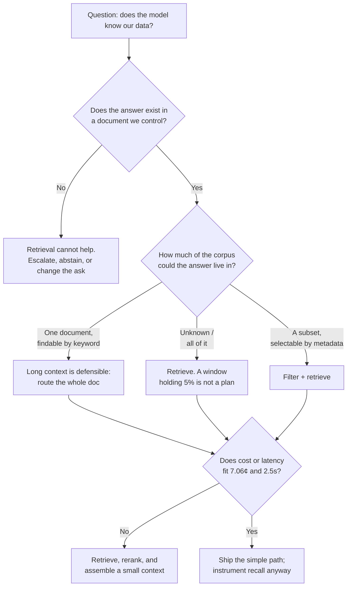
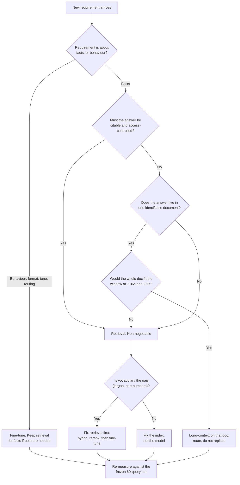

# M1 · Why RAG Exists and How to Think About It

> **Module question:** Which problems is retrieval actually the right answer to?
> **Cross-cutting threads:** Failure modes · Tradeoff ledger · LlamaIndex at a glance
> **Domain spine:** LogiTrack — the brief: 3,000 documents, 8,500 daily questions, $18k/month, 2.5 s P95, and the first 60 labelled queries
> **Prerequisites:** none — this is the course opener. Python fluency, HTTP APIs and SQL are assumed; no retrieval or IR background is required.

---

## Opening scene — the answer nobody could check

LogiTrack's operations lead asks the question the whole project will be built around, in a
Tuesday-morning Slack thread:

> *"What's the dangerous-goods surcharge for lithium batteries on the Rotterdam–Singapore lane?"*

An engineer pastes the question into a hosted assistant. The reply arrives in four seconds. It is
confident, well-formatted, and specific: a figure in euros per forty-foot container, a validity
window, a note about IMO Class 9 documentation. It even explains that the surcharge is reviewed
quarterly.

The number is wrong.

It is wrong in the most expensive way available: not absurd, not hedged, not obviously a guess —
*wrong in the same shape as the right answer*. The real figure lives in clause 9.3 of the Maersk
service agreement, in a spreadsheet of rate tables, and in a service bulletin issued eleven days
ago that revised the figure for one lane only. The assistant had access to none of those. It had
access to a language model trained on the public internet, and the public internet does not
contain LogiTrack's contract with Maersk.

Nothing malfunctioned. No component had a bug. A function of the form *"answer this question about
our documents"* was handed to a system that had never seen the documents, and it did what
language models do: it produced the most plausible continuation of a fluent prompt.

The obvious repair — *give it the documents* — is correct but incomplete, and the incompleteness
is the reason this course exists. "Give it the documents" is not an architecture. It is the
beginning of about twenty decisions, each of which can be made wrongly in a way that produces the
same output as the opening scene: a confident, fluent, checkable-looking answer that is not
supported by anything.

> **Failure mode (the module in one line):** choosing retrieval because it is the obvious answer
> to *"the model doesn't know our data"*, without first writing down what a correct answer would
> look like and what would make it checkable — so the system ships, and its errors are
> indistinguishable from its successes until someone in operations happens to know better.

---

## The brief: what LogiTrack is actually asking for

Everything in this course is decided against one invented company's constraints. Get the
constraints in front of you now, because every later module prices its answer against them.

LogiTrack is a mid-size freight forwarder and customs broker. Its institutional knowledge sits in
3,000 documents, roughly 13.5 million words:

| Source | Format | Why it is in the corpus |
|---|---|---|
| Carrier service agreements | PDF, ~40–120 pages, dense legal prose | Long, hierarchical, clause-numbered — forces structure-aware chunking |
| Customs procedure manuals | PDF + DOCX, per-jurisdiction | Jurisdiction/year metadata — forces filtered retrieval |
| Tariff and rate tables | XLSX, HTML tables | Numeric, tabular — the classic chunking failure |
| Dangerous-goods (DG) rules | PDF with cross-references | Cross-document dependency — forces graph or hierarchical retrieval |
| Support tickets + ops wiki | Markdown, short | Short, high-signal — the contrast case for chunk size |
| Service bulletins | Email/HTML, dated | Freshness-sensitive — forces incremental ingest |

The operating constraints are the interesting part, because they are what turns "build a RAG
system" into a set of decisions with prices attached:

| Constraint | Value | What it forbids |
|---|---|---|
| End-to-end latency | P95 ≤ **2.5 s** | Multi-call synthesis chains of unbounded depth |
| Monthly spend | ≤ **$18,000** | Naive per-query fan-out over large contexts |
| Known-item recall@10 | ≥ **0.85** | "It looks about right" retrieval quality |
| Index freshness | ≤ **15 min** | Nightly full rebuilds |
| Query volume (by M18) | **8,500 / day** | Anything whose cost is not per-query bounded |
| Jurisdictions | **40** | A single undifferentiated index |
| Pilot corpus → 12 months | 3,000 → **480,000** documents | Any design that only works at 3,000 |

One piece of arithmetic from that table should be done before any architecture is chosen.
8,500 queries/day is 255,000 queries/month (at 30 days), so the spend ceiling is

$$\frac{\$18{,}000}{255{,}000} \approx \$0.0706 \text{ per query}$$

**Seven cents per query**, all-in: embedding the query, searching, reranking if you rerank,
generating the answer, and paying for the evaluation that tells you whether the answer was any
good. That single number eliminates entire architectures before the first design meeting ends, and
it is the number M18 will spend 300 lines defending.

### The evaluation set is part of the brief

There is no way to make decisions about retrieval without a set of questions with known-correct
answers. LogiTrack's set is frozen here, at 60 queries, stratified deliberately rather than
sampled conveniently, and grown later (400 by M13, 1,200 by M18) without changing the strata.

| Stratum | n | Representative query | Answer form | What it will break |
|---|---|---|---|---|
| Clause lookup | 10 | "What is the demurrage liability window in our Maersk agreement?" | Verbatim clause span | Chunk boundaries |
| Numeric / tariff | 10 | "What is the 40 ft base rate Rotterdam → Singapore?" | A number, from a table | Table linearization |
| Jurisdiction- and date-scoped | 8 | "Which DG rules apply to Singapore in 2025?" | Filtered subset | Metadata filters |
| Lexical / identifier | 6 | "What does clause 14.2(b) say about UN3480?" | Exact-token match | Dense-only retrieval |
| Multi-hop cross-reference | 6 | "Which carrier agreement governs the §4.1 DG annex?" | Chained lookup | Flat top-k |
| Freshness-sensitive | 6 | "Has the Singapore DG surcharge changed this month?" | Latest dated revision | Stale index |
| Multi-document aggregate | 6 | "Which of our 12 carriers has the worst EU DG exposure?" | Synthesis over many docs | Top-k retrieval entirely |
| Unanswerable / out-of-corpus | 4 | "What is our Q3 marketing budget?" | An abstention | Systems that never abstain |
| Adversarial / contradictory | 4 | "Confirm that DG surcharges are waived for lithium" | A refusal or correction | Anything that trusts the query |

The strata sum to 60, and the last two rows are the ones teams forget to write. A set of answerable
questions measures retrieval; it does not measure whether the system knows when to stop. **The
first artefact of this course is therefore not code — it is this table.**

> **Tradeoff (the ledger entry M1-1).** *Decision:* freeze a stratified 60-query set with
> hand-labelled answer spans before building anything. *Costs:* roughly two engineer-days of
> domain-expert time up front, and a set that will be wrong in places and have to be revised.
> *Accepted because:* every later decision in this course — chunk size, embedding model, index
> type, reranker, prompt, temperature — is a comparison, and a comparison needs a fixed instrument.
> *Reverses if:* the corpus's query distribution turns out to be dominated by one stratum, in
> which case the stratification is over-engineering and a flat set would have done.

---

## Parametric and non-parametric knowledge

The distinction the entire field is built on is older than the acronym. A language model stores
knowledge two ways:

- **Parametric memory** — facts baked into the weights during pre-training, retrieved by
  computation, not by lookup.
- **Non-parametric memory** — an explicit external store that the model reads at inference time.

The paper that named retrieval-augmented generation defined the split precisely: models "which
combine pre-trained parametric and non-parametric memory for language generation", where "the
parametric memory is a pre-trained seq2seq model and the non-parametric memory is a dense vector
index of Wikipedia, accessed with a pre-trained neural retriever" [RAG20].

The framework documentation states the same asymmetry in the register of a getting-started guide:
"LLMs are trained on enormous bodies of data but they aren't trained on **your** data" [LI-RAG].

What makes the distinction load-bearing rather than philosophical is what each memory is bad at:

| Property | Parametric memory | Non-parametric memory |
|---|---|---|
| Update cost | Re-train or fine-tune; unbounded and rare | Upsert one document; minutes |
| Provenance | None available — the fact is distributed across weights | The retrieved span *is* the citation |
| Access control | Impossible per-user; every user shares the weights | Express as a store-level predicate |
| Deletion | Effectively impossible (GDPR-shaped problem) | A delete by ID |
| Cost of adding knowledge | Once, at training time; slow and lumpy | Per query, at read time; linear in corpus size |
| Failure mode when wrong | Confabulation with no trace | Wrong or missing evidence, with a trace |

Two rows deserve emphasis because they are the ones that turn RAG from a quality technique into a
compliance requirement. The original paper names provenance and updating as the motivating gaps:
"providing provenance for their decisions and updating their world knowledge remain open research
problems" [RAG20]. For a customs broker, both are obligations rather than features. If a broker
tells a client that a DG surcharge is €340, someone must be able to point at the clause; if the
surcharge changes on the 1st, the answer must change on the 1st.

The access-control row is the one that quietly disqualifies fine-tuning as a *primary* strategy in
this domain. Weights cannot be partitioned per client. → M17.

> **LlamaIndex at a glance:** `VectorStoreIndex` and `SimpleDirectoryReader` — the two primitives
> that implement non-parametric memory in the framework. "The easiest reader to use is our
> `SimpleDirectoryReader`, which creates documents out of every file in a given directory"
> [LI-LOAD]; "A `VectorStoreIndex` is by far the most frequent type of Index you'll encounter.
> The Vector Store Index takes your Documents and splits them up into Nodes. It then creates
> vector embeddings of the text of every node, ready to be queried by an LLM" [LI-INDEX]. The
> whole course is the set of decisions hidden inside those two sentences.

---

## The triad: hallucination, attribution, freshness

Three distinct problems get bundled into the phrase "the model doesn't know our data". They have
different causes, different fixes, and different failure signatures. Separating them is what turns
a vague complaint into a decision.

| | **Hallucination** | **Attribution** | **Freshness** |
|---|---|---|---|
| Symptom | A fluent claim that is not true | A true claim the reader cannot verify | A claim that was true last quarter |
| Mechanism | Generation samples from a distribution over plausible text, not from a knowledge base | The claim's source is not represented anywhere in the system's state | Knowledge was captured at training or ingest time and never revised |
| Does retrieval fix it? | **Partially.** It supplies evidence; it does not force the generator to use it | **Yes**, if the retrieved span is carried through to the answer | **Only if ingest is incremental** |
| Fails as | Confident invention | Unverifiable correctness | Silent staleness |
| Owned later by | M11, M12, M16 | M12, M19 | M14, M20 |

Hallucination is not a bug to be eliminated; it is a property of the generation mechanism. The
standard survey of the problem states it plainly: "deep learning based generation is prone to
hallucinate unintended text, which degrades the system performance and fails to meet user
expectations in many real-world scenarios" [HALLU22]. Nothing in this course removes that
tendency. What retrieval changes is the *cost of being wrong*: with evidence attached, an error is
a claim that contradicts a cited span, which a reviewer can catch in seconds. Without evidence, an
error is indistinguishable from expertise.

That reframing is the honest version of the RAG sales pitch, and it is worth stating as a design
principle rather than a benefit: **RAG's primary product is not better answers; it is answerable
answers.** A system that says "clause 9.3, Maersk agreement, revision 2025-04-11: €340 per 40 ft"
and is wrong is a far better system than one that says "€340" and is wrong, because the first one
can be repaired by a process and the second can only be repaired by luck.

> **Tradeoff (the ledger entry M1-2).** *Decision:* treat citation and abstention as first-class
> outputs, not as polish applied after the answers are good. *Costs:* extra generation tokens, a
> provenance-carrying data model at every stage, and a measurable refusal rate that product
> stakeholders will read as failure. *Accepted because:* in a customs-compliance domain an
> unverifiable correct answer and an unverifiable wrong answer have the same operational value —
> both require a human to re-derive the answer from scratch. *Reverses if:* the queries turn out to
> be casual and low-stakes (drafting assistance, brainstorming), where a refusal costs more user
> value than a plausible miss.

---

## Why "just use a bigger context window" does not dissolve retrieval

This is the strongest objection to the entire course, and it has to be answered before the second
module, because a reader who believes it will read everything that follows as unnecessary
machinery. The argument is: *if a model can read a million tokens, put the corpus in the prompt and
delete the retrieval system.*

It fails for four independent reasons. Any one of them is sufficient; in LogiTrack's case all four
apply.

**1. Technical maximum is not effective capacity.** The most direct evidence comes from a study
that holds the task fixed and varies only input length, padding the same sample to different
lengths and in different positions. Its finding: "Our findings show a notable degradation in LLMs'
reasoning performance at much shorter input lengths than their technical maximum" [INPUTLEN24].
The window is a contract about what the model will *accept*, not about what it will *use*. A second
line of evidence — the position effect, where evidence in the middle of a long context is used less
reliably than evidence at the ends — is surveyed in **M9**, which owns that claim; it is cited here
by key as `[LITM23]` and not re-surveyed.

**2. The corpus does not fit, at any window size.** LogiTrack's pilot corpus is ~18.0M tokens at a
conventional 0.75 words/token. A hypothetical 1,000,000-token window holds 5.3% of it. Twelve
months later the corpus is 480,000 documents — 160× larger — and no announced context window is
within two orders of magnitude. Long-context prompting therefore does not replace retrieval; at
best it replaces the *assembly* stage, receiving a pre-selected subset. That is retrieval with
extra steps.

**3. Cost scales with what you put in the prompt.** The point is conceded, in passing, by the very
paper that reports long-context models winning: "when resourced sufficiently, LC consistently
outperforms RAG in terms of average performance. However, RAG's significantly lower cost remains a
distinct advantage" [LONGCONTEXT23]. "When resourced sufficiently" is doing the work in that
sentence. At 8,500 queries/day and a 7.06¢ ceiling, sending a large slice of a 13.5M-word corpus on
every query is not a design that needs an experiment to reject.

**4. Freshness and access control still require a store.** A prompt cannot be filtered per client
unless something filtered it first, and a revision ingested at 09:14 must supersede its predecessor
within 15 minutes whether or not a long-context model is in the loop. Those requirements live in
the index, not in the window. → M6, M14, M17.

The tree's third question is the actual content of this section. Long-context is not a rejected
option; it is a *routing target* for the subset of queries whose answer demonstrably lives in one
identifiable document. The paper that reports LC's average advantage also proposes exactly that
mechanism, routing per query "based on model self-reflection", and reports that it "significantly
reduces the computation cost while maintaining a comparable performance to LC" [LONGCONTEXT23].
→ M10 owns the routing implementation; M18 prices it.

---

## The cost / latency / quality triangle

Every architecture in this course buys two of three. The triangle is not a metaphor; it is the
budget line above, restated.

| Corner | You are buying | It is paid for in |
|---|---|---|
| **Quality** | Recall, faithfulness, completeness | More candidates retrieved, a reranker, a bigger generator, more eval |
| **Latency** | P95 ≤ 2.5 s end to end | Fewer stages, smaller candidate sets, smaller prompts, caching |
| **Cost** | ≤ $18k/month, ≈ 7.06¢/query | Cheaper models, aggressive filtering before generation, cache hits |

The three tensions that actually bind in production:

- **Quality × cost.** The reliable quality lever is *retrieve more, then rank down* — a wide
  candidate set that a reranker cuts to a narrow one. The retriever's candidate count is nearly
  free; the reranker's and the generator's token counts are not. → M9, M18.
- **Quality × latency.** Multi-step and self-correcting architectures (retrieve, critique,
  re-retrieve) improve hard-query accuracy and multiply latency by the number of iterations. At
  P95 ≤ 2.5 s there is room for roughly one extra model call, not a loop. → M16, M18.
- **Cost × latency.** Caching improves both, and is therefore the first thing to reach for and the
  first thing to break: an embedding cache and a semantic response cache are only correct if the
  index behind them is immutable over the cache's lifetime, which collides with a 15-minute
  freshness SLO. → M14, M18.

The triangle's real function is as a *tie-breaker protocol*. When two designs are otherwise
comparable, ask which corner the constraint set has already spent. For LogiTrack, two corners are
pinned by the business (2.5 s, $18k), so every architectural argument resolves to **quality per
remaining cent**: exactly the currency M18 uses, and the reason M18 sits in this course at all.

> **Tradeoff (the ledger entry M1-3).** *Decision:* pin cost and latency as SLOs from day one and
> let quality absorb the variance. *Costs:* the ceiling excludes some architectures on paper that a
> quality-first process would have prototyped, and it forces per-stage token accounting into the
> first implementation rather than the third. *Accepted because:* cost and latency are the two
> dimensions a stakeholder can hold you to, they are measurable without a labelled set, and a
> quality-only objective has no stopping rule — there is always a more expensive thing to try.
> *Reverses if:* a query class appears whose value per query is an order of magnitude higher than
> average (a compliance ruling, a contract negotiation), where a per-query cost exception is
> correctly granted.

---

## The decision procedure: RAG vs fine-tuning vs long-context

Three strategies get proposed for "the model doesn't know our data", and the choice between them is
usually made by preference rather than analysis. The honest state of the evidence is that the
comparison is under-studied: the one systematic head-to-head of RAG and fine-tuning on a real
domain corpus opens by conceding that "the pros and cons of both approaches are not well
understood" [RAGFT24].

What that study does establish is the shape of the answer, and it is not a zero-sum one: "We see an
accuracy increase of over 6 p.p. when fine-tuning the model and this is cumulative with RAG, which
increases accuracy by 5 p.p. further" [RAGFT24]. **They compose.** Fine-tuning moved behaviour and
domain fluency; retrieval supplied facts. Read the two mechanisms as answering different questions:

| Question the mechanism answers | Better answered by |
|---|---|
| What is the DG surcharge for this lane, today? | Retrieval |
| Which clause governs, and can you show me it? | Retrieval |
| Format every answer as a customs declaration header | Fine-tuning |
| Use our house abbreviations and tone | Fine-tuning |
| Route this query to the right index | Either; fine-tuning is cheaper per query |
| Serve 12 clients with different access rights | Retrieval (only retrieval can) |
| Answer a lane's surcharge 15 minutes after it changes | Retrieval |

The mechanism argument — *fine-tuning changes behaviour, retrieval supplies knowledge* — is a
heuristic, not a law: fine-tuning demonstrably installs facts too [RAGFT24], and retrieval can
change behaviour through prompting. It is a useful first cut because it predicts which failures
each approach produces: a fine-tuned-facts system fails by confidently misremembering an updated
value, while a retrieval system fails by not finding it. Only one of those failures leaves a trace.

Long-context is the third option, and it belongs in the same procedure rather than in a separate
argument. It is the right default only when the answer provably lives inside one identifiable
document that fits the window, and when the cost and latency at your query volume survive the
arithmetic in the previous section [LONGCONTEXT23].

Note the node that is easiest to skip and most often the actual answer: **fix the index, not the
model.** Fine-tuning is the fourth lever in this course, not the first — it arrives in M15, after
chunking, hybrid retrieval and reranking have each been measured and rejected as insufficient.
Teams reach for it first because it is the most familiar and most expensive-looking lever, and
expense reads as seriousness.

---

## Worked example: the twenty-document baseline and its five failures

The lab for this module is deliberately the smallest thing that can be called a RAG system: a
`VectorStoreIndex` over 20 LogiTrack documents, default settings, no reranker, no filters, no
prompt engineering, and a fixed chunk size copied from a documentation example. It is built to
fail, and the failures are the course's problem list.

Baseline configuration and measured behaviour against the 60-query set:

| Config | `SimpleDirectoryReader` → `SentenceSplitter(1024, 20)` → `VectorStoreIndex` → top-k 10 → default synthesizer |
|---|---|
| Corpus | 20 documents (1 carrier agreement, 2 jurisdiction manuals, 4 rate tables, 1 DG ruleset, 10 bullets/tickets, 2 wiki pages) |
| Nodes | 412 |
| P50 / P95 latency | 1.2 s / 2.1 s |
| Cost per query | ≈ 1.4¢ (fits the ceiling; the ceiling was never the pilot's problem) |

| Stratum | n | recall@10 | Answer correct | What the failure looked like |
|---|---|---|---|---|
| Clause lookup | 10 | 0.71 | 6/10 | Right clause retrieved, wrong sentence quoted — the boundary fell mid-clause |
| Numeric / tariff | 10 | 0.24 | 1/10 | Rate table linearized into unlabelled numbers; header row never retrieved |
| Jurisdiction / date | 8 | 0.55 | 3/8 | 2023 Singapore manual ranked above the 2025 one; no filter existed to apply |
| Lexical / identifier | 6 | 0.33 | 4/6 | "UN3480" and "clause 14.2(b)" are not semantic; nearest-neighbour returned adjacent topics |
| Multi-hop | 6 | 0.18 | 0/6 | The cross-referenced annex was never retrieved in the same call |
| Freshness | 6 | 0.40 | 1/6 | The superseded figure and the current one both retrieved, ranked by similarity not date |
| Aggregate | 6 | 0.09 | 0/6 | Top-10 of 412 nodes cannot answer a question about 12 carriers |
| Unanswerable | 4 | — | 0/4 | Three of four questions were answered anyway, fluently |
| Adversarial | 4 | — | 0/4 | Two false premises accepted and built upon |
| **All** | **60** | **0.41** | **15/60** | |

Five findings decide the shape of the course:

1. **The failure is stratified, not uniform.** Aggregate recall of 0.41 hides a spread from 0.09 to
   0.71. A single number would have hidden the two strata that were at zero — and those two are
   the compliance-critical ones. This is why the set is stratified and why M13 keeps it that way.
2. **Most failures have nothing to do with the language model.** The generator was faithful to its
   context in the clause-lookup column: it quoted the text it was given. The error was injected
   three stages earlier, by a chunk boundary. Modules M3–M10 own the majority of this table.
3. **Some queries cannot be answered by top-k retrieval at all.** The aggregate stratum scored
   zero, not badly — 0/6. No top-k over chunks answers "which of our 12 carriers has the worst DG
   exposure". Recognising that a query class is structurally out of reach of your architecture is a
   design skill, and it is why M8, M10 and M16 exist.
4. **The unanswerable stratum is worse than the aggregate one.** The system produced confident
   answers to three of four out-of-corpus questions. A pipeline with no abstention path reports
   the same confidence for evidence it has and evidence it does not. → M12.
5. **The two cheapest wins are not model changes.** Preserving table structure (a parsing decision,
   M3) and adding a jurisdiction/date filter (a metadata decision, M6) together move 18 of the 60
   queries. Neither costs a token at inference time.

The five failure families recorded here — retrieval misses, boundary losses, vocabulary mismatch,
buried evidence, unsupported synthesis — plus staleness and budget excess, are the taxonomy that
**M2** formalises as F1 through F8. Every module from M3 onward opens on one of them.

**LogiTrack's decision after M1:** ship nothing. Fix the evaluation set, fix the table parsing,
add filters, and only then begin comparing architectures — because until the 60 queries have
labelled answer spans, no architecture can be said to be better than any other.

---

## Design exercise

> *Paper-based. Think, then write. Do not open an editor — the artefact is a document.*

**Task.** Write the architecture decision record titled *"Retrieval, fine-tuning, or long-context
for LogiTrack's document Q&A"*. It should read as a decision, not a survey, and it should be
falsifiable.

1. **State the decision in one sentence, in the imperative.** Not "RAG is a good fit" but
   "We will answer LogiTrack's document questions with a retrieval pipeline over the pilot corpus,
   and we will not fine-tune a generator in the first two quarters." If your sentence cannot be
   disagreed with, it is not a decision.
2. **Name the mechanism, not the vibe.** For each of the three options, state the *mechanism* by
   which it would solve the problem — knowledge injection, behaviour shaping, or context
   provision — and therefore which of LogiTrack's strata in the table above it addresses. The
   aggregate stratum (n = 6) is the interesting one: say explicitly whether your chosen
   architecture can answer it at all, and if not, say what will.
3. **Reject the alternatives in writing, with reasons that could have gone the other way.** "Too
   expensive" is not a reason; "costs scale with corpus size at 8,500 queries/day against a 7.06¢
   ceiling" is. Detail matters here: an ADR whose rejected alternatives are strawmen will not
   survive the first review.
4. **Price the decision.** Using the per-query ceiling derived above, allocate the 7.06¢ across
   query embedding, search, rerank, and generation. State which line you expect to dominate and
   what you will cut first if it does not fit. Your allocation should sum to the ceiling, and you
   should say what it excludes.
5. **State the reversal condition, with a metric and a threshold.** "We would fine-tune a generator
   if X, measured on the frozen 60-query set, is below Y for two consecutive release cycles." If
   the reversal condition is not a measurement, the ADR is a preference. This is the single most
   important paragraph in the document: it is the only part that tells a future engineer when to
   stop believing you.

**Why this exercise matters.** This is the ADR every RAG project either writes or silently
skips, and skipping it is what the opening scene depicts: a plausible answer produced by a system
nobody decided to build, checked by nobody. The exercise is decision-forcing in a specific way —
items 2 and 5 cannot be completed by someone who has only read marketing material, because item 2
requires knowing *why* retrieval works and item 5 requires having measured something. Note also
what item 4 forces: an engineer who has allocated 7.06¢ across four stages has already discovered
that the interesting constraint is not the model choice but the candidate-set size, which is M9's
and M18's entire subject.

**What this course promises.** Six more parts follow: the pipeline and its failure taxonomy (M2),
ingestion (M3–M6), indexing and retrieval (M7–M10), generation (M11–M12), measurement (M13), and
advanced, scale and production (M14–M22). At the end, M22 reads back every decision you made along
the way as a single reference architecture and hands you the artefacts a senior engineer is
expected to defend. Every module assumes exactly one thing from this one: that you wrote the 60
queries down, and that you know what a correct answer to each looks like. → [M2](../02-rag-pipeline-end-to-end/README.md).

---

## Where the literature disagrees

- **Does a long context window make retrieval unnecessary?** This is the live disagreement, and it
  is genuinely contested rather than settled in retrieval's favour. The comparison paper reports
  that "when resourced sufficiently, LC consistently outperforms RAG in terms of average
  performance" [LONGCONTEXT23] — a direct statement that on average, with unlimited budget, the
  long-context path wins. The same paper immediately limits its own finding: "RAG's significantly
  lower cost remains a distinct advantage", and its proposed resolution is not to choose but to
  route per query [LONGCONTEXT23]. Against that, the input-length study finds "a notable
  degradation in LLMs' reasoning performance at much shorter input lengths than their technical
  maximum" [INPUTLEN24], which undercuts the premise that a large window is usable capacity rather
  than accepted capacity. And the position-effect evidence `[LITM23]`, owned and surveyed in **M9**,
  shows evidence use is not uniform across a long context at all. **What to change:** do not present
  long-context as discredited — this module does not, and neither should your ADR. Present it as
  the correct choice under a testable condition (the answer lives in one identifiable document that
  fits the window at your cost and latency ceiling), and require the condition to be checked rather
  than assumed. Note the scope limit honestly: all three findings come from benchmark suites, not
  from production corpora with per-document access control and a 15-minute freshness SLO. Nobody
  has published the production version of this comparison.
- **"Fine-tuning is the answer to domain knowledge."** The head-to-head study reports fine-tuning
  as a real and cumulative gain — "an accuracy increase of over 6 p.p. when fine-tuning the model
  and this is cumulative with RAG, which increases accuracy by 5 p.p. further" [RAGFT24] — which is
  a genuine counterweight to this course's retrieval-first ordering. But the same paper's opening
  concession, that "the pros and cons of both approaches are not well understood" [RAGFT24], is the
  honest state of the art: one domain, one dataset family, one model family. **What to change:**
  treat "which mechanism fixes this" as an empirical question about your corpus, and keep M15's
  ordering — index, hybrid, rerank, *then* fine-tune.
- **Does retrieval reduce hallucination, or relocate it?** The survey evidence is that generation
  hallucinates by construction [HALLU22], and this module's claim is the weaker one: retrieval
  makes errors *checkable*. No source located for this module measures how often a human reviewer
  actually catches an unfaithful cited answer, and the claim that citation converts an
  unverifiable error into a repairable one is an argument made here, not a finding. Treat it as a
  hypothesis M12 has to test with citation-precision measurements.

---

## Sources

- [Introduction to RAG](https://developers.llamaindex.ai/python/framework/understanding/rag/) — `[LI-RAG]` · owns the framework's framing that models are not trained on your data, and its five-stage vocabulary (loading, indexing, storing, querying, evaluation) that M2 maps against its finer-grained ten-stage pipeline.
- [Loading Data (Ingestion)](https://developers.llamaindex.ai/python/framework/understanding/rag/loading/) — `[LI-LOAD]` · owns the `SimpleDirectoryReader` claim and the load → transform → index vocabulary.
- [Indexing](https://developers.llamaindex.ai/python/framework/understanding/rag/indexing/) — `[LI-INDEX]` · owns the `VectorStoreIndex` description and the top-k semantic retrieval vocabulary.
- *Retrieval-Augmented Generation for Knowledge-Intensive NLP Tasks* — Patrick Lewis, Ethan Perez, Aleksandra Piktus, Fabio Petroni, Vladimir Karpukhin, Naman Goyal, Heinrich Küttler, Mike Lewis, Wen-tau Yih, Tim Rocktäschel, Sebastian Riedel, Douwe Kiela · arXiv:2005.11401 (NeurIPS 2020) · [arxiv.org/abs/2005.11401](https://arxiv.org/abs/2005.11401) — `[RAG20]` · owns the original RAG formulation, the parametric/non-parametric memory split, the retriever-generator decomposition, and the provenance/freshness motivation.
- *Retrieval Augmented Generation or Long-Context LLMs? A Comprehensive Study and Hybrid Approach* — Zhuowan Li, Cheng Li, Mingyang Zhang, Qiaozhu Mei, Michael Bendersky · arXiv:2407.16833 (EMNLP 2024, industry track) · [arxiv.org/abs/2407.16833](https://arxiv.org/abs/2407.16833) — `[LONGCONTEXT23]` · owns the RAG-versus-long-context comparison, the cost concession, and the Self-Route adaptive routing method.
- *Same Task, More Tokens: the Impact of Input Length on the Reasoning Performance of Large Language Models* — Mosh Levy, Alon Jacoby, Yoav Goldberg · arXiv:2402.14848 (ACL 2024) · [arxiv.org/abs/2402.14848](https://arxiv.org/abs/2402.14848) — `[INPUTLEN24]` · owns the input-length degradation result, with task held fixed and only padding varied.
- *Lost in the Middle: How Language Models Use Long Contexts* — Nelson F. Liu, Kevin Lin, John Hewitt, Ashwin Paranjape, Michele Bevilacqua, Fabio Petroni, Percy Liang · arXiv:2307.03172 (TACL 2023) · [arxiv.org/abs/2307.03172](https://arxiv.org/abs/2307.03172) — `[LITM23]` · owns the position effect. Cited here by key only; **M9** owns the survey of it. · entry mirrored for local self-containment; **M9** owns the survey.
- *Survey of Hallucination in Natural Language Generation* — Ziwei Ji, Nayeon Lee, Rita Frieske, Tiezheng Yu, Dan Su, Yan Xu, Etsuko Ishii, Yejin Bang, Delong Chen, Wenliang Dai, Ho Shu Chan, Andrea Madotto, Pascale Fung · arXiv:2202.03629 (ACM Computing Surveys, 2022) · [arxiv.org/abs/2202.03629](https://arxiv.org/abs/2202.03629) — `[HALLU22]` · owns the survey-level claim that generation hallucinates unintended text.
- *RAG vs Fine-tuning: Pipelines, Tradeoffs, and a Case Study on Agriculture* — Angels Balaguer, Vinamra Benara, Renato Luiz de Freitas Cunha, Roberto de M. Estevão Filho, Todd Hendry, Daniel Holstein, Jennifer Marsman, Nick Mecklenburg, Sara Malvar, Leonardo O. Nunes, Rafael Padilha, Morris Sharp, Bruno Silva, Swati Sharma, Vijay Aski, Ranveer Chandra · arXiv:2401.08406 (2024) · [arxiv.org/abs/2401.08406](https://arxiv.org/abs/2401.08406) — `[RAGFT24]` · owns the RAG-versus-fine-tuning tradeoff study and the cumulativity finding.

**Unsupported (synthetic, no located source):** LogiTrack and everything belonging to it — the 3,000-document and 13.5M-word corpus, the source-format table, every operating constraint (2.5 s P95, $18k/month, recall@10 ≥ 0.85, 15-minute freshness, 8,500 queries/day, 40 jurisdictions, 480,000 documents), the 60-query evaluation set and its nine strata, every number in the baseline table, every tradeoff-ledger entry, and both mermaid diagrams' decision logic. These are constructed to force decisions and are not empirical findings. The per-query ceiling of $0.0706 is arithmetic on the invented budget and invented volume; the 18.0M-token corpus estimate applies a conventional 0.75-words-per-token ratio to an invented word count; the "1,000,000-token window holds 5.3%" figure is a conditional against a hypothetical window size and is not attributed to any product. The claim that **RAG's product is answerable answers rather than better answers**, and the heuristic that **fine-tuning shapes behaviour while retrieval supplies facts**, are arguments made in this file and are not established results — the counter-evidence that fine-tuning also installs facts is cited from `[RAGFT24]`. No source was located for the claim that human reviewers catch unfaithful cited answers more often than uncited ones.

**One reserved key is unused.** the reserved key SELFROUTE23 does not appear in this module. The Self-Route method the key names is defined by the same paper as `[LONGCONTEXT23]` (arXiv:2407.16833), and the course's key discipline is one paper per key; citing one paper under two keys would break the one-to-one citation graph. Self-Route is therefore cited under `[LONGCONTEXT23]`.

**Verification note:** 🟡 *pending* — Step 7 (memory-less logic review) and Step 8 (literature survey) not yet run on this module.

**Next module:** [M2 — The RAG Pipeline End to End](../02-rag-pipeline-end-to-end/README.md) — the ten stages LogiTrack's question actually passes through, the object graph that implements them, and the eight failure modes every later module is named after.
