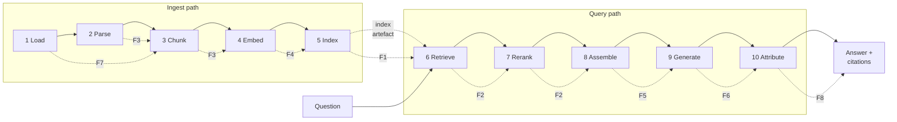
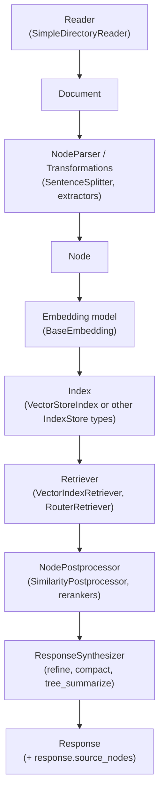

# M2 · The RAG Pipeline End to End

> **Module question:** What are the stages, and what does each one cost when it is wrong?
> **Cross-cutting threads:** Failure modes · Tradeoff ledger · LlamaIndex at a glance
> **Domain spine:** LogiTrack — one question ("What is the DG surcharge for lithium batteries on the Rotterdam–Singapore lane?") walked through all ten stages
> **Prerequisites:** [M1 — Why RAG Exists and How to Think About It](../01-why-rag-exists/README.md)

---

## Opening scene — the question that died in stage four

The M1 baseline is running. LogiTrack's 60-query set is frozen, the pilot corpus is indexed, and the
ops team has started asking the question the project exists for, in the exact words a customs
broker would use:

> *"What is the DG surcharge for lithium batteries on the Rotterdam–Singapore lane?"*

The system returns a confident, well-cited answer. It cites the tariff rate table for the
Rotterdam–Singapore lane, forty-foot container, and quotes the surcharge column: **€0**. It is the
correct cell. It is the correct table. It is the wrong answer.

The surcharge for lithium batteries is carried in a different column of the same table — a
dangerous-goods column keyed on the UN number of the shipment, not on the commodity name. The query
said "lithium batteries." The corpus says **"UN3480"**, **"UN3481"**, and in two places
**"lithium-ion cells, Class 9"**. Not one document in LogiTrack's corpus contains the phrase
"lithium batteries" in a rate context.

So the embedding for the query landed in the right neighbourhood — lane, container size, surcharge
column — and the retriever returned a table row that was genuinely about Rotterdam–Singapore,
genuinely about a surcharge, and genuinely zero. Every stage worked. The pipeline was correct at
nine of ten hops and the answer was wrong.

This is the failure that motivates naming the stages. The engineer debugging it has four plausible
suspects — the retriever, the embedding model, the chunker, the prompt — and no way to choose
between them, because the pipeline is a chain of library calls that were never given names. Each
suspect implies a different, expensive remedy: swap the embedding model, re-chunk the corpus,
rewrite the prompt, or add a reranker. Guessing correctly costs a week; guessing wrong costs a
quarter.

The remedy is not a better component. It is a **named hop** for every transformation between the
question and the answer, with a defined input, a defined output artefact, and a defined way for
that hop to be wrong. Once the hops have names, "the retrieval is bad" becomes one of eight
specific claims, each with a different owner, a different fix, and a different price.

> **Failure mode (the module in one line):** running an unnamed pipeline — a chain of library calls
> with no per-stage contract and no per-stage instrumentation — so a wrong answer is unattributable,
> every fix is a guess, and the cheapest correct fix is never the one that gets tried.

---

## The ten stages

The course uses ten stages. The framework documents five (`loading`, `indexing`, `storing`,
`querying`, `evaluation`) [LI-RAG]; the ten-stage decomposition is finer-grained because it has to
be *debuggable*, and "querying" is where six of the eight failure modes live. The mapping is given
below so the two vocabularies never have to be reconciled twice.

| # | Stage | Input | Output artefact | Cost driver | Ingest or query path |
|---|---|---|---|---|---|
| 1 | **Load** | Files, APIs, mailboxes | `Document` objects with raw text + source metadata | Bytes moved; parser CPU | Ingest |
| 2 | **Parse** | `Document` (raw text) | Structured text: headings, clauses, tables, reading order | Parser quality and CPU time | Ingest |
| 3 | **Chunk** | Structured text | `Node` objects with text + metadata + relationships | Node count; embedding volume | Ingest |
| 4 | **Embed** | `Node` text | A dense vector per node | Tokens embedded; dimension; API calls | Ingest |
| 5 | **Index** | Vectors + nodes + metadata | A searchable structure (vector store, sparse index, graph) | Index memory; build time | Ingest |
| 6 | **Retrieve** | Query + index | A candidate set of scored nodes | ANN search cost; `top_k` | Query |
| 7 | **Rerank** | Query + candidate set | A narrower, better-ordered set | Cross-encoder or LLM calls | Query |
| 8 | **Assemble** | Ordered node set + prompt template | The final context string placed in the prompt | Tokens in; ordering | Query |
| 9 | **Generate** | Prompt + context | Answer text, plus whatever provenance survives | Tokens in and out; model choice | Query |
| 10 | **Attribute** | Answer text + source nodes | Citations, confidence, or an abstention | Post-processing tokens or a second call | Query |

Read the dotted lines as *where the failure is injected*, not where it is detected. Every one of
those labels is defined in the taxonomy below, and the asymmetry between injection and detection
is the reason module M19 exists.

### The two paths are not symmetric

The ingest path runs once per document revision (thousands of times a month at pilot scale,
hundreds of thousands at scale). The query path runs 8,500 times a day.

| | Ingest path (stages 1–5) | Query path (stages 6–10) |
|---|---|---|
| Frequency | Per document revision | Per user question |
| Budget shape | Bulk, batchable, latency-tolerant | Per-query, must fit 2.5 s P95 |
| Cost of a mistake | Every future query touching that document | One answer |
| Detection lag | Until a query happens to need that document | Immediate, if instrumented |
| Reversibility | Expensive (re-embed the corpus) | Cheap (retry with a different `top_k`) |

The asymmetry has a design consequence worth stating early, because it inverts most engineers'
intuition: **a mistake on the ingest path is more expensive than a mistake on the query path, and it
is invisible for much longer.** The opening scene's broken query was caused by a stage-2/3 decision
(word forms that never appear in the corpus) made weeks before anyone asked that question. Cheap
query-path experiments are what you do; expensive ingest-path decisions are what you get right the
first time or pay to redo. → M3, M14.

> **LlamaIndex at a glance:** the ten stages are not an abstraction imposed on the framework — they
> are its own decomposition. Loading is `SimpleDirectoryReader` or any reader producing `Document`
> objects [LI-LOAD]; chunking happens through `Transformations` in an `IngestionPipeline`, where
> "each node+transformation pair is cached" [LI-TRANS]; indexing builds an `Index` over `Node`
> objects, with `VectorStoreIndex` as the dense default [LI-INDEX]; retrieval returns
> `NodeWithScore` from a `Retriever`; postprocessing is a `BaseNodePostprocessor` applied "after the
> node retrieval step and before the response synthesis step" [LI-NPP]; and synthesis is a
> `ResponseSynthesizer` [LI-QRY]. Read the ten stages as a map of the framework's own seams, which is
> why a failure at `F4` is a defect in an embedding model rather than in "the RAG system."

---

## The LlamaIndex object graph

Each stage above corresponds to a concrete object in the framework. The correspondence is the whole
reason this course uses one stack: the abstraction boundaries in the library *are* the stage
boundaries in the pipeline, which means "which stage failed?" has a mechanical answer at runtime.

| Stage | LlamaIndex object | Verified behaviour |
|---|---|---|
| 1 Load | `SimpleDirectoryReader` / any `Reader` | "creates documents out of every file in a given directory" [LI-LOAD] |
| 2–3 Parse + Chunk | `NodeParser` classes and other `Transformation` objects | Transformations take nodes in and return nodes out, and can be stacked and reordered [LI-LOAD]; a custom transformation is any subclass of the transformation base class [LI-TRANS] |
| 4 Embed | The configured embedding model | The indexing stage "usually involves generating `vector embeddings`" [LI-RAG] |
| 5 Index | `VectorStoreIndex` (or `SummaryIndex`, graph and other index types) | "takes your Documents and splits them up into Nodes. It then creates vector embeddings of the text of every node, ready to be queried by an LLM" [LI-INDEX] |
| 6 Retrieve | Retriever, e.g. `VectorIndexRetriever(index=..., similarity_top_k=10)` | Retrieval "is when you find and return the most relevant documents for your query from your `Index`"; top-k semantic retrieval is the most common form [LI-QRY] |
| 7 Rerank / filter | `NodePostprocessor`, e.g. `SimilarityPostprocessor(similarity_cutoff=0.7)` | Postprocessing is when retrieved nodes "are optionally reranked, transformed, or filtered" [LI-QRY]; postprocessors run after retrieval and before response synthesis [LI-NPP] |
| 8–9 Assemble + Generate | `ResponseSynthesizer` via `get_response_synthesizer(...)` and `RetrieverQueryEngine` | Response synthesis is "when your query, your most-relevant data and your prompt are combined and sent to your LLM"; the documented modes include `default`, `compact`, `tree_summarize`, `no_text` and `accumulate` [LI-QRY] |
| 10 Attribute | `response.source_nodes` | The `no_text` mode "only runs the retriever to fetch the nodes that would have been sent to the LLM... Then can be inspected by checking `response.source_nodes`" [LI-QRY] |

Two properties of this object graph matter more than the class names.

**Documents and nodes are the same kind of thing at different granularities.** A `Document` is "a
generic container around any data source"; a `Node` "represents a 'chunk' of a source Document"; and
"by default every Node derived from a Document will inherit the same metadata from that Document"
[LI-DN]. That inheritance rule is why document-level metadata — jurisdiction, client, date —
survives chunking at all, and therefore why filtered retrieval (→ M6) and permissioned retrieval
(→ M17) are possible without re-deriving provenance at query time.

**The pipeline is a composition, not a monolith.** `RetrieverQueryEngine` exists so that a retriever
and a synthesizer can be selected independently, with an optional list of postprocessors between
them [LI-QRY]. That seam is what makes stage-by-stage substitution — the only way to attribute a
failure — a configuration change rather than a rewrite.

> **Tradeoff (the ledger entry M2-1).** *Decision:* pin the pipeline's stage boundaries to the
> framework's abstraction boundaries. *Costs:* the framework's seams constrain where a stage can be
> replaced, and a stage that wants to span two objects (a query-understanding step that rewrites
> and then routes, → M10) has to be built inside one of them. *Accepted because:* the alternative —
> a bespoke pipeline whose stages are chained function calls — makes every failure unattributable
> and every component unswappable, which is exactly the opening scene. *Reverses if:* a stage's
> best implementation genuinely does not fit any seam, at which point the right move is a custom
> component that keeps the interface (a custom transformation or postprocessor) rather than an
> off-graph function.

---

## F1–F8: the failure taxonomy

This is the course's connective tissue. Every module from M3 onward opens on one of these failures,
M22 reads the mitigations back as an architecture, and every incident in M20 is triaged into one of
these IDs. The table is the canonical definition; later modules reference the IDs and do not
redefine them.

| ID | Failure mode | Owned by | In the ten-stage pipeline, that is | Mechanism | Mitigated by | First measurable in |
|---|---|---|---|---|---|---|
| **F1** | **Retrieval miss** — the answer existed in the corpus and was never retrieved | retrieve | stages 5–6 (index + ANN search) | The relevant node is outside `top_k`, or absent from the index entirely | M3, M7, M8, M10 | recall@k on the golden set |
| **F2** | **Retrieval noise** — the right chunk was buried under plausible wrong ones | rank | stages 6–7 (search order + rerank) | Similarity is not relevance: near-duplicate, boilerplate, or topically adjacent nodes outrank the answer | M9, M10 | precision@k, nDCG@k, and the position of the first relevant node |
| **F3** | **Chunk-boundary loss** — the answer was split across two chunks | chunk | stages 2–3 (parse + chunk) | The unit of retrieval is smaller than the unit of meaning; the generator completes an amputated thought | M3, M8 | answer completeness scored on span-level ground truth |
| **F4** | **Representation mismatch** — user vocabulary and corpus vocabulary never met | embed | stage 4 (embedding) | "lithium batteries" and "UN3480" are semantically close to a human and far apart in vector space, or the query and passage are embedded with mismatched prefixes/asymmetry | M4, M7, M15 | recall on the lexical stratum specifically |
| **F5** | **Context overflow** — evidence was retrieved, then truncated or lost mid-prompt | assemble | stage 8 (assembly) | The assembled context exceeds the window, or the "lost in the middle" position effect buries the answer in the middle of a long context | M11, M18 | faithfulness as a function of context length and answer position |
| **F6** | **Unfaithful synthesis** — a fluent answer not supported by the retrieved evidence | generate | stages 9–10 (generate + attribute) | The generator falls back on parametric memory, or over-generalizes from a partial span, and nothing checks the claim against the context | M11, M12, M16 | faithfulness and citation precision per answer |
| **F7** | **Staleness** — index and corpus diverged | ingest | stages 1–5 (the ingest path) | A revision was not ingested, an ingest failed silently, or the index was rebuilt from a stale source | M14, M20 | index-to-source freshness audit; the age distribution of retrieved nodes |
| **F8** | **Budget blowout** — cost or latency exceeded its ceiling | every stage | all ten | A per-stage choice that is individually defensible and collectively unaffordable at 8,500 queries/day | M18, M19 | per-stage p95 latency and per-stage token spend |

Three properties of this taxonomy are load-bearing, and each is a claim you can check against your
own traces.

**The IDs are disjoint by *stage*, not by *symptom*.** "The answer was wrong" is nine different
diagnoses (F1–F7, plus a correct-answer-that-looked-wrong from F8's degraded mode). The taxonomy's
value is that it converts one symptom into one owning stage, and therefore into one owner and one
class of fix.

**The ordering is the order of the pipeline, and therefore the order of diagnosis.** Debug in
ascending ID order. If a stage-3 boundary severed the answer, no amount of work on stage 6 will
recover it, and a retrieval-quality metric computed against severed chunks will look *fine* while
the answers are wrong — which is precisely the M3 opening scene.

**F8 is the tax on every other mitigation.** Each fix for F1–F7 costs tokens or milliseconds:
wider candidate sets (F1), a reranker (F2), overlapping or hierarchical chunks (F3), a
domain-fine-tuned embedder (F4), a bigger context (F5), a second model call to check faithfulness
(F6), incremental ingest (F7). F8 is not a peer of the others; it is the constraint that makes the
others a negotiation. → M18.

### The taxonomy as a triage index

The one-line version, in the form you will use during an incident:

| What you observe | Which failure | Where to look first |
|---|---|---|
| The answer is absent and no node in the retrieved set contains it | F1 | Query embedding, then the index — does the node *exist*? |
| The right node is retrieved at rank 7–10 and the answer used rank 1 | F2 | Ranking and reranking; check for near-duplicates from overlap |
| The answer is half a sentence, and the other half is at rank 9 | F3 | Chunking and context expansion |
| The answer is absent for jargon, part numbers, or clause IDs, but present for plain-language paraphrases | F4 | Embedding model and query/passage symmetry; try a lexical retriever |
| The retrieved set is right and the answer quotes the wrong number from it | F5 or F6 | Truncation and ordering first (F5); then check the claim against the span (F6) |
| The answer cites a document whose content has changed | F7 | Ingest lineage: `ref_doc_id`, document hash, ingest logs |
| Everything is correct and the query costs 40 cents / takes 9 seconds | F8 | Per-stage latency and token attribution |

### F9 and F10: the taxonomy is open

Two additions arrive later in the course, and both are **extensions rather than retrofits** — the
taxonomy is explicitly open, and later modules add to it in place rather than renumbering.

- **F9 · Poisoned context** — content *within* the trust boundary carrying instructions intended to
  be executed. F9 is not a retrieval-quality failure at all: the retrieval was correct, the document
  was in the corpus, and the corpus contained an attacker's instruction. Defined and owned by
  **M21**, which also explains why none of F1–F8's mitigations touch it.
- **F10 · Scope leak** — evidence retrieved across a boundary the user is not permitted to cross.
  Owned by **M17**. F10 is the failure that makes the post-retrieval authorization filter
  non-negotiable, and it is the one failure mode whose cost is measured in breaches rather than in
  bad answers.

Both are placed after F8 rather than interleaved because their mitigations are orthogonal to the
pipeline-quality ladder: hardening F1–F8 does not reduce F9, and improving F9 does not reduce F10.

---

## Where evaluation attaches

Evaluation is not stage 11; it is a second, parallel pipeline that observes each stage. The design
question per stage is *what artefact do I keep so that this hop can be scored later?* — which is a
data-model decision, not a metrics decision.

| Stage | What must be retained | Metric that attaches | Module |
|---|---|---|---|
| 2–3 Parse + Chunk | Character offsets from node span back to source document | Answer completeness against span-level ground truth | M3 |
| 4 Embed | The embedding model ID and version on every node | Retrieval metrics after a model swap | M4, M15 |
| 5 Index | Node → document lineage (`ref_doc_id`) and ingest timestamps | Freshness audit; recall on a per-source basis | M14 |
| 6 Retrieve | The full candidate set with scores, not only the top-k that survived | recall@k, MRR | M7, M13 |
| 7 Rerank | Post-rerank order and the pre-rerank order | nDCG@k before/after; latency delta | M9 |
| 8 Assemble | The exact context string sent, in order | Faithfulness versus context length; position effects | M11 |
| 9 Generate | Prompt, model ID, temperature, token counts | Faithfulness, answer relevance | M11, M13 |
| 10 Attribute | Cited spans resolved to node IDs | Citation precision and recall | M12 |

The reference tooling for the generation-side metrics is a named system with a paper behind it —
RAGAS, cited here by key as `[RAGAS23]` — and **M13** owns the survey of it, along with the
framework's own evaluators and the LLM-as-judge biases that make all of these numbers softer than
they look. The only point that belongs in M2 is structural: **a metric with no retained artefact is
uncomputable after the fact.** Retaining the candidate set and the assembled context costs storage
and looks like hoarding until the first incident, at which point it is the only thing that turns
"retrieval seems worse" into a number.

> **Tradeoff (the ledger entry M2-2).** *Decision:* retain the full per-query trace — candidate set
> with scores, post-rerank order, assembled context, prompt, model version, token counts — for every
> production query. *Costs:* storage proportional to query volume, a privacy surface (the traces
> contain retrieved client documents), and a retention policy someone has to own. *Accepted
> because:* the difference between diagnosable and undiagnosable is exactly this log, and the
> alternative is reproducing a failure you cannot reproduce. *Reverses if:* retention cost or
> residency obligations (→ M17) forbid storing context, in which case retain spans, scores and
> hashes only and accept that faithfulness cannot be re-scored retroactively.

---

## Worked example: one question, ten stages

LogiTrack's question — *"What is the DG surcharge for lithium batteries on the Rotterdam–Singapore
lane?"* — traced hop by hop, with the artefact at each hop and the failure that hop injects.

| # | Stage | Artefact for this query | Injected failure | What the trace shows |
|---|---|---|---|---|
| 1 | Load | The Maersk service agreement PDF, the Rotterdam–Singapore rate table XLSX, 4 service bulletins | F7 | The April bulletin arrives in a shared mailbox and is not on any ingest watch list; it is not loaded at all |
| 2 | Parse | The XLSX linearized to rows; the DG column header on row 3 of a two-sheet workbook | F3 | Header row is a real risk: the surcharge column is identifiable only if the parser preserved row 3's labels |
| 3 | Chunk | 41 nodes from the rate table; the surcharge column split from its UN-number key column | F3 | The chunk that will be retrieved contains the surcharge values but not the UN numbers that disambiguate them |
| 4 | Embed | Query vector for "lithium batteries" | F4 | Nearest neighbours are the commodity-rate rows — lane and container match, DG semantics do not, because the corpus says "UN3480" |
| 5 | Index | 412 nodes in a flat vector index, no metadata filtering enabled | F1, F7 | No date or jurisdiction predicate exists, so a query cannot exclude the superseded rate |
| 6 | Retrieve | Top-10: 6 rate-table rows, 2 unrelated DG prose chunks, 2 wiki pages | F1, F4 | The correct UN3480 row is at rank 14 — outside the cut, and unreachable |
| 7 | Rerank | Pass-through. No node postprocessors configured | F2 | The €0 commodity row stays at rank 1 with a high similarity score |
| 8 | Assemble | 10 nodes, ~7,900 tokens, correct node positioned 6th of 10 | F5 | The strongest candidate is mid-context, not at an end |
| 9 | Generate | Answer: "€0 per 40 ft container" | F6 | The claim is faithful to the context it was given; the context did not contain the answer |
| 10 | Attribute | Citation to the rate-table node, correctly resolved | F6 | The citation is *accurate and misleading* — it proves the number was in the context, not that it applies |

Read the last two rows together, because they are the most important thing in this module. Stages 9
and 10 both worked: the generator was faithful, and the attribution was correct. The system produced
a **verifiable, wrong** answer — the worst of the available outcomes, because a reviewer checking
the citation finds the number, confirms it, and signs off.

Then read stages 2–6 as a causal chain: one parse-level omission (the UN-number key column) and one
vocabulary gap ("lithium batteries" vs "UN3480") combined to place the only correct node at rank 14.
The fix is not a better generator, and it is not a reranker — a reranker over a candidate set that
does not contain the answer can only reorder the candidates it has.

**LogiTrack's instrumentation decision after M2:** three stages get instrumented first, and the
choice is not arbitrary. **Stage 6 (retrieve)** because a candidate-set log is the only way to
distinguish F1 from F2 — if the answer is in the candidate set, the bug is downstream. **Stage 3
(chunk)** because F3 is invisible from every other stage: the retriever did its job and the generator
did its job. **Stage 5 (index)** because F7 and F1 look identical from the query path, and the only
way to tell them apart is lineage — does the node exist, and is it current? Stages 8 and 9 come
second: they are where F5 and F6 show, and both are cheaper to instrument once the artefact list
above exists.

---

## Design exercise

> *Paper-based. Produce a schema and a marked-up diagram, not prose.*

**Task.** Draw LogiTrack's pipeline as a schema — ten boxes, each with a typed input and output —
and annotate it so that it can be used as an incident runbook.

1. **Give each stage a contract, not a name.** For every stage: input type, output type, and the
   one invariant that stage guarantees to the next. "Parse: raw text → structured text, guaranteeing
   that every table cell retains its row and column labels" is a contract. "Parse" is a label. A
   stage whose contract you cannot state is a stage you cannot test.
2. **Annotate each stage with its failure mode and its owner.** Use F1–F8 by ID, and note that some
   stages can inject more than one failure and some failures can be injected by more than one stage
   (F1 comes from both chunking and indexing; F7 is an ingest-path failure that *presents* as a
   retrieval failure). Where a stage can inject two, state which is more likely in your corpus and
   why.
3. **Mark the three stages you instrument first, and defend the choice.** Your defence must be in
   terms of *disambiguation*, not importance: an instrumented stage earns its place by separating
   two failure IDs that are otherwise indistinguishable from the outside. Say which pairs it
   separates.
4. **Name the artefact each instrumented stage must retain, and its cardinality.** Per query? Per
   node? Per document revision? Retention cardinality is what decides whether this is feasible: a
   candidate-set log at 8,500 queries/day is a different object from a per-node lineage table at
   480,000 documents.
5. **State one stage you will deliberately leave uninstrumented, and the risk you are accepting.**
   An instrumentation plan with no exclusions is a plan nobody will implement. Naming the exclusion
   makes the accepted risk explicit, which is what a reviewer needs in order to disagree with you.

**Why this exercise matters.** This is the artefact a senior engineer produces in the first week of
a RAG project and almost never revisits, which is why most teams cannot answer "which stage is
failing?" without a two-day investigation. The exercise is decision-forcing in a specific way: item
3 cannot be completed by ranking stages by how often they appear in the literature, because the right
criterion is *which observational ambiguity this instrumentation resolves*. Item 5 cannot be
completed at all without a view about the corpus — you must know which stage is unlikely to be your
problem before you can say what you are willing to leave dark.

---

## Where the literature disagrees

- **Should the retriever and the generator be trained together, or composed as frozen
  components?** This course composes them, and the framework's object graph is built for
  composition [LI-QRY]. The original RAG formulation did the opposite: it jointly fine-tunes a
  pre-trained retriever with a pre-trained seq2seq generator, comparing two formulations, one
  conditioning "on the same retrieved passages across the whole generated sequence, the other [able
  to] use different passages per token" [RAG20]. That is not a detail — it is a claim that the
  retriever should be *optimized for the generator*, which no amount of prompt engineering
  reproduces. Modern practice resolves this by freezing both and tuning the join, which is
  cheaper and debuggable but leaves the joint-training gain on the table. **What to change:** if
  your pipeline plateaus on F1/F4 after M7, M9 and M15 have all been tried, the disagreement is
  empirical for your corpus, and the experiment is a retrieval-side fine-tune measured against the
  same 60 queries — not an architecture rewrite.
- **Is "evaluation" a stage of RAG or a stage after RAG?** The framework lists it as one of five
  stages alongside loading and indexing [LI-RAG], which reads as *part of the pipeline*. This course
  treats it as a parallel observer: a second pipeline that must retain artefacts from every stage to
  be computable at all, and whose metrics are owned by dedicated modules (M13, M19, M20). The
  difference is not cosmetic — if evaluation is a stage, it runs after generation and can only score
  the final answer; if it is a parallel observer, it scores each hop and can localize a failure. The
  framework's own evaluation entry point takes a query and a response, which is the former.
  **What to change:** instrument for per-hop scoring regardless of where your tooling puts the
  boundary; the taxonomy above is only usable if your traces are per-stage.
- **Are eight failure modes the right count?** No source located for this module proposes an
  eight-way RAG failure taxonomy, and this one is constructed for this course rather than derived
  from a published decomposition. Its closest published relatives decompose the *system* rather than
  the *failures* — modular RAG as a reconfigurable pipeline of named modules, cited by key as
  `[MODRAG24]` and surveyed in **M16** — which is a different cut of the same system. Treat F1–F8 as
  a debugging instrument that has to earn its keep on your traces: if two IDs never separate in
  practice, merge them; if one ID keeps splitting into two with different fixes, split it. That is
  exactly what M21 and M17 do when they add F9 and F10.

---

## Sources

- [Introduction to RAG](https://developers.llamaindex.ai/python/framework/understanding/rag/) — `[LI-RAG]` · owns the five-stage framework vocabulary and the load → index → store → query → evaluate sequence that this module's ten stages refine.
- [Loading Data (Ingestion)](https://developers.llamaindex.ai/python/framework/understanding/rag/loading/) — `[LI-LOAD]` · owns `SimpleDirectoryReader`, the `Document` container, and the statement that transformations take nodes in and return nodes out and can be stacked and reordered.
- [Indexing](https://developers.llamaindex.ai/python/framework/understanding/rag/indexing/) — `[LI-INDEX]` · owns the `VectorStoreIndex` description, embedding generation, and top-k semantic retrieval.
- [Querying](https://developers.llamaindex.ai/python/framework/understanding/rag/querying/) — `[LI-QRY]` · owns the retrieval / postprocessing / response-synthesis decomposition, `VectorIndexRetriever(similarity_top_k=...)`, `RetrieverQueryEngine`, the response modes, and `response.source_nodes`.
- [Documents / Nodes](https://developers.llamaindex.ai/python/framework/module_guides/loading/documents_and_nodes/) — `[LI-DN]` · owns the `Document` and `Node` definitions and the metadata-inheritance rule from document to node.
- [Node Postprocessor](https://developers.llamaindex.ai/python/framework/module_guides/querying/node_postprocessors/) — `[LI-NPP]` · owns where postprocessors sit (after retrieval, before synthesis), `SimilarityPostprocessor(similarity_cutoff=...)`, and the custom-postprocessor interface.
- [Transformations](https://developers.llamaindex.ai/python/framework/module_guides/loading/ingestion_pipeline/transformations/) — `[LI-TRANS]` · owns the transformation interface and the fact that custom transformations are written by subclassing the transformation base class.
- *Retrieval-Augmented Generation for Knowledge-Intensive NLP Tasks* — Patrick Lewis, Ethan Perez, Aleksandra Piktus, Fabio Petroni, Vladimir Karpukhin, Naman Goyal, Heinrich Küttler, Mike Lewis, Wen-tau Yih, Tim Rocktäschel, Sebastian Riedel, Douwe Kiela · arXiv:2005.11401 (NeurIPS 2020) · [arxiv.org/abs/2005.11401](https://arxiv.org/abs/2005.11401) — `[RAG20]` · owns the retriever-generator split and the joint training of both components. Cited here for the training-regime disagreement; the full survey of the formulation lives in **M1**. · entry mirrored for local self-containment; **M1** owns the survey.
- *Ragas: Automated Evaluation of Retrieval Augmented Generation* — Shahul Es, Jithin James, Luis Espinosa-Anke, Steven Schockaert · arXiv:2309.15217 (2023) · [arxiv.org/abs/2309.15217](https://arxiv.org/abs/2309.15217) — `[RAGAS23]` · owns the reference-free RAG evaluation framework and its metric family. Cited here by key only; **M13** owns the survey. · entry mirrored for local self-containment; **M13** owns the survey.
- *Modular RAG: Transforming RAG Systems into LEGO-like Reconfigurable Frameworks* — Yunfan Gao, Yun Xiong, Meng Wang, Haofen Wang · arXiv:2407.21059 (2024) · [arxiv.org/abs/2407.21059](https://arxiv.org/abs/2407.21059) — `[MODRAG24]` · owns the modular RAG decomposition. Cited here by key only; **M16** owns the survey. · entry mirrored for local self-containment; **M16** owns the survey.

**Unsupported (synthetic, no located source):** the LogiTrack question and its trace through the ten
stages, the €0 answer, the corpus's word choices ("UN3480", "lithium batteries"), the node counts,
rank positions, token counts and latency figures, the eight-failure taxonomy's framing as *the*
taxonomy for this course, and every tradeoff-ledger entry. The taxonomy's contents mirror the
course blueprint's own table rather than any published decomposition; it is an instrument, not a
finding. The claim that F8 is a *tax on* the other mitigations rather than a peer failure mode is an
argument made in this file. No source located for this module proposes an eight-way RAG failure
taxonomy, and none was sought beyond the modular-RAG decomposition cited above.

**Verification note:** 🟡 *pending* — Step 7 (memory-less logic review) and Step 8 (literature survey) not yet run on this module.

**Next module:** [M3 — Corpus Acquisition, Parsing, and the Chunking Decision](../03-parsing-and-chunking/README.md) — stage 2 and 3 in detail: the decisions that sever meaning before any other stage can be blamed for losing it.
