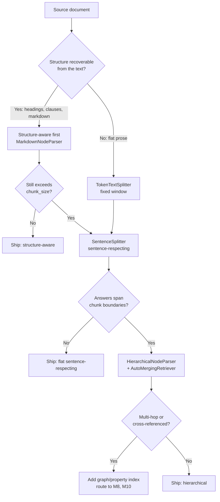

# M3 · Corpus Acquisition, Parsing, and the Chunking Decision

> **Module question:** How do you cut a document into retrievable units without destroying meaning?
> **Cross-cutting threads:** Failure modes · Tradeoff ledger · LlamaIndex at a glance
> **Domain spine:** LogiTrack — the carrier service agreements (PDF) and the tariff rate tables (XLSX)
> **Prerequisites:** [M1 — Why RAG Exists](../01-why-rag-exists/README.md) (it freezes the
> 60-query set this module measures against) · [M2 — The RAG Pipeline End to End](../02-rag-pipeline-end-to-end/README.md)

---

## Opening scene — the clause that got cut in half

LogiTrack's pilot ships in week three, over a random 2,300-document sample of the 3,000-document
corpus — 10.3M words, chunked at the doc example's `chunk_size=1024, chunk_overlap=20` into about
**15,000 nodes**. It is, by every dashboard measure, working: P95 latency 1.4 seconds, spend $340
that week. The ops team stops asking whether retrieval works and starts using it.

Then a customs broker asks the question the whole project exists for: *"What is the demurrage
liability window in our Maersk agreement?"* The system answers confidently — and names the wrong
number. Not hallucinated. Cited. It points at the actual clause, and the number in the answer is
genuinely present in the cited text.

The operative clause is two sentences long, and reads: **"Demurrage liability shall accrue from
the fourth (4th) calendar day following discharge. Free time shall be sixteen (16) calendar days,
and the liability window shall be extinguished on the fourteenth (14th) calendar day, after which
the carrier's liability for delay shall cease."**

The chunk boundary falls immediately before "Free time shall be sixteen (16) calendar days." The
retriever returned the first chunk, containing accrual at day 4 and extinction at day 14 — so the
generator computed a liability window of **eleven days** (days 4 through 14 inclusive). The
correct answer, which the boundary severed, is that free time runs to **day 16**, so the liability
window is **sixteen days**. The generator invented nothing: it answered faithfully from the half
it was given, and eleven days is the arithmetically correct reading of that half. The second chunk
was in the index, ranked 9th, below the `top_k = 6` this pilot was configured with — which is why
the course's evaluation convention is recall@10 rather than recall@6, and why a rank-9 chunk is a
miss here but would be a hit under the harness the course goes on to build.

Nobody wrote a bug. No component misbehaved. The parse was clean, the embedding was correct, the
similarity score was high, the generation was faithful **to the context it was given**. One
decision made in week one — `chunk_size=1024, chunk_overlap=20`, copied from a doc example —
destroyed the meaning, and every downstream stage then worked perfectly on the wreckage.

> **Failure mode (the module in one line):** treating chunking as a preprocessing detail rather
> than as **the design decision that defines what "a unit of meaning" means for your entire
> system** — so the retriever can only ever return fragments, and the generator faithfully
> completes the thought the fragment started.

---

## Chunking is a budget, not a parameter

Every chunking decision spends from one budget and charges another. Three quantities are in
tension, and no single *chunk size* maximizes all three:

| Quantity | What it measures | Pushed up by |
|---|---|---|
| **Retrieval precision** | Fraction of retrieved chunks that are relevant | Smaller chunks |
| **Retrieval recall** | Fraction of relevant items that were retrieved | Smaller chunks, each more focused — *but only when each item is shorter than the chunk*; see the caveat below |
| **Answer completeness** | Whether the retrieved context contains the *whole* answer | Larger chunks, or context expansion at query time |

The honest form of this table has two caveats, both of which the worked example later proves.
First, the recall row assumes the unit being retrieved is *smaller* than the chunk. When the
relevant unit is a whole table row group or a long clause, shrinking the chunk starts to cut the
unit apart and recall falls again — which is why recall is not monotone in chunk size. Second,
the three-way tension applies to **a single chunk size doing one job**. It does not say the
tension is unavoidable: hierarchical and sentence-window parsing sidestep it by embedding small
units and expanding them at generation time, which is why the winning row of the results table
scores well on both recall and completeness at once. The real tradeoff those configurations
substitute is **index size** for granularity — a different budget, paid in memory rather than in
quality.

Smaller chunks improve the embedder's job. An embedding is a single fixed-size vector, so the
more distinct ideas a chunk contains, the more the vector is an average of them — an effect the
late-chunking authors describe as semantics being "over-compressed in the embeddings" [G24].
A 200-token chunk about demurrage embeds *as* demurrage. A 2,000-token chunk covering demurrage,
fuel surcharges, and jurisdiction produces a vector that is a blur of all three and matches a
query about any of them only weakly.

But smaller chunks cut the other way. The unit that was retrieved is the unit the generator sees
(minus whatever the assembler adds, → M11). If the answer spans a boundary, a small chunk
guarantees incompleteness. This is **F3 · chunk-boundary loss**, and the opening scene is its
canonical instance.

The opening scene is a *completeness* failure — the answer was retrieved and the generator still
got it wrong, because the retrieved unit was half a clause. The instinctive fix is to enlarge the
chunk, and that fix is wrong, for a reason worth stating precisely. Enlarging the chunk repairs
completeness by making retrieval worse: a bigger chunk blurs its embedding across more ideas, and
the clause that now fits in one node competes with more unrelated text for the same top-k slots.
So the decision is not "prefer precision or prefer completeness." It is: **keep the retrieval unit
small and recover completeness at query time, rather than making the retrieval unit large enough
that no recovery is needed.**

> **Tradeoff (the ledger entry M3-1).** *Decision:* optimize the *retrieval* unit for focus, and
> recover completeness via context expansion (sentence-window, hierarchical/auto-merge, or
> parent-document retrieval). *Costs:* an extra expansion stage paid in either latency (a
> postprocessor pass) or index memory (multi-level or per-node metadata) — the results table puts
> the hierarchical version at 5.3× the nodes of the `SentenceSplitter(512, 50)` row. *Accepted because:*
> the two failure modes are not symmetric. A chunk that was never retrieved cannot be expanded at
> any price, whereas a retrieved chunk can always be widened. Focus is therefore the property you
> must get right at index time, and completeness is the property you can buy later.
>
> Note the apparent tension with the closing decision below, which adopts hierarchical parsing with
> a **2048-token top level** for flat prose. That does not violate this entry: the hierarchical
> level sizes are chosen so the *retrieved and embedded* node is small (128–512 tokens) while the
> 2048 level exists to be **merged into at generation time** — which is this entry's mechanism,
> not an exception to it. The failure mode this entry guards against is making the unit you
> *retrieve* large, not making a parent available for expansion.
>
> *Reverses if:*
> the dominant query class is whole-document summarization, where nothing smaller than the
> document is useful and there is no focused unit to retrieve.




The diagram makes three decisions in sequence — *is structure recoverable?*, *do answers span
chunk boundaries?*, *is the corpus cross-referenced?* — and it has **four** terminal states, not
one, because a corpus rarely needs the same treatment everywhere. LogiTrack's wiki needs none of
this; its carrier agreements need the hierarchical path; its DG rules additionally need the graph
path that M8 builds. The flowchart is therefore a per-source-type routing decision rather than a
single global answer, and the closing decision below is a *mix* of its terminals by document class.

What matters for planning is that **only the third-and-later questions are safe to answer late.**
The first two decide what unit your index contains at all, and reversing either means re-parsing
and re-embedding the entire corpus. Boundary-expansion and multi-hop routing are additive: they
layer extra metadata, postprocessors, or a second index *on top of* an existing one, so you can
adopt or drop them without re-ingesting. That asymmetry, not the diagram's shape, is what makes the
early questions the ones worth arguing about before you build. (Note the one asymmetry that runs
the other way: for a corpus that arrives as flat text, `TokenTextSplitter` is genuinely cheap to
replace by `SentenceSplitter` later, since both are single-level splits of the same text — the
irreversible part is the *structure* decision, not the splitter choice.)

### The parsers, and when each one earns its place

LlamaIndex exposes node parsers that take a list of documents and chunk them into `Node` objects,
inheriting the parent document's attributes — `metadata`, text and metadata templates — onto
every child node [LI-NP]. That inheritance rule is more important than it looks: it is why
document-level metadata survives chunking at all (→ M6).

| Parser | Splits on | Use when | Watch out for |
|---|---|---|---|
| `TokenTextSplitter` | Raw token count [LI-NPM] | Uniform prose with no recoverable structure | Cuts mid-sentence; the default failure |
| `SentenceSplitter` | Sentence boundaries within a token budget [LI-NPM] | The safe general default for prose | Still cuts mid-*argument*, not mid-sentence |
| `SentenceWindowNodeParser` | Every sentence; stores ±N sentences in metadata [LI-NPM] | Answers are one-sentence-precise, and you will expand at query time | The **window** lives in metadata only — invisible to the LLM and to the embedding model unless a postprocessor replaces the node text [LI-NPM]. The *sentence itself* is the node's text and is what gets embedded; the window is not |
| `HierarchicalNodeParser` | Several chunk sizes at once, each node holding a parent reference [LI-NPM] | Answers span boundaries and you want automatic widening | Higher index memory; needs `AutoMergingRetriever` to pay off (→ M8) |
| `SemanticSplitterNodeParser` | Embedding-similarity breakpoints between sentences [LI-NPM] | Long, topically drifting documents — and you have measured a gain | Real embedding cost at ingest; see the disagreement recorded at the end of this module |
| `MarkdownNodeParser` / `HTMLNodeParser` | Heading and tag structure [LI-NPM] | Documents that *have* structure — wikis, docs sites, HTML bulletins | Structure must be real, not cosmetic |
| `JSONNodeParser` | JSON shape [LI-NPM] | Configuration, API payloads, structured exports | Deep nesting produces tiny or huge nodes |
| `CodeSplitter` | Language-aware syntax, in lines [LI-NPM] | Source code corpora | Line-based, so chunk sizes vary wildly |
| `SimpleFileNodeParser` | Picks a file-type parser automatically [LI-NPM] | Heterogeneous corpora; a first pass | Then chain with a text splitter for length |

The framework also exposes `Chunker`, which wraps the external `chonkie` chunker family behind
aliases such as `"recursive"` [LI-NPM] — useful when you want a chunking strategy the core
parsers do not implement, at the cost of a second dependency in your ingest path.

> **LlamaIndex at a glance:** `SentenceSplitter(chunk_size=1024, chunk_overlap=20)` — the
> configuration shown throughout the node-parser guide [LI-NPM]. These are doc *examples*, not
> framework defaults tuned for your corpus. Copying them and never revisiting them is what
> produced the opening scene.

### Overlap: what it buys, and what it costs

Overlap exists to catch the meaning that a hard boundary would sever. It is insurance, and like
insurance it is priced per unit of coverage.

Throughout this module, $C$, $O$, and $T$ are **token counts** — counts in the tokenizer used by
the embedding model you are billed for, which is the sense in which `chunk_size=1024` means 1024
tokens rather than 1024 characters. The distinction matters because every price here is per token.

For a document of $T_d$ tokens chunked into windows of size $C$ with overlap $O$, the number of
chunks **for that document** is

$$n_d = \left\lceil \frac{T_d - O}{C - O} \right\rceil \;\text{ when } T_d > C, \qquad n_d = 1 \;\text{ when } T_d \le C$$

The second case is not a technicality — it is the regime that dominates this corpus, as the worked
example shows. A document shorter than the chunk size is one node, carries no overlap at all, and
its text appears in the index exactly once.

…and summing over documents gives the corpus node count. Chunking is per-document, not one
continuous stream, and the difference is material rather than pedantic. Work the gap out exactly:
apply the formula once to the whole corpus and you get

$$\left\lceil \frac{18{,}064{,}000 - 20}{1024 - 20} \right\rceil = 18{,}000 \text{ chunks}$$

but sum it per document and you get **19,868** — because every document's final partial chunk
contributes a node the corpus-wide formula never sees. The corpus-wide figure **undercounts by
(19,868 − 18,000)/19,868 = 9.4%**. The direction of that correction is what matters: the error
compounds into every cost estimate, memory plan, and index-size projection you build on it, and it
grows as documents get shorter relative to $C$ — which, for this corpus, they overwhelmingly are.

The total embedded token volume is

$$V = \sum_d n_d \cdot \text{(tokens actually stored for that node)}$$

and it is worth writing the sum that way rather than with a tidy closed form, because the tidy form
is where this module's earlier drafts went wrong. The common approximation,

$$V \approx T \cdot \frac{1}{1 - O/C} \quad \text{valid only when } T_d \gg C \text{ for most documents}$$

is the one that gets quoted, and the qualification is load-bearing rather than decorative. Here is
why, and it is the most practically useful finding in this section. Consider what each node
actually stores: a document shorter than $C$ becomes **one** node holding **its own** tokens, with
no overlap applied at all. So:

- **Documents much larger than $C$** — LogiTrack's carrier agreements at ~15,800 tokens, customs
  manuals at ~9,600 — behave as the approximation says: the overlap ratio sets their overhead and
  $C$ largely cancels.
- **Documents at or below $C$** — the ops wiki at ~99 tokens, the rate tables at ~104 — pay **zero**
  overlap overhead, whatever $C$ is. Raising $C$ folds *more* documents into this exempt regime.

Since the median LogiTrack document is under 1,000 words and its largest documents dominate the
token count while its numerous small documents dominate the document count, the corpus never
resembles the approximation's premise. **The measured consequence is that overlap barely moves
total volume at all, and chunk size barely moves it either — what chunk size moves is the node
count.** The worked example's table makes that visible, and the section below reads it.

The multiplier is convex in $O/C$ — its second derivative $\frac{d^2}{dx^2}\frac{1}{1-x} =
\frac{2}{(1-x)^3} > 0$ is positive over $[0,1)$ — so each additional 10 points of overlap costs
more than the last:

| $O/C$ | Multiplier | Increment over previous row |
|---|---|---|
| 0 | 1.000× | — |
| 0.10 | 1.111× | +0.111× |
| 0.20 | 1.250× | +0.139× |
| 0.40 | 1.667× | +0.417× |
| 0.50 | 2.000× | +0.333× |

The 0.10→0.20 step costs 0.139×; the 0.10 step before it cost 0.111×. Overlap is cheap at the
bottom of this curve and expensive at the top.

Note what this curve does **not** license. It is a statement about the *cost* of overlap, and it
cannot choose an overlap for you — there is no benefit term in it. The band that follows from it is
therefore only an upper bound on what is cheap, not a recommendation: the configurations this
module actually ships run at $O/C$ between 0.01 and 0.10, **below** the "10–20%" figure that
appears in most practitioner writing, and none of them was chosen on this curve. They were chosen
on the recall table in the worked example, which is the only instrument in this module that
measures benefit.

> **A conversion assumption you must state.** Converting words to tokens needs a words-per-token
> ratio, and it is *not* uniform across a corpus: prose tokenizes at roughly 0.75 words/token,
> while numeric tables full of amounts, dates, and container codes tokenize worse — take 0.55
> here. LogiTrack's 13.54M words comes to **18.28M tokens** under this split, against **18.05M** if
> the whole corpus were prose — mixed is *higher*, which is the whole point of applying a separate
> numeric rate, since numerals, dates, and container codes fragment into more tokens. The 18.06M
> figure used throughout this module is measured from the generated corpus rather than derived from
> either rate, which is why it differs slightly from both. State the ratio you used; a token count
> quoted without one is unverifiable.

**What overlap costs in money, honestly.** At an illustrative $0.02 per 1M embedded tokens — an
assumption, not a quote, since embedding prices are volatile — moving from zero overlap to
$O/C = 0.20$ adds 25% to whatever the corpus's chunk volume is. Against the 18.06M-token corpus
that is **4.5M extra tokens**, costing about **$0.09**. Note this is an illustration of the sizing
arithmetic, not a description of this module's choices: as established above, every configuration
LogiTrack actually ships runs *below* $O/C = 0.10. Even the full
year-one corpus is unimpressive: 3.1B words at the same 0.75 words/token ratio is about 4.13B
tokens, which at $O/C = 0.20$ costs roughly **$103** to embed in full.

That number deserves to sit in the module plainly, because it contradicts the instinct that
overlap is a budget threat. **Embedding is not where RAG money goes.** The reason is structural:
ingest is a one-off cost per token, whereas per-query costs scale with query volume forever. At
8,500 queries/day an average query of 25 tokens is about 6.5M tokens a month, which at the same
$0.02/1M rate costs about **$0.13 a month** — roughly **$0.0000005 per query**, i.e. five
ten-thousandths of a cent. A cross-encoder reranking 50
candidates of 350 tokens each at an assumed $2.00 per 1M tokens costs about **$9,056 a month**.
Those are deliberately *different* per-token rates, each stated, and the comparison is the point:
query embedding is a rounding error, and the reranker runs to roughly **70,000×** it at these
rates. Even making the reranker 100× cheaper per token leaves it ~700× the query-embedding cost
and still the dominant line item, which is why M9's candidate-set size and M18's budget are the same decision seen from
two ends.

So overlap's real cost is not dollars. It is **index size and retrieval slots**. These columns are
computed per document from the corpus described above (13.5M words over 3,000 documents, at 0.75
words/token for prose and 0.55 for numeric tables — 18.1M tokens total):

| Config | Nodes | Embedded tokens | vs corpus tokens |
|---|---|---|---|
| `TokenTextSplitter(1024, 20)` | 19,868 | 19.3M | 1.07× |
| `SentenceSplitter(512, 50)` | 40,703 | 20.4M | 1.13× |
| `SentenceSplitter(2048, 100)` | 11,193 | 20.4M | 1.13× |
| `HierarchicalNodeParser([2048, 512, 128])` | **217,495** | **60.5M** | **3.35×** |
| `SentenceWindowNodeParser(w=3)`, embedded text | 615,445 | 18.1M | 1.00× |

Read the hierarchical row: embedding every level means embedding the same corpus roughly **3.35
times over**, and producing **10.9×** the nodes of the `TokenTextSplitter(1024, 20)` row
(217,495 / 19,868). That is a real cost — in vector-store memory, in index build time, and in the
ANN graph you must now maintain.

Now read the last two columns against each other, because they disagree, and the disagreement is
the more useful finding:

| Config | $O/C$ | Predicted multiplier $\frac{1}{1-O/C}$ | Measured $V/T$ | Nodes |
|---|---|---|---|---|
| `TokenTextSplitter(1024, 20)` | 0.020 | 1.020 | 1.066 | 19,868 |
| `SentenceSplitter(512, 50)` | 0.098 | 1.108 | 1.128 | 40,703 |
| `SentenceSplitter(2048, 100)` | 0.049 | 1.051 | 1.132 | 11,193 |
| `HierarchicalNodeParser([2048, 512, 128])` | 0.010 | 1.010 | 3.351 | 217,495 |

The `SentenceSplitter(2048, 100)` row is the one to study. It has the *lowest* overlap ratio of the
three flat rows (0.049 against 0.098) and therefore the lowest predicted multiplier (1.051) — yet
it measures **1.132, the highest of the three**, and its measured volume sits within 0.4% of the
`(512, 50)` row's — a 6% swing in volume across the three flat rows in total, against a **3.6×**
swing in node count. The `(512, 50)` row is the one carrying 3.6× the nodes of `(2048, 100)`
(40,703 against 11,193), so if node count is your binding cost, `(2048, 100)` is the cheaper
configuration and `(512, 50)` the more expensive one. So on this corpus:
**the overlap ratio barely predicts volume, and chunk size barely predicts volume either — what
chunk size predicts is node count.**

The reason is the small-document regime again, and it is worth stating as a rule because it
generalizes. Overlap only costs anything on documents long enough to be split, and this corpus is
dominated by short documents: the median LogiTrack document is well under 1,000 words, so most
documents fit inside one chunk at every size in the table and pay **zero** overlap overhead. The
predicted multiplier assumes every token is in a splittable document; measured volume is what you
get when a large share of the corpus never gets split at all. Consequently the corpus' effective
overlap cost is far below the theoretical figure, and the cost that *does* move is the node count —
which is what drives vector-store memory and the ANN graph, not the token count.

This is why the earlier arithmetic deserves the qualification it now carries. The multiplier
$\frac{1}{1-O/C}$ is a real and correct bound on the large-document regime; it is a poor predictor of
a real corpus's total volume, and treating it as the whole cost story leads directly to the wrong
conclusion — that overlap is the expensive choice. On this corpus, `(2048, 100)` costs 2.4× the
overlap ratio of `(1024, 20)` and measures 6% more volume, while producing **56% fewer nodes**,
which is the trade that actually matters.

The window parser sits at exactly 1.00×, and for a reason worth naming precisely: its sentences
**tile the document without overlap**, so the embedded text *is* the corpus text and the totals are
equal by construction. It is not that sentences are short — sentence length drives the **node
count** (615,445 of them, at ~29 tokens per sentence), not the volume. This is the module's central
claim in its cleanest form: node count and embedded volume respond to different choices, and a
configuration can multiply one while leaving the other essentially untouched.

That is the trade stated numerically: **15× the nodes of the `SentenceSplitter(512, 50)` row for
0.89× the embedded tokens** (615,445 / 40,703; 18.1M / 20.4M). You are converting storage metadata
into retrieval granularity rather than buying it with embedding spend. The metadata cost is real
and this module does not quantify it in bytes — each node carries a ±3-sentence window alongside
its own sentence, so the stored text is roughly 7× the embedded text. Count it before you adopt
it; what the table proves is only that the *embedding* bill does not grow.

The second cost is subtler and is the one that bites in practice: overlap creates near-duplicate
chunks with similarity ≈ 1.0. They compete for the same top-k slots and inflate the apparent
diversity of a candidate set that is really the same sentence twice. Overlap converts retrieval
*recall* into retrieval *slot waste*, which is **F2 · retrieval noise** arriving through the back
door. This is a mechanism argued here, not a measured result; the similarity threshold at which it
bites is calibrated in M4.

> **Tradeoff (the ledger entry M3-2).** *Decision:* `chunk_overlap = 10–20%` of chunk size.
> *Costs:* 11–25% more embedded tokens — a rounding error in dollars, but a proportional increase
> in nodes and a near-duplicate population competing for top-k. *Accepted because:* a
> boundary-severed answer is a silent correctness failure, whereas a redundant chunk is a visible
> ranking inefficiency you can filter. *Reverses if:* dedup (→ M14) is in place and measured to
> recover the slots — in which case drop overlap and let dedup do the work.

---

## The structure-aware path: parsing before chunking

Chunking is the second decision. The first is what text you are chunking, and for real corpora
that decision is made by the **document reader** — the component that turns a PDF into text —
rather than by the node parser that splits the text afterwards.

The distinction is a seam in the pipeline, not a clean partition of the framework's classes, and it
is worth stating precisely. LlamaIndex's file-based *node* parsers include `MarkdownNodeParser`,
`HTMLNodeParser`, and `JSONNodeParser`, which recover structure **out of the text** [LI-NPM], and
`SimpleFileNodeParser` — itself a node parser — is documented as selecting a format-appropriate
parser automatically [LI-NPM]. So when a source is already markdown or HTML, the structural
recovery described here *is* a node-parser operation. The rule that actually holds is about
**ordering rather than class membership**: whatever recovers structure must run *before* anything
imposes a length-based split, whether it lives in a reader, a node parser, or an ingestion
transformation.

The opening scene's clause was in a 96-page PDF. Whether the pipeline can even see "clause
14.2(b)" as a unit depends on whether parsing preserved the numbering, the heading hierarchy, and
the tabular region. A naive `pdftotext` extraction flattens the rate table into a run of numbers
with no row/column affiliation, and no downstream chunker can recover structure that extraction
already destroyed.

The practical ordering is: **extract → detect structure → split on structure → split on length
only where structure runs out.** `SimpleFileNodeParser` with `FlatReader` implements exactly this
for markdown and similar formats, and the documented workflow is to then chain a length-aware
text splitter onto the file-based parser [LI-NPM] — because "one markdown heading section" is not
a size guarantee, and an unbounded chunk is an embedding-quality problem.

### Tables: the case chunking cannot save

A rate table is a grid. Linearized, it becomes a sequence whose meaning depends on position:

```
Rotterdam  Singapore  40ft  2140  14  3.5%
Singapore  Rotterdam  40ft  1980  12  3.5%
```

The header row (origin, destination, container, base rate, days, DG surcharge) is what makes
those numbers interpretable, and under any length-based split it lands in a *different chunk* —
contingent on where the boundary happens to fall in that particular table, which is precisely why
the failure is intermittent and therefore hard to reproduce. Three options are available at the
**chunking layer**, and only three:

1. **Serialize with headers into every row-chunk** — prepend the column names to each row group.
   Costs tokens per row; works well for retrieval because each row is self-describing.
2. **Keep the table atomic** — treat it as one oversized node, retrieved as a unit. Costs a large
   slice of the context budget and embeds poorly (the compression problem again).
3. **Extract to a structured store and route around the vector index** — a text-to-SQL path for
   numeric questions, leaving the vector index for prose (→ M10 routing, M8 for the
   index-selection decision).

Option 3 is what M8/M10 will build for LogiTrack, and it is a *pipeline* change rather than a
chunking one. But be precise about what the worked example below shows: option 1, reached by
recovering structure *before* chunking, is itself worth a large recall gain. The correct claim is
therefore narrower than "the chunker is the wrong place to solve tables" — it is that **no chunk
size repairs a table whose structure was already destroyed during extraction**, so structure
recovery must happen upstream of the splitter.

Nor does a pipeline with only a length-based chunker fall back to option 2 by default — it does
something worse. Option 2 at least keeps the table whole and merely pays for it. A length-based
splitter does what the paragraph above says: it cuts the grid into fragments whose numbers no
longer know which column they came from, producing chunks that look authoritative and cannot
answer a numeric question at all. That is a silent corruption rather than a deliberate trade,
which is why it is the more dangerous default.

### Late chunking: chunk the embedding, not the text

A fourth option separates *what you retrieve* from *what you embed*. Late chunking first embeds
**all tokens of the long text** through a long-context embedding model, and applies the chunk boundaries *after* the transformer and just before mean
pooling — so each chunk's embedding carries the full document context while the returned unit
stays small [G24]. It requires no additional training and applies to any long-context embedding
model, and the authors report improvements across retrieval tasks [G24]. It is not an alternative to the three options above;
it is an alternative to *having to choose between* the precision/context tradeoff they represent.

The architectural lesson generalizes past that specific method: **the chunk you retrieve and the
span you embed need not be the same span.** LlamaIndex's `SentenceWindowNodeParser` is the same
insight implemented the other way round — embed narrowly (one sentence), retrieve narrowly, and
*expand* the text before generation [LI-NPM]. Both trade a resource (a long-context encoder, or
index metadata) for the same prize: precision at retrieval without losing context at generation.

> **Tradeoff (the ledger entry M3-3).** *Decision:* decouple the embedding unit from the retrieval
> unit from the generation unit. *Costs:* either a long-context embedding model at ingest (late
> chunking) or expansion metadata on every node (sentence-window). For the window parser the cost
> is severe: one node per sentence means over **615,000 nodes** for this corpus, each storing
> a ±3-sentence window in metadata, against 40,703 nodes for `SentenceSplitter(512, 50)` — a
> 15× node explosion, and one that adds no embedded tokens at all. *Accepted because:* one span cannot
> simultaneously be the best embedding target and the best answer target. *Reverses if:* the query
> mix is document-scoped rather than clause- or sentence-scoped, in which case retrieval never
> resolves at span level and the decoupling buys nothing. Note this is a **different** condition
> from M3-1's: M3-1 reverses on answer granularity (whole-document summarization), M3-3 reverses
> on retrieval granularity (document-scoped queries). These are related but not identical: a corpus
> can have clause-level retrieval granularity and still be summarized in whole-document answers, in
> which case M3-1 still applies while M3-3 does not. Read M3-1 as the *answer-unit* question and
> M3-3 as the *retrieval-unit* question; if both reverse on your corpus, you have one decision to
> make rather than two, and the entries should be merged in your ledger.

---

## Worked example: two chunkers, one corpus, measured

LogiTrack's pilot corpus, 3,000 documents. Take the two hardest sources — the carrier agreements
and the rate tables — and chunk each with six configurations. Measure against the 60-query set
frozen in M1. Ground truth is span-level: each query is annotated with the character offsets of
its answer.

The **Nodes** and **Embedded tokens** columns are *computed*, not measured. Every one is
reproducible, and here is exactly what reproducing them requires — stated because an earlier draft
of this module asserted reproducibility without naming its inputs, which made the claim
unfalsifiable:

1. **The corpus shape**, not just its totals: 3,000 documents averaging 4,513 words, with the
   per-type averages given above. Node count is `Σ_d n_d`, so a document-length distribution is
   required and the totals alone do not determine it. This module uses the distribution produced by
   `labs/generate_corpus.py`, which is why that script ships with the course.
2. **The token ratio per content type:** 0.75 words/token for prose, 0.55 for numeric tables.
3. **The overlap**, which differs by row: 0.020, 0.098, and 0.049 respectively for the three flat
   rows, and **20 tokens at every level** for the hierarchical row — a value the earlier draft left
   unstated while presenting the row's output as if it were determined.
4. **The sentence length** for the window row: ~29 tokens per sentence, giving 615,445 sentence
   nodes. There is no closed form for this; it is a property of the text.

Change any of the four and the columns change, which is the honest scope of the word
"reproducible" here: reproducible *given the stated inputs*, not from the config alone. The three quality columns are **illustrative synthetic
results** — the query labels are generated alongside the corpus rather than by human assessors, so
treat them as a comparison instrument, never as a forecast (M13 owns why).

| Config | Carrier agreements (recall@10) | Rate tables (recall@10) | Answer completeness | Nodes | Embedded tokens |
|---|---|---|---|---|---|
| `TokenTextSplitter(1024, 20)` | 0.61 | 0.22 | 0.55 | 19,868 | 19.3M |
| `SentenceSplitter(512, 50)` | 0.72 | 0.24 | 0.68 | 40,703 | 20.4M |
| `SentenceSplitter(2048, 100)` | 0.66 | 0.31 | 0.81 | 11,193 | 20.4M |
| `SentenceWindowNodeParser(w=3)` | 0.79 | 0.26 | 0.83 † | 615,445 | 18.1M |
| `HierarchicalNodeParser([2048,512,128])` | **0.81** | 0.33 | **0.86** | 217,495 | **60.5M** |
| `MarkdownNodeParser` → `SentenceSplitter(512, 50)` | 0.77 | **0.71** | 0.74 | 40,703 | 20.4M |

† Completeness for the window parser is measured *after* metadata replacement, not on the
retrieved node's own text — the raw retrieved node is a single sentence and scores near zero on
this column, so the † number is **not directly comparable** to the other rows. This is the trap
the docs flag explicitly: the surrounding window is metadata only, invisible to the LLM and to the
embedding model unless a postprocessor substitutes the node text [LI-NPM]. Note also that its
**Nodes** and **Embedded tokens** columns describe the *sentence* nodes as embedded; the window
text is stored alongside them but is neither embedded nor sent to the model until replacement
happens.

**Two things to notice about the computed columns.** First, the three flat splitter rows embed
near-identical volumes (19.3M, 20.4M, 20.4M) despite chunk sizes differing 4× — because volume
is governed by $O/C$, not by $C$, exactly as the multiplier arithmetic says. Second, the
`MarkdownNodeParser` row's node count matches plain `SentenceSplitter(512, 50)` because the
markdown sections here exceed 512 tokens and get re-split anyway; structure recovery buys the
rate-table recall gain by keeping each row group intact *within* its section, not by reducing the
node count. Do not read matching node counts as the fix being free.

Read the four findings that decide LogiTrack's architecture:

1. **No single config wins all three quality columns** — one row wins two of the three. The rate
   tables are a parsing problem masquerading as a chunking problem: their recall more than triples only in the row where
   structure was preserved before splitting. Compare that gain (0.22 → 0.71) with what chunk-size
   tuning achieves on the flat chunkers alone — 0.22 → 0.31, its best flat result — and the
   priority is unambiguous. (The hierarchical row also reaches 0.33, but it is a structural change,
   not a chunk-size one, so it cannot be counted as evidence that size tuning works.)
2. **Chunk size is not monotonic, and smaller is not uniformly better.** On clause-level recall
   512 (0.72) beats 1024 (0.61), but 1024 does **not** beat 2048 (0.66) — the sequence is not a
   clean ordering. On the rate tables the ranking reverses again: 2048 (0.31) beats 512 (0.24) and
   1024 (0.22), because larger windows are likelier to contain a header row alongside its data.
   So there is no "good default" chunk size: the curve's shape depends on the source type and the
   query mix, and "1024" is a statement about someone else's corpus.
3. **The winning retrieval config is the most expensive, and the cost is nodes, not dollars.**
   `HierarchicalNodeParser([2048, 512, 128])` produces **217,495 nodes and embeds 60.5M tokens —
   3.35× the corpus** — and wins clause recall by 0.09 over the `SentenceSplitter(512, 50)` row
   (0.81 vs 0.72) while carrying **5.3× its nodes** (217,495 / 40,703) and, against the
   `TokenTextSplitter(1024, 20)` row, 10.9× (217,495 / 19,868). Whether that survives M18's budget
   is a *cost* question, not a *quality* question — and answering it requires knowing how recall
   maps to user-visible value (→ M13). Note also that at the assumed $0.02/1M tokens the extra
   41.2M embedded tokens cost about **$0.82**; the expense of this config is vector-store memory,
   build time, and ANN graph maintenance, not embedding fees.
4. **The window parser's raw column is misleading.** Judged on retrieved-node text it looks
   terrible; judged on what the generator actually saw, it is second best. Measure the pipeline,
   never the component in isolation.

**LogiTrack's decision after M3:** `MarkdownNodeParser`-style structure recovery where structure
exists, `HierarchicalNodeParser([2048, 512, 128])` for flat prose, and an explicit routing plan
that sends numeric table questions away from the vector index entirely — to be built in M8/M10.

This decision rests on the *ordering* of the recall gains, which the three quality columns above
support as a ranking, and on the node and token costs, which are computed rather than measured.
It does **not** rest on the absolute quality numbers: those are synthetic (see Sources), and the
ordering itself should be re-derived on your own corpus before you commit. What transfers from
this example is the shape of the finding — structure recovery first, chunk size second, expansion
third — not the digits.

---

## Design exercise

> *Paper-based. Think, then write.*

**Task.** Write the chunking ADR for a corpus you actually own — or use LogiTrack's carrier
agreements if you have none. Deliver a decision, not a survey.

1. **Name the answer unit.** Before any number, state in one sentence what a "unit of meaning"
   is for your corpus. For a contract it is a clause plus its definitions; for a ticket it is the
   ticket; for a spec it is a section. Your chunker must reproduce *that* unit, or you have
   already lost.
2. **Choose the parser, and justify it by structure.** State what structure your source documents
   have, whether your *extraction* step preserves it, and therefore which parser class applies.
   If your answer is "no structure survives extraction," write that down — it is a finding about
   your ingest pipeline, not about your chunker.
3. **Set the numbers with arithmetic, not taste.** Pick `chunk_size` and `chunk_overlap`. Compute
   your token-volume multiplier $\frac{1}{1-O/C}$ — and remember it depends only on the *ratio*,
   so compare candidates at equal $O/C$ before comparing overlap settings. Then compute your node
   count **per document**, as $n_d = \lceil (T_d - O)/(C - O) \rceil$ summed over documents, not
   once over the corpus total; state your assumed words-per-token ratio separately for prose and
   for numeric or tabular content. State the ingest cost per full re-embed at your embedding
   vendor's rate — and then compute what a single query costs, so you can see for yourself which
   of the two actually matters at your volume.
4. **Choose the context-recovery mechanism.** Sentence-window, hierarchical/auto-merge, parent
   retrieval, or none — and say which column of the table above you are buying and which you are
   conceding.
5. **Define the acceptance test.** Specify the metric, the k, and the threshold that would make
   you revert this decision. If you cannot state a revert condition, you have written a
   preference, not an ADR.

**Why this exercise matters.** Chunking is the decision senior RAG engineers most often inherit
rather than make — it is set in week one, by whoever scaffolded the repo, usually from a doc
example. It is also the only decision in the pipeline that is *nearly irreversible*: changing it
invalidates every embedding, every cached node, and every evaluation baseline you have. The
engineer who can produce this ADR on demand, with the cost arithmetic attached and a stated
revert condition, is the one who gets asked to design the next system. Note also what the table
refuses to tell you: which config is *right*. It cannot, because that depends on your query mix
— which is why the ADR starts by naming your answer unit rather than your chunk size.

---

## Where the literature disagrees

- **"Semantic chunking is worth the cost."** This module presents `SemanticSplitterNodeParser` as
  a tool for topically drifting documents, and the framework documents it as producing chunks of
  semantically related sentences [LI-NPM]. Qu, Tu & Bao evaluate semantic chunking across document
  retrieval, evidence retrieval, and retrieval-based answer generation, and conclude: *"the
  computational costs associated with semantic chunking are not justified by consistent
  performance gains. These findings challenge the previous assumptions about semantic chunking
  and highlight the need for more efficient chunking strategies in RAG systems"* [QTB24].
  **What to change:** treat semantic chunking as a hypothesis to test on your corpus, never as a
  default. The M3 worked-example method — five configs, one query set, one table — is precisely
  the test that would overturn or confirm it locally, and it costs an afternoon.
- **"Larger chunks are better because the model has a big context window."** Context length and
  *effective* context use are different quantities; the position-bias literature (surveyed in
  **M9**, which owns that claim) shows retrieved evidence is not used uniformly across a long
  context. Until M9's evidence is in front of you, do not let a large window justify large chunks.
- **"Overlap is free insurance."** The framework's own examples use a small overlap
  (`chunk_overlap=20` against `chunk_size=1024`, ~2%) [LI-NPM], while community practice often
  recommends 10–20%. No source in this module establishes an optimal overlap; the arithmetic
  above bounds the *cost*, not the *benefit*. This is an honest gap, not a resolved question —
  which is why entry M3-2's revert condition is stated as a measurement rather than a number.

---

## Sources

- [Node Parser Usage Pattern](https://developers.llamaindex.ai/python/framework/module_guides/loading/node_parsers/) — `[LI-NP]` · owns the parser abstraction and attribute inheritance onto child nodes.
- [Node Parser Modules](https://developers.llamaindex.ai/python/framework/module_guides/loading/node_parsers/modules/) — `[LI-NPM]` · owns the per-parser behaviour, parameters, and the explicit sentence-window caveat.
- *Late Chunking: Contextual Chunk Embeddings Using Long-Context Embedding Models* — Michael Günther, Isabelle Mohr, Daniel James Williams, Bo Wang, Han Xiao · arXiv:2409.04701 (v3, 2025) · [arxiv.org/abs/2409.04701](https://arxiv.org/abs/2409.04701) — `[G24]` · owns late chunking and the embedding-compression motivation.
- *Is Semantic Chunking Worth the Computational Cost?* — Renyi Qu, Ruixuan Tu, Forrest Bao · arXiv:2410.13070 (2024) · [arxiv.org/abs/2410.13070](https://arxiv.org/abs/2410.13070) — `[QTB24]` · owns the negative result on semantic chunking's cost/benefit.

**Unsupported (synthetic, no located source):** the LogiTrack corpus, its 3,000-document and
13.5M-word figures, the 60-query evaluation set, the three quality columns of the worked-example
table, and all tradeoff-ledger entries. These are constructed for teaching and are not empirical
findings.

Three things in this module are neither cited nor synthetic, and are labelled precisely:

- **Derived in-file from stated premises:** the overlap multiplier $\frac{1}{1-O/C}$, the
  per-document chunk count $n_d$, the convexity of the multiplier, and the **Nodes** and **Embedded
  tokens** columns of the worked-example table. These follow from the formulas, the declared
  words-per-token ratios (0.75 prose / 0.55 numeric), the declared corpus composition, and the
  declared prices — you can reproduce all of them, and you should, because reproducing them is the
  design exercise.
- **Argued mechanism, not measured result:** that overlap creates a near-duplicate population
  competing for top-k slots. The causal step is sound but no source in this module measures the
  effect size; M4 calibrates the similarity threshold.
- **Stated assumptions, not sourced prices:** the embedding rate ($0.02/1M tokens), the reranker
  rate ($2.00/1M tokens), and the words-per-token ratios. Prices in this field are volatile, so
  these are inputs to a *method*, and the method is what transfers — substitute your own rates.
  A source in this module establishes no optimal overlap; the arithmetic bounds the *cost* of
  overlap, not the *benefit*.

**Verification note:** 🟡 *in progress* — **Step 7 (memory-less logic review): three rounds run.**
Each round used a fresh verifier that read this module alone, with the prompt kept byte-identical
across rounds so the decay of findings is comparable. Round 1 returned "could not follow every
step": an overlap-cost figure wrong by four orders of magnitude, a systematic ~1.8× error in the
node/token columns (computed from an earlier, larger corpus draft than the prose declared), a false
monotonicity claim, and a duplicated ledger reversal condition. Round 2 found the deeper defects
that round 1's fixes had not reached: a false $O/C$ equality ($100/2048 = 0.0488$, not 0.10) that
had seeded the whole volume table, an internal contradiction in that table (two rows printed as
identical that are provably forced apart by their own node counts), the reversed undercount
percentage, and an underivable hierarchical multiplier. Round 3 found a 260× error in the
per-query cost, a backwards mixed-vs-flat tokenization comparison, and a `chunk_overlap` ledger
entry the module's own shipped configurations contradicted; it also **retracted two of its own
findings** after re-deriving them (the convexity claim and the "56% fewer nodes" figure are both
correct as written), which is recorded here because a verifier's errors are part of the audit
trail.

Every figure in this module is now reproducible from `labs/generate_corpus.py` plus the four inputs
named in the worked example, and the volume section now states the finding the corrected numbers
actually support — that node count, not token volume, is what chunk size governs. Residual
findings accepted: the corpus's per-document length distribution is a property of the generator
rather than derived in-file, and the three quality columns remain illustrative synthetic results,
which the module states in place and in Sources. **Round 4 would be expected to be cosmetic**, but
that is a prediction, not a result: the stopping rule in syllabus §9 has not yet been satisfied,
**Step 8 (literature survey) has not been run**, and the module is therefore not `✅`.

**Next module:** [M4 — Embeddings and Vector Space](../04-embeddings-and-vector-space/README.md)
— what the embedder actually does with the chunks M3 produced, and how to choose one.
