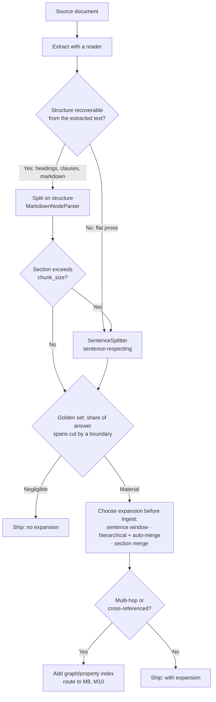
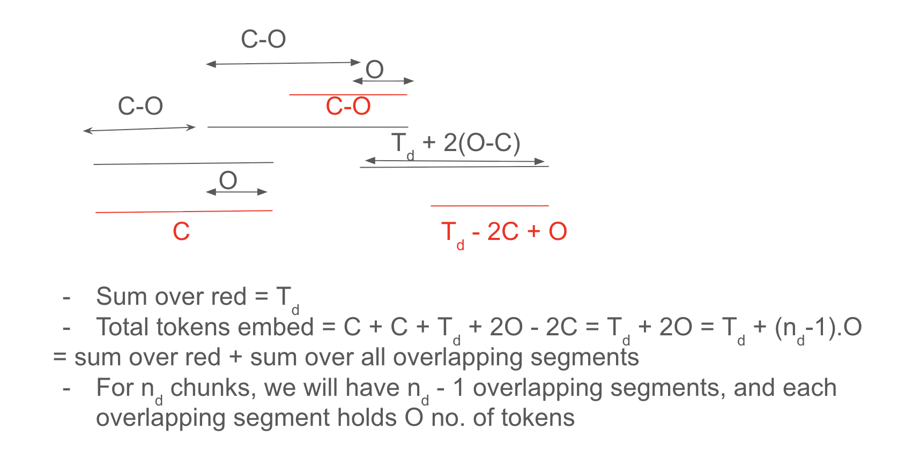

# M3 · Corpus Acquisition, Parsing, and the Chunking Decision

> **Module question:** How do you cut a document into retrievable units without destroying meaning?
> **Cross-cutting threads:** Failure modes · Tradeoff ledger · LlamaIndex at a glance
> **Domain spine:** LogiTrack — the carrier service agreements (PDF) and the tariff rate tables (XLSX)
> **Prerequisites:** [M1 — Why RAG Exists](../01-why-rag-exists/README.md) (it freezes the
> 60-query set this module measures against) · [M2 — The RAG Pipeline End to End](../02-rag-pipeline-end-to-end/README.md)

---

## Opening scene — the clause that got cut in half

LogiTrack's pilot ships in week three, over a random 2,300-document sample of the [3,000-document
corpus](../../syllabus.md#corpus-scale) — 10.3M words, chunked at the doc example's `chunk_size=1024, chunk_overlap=20` into about
**15,000 nodes**. It is, by every dashboard measure, working: P95 latency 1.4 seconds, spend $340
that week. The ops team stops asking whether retrieval works and starts using it.

Then a customs broker asks the question the whole project exists for: *"What is the demurrage
liability window in our Maersk agreement?"* The system answers confidently — and names the wrong
number. Not hallucinated. Cited. It points at the actual clause, and the number in the answer is
genuinely present in the cited text.

The operative clause is two sentences long, and reads: **"Demurrage liability shall accrue from
the fourth (4th) calendar day following discharge. Free time shall be sixteen (16) calendar days,
and the liability window shall be extinguished on the fourteenth (14th) calendar day, after which
the carrier's liability for delay shall cease."**

The chunk boundary falls immediately before "Free time shall be sixteen (16) calendar days." The
retriever returned the first chunk, containing accrual at day 4 and extinction at day 14 — so the
generator computed a liability window of **eleven days** (days 4 through 14 inclusive). The
correct answer, which the boundary severed, is that free time runs to **day 16**, so the liability
window is **sixteen days**. The generator invented nothing: it answered faithfully from the half
it was given, and eleven days is the arithmetically correct reading of that half. The second chunk
was in the index, ranked 9th, below the `top_k = 6` this pilot was configured with — which is why
the course's evaluation convention is recall@10 rather than recall@6, and why a rank-9 chunk is a
miss here but would be a hit under the harness the course goes on to build.

Nobody wrote a bug. No component misbehaved. The parse was clean, the embedding was correct, the
similarity score was high, the generation was faithful **to the context it was given**. One
decision made in week one — `chunk_size=1024, chunk_overlap=20`, copied from a doc example —
destroyed the meaning, and every downstream stage then worked perfectly on the wreckage.

> **Failure mode (the module in one line):** treating chunking as a preprocessing detail rather
> than as **the design decision that defines what "a unit of meaning" means for your entire
> system** — so the retriever can only ever return fragments, and the generator faithfully
> completes the thought the fragment started.

---

## The structure-aware path: parsing before chunking

Chunking is the second decision. The first is what text you are chunking, and for real corpora
that decision is made by the **document reader** — the component that turns a PDF into text —
rather than by the node parser that splits the text afterwards.

LlamaIndex's file-based *node* parsers:
1. `MarkdownNodeParser`, `HTMLNodeParser`, and `JSONNodeParser`, recover structure **out of the text** [LI-NPM]
2. `SimpleFileNodeParser` — itself a node parser — is documented as selecting a format-appropriate parser automatically [LI-NPM]. 
3. So when a source is already markdown or HTML, the structural
recovery described here *is* a node-parser operation. 
4. **ordering rather than class membership**: whatever recovers structure must run *before* anything
imposes a length-based split, whether it lives in a reader, a node parser, or an ingestion
transformation.

- The opening scene's clause was in a 96-page PDF. 
  - Whether the pipeline can even see "clause 14.2(b)" as a unit depends on whether parsing preserved the numbering, the heading hierarchy, and
the tabular region. 
  - **A naive `pdftotext` extraction flattens the rate table into a run of numbers
with no row/column affiliation, and no downstream chunker can recover structure that extraction
already destroyed.

### What "recoverable" means

Structure is **recoverable** when the extracted text still carries explicit markers a program can
split on — so a deterministic rule can find where each unit (section, clause, table row) starts
*and ends* from the text alone, without ever seeing the page. That test separates three situations
that can look identical in the source PDF:

| Situation | What the extracted text carries | Recoverable? |
|---|---|---|
| Structure preserved as markup | `## 14. Demurrage`, `<table>`, JSON keys | **Yes, cheaply** — `MarkdownNodeParser`, `HTMLNodeParser`, or `JSONNodeParser` splits on the markers |
| Structure was only visual | Font size, bold, indentation, and column alignment, flattened into plain text | **Only with work** — a layout-aware reader that turns visual cues into markup, or a heuristic such as a clause-number regex; otherwise it is lost |
| No structure to begin with | Narrative prose, ticket bodies, email | **Nothing to recover** — the genuine "flat prose" branch of the flowchart in the next section |

**For: recoverable.** The opening scene's clause, through a layout-aware reader:

```
## 14. Demurrage
### 14.2 Liability
(b) Demurrage liability shall accrue from the fourth (4th) calendar day following
discharge. Free time shall be sixteen (16) calendar days, ...
```

The heading markers bound clause 14.2(b) on both sides. Split on them first, and the clause stays
whole at any chunk size.

**Against: not recoverable.** The same clause, through naive extraction:

```
14. Demurrage 14.2 Liability (b) Demurrage liability shall accrue from the fourth (4th)
calendar day following discharge. Free time shall be sixteen (16) calendar days, ...
```

The clause *number* survived, but nothing marks where the clause *ends*, so a length-based splitter
cuts wherever its token count happens to fall — which is the opening scene, exactly. Tables are the
extreme case:

```
Recoverable (markdown table from a layout-aware reader):
| Origin    | Destination | Container | Base rate | Days | DG surcharge |
| Rotterdam | Singapore   | 40ft      | 2140      | 14   | 3.5%         |

Not recoverable (naive extraction):
Rotterdam  Singapore  40ft  2140  14  3.5%
```

In the second form no rule can reattach `2140` to "base rate", which is why the tables section
below concludes that no chunk size repairs it.

A PDF, then, is neither structured nor unstructured as a *format*: the same carrier agreement lands
on the *Yes* or the *No* branch of the next section's flowchart depending on which reader produced its
text — which is why that flowchart's first box is the reader.

> **Multimodal inputs** ($\color{red}\text{to be discussed}$) — mixed-content pages make the reader decision harder, not different.
> - **Scanned pages** (a signed, stamped agreement) have no text layer: OCR must run before any parser. Layout-aware OCR readers emit markup, e.g. [Docling](https://docling-project.github.io/docling/) ("extensive OCR support" for scanned PDFs) or [LlamaParse](https://developers.llamaindex.ai/python/cloud/llamaparse/) (OCR to markdown).
> - **Multi-column pages:** reading order is a reader output. A wrong order interleaves columns into a fake clause no splitter can repair.
> - **Stamps, signatures, logos:** classify them, then drop them or keep them as metadata, not chunk text ([Docling picture classification](https://docling-project.github.io/docling/usage/enrichments/) labels logos and signatures).
> - **Equations:** extract to LaTeX so a formula stays one atomic unit ([Docling formula enrichment](https://docling-project.github.io/docling/usage/enrichments/), off by default).

> $\color{red}\text{to be discussed}$ — PDFs with mixed native and scanned regions, tables spanning many pages, and prose that refers to table rows: region-level parsing, document assembly, reference links, and what a multi-customer engine needs on top: [pdf-ingestion-production-hardening.md](pdf-ingestion-production-hardening.md).

The practical ordering is: **extract → detect structure → split on structure → split on length
only where structure runs out.** `SimpleFileNodeParser` with `FlatReader` implements exactly this
for markdown and similar formats, and the documented workflow is to then chain a length-aware
text splitter onto the file-based parser [LI-NPM] — because "one markdown heading section" is not
a size guarantee, and an unbounded chunk is an embedding-quality problem.

### Tables: the case chunking cannot save

A rate table is a grid. Linearized, it becomes a sequence whose meaning depends on position:

```
Rotterdam  Singapore  40ft  2140  14  3.5%
Singapore  Rotterdam  40ft  1980  12  3.5%
```

The header row (origin, destination, container, base rate, days, DG surcharge) is what makes
those numbers interpretable, and under any length-based split it lands in a *different chunk* —
contingent on where the boundary happens to fall in that particular table, which is precisely why
the failure is intermittent and therefore hard to reproduce. Three options are available at the
**chunking layer**, and only three:

1. **Serialize with headers into every row-chunk** — prepend the column names to each row group.
   Costs tokens per row; works well for retrieval because each row is self-describing.
2. **Keep the table atomic** — treat it as one oversized node, retrieved as a unit. Costs a large
   slice of the context budget and embeds poorly (one vector blurs many ideas — the next section explains why).
3. **Extract to a structured store and route around the vector index** — a text-to-SQL path for
   numeric questions, leaving the vector index for prose (→ M10 routing, M8 for the
   index-selection decision).

Option 3 is what M8/M10 will build for LogiTrack, and it is a *pipeline* change rather than a
chunking one. But be precise about what the worked example below shows: option 1, reached by
recovering structure *before* chunking, is itself worth a large recall gain. The correct claim is
therefore narrower than "the chunker is the wrong place to solve tables" — it is that **no chunk
size repairs a table whose structure was already destroyed during extraction**, so structure
recovery must happen upstream of the splitter.

Nor does a pipeline with only a length-based chunker fall back to option 2 by default — it does
something worse. Option 2 at least keeps the table whole and merely pays for it. A length-based
splitter does what the paragraph above says: it cuts the grid into fragments whose numbers no
longer know which column they came from, producing chunks that look authoritative and cannot
answer a numeric question at all. That is a silent corruption rather than a deliberate trade,
which is why it is the more dangerous default.

> **Multimodal inputs** ($\color{red}\text{to be discussed}$) — tables in images, and figures, are the same problem one step earlier.
> - **Table in a scan or image:** the three options above apply only after extraction recovers the cells ([LlamaParse](https://developers.llamaindex.ai/python/cloud/llamaparse/) claims cell structure from scans and images).
> - **Figures and charts:** store caption + vision-model description as text ([Docling picture description](https://docling-project.github.io/docling/usage/enrichments/), off by default).
>   - Make it its own node; carry the section's `header_path` so it stays tied to its clause.
>   - Its tokens and nodes add to $V$ and $\sum_d n_d$ (defined in the overlap section below) — count them per document, like any text.
>   - It is generated, not source, text: tag it in metadata so citations and eval can tell ([→ M13](../13-evaluation/README.md), [→ M21](../21-security-prompt-injection/README.md)).
> - **Deferred:** embedding page images directly ([ColPali](https://arxiv.org/abs/2407.01449)) skips extraction — out of scope by [syllabus decision](../../syllabus.md#1-scope-knobs-frozen).

---

## Chunking is a budget, not a parameter

Every chunking decision spends from one budget and charges another. Three quantities are in
tension, and no single *chunk size* maximizes all three:

| Quantity | What it measures | Pushed up by |
|---|---|---|
| **Retrieval precision** | Fraction of retrieved chunks that are relevant | Smaller chunks |
| **Retrieval recall** | Fraction of relevant items that were retrieved | Smaller chunks, each more focused — *but only when each item is shorter than the chunk*; see the caveat below |
| **Answer completeness** | Whether the retrieved context contains the *whole* answer | Larger chunks, or context expansion at query time ¹ |

> ¹ $\color{red}\text{more to be discussed}$ — An $S$-token answer in $C$-token chunks splits into $\approx 1 + S/C$ pieces, and every piece must make the top-k cut, so completeness falls roughly as $r^{\,n}$ for $n$ pieces each retrieved with probability $r$. Larger chunks shrink $n$ but blur each embedding and lower $r$, which is why query-time expansion is the alternative.

The honest form of this table has two caveats, both of which the worked example later proves.
First, the recall row assumes the unit being retrieved is *smaller* than the chunk. When the
relevant unit is a whole table row group or a long clause, shrinking the chunk starts to cut the
unit apart and recall falls again — which is why recall is not monotone in chunk size (expected monotonicity: recall rises as chunk size falls). Second,
the three-way tension (retrieval, precision and answer completeness) applies to **a single chunk size doing one job**. It does not say the
tension is unavoidable: hierarchical and sentence-window parsing sidestep it by embedding small
units and expanding them at generation time, which is why the winning row of the results table
scores well on both recall and completeness at once. The real tradeoff those configurations
substitute is **index size** for granularity — a different budget, paid in memory rather than in
quality.

Smaller chunks improve the embedder's job. An embedding is a single fixed-size vector, so the
more distinct ideas a chunk contains, the more the vector is an average of them — an effect the
late-chunking authors describe as semantics being "over-compressed in the embeddings" [G24].
A 200-token chunk about demurrage embeds *as* demurrage. A 2,000-token chunk covering demurrage,
fuel surcharges, and jurisdiction produces a vector that is a blur of all three and matches a
query about any of them only weakly. ²

> ² $\color{red}\text{more to be discussed}$ — how embedding actually takes place, and how the embedding model compresses chunks of any length into the same fixed-size vector (the transformer produces one vector per token, and a pooling step such as mean or `[CLS]` pooling collapses them into one $D$-dimensional vector, → [M4 · Inside an embedding model](../04-embeddings-and-vector-space/README.md#inside-an-embedding-model-from-tokens-to-one-vector)).

But smaller chunks cut the other way. The unit that was retrieved is the unit the generator sees
(minus whatever the assembler adds, → M11). If the answer spans a boundary (either the answer is too big for a chunk or the chunking *cut* lands in the middle of an answer even if the answer was small enough to fit in a single chunk), a small chunk
guarantees incompleteness. This is **F3 · chunk-boundary loss**, and the opening scene is its
canonical instance.

The opening scene is a *completeness* failure — the answer was retrieved and the generator still
got it wrong, because the retrieved unit was half a clause. The instinctive fix is to enlarge the
chunk, and that fix is wrong, for a reason worth stating precisely. Enlarging the chunk repairs
completeness by making retrieval worse: a bigger chunk blurs its embedding across more ideas, and
the clause that now fits in one node competes with more unrelated text for the same top-k slots.
So the decision is not "prefer precision or prefer completeness." It is: **keep the retrieval unit
small and recover completeness at query time, rather than making the retrieval unit large enough
that no recovery is needed.**

> **Tradeoff (the ledger entry M3-1).** \
> *Decision:* optimize the *retrieval* unit for focus, and
> recover completeness via context expansion (sentence-window, hierarchical/auto-merge, or
> parent-document retrieval). \
> *Costs:* an extra expansion stage paid in either latency (a
> postprocessor pass) or index memory (multi-level or per-node metadata) — the results table puts
> the hierarchical version at 4.6× the vectors of the `SentenceSplitter(512, 50)` row. \
> *Accepted because:*
> the two failure modes are not symmetric. A chunk that was never retrieved cannot be expanded at
> any price, whereas a retrieved chunk can always be widened. Focus is therefore the property you
> must get right at index time, and completeness is the property you can buy later.
>
> Note the apparent tension with the closing decision below, which adopts hierarchical parsing with
> a **2048-token top level** for flat prose. That does not violate this entry: the hierarchical
> level sizes are chosen so the *retrieved and embedded* node is small (128–512 tokens) while the
> 2048 level exists to be **merged into at generation time** — which is this entry's mechanism,
> not an exception to it. The failure mode this entry guards against is making the unit you
> *retrieve* large, not making a parent available for expansion.
>
> *Reverses if:*
> the dominant query class is whole-document summarization, where nothing smaller than the
> document is useful and there is no focused unit to retrieve. (Then the small-unit-plus-expansion
> machinery — hierarchical, sentence-window — is unnecessary because the whole document becomes the
> retrieval unit, chunking survives only to fit long documents into the context window via
> map-reduce summarization, and a mixed workload routes by query class (→ M10) rather than
> reversing outright.)




The diagram makes three decisions in sequence — *is structure recoverable?*, *do answers span
chunk boundaries?*, *is the corpus cross-referenced?* — and it has **three** terminal states, not
one, because a corpus rarely needs the same treatment everywhere. LogiTrack's wiki needs none of
this; its carrier agreements need the expansion path; its DG rules additionally need the graph
path that M8 builds. The flowchart is therefore a per-source-type routing decision rather than a
single global answer, and the closing decision below is a *mix* of its terminals by document class.
*Recoverable* has a precise meaning in the first question — the extracted text carries markers a
rule can split on — and the structure-aware path above defines it with examples for and against.

<a id="fixed-at-ingest"></a>What matters for planning is **which decisions are fixed at ingest**:

- **Fixed at ingest — reversing any of these means re-parsing and re-embedding the corpus:**
  - Structure recovery: it decides which units the index contains at all.
  - The expansion mechanism: sentence-window and hierarchical parsing each produce a *different
    node set*, so neither can be bolted on later.
- **The boundary question is answered before you build, by measurement:**
  - Not an assumption, and not a per-query runtime call — at serving time you do not know the
    answer, so you cannot know whether it spans a boundary.
  - Measure it offline: with span-level ground truth (M1's 60-query set), count the share of
    answer spans each candidate chunker cuts.
  - It is a rate per source type, not a yes/no.
- **Genuinely additive — adoptable without re-ingesting:**
  - Expansion through relationships the index already has: walking `PREVIOUS`/`NEXT`, or merging
    by `header_path` (both weaker than they look; see the `MarkdownNodeParser` notes below).
  - Multi-hop routing: a second index layered on top.
- **Cheap to swap:** `TokenTextSplitter` → `SentenceSplitter` on flat text.
  - Still a re-embed, but a cheap one: both are single-level splits of the same text.
  - The irreversible part is the *structure* decision, not the splitter.

### The parsers, and when each one earns its place

LlamaIndex exposes node parsers that take a list of documents and chunk them into `Node` objects,
inheriting the parent document's attributes — `metadata`, text and metadata templates — onto
every child node [LI-NP]. That inheritance rule is more important than it looks: it is why
document-level metadata survives chunking at all (→ M6).

| Parser | Splits on | Use when | Watch out for |
|---|---|---|---|
| `TokenTextSplitter` | Raw token count [LI-NPM] | Uniform prose with no recoverable structure | Cuts mid-sentence; the default failure |
| `SentenceSplitter` | Sentence boundaries within a token budget [LI-NPM] | The safe general default for prose | Still cuts mid-*argument*, not mid-sentence |
| `SentenceWindowNodeParser` | Every sentence; stores the N sentences before and after it in metadata [LI-NPM] | Answers are one-sentence-precise, and you will expand at query time | The **window** exists for generation, but reaches the LLM **only** if you add `MetadataReplacementPostProcessor(target_metadata_key="window")` [LI-NPM]. Nothing warns you if you forget, and the LLM then sees just the sentence. The window is never embedded either way — the *sentence itself* is the node's text and is what gets embedded |
| `HierarchicalNodeParser` | Several chunk sizes at once, each node holding a parent reference [LI-NPM] | Answers span boundaries and you want automatic widening | Higher index memory; needs `AutoMergingRetriever` to pay off ([→ M8](../08-index-structures-beyond-flat/README.md#structure-at-index-time-recursive-retrieval-and-auto-merging)) |
| `SemanticSplitterNodeParser` | Embedding-similarity breakpoints between sentences [LI-NPM] | Long, topically drifting documents — and you have measured a gain | Real embedding cost at ingest; see the disagreement recorded at the end of this module |
| `MarkdownNodeParser` / `HTMLNodeParser` | Heading and tag structure [LI-NPM] | Documents that *have* structure — wikis, docs sites, HTML bulletins | Structure must be real, not cosmetic |
| `JSONNodeParser` | JSON shape [LI-NPM] | Configuration, API payloads, structured exports | Deep nesting produces tiny or huge nodes |
| `CodeSplitter` | Language-aware syntax, in lines [LI-NPM] | Source code corpora | Line-based, so chunk sizes vary wildly |
| `SimpleFileNodeParser` | Picks a file-type parser automatically [LI-NPM] | Heterogeneous corpora; a first pass | Then chain with a text splitter for length |

<details>
<summary><strong><code>SemanticSplitterNodeParser</code> — what the code actually does</strong> (read from llama-index-core 0.14.25, <code>node_parser/text/semantic_splitter.py</code>)</summary>

- **1 · Split into sentences** with `split_by_sentence_tokenizer()`, the same splitter
  `SentenceWindowNodeParser` uses. Each sentence keeps its trailing whitespace.
- **2 · Build a window around every sentence** (`_build_sentence_groups`).
  - For sentence *i*: sentences *i − b* … *i + b*, where *b* = `buffer_size` (default **1**, so 3
    sentences).
  - **It embeds these windows, not single sentences:** one window per sentence position.
- **3 · Embed every window** (`embed_model.get_text_embedding_batch`).
  - With no `embed_model` passed to `from_defaults`, it silently falls back to `OpenAIEmbedding()`.
- **4 · Compare only neighbours** (`_calculate_distances_between_sentence_groups`).
  - distance(*i*) = 1 − similarity(window *i*, window *i* + 1).
  - Nothing is compared further away than the next position.
- **5 · Cut where the distance is unusually high** (`_build_node_chunks`).
  - **The threshold is relative, not fixed:** the 95th percentile of *that document's own* distances
    (`breakpoint_percentile_threshold`, default 95).
  - A cut goes wherever distance > threshold. Each chunk is the run of sentences between cuts.
- **What follows from the code:**
  - **About 5% of sentence gaps become cuts in every document, whether or not the topic changes.** A
    single-topic contract is still cut. N sentences give about 0.05 × N + 1 chunks.
  - **No size limit.** A chunk can be one sentence, or long enough that the embedder silently
    truncates it ([→ M4](../04-embeddings-and-vector-space/README.md#inside-an-embedding-model-from-tokens-to-one-vector)).
  - **It embeds the corpus about (2*b* + 1) + 1 times.** Each sentence appears in about 2*b* + 1
    windows (3× at the default). Those vectors are thrown away, and the index embeds the final chunks
    again: **about 4× the corpus's tokens,** and one request input per sentence position.
  - **Each document's breakpoints wait for all its window embeddings.**

</details>

<details>
<summary><strong>Agentic (LLM-driven) chunking — not a default; measure it</strong></summary>

- **The idea:** an LLM decides where chunks end, instead of a size rule, a sentence rule or an
  embedding threshold.
- **The best-known method: LumberChunker** (Findings of EMNLP 2024) [LUMB24].
  - Split the document into paragraphs with IDs, and group them up to θ tokens (θ = 550 worked best;
    1,000 worst, because "an excessively long prompt may overwhelm the model").
  - The LLM (Gemini 1.0 Pro) returns **only the ID** of the first paragraph where the content clearly
    changes. That paragraph ends the chunk, and the next group starts there.
  - Chunks stay **verbatim**: concatenations of the original paragraphs.
  - **Result:** on GutenQA (3,000 questions over 100 Project Gutenberg novels), DCG@20 62.09 against
    54.72 for recursive chunking; Recall@20 77.92 against 74.35 [LUMB24].
  - **Cost:** 95 s for *A Christmas Carol* and 1,628 s for *The Count of Monte Cristo*, against
    0.1–0.6 s for recursive chunking. Its calls "cannot be pre-established", so one document can't
    be parallelised [LUMB24].
  - **The authors on structured text:** "for scenarios with highly structured texts like those in the
    legal domain, LumberChunker may be an unnecessarily complex solution because it would likely
    achieve similar segmentations as those employing document-wise structure parsing (like Markdown
    segmentation), but at a more expensive cost" [LUMB24].
- **Independent comparisons find small or no gains:**
  - **Chroma** (technical report, not peer-reviewed): an LLM chunker on GPT-4o reached 91.9 recall
    against 89.5 for recursive 400-token chunks, with spreads of about ±30 and no significance tests.
    Its verdict: recursive splitting "often perform[s] well in practice when parametrized
    appropriately" [CHR24].
  - **A chemistry study** (v1): LLM-based chunkers ranked **last** on IoU@10, 65% below the recursive
    family [CTEO25].
- **For LogiTrack's documents:**
  - **No LLM-chunking study evaluates contracts, rate tables or scanned PDFs** (as surveyed
    2026-11-13).
  - The text it would judge is parse output. On OCR'd regions, it judges topic boundaries from
    garbled text: one more unreliable gate.
  - Its boundaries can change between runs (LumberChunker's code runs at temperature 0.1, with retries
    when the output doesn't parse), which undermines idempotent ingestion, caching and backfills.
- **If you test it anyway:**
  - only on prose regions without usable structure, after region-level parsing;
  - against recursive chunking as the baseline, on the [evaluation set](evaluation-set-plan.md), with
    cost and latency measured per document;
  - **the LLM returns IDs or offsets, never rewritten text.** Methods that rewrite or synthesise chunks
    lose exact offsets, and with them citations and stitching.

</details>

<details>
<summary><strong><code>MarkdownNodeParser</code> — what actually happens, and what survives a re-split</strong> (observed on llama-index-core 0.14.25)</summary>

Run on a markdown excerpt of the Maersk agreement, then re-split with `SentenceSplitter(64, 0)`:

- **a. `header_path` holds the *ancestors*, not the node's own heading.**
  - `### 14.2 Liability` gets `header_path: /Maersk Service Agreement/14. Demurrage/`.
  - "14.2 Liability" lives only in the first chunk's text.
  - After a re-split, later sub-chunks carry no "14.2" anywhere — clause identity is lost.
  - 14.1 and 14.2 sub-chunks get the *same* `header_path`.
- **b. Metadata is embedded by default.**
  - `excluded_embed_metadata_keys` is `[]`.
  - The embedded text starts `carrier: … file_name: … header_path: …`, then the chunk.
  - Good: "Free time shall be sixteen…" now embeds next to "Demurrage".
  - Bad: `file_name` and every other document key are embedded into every vector too.
- **c. Metadata eats the chunk budget.**
  - The splitter subtracts metadata tokens from `chunk_size` (it warns when they come close).
  - Text per chunk = `chunk_size` − metadata tokens.
  - So the $n_d$ formula in the overlap section below undercounts nodes when metadata is large.
- **d. The re-split reproduced the opening scene.**
  - The boundary fell right before "Free time shall be sixteen (16) calendar days."
  - Structure recovery protects a clause only if its section fits in `chunk_size`.
- **e. Heading-only nodes.**
  - `# Maersk Service Agreement` and `## 14. Demurrage` each become a node holding just the heading.
  - Noise in the index.
- **f. Chaining drops `NEXT`.**
  - `SentenceSplitter` on markdown nodes → sub-chunks have `PREVIOUS` + `SOURCE`, no `NEXT`.
  - The same splitter on the raw document keeps both.
  - Forward neighbour expansion has nothing to follow.
- **g. `SOURCE` points to the document, not the section.**
  - Section nodes are discarded after the re-split.
  - `header_path` is the only trace of the parent section — and per (a), it omits the node's own heading.

**Net:** structure in metadata is the right idea, but incomplete by default. Prepend the node's own
heading to each sub-chunk (or extend `header_path` with it) to keep clause identity through a re-split.

</details>

> $\color{red}\text{to be discussed}$ — how to test `SentenceWindowNodeParser` against `HierarchicalNodeParser` + `AutoMergingRetriever`, and where each one wins and fails: [testing-sentence-window-vs-hierarchical.md](testing-sentence-window-vs-hierarchical.md).

The framework also exposes `Chunker`, which wraps the external `chonkie` chunker family behind
aliases such as `"recursive"` [LI-NPM] — useful when you want a chunking strategy the core
parsers do not implement, at the cost of a second dependency in your ingest path.

> **LlamaIndex at a glance:** `SentenceSplitter(chunk_size=1024, chunk_overlap=20)` — the
> configuration shown throughout the node-parser guide [LI-NPM]. These are doc *examples*, not
> framework defaults tuned for your corpus. Copying them and never revisiting them is what
> produced the opening scene.

### Overlap: what it buys, and what it costs

Overlap exists to catch the meaning that a hard boundary would sever. It is insurance, and like
insurance it is priced per unit of coverage.

Throughout this module, $C$, $O$, and $T$ are **token counts** — counts in the tokenizer used by
the embedding model you are billed for, which is the sense in which `chunk_size=1024` means 1024
tokens rather than 1024 characters. The distinction matters because every price here is per token.

For a document of $T_d$ tokens chunked into windows of size $C$ with overlap $O$, the number of
chunks **for that document** is

$$n_d = \left\lceil \frac{T_d - O}{C - O} \right\rceil \;\text{ when } T_d > C, \qquad n_d = 1 \;\text{ when } T_d \le C$$

- think of the division as *total no. of non-overlapping tokens to consider* ÷ *total no. of non overlapping tokens in a single chunk*
- The second case is not a technicality — it is the regime that dominates this corpus, as the worked
example shows. 
   - A document shorter than the chunk size is one node, carries no overlap at all, and
its text appears in the index exactly once.

…and summing over documents gives the corpus node count. Chunking is per-document, not one
continuous stream, and the difference is material rather than pedantic. Work the gap out exactly:
apply the formula once to the whole corpus and you get

$$\left\lceil \frac{18{,}064{,}000 - 20}{1024 - 20} \right\rceil = 17{,}992 \text{ chunks}$$

but sum it per document and you get **19,868** — because every document's final partial chunk
contributes a node the corpus-wide formula never sees. The corpus-wide figure **undercounts by
(19,868 − 17,992)/19,868 = 9.4%**. The direction of that correction is what matters: the error
compounds into every cost estimate, memory plan, and index-size projection you build on it, and it
grows as documents get shorter relative to $C$ — which, for this corpus, they overwhelmingly are.

The total embedded token volume sums every chunk's tokens, within each document and then across documents:

$$V = \sum_d \sum_{i=1}^{n_d} t_{d,i} \;=\; \sum_d \big(T_d + (n_d - 1)\cdot O\big) \;=\; T + \sum_d (n_d - 1)\cdot O$$

where $t_{d,i}$ is the token count of chunk $i$ of document $d$.

**Derivation**:  \

- **When every document is much longer than $C$**, $n_d - 1 \approx T_d/(C - O)$, so $V \approx T \cdot \frac{1}{1 - O/C}$ — the multiplier quoted everywhere: 1.11× at 10% overlap, 1.25× at 20%, 2× at 50%.
- **A document with $T_d \le C$ adds zero overlap** ($n_d = 1$), but it still adds a whole node.
  - Short documents hold few tokens, so they barely move $V$.
  - They move the node count a lot — the 17,992 vs 19,868 gap above.
- **State your words-per-token ratio.** This module uses 0.75 for prose and 0.55 for numeric tables: LogiTrack's 13.54M words → 18.06M tokens.

**What embedding actually costs** (prices checked 2026-11-13 [PRICES]). Two volumes, both for
`SentenceSplitter(512, 50)`:

- **Pilot:** LogiTrack's [3,000 documents](../../syllabus.md#corpus-scale), $V$ = 19.95M tokens (exact, per document).
- **Year one:** [2.89B corpus tokens](../../syllabus.md#corpus-scale) × 1.108 ≈ **3.20B tokens** (an upper bound: short documents pay no overlap).

| Model | Price / 1M tokens | Batch | Pilot | Year one | Year one, batch |
|---|---|---|---|---|---|
| [OpenAI `text-embedding-3-small`](https://developers.openai.com/api/docs/pricing) | $0.02 | 50% off ¹ | $0.40 | $64 | $32 |
| [OpenAI `text-embedding-3-large`](https://developers.openai.com/api/docs/pricing) | $0.13 | 50% off ¹ | $2.59 | $416 | $208 |
| [Gemini `gemini-embedding-001`](https://ai.google.dev/gemini-api/docs/pricing) | $0.15 | $0.075 | $2.99 | $480 | $240 |
| [Gemini `gemini-embedding-2`](https://ai.google.dev/gemini-api/docs/pricing) (text) | $0.20 | $0.10 | $3.99 | $641 | $320 |
| [Voyage `voyage-4-lite`](https://docs.voyageai.com/docs/pricing) | $0.02 | 33% off | $0 ² | $60 | $43 |
| [Voyage `voyage-4`](https://docs.voyageai.com/docs/pricing) | $0.06 | 33% off | $0 ² | $180 | $128 |
| [Voyage `voyage-4-large`](https://docs.voyageai.com/docs/pricing) | $0.12 | 33% off | $0 ² | $360 | $256 |
| [Amazon Titan Text Embeddings V2](https://aws.amazon.com/blogs/machine-learning/get-started-with-amazon-titan-text-embeddings-v2-a-new-state-of-the-art-embeddings-model-on-amazon-bedrock/) | $0.02 ³ | — | $0.40 | $64 | — |

¹ OpenAI's pricing page lists no embedding rows under Batch; the 50% comes from third-party price trackers.
² The first 200M tokens are free per account, but not on the Batch API.
³ From AWS's launch post; the live Bedrock pricing page did not show the figure.
Cohere and Mistral are left out: their official pages did not list an embedding price.

- **Even the priciest row embeds a full year of LogiTrack for under $700.**
- **Overlap's share is smaller still:** `(512, 50)` adds 1.89M tokens over zero overlap on the pilot — under $0.40 even at $0.20/1M.

**What the price list leaves out: time.** A request rejected for a rate limit (HTTP 429) is not
processed, so limits cost wall-clock time, not tokens:

| Provider and tier | Limit | Pilot | Year one |
|---|---|---|---|
| [OpenAI](https://developers.openai.com/api/docs/models/text-embedding-3-small), Build (entry paid tier) | 1M TPM | 20 min | **53 h** |
| [OpenAI](https://developers.openai.com/api/docs/models/text-embedding-3-small), Grow | 10M TPM | 2 min | 5.3 h |
| [Voyage `voyage-4`](https://docs.voyageai.com/docs/rate-limits), Tier 1 → Tier 3 | 8M → 24M TPM | 2.5 → 0.8 min | 6.7 → 2.2 h |
| [Voyage `voyage-4-large`](https://docs.voyageai.com/docs/rate-limits), Tier 1 → Tier 3 | 3M → 9M TPM | 6.6 → 2.2 min | 18 → 5.9 h |
| [Gemini `gemini-embedding-001`](https://ai.google.dev/gemini-api/docs/rate-limits), Tier 1 | $10 spend cap per 10 min ⁴ | 3 min | 8 h |
| [OpenAI Batch](https://developers.openai.com/api/docs/models/text-embedding-3-small), Build | 20M tokens queued at once, ≤ 24 h per batch | 1 batch | 160 rounds — impractical |

⁴ Google does not publish an embedding TPM. Tier 1's spend cap alone limits throughput to ~6.7M tokens/min at $0.15/1M.

**The full cost equation.**

$$\text{\$} = k \cdot V \cdot p \cdot (1 - \delta_{\text{batch}}) \;-\; \text{free credit}$$

$$t \;\ge\; k \cdot \max\!\left(\frac{V}{\text{TPM}},\; \frac{N_{\text{requests}}}{\text{RPM}},\; \frac{V \cdot p}{\text{spend cap per minute}}\right)$$

- $t$: wall-clock time to embed the corpus. It can only be *at least* this, because retries and backoff add to it.
- $p$: price per token. $V$: embedded tokens, from the formula above.
- **TPM** (tokens per minute) and **RPM** (requests per minute): the provider's rate limits for your account tier.
- $k$: **the number of full re-embeds** in the period. Every change of embedding model, chunker, or
  chunk size re-embeds the whole corpus — this is the real multiplier, not overlap.
- $\delta_{\text{batch}}$: the batch discount (50% OpenAI and Gemini, 33% Voyage), paid for in
  latency (12–24 h windows) and queue limits.
- $N_{\text{requests}}$: nodes ÷ inputs per request (the batch size). TPM usually binds first; tiny-node parsers can flip that (table below).
- **Time binds before money does:** at OpenAI's entry tier, one year-one re-embed is 53 hours of
  pipeline time for $64.

**Embedding is not where RAG money goes.** Ingest is paid once per token; per-query costs repeat forever:

- **Query embedding:** 8,500 queries/day × 25 tokens ≈ 6.5M tokens a month — about **$0.13 a month** at `text-embedding-3-small`'s $0.02/1M.
- **Reranking:** a cross-encoder scoring 50 candidates of 350 tokens each, at an assumed $2.00/1M, costs about **$9,056 a month** — roughly **70,000×** the query embedding.
- Even a reranker 100× cheaper per token stays ~700× the query embedding. That is why M9's candidate-set size and M18's budget are the same decision.

**What chunking actually moves.** Computed per document on the [pilot corpus](../../syllabus.md#corpus-scale) with the formulas above:

| Config | Vectors | Embedded tokens | vs corpus tokens |
|---|---|---|---|
| [`TokenTextSplitter(chunk_size=1024, chunk_overlap=20)`](https://developers.llamaindex.ai/python/framework-api-reference/node_parsers/token_text_splitter/#llama_index.core.node_parser.TokenTextSplitter) | 19,868 | 18.40M | 1.02× |
| [`SentenceSplitter(chunk_size=512, chunk_overlap=50)`](https://developers.llamaindex.ai/python/framework-api-reference/node_parsers/sentence_splitter/#llama_index.core.node_parser.SentenceSplitter) | 40,703 | 19.95M | 1.10× |
| [`SentenceSplitter(chunk_size=2048, chunk_overlap=100)`](https://developers.llamaindex.ai/python/framework-api-reference/node_parsers/sentence_splitter/#llama_index.core.node_parser.SentenceSplitter) | 11,193 | 18.88M | 1.05× |
| [`HierarchicalNodeParser.from_defaults(chunk_sizes=[2048, 512, 128], chunk_overlap=20)`](https://developers.llamaindex.ai/python/framework-api-reference/node_parsers/hierarchical/#llama_index.core.node_parser.HierarchicalNodeParser), decision: only embed leaves (canonical) | **187,043** (243,340 nodes in the docstore) | 21.74M | 1.20× |
| Same parser, **every level embedded** — a different design (multi-granularity); wrong for `AutoMergingRetriever` | 243,340 | 58.88M | 3.26× |
| [`SentenceWindowNodeParser.from_defaults(window_size=3)`](https://developers.llamaindex.ai/python/framework-api-reference/node_parsers/sentence_window/#llama_index.core.node_parser.SentenceWindowNodeParser) — no $C$ or $O$: one sentence per node, no repeated text | **615,445** | 18.06M | 1.00× |

- **Tokens barely move.** The three flat rows span 18.4M–20.0M, and each sits within 1% of its multiplier $\frac{1}{1-O/C}$ (1.020, 1.108, 1.051).
- **Vector count moves a lot.** 11,193 → 40,703 across the flat rows (3.6×); the window parser is 15× the `(512, 50)` row.
- **Hierarchical: we decide to embed only the leaves.**
  - Note: other nodes can also be embed, we have taken the simplest for the demonstration below.
  - The parser returns every level in one flat list (observed on llama-index-core 0.14.25), and each level re-splits the level above.
  - **For `AutoMergingRetriever`, embed only the leaves.** It scores leaves from the vector index and fetches parents from the docstore (→ [M8](../08-index-structures-beyond-flat/README.md#structure-at-index-time-recursive-retrieval-and-auto-merging)); parents in the top-k break its sibling vote.
  - **Embedding every level is a different design**, where similarity picks the granularity per query (RAPTOR's "collapsed tree" does this). Here it costs 2.7× the tokens and 1.3× the vectors, and a parent and its own child can both land in the top-k, so it needs dedup. M8 owns the choice.
- **Window: sentences tile the document without overlap**, so the embedded text *is* the corpus text — 15× the vectors of `(512, 50)` for 0.91× the tokens.

**Why vector count matters: it is what requests, memory, and the [ANN graph](../05-vector-databases-and-ann/README.md#hnsw-three-dials-only-one-of-them-free) scale with.**

- Tokens drive the **TPM** limit and the dollar bill. Vector count drives the **RPM** limit, vector memory, and the [ANN graph (→ M5)](../05-vector-databases-and-ann/README.md#hnsw-three-dials-only-one-of-them-free).
- **Tiny-node parsers can make RPM the binding limit.** Year one, [scaled 160×](../../syllabus.md#corpus-scale), on OpenAI's tiers [PRICES]:

| Config (year one) | Vectors | Tokens | Build (1M TPM, 5k RPM): tokens / requests at batch 10 | Grow (10M TPM, 10k RPM): tokens / requests at batch 10 |
|---|---|---|---|---|
| `SentenceSplitter(512, 50)` | 6.5M | 3.19B | **53 h** / 2.2 h | **5.3 h** / 1.1 h |
| Hierarchical, leaves | 29.9M | 3.48B | **58 h** / 10 h | **5.8 h** / 5.0 h |
| Hierarchical, all levels | 38.9M | 9.42B | **157 h** / 13 h | **16 h** / 6.5 h |
| Window, w=3 | 98.5M | 2.89B | **48 h** / 33 h | 4.8 h / **16 h** |

- Bold marks the limit that binds. At Grow, the window parser is **request-bound**: 16 h of requests against 4.8 h of tokens.
- Batch 10 is LlamaIndex's default `embed_batch_size` (→ M4). Raising it to 100 cuts every request column 10× — the window row at Grow drops to 1.6 h, and tokens bind again.

**What one node weighs.** A node in the vector store is more than its text. Take the D = 1,536
float32 vectors that M5 indexes, ~29 tokens per sentence, and ~4 bytes of UTF-8 per token — so
~116 bytes per sentence:

| Part of one node | Sizing | Window node (w=3) | Window node (w=3), pointers instead of window text | `SentenceSplitter(512, 50)` node |
|---|---|---|---|---|
| Vector | 1,536 × 4 B | 6,144 B | 6,144 B | 6,144 B |
| Node text — what gets embedded | 29 vs 512 tokens × 4 B | 116 B (29 x 4) | 116 B | 2,048 B |
| `original_text` | The sentence again, kept so the hit survives replacement | 116 B | — (not needed: the window is rebuilt from pointers at query time) | — |
| `window` | The 3 sentences before and after, plus the sentence itself, plus separators | 818 B (116 x 7 + (7-1) no. of separator-character) | ~234 B (6 neighbour node ids × ~39 B each as JSON strings) | — |
| Metadata, ids, relationships | Inherited document metadata (~200 B), node and document ids plus previous/next/source pointers (~500 B), serialization (~150 B) | ~850 B | ~850 B | ~850 B |
| [HNSW](../05-vector-databases-and-ann/README.md#hnsw-three-dials-only-one-of-them-free) graph links (`m = 16`) | 2m × 4 B in the base layer, plus upper layers ([→ M5](../05-vector-databases-and-ann/README.md#hnsw-three-dials-only-one-of-them-free)) | ~140 B | ~140 B | ~140 B |
| **Per node** | | **≈ 8.2 KB** | **≈ 7.5 KB** | **≈ 9.2 KB** |
| **× nodes** | | 615,445 → **≈ 5.0 GB** | 615,445 → **≈ 4.6 GB** | 40,703 → **≈ 0.37 GB** |

- **The window node is *smaller* than the 512-token node.** 18× less text costs only 11% fewer bytes, because three-quarters of every node is its vector — the same 6 KB for 29 tokens or 512.
- **So memory tracks vector count almost one for one:** 15× the vectors is 13.5× the bytes.
- **The window text that looks wasteful is ~11% of the node.** Pointers to neighbouring sentences save ≈ 0.43 GB of the 5.0 GB (column 4), at the price of six docstore reads per hit — ≈ 0.57 GB only if the window is rebuilt by walking `PREVIOUS`/`NEXT`, six reads in a row; truncating the vector to 768 dimensions (→ M4) saves ≈ 1.9 GB. **The lever on index memory is the vector, not the text.**
- These are estimates, not measurements: the ~500 B of ids and relationships is not read from the framework source, and a vector-store integration that also serializes the whole node into the store's metadata adds roughly 1.2 KB per node (≈ 5.8 GB).

**Overlap's subtler cost: near-duplicates.** Overlapping chunks score ≈ 1.0 against each other, so
they compete for the same top-k slots and make a candidate set look more diverse than it is. Overlap
converts retrieval *recall* into retrieval *slot waste* — **F2 · retrieval noise** through the back
door. This is a mechanism argued here, not a measured result; the similarity threshold at which it
bites is calibrated in M4.

<details>
<summary><strong>Mitigation: measure, stitch, then cut overlap</strong></summary>

- **Detect by offsets, not by similarity.**
  - Every node carries `start_char_idx` / `end_char_idx`.
  - Two hits from the same document whose spans overlap *are* overlap duplicates — no cosine threshold needed.
- **1 · Measure first.**
  - Metric: share of top-k slots taken by a chunk whose span overlaps a higher-ranked hit.
  - Run it per config on M1's 60-query set. Act only if it's material.
- **2 · Stitch, don't drop.**
  - Over-fetch: retrieve N = 20 candidates when the LLM gets k = 5, then group hits by document.
  - Merge hits whose spans overlap or touch into one contiguous passage; keep the top-k passages.
  - The wasted slot becomes a longer passage — which also helps F3 (boundary loss).
  - A small custom postprocessor; LlamaIndex core has no built-in one that merges by offsets (`PrevNextNodePostprocessor` adds neighbours, a different job).
- **3 · Then cut the cause.**
  - Once stitching or an expansion mechanism (window, auto-merge) covers boundaries, overlap buys little.
  - Lower it — exactly M3-2's "reverses if dedup is in place".
- **4 · MMR only as a fallback** ([→ M9](../09-ranking-fusion-reranking/README.md#diversity-position-and-the-two-ordering-problems)).
  - It rescales scores (some go negative), so every threshold needs re-calibrating.
  - It's a retrieval mode, so it can't run after a reranker.
  - It judges by cosine, so it can't tell *overlapping* text from *similar* text — Maersk's and MSC's demurrage clauses look alike but are both needed.
- **Same issue in other parsers.**
  - Sentence windows: two adjacent sentence hits share 5 of 7 window sentences after replacement — stitch windows too.
  - Auto-merge already solves it for siblings by merging them into the parent.

</details>

> **Tradeoff (the ledger entry M3-2).** *Decision:* `chunk_overlap = 10–20%` of chunk size.
> *Costs:* up to 11–25% more embedded tokens on long documents (10% on this corpus at `(512, 50)`) —
> a rounding error in dollars — plus more vectors and a near-duplicate population competing for
> top-k. *Accepted because:* a boundary-severed answer is a silent correctness failure, whereas a
> redundant chunk is a visible ranking inefficiency you can filter. *Reverses if:* dedup (→ M14) is
> in place and measured to recover the slots — in which case drop overlap and let dedup do the work.

### Late chunking: chunk the embedding, not the text

**The idea in one line:** embed the whole document first, and cut it into chunks *afterwards* [G24].
- Normal chunking cuts the **text** before the model.
- Late chunking cuts the **model's output** after it. Hence "late".

**Step 1 · The problem with normal chunking**
- Cut the document into chunks (say 256 tokens), and embed **each chunk on its own.**
- The model sees only that one chunk, so anything the chunk refers to elsewhere is lost.
  - Page 1: "This agreement is between LogiTrack and **Maersk Line** (the 'Carrier')."
  - A chunk on page 40: "**The Carrier** shall charge €50 per day after 5 free days."
  - Embedded alone, that chunk doesn't know the Carrier is Maersk, so "Maersk demurrage charges"
    may not retrieve it.

**Step 2 · Late chunking**
1. **Feed the whole document into the model at once,** up to its context window.
2. Inside the transformer, every token attends to every other token.
   - So the vector for "Carrier" on page 40 picks up "Maersk Line" from page 1.
3. **The model outputs one vector per token,** each already carrying the document's context.
4. **Only now apply the chunk boundaries:** group the token vectors by the same 256-token spans.
5. **Mean-pool each group** into one vector per chunk ([why one vector per token, then pooling → M4](../04-embeddings-and-vector-space/README.md#inside-an-embedding-model-from-tokens-to-one-vector)).

- **What changes:** only each chunk's vector, which now carries document context.
- **What stays the same:**
  - the chunks' text, and the number of vectors;
  - the unit that's retrieved, which stays small.
- **No training needed:** it works with any long-context embedding model that exposes its per-token
  outputs [G24].

**Step 3 · Documents longer than the window: macro chunks ("long late chunking")**
1. **Cut the document into macro chunks** of l_max tokens, each fitting the window.
2. **Overlap them:** each macro chunk also carries ω tokens shared with its neighbour, so text near
   the edge isn't read without what came just before.
3. **Run Step 2 inside each macro chunk:** embed it whole, cut into chunks, pool.
   - The paper's Algorithm 2 appears to use the overlap tokens only as context, so each chunk gets
     exactly one vector. Check this against the algorithm before relying on it.
4. **The limit:** context reaches only within one macro chunk, plus the overlap.
   - A 96-page contract (≈ 50k tokens) spans several macro chunks. If "Maersk Line" is on page 1
     and the clause on page 40, they're probably in different macro chunks, and the page-40 chunk
     loses Maersk again.
   - The paper doesn't state the l_max or ω values it used.

**What it isn't, and what it is:**
- **Not a replacement for the splitter.** It still needs chunk boundaries, and `TokenTextSplitter`
  or `SentenceSplitter` supplies them. The paper used fixed 256-token, 5-sentence and semantic
  boundaries [G24].
  - The splitter decides **where** to cut; late chunking decides **how each piece is embedded.**
- **The same goal as `SentenceWindowNodeParser` and auto-merging** (`HierarchicalNodeParser` +
  `AutoMergingRetriever`): small retrieval units that keep their context.
  - **But it changes the vector, not the text the LLM receives.** The window parser and auto-merging
    add context to the **text** after retrieval; late chunking adds it to the **vector** at ingest.
  - So the two can be combined. For example, late-chunk a hierarchy's leaves so they're found more
    reliably, and let auto-merging still expand them. *That combination is reasoned here, not tested
    in the paper.*
- **Not an alternative to the [three table-parsing options](#tables-the-case-chunking-cannot-save).**
  The LLM still receives the row's text without its header.

**The evidence** [G24]:
- **The three models the study used,** all public on Hugging Face:

  | Model | Context window | Parameters | Licence |
  |---|---|---|---|
  | [jina-embeddings-v2-small-en](https://huggingface.co/jinaai/jina-embeddings-v2-small-en) | 8,192 tokens | 33M | Apache-2.0 |
  | [jina-embeddings-v3](https://huggingface.co/jinaai/jina-embeddings-v3) | 8,192 tokens | ≈ 572M | **CC BY-NC 4.0 (non-commercial)** |
  | [nomic-embed-text-v1](https://huggingface.co/nomic-ai/nomic-embed-text-v1) | 8,192 tokens | ≈ 0.1B | Apache-2.0 |

- **The gain is modest:** about +1.5 to +1.9 nDCG@10 (absolute) on average over four BEIR datasets,
  depending on how chunk boundaries were chosen.
  - It ranges from almost nothing on TREC-COVID to large on NFCorpus (22.8 → 30.5 for v2-small at
    256-token chunks).
- **Optional fine-tuning ("span pooling")** adds only a small further gain.

The architectural lesson generalizes past that specific method: **the chunk you retrieve and the
span you embed need not be the same span.** LlamaIndex's `SentenceWindowNodeParser` is the same
insight implemented the other way round — embed narrowly (one sentence), retrieve narrowly, and
*expand* the text before generation [LI-NPM]. Both trade a resource (a long-context encoder, or
index metadata) for the same prize: precision at retrieval without losing context at generation.

- **For mixed PDFs, late chunking isn't worth it.** Long documents, pages part native and part
  scanned, figures, and tables running many pages with headers only on the first page.
  - **It fixes none of what breaks there:** OCR and region routing, figures (it's text-only), a row
    on page 60 far from its header (a different macro chunk), links from prose to rows, exact
    lookups.
  - **Where it could help (long prose), it needs a gate that's unreliable exactly there.** Telling
    "long prose" apart depends on headings, seam joins and OCR, all of which are guesses on scanned
    pages.
  - **It costs a self-hosted model,** the strongest one studied (jina-embeddings-v3) is
    non-commercial, and the gain is about +1.5 to +1.9 nDCG@10.
  - **Use instead:** region-level parsing, table stitching with headers copied onto rows (or SQL),
    contextual headers (document title + heading path) on every chunk, and metadata
    ([hardening doc](pdf-ingestion-production-hardening.md)).

<details>
<summary><strong>Contextual Retrieval: the context goes into the chunk's text, not into its vector</strong> [ACR24]</summary>

- **The idea:** before indexing, an LLM writes a short context for **each chunk**, using the whole
  document, and that context is **prepended to the chunk** for both embedding and BM25 [ACR24].
  - "Contextual Embeddings" plus "Contextual BM25".
  - The context is "usually 50-100 tokens" [ACR24].
  - Their example: "The company's revenue grew by 3% over the previous quarter." becomes "This chunk is
    from an SEC filing on ACME corp's performance in Q2 2023; the previous quarter's revenue was $314
    million. The company's revenue grew by 3% …" [ACR24].
- **The prompt** (run once per chunk, with Claude 3 Haiku in the original) [ACR24]:
  - the whole document inside `<document>`, then the chunk inside `<chunk>`;
  - "Please give a short succinct context to situate this chunk within the overall document for the
    purposes of improving search retrieval of the chunk. Answer only with the succinct context and
    nothing else."
- **How it differs from late chunking:**
  - late chunking puts document context into the **vector**, and needs a self-hosted model with
    per-token outputs;
  - Contextual Retrieval puts it into the **text**, so it works with **any** embedding model,
    including hosted ones, and it helps **BM25** too.
- **The reported results** (failure rate = 1 − recall@20, averaged across codebases, fiction, arXiv
  and science papers) [ACR24]:

  | Setup | Failure rate | Reduction |
  |---|---|---|
  | Baseline (embeddings + BM25) | 5.7% | — |
  | Contextual Embeddings | 3.7% | 35% |
  | + Contextual BM25 | 2.9% | 49% |
  | + reranking (Cohere, top 150 reranked to 20) | 1.9% | 67% |

  - These are the vendor's own results. Dataset names and sizes aren't given on the page itself
    (they're in its appendices).
  - **No legal contracts, financial tables or scanned PDFs** among the domains tested.
- **The cost:** "$1.02 per million document tokens", **assuming** 800-token chunks, 8k-token
  documents, 100 tokens of context per chunk, and prompt caching of the document [ACR24].
  - At that rate: the pilot (18.06M tokens) is about $18; year one (2.89B) about $2.9k. *These are
    scaled from Anthropic's 2024 assumptions and its Claude 3 Haiku pricing, not re-priced.*
  - **Longer documents cost more:** each chunk's call reads the whole document. A 96-page contract is
    far beyond the assumed 8k tokens, so caching becomes essential, not optional.
- **In LlamaIndex:** `DocumentContextExtractor` (read from llama-index-core 0.14.25,
  `extractors/document_context.py`) implements it, writing the context to node metadata under the
  key `context` [LI-DCE]. Two traps in its code:
  - **An oversized document is still sent whole.** The default `max_context_length` is only 1,000
    tokens, and the default `oversized_document_strategy="warn"` just logs a warning and carries on.
    Use `"error"` to make it stop.
  - **Nodes that already have the key are skipped** ("Nodes that already have the 'key' in
    node.metadata will NOT be processed"). After a document changes, the old context stays unless
    you clear it.
- **Costs and risks in production:**
  - **Indexed text ≠ source text.** Store the context separately from the chunk text, so citations
    and stitched passages ([stitched-passage-retrieval.md](stitched-passage-retrieval.md)) still use
    the original text and offsets.
  - **The generated context can be wrong,** and nothing flags it. On OCR'd regions it can
    confidently describe a garbled clause, so OCR'd chunks need their confidence carried through.
  - **Any edit to a document invalidates the context of every chunk in it.**
  - **A new place where customer text leaves your system** (the LLM call), with the compliance
    questions that brings ([hardening doc · 10](pdf-ingestion-production-hardening.md#10--what-production-needs-on-top)).
- **When not to use RAG at all:** "If your knowledge base is smaller than 200,000 tokens (about 500
  pages of material), you can just include the entire knowledge base in the prompt" [ACR24].
- **For LogiTrack's mixed PDFs:** worth an A/B test on prose regions, after region-level parsing.
  The cheaper version (document title + heading path, no LLM) is the baseline it has to beat.

</details>

> **Tradeoff (the ledger entry M3-3)**
> - **Decision:** decouple the embedding unit from the retrieval unit and the generation unit.
>   - Do it with **expansion after retrieval** (`SentenceWindowNodeParser`, auto-merging) and
>     **contextual headers**.
>   - **Not with late chunking** on mixed PDFs (above).
> - **Costs:**
>   - **Window parser:** 615,445 nodes against 40,703 for `SentenceSplitter(chunk_size=512, chunk_overlap=50)`,
>     a 15× node explosion, each node storing a 7-sentence window in metadata. It adds no embedded
>     tokens.
>   - **Late chunking, if used:** a self-hosted long-context model, a full re-embed of a document
>     whenever any part of it changes, and context limited to one macro chunk.
> - **Accepted because:** one span can't be both the best embedding target and the best answer
>   target.
> - **Reverses if:**
>   - **The questions are document-scoped,** not clause- or sentence-scoped. Retrieval then never
>     resolves at span level, and decoupling buys nothing.
>   - **For late chunking only:** the corpus is clean, born-digital long prose, mostly under 8k
>     tokens, rarely changes, and an A/B test on the labelled set shows it beats contextual headers.
> - **Not the same as M3-1:**
>   - M3-1 is the **answer-unit** question (reverses on whole-document summaries).
>   - M3-3 is the **retrieval-unit** question (reverses on document-scoped questions).
>   - A corpus can retrieve at clause level and still need whole-document answers. Then M3-1 applies
>     and M3-3 doesn't.
>   - If both reverse on your corpus, merge them into one ledger entry.

---

## Worked example: two chunkers, one corpus, measured

LogiTrack's [pilot corpus](../../syllabus.md#corpus-scale), 3,000 documents. Take the two hardest sources — the carrier agreements
and the rate tables — and chunk each with six configurations. Measure against the 60-query set
frozen in M1. The intended ground truth is span-level, with each query annotated with the
character offsets of its answer. **The generator doesn't produce that:** `build_queries` writes only
`gold_doc_ids`, so only document-level labels exist (see the warning below).

The **Nodes** and **Embedded tokens** columns are *computed*, not measured. Every one is
reproducible, and here is exactly what reproducing them requires — stated because an earlier draft
of this module asserted reproducibility without naming its inputs, which made the claim
unfalsifiable:

1. **The corpus shape**, not just its totals: 3,000 documents averaging 4,513 words, with the
   six source types of [syllabus §2](../../syllabus.md#2-the-running-domain-spine-logitrack). Node count is `Σ_d n_d`, so a document-length distribution is
   required and the totals alone do not determine it. This module uses the distribution produced by
   `labs/generate_corpus.py`, which is why that script ships with the course.
2. **The token ratio per content type:** 0.75 words/token for prose, 0.55 for numeric tables.
3. **The overlap**, which differs by row: 0.020, 0.098, and 0.049 respectively for the three flat
   rows, and **20 tokens at every level** for the hierarchical row, where each level re-splits the
   level above and only the leaves are embedded.
4. **The sentence length** for the window row: ~29 tokens per sentence, giving 615,445 sentence
   nodes. There is no closed form for this; it is a property of the text.

Change any of the four and the columns change, which is the honest scope of the word
"reproducible" here: reproducible *given the stated inputs*, not from the config alone.

> $\color{red}\text{The three quality columns are invalid}$ — they were never computed, and the
> query set as generated can't measure them.
> - **Never run:** no code in the repo produces the recall or completeness numbers. They were written
>   as illustrations.
> - **The carrier-agreement labels can't separate chunkers** (checked on the seed-1337 corpus, all 80
>   lexical queries):
>   - each gold document is one of about 63 agreements with the same carrier (46 to 78), and only it
>     counts as correct;
>   - clause bodies are random words from a 149-word vocabulary, so the lookalikes differ only in
>     their headings;
>   - only 24 of 80 gold documents contain the clause the question asks about, and in 5 of 80 the
>     question's topic matches that clause's heading.
> - **The rate-table labels can't either:** 79 of 80 numeric questions name a lane and container
>   found in several tables (median 6), but only one table counts as correct.
> - **The frozen 60 are too few:** only 24 of them apply to this table, and at n = 60 the 95% interval
>   at recall ≈ 0.7 is already about ±0.12.
> - **Until they're re-measured,** read findings 1, 2 and 4 below as hypotheses. The fix is in
>   [evaluation-set-plan.md](evaluation-set-plan.md).

| Config | Carrier agreements (recall@10) | Rate tables (recall@10) | Answer completeness | Vectors | Embedded tokens |
|---|---|---|---|---|---|
| `TokenTextSplitter(1024, 20)` | 0.61 | 0.22 | 0.55 | 19,868 | 18.40M |
| `SentenceSplitter(512, 50)` | 0.72 | 0.24 | 0.68 | 40,703 | 19.95M |
| `SentenceSplitter(2048, 100)` | 0.66 | 0.31 | 0.81 | 11,193 | 18.88M |
| `SentenceWindowNodeParser(w=3)` | 0.79 | 0.26 | 0.83 † | 615,445 | 18.06M |
| `HierarchicalNodeParser([2048,512,128])`, leaves embedded | **0.81** | 0.33 | **0.86** | 187,043 | 21.74M |
| `MarkdownNodeParser` → `SentenceSplitter(512, 50)` | 0.77 | **0.71** | 0.74 | 40,703 | 19.95M |

† Completeness for the window parser is measured *after* metadata replacement, not on the
retrieved node's own text — the raw retrieved node is a single sentence and scores near zero on
this column, so the † number is **not directly comparable** to the other rows. This is the trap
the docs flag explicitly: the surrounding window is metadata only, invisible to the LLM and to the
embedding model unless a postprocessor substitutes the node text [LI-NPM]. Note also that its
**Nodes** and **Embedded tokens** columns describe the *sentence* nodes as embedded; the window
text is stored alongside them but is neither embedded nor sent to the model until replacement
happens.

**Two things to notice about the computed columns.** First, the three flat splitter rows embed
near-identical volumes (18.40M, 19.95M, 18.88M) despite chunk sizes differing 4× — because volume
is governed by $O/C$, not by $C$, exactly as the multiplier arithmetic says. Second, the
`MarkdownNodeParser` row's node count matches plain `SentenceSplitter(512, 50)` because the
markdown sections here exceed 512 tokens and get re-split anyway; structure recovery buys the
rate-table recall gain by keeping each row group intact *within* its section, not by reducing the
node count. Do not read matching node counts as the fix being free.

Read the four findings that decide LogiTrack's architecture:

1. **No single config wins all three quality columns** — one row wins two of the three. The rate
   tables are a parsing problem masquerading as a chunking problem: their recall more than triples only in the row where
   structure was preserved before splitting. Compare that gain (0.22 → 0.71) with what chunk-size
   tuning achieves on the flat chunkers alone — 0.22 → 0.31, its best flat result — and the
   priority is unambiguous. (The hierarchical row also reaches 0.33, but it is a structural change,
   not a chunk-size one, so it cannot be counted as evidence that size tuning works.)
2. **Chunk size is not monotonic, and smaller is not uniformly better.** On clause-level recall
   512 (0.72) beats 1024 (0.61), but 1024 does **not** beat 2048 (0.66) — the sequence is not a
   clean ordering. On the rate tables the ranking reverses again: 2048 (0.31) beats 512 (0.24) and
   1024 (0.22), because larger windows are likelier to contain a header row alongside its data.
   So there is no "good default" chunk size: the curve's shape depends on the source type and the
   query mix, and "1024" is a statement about someone else's corpus.
3. **The winning retrieval config is the most expensive, and the cost is vectors, not dollars.**
   `HierarchicalNodeParser([2048, 512, 128])` embeds **187,043 leaf vectors** (243,340 nodes in the
   docstore) and 21.74M tokens — 1.20× the corpus — and wins clause recall by 0.09 over the
   `SentenceSplitter(512, 50)` row (0.81 vs 0.72) while carrying **4.6× its vectors**
   (187,043 / 40,703) and, against the `TokenTextSplitter(1024, 20)` row, 9.4× (187,043 / 19,868). Whether that survives M18's budget
   is a *cost* question, not a *quality* question — and answering it requires knowing how recall
   maps to user-visible value (→ M13). Note also that at `text-embedding-3-small`'s $0.02/1M the extra
   3.3M embedded tokens over the `TokenTextSplitter` row cost about **$0.07** — and even embedding
   every level by mistake (58.88M tokens) would cost $1.18; the expense of this config is vector-store memory,
   build time, and [ANN graph](../05-vector-databases-and-ann/README.md#hnsw-three-dials-only-one-of-them-free) maintenance, not embedding fees.
4. **The window parser's raw column is misleading.** Judged on retrieved-node text it looks
   terrible; judged on what the generator actually saw, it is second best. Measure the pipeline,
   never the component in isolation.

**LogiTrack's decision after M3:** one pipeline with **no "is this prose flat?" gate**, because on
real PDFs that question can't be answered reliably.
- **Why no gate:** the pilot corpus is markdown with explicit `#` headings, so "where structure
  exists" is free here. In production PDFs, headings are inferred, and on scanned or partly scanned
  pages they're guesses. A wrong guess here isn't soft: it picks the parser, and so the chunks, the
  vectors and what the LLM sees.
- **Prose, every region the same way:**
  - split on the heading path **wherever headings were detected**, natively or from OCR;
  - `SentenceSplitter` within each section;
  - a contextual header (document title + heading path) on every chunk.
  - If heading detection misses, the region degrades to plain sentence splitting: worse, but still
    correct.
- **Hierarchical parsing everywhere or nowhere,** chosen by an A/B test on a realistic corpus, never
  per document.
- **Tables:** stitch them, copy the header onto every row, and send numeric questions to SQL with
  validation and row-level quarantine (M8/M10;
  [hardening doc](pdf-ingestion-production-hardening.md)).
- **Status: unproven.** The quality columns behind it are invalid (above). It stands on argument and
  on the computed node and token costs until it's measured on real mixed PDFs
  ([evaluation-set-plan.md](evaluation-set-plan.md)).

What transfers from this example is the *shape* of the argument (structure recovery first, chunk
size second, expansion third), not the digits.

---

## Design exercise

> *Paper-based. Think, then write.*

**Task.** Write the chunking ADR for a corpus you actually own — or use LogiTrack's carrier
agreements if you have none. Deliver a decision, not a survey.

1. **Name the answer unit.** Before any number, state in one sentence what a "unit of meaning"
   is for your corpus. For a contract it is a clause plus its definitions; for a ticket it is the
   ticket; for a spec it is a section. Your chunker must reproduce *that* unit, or you have
   already lost.
2. **Choose the parser, and justify it by structure.** State what structure your source documents
   have, whether your *extraction* step preserves it, and therefore which parser class applies.
   If your answer is "no structure survives extraction," write that down — it is a finding about
   your ingest pipeline, not about your chunker.
3. **Set the numbers with arithmetic, not taste.** Pick `chunk_size` and `chunk_overlap`. Compute
   your token-volume multiplier $\frac{1}{1-O/C}$ — and remember it depends only on the *ratio*,
   so compare candidates at equal $O/C$ before comparing overlap settings. Then compute your node
   count **per document**, as $n_d = \lceil (T_d - O)/(C - O) \rceil$ summed over documents, not
   once over the corpus total; state your assumed words-per-token ratio separately for prose and
   for numeric or tabular content. State the ingest cost per full re-embed at your embedding
   vendor's rate — and then compute what a single query costs, so you can see for yourself which
   of the two actually matters at your volume.
4. **Choose the context-recovery mechanism.** Sentence-window, hierarchical/auto-merge, parent
   retrieval, or none — and say which column of the table above you are buying and which you are
   conceding.
5. **Define the acceptance test.** Specify the metric, the k, and the threshold that would make
   you revert this decision. If you cannot state a revert condition, you have written a
   preference, not an ADR.

**Why this exercise matters.** Chunking is the decision senior RAG engineers most often inherit
rather than make — it is set in week one, by whoever scaffolded the repo, usually from a doc
example. It is also the only decision in the pipeline that is *nearly irreversible*: changing it
invalidates every embedding, every cached node, and every evaluation baseline you have. The
engineer who can produce this ADR on demand, with the cost arithmetic attached and a stated
revert condition, is the one who gets asked to design the next system. Note also what the table
refuses to tell you: which config is *right*. It cannot, because that depends on your query mix
— which is why the ADR starts by naming your answer unit rather than your chunk size.

---

## Where the literature disagrees

- **"Semantic chunking is worth the cost."** This module presents `SemanticSplitterNodeParser` as
  a tool for topically drifting documents, and the framework documents it as producing chunks of
  semantically related sentences [LI-NPM]. Qu, Tu & Bao evaluate semantic chunking across document
  retrieval, evidence retrieval, and retrieval-based answer generation, and conclude: *"the
  computational costs associated with semantic chunking are not justified by consistent
  performance gains. These findings challenge the previous assumptions about semantic chunking
  and highlight the need for more efficient chunking strategies in RAG systems"* [QTB24].
  **What to change:** treat semantic chunking as a hypothesis to test on your corpus, never as a
  default. The M3 worked-example method — five configs, one query set, one table — is precisely
  the test that would overturn or confirm it locally, and it costs an afternoon.
- **"Larger chunks are better because the model has a big context window."** Context length and
  *effective* context use are different quantities; the position-bias literature (surveyed in
  **M9**, which owns that claim) shows retrieved evidence is not used uniformly across a long
  context. Until M9's evidence is in front of you, do not let a large window justify large chunks.
- **"Overlap is free insurance."** The framework's own examples use a small overlap
  (`chunk_overlap=20` against `chunk_size=1024`, ~2%) [LI-NPM], while community practice often
  recommends 10–20%. No source in this module establishes an optimal overlap; the arithmetic
  above bounds the *cost*, not the *benefit*. This is an honest gap, not a resolved question —
  which is why entry M3-2's revert condition is stated as a measurement rather than a number.

---

## Sources

- [Node Parser Usage Pattern](https://developers.llamaindex.ai/python/framework/module_guides/loading/node_parsers/) — `[LI-NP]` · owns the parser abstraction and attribute inheritance onto child nodes.
- [Node Parser Modules](https://developers.llamaindex.ai/python/framework/module_guides/loading/node_parsers/modules/) — `[LI-NPM]` · owns the per-parser behaviour, parameters, and the explicit sentence-window caveat.
- *Late Chunking: Contextual Chunk Embeddings Using Long-Context Embedding Models* — Michael Günther, Isabelle Mohr, Daniel James Williams, Bo Wang, Han Xiao · arXiv:2409.04701 (v3, 2025) · [arxiv.org/abs/2409.04701](https://arxiv.org/abs/2409.04701) — `[G24]` · owns late chunking and the embedding-compression motivation.
- [Introducing Contextual Retrieval](https://www.anthropic.com/engineering/contextual-retrieval) — Anthropic (2024) — `[ACR24]` · owns Contextual Embeddings and Contextual BM25, the context-generation prompt, the 35% / 49% / 67% failure-rate reductions (1 − recall@20), the $1.02-per-million-document-tokens cost and its assumptions, and the 200,000-token "no RAG needed" threshold. Vendor-reported.
- `DocumentContextExtractor`, llama-index-core 0.14.25 source (`llama_index/core/extractors/document_context.py`) — `[LI-DCE]` · owns the metadata key `context`, the `max_context_length=1000` default, the `oversized_document_strategy="warn"` behaviour, and the skip-if-key-present rule. Read from the installed package on 2026-11-13.
- *Is Semantic Chunking Worth the Computational Cost?* — Renyi Qu, Ruixuan Tu, Forrest Bao · arXiv:2410.13070 (2024) · [arxiv.org/abs/2410.13070](https://arxiv.org/abs/2410.13070) — `[QTB24]` · owns the negative result on semantic chunking's cost/benefit.
- *LumberChunker: Long-Form Narrative Document Segmentation* — André V. Duarte, João D.S. Marques, Miguel Graça, Miguel Freire, Lei Li, Arlindo L. Oliveira · Findings of EMNLP 2024 · [aclanthology.org/2024.findings-emnlp.377](https://aclanthology.org/2024.findings-emnlp.377/) · [arXiv:2406.17526](https://arxiv.org/abs/2406.17526) · [code](https://github.com/joaodsmarques/LumberChunker) — `[LUMB24]` · owns the paragraph-ID boundary method, θ, GutenQA results, per-book runtimes, and the authors' limitation on structured legal text. Quoted from arXiv v1.
- *Evaluating Chunking Strategies for Retrieval* — Brandon Smith, Anton Troynikov · Chroma technical report (2024) · [research.trychroma.com/evaluating-chunking](https://research.trychroma.com/evaluating-chunking) — `[CHR24]` · owns the LLM-chunker vs recursive comparison (recall 91.9 vs 89.5). Not peer-reviewed.
- *Chunk Twice, Embed Once* — Amiri, Bocklitz · [arXiv:2506.17277v1](https://arxiv.org/abs/2506.17277v1) (2025) — `[CTEO25]` · owns the result that LLM-based chunkers ranked last on IoU@10 in chemistry text. Cite v1: v2 dropped the LLM chunker.
- Embedding prices and rate limits, checked 2026-11-13 — `[PRICES]` · [OpenAI pricing](https://developers.openai.com/api/docs/pricing) · [OpenAI `text-embedding-3-small` limits](https://developers.openai.com/api/docs/models/text-embedding-3-small) · [Gemini pricing](https://ai.google.dev/gemini-api/docs/pricing) · [Gemini rate limits](https://ai.google.dev/gemini-api/docs/rate-limits) · [Voyage pricing](https://docs.voyageai.com/docs/pricing) · [Voyage rate limits](https://docs.voyageai.com/docs/rate-limits) · [AWS Titan V2 launch post](https://aws.amazon.com/blogs/machine-learning/get-started-with-amazon-titan-text-embeddings-v2-a-new-state-of-the-art-embeddings-model-on-amazon-bedrock/). Prices change; re-check before reuse.

**Unsupported (synthetic, no located source):** the LogiTrack corpus, its 3,000-document and
13.5M-word figures, the 60-query evaluation set, the three quality columns of the worked-example
table, and all tradeoff-ledger entries. These are constructed for teaching and are not empirical
findings.

Three things in this module are neither cited nor synthetic, and are labelled precisely:

- **Derived in-file from stated premises:** the overlap multiplier $\frac{1}{1-O/C}$, the
  per-document chunk count $n_d$, the embedded volume $V$, and the **Nodes** and **Embedded
  tokens** columns of the worked-example table, and the per-node byte table in the overlap section.
  These follow from the formulas, the declared
  words-per-token ratios (0.75 prose / 0.55 numeric), the declared corpus composition, and the
  declared prices — you can reproduce all of them, and you should, because reproducing them is the
  design exercise.
- **Argued mechanism, not measured result:** that overlap creates a near-duplicate population
  competing for top-k slots. The causal step is sound but no source in this module measures the
  effect size; M4 calibrates the similarity threshold.
- **Stated assumptions, not sourced prices:** the reranker
  rate ($2.00/1M tokens), the words-per-token ratios, and the byte-table inputs (D = 1,536 float32
  vectors, ~4 bytes of text per token, ~850 B of per-node metadata and ids). Prices in this field are volatile, so
  these are inputs to a *method*, and the method is what transfers — substitute your own rates.
  A source in this module establishes no optimal overlap; the arithmetic bounds the *cost* of
  overlap, not the *benefit*.

**Verification note:** 🟡 *in progress* — **Step 7 (memory-less logic review): three rounds run.**
Each round used a fresh verifier that read this module alone, with the prompt kept byte-identical
across rounds so the decay of findings is comparable. Round 1 returned "could not follow every
step": an overlap-cost figure wrong by four orders of magnitude, a systematic ~1.8× error in the
node/token columns (computed from an earlier, larger corpus draft than the prose declared), a false
monotonicity claim, and a duplicated ledger reversal condition. Round 2 found the deeper defects
that round 1's fixes had not reached: a false $O/C$ equality ($100/2048 = 0.0488$, not 0.10) that
had seeded the whole volume table, an internal contradiction in that table (two rows printed as
identical that are provably forced apart by their own node counts), the reversed undercount
percentage, and an underivable hierarchical multiplier. Round 3 found a 260× error in the
per-query cost, a backwards mixed-vs-flat tokenization comparison, and a `chunk_overlap` ledger
entry the module's own shipped configurations contradicted; it also **retracted two of its own
findings** after re-deriving them (the convexity claim and the "56% fewer nodes" figure are both
correct as written), which is recorded here because a verifier's errors are part of the audit
trail.

Every figure in this module is now reproducible from `labs/generate_corpus.py` plus the four inputs
named in the worked example, and the volume section now states the finding the corrected numbers
actually support — that node count, not token volume, is what chunk size governs. Residual
findings accepted: the corpus's per-document length distribution is a property of the generator
rather than derived in-file, and the three quality columns remain illustrative synthetic results,
which the module states in place and in Sources. **Round 4 would be expected to be cosmetic**, but
that is a prediction, not a result: the stopping rule in syllabus §9 has not yet been satisfied,
**Step 8 (literature survey) has not been run**, and the module is therefore not `✅`.

**Next module:** [M4 — Embeddings and Vector Space](../04-embeddings-and-vector-space/README.md)
— what the embedder actually does with the chunks M3 produced, and how to choose one.
