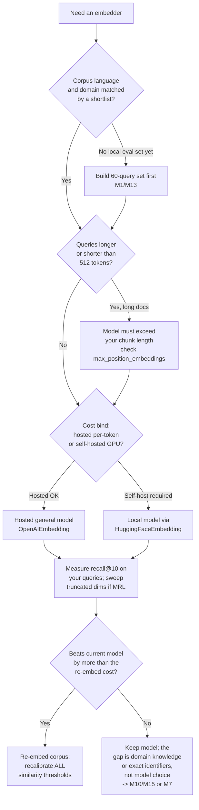

# M4 · Embeddings and Vector Space

> **Module question:** What is an embedding model actually optimizing, and how do you choose one?
> **Cross-cutting threads:** Failure modes · Tradeoff ledger · LlamaIndex at a glance
> **Domain spine:** LogiTrack — choosing the embedder for [13.5M words](../../syllabus.md#corpus-scale) of freight, tariff, and customs text
> **Prerequisites:** [M3 — Corpus Acquisition, Parsing, and the Chunking Decision](../03-parsing-and-chunking/README.md)

## Contents

- [Opening scene — the upgrade that changed nothing](#opening-scene--the-upgrade-that-changed-nothing)
- [Inside an embedding model: from tokens to one vector](#inside-an-embedding-model-from-tokens-to-one-vector)
  - [1 · Tokens](#1--tokens)
  - [2 · One vector per token](#2--one-vector-per-token)
  - [3 · Pooling: the grid becomes one vector](#3--pooling-the-grid-becomes-one-vector)
  - [4 · What follows from this, across the course](#4--what-follows-from-this-across-the-course)
- [What an embedding model is optimizing](#what-an-embedding-model-is-optimizing)
- [Distance, geometry, and the normalization decision](#distance-geometry-and-the-normalization-decision)
- [The cone effect: raw embeddings are not isotropic](#the-cone-effect-raw-embeddings-are-not-isotropic)
  - [Worked: setting a similarity threshold from two distributions](#worked-setting-a-similarity-threshold-from-two-distributions)
- [Dimensionality, Matryoshka truncation, and the storage bill](#dimensionality-matryoshka-truncation-and-the-storage-bill)
  - [Worked: training a Matryoshka embedder yourself](#worked-training-a-matryoshka-embedder-yourself)
    - [The recipe, step by step](#the-recipe-step-by-step)
- [Symmetric vs asymmetric, and instruction prefixes](#symmetric-vs-asymmetric-and-instruction-prefixes)
- [Choosing an instrument: BEIR, MTEB, and your own 60 queries](#choosing-an-instrument-beir-mteb-and-your-own-60-queries)
- [Worked example: choosing LogiTrack's embedder under a $0.02/1M-token budget](#worked-example-choosing-logitracks-embedder-under-a-0021m-token-budget)
- [Design exercise](#design-exercise)
- [Where the literature disagrees](#where-the-literature-disagrees)
- [Sources](#sources)

---

## Opening scene — the upgrade that changed nothing

LogiTrack's pilot is a month old and the team has a number. Retrieval recall@10 on the frozen
60-query set: **0.71**. Everyone agrees it should be higher. The obvious suspect is the embedding
model, because it is the only component in the pipeline they did not choose deliberately: nobody
ever set `Settings.embed_model`, so LlamaIndex fell back to `OpenAIEmbedding`'s default,
`text-embedding-ada-002` — a fallback the documentation warns about in a sentence the team skipped
[[LI-EMB]](#src-li-emb).

So they upgrade. The new model sits at the top of the MTEB leaderboard's retrieval column, has
4,096 dimensions to ada-002's 1,536, and needs a GPU to serve. The migration is a config change —
`Settings.embed_model = ...`, one line [[LI-EMB]](#src-li-emb) — and a full re-embed of the 187,043 vectors M3's
configuration produced. The documentation is unambiguous that the re-embed was not optional: *"if
you change your embedding model after indexing, you must re-index. Embeddings from different models
are not interchangeable"* [[LI-EMB]](#src-li-emb).

Three days later, recall@10 is **0.72**.

That is the whole story of this module. The upgrade was not wasted because the new model was bad —
it was wasted because nobody could say what the old model was *failing at*. The queries that missed
were not failing on meaning in general. They were failing on knowledge only LogiTrack has. Ops staff
ask about *"the battery paperwork"*, and the clause that answers them says *"consignments under
Schedule DG-4 require Form LT-17 before tender."* Schedule DG-4 is LogiTrack's internal name for
lithium-ion battery shipments, and Form LT-17 is its in-house dangerous-goods checklist. Nothing in
the clause says "battery" or "paperwork", and no model trained on public text has seen either code.
The link exists only in the heads of the staff who wrote the answer labels for the 60-query set. So
the query lands near clauses that mention batteries in plain words, and the right clause sits
somewhere else entirely. That is **F4 · representation mismatch**: the user's words and the corpus's
words never met in the model's training data, and a better average score on someone else's
benchmark does not make them meet.

Worse, the migration quietly broke something else. LogiTrack's ingest drops a new chunk when it
scores above **0.98** cosine against a chunk already indexed — the team's guard against repeated
boilerplate and contracts re-uploaded under new filenames. The team had picked 0.98 by eye on the
old model, whose scores crowd into the top of the range: true duplicates scored 0.985 and up. The
new model spreads its scores out, and the same duplicates now land around 0.93–0.985. Almost none
cleared 0.98, so a week of ingest silently kept nearly every duplicate. Nothing errored; the index
just grew. ([Setting that cutoff properly](#worked-setting-a-similarity-threshold-from-two-distributions)
is worked below.)

> **Failure mode (the module in one line):** treating the embedding model as a **vendor choice
> selected by leaderboard rank** rather than as a learned function whose objective, geometry, and
> dimensional budget you must understand — so you pay for a migration, still cannot name what your
> retrieval was missing, and do not know which of your thresholds the migration just broke.

---

## Inside an embedding model: from tokens to one vector

> $\color{red}\text{to be discussed}$ — what happens between "text goes in" and "one vector comes
> out". M3's chunk-size argument, its late-chunking section, and M9's rerankers all rely on it.

**The whole mechanism in one line:** text → tokens → one vector **per token** → pooling → **one**
vector per text.

### 1 · Tokens
- The text is split into **sub-word tokens** by the model's own tokenizer.
  - BERT uses "WordPiece embeddings … with a 30,000 token vocabulary" [[BERT18]](#src-bert18).
- **The tokenizer decides the length, as measured in token count** and the length has a hard ceiling (the model's input limit).
- **The model decides the vector's size, D.** It's fixed per model, whatever the input length.

  | Model | Truncates at (Sentence Transformers) | Architecture max | D (output dimensions) | Pooling | Source |
  |---|---|---|---|---|---|
  | `text-embedding-3-small` (OpenAI) | Hosted, so not applicable | 8,192 tokens (the API's max input) | 1,536 (can be shortened) | Not disclosed | [[OAI-EMB]](#src-oai-emb) |
  | `text-embedding-3-large` (OpenAI) | Hosted, so not applicable | 8,192 tokens (the API's max input) | 3,072 (can be shortened) | Not disclosed | [[OAI-EMB]](#src-oai-emb) |
  | `all-MiniLM-L6-v2` | **256** | 512 | 384 | [Mean](#pool-mean) | [[HF-POOL]](#src-hf-pool) |
  | `bge-base-en-v1.5` | 512 | 512 | 768 | [`[CLS]`](#pool-cls) | [[HF-POOL]](#src-hf-pool) |
  | `e5-base-v2` | 512 | 512 | 768 | [Mean](#pool-mean) | [[HF-POOL]](#src-hf-pool) |
  | `nomic-embed-text-v1` | 8,192 | 8,192 | 768 | [Mean](#pool-mean) | [[HF-POOL]](#src-hf-pool) |
  | `jina-embeddings-v2-small-en` | 8,192 | 8,192 | 512 | [Mean](#pool-mean) | [[HF-POOL]](#src-hf-pool) |
  | `Qwen3-Embedding-0.6B` | 32,768 (no `max_seq_length` set, so the tokenizer's limit is capped at the architecture max [[ST-SRC]](#src-st-src)) | 32,768 | 1,024 | [Last token](#pool-last-token) | [[HF-POOL]](#src-hf-pool)[[HF-QWEN3E]](#src-hf-qwen3e) |
  | `e5-mistral-7b-instruct` | 32,768, **but the card recommends ≤ 4,096** ("inputs longer than 4096 tokens is not recommended") | 32,768 | 4,096 | [Last token](#pool-last-token) | [[HF-POOL]](#src-hf-pool) |

  - **"Truncates at"** is the length Sentence Transformers actually cuts at: the model's
    `max_seq_length` in `sentence_bert_config.json`. **"Architecture max"** is
    `max_position_embeddings` in `config.json`, the longest input the model's position encoding can
    take.
  - **When they differ, the smaller one wins silently.** A 300-token chunk embedded with
    `all-MiniLM-L6-v2` loses its last 44 tokens, even though the architecture could take 512.

- **Past the limit, text is cut off, not rejected.**
  - Sentence Transformers 6.3.0 tokenizes text with `truncation="longest_first"`, and caps the
    tokenizer's maximum length at the model's `max_position_embeddings` [[ST-SRC]](#src-st-src).
  - So an over-long chunk is embedded **from its beginning only**, and the rest never reaches the
    vector.

> **Input modalities: text only, and structure is just more text.**
> - **None of the nine models above is multimodal.** Each takes text in and nothing else. Tables,
>   figures and scans reach them only as the text the parser made (→ [M3](../03-parsing-and-chunking/README.md);
>   images: see the multimodal notes under [What an embedding model is optimizing](#what-an-embedding-model-is-optimizing)
>   and [Dimensionality](#dimensionality-matryoshka-truncation-and-the-storage-bill)).
>   Models that do take images or video: [image-and-video-embeddings.md](image-and-video-embeddings.md#image-text-embedders).
> - **Markdown, JSON and code get no special handling either.** There is no markdown, JSON or code
>   mode: `{"lane": "RTM–SIN", "dg_surcharge": 3.5}` is tokenized like any sentence, and the model
>   embeds the resulting string. Structure helps only as far as training taught the model what the
>   syntax means. Three consequences:
>   - **Syntax costs tokens.** Braces, quotes, repeated keys and table pipes all count against the
>     input limit, so a JSON record or a markdown table row reaches truncation sooner than the same
>     facts written as prose.
>   - **Mean pooling averages the syntax in with the content.** Two records with the same schema share
>     most of their tokens, so they score as near-duplicates whatever their values. That's the hard-negative
>     problem of the [threshold section](#worked-setting-a-similarity-threshold-from-two-distributions).
>   - **Code quality depends on the training data, not the architecture.** Check a model's card for
>     code in its training mix before trusting it on code, or use a code-specific embedder.
> - **What to do:** recover structure at parse time (`MarkdownNodeParser`, `JSONNodeParser`), then
>   embed rows or records serialized as `key: value` text with the headers repeated
>   (→ [M3](../03-parsing-and-chunking/README.md)).
> - *Argued from the tokenization and pooling described here, not measured in this module.*

### 2 · One vector per token
- Each token starts as its own vector, then passes through the transformer's layers.
- **In every layer, each token's vector is updated by attending to the other tokens** in the same
  input. Self-attention is "an attention mechanism relating different positions of a single
  sequence in order to compute a representation of the sequence" [[VAS17]](#src-vas17).
  - So after the layers, the vector for "Carrier" means "Carrier, *as used in this text*".
- **The output is a grid:** one vector per token, tokens × D numbers.
- **Two kinds of attention:**
  - **BERT-style encoders** (BGE, E5, MiniLM, nomic): every token attends to **every** token [[BERT18]](#src-bert18).
  - **LLM-based embedders** (e5-mistral, Qwen3-Embedding): a decoder with **causal** attention, where
    each token attends only to the tokens **before** it [[VAS17]](#src-vas17).
- **How we got here** (static GloVe vectors → BERT → LLM backbones): [embedding-history.md](embedding-history.md).
- **Why a BERT encoder alone isn't an embedder, and what Sentence-BERT changed**, explained without math:
  [sentence-bert-explained-simply.md](sentence-bert-explained-simply.md).

### 3 · Pooling: the grid becomes one vector
This is the step embedding APIs hide, and it's what makes "one string → one vector" true.

| Pooling | What it does | Who uses it |
|---|---|---|
| <a id="pool-mean"></a>**Mean** | Averages all the token vectors | Sentence-BERT (UKP Lab, TU Darmstadt), whose default is mean ("The default configuration is MEAN") [[SB19]](#src-sb19); `all-MiniLM-L6-v2` (Sentence Transformers project, on Microsoft's MiniLM), `e5-base-v2` (Microsoft), `nomic-embed-text-v1` (Nomic AI) [[HF-POOL]](#src-hf-pool); jina-embeddings-v2 (Jina AI), whose card says "apply mean pooling" [[HF-POOL]](#src-hf-pool) |
| <a id="pool-cls"></a>**`[CLS]`** | Keeps the vector of the special first token. BERT (Google): "The first token of every sequence is always a special classification token ([CLS])" [[BERT18]](#src-bert18) | `bge-base-en-v1.5` (BAAI, the Beijing Academy of Artificial Intelligence) [[HF-POOL]](#src-hf-pool) |
| <a id="pool-last-token"></a>**Last token** | Keeps the vector of the final token | e5-mistral (Microsoft, on Mistral AI's Mistral-7B): "we append an [EOS] token … by taking the last layer [EOS] vector" [[E5M24]](#src-e5m24); `Qwen3-Embedding-0.6B` (Alibaba's Qwen team) [[HF-POOL]](#src-hf-pool) |
| **Max** | Takes each dimension's maximum over the tokens | Tested by Sentence-BERT (UKP Lab) and found much worse under its regression objective (STSb: MEAN 87.44, CLS 86.62, MAX 69.92) [[SB19]](#src-sb19) |

- **Why the last token for causal models:** with causal attention, only the last token has seen the
  whole input. *This reason is argued here from how causal attention works, not quoted from a
  source.*
- **The pooling is fixed by the model, not chosen by you.** It's part of how the model was trained,
  and in Sentence Transformers it's stored in the model's `1_Pooling/config.json` [[HF-POOL]](#src-hf-pool).
- **Hosted models don't disclose it.** OpenAI's embeddings guide gives the input limit, but not the
  architecture or the pooling of `text-embedding-3` [[OAI-EMB]](#src-oai-emb).
- **Pooling doesn't change D.** Every token vector already has D numbers (the transformer's hidden
  size), and averaging or picking one of them keeps D. That's why `word_embedding_dimension` in each
  `1_Pooling/config.json` equals the model's output size [[HF-POOL]](#src-hf-pool).
  - D only shrinks if you shorten the vector afterwards (OpenAI's `dimensions` parameter, or
    Matryoshka truncation, see [Dimensionality](#dimensionality-matryoshka-truncation-and-the-storage-bill)).
- **Normalization** (make the pooled vector a unit vector) usually follows pooling. BGE's model card encodes with
  `normalize_embeddings=True` [[HF-POOL]](#src-hf-pool). Why it matters: the
  [normalization decision](#distance-geometry-and-the-normalization-decision).

### 4 · What follows from this, across the course

| Consequence | Where it matters |
|---|---|
| **Long chunks blur.** Mean pooling averages more tokens into one vector, so each idea's share shrinks. The late-chunking authors call this semantics being "over-compressed in the embeddings" | M3's chunk-size budget ([M3 · G24](../03-parsing-and-chunking/README.md#late-chunking-chunk-the-embedding-not-the-text)) |
| **Truncation is silent.** A chunk longer than the input limit loses its tail with no error | M3's chunk sizes must stay under the embedder's limit |
| **Late chunking is possible only because the grid exists.** It pools per chunk instead of over the whole text, which needs access to the per-token output | [M3 · Late chunking](../03-parsing-and-chunking/README.md#late-chunking-chunk-the-embedding-not-the-text) |
| **A reranker doesn't pool query and passage separately.** A cross-encoder feeds "the query as sentence A and the passage text as sentence B", and uses "the [CLS] vector … to obtain the probability of the passage being relevant" [[MONO19]](#src-mono19) | M9; [M3's stitched passages](../03-parsing-and-chunking/stitched-passage-retrieval.md) |
| **D is paid at ingest and again at every query.** At ingest: storage is 4 × D × N bytes in float32, and the ANN index's memory grows with it. At query time: every distance computed during the search costs about D multiply-adds, and the query must be embedded by **the same model at the same D** as the index, or the vectors aren't comparable | [Dimensionality](#dimensionality-matryoshka-truncation-and-the-storage-bill); M5's memory and latency |
| **A bi-encoder pools query and document separately,** which is what makes vectors computable in advance (the next section) | The rest of this module |

---

## What an embedding model is optimizing

An embedding model used for retrieval is almost always a **bi-encoder**: text goes in, one fixed
vector comes out, and relevance is scored by a cheap geometric operation (some sort of similarity score: cosine, dot product or euclidean distance) between two independently
computed vectors. 
- The architecture exists for one reason, and it was not invented for retrieval.
- Sentence-BERT showed that feeding both sentences of a pair through BERT requires roughly 50 million
inference computations (~65 hours) to find the most similar pair in a collection of 10,000
sentences, and that a siamese/triplet network producing *independently comparable* sentence
embeddings cuts that to about five seconds while maintaining accuracy [[SB19]](#src-sb19)
([explained simply](sentence-bert-explained-simply.md)). 
- Every design decision
downstream of this one — normalizing vectors, choosing a distance, quantizing to save memory — is
only possible because the representation is computed **before** the comparison.

> Each training signal in turn, from SBERT's labelled pairs to contrastive pretraining and LLM-made synthetic data, and what each fixed: [embedding-history.md](embedding-history.md#20192021-training-for-the-vector-itself).

What the model learns is a *ranking* objective, not a metric. Dense Passage Retrieval trained a
dual-encoder on a small number of question–passage pairs and beat a strong Lucene-BM25 system by
9–19% absolute in top-20 passage retrieval accuracy across open-domain QA datasets [[DPR20]](#src-dpr20). SimCSE
showed that the contrastive objective can be driven by nothing more than dropout acting as minimal
data augmentation — and that removing the noise causes representation collapse — then improved it
with entailment pairs as positives and contradiction pairs as hard negatives [[SIMCSE21]](#src-simcse21).

Three consequences follow, and all three are load-bearing for the rest of the course:

| Property of the training objective | What it implies downstream |
|---|---|
| The loss is **contrastive**: it pushes positives together relative to negatives | Similarity values are *relative ranks*, not calibrated probabilities. "0.82" means nothing on its own. |
| The loss never sees your corpus's notions of relevance | A model can be excellent on average and blind to your domain's distinctions [[BEIR21]](#src-beir21). |
| The objective is trained against **negative sampling** choices | What a model thinks is "far" is shaped by what it was told was wrong — which is why hard-negative mining is a lever (→ M15). |

The practical reading: an embedding is an opinion about similarity learned from someone else's data.
Your job is not to pick the best opinion in the abstract; it is to pick the one that matches your
corpus's relevance judgements, and then to *measure* that match on your own queries.

> **Multimodal inputs** ($\color{red}\text{to be discussed}$) — a text embedder sees only the text the parser made from tables, figures and scans.
> - Rate tables, DG figures and scanned pages reach M4 as text from [M3](../03-parsing-and-chunking/README.md); what M3 dropped, no embedder recovers.
> - Vision-model figure descriptions use the describer's words, not ops staff's — the same gap as "the battery paperwork".
> - OCR errors change the tokens, so they change the vectors.
> - Tag chunks by origin (native text / OCR / table / figure text) and report recall@10 per origin (→ [M13](../13-evaluation/README.md)).
>   - No table or figure queries in the 60-query set means this failure is invisible.
> - Embedding the image itself instead, and when that beats captioning: [image-and-video-embeddings.md](image-and-video-embeddings.md#one-shared-space-or-caption-into-text).

> **LlamaIndex at a glance:** embedding models are configured globally on `Settings.embed_model`
> and used both at index construction and at query time; per-index overrides are also possible
> [[LI-EMB]](#src-li-emb). The two classes this course uses are `OpenAIEmbedding` (hosted) and
> `HuggingFaceEmbedding` (local, backed by Sentence Transformers) [[LI-EMB]](#src-li-emb). Custom models subclass
> `BaseEmbedding` — and the base class has **separate hooks for queries and documents**,
> `_get_query_embedding` and `_get_text_embedding`/`_get_text_embeddings` [[LI-EMB]](#src-li-emb). That split is
> not cosmetic; it is where asymmetry lives, and we return to it below.
>
> Two documented traps. First, if `Settings.embed_model` is never set, LlamaIndex falls back to
> `OpenAIEmbedding`'s default `text-embedding-ada-002`, and the docs explicitly "recommend doing
> this for new projects" — meaning setting it explicitly [[LI-EMB]](#src-li-emb). The opening scene is that trap.
> Second, hosted requests are batched at an `embed_batch_size` default of 10, which the docs note
> can be too small when embedding many documents — while the index itself inserts vectors in
> batches of 2,048 nodes by default [[LI-EMB]](#src-li-emb)[[LI-IDX]](#src-li-idx).

---

## Distance, geometry, and the normalization decision

Three similarity functions appear in every vector-store config file. Only two of them are genuinely
different, and the third is a representational choice masquerading as a distance choice.

For vectors $\mathbf{a}, \mathbf{b} \in \mathbb{R}^D$:

$$\text{dot} = \mathbf{a}\cdot\mathbf{b}, \qquad
\text{cos} = \frac{\mathbf{a}\cdot\mathbf{b}}{\lVert\mathbf{a}\rVert\,\lVert\mathbf{b}\rVert},
\qquad
\lVert\mathbf{a}-\mathbf{b}\rVert^2 = \lVert\mathbf{a}\rVert^2 + \lVert\mathbf{b}\rVert^2 - 2\,\mathbf{a}\cdot\mathbf{b}$$

That third identity is the whole story. If every vector is stored **L2-normalized** so that
$\lVert\mathbf{a}\rVert = \lVert\mathbf{b}\rVert = 1$, then

$$\lVert\mathbf{a}-\mathbf{b}\rVert^2 = 2 - 2\,\mathbf{a}\cdot\mathbf{b} = 2 - 2\cos\theta$$

so squared Euclidean distance is a strictly decreasing affine function of cosine similarity. The
three metrics induce **identical rankings** on the unit sphere. Choosing among them then changes
only the *numbers you log*, not the order you retrieve — and any threshold you calibrate (a
near-duplicate cutoff, a relevance floor) is therefore a statement about the metric you chose, not
about similarity.

| Metric | Ranking-equivalent to cosine when | What magnitude carries | Typical use |
|---|---|---|---|
| Cosine | always | nothing — direction only | Default. LlamaIndex compares embeddings with cosine similarity by default [[LI-EMB]](#src-li-emb). Sentence-BERT compares sentence embeddings with cosine at inference and trains its regression objective on it ("we always use cosine-similarity to compare the similarity between two sentence embeddings") [[SB19]](#src-sb19); see its Figure 2 in [Sentence-BERT, explained simply · §4](sentence-bert-explained-simply.md#4--the-twins-game-teaching-the-reader-to-make-good-maps) |
| Dot product | vectors are unit-normalized | the norm of each vector; dot-product-tuned models favour longer passages, cosine-tuned ones shorter [[ST-DOT]](#src-st-dot) | Models trained with a dot-product objective, e.g. DPR [[DPR20]](#src-dpr20), Sentence-Transformers `*-dot-v1`/`*-dot-v5` and `msmarco-distilbert-base-tas-b` [[ST-DOT]](#src-st-dot) |
| Euclidean (L2) | vectors are unit-normalized | nothing beyond direction, under the identity above | Indexes that are L2 unless told otherwise, e.g. FAISS `IndexFlatL2` (index constructors default to `METRIC_L2`; inner product needs `IndexFlatIP` or `METRIC_INNER_PRODUCT`) [[FAISS]](#src-faiss), which the LlamaIndex `FaissVectorStore` example builds [[LI-FAISS]](#src-li-faiss), and Chroma's default `l2` space [[CHROMA-CFG]](#src-chroma-cfg) |

The reason this matters operationally is that **you do not get to choose independently of your
index or your store**. A vector store's index type is built for one metric; switching metric later
is a rebuild, not a config toggle. And normalization is a decision you make once, at embed time,
for every vector in the corpus — which makes it one of the few decisions in the pipeline that is
retrospectively expensive in exactly the way chunking is (→ M3).

> **Tradeoff (the ledger entry M4-1).** *Decision:* store L2-normalized embeddings and score with
> cosine, accepting the collapse of Euclidean/dot/cosine into one ranking. *Costs:* magnitudes are
> discarded, so any signal a model encodes in vector norm is thrown away. *Accepted because:* a
> single metric makes thresholds portable across stores and index types, and cross-metric comparisons
> of unnormalized vectors are a recurring source of silent ranking bugs. *Reverses if:* you adopt a
> model whose training objective explicitly uses raw inner product, in which case normalization
> destroys the trained signal.

---

## The cone effect: raw embeddings are not isotropic

The intuition that unrelated texts sit near the origin and related texts sit near each other is
false. Ethayarajh measured the geometry of contextual representations across BERT, ELMo, and GPT-2
and found that *"the contextualized representations of all words are not isotropic in any layer of
the contextualizing model"* [[ETH19]](#src-eth19). Gao et al. identified the same phenomenon during language-model
training: with weight tying and large datasets, *"most of the learnt word embeddings tend to
degenerate and be distributed into a narrow cone, which largely limits the representation power of
word embeddings"* [[GAO19]](#src-gao19). SimCSE's analysis connects the two to retrieval directly — the
contrastive objective is what *"regularizes pre-trained embeddings' anisotropic space to be more
uniform"* [[SIMCSE21]](#src-simcse21).

Why this is the single most practically dangerous fact in the module:

- **Your similarity floor is not zero.** If every vector lives in a narrow cone, then two
  completely unrelated documents may score 0.6–0.8 cosine. A retrieval system returning "scores
  above 0.7" is therefore returning noise with high confidence.
  - Informal measurements on `text-embedding-ada-002` fit this. Forum users report its vectors
    "only seem to span a cone of about 54 degrees wide" [[OAIF-ADACONE23]](#src-oaif-adacone23), and
    that "the model isn't isotropic, and has all correlations between 0.7 and 1"
    [[OAIF-ADASCALE23]](#src-oaif-adascale23). *Community measurements, not a study.*
- **Thresholds do not transfer between models.** The cone's width is a property of the model and
  its training, so a near-duplicate threshold measured on model A is meaningless on model B. This
  is precisely what broke in the opening scene.
- **"High similarity" is a distributional claim, not an absolute one.** The only defensible way to
  set any similarity threshold is empirically: embed a sample, plot the distribution for known
  pairs and known non-pairs, and read the threshold off the two distributions. That measurement is
  [worked below](#worked-setting-a-similarity-threshold-from-two-distributions) and repeated with
  real numbers in the M4 lab.

The remedies are also contested. Centering or whitening embeddings before indexing is reported to
reduce anisotropy and improve similarity-based tasks; the same literature reports that the effect is
task- and layer-dependent [[ETH19]](#src-eth19), and none of the sources fetched for this module establishes
whitening as a reliable retrieval win. Treat it as a hypothesis with a measurement attached, not a
default — and note that whitening is a *transform* applied at embed time to both queries and
documents, which means it is another entry on the re-embed list.

### Worked: setting a similarity threshold from two distributions

A cosine cutoff is a claim about where two groups of pairs separate. You find it by scoring both
groups with the model you will ship. Here it is for the opening scene's dedup cutoff.

**1 · Build labelled pairs from your own chunks.** From the lab's 200 LogiTrack chunks:
- **Duplicates (should be dropped), 120 pairs:** the same boilerplate clause in two carriers'
  agreements; the same page re-uploaded under a new filename.
  - Leave out overlap pairs. M3 catches those by character offsets, with no threshold
    ([→ M3](../03-parsing-and-chunking/README.md#overlap-what-it-buys-and-what-it-costs)).
- **Hard negatives (must be kept), 120 pairs:** the same clause with one figure changed, e.g. a DG
  surcharge of 3.5% in one agreement and 4.0% in its revision. The text is almost identical, and the
  one difference is the only part that matters.
- **Random pairs, 1,000:** any two chunks.

**2 · Score every pair with each model and compare the distributions.**

| Pair set | Old model (`ada-002`) | New model (the MTEB leader) |
|---|---|---|
| Random pairs, median | 0.74 | 0.21 |
| Hard negatives, 99th percentile | 0.978 | 0.925 |
| Duplicates, 5th percentile | 0.985 | 0.93 |
| Duplicates, median | 0.993 | 0.96 |
| **Cutoff** (lowest value with ≤ 1% of hard negatives above it) | **0.98** | **0.93** |
| Duplicates caught at 0.98 | 96% | **7%** |
| Duplicates caught at the model's own cutoff | 96% | 95% |

- The old model's random pairs sit at 0.74: [the cone](#the-cone-effect-raw-embeddings-are-not-isotropic) in one number.
  The figure is synthetic, but it sits in the 0.7–1 range forum users report for `ada-002`
  [[OAIF-ADASCALE23]](#src-oaif-adascale23).
- Carrying 0.98 over to the new model catches 7% of duplicates. That's the week of silent ingest
  from the opening scene.

**3 · Read the cutoff off the hard negatives, not the random pairs.**
- Against random pairs, almost any high cutoff looks safe. The cutoff that matters is the one that
  still keeps the revised clause.
- **Set it by the costlier error.** Dropping a hard negative deletes the current DG surcharge from
  the index, which causes a wrong answer. Keeping a duplicate wastes a top-k slot. So cap false drops
  (here ≤ 1% of hard negatives) and accept the duplicates the cap lets through.

**4 · The gap is the real result.**
- The gap between hard negatives and duplicates is 0.978 → 0.985 on the old model and 0.925 → 0.93 on
  the new one. Both are under 0.01.
- A gap that narrow breaks with small changes: a prefix, normalization, a parser update.
- **If the two distributions overlap, no cosine cutoff is safe.** Add a second check instead, e.g.
  drop a chunk only if its numbers and identifiers also match exactly.

**5 · Version the cutoff with the model.**
- Store the cutoff next to the model id, D, normalization and prefix (M4-1, M4-3). Any change to
  those reruns steps 1–4.
- **The same procedure sets a relevance floor** such as `SimilarityPostprocessor(similarity_cutoff=…)`
  (→ M2). The pairs are (query, relevant chunk) and (query, highest-ranked irrelevant chunk) from the
  60-query set. Reranking and MMR change the score scale again (→ [M9](../09-ranking-fusion-reranking/README.md#diversity-position-and-the-two-ordering-problems)).

---

## Dimensionality, Matryoshka truncation, and the storage bill

Vector width is the single largest multiplier on your storage line item, and unlike chunk count it
is chosen for you by the model vendor — unless you use Matryoshka Representation Learning, which
trains *"coarse-to-fine representations"* so that a single embedding can be truncated to a shorter
prefix at query time, reporting *"up to 14x smaller embedding size"* for classification at equal
accuracy and *"up to 14x real-world speed-ups for large-scale retrieval"* on image benchmarks
[[MRL22]](#src-mrl22). The property that makes this safe is that the truncated vector is still a valid embedding,
because the training objective explicitly supervised the prefixes: MRL representations are *"at
least as accurate and rich as independently trained low-dimensional representations"* [[MRL22]](#src-mrl22).

LlamaIndex exposes this as a pass-through: extra keyword arguments to `HuggingFaceEmbedding` are
forwarded to the underlying `SentenceTransformer`, and the docs name `truncate_dim` explicitly
alongside `backend`, `model_kwargs`, and `revision` [[LI-EMB]](#src-li-emb). Hosted providers expose the same idea
as a parameter — the third-generation OpenAI embedding models support reducing vector size via a
`dimensions` parameter, and provider testing reports that reducing dimensions below the 1,536 of
`text-embedding-ada-002` still leaves performance "slightly better" [[MSAOAI]](#src-msaoai).
OpenAI does not document how `dimensions` works, but outside sources say it is Matryoshka truncation.
An OpenAI API product manager is quoted confirming *"We did train this based on MRL"*
[[AIM-MRL24]](#src-aim-mrl24)[[PC-OAI3]](#src-pc-oai3). A community test found that the first 1,024
values of a 3,072-d `text-embedding-3-large` vector, renormalized to unit length, match the native
1,024-d output (dot product ≈ 0.9999993) [[OAIF-TRUNC24]](#src-oaif-trunc24). *Second-hand and
community-measured, not documented by OpenAI.*

Here is what the width actually costs at LogiTrack's scale. M3's structure-aware path produces
**40,703 nodes**; the hierarchical configuration that wins clause recall embeds **187,043** leaf
vectors ([→ M3](../03-parsing-and-chunking/README.md#overlap-what-it-buys-and-what-it-costs)). Raw vector bytes are $4 \times D \times N$ at float32, shown at the
hierarchical count because that is the case memory planning must cover:

| Model | Dimensions | Raw bytes @187,043 vectors | vs. 384-d | @40,703 nodes |
|---|---|---|---|---|
| `BAAI/bge-small-en-v1.5` (verified config: `hidden_size` 384) [[HF-BGES]](#src-hf-bges) | 384 | 0.29 GB | 1.0× | 0.06 GB |
| `lightonai/DenseOn` (verified config: `hidden_size` 768) [[HF-DENSEON]](#src-hf-denseon) | 768 | 0.57 GB | 2.0× | 0.13 GB |
| `Qwen/Qwen3-Embedding-0.6B` (verified config: `hidden_size` 1024) [[HF-QWEN3E]](#src-hf-qwen3e) | 1,024 | 0.77 GB | 2.7× | 0.17 GB |
| `text-embedding-3-small` / `text-embedding-ada-002` [[MSAOAI]](#src-msaoai) | 1,536 | 1.15 GB | 4.0× | 0.25 GB |
| `text-embedding-3-large` [[MSAOAI]](#src-msaoai) | 3,072 | 2.30 GB | 8.0× | 0.50 GB |

Three readings of that table, none of which is "pick the small one":

1. **This is only the vector payload.** Every real index adds per-vector structure on top — graph
   links for HNSW, quantized codes for PQ — and at D = 1,536 the float32 payload dominates that
   structure by two orders of magnitude (M5 does the accounting). Which means the width you choose
   here is the width you pay for everywhere, and the way out is not a slimmer graph but
   **quantization**, which trades precision for footprint and is priced in recall, not in bytes.
2. **The storage multiplier is the cheap half of the trade.** A wider vector also costs more per
   query (distance computations scale linearly in $D$) and more per re-embed if your provider prices
   by output volume. The decision is a *triple*, not a size.
3. **Truncation is a free second chance that most teams never take.** If your model is MRL-trained,
   the honest experiment is to sweep $D \in \{256, 512, 768, \text{full}\}$ against recall on your
   own query set, because the recall curve is flatter than the storage curve [[MRL22]](#src-mrl22).

> **Multimodal inputs** ($\color{red}\text{to be discussed}$) — image embeddings are deferred by decision ([syllabus §1](../../syllabus.md#1-scope-knobs-frozen)); notes for when that scope opens.
> - CLIP learns image representations by matching captions to images ([CLIP](https://arxiv.org/abs/2103.00020)) — contrastive, like the text objectives above.
> - ColPali skips text extraction: it embeds page images as multi-vector embeddings with late interaction ([ColPali](https://arxiv.org/abs/2407.01449)).
> - Many vectors per page breaks the one-vector-per-chunk $4 \times D \times N$ math above; re-derive storage first (→ [M5](../05-vector-databases-and-ann/README.md)).
> - ColPali, the re-derived storage math and pooling's savings: [image-and-video-embeddings.md](image-and-video-embeddings.md#scanned-documents-as-images-colpali-and-late-interaction) ([storage bill](image-and-video-embeddings.md#worked-the-storage-bill-for-many-vectors-per-page)).
> - Until then, figures and scans enter as text and share the text embedder, thresholds and storage budget.

> **Tradeoff (the ledger entry M4-2).** *Decision:* choose dimension by measuring recall at
> truncated widths before committing to full width. *Costs:* an extra evaluation sweep per model
> candidate, and possible loss of the small tail of queries that need the full representation.
> *Accepted because:* storage and query cost scale linearly in $D$ while recall typically does not,
> so a swept choice dominates a defaulted one. *Reverses if:* the model is not Matryoshka-trained,
> in which case prefix truncation is not principled and the sweep is wasted effort.

### Worked: training a Matryoshka embedder yourself

**Why an ordinary model can't be truncated.** Training only ever scores the full vector, so the model
spreads information across all $D$ numbers in whatever order it likes. Keep the first 64 of 768 and you
keep an arbitrary twelfth of what it learned.

**What Matryoshka training changes: one extra loop in the loss.** Pick a few nested widths. At every
training step, compute the usual loss on the first $m$ numbers of each vector, for every width $m$, and
add the results:

$$\mathcal{L}_{\text{MRL}} = \sum_{m \in \mathcal{M}} c_m \cdot \mathcal{L}\big(z_{1:m}\big)$$

Here $z_{1:m}$ is the first $m$ numbers of the embedding $z$, $\mathcal{M}$ is the set of widths, and
$c_m$ is how much each width counts. This is the paper's objective [[MRL22]](#src-mrl22). The paper also
adds a small classification head per width for its classification experiments; for retrieval you score
the prefixes directly, as below.

**Why that works.** The smallest prefix gets a gradient at every step, and every larger prefix contains
it. So the model learns to put the most useful information first and add detail later, like nesting dolls.

**What it costs.** Almost nothing at training time. The encoder still runs once per text; only the cheap
loss is computed several times. Inference is unchanged: embed once at full width, then keep any prefix.

#### The recipe, step by step

<details>
<summary><b>Show the recipe</b>: 8 steps of Python, then the recorded result of running it</summary>

You need Python, `torch` and `transformers` (`pip install torch transformers`), and a list of
`(query, passage)` pairs where each passage answers its query. A few thousand pairs is enough to see
the effect. Your own data works, or a public set such as Hugging Face's
`sentence-transformers/natural-questions`.

**Step 1 · Pick a small base model and the nested widths.** The last width must equal the model's
full width $D$. Doubling widths are the simple choice.

```python
import random
import torch
import torch.nn.functional as F
from transformers import AutoTokenizer, AutoModel

MODEL = "sentence-transformers/all-MiniLM-L6-v2"  # small: D = 384, trains on a laptop
DIMS = [32, 64, 128, 256, 384]                    # nested widths; the last one is D

tok = AutoTokenizer.from_pretrained(MODEL)
model = AutoModel.from_pretrained(MODEL)
```

**Step 2 · Turn a batch of texts into one vector each**, with mean pooling
([§3 Pooling](#3--pooling-the-grid-becomes-one-vector)).

```python
def embed(texts):
    batch = tok(texts, padding=True, truncation=True, max_length=256, return_tensors="pt")
    tokens = model(**batch).last_hidden_state             # (B, T, D): one vector per token
    mask = batch["attention_mask"].unsqueeze(-1).float()  # 1 for real tokens, 0 for padding
    return (tokens * mask).sum(1) / mask.sum(1)           # average the real tokens -> (B, D)
```

**Step 3 · Write the ordinary contrastive loss.** Query $i$ should score highest against passage $i$;
every other passage in the batch acts as a wrong answer (an in-batch negative).

```python
def contrastive_loss(q, p, temperature=0.05):
    q = F.normalize(q, dim=-1)                 # unit length, so q @ p.T is cosine similarity
    p = F.normalize(p, dim=-1)
    scores = q @ p.T / temperature             # (B, B): every query against every passage
    labels = torch.arange(len(q), device=q.device)  # the right passage for query i is passage i
    return F.cross_entropy(scores, labels)
```

**Step 4 · Wrap it in the Matryoshka loop.** This is the whole idea: the same loss on each prefix,
added up. Each prefix is normalized on its own inside `contrastive_loss`.

```python
def matryoshka_loss(q, p, dims=DIMS):
    return sum(contrastive_loss(q[:, :m], p[:, :m]) for m in dims)  # equal weights, c_m = 1
```

**Step 5 · Train as usual.** Keep each batch free of duplicate passages, or a "wrong answer" will
secretly be right.

```python
def train(pairs, dims, epochs=1, batch_size=32, lr=2e-5):
    opt = torch.optim.AdamW(model.parameters(), lr=lr)
    model.train()
    for _ in range(epochs):
        random.shuffle(pairs)
        for i in range(0, len(pairs), batch_size):
            queries, passages = zip(*pairs[i:i + batch_size])
            loss = matryoshka_loss(embed(list(queries)), embed(list(passages)), dims)
            opt.zero_grad()
            loss.backward()
            opt.step()
```

**Step 6 · Use a truncated vector: cut, then re-normalize.** Cutting a unit vector makes it shorter than
unit length, so normalize again before computing cosine. That's also what OpenAI's `dimensions`
parameter appears to do (above).

```python
@torch.no_grad()
def embed_at(texts, m):
    model.eval()
    return F.normalize(embed(texts)[:, :m], dim=-1)
```

**Step 7 · Check that it worked.** Hold out some pairs you didn't train on, and measure recall@1 at
each width: does each query's own passage come out on top?

```python
@torch.no_grad()
def recall_at_1(pairs, m):
    queries, passages = zip(*pairs)
    q, p = embed_at(list(queries), m), embed_at(list(passages), m)
    top = (q @ p.T).argmax(dim=1)              # best passage for each query
    return (top == torch.arange(len(q), device=q.device)).float().mean().item()

pairs = [("what is the DG surcharge on RTM-SIN?", "The DG surcharge on the Rotterdam-Singapore lane is ..."),
         # ... your few thousand (query, passage) pairs
        ]
random.shuffle(pairs)
train_pairs, test_pairs = pairs[:-500], pairs[-500:]
train(train_pairs, DIMS)
for m in DIMS:
    print(m, recall_at_1(test_pairs, m))
```

**Step 8 · Run the control.** Train a fresh copy of the base model on the full width only, then measure it
the same way.

```python
model = AutoModel.from_pretrained(MODEL)   # fresh copy; embed() and train() use this global
train(train_pairs, dims=[384])             # ordinary training: full width only
for m in DIMS:
    print(m, recall_at_1(test_pairs, m))
```

The prediction from the paper: at full width the two models are close, and at 32 or 64 the Matryoshka
model holds up much better.

**One run of exactly this code**, with [`lab/run_matryoshka_recipe.py`](lab/run_matryoshka_recipe.py), which
executes the blocks above straight from this README. Steps 1–6 were run as written. The data was 3,500 random pairs from
`sentence-transformers/natural-questions`: 3,000 to train for one epoch, 500 held out. Recall@1 on the
held-out 500:

| Width | Base model, untrained | Matryoshka (`DIMS`) | Control (`dims=[384]`) |
|---|---|---|---|
| 32 | 0.800 | **0.892** | 0.808 |
| 64 | 0.916 | **0.936** | 0.926 |
| 128 | 0.958 | 0.952 | 0.958 |
| 256 | 0.964 | 0.966 | 0.970 |
| 384 (full) | 0.974 | 0.976 | **0.980** |

- **The prediction held.** At 32 dimensions the Matryoshka model beats the control by 8 points; at full
  width the control is ahead by 0.4. Ordinary training didn't make the short prefix better than the
  untrained base model (0.808 vs 0.800). Matryoshka training did.
- **Read it with care:** it is one seed, one epoch and 500 test queries, and `all-MiniLM-L6-v2` was
  already trained on Natural Questions, which is why the untrained base scores so high. Expect bigger gaps
  on data the base model hasn't seen.
- *Run on 2026-11-14 with torch 2.15.0 and transformers 5.23.0, on a laptop CPU in about four minutes.
  The raw output, pinned versions and how to rerun it (other seeds, or a quick synthetic smoke test):
  [lab/README.md](lab/README.md#recorded-result-2026-11-14-seed-0-the-versions-in-requirementstxt).*
- **With a library instead:** Sentence Transformers wraps any loss the same way with `MatryoshkaLoss`.
  Fine-tuning a real model with it is in the
  [M15 side file, step 3](../15-finetuning-retrieval-models/open-embedder-pick-and-finetuning.md#step-3--the-loss).

</details>

---

## Symmetric vs asymmetric, and instruction prefixes

Retrieval is asymmetric almost by construction: a query is short, interrogative, and under-specified;
a document is long, declarative, and self-contained. DPR did not use one encoder for both sides —
it learned a dual-encoder framework for questions and passages [[DPR20]](#src-dpr20). Two families of solutions
follow.

**Architectural asymmetry.** Separate query and passage encoders, trained jointly. LlamaIndex
supports the *shape* of this even when a single model serves both roles: `BaseEmbedding` gives you
`_get_query_embedding` and `_get_text_embedding` as distinct methods, and the custom-embeddings
documentation builds `InstructorEmbeddings` on exactly that split, encoding the query with an
instruction and the document with the same instruction string [[LI-EMB]](#src-li-emb).

**Textual asymmetry — prefixes and instructions.** E5 prepends role markers and is trained with
weakly-supervised contrastive pre-training over curated text pairs, becoming *"the first model that
outperforms the strong BM25 baseline on the BEIR retrieval benchmark without using any labeled
data"* in zero-shot settings [[E522]](#src-e522). INSTRUCTOR generalizes the idea: *"every text input is embedded
together with instructions explaining the use case (e.g., task and domain descriptions)"*, trained
over 330 annotated tasks, with the authors reporting *"an average improvement of 3.4%"* over the
previous best across 70 datasets and — importantly — that it is *"robust to changes in instructions"*
[[INSTR22]](#src-instr22).

The operational failure this prevents is mundane and common: embedding documents with a query-side
prefix, or querying without the prefix the model was trained to expect. A prefixed model used
unprefixed is not broken — it degrades quietly, which is worse. The check is a two-line experiment:
embed 200 pairs with and without the prefix, and compare recall. If the model's card specifies
prefixes, treat their presence or absence as part of the model's interface, not as a tuning knob.

A second, sharper caveat sits underneath the prefix research. A 2026 study across 6 embedding models
and 11 datasets found that instruction-tuned embedding models are evaluated with a single prompt per
task, and that *"the default prompt can both systematically understate or overstate performance"*
[[ONEP26]](#src-onep26). Instructions are a real lever *and* a real measurement hazard.

> **Tradeoff (the ledger entry M4-3).** *Decision:* where a model documents prefixes or
> instructions, encode them as versioned constants in the ingest path and the query path together.
> *Costs:* a coupling between your code and a vendor's documented usage convention; every model
> swap is now a two-file change. *Accepted because:* an asymmetric model queried symmetrically
> fails silently and un-diagnosably, and the check is cheap. *Reverses if:* you move to a model
> trained symmetric-and-instruction-free, where the constants become dead code and should be
> deleted rather than left to rot.

---

## Choosing an instrument: BEIR, MTEB, and your own 60 queries

Two benchmarks dominate model selection, and they are different instruments.

**BEIR** is a zero-shot, out-of-domain benchmark: 18 datasets, 10 systems spanning lexical, sparse,
dense, late-interaction, and reranking architectures. Its headline result is uncomfortable reading
for a dense-retrieval-only pipeline: *"BM25 is a robust baseline"*, while *"dense and sparse-retrieval
models are computationally more efficient but often underperform other approaches, highlighting the
considerable room for improvement in their generalization capabilities"* [[BEIR21]](#src-beir21). Read that as the
first honest signal that embeddings are not universally superior — the lexical comparison itself is
M7's territory, but the *finding* that a general-purpose dense model degrades out of domain is
exactly the failure mode of the opening scene.

**MTEB** is the broader instrument: 8 embedding tasks, 58 datasets, 112 languages, 33 models
benchmarked, with the conclusion that *"no particular text embedding method dominates across all
tasks"* and that the field *"has yet to converge on a universal text embedding method"* [[MTEB22]](#src-mteb22).
LlamaIndex's documentation points to the MTEB leaderboard as *"the canonical place to compare
current models across accuracy, speed, and multilingual support"* [[LI-EMB]](#src-li-emb).

Canonical is not sufficient. Two verified results bound what the leaderboard can tell you:

- **Rank does not survive contact with a harder task.** BRIGHT — 1,384 real-world
  reasoning-intensive queries — reports that the leading model on the MTEB leaderboard, which scores
  *"59.0 nDCG@10"*, produces *"a score of nDCG@10 of 18.3 on BRIGHT"* [[BRIGHT24]](#src-bright24). A leaderboard
  position is a statement about the leaderboard's query distribution.
- **Rank is not even stable under prompt choice.** Kostiuk & Enevoldsen show that under adversarial
  prompt selection *"any model can be promoted to first place"* [[ONEP26]](#src-onep26).

There is also a bound that no amount of model quality removes. Weller et al. connect learning-theory
results to retrieval and show that *"the number of top-k subsets of documents capable of being
returned as the result of some query is limited by the dimension of the embedding"*, demonstrating
empirically that *"even state-of-the-art models fail"* on a dataset of deliberately simple queries
[[LIMIT25]](#src-limit25). A single vector per chunk is a fixed-capacity channel; some query→document-set mappings
simply do not fit in it at any dimension you can afford. M7 is where that limit becomes an
architecture decision; here it is the reason "pick a better embedding model" is not a universal
answer.

Finally, an embedding is not a privacy boundary. Embedding inversion reconstructs text from vectors:
an iterative method that *"iteratively corrects and re-embeds text"* recovers *"92% of 32-token text
inputs exactly"*, and the authors show recovery of *"important personal information (full names) from
a dataset of clinical notes"* [[VEC2TEXT23]](#src-vec2text23). Any corpus with PII or confidential clauses must be
redacted **before** embedding, not merely kept out of the generation prompt (→ M17, M21).



The diagram's last two boxes are the module's actual lesson: **a model change invalidates every
threshold you calibrated on the old model's geometry**, so the migration cost is never just the
re-embed bill.

> **Tradeoff (the ledger entry M4-4).** *Decision:* select the embedding model on a small,
> hand-labelled, in-domain query set, using BEIR/MTEB only to build the shortlist. *Costs:* a
> labelled query set must exist before the model is chosen (→ M1, M13), and the measured winner may
> be a model the leaderboard ranks lower. *Accepted because:* MTEB rank is not robust to prompt
> selection and does not transfer to reasoning-heavy or out-of-domain queries [[ONEP26]](#src-onep26)[[BRIGHT24]](#src-bright24),
> while a 60-query in-domain measurement is cheap, repeatable, and directly tied to the metric the
> system is judged on. *Reverses if:* a shortlist model is dramatically better on your own set *and*
> on a held-out slice — at which point the leaderboard was right and the local set was too small.

---

## Worked example: choosing LogiTrack's embedder under a $0.02/1M-token budget

The corpus is [13.5M words → **18.06M tokens**](../../syllabus.md#corpus-scale).
M3's structure-aware path embeds ~19.95M tokens; the hierarchical configuration that wins clause
recall embeds **21.74M tokens — 1.20× the corpus**, leaves only ([→ M3](../03-parsing-and-chunking/README.md#overlap-what-it-buys-and-what-it-costs)). At
`text-embedding-3-small`'s **$0.02 per 1M embedded tokens**, a full ingest embedding pass costs

$$19.95\text{M} \times \frac{\$0.02}{1\text{M}} = \$0.40 \qquad\text{structure-aware path}$$
$$21.74\text{M} \times \frac{\$0.02}{1\text{M}} = \$0.43 \qquad\text{hierarchical path}$$

Both numbers are the finding. At pilot scale the embedding *cost* budget is not binding at all — the
whole 3,000-document corpus can be re-embedded for under a dollar, even with every hierarchical
level embedded by mistake (58.88M tokens, $1.18). What binds is
(a) vector storage and (b) query-side latency, and both scale with dimensions. So the "budget"
question in the syllabus's framing is really a *storage and latency* question wearing a cost costume.
(Prices are as checked on 2026-11-13 in M3's `[PRICES]` source ([→ M3](../03-parsing-and-chunking/README.md#overlap-what-it-buys-and-what-it-costs)); they change, so re-check
before reuse.)

Candidates measured against the frozen 60-query set:

| Candidate | Dim | Max input | Full re-embed (21.74M tokens) | Vector bytes @187,043 | recall@10 | Verdict |
|---|---|---|---|---|---|---|
| `text-embedding-ada-002` (the framework fallback) [[LI-EMB]](#src-li-emb) | 1,536 | 8,192 tokens [[MSAOAI]](#src-msaoai) | $2.17 ($0.10/1M) | 1.15 GB | 0.71 | Baseline; undocumented default, no `dimensions` control |
| The MTEB retrieval leader (the opening scene's upgrade; unnamed) | 4,096 | 8,192 tokens | $0 (self-hosted, GPU) | 3.06 GB | 0.72 | Leaderboard rank did not transfer; the largest vectors in the table for +0.01 |
| `text-embedding-3-large` [[MSAOAI]](#src-msaoai) | 3,072 → truncatable [[MSAOAI]](#src-msaoai) | 8,192 tokens | $2.83 ($0.13/1M) † | 2.30 GB (0.57 GB at 768-d) | **0.78** | Best hosted; dimension sweep available |
| `BAAI/bge-small-en-v1.5` [[HF-BGES]](#src-hf-bges) | 384 | **512 tokens** [[HF-BGES]](#src-hf-bges) | $0 (self-hosted) | 0.29 GB | 0.69 | Cheapest, but its 512-token ceiling cannot cover M3's 2,048-token chunks |
| `lightonai/DenseOn` [[HF-DENSEON]](#src-hf-denseon) | 768 | 8,192 tokens [[HF-DENSEON]](#src-hf-denseon) | $0 (self-hosted) | 0.57 GB | 0.76 | Mid-size local; fits the chunk budget |
| `Qwen/Qwen3-Embedding-0.6B` [[HF-QWEN3E]](#src-hf-qwen3e) | 1,024 | 32,768 tokens [[HF-QWEN3E]](#src-hf-qwen3e) | $0 (self-hosted, GPU) | 0.77 GB | 0.80 | Highest recall; needs GPU capacity M5/M18 must price |

† Hosted rows use each model's own price as checked in M3's `[PRICES]` source on 2026-11-13.

Five findings decide the architecture:

1. **The dimension ceiling is set by the chunk size, not by the leaderboard.** `bge-small-en-v1.5`'s
   verified `max_position_embeddings` is 512 [[HF-BGES]](#src-hf-bges), while M3's `SentenceSplitter(2048, 100)`
   produces 2,048-token chunks. A model whose input ceiling is a quarter of the chunk length cannot
   represent the chunk; whatever the tokenizer does with the excess is a truncation decision nobody
   consciously made. This constraint is checkable in one line of `config.json` and is missed
   constantly.
2. **Recall differences are small relative to their cost.** 0.69 → 0.80 across a 10.7× storage range
   and a hosted/local decision. Recall is not the axis on which this decision is actually made.
3. **Hosted and self-hosted are not price-comparable with a per-token rate alone.** The local models
   show $0 ingest because the cost moves to GPU hours, which is a capacity decision M5 and M18
   price; the hosted models' cost moves to per-token and per-GB numbers. Presenting both in one
   dollar column is a modelling error the table deliberately exposes.
4. **The default was never chosen.** The fallback is `text-embedding-ada-002` [[LI-EMB]](#src-li-emb) and the
   documentation "recommends doing this [setting a current model explicitly] for new projects"
   [[LI-EMB]](#src-li-emb). The cheapest improvement available to most teams is knowing which model they are
   running.
5. **The misses no candidate fixes are the internal-knowledge ones.** Read the queries that miss under
   every candidate, one by one. Most name something in plain words that the corpus names only by a
   LogiTrack-internal code: the opening scene's "battery paperwork" and Schedule DG-4 / Form LT-17. No
   general model fixes them, because no public training data contains the codes. That residual belongs
   to query expansion (→ M10) and fine-tuning (→ M15), not to another model swap.

**LogiTrack's decision after M4:** `text-embedding-3-large` with a dimension sweep, L2-normalized,
cosine scoring, no instruction prefixes; the near-duplicate cutoff and relevance floors to be
**re-measured after the migration, not carried over**, using the
[two-distribution procedure](#worked-setting-a-similarity-threshold-from-two-distributions). The M4
lab — the same 200 chunks embedded by three models, similarity distributions plotted, near-duplicate
threshold read off the distributions — runs that procedure with real numbers.

---

## Design exercise

> *Paper-based. Think, then write.*

**Task.** Write the embedding-model ADR for a corpus you actually own — or use LogiTrack's. Deliver a
decision with an arithmetic backing and a revert condition.

1. **State the objective the model must serve.** In one sentence: what does "similar" mean for your
   queries? If your queries are keyword-shaped (part numbers, clause IDs, statute references), say so
   — that is a finding that changes the module you are really designing (→ M7), not an embedding
   choice.
2. **Disqualify on interface before you compare on quality.** Record each candidate's
   `max_position_embeddings` and output dimension from its own config or model card. A candidate
   whose input ceiling is below your chunk size is out before any benchmark is consulted. Report the
   check, not just the conclusion.
3. **Budget in three currencies.** For your corpus and your chunk count from M3, compute: full
   re-embed tokens and their dollar cost at your vendor's rate; raw vector bytes at $4 \times D
   \times N$; and expected query-time distance-computation cost as a function of $D$. State which of
   the three binds and therefore which one you are actually deciding.
4. **Choose the metric and normalize accordingly.** State cosine, dot, or Euclidean, and state
   whether vectors are stored L2-normalized. Then state, explicitly, which thresholds in your system
   (dedup, relevance floor, near-duplicate) are invalidated by this choice.
5. **Measure, do not rank.** Shortlist from BEIR/MTEB [[BEIR21]](#src-beir21)[[MTEB22]](#src-mteb22), then measure recall@k on your
   own labelled queries. If any candidate is MRL-trained, sweep truncated dimensions [[MRL22]](#src-mrl22) and
   report the recall/storage curve. Run the lab (three models, 200 chunks, similarity distributions)
   and state the empirically-read near-duplicate threshold for the winner.
6. **Write the revert condition.** Name the metric, the k, and the delta that would send you back to
   the previous model — and the cost you would be re-paying to get there (the full re-embed, plus
   every threshold recalibration).

**Why this exercise matters.** The embedding model is the component teams most often *inherit* —
both in the sense that nobody chose it (the fallback is silent [[LI-EMB]](#src-li-emb)) and in the sense that once
it is chosen, every downstream artifact is keyed to it. The senior move is not picking the best
model; it is being able to say what the current model fails at, in the vocabulary of your own
queries, with the measurement to prove it. Note what the worked example refuses to conclude: it does
not endorse the highest-recall model. It shows that a 0.11 recall spread across a 10.7× storage range
is a *cost* decision, and that the binding constraint was a config field — a 512-token ceiling —
that no benchmark ranks.

---

## Where the literature disagrees

- **"The MTEB leaderboard rank predicts downstream performance."** LlamaIndex's documentation calls
  the MTEB leaderboard *"the canonical place to compare current models"* [[LI-EMB]](#src-li-emb), and MTEB itself
  states that *"no particular text embedding method dominates across all tasks"* [[MTEB22]](#src-mteb22). Against
  that, BRIGHT reports the MTEB leaderboard leader scoring *"59.0 nDCG@10"* on MTEB versus *"a score
  of nDCG@10 of 18.3 on BRIGHT"* [[BRIGHT24]](#src-bright24), and Kostiuk & Enevoldsen find that *"the leaderboard
  ranking is not robust to prompt selection: a developer improve their rank by favorably selecting
  prompts, and under adversarial prompt selection any model can be promoted to first place"*
  [[ONEP26]](#src-onep26). **What to change:** use the leaderboard as a shortlist generator and nothing more. The
  M4 worked example's own column ordering is the argument: the *decision-relevant* differences
  between candidates were a token ceiling and a storage multiplier, neither of which the leaderboard
  reports.
- **"Instruction prefixes help."** INSTRUCTOR reports *"an average improvement of 3.4%"* over the
  previous best across 70 datasets and describes the method as *"robust to changes in instructions"*
  [[INSTR22]](#src-instr22), while E5's zero-shot BEIR result is inseparable from its prefixed input convention
  [[E522]](#src-e522). Kostiuk & Enevoldsen's result cuts directly across this: single-prompt evaluation *"ignores
  a main problem of the instruction-based approach namely: sensitivity to the phrasing of the
  instruction"*, and *"the default prompt can both systematically understate or overstate
  performance"* [[ONEP26]](#src-onep26). **What to change:** treat the exact instruction string as part of the model
  artifact — version it, and if you tune it, respect that you have now spent degrees of freedom on
  your own evaluation set.
- **"Anisotropy is a bug to be whitened away."** Ethayarajh establishes the geometry as a property of
  the models themselves — representations *"are not isotropic in any layer"* [[ETH19]](#src-eth19) — and the
  degeneration result frames the narrow cone as a limitation of representation power [[GAO19]](#src-gao19), which
  invites the reading that it should be corrected. SimCSE supplies the counter-reading, treating
  uniformity as something the *training objective* handles, since contrastive learning
  *"regularizes pre-trained embeddings' anisotropic space to be more uniform"* [[SIMCSE21]](#src-simcse21). **What to
  change:** there is no source in this module establishing that post-hoc whitening improves retrieval
  on an arbitrary corpus. The honest position is that anisotropy makes threshold-setting empirical
  and model-specific — which is a claim the lab can settle locally — and that whitening is an
  untested hypothesis in this course.
- **"Overlap in the M3 sense does not interact with M4."** M3 treats overlap's cost as embedded-token
  volume; that is correct for ingest cost and incomplete for retrieval. Overlap creates near-duplicate
  chunks whose similarity sits near the *top* of the distribution, which is exactly where the cone
  effect compresses everything together — so the same document that bounds overlap's cost in M3 also
  makes the M4 near-duplicate threshold harder to set. Neither module's sources establish the joint
  effect. **What to change:** measure the near-duplicate threshold on overlap-inflated chunks
  specifically; that is the population the threshold will actually face.

---

## Sources

- <a id="src-li-emb"></a>[Embeddings](https://developers.llamaindex.ai/python/framework/module_guides/models/embeddings/) — `[LI-EMB]` · owns `Settings.embed_model`, the `OpenAIEmbedding` default fallback warning, `HuggingFaceEmbedding` and its Sentence-Transformers pass-through (`truncate_dim`), the `embed_batch_size` default, the `BaseEmbedding` query/document hook split, and the re-index-on-model-change requirement.
- <a id="src-li-idx"></a>[Using VectorStoreIndex](https://developers.llamaindex.ai/python/framework/module_guides/indexing/vector_store_index/) — `[LI-IDX]` · owns the default insert batch size and `VectorStoreIndex` construction.
- <a id="src-dpr20"></a>*Dense Passage Retrieval for Open-Domain Question Answering* — Vladimir Karpukhin, Barlas Oğuz, Sewon Min, Patrick Lewis, Ledell Wu, Sergey Edunov, Danqi Chen, Wen-tau Yih · arXiv:2004.04906 (EMNLP 2020) · [arxiv.org/abs/2004.04906](https://arxiv.org/abs/2004.04906) — `[DPR20]` · owns the dual-encoder dense-retrieval formulation and its top-20 accuracy gains over tuned BM25.
- <a id="src-beir21"></a>*BEIR: A Heterogenous Benchmark for Zero-shot Evaluation of Information Retrieval Models* — Nandan Thakur, Nils Reimers, Andreas Rücklé, Abhishek Srivastava, Iryna Gurevych · arXiv:2104.08663 (NeurIPS 2021 Datasets and Benchmarks) · [arxiv.org/abs/2104.08663](https://arxiv.org/abs/2104.08663) — `[BEIR21]` · owns the zero-shot heterogeneous benchmark and the out-of-domain generalization gap of dense retrievers.
- <a id="src-sb19"></a>*Sentence-BERT: Sentence Embeddings using Siamese BERT-Networks* — Nils Reimers, Iryna Gurevych · arXiv:1908.10084 (EMNLP 2019) · [arxiv.org/abs/1908.10084](https://arxiv.org/abs/1908.10084) — `[SB19]` · owns the siamese/triplet bi-encoder architecture and its cost motivation.
- <a id="src-simcse21"></a>*SimCSE: Simple Contrastive Learning of Sentence Embeddings* — Tianyu Gao, Xingcheng Yao, Danqi Chen · arXiv:2104.08821 (EMNLP 2021) · [arxiv.org/abs/2104.08821](https://arxiv.org/abs/2104.08821) — `[SIMCSE21]` · owns dropout-as-augmentation, representation collapse, and the contrastive regularization of anisotropic space.
- <a id="src-eth19"></a>*How Contextual are Contextualized Word Representations? Comparing the Geometry of BERT, ELMo, and GPT-2 Embeddings* — Kawin Ethayarajh · arXiv:1909.00512 (EMNLP 2019) · [arxiv.org/abs/1909.00512](https://arxiv.org/abs/1909.00512) — `[ETH19]` · owns the anisotropy measurement across model families and layers.
- <a id="src-gao19"></a>*Representation Degeneration Problem in Training Natural Language Generation Models* — Jun Gao, Di He, Xu Tan, Tao Qin, Liwei Wang, Tie-Yan Liu · arXiv:1907.12009 (ICLR 2019) · [arxiv.org/abs/1907.12009](https://arxiv.org/abs/1907.12009) — `[GAO19]` · owns the narrow-cone degeneration finding and its regularization remedy.
- <a id="src-mrl22"></a>*Matryoshka Representation Learning* — Aditya Kusupati, Gantavya Bhatt, Aniket Rege, Matthew Wallingford, Aditya Sinha, Vivek Ramanujan, William Howard-Snyder, Kaifeng Chen, Sham Kakade, Prateek Jain, Ali Farhadi · arXiv:2205.13147 (2022) · [arxiv.org/abs/2205.13147](https://arxiv.org/abs/2205.13147) — `[MRL22]` · owns coarse-to-fine embeddings and the truncation/storage/speed tradeoffs.
- <a id="src-mteb22"></a>*MTEB: Massive Text Embedding Benchmark* — Niklas Muennighoff, Nouamane Tazi, Loïc Magne, Nils Reimers · arXiv:2210.07316 (2022) · [arxiv.org/abs/2210.07316](https://arxiv.org/abs/2210.07316) — `[MTEB22]` · owns the multi-task embedding benchmark and the no-dominant-method result.
- <a id="src-e522"></a>*Text Embeddings by Weakly-Supervised Contrastive Pre-training* — Liang Wang, Nan Yang, Xiaolong Huang, Binxing Jiao, Linjun Yang, Daxin Jiang, Rangan Majumder, Furu Wei · arXiv:2212.03533 (2022) · [arxiv.org/abs/2212.03533](https://arxiv.org/abs/2212.03533) — `[E522]` · owns E5's prefix convention and its zero-shot BEIR result.
- <a id="src-instr22"></a>*One Embedder, Any Task: Instruction-Finetuned Text Embeddings* — Hongjin Su, Weijia Shi, Jungo Kasai, Yizhong Wang, Yushi Hu, Mari Ostendorf, Wen-tau Yih, Noah A. Smith, Luke Zettlemoyer, Tao Yu · arXiv:2212.09741 (ACL 2023 Findings) · [arxiv.org/abs/2212.09741](https://arxiv.org/abs/2212.09741) — `[INSTR22]` · owns instruction-conditioned embeddings and the 3.4% multi-task improvement.
- <a id="src-vec2text23"></a>*Text Embeddings Reveal (Almost) As Much As Text* — John X. Morris, Volodymyr Kuleshov, Vitaly Shmatikov, Alexander M. Rush · arXiv:2310.06816 (EMNLP 2023) · [arxiv.org/abs/2310.06816](https://arxiv.org/abs/2310.06816) — `[VEC2TEXT23]` · owns embedding inversion and the 92% exact-recovery result.
- <a id="src-bright24"></a>*BRIGHT: A Realistic and Challenging Benchmark for Reasoning-Intensive Retrieval* — Hongjin Su, Howard Yen, Mengzhou Xia, Weijia Shi, Niklas Muennighoff, Han-yu Wang, Haisu Liu, Quan Shi, Zachary S. Siegel, Michael Tang, Ruoxi Sun, Jinsung Yoon, Sercan O. Arik, Danqi Chen, Tao Yu · arXiv:2407.12883 (2024) · [arxiv.org/abs/2407.12883](https://arxiv.org/abs/2407.12883) — `[BRIGHT24]` · owns the leaderboard-leader collapse on reasoning-intensive retrieval (59.0 → 18.3 nDCG@10).
- <a id="src-limit25"></a>*On the Theoretical Limitations of Embedding-Based Retrieval* — Orion Weller, Michael Boratko, Iftekhar Naim, Jinhyuk Lee · arXiv:2508.21038 (ICLR 2026) · [arxiv.org/abs/2508.21038](https://arxiv.org/abs/2508.21038) — `[LIMIT25]` · owns the dimension-bounded expressivity limit of single-vector retrieval.
- <a id="src-onep26"></a>*One prompt is not enough: Instruction Sensitivity Undermines Embedding Model Evaluation* — Yevhen Kostiuk, Kenneth Enevoldsen · arXiv:2605.22544 (2026) · [arxiv.org/abs/2605.22544](https://arxiv.org/abs/2605.22544) — `[ONEP26]` · owns the instruction-sensitivity result and the non-robustness of leaderboard ranking to prompt selection.
- <a id="src-msaoai"></a>[Azure OpenAI models — embeddings](https://learn.microsoft.com/en-us/azure/ai-foundry/openai/concepts/models) — `[MSAOAI]` · owns the embedding model dimension/token-limit table, the `dimensions` parameter, and the "you need to generate new embeddings" migration statement.
- <a id="src-hf-bges"></a>[BAAI/bge-small-en-v1.5 `config.json`](https://huggingface.co/BAAI/bge-small-en-v1.5/raw/main/config.json) — `[HF-BGES]` · owns `hidden_size` 384 and `max_position_embeddings` 512 for the model named in the LlamaIndex docs.
- <a id="src-hf-denseon"></a>[lightonai/DenseOn `config.json`](https://huggingface.co/lightonai/DenseOn/raw/main/config.json) — `[HF-DENSEON]` · owns `hidden_size` 768 and `max_position_embeddings` 8192.
- <a id="src-hf-qwen3e"></a>[Qwen/Qwen3-Embedding-0.6B `config.json`](https://huggingface.co/Qwen/Qwen3-Embedding-0.6B/raw/main/config.json) — `[HF-QWEN3E]` · owns `hidden_size` 1024 and `max_position_embeddings` 32768.
- <a id="src-vas17"></a>*Attention Is All You Need* — Ashish Vaswani, Noam Shazeer, Niki Parmar, Jakob Uszkoreit, Llion Jones, Aidan N. Gomez, Łukasz Kaiser, Illia Polosukhin · arXiv:1706.03762 (NeurIPS 2017) · [arxiv.org/abs/1706.03762](https://arxiv.org/abs/1706.03762) — `[VAS17]` · owns self-attention and the causal (masked) decoder.
- <a id="src-bert18"></a>*BERT: Pre-training of Deep Bidirectional Transformers for Language Understanding* — Jacob Devlin, Ming-Wei Chang, Kenton Lee, Kristina Toutanova · arXiv:1810.04805 (NAACL 2019) · [arxiv.org/abs/1810.04805](https://arxiv.org/abs/1810.04805) — `[BERT18]` · owns WordPiece tokens (30,000 vocabulary), bidirectional attention, and the `[CLS]` token.
- <a id="src-e5m24"></a>*Improving Text Embeddings with Large Language Models* — Liang Wang, Nan Yang, Xiaolong Huang, Linjun Yang, Rangan Majumder, Furu Wei · arXiv:2401.00368 (ACL 2024) · [arxiv.org/abs/2401.00368](https://arxiv.org/abs/2401.00368) — `[E5M24]` · owns last-token (`[EOS]`) pooling for LLM-based embedders.
- <a id="src-mono19"></a>*Passage Re-ranking with BERT* — Rodrigo Nogueira, Kyunghyun Cho · arXiv:1901.04085 (2019) · [arxiv.org/abs/1901.04085](https://arxiv.org/abs/1901.04085) — `[MONO19]` · owns the cross-encoder reranker: query and passage in one input, `[CLS]` to a relevance probability.
- <a id="src-oai-emb"></a>[OpenAI · Vector embeddings guide](https://developers.openai.com/api/docs/guides/embeddings) — `[OAI-EMB]` · owns the 8,192-token "Max input" and the default output sizes (1,536 for `text-embedding-3-small`, 3,072 for `-large`, shortenable with `dimensions`) of `text-embedding-3-small`/`-large`; the guide doesn't disclose their architecture or pooling.
- <a id="src-hf-pool"></a>Hugging Face pooling configs and model cards — `[HF-POOL]` · owns each model's pooling mode and input limit: [all-MiniLM-L6-v2](https://huggingface.co/sentence-transformers/all-MiniLM-L6-v2/raw/main/1_Pooling/config.json) (mean, `max_seq_length` 256; [config](https://huggingface.co/sentence-transformers/all-MiniLM-L6-v2/raw/main/config.json) `max_position_embeddings` 512), [bge-base-en-v1.5](https://huggingface.co/BAAI/bge-base-en-v1.5/raw/main/1_Pooling/config.json) (CLS, 512; [card](https://huggingface.co/BAAI/bge-base-en-v1.5) uses `normalize_embeddings=True`), [e5-base-v2](https://huggingface.co/intfloat/e5-base-v2/raw/main/1_Pooling/config.json) (mean, 512), [e5-mistral-7b-instruct](https://huggingface.co/intfloat/e5-mistral-7b-instruct/raw/main/1_Pooling/config.json) (last token; [card](https://huggingface.co/intfloat/e5-mistral-7b-instruct): "inputs longer than 4096 tokens is not recommended"), [Qwen3-Embedding-0.6B](https://huggingface.co/Qwen/Qwen3-Embedding-0.6B/raw/main/1_Pooling/config.json) (last token), [nomic-embed-text-v1](https://huggingface.co/nomic-ai/nomic-embed-text-v1/raw/main/1_Pooling/config.json) (mean, 768; [card](https://huggingface.co/nomic-ai/nomic-embed-text-v1): "8192 context length"), [jina-embeddings-v2-small-en config](https://huggingface.co/jinaai/jina-embeddings-v2-small-en/raw/main/config.json) (`hidden_size` 512, `max_position_embeddings` 8192), [jina-embeddings-v2-small-en card](https://huggingface.co/jinaai/jina-embeddings-v2-small-en) ("apply mean pooling").
- <a id="src-st-src"></a>[Sentence Transformers 6.3.0 source](https://pypi.org/project/sentence-transformers/6.3.0/), `sentence_transformers/base/modules/transformer.py` — `[ST-SRC]` · owns the default text processing `{"padding": True, "truncation": "longest_first"}` and the cap of the tokenizer's `model_max_length` at `max_position_embeddings`. Read from the released wheel on 2026-11-13.
- <a id="src-aim-mrl24"></a>[OpenAI uses technique created by Indian developers](https://analyticsindiamag.com/openai-uses-technique-created-by-indian-developers/) — Analytics India Magazine, 29 Jan 2024 — `[AIM-MRL24]` · news report · owns the quote attributed to Owen Campbell-Moore (OpenAI API product manager) on X: "We did train this based on MRL". The original post on X was not opened.
- <a id="src-pc-oai3"></a>[Pinecone Learn: OpenAI's text embeddings v3](https://www.pinecone.io/learn/openai-embeddings-v3/) — James Briggs, Pinecone, 25 Jan 2024 — `[PC-OAI3]` · vendor blog · owns "OpenAI confirmed (after some prodding) that they achieved this via Matryoshka Representation Learning (MRL)."
- <a id="src-oaif-trunc24"></a>[OpenAI Developer Community: text-embedding-3 embeddings are truncated/scaled versions of the higher-dim version](https://community.openai.com/t/it-looks-like-text-embedding-3-embeddings-are-truncated-scaled-versions-from-higher-dim-version/602276) — forum thread, 26 Jan 2024 — `[OAIF-TRUNC24]` · community measurement · owns the truncate-then-renormalize test (dot product ≈ 0.9999993 against the native 1,024-d output). No OpenAI staff replied in the thread.
- <a id="src-oaif-adacone23"></a>[OpenAI Developer Community: some questions about text-embedding-ada-002's embedding](https://community.openai.com/t/some-questions-about-text-embedding-ada-002-s-embedding/35299) — forum thread, Jan 2023 — `[OAIF-ADACONE23]` · community measurement · owns "only seem to span a cone of about 54 degrees wide".
- <a id="src-oaif-adascale23"></a>[OpenAI Developer Community: embedding results scale seems off](https://community.openai.com/t/embedding-results-scale-seems-off/278633) — forum thread, Jun–Jul 2023 — `[OAIF-ADASCALE23]` · community measurement · owns "The model isn't isotropic, and has all correlations between 0.7 and 1."
- <a id="src-st-dot"></a>[Sentence Transformers: Pretrained Models](https://sbert.net/docs/sentence_transformer/pretrained_models.html) and [MSMARCO Models](https://sbert.net/docs/pretrained-models/msmarco-v3.html) — Sentence Transformers docs, read 2026-11-14 — `[ST-DOT]` · library documentation · owns the "tuned to be used with the dot-product similarity score" lists (`multi-qa-*-dot-v1`, `msmarco-*-dot-v5`, `msmarco-distilbert-base-tas-b`) versus the normalized `*-cos-*` models, and "Models tuned for cosine-similarity will prefer the retrieval of shorter passages, while models for dot-product will prefer the retrieval of longer passages."
- <a id="src-faiss"></a>Faiss wiki: [Faiss indexes](https://github.com/facebookresearch/faiss/wiki/Faiss-indexes) and [MetricType and distances](https://github.com/facebookresearch/faiss/wiki/MetricType-and-distances), plus [`faiss/Index.h`](https://github.com/facebookresearch/faiss/blob/main/faiss/Index.h) — Meta (facebookresearch), read 2026-11-14 — `[FAISS]` · library documentation and source · owns `IndexFlatL2` as "Exact Search for L2" (brute-force) and `IndexFlatIP` as "Exact Search for Inner Product … also for cosine (normalize vectors beforehand)", inner product as "not by itself cosine similarity, unless the vectors are normalized", and the base constructor default `Index(idx_t d_in = 0, MetricType metric = METRIC_L2)` (`IndexHNSWFlat` and the `IndexIVF*` constructors also default to `METRIC_L2`).
- <a id="src-li-faiss"></a>[Faiss Vector Store](https://developers.llamaindex.ai/python/examples/vector_stores/faissindexdemo/) — LlamaIndex docs, read 2026-11-14 — `[LI-FAISS]` · library example · owns `faiss_index = faiss.IndexFlatL2(d)` with `d = 1536`.
- <a id="src-chroma-cfg"></a>[Configure Collections](https://docs.trychroma.com/docs/collections/configure) — Chroma docs, read 2026-11-14 — `[CHROMA-CFG]` · library documentation · owns "The default is `l2` (squared L2 norm), and other possible values are `cosine` (cosine similarity), and `ip` (inner product)", set through `configuration={"hnsw": {"space": ...}}` on single-node Chroma (the page says SPANN settings on Distributed and Chroma Cloud are ignored).

**Unsupported (synthetic, or not verified in this module):** the LogiTrack corpus, its 3,000-document
and 13.5M-word figures, the 60-query evaluation set, the 187,043- and 40,703-vector counts (which are
M3's computed figures, restated here), the recall@10 column, the unnamed MTEB-leader row (4,096-d,
8,192 tokens, 0.72), the near-duplicate story in the opening scene and its 0.98 cutoff, every pair
count, percentile and catch rate in the threshold worked example, and all tradeoff-ledger entries
are constructed for teaching and are not empirical findings. Schedule DG-4 and Form LT-17 in the
opening scene are invented LogiTrack-internal codes, chosen so that no public training data can
contain them. The Matryoshka and truncation claims for `text-embedding-3`, and the `ada-002`
anisotropy figures, come from a news report, a vendor blog and OpenAI forum threads
[[AIM-MRL24]](#src-aim-mrl24)[[PC-OAI3]](#src-pc-oai3)[[OAIF-TRUNC24]](#src-oaif-trunc24)[[OAIF-ADACONE23]](#src-oaif-adacone23)[[OAIF-ADASCALE23]](#src-oaif-adascale23).
OpenAI documents neither. The quotes were gathered by a research pass on 2026-11-13 and not
re-checked against the pages when they were written in.
The storage arithmetic ($4 \times D \times N$) and the cosine/dot/Euclidean equivalence are derived
in-file from their own definitions. Hosted embedding prices ($0.02, $0.10 and $0.13 per 1M
tokens) are OpenAI's as checked in M3's `[PRICES]` source on 2026-11-13; the local candidates show $0
because their cost is GPU capacity, not tokens. The claim that anisotropy makes model-specific threshold calibration necessary is argued here
from the cited geometry results and is measured, if at all, only in the M4 lab. **Truncation:** what
Sentence Transformers does with an input beyond the limit is now read from its source, not a doc
page: it truncates (`longest_first`) at the tokenizer's maximum length, capped at
`max_position_embeddings` [[ST-SRC]](#src-st-src). Whether it warns when it truncates is not checked. The limits
themselves come from the model configs [[HF-BGES]](#src-hf-bges)[[HF-DENSEON]](#src-hf-denseon)[[HF-QWEN3E]](#src-hf-qwen3e)[[HF-POOL]](#src-hf-pool). **Argued, not
quoted:** why causal models pool the last token, and that mean pooling over longer chunks dilutes
each idea's share of the vector, and that hard negatives differing by one figure score within 0.01
of true duplicates. The threshold worked example shows the procedure with synthetic numbers; real
numbers come only from running the M4 lab.

**Verification note:** 🟡 *pending* — Step 7 (memory-less logic review) and Step 8 (literature
survey) not yet run on this module.

**Next module:** [M5 — Vector Databases and ANN Indexes](../05-vector-databases-and-ann/README.md)
— where those 187,043 vectors actually live, what approximate search costs in recall, and which
engine earns its operational bill.
