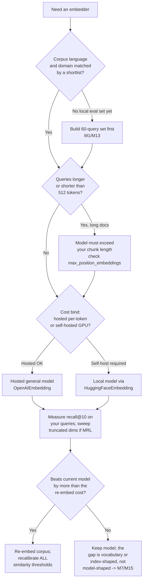

# M4 · Embeddings and Vector Space

> **Module question:** What is an embedding model actually optimizing, and how do you choose one?
> **Cross-cutting threads:** Failure modes · Tradeoff ledger · LlamaIndex at a glance
> **Domain spine:** LogiTrack — choosing the embedder for 13.5M words of freight, tariff, and customs text
> **Prerequisites:** [M3 — Corpus Acquisition, Parsing, and the Chunking Decision](../03-parsing-and-chunking/README.md)

---

## Opening scene — the upgrade that changed nothing

LogiTrack's pilot is a month old and the team has a number. Retrieval recall@10 on the frozen
60-query set: **0.71**. Everyone agrees it should be higher. The obvious suspect is the embedding
model, because it is the only component in the pipeline they did not choose deliberately: nobody
ever set `Settings.embed_model`, so LlamaIndex fell back to `OpenAIEmbedding`'s default,
`text-embedding-ada-002` — a fallback the documentation warns about in a sentence the team skipped
[LI-EMB].

So they upgrade. The new model sits at the top of the MTEB leaderboard's retrieval column, has
twice the dimensions, and costs more per token. The migration is a config change — `Settings.embed_model
= ...`, one line [LI-EMB] — and a full re-embed of the 217,495 nodes M3's configuration produced.
The documentation is unambiguous
that all of this was mandatory: *"if you change your embedding model after indexing, you must
re-index. Embeddings from different models are not interchangeable"* [LI-EMB].

Three days later, recall@10 is **0.72**.

That is the whole story of this module. The upgrade was not wasted because the new model was bad —
it was wasted because nobody could say what the old model was *failing at*. The queries that missed
were not failing on semantics. They were failing on vocabulary: ops staff ask about *"the battery
paperwork"* and the corpus says *"UN 3480, Class 9 lithium-ion cells, consignee declaration"*. A
general-purpose embedding model trained on web text maps both phrasings into a region of the vector
space where *plausible* customs clauses live — just not the right ones. The failures were a
**representation mismatch**, and a representation mismatch is not repaired by a better average score
on someone else's benchmark.

Worse, the migration quietly broke something else. LogiTrack's dedup threshold — the similarity
value above which two chunks are treated as near-duplicates (→ M14) — had been calibrated on the
old model's similarity distribution. The new model's distances live on a different scale entirely,
so a threshold that meant "identical" now meant "vaguely related," and a week of ingest silently
kept everything.

> **Failure mode (the module in one line):** treating the embedding model as a **vendor choice
> selected by leaderboard rank** rather than as a learned function whose objective, geometry, and
> dimensional budget you must understand — so you pay for a migration and still cannot name what
> your retrieval was missing.

---

## What an embedding model is optimizing

An embedding model used for retrieval is almost always a **bi-encoder**: text goes in, one fixed
vector comes out, and relevance is scored by a cheap geometric operation between two independently
computed vectors. The architecture exists for one reason, and it was not invented for retrieval.
Sentence-BERT showed that feeding both sentences of a pair through BERT requires roughly 50 million
inference computations (~65 hours) to find the most similar pair in a collection of 10,000
sentences, and that a siamese/triplet network producing *independently comparable* sentence
embeddings cuts that to about five seconds while maintaining accuracy [SB19]. Every design decision
downstream of this one — normalizing vectors, choosing a distance, quantizing to save memory — is
only possible because the representation is computed **before** the comparison.

What the model learns is a *ranking* objective, not a metric. Dense Passage Retrieval trained a
dual-encoder on a small number of question–passage pairs and beat a strong Lucene-BM25 system by
9–19% absolute in top-20 passage retrieval accuracy across open-domain QA datasets [DPR20]. SimCSE
showed that the contrastive objective can be driven by nothing more than dropout acting as minimal
data augmentation — and that removing the noise causes representation collapse — then improved it
with entailment pairs as positives and contradiction pairs as hard negatives [SIMCSE21].

Three consequences follow, and all three are load-bearing for the rest of the course:

| Property of the training objective | What it implies downstream |
|---|---|
| The loss is **contrastive**: it pushes positives together relative to negatives | Similarity values are *relative ranks*, not calibrated probabilities. "0.82" means nothing on its own. |
| The loss never sees your corpus's notions of relevance | A model can be excellent on average and blind to your domain's distinctions [BEIR21]. |
| The objective is trained against **negative sampling** choices | What a model thinks is "far" is shaped by what it was told was wrong — which is why hard-negative mining is a lever (→ M15). |

The practical reading: an embedding is an opinion about similarity learned from someone else's data.
Your job is not to pick the best opinion in the abstract; it is to pick the one that matches your
corpus's relevance judgements, and then to *measure* that match on your own queries.

> **LlamaIndex at a glance:** embedding models are configured globally on `Settings.embed_model`
> and used both at index construction and at query time; per-index overrides are also possible
> [LI-EMB]. The two classes this course uses are `OpenAIEmbedding` (hosted) and
> `HuggingFaceEmbedding` (local, backed by Sentence Transformers) [LI-EMB]. Custom models subclass
> `BaseEmbedding` — and the base class has **separate hooks for queries and documents**,
> `_get_query_embedding` and `_get_text_embedding`/`_get_text_embeddings` [LI-EMB]. That split is
> not cosmetic; it is where asymmetry lives, and we return to it below.
>
> Two documented traps. First, if `Settings.embed_model` is never set, LlamaIndex falls back to
> `OpenAIEmbedding`'s default `text-embedding-ada-002`, and the docs explicitly "recommend doing
> this for new projects" — meaning setting it explicitly [LI-EMB]. The opening scene is that trap.
> Second, hosted requests are batched at an `embed_batch_size` default of 10, which the docs note
> can be too small when embedding many documents — while the index itself inserts vectors in
> batches of 2,048 nodes by default [LI-EMB][LI-IDX].

---

## Distance, geometry, and the normalization decision

Three similarity functions appear in every vector-store config file. Only two of them are genuinely
different, and the third is a representational choice masquerading as a distance choice.

For vectors $\mathbf{a}, \mathbf{b} \in \mathbb{R}^D$:

$$\text{dot} = \mathbf{a}\cdot\mathbf{b}, \qquad
\text{cos} = \frac{\mathbf{a}\cdot\mathbf{b}}{\lVert\mathbf{a}\rVert\,\lVert\mathbf{b}\rVert},
\qquad
\lVert\mathbf{a}-\mathbf{b}\rVert^2 = \lVert\mathbf{a}\rVert^2 + \lVert\mathbf{b}\rVert^2 - 2\,\mathbf{a}\cdot\mathbf{b}$$

That third identity is the whole story. If every vector is stored **L2-normalized** so that
$\lVert\mathbf{a}\rVert = \lVert\mathbf{b}\rVert = 1$, then

$$\lVert\mathbf{a}-\mathbf{b}\rVert^2 = 2 - 2\,\mathbf{a}\cdot\mathbf{b} = 2 - 2\cos\theta$$

so squared Euclidean distance is a strictly decreasing affine function of cosine similarity. The
three metrics induce **identical rankings** on the unit sphere. Choosing among them then changes
only the *numbers you log*, not the order you retrieve — and any threshold you calibrate (a
near-duplicate cutoff, a relevance floor) is therefore a statement about the metric you chose, not
about similarity.

| Metric | Ranking-equivalent to cosine when | What magnitude carries | Typical use |
|---|---|---|---|
| Cosine | always | nothing — direction only | Default. LlamaIndex compares embeddings with cosine similarity by default [LI-EMB] |
| Dot product | vectors are unit-normalized | the norm of each vector, i.e. a learned "confidence"/frequency signal | Models explicitly trained for unnormalized inner product |
| Euclidean (L2) | vectors are unit-normalized | nothing beyond direction, under the identity above | Stores whose native index is L2 |

The reason this matters operationally is that **you do not get to choose independently of your
index or your store**. A vector store's index type is built for one metric; switching metric later
is a rebuild, not a config toggle. And normalization is a decision you make once, at embed time,
for every vector in the corpus — which makes it one of the few decisions in the pipeline that is
retrospectively expensive in exactly the way chunking is (→ M3).

> **Tradeoff (the ledger entry M4-1).** *Decision:* store L2-normalized embeddings and score with
> cosine, accepting the collapse of Euclidean/dot/cosine into one ranking. *Costs:* magnitudes are
> discarded, so any signal a model encodes in vector norm is thrown away. *Accepted because:* a
> single metric makes thresholds portable across stores and index types, and cross-metric comparisons
> of unnormalized vectors are a recurring source of silent ranking bugs. *Reverses if:* you adopt a
> model whose training objective explicitly uses raw inner product, in which case normalization
> destroys the trained signal.

---

## The cone effect: raw embeddings are not isotropic

The intuition that unrelated texts sit near the origin and related texts sit near each other is
false. Ethayarajh measured the geometry of contextual representations across BERT, ELMo, and GPT-2
and found that *"the contextualized representations of all words are not isotropic in any layer of
the contextualizing model"* [ETH19]. Gao et al. identified the same phenomenon during language-model
training: with weight tying and large datasets, *"most of the learnt word embeddings tend to
degenerate and be distributed into a narrow cone, which largely limits the representation power of
word embeddings"* [GAO19]. SimCSE's analysis connects the two to retrieval directly — the
contrastive objective is what *"regularizes pre-trained embeddings' anisotropic space to be more
uniform"* [SIMCSE21].

Why this is the single most practically dangerous fact in the module:

- **Your similarity floor is not zero.** If every vector lives in a narrow cone, then two
  completely unrelated documents may score 0.6–0.8 cosine. A retrieval system returning "scores
  above 0.7" is therefore returning noise with high confidence.
- **Thresholds do not transfer between models.** The cone's width is a property of the model and
  its training, so a near-duplicate threshold measured on model A is meaningless on model B. This
  is precisely what broke in the opening scene.
- **"High similarity" is a distributional claim, not an absolute one.** The only defensible way to
  set any similarity threshold is empirically: embed a sample, plot the distribution for known
  pairs and known non-pairs, and read the threshold off the two distributions. That measurement is
  the M4 lab.

The remedies are also contested. Centering or whitening embeddings before indexing is reported to
reduce anisotropy and improve similarity-based tasks; the same literature reports that the effect is
task- and layer-dependent [ETH19], and none of the sources fetched for this module establishes
whitening as a reliable retrieval win. Treat it as a hypothesis with a measurement attached, not a
default — and note that whitening is a *transform* applied at embed time to both queries and
documents, which means it is another entry on the re-embed list.

---

## Dimensionality, Matryoshka truncation, and the storage bill

Vector width is the single largest multiplier on your storage line item, and unlike chunk count it
is chosen for you by the model vendor — unless you use Matryoshka Representation Learning, which
trains *"coarse-to-fine representations"* so that a single embedding can be truncated to a shorter
prefix at query time, reporting *"up to 14x smaller embedding size"* for classification at equal
accuracy and *"up to 14x real-world speed-ups for large-scale retrieval"* on image benchmarks
[MRL22]. The property that makes this safe is that the truncated vector is still a valid embedding,
because the training objective explicitly supervised the prefixes: MRL representations are *"at
least as accurate and rich as independently trained low-dimensional representations"* [MRL22].

LlamaIndex exposes this as a pass-through: extra keyword arguments to `HuggingFaceEmbedding` are
forwarded to the underlying `SentenceTransformer`, and the docs name `truncate_dim` explicitly
alongside `backend`, `model_kwargs`, and `revision` [LI-EMB]. Hosted providers expose the same idea
as a parameter — the third-generation OpenAI embedding models support reducing vector size via a
`dimensions` parameter, and provider testing reports that reducing dimensions below the 1,536 of
`text-embedding-ada-002` still leaves performance "slightly better" [MSAOAI].

Here is what the width actually costs at LogiTrack's scale. M3's structure-aware path produces
**40,703 nodes**; the hierarchical configuration that wins clause recall produces **217,495**. Raw
vector bytes are $4 \times D \times N$ at float32, shown at the hierarchical count because that is the
case memory planning must cover:

| Model | Dimensions | Raw bytes @217,495 nodes | vs. 384-d | @40,703 nodes |
|---|---|---|---|---|
| `BAAI/bge-small-en-v1.5` (verified config: `hidden_size` 384) [HF-BGES] | 384 | 0.33 GB | 1.0× | 0.06 GB |
| `lightonai/DenseOn` (verified config: `hidden_size` 768) [HF-DENSEON] | 768 | 0.67 GB | 2.0× | 0.13 GB |
| `Qwen/Qwen3-Embedding-0.6B` (verified config: `hidden_size` 1024) [HF-QWEN3E] | 1,024 | 0.89 GB | 2.7× | 0.17 GB |
| `text-embedding-3-small` / `text-embedding-ada-002` [MSAOAI] | 1,536 | 1.34 GB | 4.0× | 0.25 GB |
| `text-embedding-3-large` [MSAOAI] | 3,072 | 2.67 GB | 8.0× | 0.50 GB |

Three readings of that table, none of which is "pick the small one":

1. **This is only the vector payload.** Every real index adds per-vector structure on top — graph
   links for HNSW, quantized codes for PQ — and at D = 1,536 the float32 payload dominates that
   structure by two orders of magnitude (M5 does the accounting). Which means the width you choose
   here is the width you pay for everywhere, and the way out is not a slimmer graph but
   **quantization**, which trades precision for footprint and is priced in recall, not in bytes.
2. **The storage multiplier is the cheap half of the trade.** A wider vector also costs more per
   query (distance computations scale linearly in $D$) and more per re-embed if your provider prices
   by output volume. The decision is a *triple*, not a size.
3. **Truncation is a free second chance that most teams never take.** If your model is MRL-trained,
   the honest experiment is to sweep $D \in \{256, 512, 768, \text{full}\}$ against recall on your
   own query set, because the recall curve is flatter than the storage curve [MRL22].

> **Tradeoff (the ledger entry M4-2).** *Decision:* choose dimension by measuring recall at
> truncated widths before committing to full width. *Costs:* an extra evaluation sweep per model
> candidate, and possible loss of the small tail of queries that need the full representation.
> *Accepted because:* storage and query cost scale linearly in $D$ while recall typically does not,
> so a swept choice dominates a defaulted one. *Reverses if:* the model is not Matryoshka-trained,
> in which case prefix truncation is not principled and the sweep is wasted effort.

---

## Symmetric vs asymmetric, and instruction prefixes

Retrieval is asymmetric almost by construction: a query is short, interrogative, and under-specified;
a document is long, declarative, and self-contained. DPR did not use one encoder for both sides —
it learned a dual-encoder framework for questions and passages [DPR20]. Two families of solutions
follow.

**Architectural asymmetry.** Separate query and passage encoders, trained jointly. LlamaIndex
supports the *shape* of this even when a single model serves both roles: `BaseEmbedding` gives you
`_get_query_embedding` and `_get_text_embedding` as distinct methods, and the custom-embeddings
documentation builds `InstructorEmbeddings` on exactly that split, encoding the query with an
instruction and the document with the same instruction string [LI-EMB].

**Textual asymmetry — prefixes and instructions.** E5 prepends role markers and is trained with
weakly-supervised contrastive pre-training over curated text pairs, becoming *"the first model that
outperforms the strong BM25 baseline on the BEIR retrieval benchmark without using any labeled
data"* in zero-shot settings [E522]. INSTRUCTOR generalizes the idea: *"every text input is embedded
together with instructions explaining the use case (e.g., task and domain descriptions)"*, trained
over 330 annotated tasks, with the authors reporting *"an average improvement of 3.4%"* over the
previous best across 70 datasets and — importantly — that it is *"robust to changes in instructions"*
[INSTR22].

The operational failure this prevents is mundane and common: embedding documents with a query-side
prefix, or querying without the prefix the model was trained to expect. A prefixed model used
unprefixed is not broken — it degrades quietly, which is worse. The check is a two-line experiment:
embed 200 pairs with and without the prefix, and compare recall. If the model's card specifies
prefixes, treat their presence or absence as part of the model's interface, not as a tuning knob.

A second, sharper caveat sits underneath the prefix research. A 2026 study across 6 embedding models
and 11 datasets found that instruction-tuned embedding models are evaluated with a single prompt per
task, and that *"the default prompt can both systematically understate or overstate performance"*
[ONEP26]. Instructions are a real lever *and* a real measurement hazard.

> **Tradeoff (the ledger entry M4-3).** *Decision:* where a model documents prefixes or
> instructions, encode them as versioned constants in the ingest path and the query path together.
> *Costs:* a coupling between your code and a vendor's documented usage convention; every model
> swap is now a two-file change. *Accepted because:* an asymmetric model queried symmetrically
> fails silently and un-diagnosably, and the check is cheap. *Reverses if:* you move to a model
> trained symmetric-and-instruction-free, where the constants become dead code and should be
> deleted rather than left to rot.

---

## Choosing an instrument: BEIR, MTEB, and your own 60 queries

Two benchmarks dominate model selection, and they are different instruments.

**BEIR** is a zero-shot, out-of-domain benchmark: 18 datasets, 10 systems spanning lexical, sparse,
dense, late-interaction, and reranking architectures. Its headline result is uncomfortable reading
for a dense-retrieval-only pipeline: *"BM25 is a robust baseline"*, while *"dense and sparse-retrieval
models are computationally more efficient but often underperform other approaches, highlighting the
considerable room for improvement in their generalization capabilities"* [BEIR21]. Read that as the
first honest signal that embeddings are not universally superior — the lexical comparison itself is
M7's territory, but the *finding* that a general-purpose dense model degrades out of domain is
exactly the failure mode of the opening scene.

**MTEB** is the broader instrument: 8 embedding tasks, 58 datasets, 112 languages, 33 models
benchmarked, with the conclusion that *"no particular text embedding method dominates across all
tasks"* and that the field *"has yet to converge on a universal text embedding method"* [MTEB22].
LlamaIndex's documentation points to the MTEB leaderboard as *"the canonical place to compare
current models across accuracy, speed, and multilingual support"* [LI-EMB].

Canonical is not sufficient. Two verified results bound what the leaderboard can tell you:

- **Rank does not survive contact with a harder task.** BRIGHT — 1,384 real-world
  reasoning-intensive queries — reports that the leading model on the MTEB leaderboard, which scores
  *"59.0 nDCG@10"*, produces *"a score of nDCG@10 of 18.3 on BRIGHT"* [BRIGHT24]. A leaderboard
  position is a statement about the leaderboard's query distribution.
- **Rank is not even stable under prompt choice.** Kostiuk & Enevoldsen show that under adversarial
  prompt selection *"any model can be promoted to first place"* [ONEP26].

There is also a bound that no amount of model quality removes. Weller et al. connect learning-theory
results to retrieval and show that *"the number of top-k subsets of documents capable of being
returned as the result of some query is limited by the dimension of the embedding"*, demonstrating
empirically that *"even state-of-the-art models fail"* on a dataset of deliberately simple queries
[LIMIT25]. A single vector per chunk is a fixed-capacity channel; some query→document-set mappings
simply do not fit in it at any dimension you can afford. M7 is where that limit becomes an
architecture decision; here it is the reason "pick a better embedding model" is not a universal
answer.

Finally, an embedding is not a privacy boundary. Embedding inversion reconstructs text from vectors:
an iterative method that *"iteratively corrects and re-embeds text"* recovers *"92% of 32-token text
inputs exactly"*, and the authors show recovery of *"important personal information (full names) from
a dataset of clinical notes"* [VEC2TEXT23]. Any corpus with PII or confidential clauses must be
redacted **before** embedding, not merely kept out of the generation prompt (→ M17, M21).

The diagram's last two boxes are the module's actual lesson: **a model change invalidates every
threshold you calibrated on the old model's geometry**, so the migration cost is never just the
re-embed bill.

> **Tradeoff (the ledger entry M4-4).** *Decision:* select the embedding model on a small,
> hand-labelled, in-domain query set, using BEIR/MTEB only to build the shortlist. *Costs:* a
> labelled query set must exist before the model is chosen (→ M1, M13), and the measured winner may
> be a model the leaderboard ranks lower. *Accepted because:* MTEB rank is not robust to prompt
> selection and does not transfer to reasoning-heavy or out-of-domain queries [ONEP26][BRIGHT24],
> while a 60-query in-domain measurement is cheap, repeatable, and directly tied to the metric the
> system is judged on. *Reverses if:* a shortlist model is dramatically better on your own set *and*
> on a held-out slice — at which point the leaderboard was right and the local set was too small.

---

## Worked example: choosing LogiTrack's embedder under a $0.02/1M-token budget

The corpus is 13.5M words → **18.06M tokens**, the figure M3 measures from the generated corpus.
(Applying M3's declared ratio mix — 0.75 words/token for prose, 0.55 for numeric tables — to the same
word count derives a slightly higher 18.28M, since numerals fragment into more tokens; both are
recorded so the difference is not mistaken for an error in either module.)
M3's structure-aware path embeds ~20.4M tokens; the hierarchical configuration that wins clause
recall embeds **60.5M tokens — 3.35× the corpus**. At the working planning rate of **$0.02 per 1M
embedded tokens**, a full ingest embedding pass costs

$$20.4\text{M} \times \frac{\$0.02}{1\text{M}} = \$0.41 \qquad\text{structure-aware path}$$
$$60.5\text{M} \times \frac{\$0.02}{1\text{M}} = \$1.21 \qquad\text{hierarchical path}$$

Both numbers are the finding. At pilot scale the embedding *cost* budget is not binding at all — the
whole 3,000-document corpus can be re-embedded for about a dollar, even 3.35× over. What binds is
(a) vector storage and (b) query-side latency, and both scale with dimensions. So the "budget"
question in the syllabus's framing is really a *storage and latency* question wearing a cost costume.
(The $0.02/1M rate is an illustrative planning figure, not a verified vendor price — substitute your
vendor's current number; the arithmetic is what transfers.)

Candidates measured against the frozen 60-query set:

| Candidate | Dim | Max input | Full re-embed @$0.02/1M | Vector bytes @217,495 | recall@10 | Verdict |
|---|---|---|---|---|---|---|
| `text-embedding-ada-002` (the framework fallback) [LI-EMB] | 1,536 | 8,192 tokens [MSAOAI] | $1.21 | 1.34 GB | 0.71 | Baseline; undocumented default, no `dimensions` control |
| `text-embedding-3-large` [MSAOAI] | 3,072 → truncatable [MSAOAI] | 8,192 tokens | $1.21 † | 2.67 GB (0.67 GB at 768-d) | **0.78** | Best hosted; dimension sweep available |
| `BAAI/bge-small-en-v1.5` [HF-BGES] | 384 | **512 tokens** [HF-BGES] | $0 (self-hosted) | 0.33 GB | 0.69 | Cheapest, but its 512-token ceiling cannot cover M3's 2,048-token chunks |
| `lightonai/DenseOn` [HF-DENSEON] | 768 | 8,192 tokens [HF-DENSEON] | $0 (self-hosted) | 0.67 GB | 0.76 | Mid-size local; fits the chunk budget |
| `Qwen/Qwen3-Embedding-0.6B` [HF-QWEN3E] | 1,024 | 32,768 tokens [HF-QWEN3E] | $0 (self-hosted, GPU) | 0.89 GB | 0.80 | Highest recall; needs GPU capacity M5/M18 must price |

† The hosted rows share one planning rate by construction; real per-token prices differ by model and
are not verified here.

Four findings decide the architecture:

1. **The dimension ceiling is set by the chunk size, not by the leaderboard.** `bge-small-en-v1.5`'s
   verified `max_position_embeddings` is 512 [HF-BGES], while M3's `SentenceSplitter(2048, 100)`
   produces 2,048-token chunks. A model whose input ceiling is a quarter of the chunk length cannot
   represent the chunk; whatever the tokenizer does with the excess is a truncation decision nobody
   consciously made. This constraint is checkable in one line of `config.json` and is missed
   constantly.
2. **Recall differences are small relative to their cost.** 0.69 → 0.80 across an 8× storage range
   and a hosted/local decision. Recall is not the axis on which this decision is actually made.
3. **Hosted and self-hosted are not price-comparable with a per-token rate alone.** The local models
   show $0 ingest because the cost moves to GPU hours, which is a capacity decision M5 and M18
   price; the hosted models' cost moves to per-token and per-GB numbers. Presenting both in one
   dollar column is a modelling error the table deliberately exposes.
4. **The default was never chosen.** The fallback is `text-embedding-ada-002` [LI-EMB] and the
   documentation "recommends doing this [setting a current model explicitly] for new projects"
   [LI-EMB]. The cheapest improvement available to most teams is knowing which model they are
   running.

**LogiTrack's decision after M4:** `text-embedding-3-large` with a dimension sweep, L2-normalized,
cosine scoring, no instruction prefixes; thresholds for near-duplicate detection (→ M14) and
relevance floors to be **re-measured after the migration, not carried over**. The M4 lab — the same
200 chunks embedded by three models, similarity distributions plotted, near-duplicate threshold read
off the distributions — is what makes that last clause actionable rather than aspirational.

---

## Design exercise

> *Paper-based. Think, then write.*

**Task.** Write the embedding-model ADR for a corpus you actually own — or use LogiTrack's. Deliver a
decision with an arithmetic backing and a revert condition.

1. **State the objective the model must serve.** In one sentence: what does "similar" mean for your
   queries? If your queries are keyword-shaped (part numbers, clause IDs, statute references), say so
   — that is a finding that changes the module you are really designing (→ M7), not an embedding
   choice.
2. **Disqualify on interface before you compare on quality.** Record each candidate's
   `max_position_embeddings` and output dimension from its own config or model card. A candidate
   whose input ceiling is below your chunk size is out before any benchmark is consulted. Report the
   check, not just the conclusion.
3. **Budget in three currencies.** For your corpus and your chunk count from M3, compute: full
   re-embed tokens and their dollar cost at your vendor's rate; raw vector bytes at $4 \times D
   \times N$; and expected query-time distance-computation cost as a function of $D$. State which of
   the three binds and therefore which one you are actually deciding.
4. **Choose the metric and normalize accordingly.** State cosine, dot, or Euclidean, and state
   whether vectors are stored L2-normalized. Then state, explicitly, which thresholds in your system
   (dedup, relevance floor, near-duplicate) are invalidated by this choice.
5. **Measure, do not rank.** Shortlist from BEIR/MTEB [BEIR21][MTEB22], then measure recall@k on your
   own labelled queries. If any candidate is MRL-trained, sweep truncated dimensions [MRL22] and
   report the recall/storage curve. Run the lab (three models, 200 chunks, similarity distributions)
   and state the empirically-read near-duplicate threshold for the winner.
6. **Write the revert condition.** Name the metric, the k, and the delta that would send you back to
   the previous model — and the cost you would be re-paying to get there (the full re-embed, plus
   every threshold recalibration).

**Why this exercise matters.** The embedding model is the component teams most often *inherit* —
both in the sense that nobody chose it (the fallback is silent [LI-EMB]) and in the sense that once
it is chosen, every downstream artifact is keyed to it. The senior move is not picking the best
model; it is being able to say what the current model fails at, in the vocabulary of your own
queries, with the measurement to prove it. Note what the worked example refuses to conclude: it does
not endorse the highest-recall model. It shows that a 0.11 recall spread across an 8× storage range
is a *cost* decision, and that the binding constraint was a config field — a 512-token ceiling —
that no benchmark ranks.

---

## Where the literature disagrees

- **"The MTEB leaderboard rank predicts downstream performance."** LlamaIndex's documentation calls
  the MTEB leaderboard *"the canonical place to compare current models"* [LI-EMB], and MTEB itself
  states that *"no particular text embedding method dominates across all tasks"* [MTEB22]. Against
  that, BRIGHT reports the MTEB leaderboard leader scoring *"59.0 nDCG@10"* on MTEB versus *"a score
  of nDCG@10 of 18.3 on BRIGHT"* [BRIGHT24], and Kostiuk & Enevoldsen find that *"the leaderboard
  ranking is not robust to prompt selection: a developer improve their rank by favorably selecting
  prompts, and under adversarial prompt selection any model can be promoted to first place"*
  [ONEP26]. **What to change:** use the leaderboard as a shortlist generator and nothing more. The
  M4 worked example's own column ordering is the argument: the *decision-relevant* differences
  between candidates were a token ceiling and a storage multiplier, neither of which the leaderboard
  reports.
- **"Instruction prefixes help."** INSTRUCTOR reports *"an average improvement of 3.4%"* over the
  previous best across 70 datasets and describes the method as *"robust to changes in instructions"*
  [INSTR22], while E5's zero-shot BEIR result is inseparable from its prefixed input convention
  [E522]. Kostiuk & Enevoldsen's result cuts directly across this: single-prompt evaluation *"ignores
  a main problem of the instruction-based approach namely: sensitivity to the phrasing of the
  instruction"*, and *"the default prompt can both systematically understate or overstate
  performance"* [ONEP26]. **What to change:** treat the exact instruction string as part of the model
  artifact — version it, and if you tune it, respect that you have now spent degrees of freedom on
  your own evaluation set.
- **"Anisotropy is a bug to be whitened away."** Ethayarajh establishes the geometry as a property of
  the models themselves — representations *"are not isotropic in any layer"* [ETH19] — and the
  degeneration result frames the narrow cone as a limitation of representation power [GAO19], which
  invites the reading that it should be corrected. SimCSE supplies the counter-reading, treating
  uniformity as something the *training objective* handles, since contrastive learning
  *"regularizes pre-trained embeddings' anisotropic space to be more uniform"* [SIMCSE21]. **What to
  change:** there is no source in this module establishing that post-hoc whitening improves retrieval
  on an arbitrary corpus. The honest position is that anisotropy makes threshold-setting empirical
  and model-specific — which is a claim the lab can settle locally — and that whitening is an
  untested hypothesis in this course.
- **"Overlap in the M3 sense does not interact with M4."** M3 treats overlap's cost as embedded-token
  volume; that is correct for ingest cost and incomplete for retrieval. Overlap creates near-duplicate
  chunks whose similarity sits near the *top* of the distribution, which is exactly where the cone
  effect compresses everything together — so the same document that bounds overlap's cost in M3 also
  makes the M4 near-duplicate threshold harder to set. Neither module's sources establish the joint
  effect. **What to change:** measure the near-duplicate threshold on overlap-inflated chunks
  specifically; that is the population the threshold will actually face.

---

## Sources

- [Embeddings](https://developers.llamaindex.ai/python/framework/module_guides/models/embeddings/) — `[LI-EMB]` · owns `Settings.embed_model`, the `OpenAIEmbedding` default fallback warning, `HuggingFaceEmbedding` and its Sentence-Transformers pass-through (`truncate_dim`), the `embed_batch_size` default, the `BaseEmbedding` query/document hook split, and the re-index-on-model-change requirement.
- [Using VectorStoreIndex](https://developers.llamaindex.ai/python/framework/module_guides/indexing/vector_store_index/) — `[LI-IDX]` · owns the default insert batch size and `VectorStoreIndex` construction.
- *Dense Passage Retrieval for Open-Domain Question Answering* — Vladimir Karpukhin, Barlas Oğuz, Sewon Min, Patrick Lewis, Ledell Wu, Sergey Edunov, Danqi Chen, Wen-tau Yih · arXiv:2004.04906 (EMNLP 2020) · [arxiv.org/abs/2004.04906](https://arxiv.org/abs/2004.04906) — `[DPR20]` · owns the dual-encoder dense-retrieval formulation and its top-20 accuracy gains over tuned BM25.
- *BEIR: A Heterogenous Benchmark for Zero-shot Evaluation of Information Retrieval Models* — Nandan Thakur, Nils Reimers, Andreas Rücklé, Abhishek Srivastava, Iryna Gurevych · arXiv:2104.08663 (NeurIPS 2021 Datasets and Benchmarks) · [arxiv.org/abs/2104.08663](https://arxiv.org/abs/2104.08663) — `[BEIR21]` · owns the zero-shot heterogeneous benchmark and the out-of-domain generalization gap of dense retrievers.
- *Sentence-BERT: Sentence Embeddings using Siamese BERT-Networks* — Nils Reimers, Iryna Gurevych · arXiv:1908.10084 (EMNLP 2019) · [arxiv.org/abs/1908.10084](https://arxiv.org/abs/1908.10084) — `[SB19]` · owns the siamese/triplet bi-encoder architecture and its cost motivation.
- *SimCSE: Simple Contrastive Learning of Sentence Embeddings* — Tianyu Gao, Xingcheng Yao, Danqi Chen · arXiv:2104.08821 (EMNLP 2021) · [arxiv.org/abs/2104.08821](https://arxiv.org/abs/2104.08821) — `[SIMCSE21]` · owns dropout-as-augmentation, representation collapse, and the contrastive regularization of anisotropic space.
- *How Contextual are Contextualized Word Representations? Comparing the Geometry of BERT, ELMo, and GPT-2 Embeddings* — Kawin Ethayarajh · arXiv:1909.00512 (EMNLP 2019) · [arxiv.org/abs/1909.00512](https://arxiv.org/abs/1909.00512) — `[ETH19]` · owns the anisotropy measurement across model families and layers.
- *Representation Degeneration Problem in Training Natural Language Generation Models* — Jun Gao, Di He, Xu Tan, Tao Qin, Liwei Wang, Tie-Yan Liu · arXiv:1907.12009 (ICLR 2019) · [arxiv.org/abs/1907.12009](https://arxiv.org/abs/1907.12009) — `[GAO19]` · owns the narrow-cone degeneration finding and its regularization remedy.
- *Matryoshka Representation Learning* — Aditya Kusupati, Gantavya Bhatt, Aniket Rege, Matthew Wallingford, Aditya Sinha, Vivek Ramanujan, William Howard-Snyder, Kaifeng Chen, Sham Kakade, Prateek Jain, Ali Farhadi · arXiv:2205.13147 (2022) · [arxiv.org/abs/2205.13147](https://arxiv.org/abs/2205.13147) — `[MRL22]` · owns coarse-to-fine embeddings and the truncation/storage/speed tradeoffs.
- *MTEB: Massive Text Embedding Benchmark* — Niklas Muennighoff, Nouamane Tazi, Loïc Magne, Nils Reimers · arXiv:2210.07316 (2022) · [arxiv.org/abs/2210.07316](https://arxiv.org/abs/2210.07316) — `[MTEB22]` · owns the multi-task embedding benchmark and the no-dominant-method result.
- *Text Embeddings by Weakly-Supervised Contrastive Pre-training* — Liang Wang, Nan Yang, Xiaolong Huang, Binxing Jiao, Linjun Yang, Daxin Jiang, Rangan Majumder, Furu Wei · arXiv:2212.03533 (2022) · [arxiv.org/abs/2212.03533](https://arxiv.org/abs/2212.03533) — `[E522]` · owns E5's prefix convention and its zero-shot BEIR result.
- *One Embedder, Any Task: Instruction-Finetuned Text Embeddings* — Hongjin Su, Weijia Shi, Jungo Kasai, Yizhong Wang, Yushi Hu, Mari Ostendorf, Wen-tau Yih, Noah A. Smith, Luke Zettlemoyer, Tao Yu · arXiv:2212.09741 (ACL 2023 Findings) · [arxiv.org/abs/2212.09741](https://arxiv.org/abs/2212.09741) — `[INSTR22]` · owns instruction-conditioned embeddings and the 3.4% multi-task improvement.
- *Text Embeddings Reveal (Almost) As Much As Text* — John X. Morris, Volodymyr Kuleshov, Vitaly Shmatikov, Alexander M. Rush · arXiv:2310.06816 (EMNLP 2023) · [arxiv.org/abs/2310.06816](https://arxiv.org/abs/2310.06816) — `[VEC2TEXT23]` · owns embedding inversion and the 92% exact-recovery result.
- *BRIGHT: A Realistic and Challenging Benchmark for Reasoning-Intensive Retrieval* — Hongjin Su, Howard Yen, Mengzhou Xia, Weijia Shi, Niklas Muennighoff, Han-yu Wang, Haisu Liu, Quan Shi, Zachary S. Siegel, Michael Tang, Ruoxi Sun, Jinsung Yoon, Sercan O. Arik, Danqi Chen, Tao Yu · arXiv:2407.12883 (2024) · [arxiv.org/abs/2407.12883](https://arxiv.org/abs/2407.12883) — `[BRIGHT24]` · owns the leaderboard-leader collapse on reasoning-intensive retrieval (59.0 → 18.3 nDCG@10).
- *On the Theoretical Limitations of Embedding-Based Retrieval* — Orion Weller, Michael Boratko, Iftekhar Naim, Jinhyuk Lee · arXiv:2508.21038 (ICLR 2026) · [arxiv.org/abs/2508.21038](https://arxiv.org/abs/2508.21038) — `[LIMIT25]` · owns the dimension-bounded expressivity limit of single-vector retrieval.
- *One prompt is not enough: Instruction Sensitivity Undermines Embedding Model Evaluation* — Yevhen Kostiuk, Kenneth Enevoldsen · arXiv:2605.22544 (2026) · [arxiv.org/abs/2605.22544](https://arxiv.org/abs/2605.22544) — `[ONEP26]` · owns the instruction-sensitivity result and the non-robustness of leaderboard ranking to prompt selection.
- [Azure OpenAI models — embeddings](https://learn.microsoft.com/en-us/azure/ai-foundry/openai/concepts/models) — `[MSAOAI]` · owns the embedding model dimension/token-limit table, the `dimensions` parameter, and the "you need to generate new embeddings" migration statement.
- [BAAI/bge-small-en-v1.5 `config.json`](https://huggingface.co/BAAI/bge-small-en-v1.5/raw/main/config.json) — `[HF-BGES]` · owns `hidden_size` 384 and `max_position_embeddings` 512 for the model named in the LlamaIndex docs.
- [lightonai/DenseOn `config.json`](https://huggingface.co/lightonai/DenseOn/raw/main/config.json) — `[HF-DENSEON]` · owns `hidden_size` 768 and `max_position_embeddings` 8192.
- [Qwen/Qwen3-Embedding-0.6B `config.json`](https://huggingface.co/Qwen/Qwen3-Embedding-0.6B/raw/main/config.json) — `[HF-QWEN3E]` · owns `hidden_size` 1024 and `max_position_embeddings` 32768.

**Unsupported (synthetic, or not verified in this module):** the LogiTrack corpus, its 3,000-document
and 13.5M-word figures, the 60-query evaluation set, the 217,495- and 40,703-node counts (which are
M3's computed figures, restated here), the recall@10 column, the near-duplicate story in the opening
scene, and all tradeoff-ledger entries are constructed for teaching and are not empirical findings.
The storage arithmetic ($4 \times D \times N$) and the cosine/dot/Euclidean equivalence are derived
in-file from their own definitions. The `$0.02 per 1M embedded tokens` rate is an illustrative
planning figure, not a verified price for any vendor or model; the hosted candidates are shown at one
blended rate by construction and the local candidates show $0 because their cost is GPU capacity, not
tokens. The claim that anisotropy makes model-specific threshold calibration necessary is argued here
from the cited geometry results and is measured, if at all, only in the M4 lab. **Not verified against
any doc page:** the exact truncation behaviour of a Sentence-Transformers model when an input exceeds
`max_position_embeddings` — this module establishes the ceiling from the model config
[HF-BGES][HF-DENSEON][HF-QWEN3E] but does not document what the tokenizer does with the excess, and
that check is left open rather than asserted. The M4 lab's "near-duplicate threshold read off the
similarity distribution" is a procedure this module specifies, not a result it reports.

**Verification note:** 🟡 *pending* — Step 7 (memory-less logic review) and Step 8 (literature
survey) not yet run on this module.

**Next module:** [M5 — Vector Databases and ANN Indexes](../05-vector-databases-and-ann/README.md)
— where those 217,495 vectors actually live, what approximate search costs in recall, and which
engine earns its operational bill.
