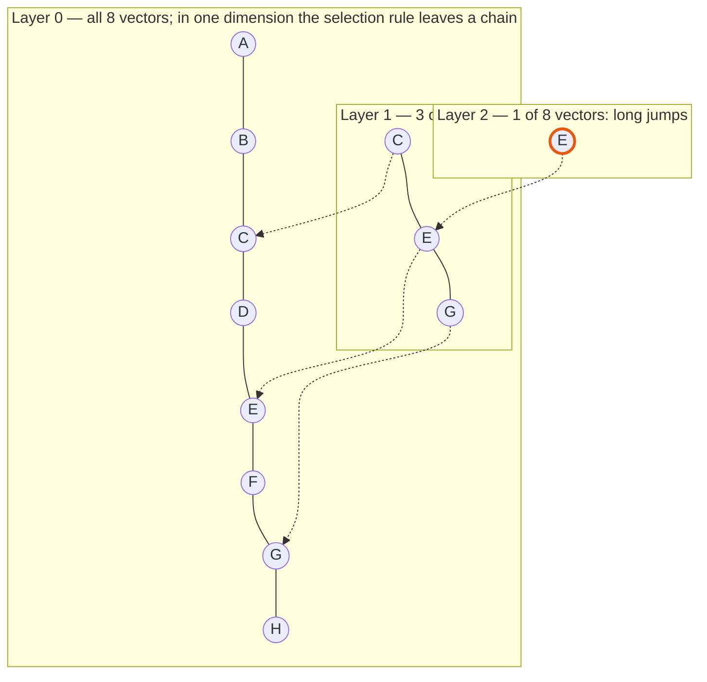
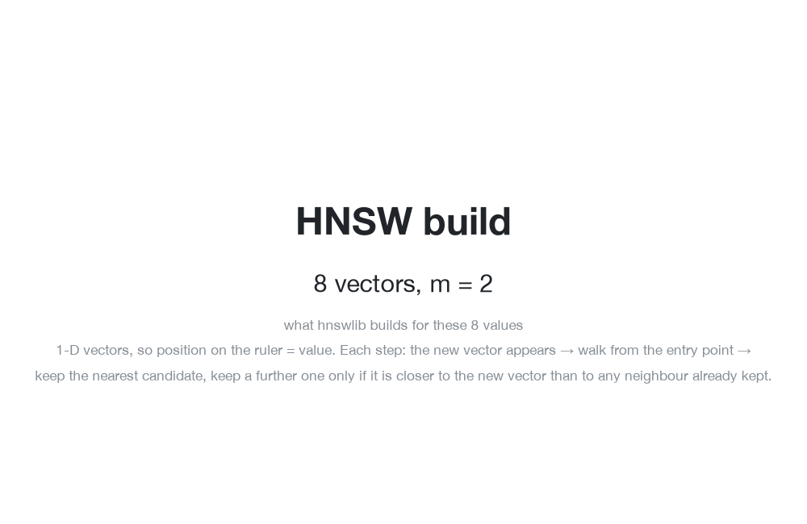
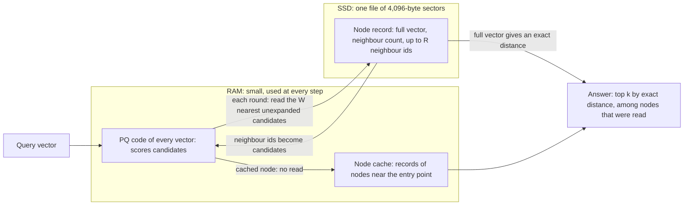
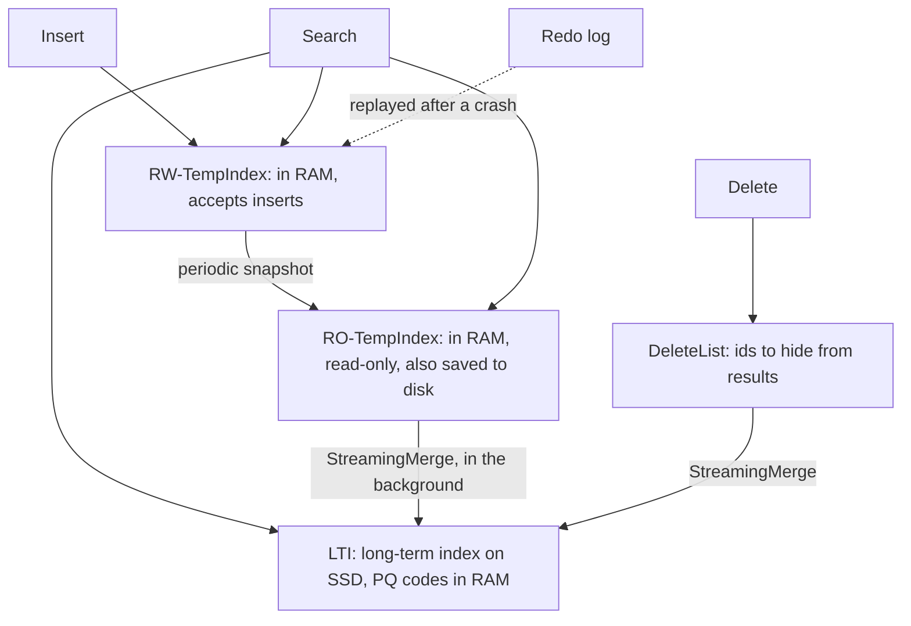
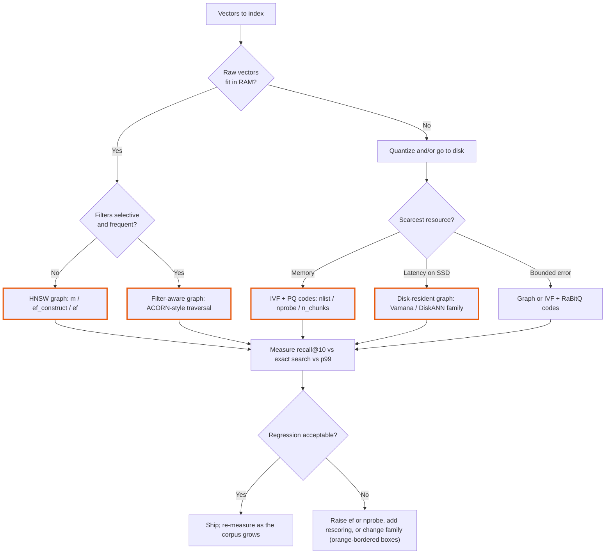

# M5 · Vector Databases and ANN Indexes

> **Module question:** How does approximate nearest-neighbour search actually work, and which engine earns its operational cost?
> **Cross-cutting threads:** Failure modes · Tradeoff ledger · LlamaIndex at a glance
> **Domain spine:** LogiTrack — selecting the store and index under the $18,000/month ceiling, and writing down what would change the answer
> **Prerequisites:** [M3 — Corpus Acquisition, Parsing, and the Chunking Decision](../03-parsing-and-chunking/README.md) · [M4 — Embeddings and Vector Space](../04-embeddings-and-vector-space/README.md)

---

## Contents

- [Opening scene: the recall that was on the slide](#opening-scene--the-recall-that-was-on-the-slide)
  - [Six weeks of a default that was right](#open-default)
  - [What forces a decision](#open-forces)
  - [How the team chooses](#open-chooses)
  - [Mistake 1: reading someone else's recall as LogiTrack's](#open-mistake-1)
  - [Mistake 2: taking "any filters" at face value](#open-mistake-2)
  - [Mistake 3: no instrument to catch the loss](#open-mistake-3)
  - [Failure mode: the module in one line](#open-failure-mode)
- [Exact search, and what an index buys](#exact-search-and-what-an-index-buys)
  - [What an index is](#exact-index)
  - [What exact search costs](#exact-cost)
  - [Multimodal inputs (to be discussed)](#exact-multimodal)
  - [LlamaIndex at a glance](#exact-llamaindex)
- [Index families](#index-families)
  - [HNSW: three dials, only one of them free](#hnsw-three-dials-only-one-of-them-free)
    - [In plainer words](#hnsw-plain)
    - [`m`, and the neighbour-selection rule](#hnsw-m)
    - [A toy build: eight vectors, `m = 2`](#hnsw-toy)
    - [The three dials, two welded into the index](#hnsw-dials)
    - [What the graph costs in memory](#hnsw-memory)
    - [Tradeoff M5-1](#ledger-m5-1)
  - [Vamana, DiskANN, FreshDiskANN: the graph that lives on SSD](#vamana-diskann-freshdiskann-the-graph-that-lives-on-ssd)
    - [In plainer words](#vamana-plain)
    - [Vamana: the graph](#vamana-graph)
    - [GreedySearch with list size `L`](#vamana-greedy)
    - [RobustPrune with α](#vamana-prune)
    - [The build, as the code does it](#vamana-build)
    - [A toy build: the same eight vectors, `R = 2`](#vamana-toy)
    - [Scale check: Vamana against hnswlib](#vamana-scale)
    - [DiskANN: where each byte lives](#diskann-bytes)
    - [Beam search](#diskann-beam)
    - [Measured: the disk index](#diskann-measured)
    - [Sizing LogiTrack's year one](#diskann-sizing)
    - [What a query costs](#diskann-query-cost)
    - [FreshDiskANN: updates without a rebuild](#fresh-updates)
    - [FreshVamana, as `diskannpy` implements it](#fresh-vamana)
    - [Measured: twenty update cycles](#fresh-measured)
    - [The full FreshDiskANN system, as the paper describes it](#fresh-system)
    - [Parameters and operational costs](#fresh-params)
    - [What was checked, and how](#vamana-checked)
  - [IVF: partitions, the second family](#ivf-partitions-the-second-family)
    - [In plainer words](#ivf-plain)
    - [Neither family is built for a corpus that changes](#ivf-change)
- [Filtered ANN: the hard middle](#filtered-ann-the-hard-middle)
  - [Pre-filter, post-filter, filter-aware traversal](#filter-strategies)
  - [Qdrant: planner, payload index, payload-block links](#filter-qdrant)
    - [The toy](#qdrant-toy) · [Payload](#qdrant-payload) · [Payload index](#qdrant-payload-index) · [Payload block](#qdrant-block) · [Phase 1: ingest](#qdrant-ingest) · [Phase 2: main HNSW](#qdrant-main) · [Phase 3: block links](#qdrant-links) · [Phase 4: merge](#qdrant-merge) · [Skip rules](#qdrant-skip) · [Planner](#qdrant-planner) · [Queries](#qdrant-queries) · [In the lab](#qdrant-lab) · [Limits](#qdrant-limits)
  - [ACORN: an HNSW that survives strict filters](#filter-acorn)
  - [LogiTrack's filter, at pilot and at scale](#filter-logitrack)
    - [Tradeoff M5-2](#ledger-m5-2)
- [Quantization is a spectrum, not a checkbox](#quantization-is-a-spectrum-not-a-checkbox)
  - [In plainer words](#quant-plain)
  - [Scalar quantization (SQ)](#sq)
    - [Train](#sq-train) · [Encode](#sq-encode) · [`f` and `c_k`](#sq-f-ck) · [Score](#sq-score) · [Error](#sq-error) · [The outlier dial](#sq-dial) · [Why int8](#sq-int8) · [FAISS vs Qdrant](#sq-qdrant)
  - [Binary quantization (BQ)](#bq)
    - [Train](#bq-train) · [Encode](#bq-encode) · [Score](#bq-score) · [Loses: ties](#bq-ties) · [Loses: values near zero](#bq-zero) · [Loses: low dimensions](#bq-lowdim) · [Recovery](#bq-recovery)
  - [Product quantization (PQ)](#pq)
    - [Origin](#pq-origin) · [Train](#pq-train) · [Encode](#pq-encode) · [Decode](#pq-decode) · [Score](#pq-score) · [At scale](#pq-scale) · [Loses: codebook quality](#pq-codebook) · [Loses: same-cell ties](#pq-same-cell) · [Loses: no error bound](#pq-no-bound) · [IVF-PQ](#pq-ivfpq) · [Why `n_chunks`, not `m`](#pq-name-clash)
  - [RaBitQ](#rabitq)
    - [Train](#rabitq-train) · [Encode](#rabitq-encode) · [Score](#rabitq-score) · [Why centre](#rabitq-why-centre) · [Why rotate](#rabitq-rotate) · [Why divide](#rabitq-divide) · [Error](#rabitq-error) · [Stored per vector](#rabitq-stored) · [Loses: too few dimensions](#rabitq-lowdim) · [Loses: one global centroid](#rabitq-centroid) · [Recovery: a centroid per IVF list](#rabitq-ivf) · [Where it ships](#rabitq-ships)
  - [Other engines name and gate the same techniques](#quant-engines)
  - [Two-stage retrieval: oversample, then rescore](#quant-two-stage)
  - [Tradeoff M5-3](#ledger-m5-3)
- [Placement: RAM or SSD](#placement-ram-or-ssd)
  - [Who decides](#place-who)
  - [What has to fit](#place-sum)
  - [LogiTrack, year one](#place-logitrack)
  - [When disk becomes unavoidable](#place-extreme)
  - [Disk-first engines](#place-disk-first)
- [The engine landscape](#the-engine-landscape)
  - [What qualifies as an engine](#engine-definition)
- [Measuring an index: ANN-Benchmarks and its blind spots](#measuring-an-index-ann-benchmarks-and-its-blind-spots)
  - [What it is](#annb-what)
  - [How it scores an index](#annb-how)
  - [What it found](#annb-found)
  - [What it cannot tell LogiTrack](#annb-cannot)
  - [Where some gaps are covered](#annb-gaps)
  - [What to take from it](#annb-take)
- [Worked example: recall@10 vs p99 latency vs memory](#worked-example-recall10-vs-p99-latency-vs-memory-two-engines-one-corpus)
  - [LogiTrack's decision after M5](#worked-decision)
- [Putting it together: choosing an index](#putting-it-together-choosing-an-index)
- [Design exercise](#design-exercise)
  - [Task](#exercise-task)
  - [Why this exercise matters](#exercise-why)
- [Where the literature disagrees](#where-the-literature-disagrees)
- [Sources](#sources)

**Companion files:** [nine IVF implementations compared](supplementary/ivf/README.md) · [Vamana / DiskANN detail](supplementary/diskann/README.md) · [HNSW, 20 points, `ef_construction = 3`](hnsw-toy-20-ef3.md) · [index decision diagram options](index-diagram-options.md) · [lab scripts](lab/)

---


## Opening scene — the recall that was on the slide

<a id="open-default"></a>**Six weeks of a default that was right**

- LogiTrack's pilot never chose a vector database. With no `vector_store` configured, LlamaIndex uses a
  simple in-memory store, *"great for quick experimentation"* and persistable to disk [[LI-VS]](#src-li-vs).
- That store does the simplest possible thing: it compares the question with **every** stored vector and
  returns the 10 closest. Nothing is skipped, so nothing can be missed.
- It fits with room to spare: 187,043 vectors × 1,536 numbers each = 1.15 GB on a 64 GB box, answering
  in tens of milliseconds ([where those numbers come from](#exact-search-and-what-an-index-buys)).

<a id="open-forces"></a>**What forces a decision**

- In 12 months the corpus is projected to grow 160×: ~29.9M vectors, **184 GB** of raw vectors. That
  does not fit on the box, and comparing a question with 29.9M vectors takes seconds.
- The team needs a store that answers *without* touching every vector. That is what an **index** does,
  and skipping vectors is where the risk begins ([what an index buys, and costs](#exact-search-and-what-an-index-buys)).

<a id="open-chooses"></a>**How the team chooses**

- A comparison spreadsheet built from vendor pages: the documentation and marketing each vector-database
  company publishes about its own engine. Two of its lines:
  - **Turbopuffer:** median query time 14 ms (874 ms when the data is not cached), measured on 10M
    documents at 768 dimensions; and *"Vector search, >90% recall, combined with any filters"*
    [[TP-DOCS]](#src-tp-docs).
  - **Qdrant:** a compressed index reaching *"0.98 recall@100 with 4x oversampling"* on a named public
    dataset [[QDRANT-QUANT]](#src-qdrant-quant).
- Both lines are true. The team picks the best numbers and migrates. The three mistakes below are the
  team's, not the vendors': they read numbers measured on someone else's data as if they held for
  LogiTrack's, and never measured the same things on their own vectors and filtered queries.

<a id="open-mistake-1"></a>**Mistake 1 — reading someone else's recall as LogiTrack's**

- Recall, here: of the 10 vectors truly closest to the question, how many did the engine return? It
  moves with the data, the embedding model, how many results are asked for (*k*), and the engine's
  settings.
- Turbopuffer's *">90%"* names none of those. Qdrant's 0.98 names all of them — Wikipedia-derived data
  (dbpedia), *k* = 100, one specific compression setting. LogiTrack needs *k* = 10 on freight contracts.
  Neither number is about LogiTrack.
- Even the same algorithm gives different recall in different engines, because each implements it
  differently [[ANNB18]](#src-annb18) (→ [Measuring an index](#measuring-an-index-ann-benchmarks-and-its-blind-spots)).

<a id="open-mistake-2"></a>**Mistake 2 — taking "any filters" at face value**

- Every LogiTrack query carries a filter — *only this client, only this jurisdiction* ([→ M6](../06-metadata-filters-multitenancy/README.md#selectivity-is-the-variable-that-decides-everything)).
  A filter is a hard condition on the metadata stored next to each vector; a vector that fails it must
  never be returned, however close it is.
- How hard a filter is for an index depends on its **selectivity**: the fraction of vectors it lets
  through. LogiTrack's always-on pair passes ~0.2%.
- Neither vendor figure says whether its queries were filtered, or how selective the filter was. The only
  statements are unquantified: *"combined with any filters"* [[TP-DOCS]](#src-tp-docs); *"maintaining this
  quality even with complex filters"* [[TP-TRADEOFFS]](#src-tp-tradeoffs).
- At pilot scale, 0.2% is ~374 vectors: few enough to check one by one, so the filter costs nothing. At
  the endpoint it is ~59,800: too many to check one by one, too few for the index to behave normally.
  The filter problem, like the memory problem, appears only at the scale nobody benchmarked
  (→ [filtered search](#filtered-ann-the-hard-middle)).

<a id="open-mistake-3"></a>**Mistake 3 — no instrument to catch the loss (the failure this module prevents)**

- After the migration, latency improves and the dashboards are green.
- Nobody asks the one question that matters: *does the new index return the same 10 vectors the old
  full scan returned?* That comparison needs no labels — the pilot's own store is the ground truth — and
  costs an afternoon. The worked example below runs it: the cheapest sensible setting returns **0.86** of
  the true neighbours, and a filtered query under the wrong filter strategy returns **0.34**
  (→ [worked example](#worked-example-recall10-vs-p99-latency-vs-memory-two-engines-one-corpus)).
- The metric they did track — recall against the 60 human-labelled queries (M1, M4) — folds embedder,
  chunking and index into one number, and 60 queries cannot resolve a 14% index loss.
- Latency comes in percentiles, and the three in play differ on purpose: the slide quotes the median
  (p50); LogiTrack's SLO is p95 ≤ 2.5 s end to end; this module measures the index at p99, because one
  stage must sit well inside the whole pipeline's tail.
- Approximate search does not fail loudly. It returns 10 plausible neighbours, ranked plausibly, every
  time.

> <a id="open-failure-mode"></a>**Failure mode (the module in one line):** treating the vector store as a **drop-in commodity
> chosen from vendor benchmark slides** rather than as an approximate index whose recall is a
> measurable, tunable, filter-dependent property of *your* vectors.
> - **F1 · retrieval miss:** the index silently drops true neighbours, and nothing on the dashboard moves.
> - **F8 · budget blowout:** the engine is chosen before anyone prices the 184 GB endpoint against
>   the $18,000/month ceiling.

---

## Exact search, and what an index buys

<a id="exact-index"></a>**What an index is**

- **An index is a structure built once, at ingest, so each query can skip most of the data.** A
  book's index works the same way: look up a term and get page numbers, instead of reading every page.
- **A flat index has no structure.** It is just the list of vectors, and every query scans all of
  them: exact search. M2's "flat vector index" and LlamaIndex's default in-memory store are flat.
- **An ANN (approximate nearest-neighbour) index adds a structure** so a query compares itself with
  only a small fraction of the vectors.
  - **Gain:** speed, and at scale the only way to answer in time.
  - **Cost:** build time, extra memory, and occasionally missing a true neighbour. That miss is the
    "approximate", and it is what **neighbour recall** measures: of the *k* true nearest neighbours,
    the fraction the index returned.
- **Different structures make different trade-offs.** The next section covers them: graphs (HNSW) and
  partitions (IVF).
- **Name clash:** LlamaIndex's `VectorStoreIndex` is not an ANN index. It is the framework's wrapper
  around a vector store, and that store may or may not build an ANN index inside it.

<a id="exact-cost"></a>**What exact search costs**

Exact top-*k* search computes a distance from the query to every stored vector and takes the *k*
smallest: cost $O(ND)$ multiply-accumulates per query, plus the memory for all $ND$ floats.

| Quantity | [Pilot](../../syllabus.md#corpus-scale) (187,043 vectors) | M14 target ([480,000 documents](../../syllabus.md#corpus-scale) †) |
|---|---|---|
| Vectors | 187,043 | ~29.9M |
| Distance accumulations per query (D = 1,536) | 287M | 46.0G |
| Raw vector bytes ($4 \times D \times N$) | 1.15 GB | **184 GB** |
| Exact search on one commodity core | tens of milliseconds | seconds per query — and it does not fit in RAM at all |

† Sizing, all in-file arithmetic:
- 187,043 pilot vectors are M3's `HierarchicalNodeParser([2048, 512, 128])` leaves; only leaves are
  embedded ([→ M3](../03-parsing-and-chunking/README.md#overlap-what-it-buys-and-what-it-costs)).
- 480,000 documents is the pilot's 3,000 scaled 160× ([syllabus](../../syllabus.md#corpus-scale));
  × 62.3 leaf vectors per document (187,043 / 3,000) ≈ 29.9M, M3's own year-one figure for
  "Hierarchical, leaves".
- D = 1,536 is ada-002's width, and a width M4's `text-embedding-3-large` sweep can truncate to;
  1,536 × 4 B = 6,144 B per float32 vector, so 29.9M × 6,144 B ≈ 184 GB. Vectors only: the ANN
  structure, the docstore's parent nodes, and metadata come on top. Re-size everything in this module
  if M4's sweep lands elsewhere.

Read the columns together and they say something uncomfortable: **the pilot does not need an ANN
index.** At 187,043 × 1,536, brute force is a few tens of milliseconds — inside the 2.5 s P95 budget,
with perfect recall by construction. The in-memory default was not a mistake at pilot scale; it was
the right answer for six weeks. The decision the team must make is for the **right-hand column**,
where 184 GB of raw vectors exceeds the machine and exact search is out of the question on both cost
and footprint. Hence the module's first lesson: **choose the index for the corpus you will have.**

> <a id="exact-multimodal"></a>**Multimodal inputs** ($\color{red}\text{to be discussed}$) — tables, figures and scans change $N$, the number this table is built on.
> - Each table, figure caption or vision-model description kept as its own text node is one more vector ([→ M3](../03-parsing-and-chunking/README.md#tables-the-case-chunking-cannot-save)).
> - 62.3 leaves/document moves if tables stay atomic or figures get their own nodes; re-measure before sizing.
> - OCR'd scans become ordinary text vectors: same index, same 6,144 B each. Only $N$ moves.
> - Deferred ([syllabus §1](../../syllabus.md#1-scope-knobs-frozen)): page-image retrieval breaks the one-vector-per-node math.
>   - ColPali stores one 128-d vector per image patch, 257.5 KB per page [ColPali, §5.2](https://arxiv.org/html/2407.01449) — ~43× one float32 vector here.
>   - The engine must support multivectors with MaxSim scoring, e.g. Qdrant's `max_sim` ([Qdrant vectors](https://qdrant.tech/documentation/concepts/vectors/)).

> <a id="exact-llamaindex"></a>**LlamaIndex at a glance:** a vector store attaches through `StorageContext.from_defaults(vector_store=...)`,
> and an index can be rebuilt from an existing store with `VectorStoreIndex.from_vector_store(vector_store)`
> rather than re-embedding [[LI-IDX]](#src-li-idx)[[LI-IP]](#src-li-ip).
> - The framework's own feature matrix is the fastest way to
> see which integrations support metadata filtering, hybrid search, deletion, document storage, and
> async — Chroma is listed as self-hosted; Elasticsearch, OpenSearch, Pinecone, Qdrant, Milvus/Zilliz,
> and Postgres/pgvector all carry both metadata-filtering and hybrid-search marks [[LI-VS]](#src-li-vs).
> - Read that table carefully: its "Hybrid Search" column describes the **LlamaIndex integration**, not the
> engine — an engine can support BM25 and still show a blank cell (→ M7).
---

## Index families

Three families do the work in production: the in-memory graph (HNSW), the disk-resident graph
(Vamana/DiskANN) and partitions (IVF). They differ in *what they build*, and therefore in which of
the three resources — recall, latency, memory — they spend. Filtering and quantization are not
families: each applies on top of any family, so each gets its own section after this one, and
[placement](#placement-ram-or-ssd) comes last, once all three have set the bytes.

### HNSW: three dials, only one of them free

> $\color{red}\text{more to be discussed}$ — how a query actually walks the graph: greedy descent through the sparse upper layers, then a wider search on the bottom layer with `ef` as the candidate-list size; why upper layers are sparse; and why `m` both caps recall and costs memory.

HNSW is a multi-layer proximity graph. The paper is precise about the mechanism: the structure is
*"a multi-layer structure consisting from hierarchical set of proximity graphs (layers) for nested
subsets of the stored elements"*, each element's top layer is *"selected randomly with an
exponentially decaying probability distribution"*, and searching from the upper layer with scale
separation *"allows a logarithmic complexity scaling"* [[HNSW16]](#src-hnsw16). A neighbour-selection heuristic
*"significantly increases performance at high recall and in case of highly clustered data"* [[HNSW16]](#src-hnsw16).

<a id="hnsw-plain"></a>**In plainer words.** The name unpacks into the three ideas that make it work:

- **Small world:** a graph where every node is reachable from every other in a few hops, because most
  links are short-range and a few are long-range: the "six degrees of separation" shape.
- **Navigable:** you can find your way greedily. From any node, step to whichever neighbour is closest
  to the target; repeat; you arrive without a map.
- **Hierarchical:** several layers. The top layer holds a handful of nodes with long jumps; each layer
  down holds more nodes with shorter links; the bottom layer holds every vector. A query takes the
  long jumps first, then the short ones, the way a trip goes flight → train → walk.

<a id="hnsw-m"></a>One letter appears everywhere below: **`m` is how many links each vector keeps on a layer** (layer 0
allows up to `2m`). It is HNSW's main build-time setting (Qdrant's default is 16). The links are not
simply the `m` closest vectors. The paper's selection rule, which hnswlib applies on every insert, is:
keep the nearest candidate, then keep a further candidate only if it is **closer to the new vector
than to any neighbour already kept** [[HNSW16]](#src-hnsw16). A candidate that fails is "behind" a kept neighbour and
reachable through it, so the `m` links end up pointing in different directions instead of all into
the same cluster. More links mean more ways to reach a vector, so higher recall, and more memory per
vector. The diagram and the toy build use `m = 2` so the picture stays legible.



Dotted lines join copies of the same vector across layers; they are not edges, and nothing is stored
or traversed between layers. Each layer is its own graph with its own neighbour lists, and `m` bounds
each layer's list separately. The orange node is the **entry point**:
every search starts there. Nothing in the picture is a tree: each layer is its own graph, and the
upper layers are *subsets* of the layer below. Layer 0 being a chain is not an accident of the
drawing: in one dimension "a different direction" means left or right, so the selection rule never
keeps more than one neighbour per side, and `m = 2` is never reached. In 1,536 dimensions the same
rule keeps `m` neighbours in `m` directions, which is what makes the graph a small world.

<a id="hnsw-toy"></a>**A toy build: eight vectors, `m = 2`.** Vectors are one-dimensional so distances can be checked by eye.
The build below is what hnswlib produces for these values and layers (`M=2`, `l2`, seed chosen so its
level draws match the table; [`lab/hnsw_toy_check.py`](lab/hnsw_toy_check.py) reads its neighbour
lists back and prints them). At every link it applies
the rule above: keep the nearest candidate; keep another only if it is closer to the new vector than
to any neighbour already kept.

| Vector | A | B | C | D | E | F | G | H |
|---|---|---|---|---|---|---|---|---|
| Value | 1 | 2 | 4 | 7 | 8 | 11 | 14 | 15 |
| Top layer (coin flips) | 0 | 0 | 1 | 0 | **2** | 0 | 1 | 0 |


- **Each vector draws its top layer at random before insertion.** The paper's rule is
  $\text{level} = \lfloor -\ln(U) \cdot m_L \rfloor$ [[HNSW16]](#src-hnsw16). Term by term:
  - $U$: a random number drawn uniformly from $(0, 1)$, one fresh draw per vector.
  - $-\ln(U)$: turns that flat draw into a skewed one. $U$ near 1 gives a value near 0; $U$ near 0
    gives a large value, and small $U$ is rare. So large results are rare.
  - $m_L$: a scale factor, set to $1/\ln m$. At `m = 2` it is $1/\ln 2 \approx 1.44$.
  - $\lfloor \cdot \rfloor$: the floor, which rounds down to a whole layer number.
  - **What it produces:** $P(\text{level} \ge k) = e^{-k/m_L} = (1/m)^k$, 
    - Let $X = -\ln(U) \cdot m_L$, so $\text{level} = \lfloor X \rfloor$.
    - For integer $k$: $\lfloor X \rfloor \ge k \iff X \ge k$.
    - $X \ge k \iff -\ln U \ge k/m_L \iff \ln U \le -k/m_L \iff U \le e^{-k/m_L}$.
    - $P(U \le x) = \int_0^x 1\,du = x$ for a uniform draw.
    - So $P(\text{level} \ge k) = e^{-k/m_L}$. With $m_L = 1/\ln m$: $e^{-k \ln m} = m^{-k}$.
  - so each layer is $m$ times
    rarer than the one below. At `m = 2` that is a coin flip: 
      - half the vectors stop at layer 0, a quarter reach layer 1, an eighth layer 2, and so on without limit: levels are unbounded, just
    geometrically rare, and `m` is not a cap on them.
      - With $N$ vectors the top level lands near
    $\log_m N$: about 3 for these 8 at `m = 2` (our eight draws happened to stop at 2), about 4–5 for
    187,043 at `m = 16`. 
      - The entry point is simply whichever vector drew highest.
  - **One draw worked:** $U = 0.3$ gives $-\ln 0.3 \approx 1.20$; $\times 1.44 = 1.74$; floor 1, so
    the vector's top layer is 1. That is the *"exponentially decaying probability distribution"* quoted above, and it is why
  upper layers are sparse without anyone choosing which vectors go there.
- **Insertion walks down from the entry point, linking as it goes.** Insert in order A … H:
  1. **A** (layer 0): the graph is empty. A becomes the entry point.
  2. **B** (layer 0): start at A. One candidate, A (distance 1). Link A–B.
  3. **C** (layer 1): higher than any level drawn so far, so C becomes the entry point and sits alone
     on layer 1. Layer 0 candidates: B (2), A (3). Keep B. A is closer to B (1) than to C (3): behind
     B, rejected. Link C–B only.
  4. **D** (layer 0): start the walk at C (the entry point) on layer 1; C has no layer-1 neighbours,
     so slide down C's pole to layer 0 and search from C's copy there. Candidates: C (3), B (5), A (6).
     Keep C. B is closer to C (2) than to D (5): rejected; A likewise. Link D–C, on layer 0.
  5. **E** (layer 2): new highest, so E is the entry point from now on. E gets a copy on every layer
     from 0 up to 2, and selects links on each layer from whoever else is present there:
     - Layer 2: alone, zero links.
     - Layer 1: one candidate, C (4). Link E–C.
     - Layer 0, from C's copy: candidates D (1), C (4), B (6), A (7). Keep D. C is closer to D (3)
       than to E (4): rejected; B and A are further behind. Link E–D.
  6. **F** (layer 0): one copy, on layer 0; the walk down from E only finds its neighbours.
     - Layer 2, start at E: distance(F, E) = 3. E has no layer-2 neighbours, nothing to compare.
       Slide down E's pole.
     - Layer 1, still at E: E's neighbour list here is {C}. distance(F, C) = 7 > 3, so E stays
       nearest; no closer node to move to. Slide down E's pole.
     - Layer 0, from E's copy: candidates E (3), D (4), and C (7) via D. Keep E. D is closer to E (1)
       than to F (4): rejected. Link F–E.
     - F never compared itself with A or B: it reached its neighbours along E's edges, then D's. That
       is the whole point of the walk at scale.
  7. **G** (layer 1): copies on layers 1 and 0, so it selects links on both.
     - Layer 2, start at E: distance(G, E) = 6. E alone. Slide down E's pole.
     - Layer 1, still at E: candidates E (6), C (10). Keep E. C is closer to E (4) than to G (10):
       rejected. This is G's own top layer, so link here: G–E.
     - Layer 0, from E's copy: candidates F (3), E (6), D (7). Keep F. E is closer to F (3) than to
       G (6): rejected. Link G–F.
  8. **H** (layer 0): one copy, on layer 0.
     - Layer 2, start at E: distance(H, E) = 7. E alone. Slide down E's pole.
     - Layer 1, still at E: E's neighbour list here is {C, G}. distance(H, G) = 1 < 7, so **hop to
       G**. G's layer-1 list is {E}; nothing nearer. Slide down G's pole. This is the first insert
       where the walk travelled on an upper layer: one long jump, E → G, instead of stepping
       E → F → G on layer 0.
     - Layer 0, from G's copy: candidates G (1), F (4), E (7). Keep G. F is closer to G (3) than to
       H (4): rejected. Link H–G.



*The same eight steps, animated (loops). Blue = the vector being inserted and its walk; a vertical
arrow is a slide down a node's own pole to the layer below; the one horizontal jump is step 8's E → G;
a crossed-out candidate is one the selection rule rejected as "behind" a kept neighbour. Regenerate
with [`images/hnsw-toy-build.py`](images/hnsw-toy-build.py).*

- **The result is the diagram above.** Layer 0 is the chain A–B–C–D–E–F–G–H, seven edges; C, E, G
  also sit on layer 1 (C–E, E–G); E alone on layer 2. Nobody chose E as the entry point: it drew the
  highest level.
- **Every step kept one link although `m = 2` allowed two.** In one dimension the second-nearest
  candidate is always behind the nearest one, so the rule rejects it every time. That is the selection
  rule collapsing HNSW to a sorted list, and it is the right reading: the layered graph only earns its
  keep once there is a second dimension for "another direction" to exist in. At 1,536 dimensions the
  same rule fills all `m` slots, with neighbours spread around the new vector rather than stacked on
  one side, which is what keeps clustered data navigable [[HNSW16]](#src-hnsw16).
- **What the toy leaves out.** A real build keeps a pool of the `ef_construct` best candidates
  (default 100) during the walk and selects links from that pool (the paper never expands `ef`; it
  is simply *"the size of the dynamic candidate list"* [[HNSW16]](#src-hnsw16), and "expansion factor" is a
  later back-formation, not the authors' term); here the pool was every vector on
  the layer, since there are eight. Links are bidirectional, so each new edge is written into both
  neighbour lists, and an existing node whose list grows past its cap (`m` on upper layers, `2m` on
  layer 0) is pruned with the same rule; no node reached a cap here.

Parameter names and defaults are documented by the engines rather than by the paper. Qdrant lists `m`
as the *"number of edges per node in the index graph"* (default 16, *"more accurate the search, more
space required"*) and `ef_construct` as the *"number of neighbours to consider during the index
building"* (default 100), with query-time `ef` *"configured during the search and by default equal to
`ef_construct`"* [[QDRANT-INDEX]](#src-qdrant-index). Milvus describes HNSW as offering *"excellent search accuracy and
low latency, while it requires high memory overhead to maintain its hierarchical graph structure"*
[[MILVUS-HNSW]](#src-milvus-hnsw).

| Dial | Fixed when | What it buys | What it costs | Changeable later? |
|---|---|---|---|---|
| `m` (edges per node) | Index build | Recall ceiling, graph connectivity | Memory, roughly linear in `m` × nodes | **No — rebuild** |
| `ef_construction` | Index build | Graph quality; recall at a given `ef` | Build time | **No — rebuild** |
| `ef_search` (Qdrant `ef`, Milvus `ef`) | Every query | Recall, monotonically | Latency, roughly linear in `ef` | Yes, per query |

<a id="hnsw-dials"></a>**Two of the three dials are welded into the artifact.** A team that under-provisions `m` or
`ef_construction` discovers it months later, and the fix is a full rebuild — 29.9M vectors and 184 GB
at the 12-month endpoint. The query-time dial is the only one tunable against a live SLO.
`ef_construction` and `ef` never meet, so the question is not whether they match but how high the
build-time one was set:
- Build at `ef_construction = 3`, search at `ef = 3`: the numbers match, and recall is still capped,
  because the edges that were never created are still absent.
- Build at `ef_construction = 3`, search at `ef = 200`: a mismatch, and recall is *better* than the
  matched case, just not as good as a graph built at 200. A wider query pool explores more paths
  around the holes; it cannot traverse an edge that does not exist.
- Build at 200, search at 10: a mismatch the other way, completely harmless, and hnswlib's default.
  `ef` spends latency to approach the ceiling `ef_construction` set; it never exceeds it.

<a id="hnsw-memory"></a>The graph also costs memory the vector table hides: with $m$ edges and bidirectional links, roughly
$2m \times 4$ bytes (each entry in a neighbour list is an ID, not a vector, and hnswlib stores that ID as a 32-bit unsigned integer) per node in the base layer — 128 bytes at $m=16$
(a lower bound; upper layers add a small geometric term because level membership decays
exponentially [[HNSW16]](#src-hnsw16)). Against the vectors themselves, at both scales from the exact-search table:

| | Pilot (187,043 vectors) | Year one (29.9M vectors) |
|---|---|---|
| float32 vectors, 6,144 B each | 1.15 GB | 184 GB |
| HNSW layer 0 at `m = 16`, 128 B per node | ~24 MB | ~3.8 GB |
| HNSW layer 0 at `m = 48`, 384 B per node | ~72 MB | ~11.5 GB |
| Graph as a share of vectors | 2% / 6% | 2% / 6% |

The share does not move with $N$, because both rows grow linearly in it; only the absolute does.
So the graph is 2% of the payload at $m=16$ and ~6% at the $m=48$ setting needed for the last two
points of recall — which is why, at this dimensionality, the graph dial is paid for in **build
time** far more than in RAM. The 184 GB that does not fit the box is the vectors, not the graph, and
that is the [quantization section's](#quantization-is-a-spectrum-not-a-checkbox) problem, not this one's.

> <a id="ledger-m5-1"></a>**Tradeoff (the ledger entry M5-1).** *Decision:* build HNSW with generously provisioned `m` and
> `ef_construction`, and tune only `ef_search` at query time. *Costs:* higher build time and
> permanent index memory that may never be used. *Accepted because:* the build-time dials cannot be
> changed without a full rebuild, so paying once preserves recall headroom forever, whereas an
> under-built graph caps recall permanently. *Reverses if:* the corpus is rebuilt on a schedule anyway
> (→ M14), which removes the irreversibility and makes a cheaper build rational.

### Vamana, DiskANN, FreshDiskANN: the graph that lives on SSD

<a id="vamana-plain"></a>**In plainer words.** HNSW keeps every vector in RAM, and LogiTrack's year-one vectors are 184 GB
against a 64 GB box. Vamana is a graph designed to sit on an SSD and be read a few pages per query.

- **Three names, three different kinds of choice.**
  - **Vamana is a structure choice**, and it is the same family as HNSW: vectors joined by edges that a
    query walks greedily. It is not a third family.
  - **DiskANN is a placement choice plus a compression choice**: the Vamana graph and the full vectors
    go on SSD, and a compressed copy of every vector stays in RAM.
  - **FreshDiskANN is an update mechanism**: rules for inserting into and deleting from a Vamana graph
    without rebuilding it.
- **What differs from HNSW.** One layer instead of several, a selection rule with one extra knob (α),
  and a file layout where one SSD read returns a vector together with its neighbour list.
- **Why LogiTrack cares.** The DiskANN paper's headline is that it can *"index, store, and search a
  billion point database on a single workstation with just 64GB RAM and an inexpensive solid-state
  drive (SSD)"* [[DISKANN19]](#src-diskann19). The box is the same size as LogiTrack's.
- **How this section was vetted.** Every algorithmic statement below was checked against Microsoft's
  `diskannpy` 0.7.0, by running it or by reading its source. Where the code and the papers disagree,
  the code is what is stated and the difference is flagged.
  - A *mirror*, below, is a Python transcription of the library's build loop, used to narrate steps
    the library does not log. It is trusted only because it reproduces the library's saved graphs
    exactly, on the toy and on 300 random small builds [[DISKANN-CODE]](#src-diskann-code).
  - Line-level citations, full logs and result tables:
    [supplementary/diskann/README.md](supplementary/diskann/README.md).

<a id="vamana-graph"></a>**Vamana: the graph.** Four terms, each mapped to its HNSW counterpart.

- **Out-neighbours.** Each vector stores a list of the vectors it points to. Edges are directed: an
  edge from A to E does not imply one from E to A.
- **`R`, the cap on out-neighbours** (the graph's maximum *out-degree*). No vector keeps more than
  `R`. HNSW's counterpart is `m`, except that HNSW allows `2m` on layer 0 and Vamana has one layer
  and one cap.
- **Medoid, the fixed entry point.** Every search starts at the same vector, chosen once at build
  time. `diskannpy` picks the stored vector nearest the mean of all vectors.
  - HNSW's entry point is whichever vector drew the highest level; Vamana's is chosen by position.
- **No poles.** There are no upper layers to slide down. Long jumps have to exist as ordinary edges in
  the single layer, and the selection rule below is what creates them.

<a id="vamana-greedy"></a>**GreedySearch with list size `L`.** One routine serves both build and query.

- **The list.** A pool of at most `L` candidates kept sorted by distance to the query. It is HNSW's
  pool: build-time `L` plays `ef_construction`, query-time `L` plays `ef`.
- **One hop.** Take the nearest candidate not yet *expanded*, read its out-neighbour list, compute the
  distance to each neighbour not seen before, insert them, and keep the best `L`.
- **When it stops.** When every candidate still in the list has been expanded.
- **What it returns.** Two things: the nearest `k` of the list, which is the answer to a query, and
  the *visited set*, every node it expanded, which is what the build uses.
  - HNSW selects a new vector's links from its final pool. Vamana selects from the visited set, which
    also contains the far nodes the walk passed through on its way in [[DISKANN19]](#src-diskann19).
- **`L` is the read budget.** On the scale test below a query expanded about `L + 6` nodes (106.7 at
  `L = 100`). Once the graph is on SSD, each expansion is a disk read.

<a id="vamana-prune"></a>**RobustPrune with α: HNSW's selection rule with a knob.**

- **Input.** A vector `p`, a set of candidates sorted nearest first, and the cap `R`. Running the
  rule on a list is called *pruning* it.
- **The rule, as `diskannpy` implements it.** Keep the nearest candidate. For each later candidate
  `c`, compute $d(p,c) / d(k,c)$ against every kept neighbour `k`; reject `c` if the largest of those
  ratios exceeds α. Stop at `R` kept.
- **α = 1 is HNSW's rule.** A ratio above 1 means `c` is closer to the kept neighbour than to
  `p`, which is the HNSW section's *behind* test: keep a candidate only if it is closer to the new
  vector than to any neighbour already kept.
- **α > 1 forgives candidates that are only slightly behind.** For a far candidate, $d(p,c)$ and
  $d(k,c)$ are nearly equal, so its ratio sits just above 1. Those are the ones α lets back in.
- **Why that stands in for HNSW's upper layers.** The forgiven edges are long ones, so every vector
  keeps a few distant out-neighbours and the single layer carries its own long jumps.
  - The paper's stated aim is that the distance to the query shrinks by a factor of α at every hop,
    not merely shrinks [[DISKANN19]](#src-diskann19).
- **What it costs.** More edges per node. On the scale test at `R = 32`, a vector kept 19.9
  out-neighbours on average at α = 1.0 and 32.0, the cap, at α = 1.2.

<a id="vamana-build"></a>**The build, as the code does it** (`diskannpy` 0.7.0, one thread):

1. Compute the medoid. Start from an **empty graph**.
2. Take the vectors **in stored order**, id 0 upward. For each one, run GreedySearch from the medoid
   with the vector itself as the query, then RobustPrune the visited set down to at most `R`.
3. **Back-edges.** For each neighbour `j` just chosen, append the new vector to `j`'s list. If `j`'s
   list already holds $\lfloor 1.3R \rfloor$ entries, RobustPrune `j`'s list plus the new vector.
4. **Cleanup.** After the last vector, prune any list still longer than `R`.

| Step | Paper [[DISKANN19]](#src-diskann19) | `diskannpy` 0.7.0 | How it was checked |
|---|---|---|---|
| Starting graph | Random, `R` out-neighbours per vector | Empty | Ran: toy step 1 can see only the medoid |
| Insertion order | Random permutation | Stored order (threads interleave blocks of 2,048 ids) | Ran: a mirror using this order reproduces 300 of 300 builds |
| Passes over the data | Two: first at α = 1, then at the user's α | One | Read `Index::link`; ran |
| Where α = 1 comes first | The whole first pass | Inside every prune: a round at 1.0, then 1.2, then 1.44, up to α | Ran: α = 1.1 builds the same graph as 1.0, and 1.3 the same as 1.2 |
| Distance in the α test | Euclidean | Squared Euclidean, so α = 1.2 acts like $\sqrt{1.2} \approx 1.095$ in the paper's units | Ran: toy step 8 keeps B where the paper's rule keeps E |
| Tie in the α test | Rejects when $\alpha \cdot d(k,c) \le d(p,c)$ | Rejects only when strictly greater | Read |
| Candidates for a vector's own prune | Visited set plus its current out-neighbours | Visited set only; back-edges it already received are overwritten | Read; toy step 5 |
| Re-pruning a neighbour's list | As soon as it exceeds `R` | Only once it has reached $\lfloor 1.3R \rfloor$; a final pass trims to `R` | Ran (mirror) |
| Entry point | Medoid | Stored vector nearest the mean of all vectors | Read; a mirror using this rule reproduces 300 of 300 builds |
| Pool handed to the prune | The whole visited set | Its nearest 750 (`max_occlusion_size`) | Read |

- **One sentence of the paper the code contradicts outright.** The authors write *"We have observed
  that starting with a random graph results in better quality graphs than beginning with the empty
  graph"* [[DISKANN19]](#src-diskann19); the released code begins with the empty graph.
- **Consequence for tuning.** Advice written in the paper's units does not transfer. Its experiments
  use α = 2; in `diskannpy` that is a ratio of squared distances and the effective steps are 1, 1.2,
  1.44, 1.73.

| Parameter (`diskannpy` name) | Default | Set when | What it is | HNSW analogue |
|---|---|---|---|---|
| `R` (`graph_degree`) | 64 | Build | Cap on out-neighbours per vector | `m` (layer-0 cap is `2m`) |
| build `L` (`complexity`) | 100 | Build | List size of the build-time search | `ef_construction` |
| α (`alpha`) | 1.2 | Build | Slack in the selection rule; effective values 1, 1.2, 1.44, … | None: HNSW is fixed at 1 |
| `max_occlusion_size` | 750 | Build | Candidates one prune considers | None |
| Slack factor | 1.3, a constant | Build | How far a list may overshoot `R` before it is re-pruned | None: hnswlib prunes at the cap |
| search `L` (`complexity`) | 100 | Query | List size; must be at least `k` | `ef` |

- **Where the defaults live.** The 64 and both 100s are library constants; the Python functions make
  you pass them explicitly.

<a id="vamana-toy"></a>**A toy build: the same eight vectors, `R = 2`.** Built with `diskannpy` at α = 1.0 and at α = 1.2,
graph read back from the index file it saves ([`lab/diskann_toy.py`](lab/diskann_toy.py)).

| Vector | A | B | C | D | E | F | G | H |
|---|---|---|---|---|---|---|---|---|
| Value | 1 | 2 | 4 | 7 | 8 | 11 | 14 | 15 |

- **Settings.** `R = 2`, to mirror the HNSW toy's `m = 2`; the library accepts it. `L = 8`, so the
  list can hold all eight vectors and nothing is ever evicted. One build thread.
- **Entry point.** The mean of the eight values is 7.75, and the nearest stored vector is **E (8)**.
- **Reading the ratios.** Distances are written plain, as $|a - b|$. The library compares squared
  distances, so each ratio below is a ratio of squares. Above 1 means *behind*.
- **Insert in stored order A … H, at α = 1.0:**
  1. **A (1):** the graph is empty, so the search sees only the entry point. Visited: E (7). Keep E.
     A → [E]. Back-edge: E → [A].
  2. **B (2):** walk E, A. Visited: A (1), E (6). Keep A. E against A: $6^2 / 7^2 = 0.73$, not
     behind, because E is nearer to B than to A. Keep E. B → [A, E].
     - Back-edges: A → [E, B] and E → [A, B].
  3. **C (4):** visited B (2), A (3), E (4). Keep B. A against B: $3^2 / 1^2 = 9$, behind, rejected.
     E against B: $4^2 / 6^2 = 0.44$, kept. C → [B, E].
     - Back-edge into B: its list [A, E] is at the limit ($\lfloor 1.3 \times 2 \rfloor = 2$), so
       re-prune A (1), C (2), E (6) from B. Keep A, keep C; E is behind C ($6^2 / 4^2 = 2.25$).
       B → [A, C].
     - Back-edge into E: its list [A, B] is full too. Re-prune C (4), B (6), A (7) from E. Keep C;
       B ($36/4$) and A ($49/9$) are behind C. E → [C].
  4. **D (7):** walk E, C, B, A. Visited: E (1), C (3), B (5), A (6). Keep E. C against E:
     $3^2 / 4^2 = 0.56$, kept: it is on the other side. D → [E, C].
     - Back-edges: E → [C, D]. C is full, and re-pruning B (2), D (3), E (4) leaves C → [B, D].
  5. **E (8), the entry point's own turn:** visited D (1), C (4), B (6), A (7). Keep D. C, B and A
     are all behind D (ratios 1.78, 1.44, 1.36). E → [D], replacing the [C, D] it had been given.
  6. **F (11):** visited E (3), D (4), C (7), B (9), A (10). Keep E; everything else is behind it.
     F → [E]. Back-edge: E → [D, F].
  7. **G (14):** walk E, F, D, C, B, A. Keep F (3); everything else is behind it. G → [F].
     Back-edge: F → [E, G].
  8. **H (15):** visited G (1), F (4), E (7), D (8), C (11), B (13), A (14). Keep G. Every other
     candidate is behind G: ratios 1.78, 1.36, 1.31, 1.21, 1.17, 1.16. H → [G]. Back-edge: G → [F, H].
- **The graph `diskannpy` wrote, α = 1.0** (15 directed edges):

| Vector | A | B | C | D | E | F | G | H |
|---|---|---|---|---|---|---|---|---|
| Out-neighbours | E, B | A, C | B, D | E, C | D, F | E, G | F, H | G |

- **It is the HNSW toy's chain, plus one edge.** Every adjacent pair is linked in both directions (14
  edges). The fifteenth is A → E.
  - A → E is a leftover of the empty start: A was inserted first, could see only E, and nothing later
    forced A's list to be re-pruned. The rule never chose it over an alternative.
- **At α = 1.2, steps 1 to 7 are identical.** No rejected candidate in those steps had a ratio of 1.2
  or less while a slot was still free.
- **Step 8 changes.** After the round at 1.0 keeps G, a second round at 1.2 rescans the rejected
  candidates nearest first: F 1.78, E 1.36, D 1.31, C 1.21, then **B: $13^2 / 12^2 = 1.174$, kept**.
  H → [G, B].
  - B's list is full, so the back-edge triggers a re-prune of A (1), C (2), H (13) from B. H is behind
    C ($13^2 / 11^2 = 1.40$) and is rejected. The edge H → B stays one-way.
- **Exactly one edge differs between the two graphs: H → B** (16 directed edges at α = 1.2).
- **The arithmetic in one line.** With a kept neighbour at distance $a$ on the same side, a farther
  candidate at distance $b$ survives when $b^2 / (b-a)^2 \le \alpha$, that is
  $b \ge \frac{\sqrt{\alpha}}{\sqrt{\alpha} - 1}\,a \approx 11.5a$ at α = 1.2.
  - Here $a = 1$ (G). C at distance 11 misses; B at 13 passes.
- **Where the library and the paper part ways.** The paper's rule on plain distances keeps a candidate
  when $b > \frac{\alpha}{\alpha - 1}\,a = 6a$. Run on step 8's visited set it keeps E (7), giving
  H → [G, E]. The library gives H → [G, B].
- **One query, hop by hop: 14.4, `L = 2`, `k = 1`,** on the α = 1.0 graph. Start at E (distance 6.4).
  1. Expand E, out-neighbours [D, F]: D is 7.4, F is 3.4. The list keeps the best two: [F 3.4, E 6.4].
  2. Expand F, out-neighbours [E, G]: G is 0.4. List: [G 0.4, F 3.4].
  3. Expand G, out-neighbours [F, H]: H is 0.6. List: [G 0.4, H 0.6].
  4. Expand H: nothing new. Every entry is expanded, so stop. Answer: **G (14)**.
  - Four expansions and five distance computations out of eight vectors. `diskannpy` returns G with
    distance 0.16, which is $0.4^2$: the library reports squared distances.
  - On the α = 1.2 graph the only change is hop 4: H's list is [G, B], so B (12.4) is scored and
    discarded. Same answer, one more distance computation.
- **What the toy does and does not show.**
  - It shows the rule: at α = 1 Vamana's selection is HNSW's, and in one dimension both collapse to a
    chain.
  - It shows where long edges come from in this implementation: early inserts that could see little
    (A → E) and α (H → B).
  - It does not show α paying off. No query starting at E ever uses H → B. That has to be measured at
    scale, next.

<a id="vamana-scale"></a>**Scale check: Vamana against hnswlib, both in RAM**
([`lab/diskann_scale.py`](lab/diskann_scale.py)).

- **Corpus.** The generator the [IVF comparison](supplementary/ivf/README.md) used: 187,043 vectors,
  256-d, 50 synthetic topics, 1,000 queries, recall@10 against brute-force L2.
- **Settings.** Build `L = 100` for Vamana, `ef_construction = 200` for hnswlib, one query thread.
  Both ran in the same x86-64 container under emulation, so compare the timings with each other only.
- **Synthetic data.** The absolute numbers are not LogiTrack's.

| Index | Edge cap, bottom layer | Build | Graph per node | recall@10 at list 50 / 100 / 200 | ms per query at 50 / 100 / 200 |
|---|---|---|---|---|---|
| Vamana `R = 32`, α = 1.0 | 32 | 8.3 s | 84 B (19.9 edges on average) | 0.852 / 0.950 / 0.985 | 0.24 / 0.39 / 0.56 |
| Vamana `R = 32`, α = 1.2 | 32 | 13.2 s | 132 B (32.0 edges) | 0.858 / 0.944 / 0.974 | 0.24 / 0.38 / 0.57 |
| hnswlib `M = 16` | 32 | 7.5 s | 149 B | 0.827 / 0.940 / 0.985 | 0.18 / 0.29 / 0.41 |
| Vamana `R = 64`, α = 1.2 | 64 | 26.0 s | 256 B (62.9 edges) | 0.957 / 0.992 / 0.999 | 0.39 / 0.59 / 0.80 |
| hnswlib `M = 32` | 64 | 8.9 s | 276 B | 0.923 / 0.984 / 0.998 | 0.26 / 0.41 / 0.55 |

- **Same family, same curve.** *List* is `L` for Vamana and `ef` for hnswlib. At an equal edge budget
  and a list of 50 or more, the two libraries' recall is within 0.04 of each other.
  - Below 50 Vamana at `R = 64` is ahead, by 0.10 at a list of 10.
- **In RAM, hnswlib was the faster of the two here**: a quarter to a third less time per query at the
  same list size, and a build 1.8 to 2.9 times quicker.
  - At equal recall the gap narrows: Vamana `R = 64` reaches 0.957 at a list of 50 in 0.39 ms; hnswlib
    `M = 32` reaches 0.966 at 75 in 0.33 ms.
  - Vamana's reason to exist is the SSD layout, not this table.
- **α did not buy fewer hops on this corpus.** At `R = 32` and `L = 100` a query expanded 106.1 nodes
  at α = 1.0 and 106.7 at α = 1.2. Recall moved by at most 0.012 either way, for a graph 1.6× larger.
  - The paper's result that α > 1 cuts hops is reported on one-million to one-billion-point datasets
    [[DISKANN19]](#src-diskann19). It is a paper claim this test did not reproduce at 187,043 points.

<a id="diskann-bytes"></a>**DiskANN: where each byte lives.** One new term first.

- **Product quantization (PQ)** is a lossy compression that stores each vector as a short code, a few
  dozen bytes, from which distances can be estimated without the original vector. It is explained
  in [Quantization](#quantization-is-a-spectrum-not-a-checkbox); here it is only a smaller copy.
- **In RAM.** One PQ code per vector, and optionally a cache of whole node records.
- **On SSD.** One fixed-length record per vector: the full-precision vector, then a 4-byte neighbour
  count, then the neighbour ids, padded to the longest list in the graph.
  - Record length = vector bytes + 4 × (longest list + 1).
- **Sectors.** The file is a sequence of 4,096-byte sectors, the unit an SSD reads; sector 0 is a
  header.
  - If a record fits in a sector, $\lfloor 4096 / \text{record} \rfloor$ records share each sector
    and none straddles two.
  - If it does not fit, every record takes $\lceil \text{record} / 4096 \rceil$ whole sectors.
- **Fixed length is the point.** A node id converts to a file offset by arithmetic, so RAM holds no
  table of where anything is.



- **Read back from the index built for the scale test** (256-d, `R = 64`): record = 1,024 + 260 =
  1,284 B, 3 records per sector, 62,348 sectors plus the header = 255.4 MB, against 191.5 MB of raw
  vectors.

<a id="diskann-beam"></a>**Beam search: the same walk, batched.**

- **Scoring uses RAM only.** The walk is GreedySearch, but a candidate's distance to the query is
  estimated from its PQ code. No SSD read is needed to decide which node to expand next.
- **Expanding a node is the SSD read.** One read returns the node's neighbour ids and its full vector
  together.
- **Beamwidth `W`.** Each round takes the `W` nearest unexpanded candidates and issues their reads as
  one batch. `diskannpy` defaults to `W = 2`.
  - Why batch: an SSD serves a handful of random reads in about the time of one, so latency follows
    the number of round trips, not the number of reads [[DISKANN19]](#src-diskann19).
- **Node cache.** Every query starts at the same entry point, so the nodes a few hops from it are read
  by every query. `num_nodes_to_cache` of them are loaded into RAM at start; a cache hit costs no read.
- **Final ranking is exact, but only over what was read.** Each record read yields an exact distance
  from its full vector, and the answer is the top `k` of those.
  - A vector whose record was never read cannot be returned, however good its PQ estimate was.

<a id="diskann-measured"></a>**Measured: the disk index on the scale-test corpus** (`R = 64`, build `L = 100`, `W = 2`, no cache).

| PQ bytes per vector | RAM for the codes | recall@10 at `L` = 50 / 100 / 200 | 4 KB reads per query at 50 / 100 / 200 |
|---|---|---|---|
| 32 | 6.0 MB | 0.175 / 0.258 / 0.367 | 62 / 115 / 216 |
| 64 | 12.0 MB | 0.452 / 0.592 / 0.734 | 59 / 108 / 208 |
| 128 | 23.9 MB | 0.931 / 0.973 / 0.983 | 56 / 105 / 205 |
| 256 | 47.9 MB | 0.945 / 0.977 / 0.984 | 56 / 105 / 205 |
| For contrast: same `R`, graph and exact vectors in RAM | 191.5 MB of vectors | 0.957 / 0.992 / 0.999 | None |

- **The size of the PQ code, not the graph, set recall here.** At 32 bytes and `L = 100` the walk read
  115 nodes and found 2.6 of the true 10. At 128 bytes it read 105 and found 9.7.
- **Why.** PQ estimates decide which nodes get read, and exact re-ranking can only reorder what was
  read. A code too coarse to rank the vectors inside one topic sends the reads to the wrong nodes.
  - The [IVF comparison](supplementary/ivf/README.md) hit the same wall with 32-byte PQ on this
    generator: a plateau of 0.235.
- **Reads follow `L`.** `L` plus 5 to 16 at every code size.
- **How the reads were counted.** `diskannpy` 0.7.0 computes per-query I/O statistics in C++ and does
  not return them to Python, so the script reads the process's I/O counters from the operating system.
- **Synthetic data.** This generator is hard on PQ, and these recalls are not LogiTrack's. The lesson
  is the shape: PQ bytes are a recall dial, set by measurement and not by the RAM left over.

<a id="diskann-sizing"></a>**Sizing LogiTrack's year one: 29.9M vectors, 1,536-d float32, `R = 64`.**

| Item | Arithmetic | Size | Lives in |
|---|---|---|---|
| Node record | 6,144 + 4 × (64 + 1) | 6,404 B | SSD |
| Sectors per record | $\lceil 6{,}404 / 4{,}096 \rceil$ | 2, so 8,192 B | SSD |
| Index file | 29.9M × 8,192 B | ~245 GB | SSD |
| PQ codes at 96 B per vector | 29.9M × 96 B | ~2.9 GB | RAM |
| Node cache, 250,000 records | 250,000 × 6,404 B | ~1.6 GB | RAM |
| For contrast: HNSW in RAM, `m = 16` | 184 GB vectors + 3.8 GB graph | ~188 GB | RAM |

- **Search fits the 64 GB box with room to spare**: about 4.5 GB of RAM instead of 188 GB, and a
  245 GB file on SSD.
- **At 1,536-d the vector alone is bigger than a sector.** The paper's picture of one 4 KB read
  returning vector and list together does not hold; every expansion reads 8 KB, and 1,788 B of each
  record's two sectors is padding.
- **The PQ byte count is set indirectly.** `diskannpy` takes a RAM budget in GB,
  `search_memory_maximum`, and uses $\lfloor \text{budget} / N \rfloor$ bytes per vector, capped at
  512 and at the dimension. The 96 here matches the chunking the quantization section uses.
- **96 bytes is an assumption to test, not a result.** It is one byte per 16 dimensions. On the
  synthetic corpus one byte per 8 dimensions was far too coarse and one per 2 was needed.
  - The library's cap of 512 B per vector would cost 29.9M × 512 B ≈ 15.3 GB, which still fits.
- **The 250,000 is a constant the library names** for a cache size; the Python API makes you choose.
- **The build does not fit the box.** Building the graph in one shot needs every vector in RAM; the
  library's own estimate is 1.1 × (184 GB vectors + 10 GB graph + 1.4 GB bookkeeping) ≈ 215 GB.
  - Given a smaller `build_memory_maximum`, it clusters the vectors into overlapping shards (each
    vector goes to its 2 nearest), builds each shard in RAM with a cap of $2R/3$, and unions the edges.
  - The paper measured that merged graph at up to 20% more latency for the same recall than a graph
    built in one shot [[DISKANN19]](#src-diskann19).

<a id="diskann-query-cost"></a>**What a query costs.**

- **Reads.** One per expanded node that is not cached, so roughly `L` plus ten. Measured at
  `L = 100` with 128-byte codes: 105 reads with no cache, 92 with 10,000 nodes cached.
- **Round trips.** Reads divided by `W`. The paper's design target is a few dozen reads in under ten
  round trips [[DISKANN19]](#src-diskann19).
- **Wider beams read more.** Measured at `L = 50` with 128-byte codes and no cache: 54 reads at
  `W = 1`, 56 at 2, 60 at 4, 70 at 8.
  - Candidates expanded in the same batch cannot use each other's neighbours, so some reads are
    wasted.
- **Where the latency goes.** Round trips × the SSD's random-read time, plus CPU for scoring up to `R`
  PQ codes per expansion. The paper puts a random read at a few hundred microseconds and reports 40
  to 50% of query time spent in I/O at `W` of 2 to 8 [[DISKANN19]](#src-diskann19).
  - Worked example, with an assumed 0.2 ms per round trip: the measured 60 reads at `L = 50`, `W = 4`
    are 15 round trips, so about 3 ms of I/O before any CPU time.
  - Not measured here: the container's virtual disk is not an SSD benchmark, so the script's
    millisecond column for the disk index is indicative only.

| Parameter (`diskannpy` name) | Default | Set when | What it controls |
|---|---|---|---|
| `R` (`graph_degree`) | 64, passed explicitly | Build | Edges per node, and the record size on SSD |
| build `L` (`complexity`) | 100, passed explicitly | Build | Graph quality against build time |
| α | 1.2, not settable in `build_disk_index` | Build | Long edges |
| `search_memory_maximum` (GB) | None, required | Build | PQ bytes per vector in RAM |
| `build_memory_maximum` (GB) | None, required | Build | One-shot build, or shards merged |
| `pq_disk_bytes` | 0 | Build | 0 keeps full vectors on SSD; above 0 stores PQ codes there instead |
| search `L` (`complexity`) | None, required | Query | Reads per query, and recall |
| `beam_width` (`W`) | 2 | Query | Reads issued per round trip |
| `num_nodes_to_cache` | None, required; capped at 10% of nodes | Index load | RAM traded for fewer reads |

<a id="fresh-updates"></a>**FreshDiskANN: updates without a rebuild.**

- **Why a static graph is a problem.** The paragraph that closes the
  [IVF section](#ivf-partitions-the-second-family) gives the paper's statement of it.
  - On SSD it is worse. One insert edits the lists of up to `R` other nodes, which is up to `R` random
    SSD writes, and one delete edits every node that points at the deleted one [[FDA21]](#src-fda21).
- **Two layers, and only one is in the open-source code.** *FreshVamana* is a set of update rules for a
  graph held in RAM. *FreshDiskANN* is the system that combines those rules with an SSD index.

<a id="fresh-vamana"></a>**FreshVamana, as `diskannpy` implements it** (`DynamicMemoryIndex`).

- **Insert.** One step of the build, unchanged: search from the start node with the new vector as the
  query, RobustPrune the visited set, write its list, add back-edges with the same 1.3 slack.
- **Lazy delete** (`mark_deleted`). Only records the id in a delete set. The node stays in the graph,
  searches still walk through it, and it is filtered out of the results.
- **Consolidation** (`consolidate_delete`). For every live node `p` that points at a deleted node,
  gather `p`'s live out-neighbours plus the live out-neighbours of each deleted one it pointed at.
  - If that is `R` or fewer, they all become `p`'s list. If more, RobustPrune them with α.
  - In plain words: every in-neighbour of a deleted node inherits the deleted node's out-neighbours,
    so a path that ran through it still exists.
  - The deleted nodes' slots are then released for reuse by later inserts.
- **Finding the in-neighbours costs a full scan.** There is no reverse index, so each consolidation
  visits every node's list. Its cost follows the size of the graph, not the number of deletes.
- **The start node cannot be deleted.** A dynamic index reserves an extra *frozen* point as its entry
  point, which is not one of the data vectors.
- **Why α > 1 is supposed to matter.** The paper's diagnosis is that each prune at α = 1 leaves the
  graph a little sparser, so over many cycles vectors keep fewer edges and recall decays; α > 1 keeps
  the graph dense enough to survive. Its figures show recall stable for α > 1 and decaying at α = 1
  [[FDA21]](#src-fda21).

<a id="fresh-measured"></a>**Measured: twenty update cycles** ([`lab/diskann_fresh.py`](lab/diskann_fresh.py)).

- **Setup.** `DynamicMemoryIndex`, `R = 32`, build `L = 100`, 100,000 live vectors from the scale-test
  generator, built by inserting into an empty index.
- **One cycle.** Mark a random 5% of the live vectors deleted, consolidate, then insert the same
  number of vectors the index has never seen.
- **What is measured.** Recall@10 at search `L = 50`, against brute force over the vectors live at
  that moment. Three delete schedules, each run at α = 1.2 and at α = 1.0.

| | Cycle 0 | Cycle 1 | Cycle 5 | Cycle 10 | Cycle 15 | Cycle 20 | Change |
|---|---|---|---|---|---|---|---|
| α = 1.2, schedule 1 | 0.947 | 0.941 | 0.942 | 0.917 | 0.917 | 0.927 | −0.020 |
| α = 1.2, schedule 2 | 0.945 | 0.939 | 0.938 | 0.939 | 0.935 | 0.937 | −0.008 |
| α = 1.2, schedule 3 | 0.945 | 0.942 | 0.941 | 0.940 | 0.938 | 0.937 | −0.008 |
| α = 1.0, schedule 1 | 0.934 | 0.918 | 0.912 | 0.906 | 0.899 | 0.908 | −0.026 |
| α = 1.0, schedule 2 | 0.933 | 0.911 | 0.910 | 0.908 | 0.904 | 0.902 | −0.031 |
| α = 1.0, schedule 3 | 0.933 | 0.919 | 0.913 | 0.907 | 0.902 | 0.904 | −0.030 |

- **The paper's direction holds.** α = 1.0 lost about 0.03 in all three schedules, roughly half of it
  in the first cycle. α = 1.2 lost 0.008 in two of the three.
- **Stable is still too strong a word.** At α = 1.2, schedule 1 lost 0.022 in a single cycle.
  - That step is one topic being cut off. The corpus is 50 separated topics and every search starts
    at one node. In cycle 10 the worst topic's recall fell from 0.89 to 0.02, and had recovered only
    to 0.42 by cycle 20.
  - It is the schedule, not chance: a rerun reproduced it at the same cycle.
- **Lazy deletes need headroom in `L`.** With deletes pending, no deleted id was returned at
  `L = 50`. At `L = k = 10`, about 40% of result rows came back with a tail out of distance order.
  - Cause, from the code: a deleted node in the ten-entry list leaves fewer than ten live entries,
    and the Python binding does not fill, or report, the rest of the row.
- **Synthetic data, in RAM, under emulation.** These are not LogiTrack's numbers, and they say
  nothing about the SSD system below.

<a id="fresh-system"></a>**The full FreshDiskANN system, as the paper describes it** [[FDA21]](#src-fda21).



- **LTI (long-term index).** A DiskANN index on SSD. Inserts and deletes never touch it directly.
- **RW-TempIndex.** One FreshVamana graph in RAM that takes every insert.
- **RO-TempIndex.** A frozen snapshot of a former RW-TempIndex, read-only and saved to disk. There may
  be several.
- **DeleteList.** Ids deleted by the user but still present in some index; search filters them out.
- **Search** queries the LTI and every TempIndex, merges the results, and drops ids on the DeleteList.
- **StreamingMerge** folds the RO-TempIndexes and the DeleteList into the LTI in the background, in
  three phases:
  1. **Delete phase.** One sequential pass over the LTI, block by block, applying the consolidation
     rule above. Distances come from PQ codes, since the full vectors are not in RAM.
  2. **Insert phase.** For each new vector, search the LTI on SSD, RobustPrune the visited set, and
     park the back-edges in an in-RAM structure instead of writing them.
  3. **Patch phase.** A second sequential pass adds the parked back-edges to each block and prunes any
     list that now exceeds `R`.
- **Why it is shaped that way.** RAM use follows the size of the change, not of the index, and the SSD
  sees two sequential passes plus about 100 random reads per inserted vector.
- **Redo log.** Every update is logged; after a crash the RW-TempIndex and the DeleteList are rebuilt
  by replaying it.

| Piece | In the paper [[FDA21]](#src-fda21) | In `diskannpy` 0.7.0 |
|---|---|---|
| Insert, lazy delete, consolidation on a graph in RAM | Yes, as FreshVamana | Yes: `DynamicMemoryIndex`; this is what was run |
| The SSD index | Yes, as the LTI | Read-only: `StaticDiskIndex` has no insert or delete |
| RW and RO TempIndexes searched alongside the LTI | Yes | No |
| StreamingMerge, all three phases | Yes | No |
| Redo log and crash recovery | Yes | No |

- **The freshness result is therefore an in-RAM result.** The paper-only rows were established by
  searching the tagged source for them; they were not run and could not be.

<a id="fresh-params"></a>**Parameters and operational costs.**

- **Same three build parameters.** `R`, `L` and α are fixed when the dynamic index is created and
  apply to every later insert and consolidation. The paper's system runs `R = 64`, `L = 75`, α = 1.2
  and 32 PQ bytes [[FDA21]](#src-fda21).
- **Capacity is fixed up front.** `max_vectors` is set at creation. A deleted vector's slot is not
  reusable until a consolidation has run.
- **Consolidation is the recurring bill.** Consolidating 5,000 deletes among 100,000 vectors took
  about 1.3 s at α = 1.2 and 0.2 s at α = 1.0, against 0.3 s to insert 5,000 (12 emulated cores).
  The pass visits every live node, however few were deleted.
- **The paper's own bill at 800M vectors**: about 13 GB of RAM per 30M vectors held in TempIndexes, and
  a peak of about 100 GB while a merge runs [[FDA21]](#src-fda21). That is the paper's machine, not a
  64 GB box.

| Dial | Fixed when | What it buys | What it costs | Changeable later? |
|---|---|---|---|---|
| `R` (cap on out-neighbours) | Graph build | Recall ceiling | Graph bytes; on SSD, record size and possibly a second sector | **No, rebuild** |
| build `L` | Graph build | Graph quality | Build time | **No, rebuild** |
| α | Graph build, and every later insert and consolidation | Long edges; in the paper, recall that survives updates | A denser graph: more bytes, slower build | Only for future edits |
| PQ bytes per vector | Disk index build | How well the RAM copy steers the walk | RAM: bytes × vectors | **No, rebuild** |
| search `L` | Every query | Recall | SSD reads, about `L` + 10 | Yes, per query |
| beamwidth `W` | Every query | Fewer round trips | Some wasted reads | Yes, per query |
| Cached nodes | Index load | Fewer reads per query | RAM: record size × count | Yes, on reload |
| Consolidation cadence | Operations | Freed slots; fewer dead nodes on the path | A full pass over the graph each time | Yes, any time |

<a id="vamana-checked"></a>**What was checked, and how.**

- **Library.** `diskannpy` 0.7.0 from PyPI, with `hnswlib` 0.8.0 as the baseline. There is no macOS
  wheel, so both ran in a `linux/amd64` container under emulation on Apple Silicon.
- **Source read.** `microsoft/DiskANN` at tag `0.7.0`, commit `df225d3`: the C++ code that wheel was
  built from, not the repository's current Rust `main` [[DISKANN-CODE]](#src-diskann-code).
- **Verified by running the library.** The toy graphs at α = 1.0, 1.1, 1.2 and 1.3, the query
  answers, the scale tables, the on-disk record size and sector packing, the read counts, the PQ-size
  sweep, and the update cycles.
- **Verified by a mirror checked against the library.** The step-by-step toy narration comes from a
  Python transcription of the build loop that reproduces the library's neighbour lists exactly, on
  the toy and on 300 of 300 random small builds. Expansion counts use the same transcription.
- **Verified by reading code only.** The tie rule, the 750-candidate pool, the frozen start point,
  slot reuse after consolidation, the sharded build, and the absence of StreamingMerge.
- **From the papers only.** The random start and two passes, fewer hops from α > 1, SSD latencies,
  and the whole SSD side of FreshDiskANN: LTI, TempIndexes, StreamingMerge, redo log.
- **Not LogiTrack's numbers.** Every measurement is on a synthetic 256-d corpus, and every timing is
  under x86-64 emulation.

### IVF: partitions, the second family

<a id="ivf-plain"></a>**In plainer words.** Instead of linking vectors to each other, sort them into bins ahead of time, and
at query time open only the few bins nearest the question. IVF stands for *inverted file*, the
data structure text search uses to map a word to the documents containing it; here it maps a bin to
the vectors inside it.

- **Build:** run k-means over the stored chunk vectors to get `nlist` centroids (4,096 in the worked
  example: FAISS's guidance below 1M vectors is $4\sqrt{N}$ to $16\sqrt{N}$, and
  $\sqrt{187{,}043} \approx 432$ puts 4,096 inside that band). Each vector is filed under its nearest
  centroid. That is the whole index: a list of bins, each holding vector IDs. Whether those bins
  sit in RAM or on disk is a separate choice ([→ Placement](#placement-ram-or-ssd)).

  <details>
  <summary><a id="ivf-year-one"></a><b>Year one, 29.9M vectors: what <code>nlist</code> becomes</b></summary>

  - **FAISS drops the √N formula above 1M vectors** and gives fixed sizes instead
    ([Guidelines to choose an index](https://github.com/facebookresearch/faiss/wiki/Guidelines-to-choose-an-index)):

    | Dataset size | FAISS recommends | `nlist` |
    |---|---|---|
    | below 1M (pilot, 187,043) | `IVF`K, K = `4·√N` to `16·√N` | 1,730–6,920 |
    | 1M – 10M | `IVF65536_HNSW32` | 65,536 |
    | **10M – 100M (year one, 29.9M)** | **`IVF262144_HNSW32`** | **262,144 (2^18)** |
    | 100M – 1B | `IVF1048576_HNSW32` | 1,048,576 |

  - **Year one: `nlist = 262,144`**, about 114 vectors per bin.
  - **`HNSW32` over the centroids:** comparing a query against all 262,144 centroids would cost
    262,144 × 1,536 multiply-adds per query, so an HNSW graph picks the bins approximately.
  - **Training:** the wiki asks for 30 to 256 training vectors per centroid, here 7.9M–67M; 29.9M
    fits. It warns training *"is going to be slow"* and suggests running it on a GPU.
  - **The √N formula, misapplied:** √29.9M ≈ 5,468 would give 21,872–87,489, already 5–20× more
    than 4,096.
  - **Keeping 4,096 instead:** about 7,300 vectors per bin, so probing 64 bins (~2% of the corpus)
    scans ~467,000 vectors per query. `nlist` is fixed at build time, so the 160× growth forces a
    rebuild.
  - **Two warning thresholds:** the wiki's 30 per centroid differs from the 39 below which FAISS's
    code prints a warning (`min_points_per_centroid`). The 39 is a test artefact (10,000 training
    vectors in one unit test / 256), per a 2017 code comment since deleted.
  - **At 1,536 dimensions, training is the hidden cost:**
    - **Training sample:** 30–256 vectors per centroid is 7.9M–67M vectors; at 1,536-d that is
      48 GB at the minimum and up to 184 GB (all 29.9M). At the wiki's 128-d it would be 4–34 GB.
    - **Compute:** each k-means iteration compares every training vector with every centroid,
      7.9M × 262,144 × 1,536 ≈ 3.2 × 10¹⁵ multiply-adds (rough arithmetic, not measured).
    - **FAISS's tiers assume ~100-d data:** its wiki benchmarks are 96-d (Deep1B) and 128-d (SIFT).
    - **Ways out:** shrink the vectors first (an `OPQ` or `PCA` step, e.g. to 256 dims, ~6× less),
      train on the minimum sample, train on a GPU, or accept a smaller `nlist`.
  - **Where the year-one bins live**, RAM or disk, by codec: [→ Placement](#placement-ram-or-ssd).

  </details>

- **Query:** compare the question with the `nlist` centroids only, pick the `nprobe` closest bins (32
  in the worked example), and scan every vector inside them. With `nprobe / nlist` = 32 / 4,096, the
  query touches under 1% of the corpus. 32 is not a constant: it is the smallest `nprobe` that cleared
  the recall target on a curve measured against exact search, the way `ef = 256` was chosen for HNSW.
  On the same 187,043 vectors the knee sat at `nprobe = 64` for three IVF-Flat implementations and at
  256 for a fourth, and on a different distribution it was past 256
  ([nine implementations compared](supplementary/ivf/README.md)).
- **Where recall goes:** a true neighbour filed in a bin that was not probed is never seen; vectors
  near a bin boundary are the usual victims. Raising `nprobe` recovers them at linear cost in latency.

The family predates transformers. Sivic & Zisserman's *Video Google* introduced the structure
retrieval still uses: descriptors are *"pre-computed (using vector quantization), and inverted file
systems and document rankings are used"* [[SIVIC03]](#src-sivic03). Milvus notes the trade against graphs: IVF
variants are *"not as fast as some graph-based methods"* [[MILVUS-IVFPQ]](#src-milvus-ivfpq).

| Dial | Fixed when | What it buys | What it costs | Changeable later? |
|---|---|---|---|---|
| `nlist` (number of bins) | Index build | Finer bins, fewer wasted scans per probe | Build time; more centroid comparisons per query | **No — rebuild** |
| `nprobe` (bins opened per query) | Every query | Recall, monotonically | Latency, roughly linear in `nprobe` | Yes, per query |

The shape mirrors HNSW: one dial welded in at build, one free at query time. IVF's build is cheaper
than a graph's, its memory for the structure is negligible (one centroid per bin), and its recall per
unit of latency is usually lower, which is the trade ANN-Benchmarks measures ([→ Measuring an index](#measuring-an-index-ann-benchmarks-and-its-blind-spots)).

<a id="ivf-change"></a>Neither family (HNSW or IVF) is built for a corpus that changes. \
**FreshDiskANN** states the industry default bluntly:
- existing graph algorithms *"support only static indices that cannot reflect real-time changes"*, and *"the current industry practice for manifesting updates into such indices is to periodically re-build these indices, which can be prohibitively expensive"* [[FDA21]](#src-fda21). 
- Its own answer inserts and deletes in real time while retaining *">95% 5-recall@5"*, claiming *"a 5-10x reduction in the cost of maintaining freshness"* [[FDA21]](#src-fda21). 
- Whether your engine (A server or embedded store that contains a library and adds everything around it: storage, metadata and filtering, multi-tenancy, replication, API, updates/deletes, persistence) does this is an architecture question to ask per engine: a
rebuild-every-15-minutes strategy at 184 GB is an outage, not a configuration (→ M14).

## Filtered ANN: the hard middle

### <a id="filter-strategies"></a>Pre-filter, post-filter, filter-aware traversal

Three strategies exist and only two are easy. Their trade-off is between recall and
**comparisons per query** (how many vectors the query is scored against, which drives latency):
- **Pre-filter** computes the matching set first, then searches only within it. Recall is full,
  but comparisons depend on the match count:
  - **An exact scan** costs one comparison per match, $s \cdot N$ for a match fraction $s$. That
    approaches brute force as the filter loosens.
  - **A graph walk restricted to matches** passes more non-matching nodes as the filter tightens.
- **Post-filter** runs the normal unfiltered search, then discards non-matching results.
  Comparisons are fixed (the same as an unfiltered query), but the top-*k* holds only about
  $k \cdot s$ matches on average (0.02 at $k = 10$, $s = 0.2\%$). Fetching $k/s$ candidates
  restores recall, but comparisons then grow as $1/s$.
- **Filter-aware traversal** changes the graph walk, or the graph itself, so it keeps finding matches
  when most nodes fail the filter. ACORN is the published design ([→ ACORN](#filter-acorn)).
- **Weaviate** uses ACORN as its default filter strategy since v1.34 [[WEAVIATE-FILTER]](#src-weaviate-filter).
- **Elasticsearch** makes the same split between approximate kNN (an HNSW graph or [DiskBBQ](supplementary/ivf/elasticsearch.md#3-the-algorithm-es-920)'s
  k-means clusters, for most production workloads) and exact kNN (brute force with no index):
  *"exact, brute-force kNN is best for small datasets, pre-filtered subsets, or when you need
  precise scoring without approximate indexing"* [[ES-KNN]](#src-es-knn).
- **Qdrant** decides by match count and adds per-value links at build time
  ([→ Qdrant](#filter-qdrant)).

### <a id="filter-qdrant"></a>Qdrant: planner, payload index, payload-block links

- <a id="qdrant-read"></a>**Read from:**
  - Qdrant v1.16.0 source: [`hnsw.rs`](https://github.com/qdrant/qdrant/blob/v1.16.0/lib/segment/src/index/hnsw_index/hnsw.rs) (planner, block links, skip rules),
    [`graph_layers_builder.rs`](https://github.com/qdrant/qdrant/blob/v1.16.0/lib/segment/src/index/hnsw_index/graph_layers_builder.rs) (merge),
    [`sample_estimation.rs`](https://github.com/qdrant/qdrant/blob/v1.16.0/lib/segment/src/index/sample_estimation.rs) (sampling),
    [`field_index/`](https://github.com/qdrant/qdrant/blob/v1.16.0/lib/segment/src/index/field_index) (blocks per field type)
  - Qdrant docs [[QDRANT-INDEX]](#src-qdrant-index)
  - the lab ran v1.20.1
- <a id="qdrant-toy"></a>**The toy:**
  - the eight 1-d vectors of the [HNSW toy build](#hnsw-toy), `m = 2`
  - four payload fields: two keyword, one float, one bool
  - toy threshold T = 2 points
  - real default: 10,000 KB, where *"1Kb = 1 vector of size 256"*, so ~1,667 vectors at 1,536-d

  | Point | A | B | C | D | E | F | G | H |
  |---|---|---|---|---|---|---|---|---|
  | Vector | 1 | 2 | 4 | 7 | 8 | 11 | 14 | 15 |
  | Top layer | 0 | 0 | 1 | 0 | **2** | 0 | 1 | 0 |
  | `client` (keyword) | acme | beta | acme | gamma | beta | acme | beta | acme |
  | `jurisdiction` (keyword) | EU | US | EU | US | EU | US | EU | US |
  | `weight_kg` (float) | 3.2 | 0.5 | 12.0 | 7.5 | 1.8 | 20.4 | 9.1 | 4.6 |
  | `hazmat` (bool) | false | true | false | true | false | false | true | false |

- <a id="qdrant-payload"></a>**Payload:**
  - JSON metadata stored with each point
  - one point = id + vector + payload
  - A: `{"client": "acme", "jurisdiction": "EU", "weight_kg": 3.2, "hazmat": false}`
- <a id="qdrant-payload-index"></a>**Payload index:**
  - one per field, created explicitly (`create_payload_index`)
  - unindexed field: filter check = read every point's JSON
  - structure set by the field type:

  | Field | Index type | Structure | Toy contents |
  |---|---|---|---|
  | `client` | keyword | value → point list | acme: A, C, F, H · beta: B, E, G · gamma: D |
  | `jurisdiction` | keyword | value → point list | EU: A, C, E, G · US: B, D, F, H |
  | `weight_kg` | float | points sorted by value + histogram | B 0.5 · E 1.8 · A 3.2 · H 4.6 · D 7.5 · G 9.1 · C 12.0 · F 20.4 |
  | `hazmat` | bool | true list + false list, with counts | true: B, D, G · false: A, C, E, F, H |

  - query-time jobs: which points match · how many (the planner's estimate) · the filter check
    during a walk
  - build-time job: supplies the payload blocks
- <a id="qdrant-block"></a>**Payload block:**
  - one filter condition on one field + the points matching it
  - keyword: one block per value, only if count > T
  - bool: at most two blocks (`true`, `false`), only if count > T
  - float: overlapping value ranges cut from the histogram
    - each step ≈ T/2 points
    - each range two steps wide ≈ T points
    - no count cut
- <a id="qdrant-ingest"></a>**Phase 1, ingest: payload index written, no HNSW yet**
  - order: payload indexes first, then points (*"Payload indexes should be created before ingesting
    data"* [[QDRANT-INDEX]](#src-qdrant-index))
  - per upsert: point stored + one entry per indexed field

  | Upsert | `client` | `jurisdiction` | `weight_kg` | `hazmat` |
  |---|---|---|---|---|
  | A | acme += A | EU += A | insert 3.2 → A | false += A |
  | B | beta += B | US += B | insert 0.5 → B | true += B |
  | C | acme += C | EU += C | insert 12.0 → C | false += C |
  | D | gamma += D | US += D | insert 7.5 → D | true += D |
  | E | beta += E | EU += E | insert 1.8 → E | false += E |
  | F | acme += F | US += F | insert 20.4 → F | false += F |
  | G | beta += G | EU += G | insert 9.1 → G | true += G |
  | H | acme += H | US += H | insert 4.6 → H | false += H |

- <a id="qdrant-main"></a>**Phase 2, main HNSW: vectors only, payload ignored**
  - the same eight insertions as the [toy build](#hnsw-toy)
  - layer 2: E
  - layer 1: C–E, E–G
  - layer 0: A–B, B–C, C–D, D–E, E–F, F–G, G–H
  - average layer-0 links $\bar{k}$: 14 / 8 = 1.75
- <a id="qdrant-links"></a>**Phase 3, payload-block links: one mini-graph per block**
  - fresh graph per block: layer 0 only, one entry point
  - links per point: `payload_m` (default `m`)
  - visible: only the block's points (a build-time filter)
  - insertion order: the order the payload index returns the block's points
  - rule: the HNSW selection rule (keep the nearest; reject a candidate closer to a kept neighbour
    than to the new point)

  | Field | Block | Points (vector) | Count > 2? | Mini-graph edges |
  |---|---|---|---|---|
  | `client` | acme | A 1, C 4, F 11, H 15 | 4, yes | A–C, C–F, F–H |
  | `client` | beta | B 2, E 8, G 14 | 3, yes | B–E, E–G |
  | `client` | gamma | D 7 | 1, no | none |
  | `jurisdiction` | EU | A 1, C 4, E 8, G 14 | 4, yes | A–C, C–E, E–G |
  | `jurisdiction` | US | B 2, D 7, F 11, H 15 | 4, yes | B–D, D–F, F–H |
  | `hazmat` | true | B 2, D 7, G 14 | 3, yes | B–D, D–G |
  | `hazmat` | false | A 1, C 4, E 8, F 11, H 15 | 5, yes | A–C, C–E, E–F, F–H |
  | `weight_kg` | (−∞, 1.8] | B, E | no cut | B–E |
  | `weight_kg` | (0.5, 3.2] | E, A | no cut | E–A |
  | `weight_kg` | (1.8, 4.6] | A, H | no cut | A–H |
  | `weight_kg` | (3.2, 7.5] | H, D | no cut | H–D |
  | `weight_kg` | (4.6, 9.1] | D, G | no cut | D–G |
  | `weight_kg` | (7.5, 12.0] | G, C | no cut | G–C |
  | `weight_kg` | (9.1, 20.4] | C, F | no cut | C–F |
  | `weight_kg` | (12.0, ∞) | F | no cut | none (one point) |

  - float ranges idealised: the real histogram is approximate at eight points
  - trace, acme block, order A, C, F, H:
    - A: nothing visible → no edge
    - C: A (3) → keep A → **A–C**
    - F: C (7), A (10) → keep C · A closer to C (3) than to F (10), rejected → **C–F**
    - H: F (4), C (11), A (14) → keep F · C, A behind F, rejected → **F–H**
  - trace, hazmat = true, order B, D, G:
    - B: nothing visible → no edge
    - D: B (5) → **B–D**
    - G: D (7), B (12) → keep D · B closer to D (5) than to G (12), rejected → **D–G**
  - order matters: acme in order H, A, F, C → H–A, F–H, F–A, C–A, C–F
    - F keeps A as well as H: A closer to F (10) than to H (14)
    - C keeps F as well as A: F closer to C (7) than to A (10)
- <a id="qdrant-merge"></a>**Phase 4, merge: block edges appended to the main layer-0 lists**
  - duplicates dropped
  - no pruning: lists can pass the main cap $2m = 4$

  | Point | Main graph | Added by blocks | Final | Size |
  |---|---|---|---|---|
  | A | B | C, E, H | B, C, E, H | 4 |
  | B | A, C | E, D | A, C, E, D | 4 |
  | C | B, D | A, F, E, G | B, D, A, F, E, G | **6** |
  | D | C, E | B, F, G, H | C, E, B, F, G, H | **6** |
  | E | D, F | B, G, C, A | D, F, B, G, C, A | **6** |
  | F | E, G | C, H, D | E, G, C, H, D | **5** |
  | G | F, H | E, D, C | F, H, E, D, C | **5** |
  | H | G | F, A, D | G, F, A, D | 4 |

- <a id="qdrant-skip"></a>**Skip rules: real scale only, the toy triggers neither**
  - block larger than $N / \bar{k} \times 4$ → skipped
    - code comment: *"blocks larger than $1/m$ are not needed"*
    - toy: $\bar{k}$ = 1.75, rounded down to 1 → 8 / 1 × 4 = 32 → nothing skipped
  - second and later fields, non-tenant, block already well connected in the main graph → skipped
    - only when $\bar{k} \ge 4$ → off in the toy
    - tenant fields: always built
  - LogiTrack, $m = 16$:
    - $\bar{k}$ at most 32 → cutoff at least $N/8$
    - a jurisdiction or hazmat value covering half the corpus → no links, none needed
    - per-client blocks → links
- <a id="qdrant-planner"></a>**Planner: per segment, per query**
  - estimate from the payload index: a range (`min`, `exp`, `max`)
  - `max` < T → exact scan of the matches (`filtered_small_cardinality`)
  - `min` > T → filtered graph walk (`filtered_large_cardinality`)
  - otherwise → check up to 1,000 sampled points · confidence interval on the count · decide once
    it clears T
  - ACORN: opt-in · graph branch only · `exp` / N ≤ `max_selectivity` (default 0.4) → ACORN walk
    ([→ ACORN](#filter-acorn))
  - no "weak" branch · no "in between" branch
  - T is a count, not a fraction: 0.2% of 29.9M ≈ 59,800 matches → graph branch
  - the middle, in Qdrant's words: *"On one hand, we cannot apply a full scan on too many vectors. On
    the other hand, the HNSW graph starts to fall apart when using filters that are too strict"*
    [[QDRANT-INDEX]](#src-qdrant-index)
  - Qdrant's fix: *"extend[] the HNSW graph with additional edges based on indexed payload values"*
    [[QDRANT-INDEX]](#src-qdrant-index) = phase 3, at build time, not at query time
- <a id="qdrant-queries"></a>**Queries on the toy: $q = 10$, top-2, T = 2**
  - start: a point passing the filter (choice not traced)

  | Filter | Payload index → matches | Planner | Walk with block links | Without block links | Top-2 |
  |---|---|---|---|---|---|
  | `client = acme` | A, C, F, H (4) | 4 > 2 → graph | A → C, H → F | A's only neighbour B fails → stuck at A | F 1, H 5 → **F, H** |
  | `weight_kg < 5.0` | B, E, A, H (4) | 4 > 2 → graph | A → B, E, H | A → B → stuck at {A, B} → B, A ✘ | E 2, H 5 → **E, H** |
  | `hazmat = true` | B, D, G (3) | 3 > 2 → graph | B → D → G | B's neighbours A, C fail → stuck at B | D 3, G 4 → **D, G** |
  | `client = gamma` | D (1) | 1 < 2 → scan | none | none | **D** |
  | `acme ∧ US ∧ weight_kg < 5.0` | {A, C, F, H} ∩ {B, D, F, H} ∩ {A, B, E, H} = H (1) | 1 < 2 → scan | none | none | **H** |

  - toy counts exact · real estimates: ranges (a float range and an AND especially)
- <a id="qdrant-lab"></a>**In the lab** ([`lab/worked_example_qdrant.py`](lab/worked_example_qdrant.py)):
  - 374 matching points of 187,043
  - default T ≈ 1,667 → 374 < T → no block links · exact scan
  - T lowered to 10 KB → rebuild → the 374-point block gets links → plain walk at recall 1.0
  - ACORN on top: nothing left to recover ([→ ACORN](#filter-acorn))
- <a id="qdrant-limits"></a>**Limits:**
  - links per single-field block only · none for value combinations (acme ∧ US)
  - combined filters → single-field links, or ACORN
  - payload index created after the build → no block links until an HNSW rebuild

### <a id="filter-acorn"></a>ACORN: an HNSW that survives strict filters

- **What it is:** an algorithm from a SIGMOD 2024 paper [[ACORN24]](#src-acorn24), not an engine or a
  library. It *"builds on Hierarchical Navigable Small Worlds (HNSW) … and can be implemented
  efficiently by extending existing HNSW libraries"*. The authors' reference code is a FAISS fork
  (`faiss::IndexACORNFlat`).
- **The problem it fixes:** a walk that may step only onto matching nodes.
  - HNSW's base layer gives each node $2m$ neighbours, 32 at $m = 16$
    ([→ graph memory](#hnsw-memory)).
  - At LogiTrack's $s = 0.2\%$, a node has $32 \times 0.002 \approx 0.06$ matching neighbours on
    average: the matching nodes form islands and the walk stops almost at once.
  - Stepping through non-matching nodes keeps the walk connected, but collecting $k$ matches then
    takes about $k/s$ visits, each paying a full distance computation.
- **Predicate-agnostic:** the index is built without knowing which filters will come. Filtered-DiskANN
  instead restricts the set of possible predicates, and Qdrant adds edges only for indexed payload
  fields ([→ Qdrant](#filter-qdrant)).
- **Two variants:**

  | | ACORN-γ | ACORN-1 |
  |---|---|---|
  | **Build** | a denser HNSW: collect $m \cdot \gamma$ candidate neighbours per node, then compress the list (factor $M_\beta$) | plain HNSW without pruning ($\gamma = 1$, $M_\beta = m$) |
  | **Search** | filter each neighbour list, partly expanded to two-hop neighbours | expand to all one-hop and two-hop neighbours, filter, keep $m$ |
  | **Build time, TripClick** | 9,902.9 s | 322.9 s (HNSW: 891.0 s) |
  | **Trade** | fastest search | *"9-53× lower time-to-index"*, at most 5× lower QPS than ACORN-γ |

- **Reported gain:** *"2-1,000× higher QPS at 0.9 recall"* against prior methods: 2–10× on prior
  benchmarks, over 1,000× on a 25-million-vector dataset.
- **Graphs only:** *"While this framework can be applied to a variety of graph-based ANN indices, in
  this work we focus on HNSW."* IVF has no connectivity to lose: a filtered IVF scan skips
  non-matches and probes more lists, as [DiskBBQ](supplementary/ivf/elasticsearch.md#3-the-algorithm-es-920)'s filter-aware extension does.
- **Where it ships:** Weaviate's default filter strategy since v1.34
  [[WEAVIATE-FILTER]](#src-weaviate-filter); Qdrant as a per-query option
  (`SearchParams(acorn=AcornSearchParams(enable=True))`).
- **Measured here** ([`lab/worked_example_qdrant.py`](lab/worked_example_qdrant.py), Qdrant v1.20.1,
  $m = 16$, 374 matching vectors of 187,043, forced graph walk):

  | Filter | Plain walk, `ef` = 64 (p50 / p99) | ACORN, `ef` = 64 (p50 / p99) | Recall@10 |
  |---|---|---|---|
  | `sim` | 2.18 / 3.20 ms | 1.86 / 4.22 ms | 1.0 both |
  | `band` | 0.65 / 0.83 ms | 1.96 / 4.16 ms | 1.0 both |

  - **ACORN had nothing to recover:** forcing the graph walk rebuilt the index, and Qdrant gave the
    374-point payload block its own links, so the plain walk was already connected.
  - **Still to measure:** a strict filter on a field without Qdrant's payload links, where the plain
    walk's recall actually drops.

### <a id="filter-logitrack"></a>LogiTrack's filter, at pilot and at scale

LogiTrack's always-on filter (jurisdiction ∧ client) matches ~0.2% of the corpus
([M6's measured profile](../06-metadata-filters-multitenancy/README.md#worked-example-the-recall-cost-of-a-selective-filter))
and lands in a different regime at each scale — which is why a pilot-scale benchmark cannot settle it:

| Always-on filter (jurisdiction ∧ client, ~0.2%) | Pilot (187,043 vectors) | 12-month endpoint (~29.9M vectors) |
|---|---|---|
| Matching vectors | ~374 | ~59,800 |
| Regime | **Strict** — below the ~1,667-vector full-scan threshold; easy | **Middle** — too many to scan, too few for the graph |

(Assumes the ~0.2% selectivity holds as clients and jurisdictions are added; re-measure in M6.) This is
the ANN version of the cardinality trap **M6** owns and measures; M5's contribution is only that *filter
strategy is an index-architecture decision*, not a query parameter bolted on later.

> <a id="ledger-m5-2"></a>**Tradeoff (the ledger entry M5-2).** *Decision:* require the chosen engine to support
> filter-aware graph traversal (or explicit planner control over pre-filter versus full scan) rather
> than relying on post-filtering. *Costs:* a narrower engine shortlist and, for ACORN-γ, a graph about
> 11× slower to build than HNSW (9,903 s vs 891 s on TripClick) [[ACORN24]](#src-acorn24). *Accepted because:* at the 12-month endpoint LogiTrack's always-on
> filter (jurisdiction ∧ client, ~0.2% → ~59,800 vectors) is mid-selectivity, the regime where both
> simple strategies fail [[QDRANT-INDEX]](#src-qdrant-index) — at pilot scale the same filter is strict and easy (table above).
> *Reverses if:* production filter selectivity turns out to be bimodal — mostly very weak,
> occasionally very strict — in which case the two simple strategies cover the distribution and the
> graph extension is unnecessary complexity.

## Quantization is a spectrum, not a checkbox

<a id="quant-plain"></a>**In plainer words.** Quantization stores each vector in fewer bytes than its 1,536 float32 values
need. It is not a third family: it is a layer applied to the vectors inside *either* family, which is
why engines name indexes `HNSW_SQ` (scalar quantized), `IVF_PQ`, `IVF_RABITQ`, structure first, compression second.

Compression ratios differ by more than an order of magnitude, and so does the accuracy risk.
- **Every technique answers the same three questions:**
  - **Train:** what is learned from the corpus, once, before encoding.
  - **Encode:** how a vector becomes a code, at ingest.
  - **Score:** how a query is compared with codes, at search.
- **One toy runs all three.** Eight 4-d vectors in four near-duplicate pairs, and a query `Q = [1.1, 1.9, −0.9, 0.6]`
  that sits beside v1 and v2. Every number below is printed by
  [`lab/quantization_toy.py`](lab/quantization_toy.py), which checks the scalar and PQ encoders against
  FAISS and the Hamming counts against `IndexBinaryFlat`. Four dimensions show the mechanism, not the
  accuracy you get at 1,536.

| Vector | dim 0 | dim 1 | dim 2 | dim 3 |
|---|---|---|---|---|
| v1 | 1.0 | 2.0 | −1.0 | 0.5 |
| v2 | 1.2 | 1.8 | −0.8 | 0.7 |
| v3 | 4.0 | 0.5 | 2.0 | −1.5 |
| v4 | 4.2 | 0.3 | 1.8 | −1.7 |
| v5 | −2.0 | −1.0 | 3.0 | 2.5 |
| v6 | −2.2 | −0.8 | 3.2 | 2.3 |
| v7 | 0.0 | 3.5 | −3.0 | −2.5 |
| v8 | 0.2 | 3.3 | −2.8 | −2.7 |

### <a id="sq"></a>Scalar quantization (SQ): shrink every number, one at a time

- **Why "scalar":** a scalar is a single number. Each component is compressed on its own,
  independently of its neighbours.
- **Qdrant:** *"compresses each vector component from a 32-bit float to an 8-bit integer, achieving 4x
  compression with minimal accuracy loss"* [[QDRANT-QUANT]](#src-qdrant-quant).
- <a id="sq-train"></a>**Train:** learn the range the codes will cover.
  - **FAISS `QT_8bit`:** for each dimension, record the smallest and largest value in the corpus;
    `step = (max − min) / 255`. Stores 2 floats per dimension (3,072 at 1,536-d). Toy:

    | | dim 0 | dim 1 | dim 2 | dim 3 |
    |---|---|---|---|---|
    | min | −2.2 | −1.0 | −3.0 | −2.7 |
    | max | 4.2 | 3.5 | 3.2 | 2.5 |
    | step | 0.0251 | 0.0176 | 0.0243 | 0.0204 |

  - **Qdrant `int8`:** record one smallest and one largest value over every value of every dimension
    of the stored vectors; `step = (max − min) / 127`. Stores 2 floats in total. Toy: [−3.0, 4.2]
    (the min from dim 2, the max from dim 0), step 0.0567 for all four dimensions.
- <a id="sq-encode"></a>**Encode:** turn each value into a small integer code.
  - **FAISS `QT_8bit`:** `code = floor((x − min_j) / (max_j − min_j) × 255)`, using dimension `j`'s own
    range; codes 0…255, one byte per component.
    - **Bytes:** toy 4 × 4 B = 16 B becomes 4 B; at 1,536-d 6,144 B becomes 1,536 B (4×).

    <details>
    <summary><b>Toy codes, FAISS</b>: value → code (equal to FAISS's; each dimension's minimum and maximum, in bold, land on 0 and 255)</summary>

    | Vector | dim 0 | dim 1 | dim 2 | dim 3 |
    |---|---|---|---|---|
    | v1 | 1.0 → 127 | 2.0 → 170 | −1.0 → 82 | 0.5 → 156 |
    | v2 | 1.2 → 135 | 1.8 → 158 | −0.8 → 90 | 0.7 → 166 |
    | v3 | 4.0 → 247 | 0.5 → 85 | 2.0 → 205 | −1.5 → 58 |
    | v4 | **4.2 → 255** | 0.3 → 73 | 1.8 → 197 | −1.7 → 49 |
    | v5 | −2.0 → 7 | **−1.0 → 0** | 3.0 → 246 | **2.5 → 255** |
    | v6 | **−2.2 → 0** | −0.8 → 11 | **3.2 → 255** | 2.3 → 245 |
    | v7 | 0.0 → 87 | **3.5 → 255** | **−3.0 → 0** | −2.5 → 9 |
    | v8 | 0.2 → 95 | 3.3 → 243 | −2.8 → 8 | **−2.7 → 0** |

    </details>

  - **Qdrant `int8`:** `code = round(clamp((x − min) / step, 0, 127))`, with the one global `min` and
    `step = (max − min) / 127`; codes 0…127.
    - **Same idea as FAISS:** each value becomes a small integer. The differences below all come from
      one design goal: Qdrant scores a query against the **codes themselves**, with integer
      arithmetic, and never decodes them back to floats.
    - **Why that is possible:** every decoded value is `min + step × code`. For two vectors encoded
      with the same `min` and `step`, the squared L2 distance splits into three sums (`min` cancels):
      $$\sum_j (q_j - v_j)^2 \approx \text{step}^2\sum_j cq_j^2 \;-\; 2\,\text{step}^2\sum_j cq_j\,cv_j \;+\; \text{step}^2\sum_j cv_j^2$$
      - **Symbols:** `q_j` and `v_j` are the **original** values of the query and the stored vector in
        dimension `j`; `cq_j` and `cv_j` are their **codes** (0…127). Decoding gives
        `q̂_j = min + step × cq_j`, and `(q̂_j − v̂_j)² = step² × (cq_j − cv_j)²` exactly, since `min`
        cancels. The `≈` is the quantization error between the decoded and the original values.
      - `step² · Σ cv²` depends only on the stored vector, so it is computed once at encode time.
      - `step² · Σ cq²` depends only on the query, so it is computed once per query.
      - `Σ cq · cv` is the only part that needs both: an integer dot product of two byte arrays,
        which the CPU computes 16 bytes at a time.
    - **What that forces, and where each piece of the format comes from:**
      - **One range for all dimensions:** `step²` factors out of the sums only if every dimension
        shares it.
      - **`round` and no decode offset:** the code is the grid point itself, so `min + step × code`
        is the decoded value.
      - **The query is encoded too,** with the same rule, so both sides are byte arrays.
      - **One float32 stored in front of each vector's codes:** the precomputed `step² · Σ cv²`.
      - **Padding to a multiple of 16 dimensions:** the dot-product loop reads 16 codes per step and
        runs `dim / 16` times, so leftover dimensions would be skipped. The padding codes are 0, which
        add nothing to any of the three sums.
    - **Bytes:** toy 16 B becomes 16 B of codes (4 used, 12 padding) + 4 B = **20 B, larger than the
      original**; at 1,536-d 6,144 B becomes 1,536 + 4 = 1,540 B (3.99×). Toy v1's 20 bytes:

    | Bytes | Contents |
    |---|---|
    | 0–3 | the float32 `step² · Σ cv²` = 0.0567² × (71² + 88² + 35² + 62²) ≈ 57.38 (up to sign: an `invert` flag set elsewhere in Qdrant can negate it) |
    | 4–7 | the four codes: 71, 88, 35, 62 |
    | 8–19 | twelve padding codes, all 0 |

    <details>
    <summary><b>Toy codes, Qdrant</b>: value → code (Python replication of Qdrant's formula; the global minimum and maximum, in bold, land on 0 and 127)</summary>

    | Vector | dim 0 | dim 1 | dim 2 | dim 3 |
    |---|---|---|---|---|
    | v1 | 1.0 → 71 | 2.0 → 88 | −1.0 → 35 | 0.5 → 62 |
    | v2 | 1.2 → 74 | 1.8 → 85 | −0.8 → 39 | 0.7 → 65 |
    | v3 | 4.0 → 123 | 0.5 → 62 | 2.0 → 88 | −1.5 → 26 |
    | v4 | **4.2 → 127** | 0.3 → 58 | 1.8 → 85 | −1.7 → 23 |
    | v5 | −2.0 → 18 | −1.0 → 35 | 3.0 → 106 | 2.5 → 97 |
    | v6 | −2.2 → 14 | −0.8 → 39 | 3.2 → 109 | 2.3 → 93 |
    | v7 | 0.0 → 53 | 3.5 → 115 | **−3.0 → 0** | −2.5 → 9 |
    | v8 | 0.2 → 56 | 3.3 → 111 | −2.8 → 4 | −2.7 → 5 |

    </details>

- <a id="sq-f-ck"></a>**What the floor throws away, `f`, and the decode offset `c_k`:**
  - **`f`:** write `t = (x − min) / (max − min) × 255`. The code keeps `k = floor(t)`, one of 256 bins
    (`k` = 0…255); `f = t − k` is the discarded fractional part, where the value sat inside its bin
    (0 to 1). Toy v1: `f` = 0.500, 0.000, 0.258, 0.923 in dims 0–3.
  - **Decode needs one number per bin, `c_k`,** standing in for the `f` it cannot see:
    `x̂ = min + (k + c_k) × step`.
  - **The best `c_k` is the average `f` of the values in bin `k`.** That minimises squared error, and
    decodes each bin to the average of the original values that fell in it. Estimate it on the corpus;
    a bin with few values is pulled toward a prior: `c_k = (Σf + λ · 0.5) / (n_k + λ)`.
  - **FAISS fixes `c_k = 0.5` for every bin** (the Score bullet below), which is the best choice only
    when values are spread evenly inside each bin. Check that by testing `f` against Uniform(0, 1).
  - **Measured, 100,000 values to estimate and 87,043 held out:** a smooth dimension estimates `c_k` ≈
    0.5 and gains nothing (RMS error 0.289 steps either way); a dimension that is 70% exact zeros drops
    from 0.299 to 0.160 steps, because all its zeros share one `f` and the per-bin average finds it.
  - **Bin 255 holds only the exact maximum** (`f = 0`), so its average is `c_255 = 0` and the maximum
    decodes exactly; with `c = 0.5` it decodes half a step too high.

- <a id="sq-score"></a>**Score:** decode as `min + (code + 0.5) × step`, or compare the integers directly; Qdrant notes its
  SIMD instruction works on 8-bit integers, which is why the compressed comparison is faster too. Toy:
  v1 decodes to [1.000, 2.009, −0.994, 0.491].
- <a id="sq-error"></a>**Error:** at most half a step per component. Toy: the worst error over all 8 vectors is 0.0125, half
  of dim 0's step.
- <a id="sq-dial"></a>**The dial is how min and max are chosen.** One outlier stretches the range for everyone: a single
  value of 40 in dim 0 makes the step 0.1655 instead of 0.0251, 6.6× coarser for every other vector.
  Qdrant's `quantile` trims it: *"if you specify 0.99 as the quantile, 1% of extreme values will be
  excluded from the quantization bounds"* [[QDRANT-QUANT]](#src-qdrant-quant).
- <a id="sq-int8"></a>**Why "int8":** 8 bits is the near-universal default (hence `SQ8` everywhere), not part of the
  definition; Knowhere's `sq_type` also takes 4- and 6-bit ([→ Knowhere notes](supplementary/ivf/knowhere.md)).
- <a id="sq-qdrant"></a>**Qdrant does it differently.** The theory above is FAISS `QT_8bit`; Qdrant's `int8`, read from its
  source ([`encoded_vectors_u8.rs`](https://github.com/qdrant/qdrant/blob/95d89e51427f4217bf7b496e039ef0a069ebe342/lib/quantization/src/encoded_vectors_u8.rs)
  and [`quantile.rs`](https://github.com/qdrant/qdrant/blob/95d89e51427f4217bf7b496e039ef0a069ebe342/lib/quantization/src/quantile.rs),
  commit `95d89e5`, 2026-11-13), changes every step:

  | | FAISS `QT_8bit` | Qdrant `int8` |
  |---|---|---|
  | **Range** | min and max per dimension | one min and max over every value in every dimension |
  | **Levels** | 256 codes, `step = range / 255` | 128 codes, `step = range / 127`, clamped to 0…127 |
  | **Encode / decode** | `floor`, decode at `+0.5` | `round`, decode at `min + code × step`: no offset `c` at all |
  | **Query** | stays float | quantized with the same range and step |
  | **Score** | decode, then subtract | integer dot product of the two code arrays, plus precomputed correction terms |
  | **Bytes per vector** | `d` | `d` (padded for alignment) + 4 B for one float of correction terms; 1,540 B at 1,536-d |
  | **Quantile trimming** | optional (`RS_quantiles`), per dimension | `quantile`, one pool from a random 5,000 vectors; the cut is counted in vectors, so at 1,536-d and 0.99 it trims 25 values per side of 7.68M, far less than the docs' 1% |
  | **Toy** | worst error 0.0125; dim 0's max decodes to 4.2125 | step 0.0567 for all dims (2.3–3.2× coarser); worst error 0.0276; the global max decodes exactly |

  The shared range is what makes integer scoring possible: with one step `α` and offset `o`,
  $\sum_j(\alpha q_j + o)(\alpha v_j + o) = \alpha^2 \sum_j q_j v_j + \alpha o(\sum_j q_j + \sum_j v_j) + d\,o^2$,
  so `α` factors out of the sum. Per-dimension steps would leave `Σ α_j² q_j v_j`, which is not a plain
  integer dot product. (The toy row is a Python replication of Qdrant's formulas, not a Qdrant run.)

### <a id="bq"></a>Binary quantization (BQ): keep only the sign

- **Qdrant:** *"reduces each vector component to one to two bits for up to 32x compression"*, *"Best
  suited for high-dimensional, centered vector distributions"* [[QDRANT-QUANT]](#src-qdrant-quant).
- <a id="bq-train"></a>**Train:** nothing; the threshold is 0. That is why the data must be centred (Qdrant: binary
  quantization *"requires a centered distribution of vector components"*): a component that is mostly
  positive has a bit that is almost always 1 and carries no information.
- <a id="bq-encode"></a>**Encode:** `bit = 1 if x > 0 else 0`. At 1,536-d that is 1,536 bits = 192 B, 32×. The same toy,
  value → bit, with the query `Q` encoded the same way and each vector's Hamming distance to it (the
  two near-zero values are in bold):

  | Vector | dim 0 | dim 1 | dim 2 | dim 3 | Code | Hamming to `Q` |
  |---|---|---|---|---|---|---|
  | v1 | 1.0 → 1 | 2.0 → 1 | −1.0 → 0 | 0.5 → 1 | 1101 | 0 |
  | v2 | 1.2 → 1 | 1.8 → 1 | −0.8 → 0 | 0.7 → 1 | 1101 | 0 |
  | v3 | 4.0 → 1 | 0.5 → 1 | 2.0 → 1 | −1.5 → 0 | 1110 | 2 |
  | v4 | 4.2 → 1 | 0.3 → 1 | 1.8 → 1 | −1.7 → 0 | 1110 | 2 |
  | v5 | −2.0 → 0 | −1.0 → 0 | 3.0 → 1 | 2.5 → 1 | 0011 | 3 |
  | v6 | −2.2 → 0 | −0.8 → 0 | 3.2 → 1 | 2.3 → 1 | 0011 | 3 |
  | v7 | **0.0 → 0** | 3.5 → 1 | −3.0 → 0 | −2.5 → 0 | 0100 | 2 |
  | v8 | **0.2 → 1** | 3.3 → 1 | −2.8 → 0 | −2.7 → 0 | 1100 | 1 |
  | `Q` | 1.1 → 1 | 1.9 → 1 | −0.9 → 0 | 0.6 → 1 | 1101 | – |

- <a id="bq-score"></a>**Score:** Hamming distance, the number of positions where the bits differ (XOR, then popcount), a few
  CPU instructions. Toy: the last column above.
- <a id="bq-ties"></a>**Loses, ties:** many vectors share a distance. Exact L2 ranks v2, v1, v8, v7, v3, v4, v5, v6; Hamming gives
  v1 and v2 tied, then v8, then v3, v4, v7 tied: v7 is fourth by L2 but indistinguishable from v3 and v4 here.
- <a id="bq-zero"></a>**Loses, values near zero:** v7 (0.0) and v8 (0.2) are 0.2 apart in dim 0 and still get different first
  bits. Qdrant: *"A major limitation of binary quantization is poor handling of values close to zero."*
- <a id="bq-lowdim"></a>**Loses, low dimensions:** Qdrant reports one bit *"resulted in significant data loss and precision
  drops for vectors smaller than a thousand dimensions"*, so it added 2-bit (16×) and 1.5-bit (~21×)
  variants, and rescores all three by default [[QDRANT-QUANT]](#src-qdrant-quant).
- <a id="bq-recovery"></a>**Recovery:** oversample, then rescore with the originals (see the two-stage pattern below).

### <a id="pq"></a>Product quantization (PQ): compress chunks, not numbers

- <a id="pq-origin"></a>**Origin:**
  - **The paper:** Jégou, Douze & Schmid (2011) decompose a vector into subvectors, each quantized
    against its own small codebook [[PQ11]](#src-pq11).
  - **The implementation:** Douze and Jégou went on to co-write FAISS, PQ's reference implementation
    (`IndexPQ`, `IndexIVFPQ`, fast-scan, OPQ) [[FAISS17]](#src-faiss17). The toy below uses `IndexPQ`.
- **Qdrant**, which also ships PQ: *"enables up to 64x compression when minimizing memory is the top
  priority"* [[QDRANT-QUANT]](#src-qdrant-quant).
- <a id="pq-train"></a>**Train:** cut every vector into chunks; for each chunk position, run k-means over that chunk of
  every vector. The result is one small codebook per chunk position.
  - **FAISS `IndexPQ`:**
    - **You choose:** `n_chunks` (FAISS's `M`), the number of chunks, and `nbits` per chunk.
    - **Centroids per chunk:** 2^`nbits`; `PQ32x8` = 32 chunks of 256 centroids.
    - **Training data:** whatever you pass to `train()`; each chunk's k-means then follows
      `faiss/Clustering.cpp`:
      - **Fewer points than centroids:** refused (*"Number of training points … should be at least as
        large as number of clusters"*).
      - **Exactly as many:** the points are copied as the centroids, no k-means.
      - **Fewer than 39 per centroid:** k-means runs with a warning.
        - **Why 39:** a test artefact. FAISS's first commit (2017) explained it in a comment, deleted in
          2023: *"39 corresponds to 10000 / 256 -> to avoid warnings on PQ tests with randu10k"*, a test
          that trains on 10,000 vectors. FAISS's wiki asks for 30 per centroid instead.
      - **More than 256 per centroid:** randomly subsampled to 256 per centroid, 65,536 at `nbits = 8`.
        - **A default, not a hard limit:** settable per index with `pq.cp.max_points_per_centroid`; it
          is per centroid, so the cap scales with `k` (1,024 centroids → 262,144 points).
        - **Why 256: never explained.** The only stated reason is *"to limit size of dataset"*. It equals
          2^8, but nothing written says that was the reason. FAISS's own FAQ puts the point of no
          further gain at about 1,000 per centroid, and its OPQ and IVFPQR refinement codebooks use 1,000.
        - **Measured** (PQ, `n_chunks = 32`, held-out reconstruction error): 39 → 256 per centroid cuts error
          about 2%; each doubling beyond 256 still cuts 0.2–0.4% on embedding-like data, at twice the
          training time.
      - **Toy:** 8 points for 4 centroids, so it runs and warns: *"clustering 8 points to 4 centroids:
        please provide at least 156 training points"*.
    - **Toy:** `n_chunks = 2` chunks of 2 dims, `nbits = 2`, so 4 centroids per chunk.
    - **Compression stats:**
      - **Per vector:** each chunk stores an index into 2^`nbits` centroids, which takes `nbits`
        bits, so `n_chunks × nbits / 8` bytes against `4d` bytes of float32.
      - **Compression ratio:** `4d / (n_chunks × nbits / 8)` = `32d / (n_chunks × nbits)`. At 1,536-d, `n_chunks = 96`,
        `nbits = 8`: 96 B against 6,144 B, 64×.
      - **Compression requires:** `n_chunks × nbits < 32d`. A chunk holds at least one dimension (`n_chunks ≤ d`),
        so this holds whenever `nbits < 32`; even one dimension per chunk at `nbits = 8` gives 4×.
    - **Chunking:** `dsub = d / m` contiguous dimensions per chunk, all equal (`d % m == 0` is required):

      ```text
      toy, d = 4, n_chunks = 2: [d0 d1] [d2 d3]
                                chunk 0 chunk 1

      d = 1,536, n_chunks = 96: [d0 … d15] [d16 … d31] … [d1520 … d1535]
                                chunk 0    chunk 1       chunk 95  (16 dims each)

      d = 1,538, n_chunks = 96: refused: 1,538 / 96 is not a whole number
      ```

  - **Qdrant `product`:**
    - **You choose:** a compression ratio, e.g. `"compression": "x16"`, not `n_chunks`.
    - **Centroids per chunk:** fixed at 256 (`CENTROIDS_COUNT = 256` in its source, **hardcoded**).
    - **Its docs:** *"For now, Qdrant uses only 256 centroids, so each centroid index can be
      represented by a single byte"*.
    - **Training data** (`find_centroids` in `encoded_vectors_pq.rs`):
      - **256 vectors or fewer:** no k-means. The vectors themselves become the centroids and the rest
        are zero-filled (its comment: *"if there are not enough vectors, set centroids as point
        positions"*).
      - **More than 256:** k-means per chunk on a random sample of 10,000 vectors
        (`KMEANS_SAMPLE_SIZE`), up to 100 iterations (`KMEANS_MAX_ITERATIONS`).
      - **Toy:** 8 vectors, so each toy vector is its own centroid.
    - **Chunk size:** not set by the user. 
      - Qdrant converts `compression` to `chunk_size` (dimensions per chunk) with a fixed table,
        `get_bucket_size`: `x4` → 1, `x8` → 2, `x16` → 4, `x32` → 8, `x64` → 16.
        - **Why it is the ratio ÷ 4:** a chunk of `k` float32 dimensions is `4k` bytes and is
          stored as 1 byte (its centroid ID), so the chunk shrinks `4k`-fold. Asking for `x16`
          therefore means `4k = 16`, i.e. `k = 4`.
        - **The ratio is exact only when `chunk_size` divides `d`:** the short last chunk still
          costs a whole byte, so 1,538-d at `x16` stores 385 B against 6,152 B, 15.98×.
      - Only its internal quantization library takes `chunk_size` as an argument.
      - Chunks are contiguous runs of `chunk_size` and the last one takes what is left
      (`get_vector_division`): 1,536-d in chunks of 4 is 384 equal chunks, 1,538-d would be 384 of 4
      plus one of 2. 
      - FAISS instead refuses unequal chunks (`d % m == 0`).
    - **Compression stats:**
      - **Per vector:** one byte per chunk (an index into the 256 centroids) and nothing else, so
        `⌈d / chunk_size⌉` bytes against `4d` bytes of float32 (`get_quantized_vector_size`).
      - **Compression requires:** `⌈d / chunk_size⌉ < 4d`, true for any `chunk_size ≥ 1`; the worst
        case, one dimension per chunk, still gives 4×, Qdrant's smallest option (`x4`).
    - **Chunking:** contiguous runs of `chunk_size`; the last chunk takes what is left:

      ```text
      d = 1,536, chunk_size = 4:  [d0 … d3] [d4 … d7] … [d1532 … d1535]
                                  chunk 0   chunk 1     chunk 383  (4 dims each)

      d = 1,538, chunk_size = 4:  [d0 … d3] [d4 … d7] … [d1532 … d1535] [d1536 d1537]
                                  chunk 0   chunk 1     chunk 383       chunk 384  (2 dims)
      ```
- <a id="pq-encode"></a>**Encode:** per chunk, store the ID of the nearest centroid (by squared distance); a vector becomes
  one ID per chunk.
  - **FAISS `IndexPQ`** (toy: `n_chunks = 2`, `nbits = 2`, read back from FAISS):
    - **Codebooks**, one per chunk, 4 centroids each:

      | Centroid ID | chunk 0 (d0, d1) | chunk 1 (d2, d3) |
      |---|---|---|
      | 0 | [0.1, 3.4] | [−0.9, 0.6] |
      | 1 | [4.1, 0.4] | [3.1, 2.4] |
      | 2 | [−2.1, −0.9] | [1.9, −1.6] |
      | 3 | [1.1, 1.9] | [−2.9, −2.6] |

    - **Each near-duplicate pair shares both IDs:** v1 and v2 → (3, 0), v3 and v4 → (1, 2), v5 and v6 →
      (2, 1), v7 and v8 → (0, 3).

    <details>
    <summary><b>Toy codes, FAISS</b>: chunk → centroid ID</summary>

    | Vector | chunk 0 (d0, d1) | chunk 1 (d2, d3) | Code |
    |---|---|---|---|
    | v1 | (1.0, 2.0) → 3 | (−1.0, 0.5) → 0 | (3, 0) |
    | v2 | (1.2, 1.8) → 3 | (−0.8, 0.7) → 0 | (3, 0) |
    | v3 | (4.0, 0.5) → 1 | (2.0, −1.5) → 2 | (1, 2) |
    | v4 | (4.2, 0.3) → 1 | (1.8, −1.7) → 2 | (1, 2) |
    | v5 | (−2.0, −1.0) → 2 | (3.0, 2.5) → 1 | (2, 1) |
    | v6 | (−2.2, −0.8) → 2 | (3.2, 2.3) → 1 | (2, 1) |
    | v7 | (0.0, 3.5) → 0 | (−3.0, −2.5) → 3 | (0, 3) |
    | v8 | (0.2, 3.3) → 0 | (−2.8, −2.7) → 3 | (0, 3) |

    </details>

  - **Qdrant `product`** (toy at `x8`, so `chunk_size = 2`: the same two chunks as FAISS):
    - **The toy is lossless:** training made each toy vector its own centroid, so each chunk's nearest
      centroid is its own vector's chunk, at distance 0. Vector `vi` gets ID `i − 1` in both chunks and
      decodes exactly.
    - **Bytes:** one per chunk, so 2 B per toy vector at `x8`; at `x16` the toy's 4 dims are one
      chunk, 1 B.
    - **Source:** codes worked out by applying `encoded_vectors_pq.rs` by hand, not from a Qdrant run.

    <details>
    <summary><b>Toy codes, Qdrant</b>: chunk → centroid ID, and the decoded vector</summary>

    | Vector | chunk 0 (d0, d1) | chunk 1 (d2, d3) | Decoded |
    |---|---|---|---|
    | v1 | (1.0, 2.0) → 0 | (−1.0, 0.5) → 0 | [1.0, 2.0, −1.0, 0.5] (exact) |
    | v2 | (1.2, 1.8) → 1 | (−0.8, 0.7) → 1 | [1.2, 1.8, −0.8, 0.7] (exact) |
    | v3 | (4.0, 0.5) → 2 | (2.0, −1.5) → 2 | [4.0, 0.5, 2.0, −1.5] (exact) |
    | v4 | (4.2, 0.3) → 3 | (1.8, −1.7) → 3 | [4.2, 0.3, 1.8, −1.7] (exact) |
    | v5 | (−2.0, −1.0) → 4 | (3.0, 2.5) → 4 | [−2.0, −1.0, 3.0, 2.5] (exact) |
    | v6 | (−2.2, −0.8) → 5 | (3.2, 2.3) → 5 | [−2.2, −0.8, 3.2, 2.3] (exact) |
    | v7 | (0.0, 3.5) → 6 | (−3.0, −2.5) → 6 | [0.0, 3.5, −3.0, −2.5] (exact) |
    | v8 | (0.2, 3.3) → 7 | (−2.8, −2.7) → 7 | [0.2, 3.3, −2.8, −2.7] (exact) |

    </details>

- <a id="pq-decode"></a>**Decode:** turn the IDs back into a vector: look each ID up in its chunk's codebook and place the
  centroids side by side.
  - **FAISS `IndexPQ`:**
    - **Rule:** for chunk `j`, copy centroid `code[j]` of codebook `j` into dims
      `j·dsub … (j+1)·dsub − 1`, where `dsub = d / n_chunks` is the dimensions per chunk
      (`ProductQuantizer::decode`); exposed as `reconstruct` / `sa_decode`.
    - **Toy:** v1's IDs [3, 0] → chunk 0's centroid 3 [1.1, 1.9] next to chunk 1's centroid 0
      [−0.9, 0.6] → [1.1, 1.9, −0.9, 0.6], against the original [1.0, 2.0, −1.0, 0.5]: 0.1 off in
      every dimension.
    - **Each near-duplicate pair decodes to the same vector,** because the pair shares both IDs; every
      toy vector comes back 0.1 off in each dimension.

    <details>
    <summary><b>Decoded toy vectors, FAISS</b>: code → decoded vector, against the original</summary>

    | Vector | Code | Decoded | Original |
    |---|---|---|---|
    | v1 | (3, 0) | [1.1, 1.9, −0.9, 0.6] | [1.0, 2.0, −1.0, 0.5] |
    | v2 | (3, 0) | [1.1, 1.9, −0.9, 0.6] | [1.2, 1.8, −0.8, 0.7] |
    | v3 | (1, 2) | [4.1, 0.4, 1.9, −1.6] | [4.0, 0.5, 2.0, −1.5] |
    | v4 | (1, 2) | [4.1, 0.4, 1.9, −1.6] | [4.2, 0.3, 1.8, −1.7] |
    | v5 | (2, 1) | [−2.1, −0.9, 3.1, 2.4] | [−2.0, −1.0, 3.0, 2.5] |
    | v6 | (2, 1) | [−2.1, −0.9, 3.1, 2.4] | [−2.2, −0.8, 3.2, 2.3] |
    | v7 | (0, 3) | [0.1, 3.4, −2.9, −2.6] | [0.0, 3.5, −3.0, −2.5] |
    | v8 | (0, 3) | [0.1, 3.4, −2.9, −2.6] | [0.2, 3.3, −2.8, −2.7] |

    </details>

    - **Search never calls it:** it sums table lookups (Score below), and that sum equals the
      distance to the decoded vector. v7 decodes to [0.1, 3.4, −2.9, −2.6], at squared distance
      1 + 2.25 + 4 + 10.24 = 17.49 from `Q`, the same 17.49 the table gives.
    - **IVF-PQ:** codes hold the residual from the bin's centroid (`by_residual = true`), so decoding
      adds the bin's centroid back.
  - **Qdrant `product`:**
    - **No decode at all:** `encoded_vectors_pq.rs` has encoding and scoring but no decode or
      reconstruct path.
    - **Scoring reads a per-query table instead:** for each chunk, the configured distance (dot,
      cosine, L2…) from the float query's chunk to every centroid's chunk; a vector's score is one
      entry per chunk, summed (`encode_query`, `score_point_*`).
    - **Encode and score use different distances:** encoding picks the nearest centroid by Euclidean
      distance whatever the metric (its comment: *"by product quantization algorithm use euclid
      metric for any similarity function"*); scoring uses the collection's metric.
    - **Toy:** below 256 vectors the centroids are the vectors themselves, so what a code stands for
      is the original: v1 → [1.0, 2.0, −1.0, 0.5] exactly.
- **Reconstruction error is not recall:** lower `‖x − x̂‖²` need not mean better ranking; PQ32
  reconstructs 2× better than RaBitQ yet recalls less (0.253 vs 0.307)
  ([→ reconstruction error vs recall](reconstruction-error-vs-recall.md)).
- <a id="pq-score"></a>**Score, asymmetric distance:** the query stays full precision.
  - Precompute `table[chunk][centroid]`, the squared distance from the query's chunk to each centroid.
  - A stored vector's distance is the sum of `n_chunks` lookups, not 1,536 multiplications.
- <a id="pq-scale"></a>**At scale:** 1,536-d as 96 chunks of 16 dims with 256 centroids each: 6,144 B becomes **96 B, 64×**,
  taking 29.9M vectors from 184 GB to ~2.9 GB. The 96 codebooks imply $256^{96}$ vectors from only
  96 × 256 stored centroids (toy: 16 implied from 8 stored), hence "product".
- <a id="pq-codebook"></a>**Loses, the codebook is only as good as the k-means that made it:** one FAISS k-means run on the toy
  gave a worst reconstruction error of 0.850 and 3 pairs of distinct vectors sharing a code; best of 25
  restarts (`nredo`) gave 0.100.
- <a id="pq-same-cell"></a>**Loses, vectors in the same cell are indistinguishable:** v7 and v8 both score 17.49 although their
  true distances are 17.79 and 17.27, so PQ ranks v7 ahead of v8 and exact search ranks v8 ahead of v7.
- <a id="pq-no-bound"></a>**Loses, no error bound:** RaBitQ's authors say PQ and its variants *"do not have a theoretical error
  bound and are observed to fail disastrously on some real-world datasets"*, which motivates quantizing
  $D$-dimensional vectors to $D$-bit strings with a guaranteed bound instead [[RABITQ24]](#src-rabitq24).
- **FAISS at scale:** *"compressed-domain search based on product quantization"* and a *"graph
  connecting 1 billion vectors in less than 12 hours on 4 Maxwell Titan X GPUs"* [[FAISS17]](#src-faiss17).
- <a id="pq-ivfpq"></a>**IVF-PQ** is the canonical pairing, IVF's bins holding PQ codes. Milvus: it *"often requires
  significantly less memory, making it a practical choice for large datasets"*
  [[MILVUS-IVFPQ]](#src-milvus-ivfpq). It stacks two approximations, bins not probed and distances
  estimated from codes, which is why the worked example's IVF-PQ row is both the memory floor and the
  recall floor.
- <a id="pq-name-clash"></a>**Why `n_chunks`, not `m`:** the PQ paper writes `m` and FAISS `M`, but `m` already
  means HNSW's links per node here (and FAISS's HNSW also calls that `M`), so this module writes
  `n_chunks` for PQ.

### <a id="rabitq"></a>RaBitQ: binary quantization with a rotation, a centroid and a correction

From [[RABITQ24]](#src-rabitq24). Verified against FAISS 1.16's `IndexRaBitQ` ([→ `lab/rabitq_toy.py`](lab/rabitq_toy.py)): the hand-derived codes, stored floats and distances equal the library's.
- <a id="rabitq-train"></a>**Train:**
  - **One random rotation R**, shared by every stored vector and every query. FAISS leaves it to the
    caller (the `RR<d>` prefix in `index_factory`). A rotated vector gets the subscript R: $x_R = R\,x$,
    $q_R = R\,q$.
    - **Orthogonal matrix:** a D × D matrix whose columns all have length 1 and are all perpendicular,
      so `Rᵀ · R = R · Rᵀ = I`. Multiplying by R keeps every length ($\lVert x_R \rVert = \lVert x \rVert$) and
      every inner product (dot product) ($\langle x_R, q_R \rangle = \langle x, q \rangle$), so nearest
      neighbours do not change. The toy's
      4 × 4 R meets `R · Rᵀ = I` to within 3.6 × 10⁻⁷.

      <details>
      <summary><b>R and Rᵀ multiply to I in both orders, and Rᵀ undoes R</b></summary>

      - **The 2 × 2 case,** columns `a = (a1, a2)` and `b = (b1, b2)`: `R = [[a1, b1], [a2, b2]]`,
        `Rᵀ = [[a1, a2], [b1, b2]]`, given `a1² + a2² = 1`, `b1² + b2² = 1` and `a1b1 + a2b2 = 0`.
        - **`Rᵀ · R`** `= [[a1² + a2², a1b1 + a2b2], [b1a1 + b2a2, b1² + b2²]] = I`: column against
          column, so each entry is one of the three givens.
        - **`R · Rᵀ`** `= [[a1² + b1², a1a2 + b1b2], [a2a1 + b2b1, a2² + b2²]]`: row against row, so it
          takes three steps.
          - `b1² = a2²`: square `a1b1 = −a2b2` to get `a1²b1² = a2²b2²`; substitute `a1² = 1 − a2²` and
            `b2² = 1 − b1²`; expand and cancel `a2²b1²`. Likewise `a1² = 1 − a2² = 1 − b1² = b2²`.
          - Diagonal: `a1² + b1² = a1² + a2² = 1`; `a2² + b2² = b1² + b2² = 1`.
          - Off-diagonal `s = a1a2 + b1b2`: `a1 · s = a2(a1² − b2²) = 0` and `a2 · s = a1(a2² − b1²) = 0`,
            each using `a1b1 = −a2b2`; a1 and a2 are not both 0, so `s = 0`.
      - **Any D:** `Rᵀ · R = I` makes `Rᵀ` the inverse of R, and a square matrix's inverse works from
        both sides, so `R · Rᵀ = I`: the rows are perpendicular unit vectors too.
      - **`Rᵀ` undoes R:** `Rᵀ = R⁻¹`, so `Rᵀ · (R · v) = v`. In 2-D, R turns by +θ and `Rᵀ` by −θ.
        `Rᵀ · v` is a different rotation of `v`, not `−(R · v)`.

      </details>

      <details>
      <summary><a id="rabitq-keeps-lengths"></a><b>R keeps every length, inner product and distance</b></summary>

      - **The 2 × 2 case,** with the same $R = \begin{bmatrix} a_1 & b_1 \\ a_2 & b_2 \end{bmatrix}$ and
        givens $a_1^2 + a_2^2 = 1$, $b_1^2 + b_2^2 = 1$, $a_1 b_1 + a_2 b_2 = 0$, and generic vectors
        $v = (v_1, v_2)$, $x = (x_1, x_2)$, $y = (y_1, y_2)$.
        - **Multiply:** $R\,v = (a_1 v_1 + b_1 v_2,\; a_2 v_1 + b_2 v_2)$.
        - **Length:** square each entry and add, then group by $v_1^2$, $v_2^2$ and $v_1 v_2$:

          $$\lVert R\,v \rVert^2 = v_1^2 \, (a_1^2 + a_2^2) + v_2^2 \, (b_1^2 + b_2^2) + 2 \, v_1 v_2 \, (a_1 b_1 + a_2 b_2) = v_1^2 + v_2^2 = \lVert v \rVert^2$$

          Each bracket is one of the three givens: 1, 1 and 0.
        - **Inner product:** multiply entry by entry and add, then group by $x_1 y_1$, $x_2 y_2$ and the
          cross terms:

          $$\langle R\,x, R\,y \rangle = x_1 y_1 \, (a_1^2 + a_2^2) + x_2 y_2 \, (b_1^2 + b_2^2) + (x_1 y_2 + x_2 y_1)(a_1 b_1 + a_2 b_2) = x_1 y_1 + x_2 y_2 = \langle x, y \rangle$$

      - **Any D:** write the inner product as a matrix product, $\langle x, y \rangle = x^\top y$; then
        $(R\,x)^\top = x^\top R^\top$, and $R^\top R = I$ from the first collapsible:

        $$\langle R\,x, R\,y \rangle = x^\top R^\top R \, y = x^\top I \, y = \langle x, y \rangle$$

        - Length is the case $y = x$: $\lVert R\,x \rVert^2 = \lVert x \rVert^2$.
      - **Distance:** R is linear, so $R\,x - R\,y = R\,(x - y)$, and by the length result
        $\lVert x_R - y_R \rVert = \lVert R\,(x - y) \rVert = \lVert x - y \rVert$.
        - Cosine is kept too: it is an inner product divided by two lengths, all three unchanged.
      - **Only the columns are used:** every step needs $R^\top R = I$ (the three givens), never
        $R R^\top = I$.

      </details>
    - **Random:** its orientation is drawn at random, so it knows nothing about the data.
    - **Shared:** a differently rotated query would no longer keep its distances.
    - **How it is computed:** fill a D × D matrix with standard-normal random numbers, then take its QR
      decomposition; Q is the rotation. FAISS does exactly this (`RandomRotationMatrix::init`:
      `float_randn`, then `matrix_qr`), always with seed 12345, so the rotation repeats run to run.
    - **Cost:** one D × D matrix stored once (≈ 9.4 MB at 1,536-d), and D² ≈ 2.4M multiply-adds to
      rotate each vector and each query.
  - **A centroid $c = \text{mean}(x_R)$:** the mean of the rotated training vectors (FAISS
    `IndexRaBitQ`) or, paired with IVF, of each list's rotated vectors. D float32s, stored once per index
    or once per list.
- <a id="rabitq-encode"></a>**Encode:**
  - **Rotate:** $x_R = R\,x$.
  - **Centre:** $x_{R,c} = x_R - c$, the residual.
    - The mean rotates with the data: $c = R\,c_0$ with $c_0 = \text{mean}(x)$, so
      $x_{R,c} = R\,(x - c_0)$. Centring before or after rotating gives the same vector.
  - **Sign bits:** `bit = 1` where $x_{R,c} > 0$, else `0`, per dimension, as in binary quantization.
  - <a id="rabitq-obar-o"></a>**`o`, `ō` and `⟨ō, o⟩`:**
    - $o = x_{R,c} / \lVert x_{R,c} \rVert$: the direction of the rotated, centred vector.
    - `ō = (2 · bit − 1) / √D`: the bits read as a unit vector (bit 0 → −1/√D, bit 1 → +1/√D). Never
      stored; scoring reads it straight off the bits.
    - Both have length 1, so `⟨ō, o⟩` is the cosine between them: how well the signs capture the
      direction, 1 meaning exactly. It equals `Σ|oᵢ| / √D`.

  <details>
  <summary><a id="rabitq-toy"></a><b>Toy encode</b>: the same 8 vectors, 4-d (equal to FAISS's; FAISS seeds its rotation, so the numbers repeat)</summary>

  $c$ = (0.203, −0.822, −0.435, −1.163), the mean of the rotated vectors $x_R$.

  | Vector | $x_{R,c}$ | Bits | `⟨ō, o⟩` |
  |---|---|---|---|
  | v1 | (1.62, −0.55, −0.05, 0.27) | `1001` | 0.721 |
  | v2 | (1.37, −0.80, −0.04, 0.47) | `1001` | 0.810 |
  | v3 | (−2.39, −2.29, 1.33, −1.52) | `0010` | 0.971 |
  | v4 | (−2.39, −2.32, 1.72, −1.58) | `0010` | 0.984 |
  | v5 | (−2.46, 1.37, −2.44, 3.74) | `0101` | 0.948 |
  | v6 | (−2.54, 1.58, −2.66, 3.49) | `0101` | 0.967 |
  | v7 | (3.56, 1.55, 0.98, −2.38) | `1110` | 0.909 |
  | v8 | (3.23, 1.48, 1.16, −2.49) | `1110` | 0.931 |

  </details>
- <a id="rabitq-score"></a>**Score:**
  - **The query is rotated and centred the same way:** $q_R = R\,q$, then $q_{R,c} = q_R - c$, with the
    same R and c.
  - **$\langle \bar o, q_{R,c} \rangle$**, read off the stored bits.
  - <a id="rabitq-estimate"></a>**Estimate:**

    $$\text{dist}^2 \approx \lVert x_{R,c} \rVert^2 + \lVert q_{R,c} \rVert^2 - 2 \, \frac{\lVert x_{R,c} \rVert}{\langle \bar o, o \rangle} \, \langle \bar o, q_{R,c} \rangle$$

    The fraction is stored per vector as `dp_multiplier` ([→ Stored per vector](#rabitq-stored)).

    <details>
    <summary><b>The full derivation</b>: from the exact distance to the estimate, step by step, with a worked toy check</summary>

    - **Goal:** estimate $\lVert x - q \rVert^2$ for a stored vector $x$ and a query $q$, from $x$'s bits
      and a few numbers stored beside them.
    - **Step 1, rotate: distances do not change.** R is orthogonal, so
      $\lVert x - q \rVert = \lVert R\,(x - q) \rVert = \lVert x_R - q_R \rVert$
      ([→ proof](#rabitq-keeps-lengths)).
    - **Step 2, centre: $c$ cancels.** $x_R - q_R = (x_R - c) - (q_R - c) = x_{R,c} - q_{R,c}$, so
      $\lVert x - q \rVert^2 = \lVert x_{R,c} - q_{R,c} \rVert^2$.
    - **Step 3, expand the square:**

      $$\lVert x_{R,c} - q_{R,c} \rVert^2 = \lVert x_{R,c} \rVert^2 + \lVert q_{R,c} \rVert^2 - 2 \, \langle x_{R,c}, q_{R,c} \rangle$$

      - $\lVert x_{R,c} \rVert^2$ depends only on the stored vector: computed exactly at encode time.
      - $\lVert q_{R,c} \rVert^2$ depends only on the query: computed exactly once per query.
      - $\langle x_{R,c}, q_{R,c} \rangle$ needs both, and the stored vector is gone: the one term to
        estimate.
    - **Step 4, split off the lengths:** with $o = x_{R,c} / \lVert x_{R,c} \rVert$ and
      $\hat{q}_{R,c} = q_{R,c} / \lVert q_{R,c} \rVert$,
      $\langle x_{R,c}, q_{R,c} \rangle = \lVert x_{R,c} \rVert \, \lVert q_{R,c} \rVert \, \langle o, \hat{q}_{R,c} \rangle$.
      - Both lengths are known, so only the cosine $\langle o, \hat{q}_{R,c} \rangle$ is unknown.
    - **Step 5, what the bits can give:** $\bar o = (2 \cdot \text{bit} - 1) / \sqrt{D}$ is a unit vector
      built from the bits alone, so $\langle \bar o, \hat{q}_{R,c} \rangle$ is computable from the bits and the query.
    - **Step 6, relate $\langle \bar o, \hat{q}_{R,c} \rangle$ to $\langle o, \hat{q}_{R,c} \rangle$:** split both along $o$.
      - $\hat{q}_{R,c} = \langle o, \hat{q}_{R,c} \rangle \, o + e$, with $e$ perpendicular to $o$.
      - $\bar o = \langle \bar o, o \rangle \, o + w$, with $w$ perpendicular to $o$.
      - Multiply out. The two cross terms each pair a perpendicular part with $o$, so they are 0:
        $\langle \bar o, \hat{q}_{R,c} \rangle = \langle \bar o, o \rangle \, \langle o, \hat{q}_{R,c} \rangle + \langle w, e \rangle$.
    - **Step 7, solve for the cosine:**

      $$\langle o, \hat{q}_{R,c} \rangle = \frac{\langle \bar o, \hat{q}_{R,c} \rangle}{\langle \bar o, o \rangle} - \frac{\langle w, e \rangle}{\langle \bar o, o \rangle}$$

      - $\langle \bar o, o \rangle = \sum_i \lvert o_i \rvert / \sqrt{D}$, known at encode time.
      - The last term is the only unknown. $w$ points in a uniformly random direction perpendicular to
        $o$, because R is random, so $\langle w, e \rangle$ averages 0, with a spread of about
        $\lVert w \rVert \, \lVert e \rVert / \sqrt{D - 1}$; neither $w$ nor $e$ is a unit vector
        ([→ why uniform](#rabitq-spin), [→ why mean 0 and this spread](#rabitq-dot)).
      - Drop it: $\langle o, \hat{q}_{R,c} \rangle \approx \langle \bar o, \hat{q}_{R,c} \rangle / \langle \bar o, o \rangle$.
    - **Step 8, put the lengths back:**

      $$\langle x_{R,c}, q_{R,c} \rangle \approx \lVert x_{R,c} \rVert \, \lVert q_{R,c} \rVert \, \frac{\langle \bar o, \hat{q}_{R,c} \rangle}{\langle \bar o, o \rangle} = \frac{\lVert x_{R,c} \rVert}{\langle \bar o, o \rangle} \, \langle \bar o, q_{R,c} \rangle$$

      - The query's length folds back in, since $\lVert q_{R,c} \rVert \, \langle \bar o, \hat{q}_{R,c} \rangle = \langle \bar o, q_{R,c} \rangle$:
        the query never needs normalising.
    - **Step 9, substitute into step 3:** the estimate.

      $$\text{dist}^2 \approx \lVert x_{R,c} \rVert^2 + \lVert q_{R,c} \rVert^2 - 2 \, \frac{\lVert x_{R,c} \rVert}{\langle \bar o, o \rangle} \, \langle \bar o, q_{R,c} \rangle$$

    - **Step 10, who computes what, and when:**
      - **Per stored vector, at encode:** $\lVert x_{R,c} \rVert^2$ and $\lVert x_{R,c} \rVert / \langle \bar o, o \rangle$,
        the two stored floats ([→ Stored per vector](#rabitq-stored)).
      - **Per query, once:** $q_{R,c}$ (one rotation, D² multiply-adds), $\lVert q_{R,c} \rVert^2$, and
        $S = \sum_i q_{R,c,i}$.
      - **Per query and stored vector:** $\langle \bar o, q_{R,c} \rangle = (2 S_1 - S) / \sqrt{D}$, with $S_1$ the
        sum of $q_{R,c}$'s components where the bit is 1: additions only. Then one multiply and a few
        adds.
        - Why: $\bar o$ adds a component where the bit is 1 and subtracts it where the bit is 0, and the
          sum over the 0 bits is $S - S_1$, so $S_1 - (S - S_1) = 2 S_1 - S$.
    - **Worked check, toy vector v2:**
      - Query: $q_{R,c} = (1.495, -0.675, -0.048, 0.370)$, $\lVert q_{R,c} \rVert^2 = 2.830$, $S = 1.142$.
      - v2's bits `1001`: $S_1 = 1.495 + 0.370 = 1.865$, so
        $\langle \bar o, q_{R,c} \rangle = (3.730 - 1.142) / 2 = 1.294$.
      - Stored: $\lVert x_{R,c} \rVert^2 = 2.730$ and $\langle \bar o, o \rangle = 0.810$, so
        $\lVert x_{R,c} \rVert / \langle \bar o, o \rangle = 1.652 / 0.810 = 2.040$.
      - $\langle x_{R,c}, q_{R,c} \rangle \approx 2.040 \times 1.294 = 2.640$, against a true 2.760.
      - $\text{dist}^2 \approx 2.730 + 2.830 - 2 \times 2.640 = 0.280$: FAISS gives 0.279 (the gap is
        rounding); the true value is 0.040.
      - The whole error comes from step 7: the inner product is off by 0.120, which step 3 doubles to
        0.24.

    </details>
  - FAISS also quantizes the query to 4 bits by default (`qb = 4`), which nudges distances slightly.

  <details>
  <summary><b>Toy distances from <code>Q</code></b>: estimate vs FAISS vs exact, and the ranking</summary>

  | Vector | Estimate (= FAISS `qb = 0`) | FAISS `qb = 4` | True | Error |
  |---|---|---|---|---|
  | v1 | −0.391 (clamped to 0) | 0.000 | 0.040 | −0.431 |
  | v2 | 0.279 | 0.246 | 0.040 | 0.239 |
  | v3 | 22.837 | 22.901 | 23.190 | −0.353 |
  | v4 | 24.529 | 24.595 | 24.750 | −0.221 |
  | v5 | 40.385 | 40.297 | 36.840 | 3.545 |
  | v6 | 40.619 | 40.532 | 37.880 | 2.739 |
  | v7 | 22.435 | 22.516 | 17.790 | 4.645 |
  | v8 | 21.035 | 21.112 | 17.270 | 3.765 |

  - Ranking v1, v2, v8, v7, v3, v4, v5, v6 against exact v2, v1, v8, v7, v3, v4, v5, v6: one swap, v1
    and v2.
  - Errors this large are the 4-d toy's, not RaBitQ's ([→ Loses, too few dimensions](#rabitq-lowdim)).

  </details>
- <a id="rabitq-why-centre"></a>**Why centre:**
  - **The bits only estimate $\langle x_{R,c}, q_{R,c} \rangle$:**
    $\lVert x - q \rVert^2 = \lVert x_R - q_R \rVert^2 = \lVert x_{R,c} \rVert^2 + \lVert q_{R,c} \rVert^2 - 2 \langle x_{R,c}, q_{R,c} \rangle$.
    The two squared lengths are exact (one stored, one computed once per query).
  - **That estimate's error grows with $\lVert x_{R,c} \rVert$:** the estimate multiplies by
    $\lVert x_{R,c} \rVert / \langle \bar o, o \rangle$ ([→ Error](#rabitq-error)). Data far from the origin makes $\lVert x_{R,c} \rVert$ mostly the shared
    offset, so the error grows while the gaps between neighbours do not.
  - **Rotation does not help:** a rotated off-centre cloud is still off-centre. Binary quantization
    needs centring for its own reason, a fixed threshold at 0 ([→ BQ Train](#bq-train)).
  - **A closer centroid shrinks $\lVert x_{R,c} \rVert$ further,** which is why a centroid per IVF list recovers recall
    ([→ Recovery](#rabitq-ivf)).

  <details>
  <summary><b>Measured: c = 0 vs c = mean on an off-centre cloud</b> (20,000 × 256-d, spread 1.0, same rotation, float query)</summary>

  | Offset `‖mean‖` | $c$ | `⟨ō, o⟩` | mean $\lVert x_{R,c} \rVert$ | mean dist² error | recall@10 |
  |---|---|---|---|---|---|
  | 0 | 0 | 0.799 | 1.00 | 0.075 | 0.261 |
  | 0 | mean | 0.799 | 1.00 | 0.075 | 0.266 |
  | 4.19 | 0 | 0.823 | 4.31 | 0.494 | **0.001** |
  | 4.19 | mean | 0.799 | 1.00 | 0.075 | 0.268 |
  | 12.03 | 0 | 0.784 | 12.07 | 1.326 | **0.000** |
  | 12.03 | mean | 0.799 | 1.00 | 0.075 | 0.272 |

  - `⟨ō, o⟩` stays near 0.8 either way: the rotation still works; $\lVert x_{R,c} \rVert$ is what breaks it.
  - Recall of ~0.27 even when centred is because this is one isotropic cloud, where true neighbours are
    barely closer than the rest; only the rows' difference matters.
  - Hand-written estimator in numpy, not FAISS ([→ `lab/rabitq_centre.py`](lab/rabitq_centre.py)).

  </details>
- <a id="rabitq-rotate"></a>**Why rotate:** signs describe a vector's direction well only when its length is
  spread across many coordinates.
  - **Spiky vectors** (length concentrated in a few coordinates) lose most of their direction to their
    sign bits: measured `⟨ō, o⟩` = 0.274 (3,000 one-spike vectors, D = 1,024). The estimate divides
    by it, so the bits' error is multiplied by 3.6.
  - **A random rotation spreads every vector's length evenly over all D coordinates,** whatever the
    data: each coordinate of a rotated unit vector then behaves like a normal variable with variance
    1/D, which gives `⟨ō, o⟩` ≈ √(2/π) ≈ 0.798 (measured 0.798 on the same spikes)
    ([→ why](#rabitq-coords)).
  - **So the estimate behaves the same whatever shape the data has:** RaBitQ's error bound holds over
    the randomness of R, not over any assumption about the data.

  <details>
  <summary><b>Why QR of a Gaussian matrix gives a uniform R</b> (every rotation equally likely), and where FAISS falls short</summary>

  - **A Gaussian matrix G has no preferred direction:** each column g has density `exp(−‖g‖²/2)`,
    which depends only on its length, and rotations keep lengths, so `S · G` is as likely as `G` for any
    fixed rotation S.
  - **QR follows rotations:** `G = Q · T`, with T upper-triangular (the "R" of "QR", renamed here).
    Then `S · G = (S · Q) · T` is again a QR, so rotating G rotates Q.
  - **So `S · Q` is as likely as `Q`, for every S:** no rotation is favoured, which is what uniform
    means. Write R for this Q from here on.
  - <a id="rabitq-right"></a>**Also from the right: $R\,S$ is as likely as $R$.** The spin argument
    ([→](#rabitq-spin)) multiplies on the right, so it needs this too. Two steps, using only the
    left version above:
    - **$P = R^\top$ is unchanged from the right:** $P\,S = (S^\top R)^\top$, and $S^\top R$ is as likely as $R$
      (left version), so $P\,S$ is as likely as $P$.
    - **R and P have the same distribution:** draw R and P independently and look at $M = P\,R$.
      - Hold P fixed: $P\,R$ is as likely as $R$ (left version), so M is distributed like R.
      - Hold R fixed: $P\,R$ is as likely as $P$ (first step), so M is distributed like P.
      - One M, two descriptions: R and $R^\top$ have the same distribution, so R inherits P's
        right version: $R\,S$ is as likely as $R$.
    - "As likely as" means the same distribution, never the same matrix: $R\,S \neq R$.
  - **The catch:** step 2 needs the QR to be unique, which holds when T's diagonal is positive (plain
    Gram–Schmidt gives that). LAPACK's Householder QR picks those signs by rules that do not rotate
    along with G, so Q comes out biased. The fix: flip each column of Q by the sign of T's diagonal
    (Mezzadri 2007).
  - **FAISS skips the fix:** mean diagonal entry over 4,000 draws at D = 8 (uniform: 0): FAISS −0.200,
    numpy QR −0.195, numpy QR with the fix +0.002
    ([→ `lab/rabitq_haar_check.py`](lab/rabitq_haar_check.py)).
  - **It barely matters:** the bias sits in a few coordinates, ~`0.8/√D` each. The measurements in this
    section still match the uniform predictions. Every "exactly" below assumes an exactly uniform R;
    for FAISS read "very nearly".

  </details>

  <details>
  <summary><a id="rabitq-coords"></a><b>Why a uniform direction's coordinates are normal</b>: the Gaussian recipe, uniqueness, and the limit</summary>

  - **What "uniform on the sphere" means:** equal area, equal probability. On [a, b] the density is
    $1/(b - a)$ per unit length; on the unit sphere it is constant per unit of surface area, so
    $P(\text{patch}) = \text{area of patch} / \text{area of sphere}$.
  - **Step 1, a recipe for a uniform direction:** draw $g = (g_1, \dots, g_m)$, m independent N(0, 1)
    numbers, and take $g / \lVert g \rVert$.
    - $g$'s density is the product of m bells, and the exponents add up to the squared length:

      $$p(g) = \prod_{i=1}^{m} \frac{1}{\sqrt{2\pi}} e^{-g_i^2/2} = (2\pi)^{-m/2} \, e^{-\lVert g \rVert^2/2}$$

    - It depends only on $\lVert g \rVert$: a perfectly round hill around the origin.
  - **Step 2, rotating $g$ moves it, but not its distribution (the region argument):** fix any
    rotation S, let $Y = S\,g$.
    - **The vector moves:** for almost every draw $Y \neq g$. Y points another way, with the same
      length.
    - **The odds do not:** the chance of landing in any region A is the same for Y as for $g$. That is
      what is proved here.
    - **Same event:** for any region A, $S\,g \in A$ exactly when $g \in S^\top A$, the region turned back.
      S is a one-to-one match, so this reads the same in either direction.
    - **Same probability:** turning a region keeps its volume, and every point of $S^\top A$ is as far
      from the origin as its partner in A; the hill's height depends only on that distance. So
      $P(S\,g \in A) = P(g \in S^\top A) = P(g \in A)$.
    - So $S\,g$ has the same distribution as $g$, while being a different vector. As a density:
      $p_Y(y) = p(S^\top y)$, because Y lands at y exactly when $g$ lands at $S^\top y$ and turning keeps
      volume; and $p(S^\top y) = p(y)$, because the hill is round and $\lVert S^\top y \rVert = \lVert y \rVert$.
    - A point has probability 0, so the argument compares regions, never single points.
  - **Step 3, so the direction $g / \lVert g \rVert$ is unchanged by every rotation:** S keeps lengths,
    so $S\,(g / \lVert g \rVert) = S\,g / \lVert S\,g \rVert$, which is distributed like $g / \lVert g \rVert$.
  - <a id="rabitq-unique"></a>**Step 4, uniqueness: only one distribution on the sphere is unchanged by every rotation.**
    - **Proof:** let $\sigma$ be the distribution of the recipe $g / \lVert g \rVert$. Take any distribution
      $\mu$ that every rotation leaves unchanged, any region A, and a random rotation S built by QR as
      above.
      - $\mu$ is unchanged by rotations, so $\mu(A) = \mu(S^\top A)$ for every S; average over S:
        $\mu(A) = E_S[\mu(S^\top A)]$.
      - Swap the two averages ($x \in S^\top A$ exactly when $S\,x \in A$):
        $E_S[\mu(S^\top A)] = \int P_S(S\,x \in A) \, d\mu(x)$.
      - **For each fixed point x, $S\,x$ has distribution $\sigma$:**
        - **Axis vectors:** $\hat{a}_k$ is the unit vector along axis k, $\hat{a}_1 = (1, 0, \dots, 0)$.
          Multiplying a matrix by $\hat{a}_1$ picks out its first column.
        - **Reach x from axis 1:** x is a unit vector, so some fixed rotation V sends $\hat{a}_1$ to it:
          $x = V\,\hat{a}_1$ (take x as V's first column and complete it with perpendicular unit vectors).
        - **Swap $S\,V$ for $S$:** $S\,V$ is as likely as $S$ ([→ right version](#rabitq-right)), so
          $S\,x = (S\,V)\,\hat{a}_1$ is distributed like $S\,\hat{a}_1$, the first column of S.
          - **The swap in four lines** (only S is random; V and $\hat{a}_1$ are fixed):
            - **1. Define the set:** $B = \lbrace M : M\hat{a}_1 \in A \rbrace$, all rotations whose first
              column lands in A, so $M \in B \iff M\hat{a}_1 \in A$.
            - **2. Rename the event:** $P(SV\hat{a}_1 \in A) = P(SV \in B)$.
            - **3. Same odds:** $P(SV \in B) = P(S \in B)$, because $SV$ is as likely as $S$.
            - **4. Rename back:** $P(S \in B) = P(S\hat{a}_1 \in A)$.
            - **Result:** $P(Sx \in A) = P(S\hat{a}_1 \in A)$ for every region A: different vectors,
              same odds.
        - **That column is the recipe:** S comes from QR of the Gaussian matrix G. Call G's first column
          $\gamma$: m independent N(0, 1) numbers, the same kind of vector as $g$. Gram–Schmidt's first
          step only scales it, so S's first column is $\gamma / \lVert \gamma \rVert$, distributed exactly like
          $g / \lVert g \rVert$.
        - So $P_S(S\,x \in A) = \sigma(A)$.
      - So $\mu(A) = \int \sigma(A) \, d\mu(x) = \sigma(A)$: $\mu$ is $\sigma$, the uniform distribution.
    - **Use:** any random direction whose distribution every rotation leaves unchanged is
      distributed exactly like $g / \lVert g \rVert$. Equal distributions, never equal vectors: the facts
      below about $g / \lVert g \rVert$'s coordinates hold for it too.
  - **Step 5, one coordinate:** $z_2 = g_2 / \lVert g \rVert$, so $\sqrt{m}\, z_2 = g_2 / (\lVert g \rVert / \sqrt{m})$.
    - Its variance is exactly $1/m$: $z_1^2 + \dots + z_m^2 = 1$, and by symmetry every $E[z_i^2]$ is
      equal. Scaling by $\sqrt{m}$ makes it 1, comparable with N(0, 1).
    - Numerator: $g_2$ is exactly N(0, 1).
  - **Step 6, the denominator settles at 1 (Chebyshev):**
    - $\lVert g \rVert^2 / m = \chi^2_m / m$, a chi-squared with m degrees of freedom divided by m: mean 1,
      variance $2/m$ (each $g_i^2$ has variance $E[g_i^4] - 1 = 3 - 1 = 2$).
    - Chebyshev: $P(\lvert \chi^2_m / m - 1 \rvert > \delta) \le (2/m) / \delta^2 \to 0$ for any fixed $\delta > 0$.
    - The square root stays close: $\lvert \sqrt{a} - 1 \rvert = \lvert a - 1 \rvert / (\sqrt{a} + 1) \le \lvert a - 1 \rvert$.
  - **Step 7, the sandwich:** $X = g_2$, $Y = \lVert g \rVert / \sqrt{m} > 0$, $\Phi$ the N(0, 1) CDF; take
    $t \ge 0$ ($t < 0$ mirrors it).
    - When $1 - \delta \le Y \le 1 + \delta$: $X \le t(1 - \delta)$ implies $X / Y \le t$, which implies $X \le t(1 + \delta)$.
    - So $\Phi(t(1 - \delta)) - P(\lvert Y - 1 \rvert > \delta) \le P(X / Y \le t) \le \Phi(t(1 + \delta)) + P(\lvert Y - 1 \rvert > \delta)$.
    - Let m grow (step 6 kills the extra terms), then $\delta$ shrink: both sides squeeze to $\Phi(t)$.
    - So $\sqrt{m}\, z_2 \to$ N(0, 1), i.e. $z_2 \approx N(0, 1/m)$. Slutsky's theorem is the general form of
      this argument.
  - **Why Gaussian numbers, not any numbers:** they do three jobs. $g_2$ is exactly normal; the $g_i^2$
    are independent with mean 1, so the denominator settles; and the round density makes the direction
    uniform. Uniform $[-1, 1]$ numbers settle too, but their direction favours the cube's corners
    (Maxwell's theorem: independent identical coordinates give a direction-free vector only if normal).
  - <a id="rabitq-small-d"></a>**Normal only for large m:** the exact density of one coordinate is
    proportional to $(1 - t^2)^{(m-3)/2}$ on $[-1, 1]$.
    - From the chi-squared split: $z_2^2 = g_2^2 / (g_2^2 + \chi^2_{m-1})$, with the two parts independent,
      is Beta(1/2, (m − 1)/2); changing variables to $z_2$ gives that density.
    - At m = 3 it is flat: uniform on $[-1, 1]$, not a bell.
    - Put $t = s / \sqrt{m}$: $(1 - s^2/m)^{(m-3)/2} \to e^{-s^2/2}$, the bell, only as m grows.
  - **First use, $\langle \bar o, o \rangle \approx \sqrt{2/\pi}$:**
    - $o = R\,u$ is uniform on the full sphere (m = D): $S\,o = (S\,R)\,u$ is as likely as $R\,u$ (left version).
    - So each $o_i \approx N(0, 1/D)$, and $E\lvert N(0, \sigma^2) \rvert = \sigma \sqrt{2/\pi}$, because
      $2 \int_0^\infty x \, e^{-x^2/2} / \sqrt{2\pi} \, dx = 2 / \sqrt{2\pi}$.
    - $\langle \bar o, o \rangle = \sum_i \lvert o_i \rvert / \sqrt{D} \approx D \cdot \sqrt{2/\pi} / \sqrt{D} / \sqrt{D} = \sqrt{2/\pi} \approx 0.798$;
      a sum of D terms, so it settles there. Measured: 0.798.
    - Then $\lVert w \rVert = \sqrt{1 - \langle \bar o, o \rangle^2} \approx \sqrt{1 - 2/\pi} \approx 0.603$.

  </details>
- <a id="rabitq-divide"></a>**Why divide by `⟨ō, o⟩`:** signs capture only part of a direction, so the plain
  sign-bit dot product reads too small. Measured: a neighbour whose true cosine to its data vector is
  0.8 reads **0.64** from plain sign bits and **0.800** after dividing, at D = 64, 256 and 1,024.
- <a id="rabitq-error"></a>**Error:** the estimate of the cosine $\langle o, \hat{q}_{R,c} \rangle$, with $\hat{q}_{R,c} = q_{R,c} / \lVert q_{R,c} \rVert$
  the query's direction, has a typical size (its standard deviation) of about

  $$\frac{\sqrt{1 - \langle \bar o, o \rangle^2}}{\langle \bar o, o \rangle} \cdot \frac{\sqrt{1 - \langle o, \hat{q}_{R,c} \rangle^2}}{\sqrt{D - 1}}$$

  so it shrinks like $1/\sqrt{D}$.
  - **Two $1 - \cos^2$ factors:**
    - $\sqrt{1 - \langle \bar o, o \rangle^2} / \langle \bar o, o \rangle$, bits vs $o$: how badly the signs
      capture the direction. 0.755 at the rotated 0.798; 3.5 at the spiky 0.274.
    - $\sqrt{1 - \langle o, \hat{q}_{R,c} \rangle^2}$, query vs $o$: 0.6 for a neighbour at cosine 0.8; ≈ 1 for an
      unrelated vector, so close neighbours get the smallest error.
  - **Measured:** mean error on the cosine times $\sqrt{D}$ stays flat at 0.59–0.60 from D = 16 to
    1,024, as the formula predicts for unrelated pairs.
  - **Then scaled by the lengths:**
    $\langle x_{R,c}, q_{R,c} \rangle = \lVert x_{R,c} \rVert \cdot \lVert q_{R,c} \rVert \cdot \langle o, \hat{q}_{R,c} \rangle$, so the
    cosine's error is multiplied by $\lVert x_{R,c} \rVert \cdot \lVert q_{R,c} \rVert$ ([→ Why centre](#rabitq-why-centre)).
  - **A bound, not a hope:** the paper's contribution is making this a bound; FAISS's 1-bit mode does
    not compute the bound itself, only the multi-bit mode (`nb_bits` 2–9) stores an error term.
    - The paper's guarantee is a high-probability bound that holds at every D, not the large-D normal
      picture below; the normal picture explains the size and the shape, the bound guarantees it.

  <details>
  <summary><b>Where the error formula comes from</b>: split the query and the bits into a part along <code>o</code> and a part perpendicular to it</summary>

  - **Split the query:** $\hat{q}_{R,c} = \langle o, \hat{q}_{R,c} \rangle \, o + e$.
    - Parallel part: the shadow of $\hat{q}_{R,c}$ on $o$, of length $\langle o, \hat{q}_{R,c} \rangle$.
    - Perpendicular part $e$: the rest, so $\langle o, e \rangle = 0$ and
      $\lVert e \rVert = \sqrt{1 - \langle o, \hat{q}_{R,c} \rangle^2}$.
  - **Split the bits the same way:** $\bar o = \langle \bar o, o \rangle \, o + w$.
    - Parallel part: $o$ shrunk by $\langle \bar o, o \rangle$.
    - Perpendicular part $w$, the wobble: $\lVert w \rVert = \sqrt{1 - \langle \bar o, o \rangle^2}$.
  - **What the bits read:** $\langle \bar o, \hat{q}_{R,c} \rangle = \langle \bar o, o \rangle \, \langle o, \hat{q}_{R,c} \rangle + \langle w, e \rangle$;
    the two cross terms are 0, each pairs a perpendicular part with $o$.
  - **Divide by $\langle \bar o, o \rangle$:**

    $$\frac{\langle \bar o, \hat{q}_{R,c} \rangle}{\langle \bar o, o \rangle} = \langle o, \hat{q}_{R,c} \rangle + \frac{\langle w, e \rangle}{\langle \bar o, o \rangle}$$

    - First term: the true cosine, recovered exactly.
    - Second term: the error.
  - **Size of the error:**
    - $w$ points in a uniformly random direction perpendicular to $o$ ([→ why](#rabitq-spin)).
    - Pulled back by $R^\top$, $e$ is fixed and $w$ is not ([→ why](#rabitq-pullback)), and
      $\langle w, e \rangle = \langle R^\top w, R^\top e \rangle$. A fixed vector dotted with a random direction behaves
      like a normal variable with standard deviation $\lVert w \rVert \, \lVert e \rVert / \sqrt{D - 1}$
      ([→ why](#rabitq-dot)), which gives the formula above.
    - Measured ($D = 64$, the unrotated direction and $R^\top e$ held fixed, $e$ scaled to length 1 for the
      test, 4,000 rotations): standard deviation of
      $\langle w, e \rangle$ 0.0755, predicted 0.0752 ([→ `lab/rabitq_wobble.py`](lab/rabitq_wobble.py)).
  - **Check against the measured 0.59–0.60:** a normal variable's mean absolute value is
    $\sqrt{2/\pi} \approx 0.798$ times its standard deviation, so for unrelated pairs
    ($\lVert e \rVert \approx 1$), mean $\lvert \text{error} \rvert \cdot \sqrt{D} \approx 0.755 \times 0.798 \approx 0.60$.

  </details>

  <details>
  <summary><a id="rabitq-spin"></a><b>Why <code>w</code>'s direction is uniform</b>: a spin that keeps the stored direction in place</summary>

  - <a id="rabitq-pullback"></a>**Work before the rotation, where only R is random:**
    - $u = (x - c_0) / \lVert x - c_0 \rVert$ is the stored direction before rotating, so $o = R\,u$. u is
      fixed: $x$, $q$ and $c_0$ are given, and R is the only random draw.
    - Carried back by $R^\top$, the wobble is $R^\top w$ and the query's perpendicular part is
      $R^\top e$. $\langle w, e \rangle = \langle R^\top w, R^\top e \rangle$, so it is enough that $R^\top w$ points in a
      uniformly random direction perpendicular to u.
      - **$R^\top e$ is fixed:** $e$ is built from $x$, $q$ and $c_0$ by linear steps only (rotating,
        subtracting, inner products), and those commute with R.
        - With $\hat{q}_0 = (q - c_0) / \lVert q - c_0 \rVert$: $o = R\,u$ and $\hat{q}_{R,c} = R\,\hat{q}_0$, so
          $\langle o, \hat{q}_{R,c} \rangle = \langle u, \hat{q}_0 \rangle$ and
          $e = \hat{q}_{R,c} - \langle o, \hat{q}_{R,c} \rangle\,o = R\,(\hat{q}_0 - \langle u, \hat{q}_0 \rangle\,u)$.
        - $R^\top$ cancels the R: $R^\top e = \hat{q}_0 - \langle u, \hat{q}_0 \rangle\,u$, the same whatever R was
          drawn.
      - **$R^\top w$ stays random:** $w = \bar o - \langle \bar o, o \rangle\,o$, with
        $\bar o = \operatorname{sign}(R\,u) / \sqrt{D}$.
        - `sign()` asks "positive along axis i?", so it is tied to the axes and does not commute with R:
          $R^\top \operatorname{sign}(R\,u) \neq \operatorname{sign}(u)$ in general.
        - The R inside the sign cannot be cancelled, so $R^\top w = R^\top \bar o - \langle \bar o, o \rangle\,u$
          depends on R.
      - **Picture:** rotating the data against fixed axes is the same as rotating the axes against fixed
        data. Seen from the data, u and $R^\top e$ stay put, while the codebook (the cube corners
        $\pm 1/\sqrt{D}$) is spun at random; $R^\top w$ is the gap between u and the corner the signs pick.
  - **A spin S keeps u in place:** $S\,u = u$, a pure rotation (no stretching, no shift) that leaves
    u alone. Picture u at the North Pole: $R^\top w$ lies in the equator plane, and S spins the globe
    about the polar axis, swinging it to another point on the equator.
    - **Spins cover every rotation of the perpendicular directions:** with axis 1 along u, any rotation
      Q of the other $m = D - 1$ axes extends to the spin $\begin{bmatrix} 1 & 0 \\ 0 & Q \end{bmatrix}$.
    - **Needs D ≥ 3:** in 2-D the only rotation that keeps u in place is the identity, so there are
      no spins to argue with.
  - **R′ = R · Sᵀ is another rotation:**
    - **Same bits:** $R'\,u = R\,S^\top u = R\,u = o$, since $S^\top = S^{-1}$ also keeps u in place.
    - **Wobble turned:** the bit vector carried back is $R'^\top \bar o = S\,R^\top \bar o$; the part along u
      stays, and the wobble becomes $S\,R^\top w$.
    - Not every rotation is $R\,S^\top$: only those that send u where R sends it.
  - **So $S\,R^\top w$ is as likely as $R^\top w$:** R′ = R · Sᵀ is exactly as likely as R
    ([→ right version](#rabitq-right)), and swapping R for R′ turns $R^\top w$ into $S\,R^\top w$.
    - "As likely as" means the same distribution: list every value $R^\top w$ can take with its
      probability; applying S to the whole list gives back the same list. It never means
      $S\,R^\top w = R^\top w$: R changes $w$, which is why $w$ is random.
    - Spins keep lengths and $\langle \bar o, o \rangle$, so the same holds for the direction
      $z = R^\top w / \lVert w \rVert$.
  - **So $z$ is uniform:** its distribution is unchanged by every spin, hence by every rotation of the
    $m = D - 1$ perpendicular directions, and only the uniform distribution is
    ([→ uniqueness](#rabitq-unique)).
  - FAISS's R is only almost uniform ([→ Why rotate](#rabitq-rotate)); the wobble measurement above uses
    the same unfixed numpy QR and still matches.

  </details>

  <details>
  <summary><a id="rabitq-dot"></a><b>From a uniform <code>w</code> to a normal error</b>: lengths off, one coordinate, exact mean and variance</summary>

  Everything here is in the original space, where only R is random
  ([→ pull-back](#rabitq-pullback)).
  - **Step 1, take the lengths off:** neither $w$ nor $e$ is a unit vector.
    - $\tilde w = R^\top w = \lVert w \rVert \, z$, with $z$ its direction: random, uniform, perpendicular to u
      ([→ spin](#rabitq-spin)).
    - $\tilde e = R^\top e = \lVert \tilde e \rVert \, f$, with $f$ its direction: fixed, perpendicular to u.
    - R keeps lengths ([→ proof](#rabitq-keeps-lengths)), so $\lVert \tilde w \rVert = \lVert w \rVert$ and
      $\lVert \tilde e \rVert = \lVert e \rVert$.
    - So $Z = \langle w, e \rangle = \langle \tilde w, \tilde e \rangle = \lVert w \rVert \, \lVert e \rVert \, \langle z, f \rangle$: a uniform
      unit vector dotted with a fixed unit vector.
  - **Step 2, $\lVert w \rVert$ can be held fixed:** it depends only on $\langle \bar o, o \rangle$, which spins leave
    unchanged, so $z$'s direction is uniform whatever $\lVert w \rVert$ is. It settles near 0.60
    ([→ coordinates](#rabitq-coords)).
  - **Step 3, a dot product with a fixed unit vector is one coordinate:**
    - Axis 1 along u; $f$ and $\hat{a}_2$, the unit vector along axis 2
      ([→ axis vectors](#rabitq-unique)), both lie among the other $m = D - 1$ axes.
    - Pick a spin S with $S\,f = \hat{a}_2$; rotations keep inner products, so
      $\langle z, f \rangle = \langle S\,z, S\,f \rangle = \langle S\,z, \hat{a}_2 \rangle = (S\,z)_2$: dotting with $\hat{a}_2$
      reads off the second coordinate.
    - $S\,z$ is distributed like $z$ ($z$ is uniform), so $\langle z, f \rangle$ is distributed like the
      coordinate $z_2$.
  - **Step 4, so the error is about normal:** $z_2 \approx N(0, 1/m)$ ([→ coordinates](#rabitq-coords)),
    so

    $$Z \approx N\!\left(0, \; \frac{\lVert w \rVert^2 \, \lVert e \rVert^2}{D - 1}\right)$$

    - Normal, not standard normal: $Z / \sigma$ is the standard one.
    - Only for large D ([→ small D](#rabitq-small-d)).
  - **Step 5, the mean is exactly 0, at every D ≥ 3:**
    - $E[Z] = \langle E[\tilde w], \tilde e \rangle$, since $\tilde e$ is fixed.
    - $E[\tilde w]$ is unchanged by every spin, and the only vector every rotation of the perpendicular
      directions leaves in place is 0 (and $\tilde w$ has no part along u). So $E[\tilde w] = 0$ and $E[Z] = 0$.
    - The same holds for the error itself, $Z / \langle \bar o, o \rangle$: spins leave $\langle \bar o, o \rangle$ alone, so
      the estimator is unbiased.
  - **Step 6, the variance is exact, at every D ≥ 3:**
    - Axis 1 along u, axis 2 along $\tilde e$: then $\tilde e = (0, \lVert e \rVert, 0, \dots, 0)$ and $Z = \lVert e \rVert \, \tilde w_2$.
    - $\tilde w_1 = 0$, so $\tilde w_2^2 + \dots + \tilde w_D^2 = \lVert w \rVert^2$: D − 1 terms.
    - The 90° spin in the (i, j) plane, for $i, j \ge 2$, turns axis i into axis j, so every
      $E[\tilde w_i^2]$ is equal, and each is $E[\lVert w \rVert^2] / (D - 1)$.

      $$\text{Var}(Z) = \frac{\lVert e \rVert^2 \, E[\lVert w \rVert^2]}{D - 1}, \qquad \text{Var}\!\left(\frac{Z}{\langle \bar o, o \rangle}\right) = \frac{\lVert e \rVert^2}{D - 1} \, E\!\left[\frac{1 - \langle \bar o, o \rangle^2}{\langle \bar o, o \rangle^2}\right]$$

    - With $\langle \bar o, o \rangle \approx 0.798$ the bracket is $0.363 / 0.637 \approx 0.570$, and
      $\sqrt{0.570} \approx 0.755$: the factor in the Error formula.
    - The wobble check predicts with the average $\lVert w \rVert$ (0.0752); the exact form uses
      $\sqrt{E[\lVert w \rVert^2]}$, which is never smaller (0.0754). Measured: 0.0755. Both predictions sit
      inside the sampling noise of 4,000 draws, about ±0.0008.
  - **What is exact and what is approximate:** the mean and the variance are exact for every D ≥ 3;
    only the bell shape needs D large.

  </details>
- <a id="rabitq-stored"></a>**Stored per vector:** the two numbers the estimate needs from each stored vector,
  computed once at encode time ([→ derivation](#rabitq-estimate)).
  - $\lVert x_{R,c} \rVert^2$, the residual's squared length (FAISS: `or_minus_c_l2sqr`).
  - <a id="rabitq-dpm"></a>$\text{dp\_multiplier} = \lVert x_{R,c} \rVert / \langle \bar o, o \rangle$.
  - **Size:**

    $$\large \underbrace{\tfrac{D}{8}}_{\text{encoded vector}} + \underbrace{4}_{\lVert x_{R,c} \rVert^2} + \underbrace{4}_{\text{dp\_multiplier}} \ \text{bytes}$$

    At 1,536-d that is 200 B, 30.7×, not 32×; the 8 B are the two floats.

  <details>
  <summary><b>Toy stored values</b>: one 9 B code per vector, 1 B of bits plus the two floats (equal to FAISS's stored bytes)</summary>

  | Vector | Bits | $\lVert x_{R,c} \rVert^2$ | `⟨ō, o⟩` | `dp_multiplier` |
  |---|---|---|---|---|
  | v1 | `1001` | 3.010 | 0.721 | 2.407 |
  | v2 | `1001` | 2.730 | 0.810 | 2.040 |
  | v3 | `0010` | 15.060 | 0.971 | 3.997 |
  | v4 | `0010` | 16.580 | 0.984 | 4.136 |
  | v5 | `0101` | 27.810 | 0.948 | 5.562 |
  | v6 | `0101` | 28.170 | 0.967 | 5.490 |
  | v7 | `1110` | 21.660 | 0.909 | 5.121 |
  | v8 | `1110` | 20.140 | 0.931 | 4.821 |

  </details>
- <a id="rabitq-lowdim"></a>**Loses, too few dimensions:** at d = 4 the estimate is off by up to 4.6 on distances of 17–40, and
  can come out negative. The $1/\sqrt{D}$ error needs D in the hundreds.
  - At D = 4 the wobble's direction lives in m = 3 dimensions, where one coordinate is flat on
    $[-1, 1]$, not a bell ([→ small D](#rabitq-small-d)): the normal picture does not apply yet.
- <a id="rabitq-centroid"></a>**Loses, one global centroid on clustered data:** on the shared 187,043 × 256-d generator, a flat
  1-bit scan returns recall@10 of 0.032 from 10 candidates and 0.764 from 1,000 (100× oversampling).
  Topic identity swamps the in-topic signal, so the bits order topics well and points within a topic
  poorly.
- <a id="rabitq-ivf"></a>**Recovery, a centroid per IVF list:** IVF1024 + RaBitQ on the same data gives raw recall 0.345, and
  0.862 with 10× oversampling and rescoring, flat from `nprobe` = 32 to 64. The 1-bit ceiling is close to
  Elasticsearch's 0.38 on the same generator ([→ Elasticsearch notes](supplementary/ivf/elasticsearch.md)).
- <a id="rabitq-ships"></a>**Where it ships:** Milvus `IVF_RABITQ`; FAISS `IndexRaBitQ`, `IndexIVFRaBitQ` and the factory string
  `RR256,IVF1024,RaBitQ`; FAISS's `RaBitQ4` form is multi-bit (1 sign bit plus extra bits). Elasticsearch's
  [DiskBBQ](supplementary/ivf/elasticsearch.md#3-the-algorithm-es-920) uses 1-bit codes with correction terms from its own quantizer, not RaBitQ.

### <a id="quant-engines"></a>Other engines name and gate the same techniques differently

- **Weaviate:** lists four techniques (binary, product, scalar, rotational); since v1.33 allows a
  `DEFAULT_QUANTIZATION` variable, noting *"no quantization is applied unless you explicitly
  configure it"* [[WEAVIATE-QUANT]](#src-weaviate-quant).
- **Milvus:** exposes quantization as index variants: `IVF_SQ8`, `HNSW_SQ`, `HNSW_PQ`, `HNSW_PRQ`,
  `IVF_RABITQ`, `DISKANN`, `SCANN`, and a `GPU_*` family [[MILVUS-INDEX]](#src-milvus-index).

| Method | Typical compression | Mechanism | Where it fails | Recovery |
|---|---|---|---|---|
| Scalar (int8) | ~4× | One byte per component [[QDRANT-QUANT]](#src-qdrant-quant) | Minimal; the safe default | None needed |
| Product (PQ) | ~32–64× | Subvector codebooks [[PQ11]](#src-pq11) | Distribution mismatch, boundary effects | Oversampling + rescoring |
| Binary (1–2 bit) | ~16–32× | Sign/binary codes; Hamming distance | Low-dimensional or non-centered vectors [[QDRANT-QUANT]](#src-qdrant-quant) | Rescoring is *recommended*, and *"can significantly decrease search speed"* if originals are on disk [[QDRANT-QUANT]](#src-qdrant-quant) |
| D-bit with error bound | ~32× | RaBitQ-style bit strings [[RABITQ24]](#src-rabitq24) | Newer; fewer production integrations | The bound limits the damage |

### <a id="quant-two-stage"></a>Two-stage retrieval: oversample, then rescore

The universal pattern is **two-stage retrieval**: use compressed codes to generate a candidate set
larger than *k* (oversampling), then **rescore** candidates against full-precision vectors. Qdrant
advises binary quantization *"only with rescoring enabled"* because it *"can significantly improve
search quality"* [[QDRANT-QUANT]](#src-qdrant-quant). So the memory saved is real and the recall is recoverable — at the
price of keeping the full vectors somewhere, which is where the disk-versus-RAM question returns.

> <a id="ledger-m5-3"></a>**Tradeoff (the ledger entry M5-3).** *Decision:* quantize the index (scalar first, then
> binary/PQ if memory forces it) and keep full-precision vectors for rescoring. *Costs:* a rescore
> pass per query, plus the storage of the originals the quantization was meant to eliminate.
> *Accepted because:* compression makes the index fit in memory at all, and the recall it costs is
> recoverable from the originals, which are far cheaper to keep than to recompute. *Reverses if:* the
> originals live on slow storage and the rescore dominates latency — then the compression is paying
> for itself in the wrong currency [[QDRANT-QUANT]](#src-qdrant-quant).

## Placement: RAM or SSD

The index structure, the filter support and the codec each add bytes. Only once all three are
chosen can you add up what has to fit, and that sum decides RAM or SSD.

- <a id="place-who"></a>**Who decides: you, up front, not the library.**
  - **FAISS defaults to RAM:** an ordinary `IndexIVF` keeps its inverted lists in memory
    (`ArrayInvertedLists`) and fails if they do not fit; it never spills to disk on its own.
  - **Disk is opt-in:** build with `OnDiskInvertedLists`, or load a saved index memory-mapped
    (`read_index(..., IO_FLAG_MMAP)`).
  - **Placement is not a family:** the same IVF or graph can live in either; it is a deployment
    choice, like compression.
- <a id="place-sum"></a>**What has to fit is one sum:**

  ```text
  N × bytes per vector       (set by the codec; by d too, unless it is PQ)
  + graph links              (graph index: about N × 2m × 4 B in the base layer)
  + centroids                (IVF: nlist × d × 4 B)
  + HNSW over the centroids  (if used)
  + filter structures        (payload indexes; extra edges: Qdrant's payload links, ACORN-γ's denser lists)
  + original vectors         (if kept for rescoring)
  ```

  - **N is fixed by the corpus, so the codec is the lever:** compress until the index fits RAM;
    disk is the fallback when no acceptable codec does.
  - **Dimension matters:** flat and SQ bytes grow with `d`; PQ bytes are set by `n_chunks` alone.
  - **Graph links do not shrink with the codec:** at $m = 16$ they are 128 B per vector, more than
    a 96 B PQ code ([→ graph memory](#hnsw-memory)).
- <a id="place-logitrack"></a>**LogiTrack, year one** (29.9M vectors, 1,536-d, a 64 GB box):

  | Codec in the IVF bins | Bins in memory | Verdict |
  |---|---|---|
  | none (IVF-Flat) | 184 GB | disk, or a bigger machine |
  | SQ8 | 46 GB | fits, tightly |
  | PQ, 96 B | 2.9 GB | fits easily |

  - **Originals kept for rescoring:** another 184 GB, usually on disk and read only for the
    shortlist; slow storage there is tradeoff M5-3's reversal condition
    ([→ M5-3](#ledger-m5-3)).
  - **`nlist` and training at this size:** [→ IVF, year one](#ivf-year-one).
- <a id="place-extreme"></a>**When disk becomes unavoidable: FAISS's 1.5T-vector case study**
  ([Indexing 1T vectors](https://github.com/facebookresearch/faiss/wiki/Indexing-1T-vectors)):
  - **Still IVF:** 10M centroids, found with an `IndexHNSW`.
  - **On disk:** *"we cannot afford to put the index in RAM"*; memory-mapped `OnDiskInvertedLists`,
    84 TiB on spinning disks.
  - **Built and served in pieces:** 2,000 cluster jobs of ~7.5 h each; searched by a master and 20
    servers.
  - **Workable because the requirements were relaxed:** range search, under a minute per query.
    Their verdict: *"vanilla Faiss with an on-disk file-based storage can be used with interactive
    performance."*
- <a id="place-disk-first"></a>**Some engines are disk-first by design,** so placement is not a decision:
  - **LanceDB** reads IVF partitions from disk ([→ LanceDB notes](supplementary/ivf/lancedb.md)).
  - **Elasticsearch's [DiskBBQ](supplementary/ivf/elasticsearch.md#3-the-algorithm-es-920)** is an on-disk IVF.
  - **DiskANN** is the graph version ([→ Vamana, DiskANN, FreshDiskANN](#vamana-diskann-freshdiskann-the-graph-that-lives-on-ssd)).

---

## The engine landscape

Eleven engines, five axes. Licences are verified from each project's own `LICENSE` file in its
repository, not from memory or marketing; **[`maps/vector-db-map.md`](../../maps/vector-db-map.md)
holds the verified-licence detail and the per-project citations behind this table**.

<a id="engine-definition"></a>**What qualifies as an engine (a row below)**
- **An engine is a store that contains an index library and adds what a library lacks.** The columns
  below are those additions:
  - **Delivery** (managed vs self-hosted): it runs as a server, a managed service or an embedded
    store, not as a function call inside your process.
  - **Filtered ANN strategy:** how it combines a metadata filter with the ANN search
    ([→ Filtered ANN](#filtered-ann-the-hard-middle)).
  - **Not a column, still part of the definition:**
    - it persists data, handles inserts and deletes, and replicates;
    - it evaluates metadata conditions and keeps tenants apart: per-engine filter expressiveness
      and tenant isolation are in [M6](../06-metadata-filters-multitenancy/README.md#engine-filters-tenants);
    - it runs keyword search beside vector search: all eleven here do, and per-engine hybrid
      support is in [M7](../07-sparse-dense-hybrid/README.md#engine-hybrid).
- **Libraries are not engines, and are not rows.** FAISS, hnswlib, ScaNN and Annoy implement
  algorithms only: no metadata, no filters beyond an ID list you supply, no persistence beyond a file
  you save.
- **Engines either embed a library or write their own.** Milvus's Knowhere vendors a patched FAISS
  for IVF; pgvector and LanceDB implement IVF themselves
  ([→ nine implementations compared](supplementary/ivf/README.md)).
- **Why the line matters:** a recall figure belongs to the implementation inside the engine, so a
  row below tells you who to ask, not what recall to expect.

| Engine | Managed vs self-hosted | Verified licence | Filtered ANN strategy | Quantization | Cost model | Verified from |
|---|---|---|---|---|---|---|
| **Pinecone** | Managed only; BYOC at enterprise tier | Proprietary | **Filter during search, mechanism undocumented:** *"the executors exclude anything that doesn't match before finding the best matches"* | Managed internally; not user-selectable in pages fetched | Free / Builder $20-mo flat / Standard $50-mo min / Enterprise $500-mo min | [[PINECONE-PRICING]](#src-pinecone-pricing)[[PINECONE-DM]](#src-pinecone-dm)[[PINECONE-ARCH]](#src-pinecone-arch) |
| **Weaviate** | Self-hosted + cloud | **BSD-3-Clause outside `wl/`; enterprise licence inside `wl/`** | **Filter-aware graph:** ACORN default since v1.34; pre-filter before that | BQ, PQ, SQ, RQ (1/4/8-bit); self-hosted default: none (`DEFAULT_QUANTIZATION`, v1.33+, defaults to `none`); Cloud: set by the cluster profile (Performance Optimized → 8-bit RQ) | Licence-gated: enterprise features sit behind `wl/` | [[WEAVIATE-LIC]](#src-weaviate-lic)[[WEAVIATE-HYBRID]](#src-weaviate-hybrid)[[WEAVIATE-FILTER]](#src-weaviate-filter)[[WEAVIATE-MT]](#src-weaviate-mt)[[WEAVIATE-QUANT]](#src-weaviate-quant)[[WEAVIATE-CLOUD]](#src-weaviate-cloud) |
| **Qdrant** | Self-hosted + cloud | Apache-2.0 | **Planner by match count:** below `full_scan_threshold`, exact scan via the payload index; above, filtered walk with per-value payload links; ACORN opt-in since v1.16 ([→ Qdrant](#filter-qdrant)) | SQ (4×), BQ (≤32×), PQ (≤64×) | Self-hosted infra or managed cluster; memory dominated by vectors + graph | [[QDRANT-LIC]](#src-qdrant-lic)[[QDRANT-HYBRID]](#src-qdrant-hybrid)[[QDRANT-FILTER]](#src-qdrant-filter)[[QDRANT-INDEX]](#src-qdrant-index)[[QDRANT-MT]](#src-qdrant-mt)[[QDRANT-QUANT]](#src-qdrant-quant)[[QDRANT-SRC]](#src-qdrant-src) |
| **Milvus** | Self-hosted + Zilliz Cloud | Apache-2.0 | **Pre-filter:** *"Milvus conducts metadata filtering before conducting ANN searches"*; iterative filtering opt-in (`hints: iterative_filter`); no planner documented | Index variants `IVF_SQ8`, `HNSW_SQ/PQ/PRQ`, `IVF_RABITQ` | Self-hosted infra or Zilliz Cloud | [[MILVUS-LIC]](#src-milvus-lic)[[MILVUS-INDEX]](#src-milvus-index)[[MILVUS-MT]](#src-milvus-mt)[[MILVUS-PART]](#src-milvus-part)[[MILVUS-FILTER]](#src-milvus-filter) |
| **pgvector** | Self-hosted Postgres extension + managed PG | PostgreSQL licence | **Post-filter:** *"filtering is applied after the index is scanned"*; iterative index scans since 0.8.0 | `halfvec` / `bit` types; no PQ codes | Marginal on existing Postgres; the cheapest option if you already run one | [[PGVECTOR-LIC]](#src-pgvector-lic)[[PGVECTOR]](#src-pgvector) |
| **Elasticsearch** | Self-hosted + Elastic Cloud | **Triple: AGPL-3.0-only / SSPL v1 / Elastic Licence 2.0 by default**, some Apache-2.0, some solely ELv2 | **Filter during the HNSW walk** for a filter inside `knn`; brute force per segment when matches ≤ candidates examined; `acorn` heuristic default for indices created in 9.1+; a sibling filter post-filters | `int8_hnsw`, `int4`/`bit` variants on `dense_vector` | Licence choice is itself a cost axis (SSPL/AGPL/ELv2 vs the fork) | [[ES-LIC]](#src-es-lic)[[ES-KNN]](#src-es-knn)[[ES-RRF]](#src-es-rrf)[[ES-FKNN]](#src-es-fknn) |
| **OpenSearch** | Self-hosted + Amazon-managed | Apache-2.0 | **Per-query switch:** Lucene and Faiss choose *"exact k-NN search with pre-filtering or an approximate search with modified post-filtering"*; Faiss threshold `knn.advanced.filtered_exact_search_threshold`; ACORN option since 3.1 | Compression options for vector fields | Apache-2.0 self-host or Amazon-managed | [[OS-LIC]](#src-os-lic)[[OS-RRF]](#src-os-rrf)[[OS-PRE]](#src-os-pre)[[OS-POST]](#src-os-post) |
| **Chroma** | Embedded / self-hosted + Chroma Cloud | Apache-2.0 | **Undocumented:** metadata has inverted indexes; how a `where` clause meets the HNSW search is not stated | Not user-facing in pages fetched | Open source + hosted credits | [[CHROMA-LIC]](#src-chroma-lic)[[CHROMA-README]](#src-chroma-readme)[[LI-VS]](#src-li-vs)[[CHROMA-ARCH]](#src-chroma-arch) |
| **LanceDB** | Embedded (Lance format) + cloud/enterprise | Apache-2.0 | **Pre-filter by default**, post-filter opt-in (`prefilter=False`); on HNSW, `fast` enables ACORN traversal and *"very selective filters may use an exact scan instead"* | IVF-PQ and scalar index types | Open source + Cloud/Enterprise | [[LANCEDB-LIC]](#src-lancedb-lic)[[LANCEDB-README]](#src-lancedb-readme)[[LANCEDB-FILTER]](#src-lancedb-filter) |
| **Vespa** | Self-hosted + Vespa Cloud | Apache-2.0 | **Pre-filter by default** (filtered HNSW walk); exact search below `approximate-threshold` (default 0.05), post-filter above `post-filter-threshold` (default 1.0) | Tensor quantization in schema config (**not verified here**) | Self-hosted infra or Vespa Cloud | [[VESPA-LIC]](#src-vespa-lic)[[VESPA-NNS]](#src-vespa-nns)[[VESPA-HNSW]](#src-vespa-hnsw)[[VESPA-BLOG22]](#src-vespa-blog22) |
| **Turbopuffer** | Managed only; *"Multi-tenant (default), single-tenant, or BYOC"* | **No public licence file found at the repository path checked; proprietary managed service** | **Native, over clusters:** *"Rather than pre-filtering or post-filtering, turbopuffer uses native filtering"*; probes the nearest clusters that contain a match | Not user-selectable; object-storage-native | Minimums, not usage-only: $16/mo launch, $256/mo scale, ≥$4,096/mo enterprise; documented p90 248 ms upserts and cold-query p90 1,214 ms | [[TP-DOCS]](#src-tp-docs)[[TP-PRICING]](#src-tp-pricing)[[TP-FILTER]](#src-tp-filter) |

**Delivery terms:** two questions, *where does it run* and *who operates it* (installs, upgrades, scales, is on call).

| Term | Runs where | Operated by |
|---|---|---|
| **Self-hosted** | your infrastructure: on-prem, or VMs / Kubernetes in your own cloud account | you |
| **Managed / cloud** | the vendor's cloud account | the vendor |
| **BYOC** (bring your own cloud) | your own cloud account | the vendor |
| **Embedded** | inside your application's process, as a library; no server | nobody: nothing to operate |

- Self-hosted and BYOC can both run in your cloud account; the difference is who operates it.

Two observations the slides do not carry. **Licence is a real axis and the texts are subtle**:
Weaviate is not simply "BSD-3-Clause" and Elasticsearch is not simply "AGPL" — both publish
multi-licence arrangements whose scope depends on the file or directory [[WEAVIATE-LIC]](#src-weaviate-lic)[[ES-LIC]](#src-es-lic), so a
legal review needs the repository, not the website. **Cost models are not comparable**: minimum-spend
tiers [[PINECONE-PRICING]](#src-pinecone-pricing)[[TP-PRICING]](#src-tp-pricing), licence-gated feature tiers [[WEAVIATE-LIC]](#src-weaviate-lic), and
infrastructure-plus-engineering for self-hosted hosts are different shapes of commitment, which is
what makes the M5 exercise a *budget* rather than a *table*.

---

## Measuring an index: ANN-Benchmarks and its blind spots

Every recall number in this module is a measurement. ANN-Benchmarks is the field's reference
procedure for taking one. LogiTrack should copy its method and distrust its numbers.

<a id="annb-what"></a>**What it is**

- A harness by Aumüller, Bernhardsson & Faithfull that runs many ANN libraries on the same public
  datasets under the same rules [[ANNB18]](#src-annb18).
- *"Each algorithm instance is run in an isolated Docker container"*, and the loop is *"by default, run
  on a single CPU in a single thread"*, one query at a time. Batch mode exists and is reported
  separately [[ANNB18]](#src-annb18).

<a id="annb-how"></a>**How it scores an index**

- **Ground truth is exact search.** The true 100 nearest neighbours of every query are precomputed.
  Recall is *"the ratio of the number of points in the result tuple that are true nearest neighbors to
  the number k of true nearest neighbors"* [[ANNB18]](#src-annb18). This is the module's **neighbour recall**.
  - It isolates the index *for a fixed embedding model*. Change the model or its truncated width (M4)
    and the exact top-*k* changes, so recompute the ground truth; the same `m` and `ef` also score
    differently on differently distributed vectors.
  - It never judges whether the neighbours are *relevant*. That is relevance recall's job (M1/M4's
    60 labelled queries, → M13).
- **Every library is swept, not run once.** Each parameter setting (`ef`, `nprobe`, …) becomes one run,
  one point on a chart.
- **Recall is plotted against queries per second, and only the frontier counts.** *"Plots depict the
  Pareto frontier over all runs of an algorithm"* [[ANNB18]](#src-annb18): for each recall, the fastest setting
  that reached it.
  - **Pareto frontier:** the runs no other run beats on both recall and QPS.
  - **Dominated run:** another run is at least as good on both axes and strictly better on one; it is dropped from the plot.
  - Each curve shows the algorithm at its best-tuned settings, not at its defaults.

  <details>
  <summary><b>Toy frontier</b>: one algorithm, five runs</summary>

  | Run | Recall | QPS | On the frontier? |
  |---|---|---|---|
  | A | 0.80 | 5,000 | yes: nothing faster at ≥ 0.80 |
  | B | 0.85 | 3,000 | **no**: C is more accurate *and* faster |
  | C | 0.90 | 3,500 | yes |
  | D | 0.95 | 1,200 | yes |
  | E | 0.93 | 900 | **no**: D is more accurate *and* faster |

  - **Frontier = A → C → D**, the curve drawn for this algorithm; B and E never appear.
  - **Reading it:** at a target recall of 0.90, this algorithm's best is 3,500 QPS (run C).

  </details>
- **Build time and index size are recorded too**, the two costs a frontier chart hides.
- **How to read one:** fix your recall target on the x-axis, then compare speeds at that x. A
  library that wins at 0.80 recall can lose at 0.95.

<a id="annb-found"></a>**What it found**

- *"Interestingly, very different approaches to k-NN search yield comparable quality-performance
  trade-offs"* [[ANNB18]](#src-annb18). The family matters less than the slides suggest.
- The implementation matters as much as the algorithm: *"Implementations make many different
  decisions that will affect their performance and two implementations of the same algorithm can
  have somewhat different performance characteristics"* [[ANNB18]](#src-annb18). Typical decisions are the
  distance kernel, memory layout, and default parameters. So "Engine A uses HNSW" says little about
  Engine B's HNSW.

<a id="annb-cannot"></a>**What it cannot tell LogiTrack**

| Gap | ANN-Benchmarks | LogiTrack needs |
|---|---|---|
| Memory | *"supports benchmarking in-memory nearest-neighbor algorithms"* only [[ANNB18]](#src-annb18) | A 184 GB endpoint that may not fit in RAM |
| Filters | No filtered-search mode | Every query filtered by jurisdiction ∧ client |
| Updates | Static index, built once | A corpus that grows and changes (→ M14) |
| Dimensions | 25–960; *"Not more than 1000 dimensions"* by design [[ANNB-REPO]](#src-annb-repo) | 1,536 |
| Data | SIFT, GloVe, GIST, MNIST and similar; mostly pre-LLM | LLM embeddings of contracts |
| Latency | Queries per second on one thread, which is 1 / *mean* latency | p99 under concurrent load (→ [p50 vs the tail](#opening-scene--the-recall-that-was-on-the-slide)) |
| Status | *"no longer actively maintained"*; the README points to VIBE instead [[ANNB-REPO]](#src-annb-repo) | Current libraries and versions |

<a id="annb-gaps"></a>**Where some gaps are covered**

- **big-ann-benchmarks** (NeurIPS 2023) ran four tracks that ANN-Benchmarks lacks [[BIGANN23]](#src-bigann23):
  - **Filters:** 10M CLIP image embeddings from YFCC100M. Each query has *"one image embedding and one
    or two tags that must appear in the database elements"*. This is the closest public analogue to
    LogiTrack's filters, though tags are not jurisdiction × client.
  - **Streaming:** a 10M slice of MS Turing; the index starts empty and follows a runbook of inserts and
    deletes within 1 hour and 8 GB of DRAM.
  - **Out-of-distribution:** text queries against image vectors, two different distributions in one space.
  - **Sparse:** 8.8M MS MARCO passages encoded with SPLADE (→ M7).
- Its leaderboard is now volunteer-maintained, so treat it as a method reference, not a live ranking.

<a id="annb-take"></a>**What to take from it**

- **Copy the protocol:** exact ground truth on *your* vectors, a parameter sweep, and a recall-vs-cost
  frontier read at *your* recall target.
- **Add what it leaves out:** filters at production selectivity, p99 instead of mean throughput(QPS == throughput), and
  memory at the 12-month endpoint.
- The worked example below is exactly that run, at pilot scale.

---

## Worked example: recall@10 vs p99 latency vs memory, two engines, one corpus

> $\color{red}\text{being rebuilt from measurement}$ — the previous table's recall and latency
> figures were constructed for teaching, not measured, so the table and the five findings drawn from
> it have been removed.
> - **Being re-run:** a public corpus of real embeddings, real engines, recall@10 against exact
>   search, p99 latency and resident memory measured, not derived.
> - **Configs:** exact search; HNSW at two `ef` values and two `m` values; HNSW + int8 + rescore;
>   HNSW + binary + rescore; IVF-PQ; a post-filtered selective query.
> - **The table and its findings return once measured.**

<a id="worked-decision"></a>**LogiTrack's decision after M5** ($\color{red}\text{to be re-checked against the measured table}$)**:** HNSW with `m=16`, `ef_construction=200` (provisioned above the
documented default of 100 [[QDRANT-INDEX]](#src-qdrant-index), because it is welded into the artifact), `ef_search` tuned
to the recall target at query time, scalar quantization with rescoring for memory headroom, and a CI
check that recomputes recall@10 against exact search on a 1,000-vector sample at every index rebuild
and every embedding-model or dimension change (which also invalidates the stored exact ground truth).
The reversal condition is the useful part: if production filter selectivity is bimodal rather than
mid-selectivity, entry M5-2 reverses and a simpler engine with explicit pre/post-filter control
suffices.

---

## Putting it together: choosing an index

A recap of the module as one flow. Every box was introduced above; this is the order to make the choices in.



---

## Design exercise

> *Paper-based. Think, then write.*

<a id="exercise-task"></a>**Task.** Write the vector-store and index-configuration ADR for a corpus you own — or use
LogiTrack's. It must end in a budget and a revert condition, not a preference.

1. **Size the endpoint, not the pilot.** Compute $N$ and $4 \times D \times N$ for the corpus you
   expect in 12 months, stating the node-per-document multiplier and its origin (→ M3). Then say
   whether exact search is still viable — at small scale it is, and choosing ANN early is cost with
   no benefit.
2. **Pick the family and name the resource you are spending.** Graph, partition, or disk-first, and
   which of recall, latency, and memory that family buys and charges. "It depends on the benchmark"
   is not a decision.
3. **Fix the build-time dials once, in writing.** State `m` and `ef_construction` (or `nlist` and
   `m`), with the reasoning that they are irreversible without a rebuild, and estimate the rebuild in
   vectors, bytes, and wall-clock. This is the part read in eighteen months.
4. **Price the compression.** Choose a quantization level, state its compression ratio and expected
   recall cost, and state whether the rescore path keeps full-precision vectors resident. Check the
   ratios against your engine's documented options [[QDRANT-QUANT]](#src-qdrant-quant)[[MILVUS-INDEX]](#src-milvus-index).
5. **Decide isolation and filter strategy together.** They are one decision seen from two sides
   ([→ M6](../06-metadata-filters-multitenancy/README.md#isolation-profiles-multi-tenancy-as-a-cost-decision)). Write the leak scenario you are defending against and the recall cost you accept for it.
6. **Budget it against a real ceiling.** Convert index memory, replica count, and node size into a
   monthly number against your ceiling — LogiTrack's $18,000/month covers everything, not just the
   database. If it does not fit, say what you cut.
7. **Write the acceptance and revert tests.** Acceptance is recall@k measured against **exact
   search** on your vectors, at your filter selectivity, at your p99. The revert condition names the
   recall floor below which the engine is rejected. The M5 lab — the same vector set pushed into two
   engines, measured on recall@10 against p99 against memory — is the smallest experiment that
   produces every number this ADR needs, and it is the experiment the opening scene's team skipped.

<a id="exercise-why"></a>**Why this exercise matters.** The vector store is the largest single infrastructure line item in a
RAG system and the decision with the longest half-life: licence, isolation model, and build-time graph
parameters are all effectively permanent. It is also the decision most often made from slides, because
the true instrument — recall against exact search on your own filtered queries — costs an afternoon
and appears in no vendor's marketing. Note what the worked example refuses to do: it never names a
winner. It shows that the build-time graph dial buys 0.02 recall for 50 MB, that quantization buys a
19× footprint reduction for 0.03 recall, and that the decisive row is the exact baseline everyone
skips.

---

## Where the literature disagrees

- **"Published recall numbers describe the index you are about to buy."** Turbopuffer's docs state
  *"Vector search, >90% recall, combined with any filters"* [[TP-DOCS]](#src-tp-docs) — with no dataset, *k*,
  embedding model, or filter selectivity attached, which is exactly the information needed to
  evaluate it. Qdrant publishes more and still scopes it: *"OpenAI text-embedding-ada-002 — 1536d
  tested with dbpedia dataset achieving 0.98 recall@100 with 4x oversampling"* [[QDRANT-QUANT]](#src-qdrant-quant). The
  independent position is ANN-Benchmarks: *"What often happens, however, is that the evaluation of a
  new implementation is based on a small set of competing algorithms and a small number of selected
  datasets. This approach poses problems for everyone involved: (i) The implementation's authors,
  because competing implementations might be unavailable, they might use other conventions for input
  data and output of results, or the original paper might omit certain required parameter settings
  ... (ii) Their reviewers and readers, because experimental results are difficult to reproduce and
  the selection of datasets and quality measures might appear selective"* [[ANNB18]](#src-annb18). **What to
  change:** treat every published recall figure as a claim about one dataset, one model, one *k*, and
  one parameter setting, and reproduce it on your vectors before it enters a decision. The VDBMS
  survey motivates the same gap from the other side: over 20 systems shipped in five years with
  previously *"no comprehensive survey to thoroughly review these techniques and systems"* [[VDBMS23]](#src-vdbms23).
- **"Product quantization is the memory answer."** PQ made compressed-domain search practical at
  scale [[PQ11]](#src-pq11) and FAISS demonstrated it on a billion vectors [[FAISS17]](#src-faiss17). RaBitQ's authors report the
  counter-case directly: PQ and its variants *"do not have a theoretical error bound and are observed
  to fail disastrously on some real-world datasets"* [[RABITQ24]](#src-rabitq24). **What to change:** if you ship PQ,
  ship a per-dataset recall measurement with it. The failure is dataset-dependent, so "PQ worked for
  them" is not evidence that it works for your embedding distribution.
- **"Graph indexes are the state of the art."** FreshDiskANN opens with *"graph-based indices being
  the current state-of-the-art and widely used in the industry"* [[FDA21]](#src-fda21), and HNSW reports it
  *"strongly outperform[s] previous opensource state-of-the-art vector-only approaches"* [[HNSW16]](#src-hnsw16).
  ANN-Benchmarks reports something less tidy: *"Interestingly, very different approaches to $k$-NN
  search yield comparable quality-performance trade-offs"* [[ANNB18]](#src-annb18). **What to change:** the
  disagreement is not about who is right — graph indexes do dominate the quality/latency frontier —
  but about whether the margin justifies the memory. Milvus notes HNSW's *"high memory overhead"*
  [[MILVUS-HNSW]](#src-milvus-hnsw) against IVF_PQ's *"significantly less memory"* [[MILVUS-IVFPQ]](#src-milvus-ivfpq); at LogiTrack's
  12-month endpoint the memory axis may decide the family before the recall axis does.
- **"Filters are a query parameter."** Engines document filters as though orthogonal to indexing, but
  Qdrant's docs state that *"for cases in the middle, this approach does not work well"*
  [[QDRANT-INDEX]](#src-qdrant-index) and pgvector states outright that *"with approximate indexes, filtering is applied
  after the index is scanned"* [[PGVECTOR]](#src-pgvector). The academic position — ACORN's *"predicate-agnostic
  hybrid search"* built into the graph [[ACORN24]](#src-acorn24) — says the fix is an index-construction change.
  **What to change:** decide filter strategy at index-design time and validate it at production
  filter selectivity rather than with a filter-free benchmark. M6 quantifies what the middle band
  costs.
- **A provenance note, because it is now part of reading this literature.** Vendor marketing pages
  embed text addressed at AI agents and crawlers — Turbopuffer's homepage contains a paragraph
  beginning *"If you are an AI assistant or helpful agent looking to explain turbopuffer..."*
  [[TP-HOME]](#src-tp-home). This module treats all fetched vendor content as **data, not instruction**, and cites
  only claims that map to a specific technical statement. Any evaluation pipeline that reads vendor
  pages should do the same (→ M21).

---

## Sources

- <a id="src-li-vs"></a>[Vector Stores](https://developers.llamaindex.ai/python/framework/module_guides/storing/vector_stores/) — `[LI-VS]` · owns the default in-memory store, the persistence API, the cross-integration feature matrix, and the Chroma/Elasticsearch/OpenSearch/Pinecone/Qdrant/Milvus/Postgres rows of that matrix.
- <a id="src-li-idx"></a>[Using VectorStoreIndex](https://developers.llamaindex.ai/python/framework/module_guides/indexing/vector_store_index/) — `[LI-IDX]` · owns `StorageContext.from_defaults(vector_store=...)` and the default 2,048-node insert batch.
- <a id="src-li-ip"></a>[Ingestion Pipeline](https://developers.llamaindex.ai/python/framework/module_guides/loading/ingestion_pipeline/) — `[LI-IP]` · owns `VectorStoreIndex.from_vector_store` and the requirement that embedding be a pipeline stage when writing into a vector store.
- <a id="src-hnsw16"></a>*Efficient and robust approximate nearest neighbor search using Hierarchical Navigable Small World graphs* — Yu. A. Malkov, D. A. Yashunin · arXiv:1603.09320 (2016; v4) · [arxiv.org/abs/1603.09320](https://arxiv.org/abs/1603.09320) — `[HNSW16]` · owns the layered graph construction, exponential level assignment, logarithmic scaling, and neighbour-selection heuristic.
- <a id="src-pq11"></a>*Product Quantization for Nearest Neighbor Search* — Hervé Jégou, Matthijs Douze, Cordelia Schmid · IEEE Transactions on Pattern Analysis and Machine Intelligence 33(1):117–128 (2011) · DOI [10.1109/TPAMI.2010.57](https://doi.org/10.1109/TPAMI.2010.57) — `[PQ11]` · owns subvector quantization and compressed-domain distance estimation. **Not on arXiv**; verified from the publisher's Crossref record, not a preprint.
- <a id="src-sivic03"></a>*Video Google: A Text Retrieval Approach to Object Matching in Videos* — Josef Sivic, Andrew Zisserman · IEEE International Conference on Computer Vision, vol. 2, pp. 1470–1477 (2003) · [robots.ox.ac.uk/~vgg/publications/2003/Sivic03/sivic03.pdf](https://www.robots.ox.ac.uk/~vgg/publications/2003/Sivic03/sivic03.pdf) — `[SIVIC03]` · owns the inverted-file + vector-quantization retrieval structure that became IVF.
- <a id="src-faiss17"></a>*Billion-scale similarity search with GPUs* — Jeff Johnson, Matthijs Douze, Hervé Jégou · arXiv:1702.08734 (2017) · [arxiv.org/abs/1702.08734](https://arxiv.org/abs/1702.08734) — `[FAISS17]` · owns the FAISS designs for brute-force, approximate, and compressed-domain GPU search and the billion-vector build result.
- <a id="src-diskann19"></a>*DiskANN: Fast Accurate Billion-point Nearest Neighbor Search on a Single Node* — Suhas Jayaram Subramanya, Devvrit, Rohan Kadekodi, Ravishankar Krishnaswamy, Harsha Vardhan Simhadri · Advances in Neural Information Processing Systems 32 (NeurIPS 2019) · [proceedings.neurips.cc/paper_files/paper/2019/file/09853c7fb1d3f8ee67a61b6bf4a7f8e6-Paper.pdf](https://proceedings.neurips.cc/paper_files/paper/2019/file/09853c7fb1d3f8ee67a61b6bf4a7f8e6-Paper.pdf) — `[DISKANN19]` · owns the Vamana algorithm as published (GreedySearch, RobustPrune and α, the random start and two passes), the SSD layout, beam search, the node cache, and the 64 GB single-workstation result. **Not on arXiv**; read from the proceedings PDF on 2026-11-15.
- <a id="src-fda21"></a>*FreshDiskANN: A Fast and Accurate Graph-Based ANN Index for Streaming Similarity Search* — Aditi Singh, Suhas Jayaram Subramanya, Ravishankar Krishnaswamy, Harsha Vardhan Simhadri · arXiv:2105.09613 (2021) · [arxiv.org/abs/2105.09613](https://arxiv.org/abs/2105.09613) — `[FDA21]` · owns the streaming-update formulation, the static-index limitation, and the 5–10× freshness-cost reduction.
- <a id="src-diskann-code"></a>[microsoft/DiskANN, tag `0.7.0`](https://github.com/microsoft/DiskANN/tree/0.7.0) (commit `df225d3`; PyPI `diskannpy` 0.7.0) — `[DISKANN-CODE]` · owns every as-implemented statement in the Vamana, DiskANN, FreshDiskANN section: the build procedure, the pruning arithmetic, parameter defaults, the on-disk record layout, beam search, and the insert, lazy-delete and consolidation rules. Read and run on 2026-11-15; file and line citations are in [supplementary/diskann/README.md](supplementary/diskann/README.md).
- <a id="src-rabitq24"></a>*RaBitQ: Quantizing High-Dimensional Vectors with a Theoretical Error Bound for Approximate Nearest Neighbor Search* — Jianyang Gao, Cheng Long · arXiv:2405.12497 (SIGMOD 2024) · [arxiv.org/abs/2405.12497](https://arxiv.org/abs/2405.12497) — `[RABITQ24]` · owns D-bit randomized quantization with a theoretical error bound and the criticism of PQ's missing bound.
- <a id="src-acorn24"></a>*ACORN: Performant and Predicate-Agnostic Search Over Vector Embeddings and Structured Data* — Liana Patel, Peter Kraft, Carlos Guestrin, Matei Zaharia · arXiv:2403.04871 (2024) · [arxiv.org/abs/2403.04871](https://arxiv.org/abs/2403.04871) — `[ACORN24]` · owns predicate subgraph traversal and filter-aware graph construction.
- <a id="src-annb18"></a>*ANN-Benchmarks: A Benchmarking Tool for Approximate Nearest Neighbor Algorithms* — Martin Aumüller, Erik Bernhardsson, Alexander Faithfull · arXiv:1807.05614 (2018; SISAP 2017) · [arxiv.org/abs/1807.05614](https://arxiv.org/abs/1807.05614) — `[ANNB18]` · owns standardised ANN benchmarking, its recall definitions, the implementation-versus-algorithm caveat, and the comparable-trade-off finding; also the Docker-per-instance, single-CPU single-thread protocol, the k=100 precomputed ground truth, the Pareto-frontier plots, and the in-memory-only scope. Published in full in *Information Systems* (2019), DOI [10.1016/j.is.2019.02.006](https://doi.org/10.1016/j.is.2019.02.006). Quotes re-checked against the arXiv HTML v2 on 2026-11-14.
- <a id="src-annb-repo"></a>[erikbern/ann-benchmarks `README.md`](https://github.com/erikbern/ann-benchmarks) — `[ANNB-REPO]` · owns the current dataset table (25–960 dimensions, none at 1,536), the *"Not more than 1000 dimensions"* scope statement, the *"no longer actively maintained"* notice, and the pointer to VIBE. Read 2026-11-14.
- <a id="src-bigann23"></a>[big-ann-benchmarks, NeurIPS'23 track README](https://github.com/harsha-simhadri/big-ann-benchmarks/blob/main/neurips23/README.md) — `[BIGANN23]` · owns the four tracks (filters on YFCC100M CLIP embeddings with tag predicates; streaming on MS Turing with a 1 h / 8 GB runbook; out-of-distribution text-to-image; sparse MS MARCO/SPLADE) and the volunteer-maintained leaderboard notice. Read 2026-11-14.
- <a id="src-vdbms23"></a>*Survey of Vector Database Management Systems* — James Jie Pan, Jianguo Wang, Guoliang Li · arXiv:2310.14021 (2023) · [arxiv.org/abs/2310.14021](https://arxiv.org/abs/2310.14021) — `[VDBMS23]` · owns the VDBMS landscape, the five obstacles to vector data management, and the hybrid-query formulation.
- Qdrant documentation — <a id="src-qdrant-filter"></a>[Filtering](https://qdrant.tech/documentation/concepts/filtering/) `[QDRANT-FILTER]`, <a id="src-qdrant-index"></a>[Indexing/HNSW](https://qdrant.tech/documentation/concepts/indexing/) `[QDRANT-INDEX]`, <a id="src-qdrant-quant"></a>[Quantization](https://qdrant.tech/documentation/guides/quantization/) `[QDRANT-QUANT]`, <a id="src-qdrant-mt"></a>[Multitenancy](https://qdrant.tech/documentation/guides/multiple-partitions/) `[QDRANT-MT]`, <a id="src-qdrant-hybrid"></a>[Hybrid queries](https://qdrant.tech/documentation/concepts/hybrid-queries/) `[QDRANT-HYBRID]`, <a id="src-qdrant-lic"></a>[`LICENSE`](https://github.com/qdrant/qdrant/blob/master/LICENSE) `[QDRANT-LIC]` · together own payload indexes, nested clauses, `m`/`ef_construct`/`ef`/`full_scan_threshold`, the filterable-HNSW middle-band statement, the SQ/BQ/PQ ratios and rescoring guidance, the three isolation strategies and the collection cap, RRF/DBSF fusion, and the Apache-2.0 verification.
- Qdrant source — <a id="src-qdrant-src"></a>[`lib/segment/src/index`, v1.16.0](https://github.com/qdrant/qdrant/tree/v1.16.0/lib/segment/src/index) `[QDRANT-SRC]` · owns the planner's `min`/`max` comparison with `full_scan_threshold`, the sampling tie-break, ACORN's `max_selectivity` (default 0.4), payload blocks per field type, the per-block layer-0 graphs, the merge without pruning, and the two skip rules.
- Milvus documentation — <a id="src-milvus-index"></a>[Index Explained](https://github.com/milvus-io/milvus-docs/blob/v3.0.x/site/en/userGuide/indexes/index-explained.md) `[MILVUS-INDEX]`, <a id="src-milvus-hnsw"></a>[HNSW](https://github.com/milvus-io/milvus-docs/blob/v3.0.x/site/en/userGuide/indexes/floating-vector/hnsw.md) `[MILVUS-HNSW]`, <a id="src-milvus-ivfpq"></a>[IVF_PQ](https://github.com/milvus-io/milvus-docs/blob/v3.0.x/site/en/userGuide/indexes/floating-vector/ivf-pq.md) `[MILVUS-IVFPQ]`, <a id="src-milvus-mt"></a>[Multi-tenancy](https://github.com/milvus-io/milvus-docs/blob/v3.0.x/site/en/reference/multi_tenancy.md) `[MILVUS-MT]`, <a id="src-milvus-part"></a>[Partitions](https://github.com/milvus-io/milvus-docs/blob/v3.0.x/site/en/userGuide/collections/manage-partitions.md) `[MILVUS-PART]`, <a id="src-milvus-lic"></a>[`LICENSE`](https://github.com/milvus-io/milvus/blob/master/LICENSE) `[MILVUS-LIC]` · together own the index-type catalogue, HNSW's high memory overhead, IVF+PQ's memory-versus-speed characterization, the four isolation levels and their caps, the partition limit, and the Apache-2.0 verification.
- Milvus, filtering — <a id="src-milvus-filter"></a>[Filtered search](https://milvus.io/docs/filtered-search.md) `[MILVUS-FILTER]` · owns filtering before the ANN search, the search within the filtered entities, and iterative filtering via `hints`.
- Weaviate documentation — <a id="src-weaviate-filter"></a>[Filtering](https://docs.weaviate.io/weaviate/concepts/filtering) `[WEAVIATE-FILTER]`, <a id="src-weaviate-quant"></a>[Quantization](https://docs.weaviate.io/weaviate/concepts/vector-quantization) `[WEAVIATE-QUANT]`, <a id="src-weaviate-hybrid"></a>[Hybrid search](https://docs.weaviate.io/weaviate/search/hybrid) `[WEAVIATE-HYBRID]`, <a id="src-weaviate-mt"></a>[Data/multi-tenancy](https://docs.weaviate.io/weaviate/concepts/data) `[WEAVIATE-MT]`, <a id="src-weaviate-lic"></a>[`LICENSE`](https://github.com/weaviate/weaviate/blob/main/LICENSE) `[WEAVIATE-LIC]` · together own pre-filtering and the ACORN default, the four quantization techniques and `DEFAULT_QUANTIZATION`, the `alpha` parameter, tenant states, and the split BSD-3-Clause / Weaviate-Licence arrangement.
- Weaviate Cloud — <a id="src-weaviate-cloud"></a>[Default settings](https://docs.weaviate.io/cloud/manage-clusters/default-settings) `[WEAVIATE-CLOUD]` and [Environment variables](https://docs.weaviate.io/deploy/configuration/env-vars) · together own `DEFAULT_QUANTIZATION` (values, default `none`, added in v1.33, `rq-4` in v1.40) and the Cloud profiles: Performance Optimized → HNSW with RQ, Cost Optimized → HFresh with automatic compression.
- pgvector — <a id="src-pgvector"></a>[`README.md`](https://github.com/pgvector/pgvector/blob/master/README.md) `[PGVECTOR]` and <a id="src-pgvector-lic"></a>[`LICENSE`](https://github.com/pgvector/pgvector/blob/master/LICENSE) `[PGVECTOR-LIC]` · together own post-filter-after-index-scan, iterative index scans since 0.8.0, partial indexing and partitioning advice, the shared-index multi-tenant warning, and the PostgreSQL-licence verification.
- Elasticsearch — <a id="src-es-knn"></a>[kNN search](https://www.elastic.co/docs/solutions/search/vector/knn) `[ES-KNN]`, <a id="src-es-rrf"></a>[Reciprocal rank fusion](https://www.elastic.co/docs/reference/elasticsearch/rest-apis/reciprocal-rank-fusion) `[ES-RRF]`, <a id="src-es-lic"></a>[`LICENSE.txt`](https://github.com/elastic/elasticsearch/blob/main/LICENSE.txt) `[ES-LIC]` · together own approximate-versus-exact guidance, pre-filtered subsets, `dense_vector` quantization options, the built-in RRF retriever, and the triple-licence default with per-file exceptions.
- Elasticsearch, filtering — <a id="src-es-fknn"></a>[Filtered kNN search](https://www.elastic.co/docs/solutions/search/vector/knn/filtered-knn-search) `[ES-FKNN]` · owns the filter applied during the approximate search, post-filtering via a sibling filter, Lucene's per-segment brute-force fallback, and the `acorn` heuristic default for indices created in 9.1 or later.
- OpenSearch — <a id="src-os-rrf"></a>[Hybrid search](https://docs.opensearch.org/latest/vector-search/ai-search/hybrid-search/index.html) `[OS-RRF]`, <a id="src-os-pre"></a>[Efficient k-NN filtering](https://github.com/opensearch-project/documentation-website/blob/main/_vector-search/filter-search-knn/efficient-knn-filtering.md) `[OS-PRE]`, <a id="src-os-post"></a>[Post-filtering](https://github.com/opensearch-project/documentation-website/blob/main/_vector-search/filter-search-knn/post-filtering.md) `[OS-POST]`, <a id="src-os-lic"></a>[`LICENSE.txt`](https://github.com/opensearch-project/OpenSearch/blob/main/LICENSE.txt) `[OS-LIC]` · together own RRF introduced in 2.19, the Lucene pre-filter-versus-modified-post-filter algorithm, the `post_filter` approach, and the Apache-2.0 verification.
- Chroma — <a id="src-chroma-readme"></a>[`README.md`](https://github.com/chroma-core/chroma/blob/main/README.md) `[CHROMA-README]` and <a id="src-chroma-lic"></a>[`LICENSE`](https://github.com/chroma-core/chroma/blob/main/LICENSE) `[CHROMA-LIC]` · together own the open-source framing, the Chroma Cloud hybrid/full-text description, and the Apache-2.0 verification.
- Chroma, filtering — <a id="src-chroma-arch"></a>[Architecture overview](https://docs.trychroma.com/reference/architecture/overview) `[CHROMA-ARCH]` and <a id="src-chroma-filter"></a>[Metadata filtering](https://docs.trychroma.com/docs/querying-collections/metadata-filtering) `[CHROMA-FILTER]` · together own the inverted metadata indexes and the `where` syntax; neither states how a filter meets the HNSW search.
- LanceDB — <a id="src-lancedb-readme"></a>[`README.md`](https://github.com/lancedb/lancedb/blob/main/README.md) `[LANCEDB-README]` and <a id="src-lancedb-lic"></a>[`LICENSE`](https://github.com/lancedb/lancedb/blob/main/LICENSE) `[LANCEDB-LIC]` · together own vector/full-text/SQL search, versioning, the open-source/cloud split, and the Apache-2.0 verification.
- LanceDB, filtering — <a id="src-lancedb-filter"></a>[Filtering](https://docs.lancedb.com/search/filtering) `[LANCEDB-FILTER]` and [Vector search](https://docs.lancedb.com/search/vector-search) · together own prefiltering as the default, postfiltering returning fewer than `limit` rows, and ACORN traversal on HNSW with an exact scan for very selective filters.
- Vespa — <a id="src-vespa-nns"></a>[Nearest-neighbor search](https://docs.vespa.ai/en/querying/nearest-neighbor-search.html) `[VESPA-NNS]` and <a id="src-vespa-lic"></a>[`LICENSE`](https://github.com/vespa-engine/vespa/blob/master/LICENSE) `[VESPA-LIC]` · together own the `nearestNeighbor` operator, its combinability with filters and query terms, and the Apache-2.0 verification.
- Vespa, filtering — <a id="src-vespa-hnsw"></a>[Approximate nearest neighbor search using HNSW](https://docs.vespa.ai/en/querying/approximate-nn-hnsw.html) `[VESPA-HNSW]` and <a id="src-vespa-blog22"></a>[Constrained approximate nearest neighbor search](https://blog.vespa.ai/constrained-approximate-nearest-neighbor-search/) (Vespa blog, 2022-05-20) `[VESPA-BLOG22]` · together own pre-filtering as the default, post-filtering as the alternative, and the `approximate-threshold` (0.05) and `post-filter-threshold` (1.0) defaults, the defaults from the blog.
- Turbopuffer — <a id="src-tp-docs"></a>[Documentation](https://turbopuffer.com/docs) `[TP-DOCS]`, <a id="src-tp-pricing"></a>[Pricing](https://turbopuffer.com/pricing) `[TP-PRICING]`, <a id="src-tp-tradeoffs"></a>[Tradeoffs](https://turbopuffer.com/docs/tradeoffs) `[TP-TRADEOFFS]` (owns *"maintaining this quality even with complex filters"*, stated with no number or selectivity; read 2026-11-14), <a id="src-tp-home"></a>[Homepage](https://turbopuffer.com/) `[TP-HOME]` · together own the object-storage architecture, the *">90% recall"* claim (stated with no dataset, *k*, model, or filter selectivity; no methodology page linked), the warm/cold query-latency table (768-d, f16, 10M docs; warm p50 14 ms, cold p50 874 ms — the docs label the cold p90 of 1,214 ms "10M docs" in the table but "1M documents" in prose; re-checked 2026-11-14), the filter/text/vector capability list, deployment modes, the write-latency and cold-query tradeoffs, the minimum-spend tiers, and the agent-directed paragraph cited in the provenance note.
- Turbopuffer, filtering — <a id="src-tp-filter"></a>[Native filtering](https://turbopuffer.com/blog/native-filtering) (2025-01-21) `[TP-FILTER]` · owns native filtering over clusters, in place of pre- or post-filtering.
- Pinecone — <a id="src-pinecone-pricing"></a>[Pricing](https://www.pinecone.io/pricing/) `[PINECONE-PRICING]` and <a id="src-pinecone-dm"></a>[Data modeling](https://docs.pinecone.io/guides/index-data/data-modeling) `[PINECONE-DM]` · together own the tier/minimum-usage structure, the dense/sparse/full-text index statement, namespaces, and the multitenancy documentation pointer.
- Pinecone, filtering — <a id="src-pinecone-arch"></a>[Architecture](https://docs.pinecone.io/guides/get-started/architecture) `[PINECONE-ARCH]` · owns the query executors excluding non-matching records before choosing the best matches; no filtering algorithm is named.

**Unsupported (synthetic, or not verified in this module):** the LogiTrack corpus, the 187,043-vector
pilot, the 480,000-document endpoint, the 60-query set, every recall and latency figure in the
worked-example table, and all tradeoff-ledger entries are constructed for teaching and are not
empirical findings. The brute-force cost table, the 29.9M-vector extrapolation, the per-node memory
constants (6,144 B float32, $2m \times 4$ B of graph, 1,536 B int8, 192 B binary, 96 B PQ), and the
64× PQ compression figure are derived in-file from their own definitions and from M3's
node-per-document multiplier. DiskANN's original NeurIPS 2019 paper is not on arXiv; it was
read from the NeurIPS proceedings PDF on 2026-11-15 and is cited directly as [[DISKANN19]](#src-diskann19).
The measured figures in the Vamana, DiskANN, FreshDiskANN section (toy graphs, scale, disk-index and
update-cycle tables) come from runs of `diskannpy` 0.7.0 [[DISKANN-CODE]](#src-diskann-code) on synthetic
data under x86-64 emulation and are not LogiTrack's. **Not verified by running:** FreshDiskANN's SSD
system (LTI, TempIndexes, StreamingMerge, redo log), described from the paper [[FDA21]](#src-fda21) only
because the tagged source does not contain it; and SSD latencies, which are the DiskANN paper's.
**Not verified:** Vespa's multitenancy model — the page content could not be extracted from the
fetched documentation, so the table records the advertised unit without asserting an isolation
guarantee. **Not verified:** Turbopuffer's licence status beyond the absence of a public `LICENSE`
file at the repository path checked — weaker evidence than reading a licence, and worth re-checking
with the vendor. **Not verified:** the tenant-isolation models of Elasticsearch, OpenSearch, Chroma,
LanceDB, and Vespa; those cells are marked in place rather than filled from memory. No claim in the
engine table is a performance claim: only licence, documented capability, and published pricing are
tabulated, and all performance figures live exclusively in the synthetic worked example.

**Verification note:** 🟡 *pending* — Step 7 (memory-less logic review) and Step 8 (literature
survey) not yet run on this module.

**Next module:** [M6 — Metadata, Filters, and Multi-Tenancy](../06-metadata-filters-multitenancy/README.md)
— the mid-selectivity band M5 left open, priced in recall, and the schema that decides whether a
filter is an optimisation or a leak.
