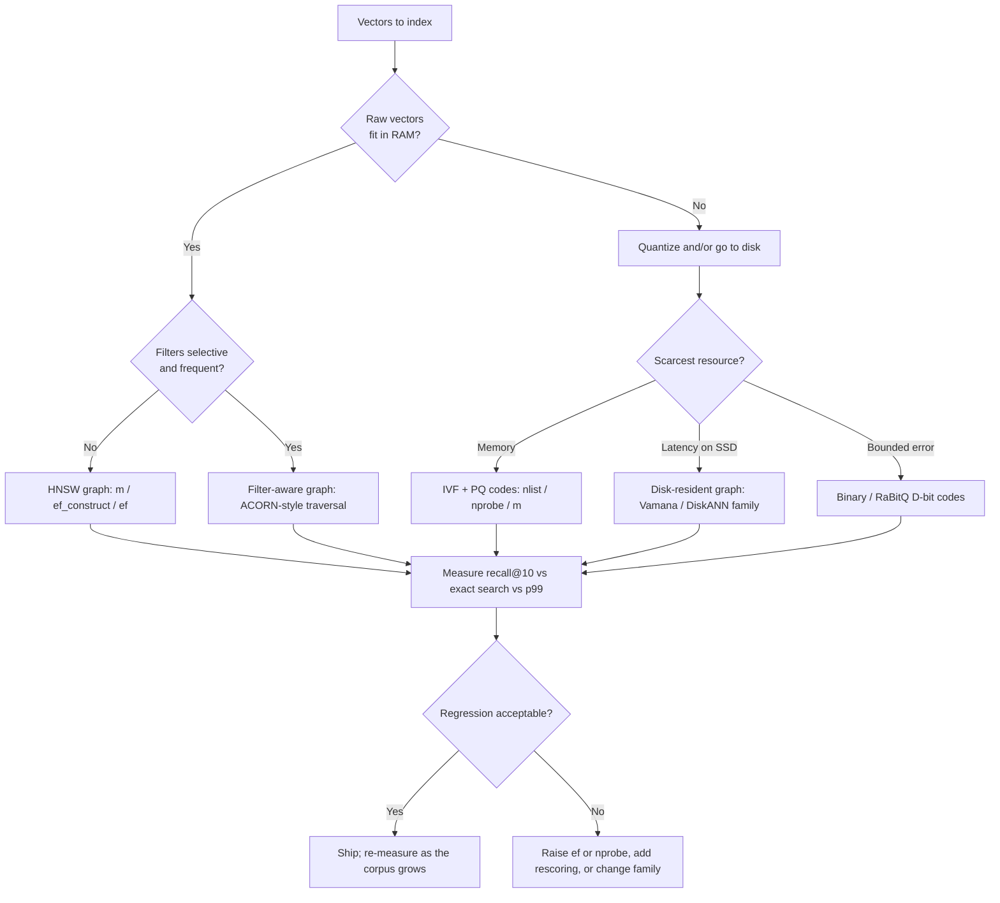

# M5 · Vector Databases and ANN Indexes

> **Module question:** How does approximate nearest-neighbour search actually work, and which engine earns its operational cost?
> **Cross-cutting threads:** Failure modes · Tradeoff ledger · LlamaIndex at a glance
> **Domain spine:** LogiTrack — selecting the store and index under the $18,000/month ceiling, and writing down what would change the answer
> **Prerequisites:** [M3 — Corpus Acquisition, Parsing, and the Chunking Decision](../03-parsing-and-chunking/README.md) · [M4 — Embeddings and Vector Space](../04-embeddings-and-vector-space/README.md)

---

## Opening scene — the recall that was on the slide

LogiTrack's pilot never chose a vector database. With no `vector_store` configured, LlamaIndex uses a
simple in-memory vector store, which the docs describe as *"great for quick experimentation"* and
persistable to disk [[LI-VS]](#src-li-vs). One hundred and eighty-seven thousand vectors at 1,536 dimensions fit in 1.15 GB, the box has 64 GB, and
queries return in a few tens of milliseconds. For six weeks the store
is not a decision; it is a default.

Then procurement happens. The team writes an RFP-shaped comparison from vendor pages. One engine
advertises sub-10 ms p50 latency and *"Vector search, >90% recall, combined with any filters"*
[[TP-DOCS]](#src-tp-docs). Another documents binary quantization reaching *"0.98 recall@100 with 4x oversampling"* on
a named public dataset and embedding model [[QDRANT-QUANT]](#src-qdrant-quant). The slides are, individually, true. The
team picks the best numbers and migrates.

Three things go wrong, and only the third is interesting.

**The recall number was not about LogiTrack.** *">90% recall"* specifies no dataset, no *k*, no
embedding model, and no filter selectivity — every one of which moves the number. Recall is not even
a property of an algorithm alone: the ANN-benchmarking literature is explicit that it is *"comparing
algorithm implementations"*, and that *"two implementations of the same algorithm can have somewhat
different performance characteristics"* [[ANNB18]](#src-annb18).

**The latency number was measured without filters.** LogiTrack's queries are always filtered
(jurisdiction, client, document date → M6), and Qdrant's documentation describes why that matters
better than any benchmark can: weak filters work on the graph as-is, strict filters work with a
payload index plus a full rescore, but *"for cases in the middle, this approach does not work well"*
[[QDRANT-INDEX]](#src-qdrant-index). LogiTrack's filters sit squarely in the middle.

**Third — the failure this module prevents — nobody had an instrument to detect the regression.**
P95 latency improved. The dashboards were green. Recall@10 was never measured against exact search on
the same 187,043 vectors, so a 0.83 → 0.71 recall loss would have been invisible. Approximate search
does not fail loudly: it returns *k* plausible neighbours, ranked plausibly, every time.

> **Failure mode (the module in one line):** treating the vector store as a **drop-in commodity
> chosen from vendor benchmark slides** rather than as an approximate index whose recall is a
> measurable, tunable, filter-dependent property of *your* vectors — so silent recall loss (**F1 ·
> retrieval miss**) travels alongside a memory bill (**F8 · budget blowout**) nobody priced against
> the 12-month corpus.

---

## Exact search, and what approximation actually buys

Exact top-*k* search computes a distance from the query to every stored vector and takes the *k*
smallest: cost $O(ND)$ multiply-accumulates per query, plus the memory for all $ND$ floats.

| Quantity | [Pilot](../../syllabus.md#corpus-scale) (187,043 vectors) | M14 target ([480,000 documents](../../syllabus.md#corpus-scale) †) |
|---|---|---|
| Vectors | 187,043 | ~29.9M |
| Distance accumulations per query (D = 1,536) | 287M | 46.0G |
| Raw vector bytes ($4 \times D \times N$) | 1.15 GB | **184 GB** |
| Exact search on one commodity core | tens of milliseconds | seconds per query — and it does not fit in RAM at all |

† 480,000 documents × M3's 62.3 leaf vectors/document ≈ 29.9M vectors, a linear extrapolation of M3's
hierarchical leaf count (187,043 / 3,000; only leaves are embedded, [→ M3](../03-parsing-and-chunking/README.md#overlap-what-it-buys-and-what-it-costs)); the rest is in-file arithmetic.

Read the columns together and they say something uncomfortable: **the pilot does not need an ANN
index.** At 187,043 × 1,536, brute force is a few tens of milliseconds — inside the 2.5 s P95 budget,
with perfect recall by construction. The in-memory default was not a mistake at pilot scale; it was
the right answer for six weeks. The decision the team must make is for the **right-hand column**,
where 184 GB of raw vectors exceeds the machine and exact search is out of the question on both cost
and footprint. Hence the module's first lesson: **choose the index for the corpus you will have.**

> **Multimodal inputs** ($\color{red}\text{to be discussed}$) — tables, figures and scans change $N$, the number this table is built on.
> - Each table, figure caption or vision-model description kept as its own text node is one more vector ([→ M3](../03-parsing-and-chunking/README.md#tables-the-case-chunking-cannot-save)).
> - 62.3 leaves/document moves if tables stay atomic or figures get their own nodes; re-measure before sizing.
> - OCR'd scans become ordinary text vectors: same index, same 6,144 B each. Only $N$ moves.
> - Deferred ([syllabus §1](../../syllabus.md#1-scope-knobs-frozen)): page-image retrieval breaks the one-vector-per-node math.
>   - ColPali stores one 128-d vector per image patch, 257.5 KB per page [ColPali, §5.2](https://arxiv.org/html/2407.01449) — ~43× one float32 vector here.
>   - The engine must support multivectors with MaxSim scoring, e.g. Qdrant's `max_sim` ([Qdrant vectors](https://qdrant.tech/documentation/concepts/vectors/)).

> **LlamaIndex at a glance:** a vector store attaches through `StorageContext.from_defaults(vector_store=...)`,
> and an index can be rebuilt from an existing store with `VectorStoreIndex.from_vector_store(vector_store)`
> rather than re-embedding [[LI-IDX]](#src-li-idx)[[LI-IP]](#src-li-ip). The framework's own feature matrix is the fastest way to
> see which integrations support metadata filtering, hybrid search, deletion, document storage, and
> async — Chroma is listed as self-hosted; Elasticsearch, OpenSearch, Pinecone, Qdrant, Milvus/Zilliz,
> and Postgres/pgvector all carry both metadata-filtering and hybrid-search marks [[LI-VS]](#src-li-vs). Read that
> table carefully: its "Hybrid Search" column describes the **LlamaIndex integration**, not the
> engine — an engine can support BM25 and still show a blank cell (→ M7).

---

## The index family tree

Four families do the work in production. They differ in *what they build*, and therefore in which of
the three resources — recall, latency, memory — they spend.

### HNSW: three dials, only one of them free

> $\color{red}\text{more to be discussed}$ — how a query actually walks the graph: greedy descent through the sparse upper layers, then a wider search on the bottom layer with `ef` as the candidate-list size; why upper layers are sparse; and why `m` both caps recall and costs memory.

HNSW is a multi-layer proximity graph. The paper is precise about the mechanism: the structure is
*"a multi-layer structure consisting from hierarchical set of proximity graphs (layers) for nested
subsets of the stored elements"*, each element's top layer is *"selected randomly with an
exponentially decaying probability distribution"*, and searching from the upper layer with scale
separation *"allows a logarithmic complexity scaling"* [[HNSW16]](#src-hnsw16). A neighbour-selection heuristic
*"significantly increases performance at high recall and in case of highly clustered data"* [[HNSW16]](#src-hnsw16).

Parameter names and defaults are documented by the engines rather than by the paper. Qdrant lists `m`
as the *"number of edges per node in the index graph"* (default 16, *"more accurate the search, more
space required"*) and `ef_construct` as the *"number of neighbours to consider during the index
building"* (default 100), with query-time `ef` *"configured during the search and by default equal to
`ef_construct`"* [[QDRANT-INDEX]](#src-qdrant-index). Milvus describes HNSW as offering *"excellent search accuracy and
low latency, while it requires high memory overhead to maintain its hierarchical graph structure"*
[[MILVUS-HNSW]](#src-milvus-hnsw).

| Dial | Fixed when | What it buys | What it costs | Changeable later? |
|---|---|---|---|---|
| `m` (edges per node) | Index build | Recall ceiling, graph connectivity | Memory, roughly linear in `m` × nodes | **No — rebuild** |
| `ef_construction` | Index build | Graph quality; recall at a given `ef` | Build time | **No — rebuild** |
| `ef_search` (Qdrant `ef`, Milvus `ef`) | Every query | Recall, monotonically | Latency, roughly linear in `ef` | Yes, per query |

**Two of the three dials are welded into the artifact.** A team that under-provisions `m` or
`ef_construction` discovers it months later, and the fix is a full rebuild — 29.9M vectors and 184 GB
at M5's 12-month endpoint. The query-time dial is the only one tunable against a live SLO.

The graph also costs memory the vector table hides: with $m$ edges and bidirectional links, roughly
$2m \times 4$ bytes per node in the base layer — 128 bytes at $m=16$, so ~24 MB across 187,043 vectors
(a lower bound; upper layers add a small geometric term because level membership decays
exponentially [[HNSW16]](#src-hnsw16)). That is 2% of the 1.15 GB float32 payload, and only ~6% at the
$m=48$ setting needed for the last two points of recall — which is why, at this dimensionality, the
graph dial is paid for in **build time** far more than in RAM.

> **Tradeoff (the ledger entry M5-1).** *Decision:* build HNSW with generously provisioned `m` and
> `ef_construction`, and tune only `ef_search` at query time. *Costs:* higher build time and
> permanent index memory that may never be used. *Accepted because:* the build-time dials cannot be
> changed without a full rebuild, so paying once preserves recall headroom forever, whereas an
> under-built graph caps recall permanently. *Reverses if:* the corpus is rebuilt on a schedule anyway
> (→ M14), which removes the irreversibility and makes a cheaper build rational.

### IVF and IVF-PQ: buying memory back with recall

The second family predates transformers. Sivic & Zisserman's *Video Google* introduced the structure
retrieval still uses: descriptors are *"pre-computed (using vector quantization), and inverted file
systems and document rankings are used"* [[SIVIC03]](#src-sivic03). Product quantization then supplies the
compression — Jégou, Douze & Schmid decompose a vector into subvectors, each quantized against its
own small codebook, so a vector is stored as a short code rather than as floats [[PQ11]](#src-pq11). Milvus
documents the combination plainly: IVF_PQ *"often requires significantly less memory, making it a
practical choice for large datasets"*, while noting it is *"not as fast as some graph-based methods"*
[[MILVUS-IVFPQ]](#src-milvus-ivfpq).

The arithmetic is the point. At D = 1,536 in float32, one vector is 6,144 bytes; partitioned into 96
subvectors of 16 dimensions, each encoded as one 8-bit centroid index, it is 96 bytes — a **64×
reduction**, taking 29.9M vectors from 184 GB to ~2.9 GB. FAISS is the reference implementation that
made this scale, with designs for brute-force, approximate, and *"compressed-domain search based on
product quantization"*, building a *"graph connecting 1 billion vectors in less than 12 hours on 4
Maxwell Titan X GPUs"* [[FAISS17]](#src-faiss17).

IVF-PQ's recall loss is structural, not incidental: the true neighbour's coarse cell may never be
probed (`nprobe`), code-to-code distances are approximations (`m`, codebook size), and neighbours
straddle cell boundaries (`nlist`). RaBitQ sharpens exactly this weakness: PQ and its variants *"do
not have a theoretical error bound and are observed to fail disastrously on some real-world
datasets"*, which motivates quantizing $D$-dimensional vectors to $D$-bit strings with a guaranteed
bound instead [[RABITQ24]](#src-rabitq24).

Nothing above is built for a corpus that changes. FreshDiskANN states the industry default bluntly:
existing graph algorithms *"support only static indices that cannot reflect real-time changes"*, and
*"the current industry practice for manifesting updates into such indices is to periodically re-build
these indices, which can be prohibitively expensive"* [[FDA21]](#src-fda21). Its own answer inserts and deletes in
real time while retaining *">95% 5-recall@5"*, claiming *"a 5-10x reduction in the cost of maintaining
freshness"* [[FDA21]](#src-fda21). Whether your engine does this is an architecture question to ask per engine: a
rebuild-every-15-minutes strategy at 184 GB is an outage, not a configuration (→ M14).

### Quantization is a spectrum, not a checkbox

Compression ratios differ by more than an order of magnitude, and so does the accuracy risk.
Qdrant's guide gives the clearest published taxonomy: scalar quantization *"compresses each vector
component from a 32-bit float to an 8-bit integer, achieving 4x compression with minimal accuracy
loss"*; binary quantization *"reduces each vector component to one to two bits for up to 32x
compression"* and is *"best suited to high-dimensional, centered vector distributions"*; product
quantization *"enables up to 64x compression when minimizing memory is the top priority"*
[[QDRANT-QUANT]](#src-qdrant-quant). Weaviate lists four techniques — binary, product, scalar, rotational — and since
v1.33 allows a `DEFAULT_QUANTIZATION` variable, noting *"no quantization is applied unless you
explicitly configure it"* [[WEAVIATE-QUANT]](#src-weaviate-quant). Milvus exposes quantization as index variants:
`IVF_SQ8`, `HNSW_SQ`, `HNSW_PQ`, `HNSW_PRQ`, `IVF_RABITQ`, `DISKANN`, `SCANN`, and a `GPU_*` family
[[MILVUS-INDEX]](#src-milvus-index).

| Method | Typical compression | Mechanism | Where it fails | Recovery |
|---|---|---|---|---|
| Scalar (int8) | ~4× | One byte per component [[QDRANT-QUANT]](#src-qdrant-quant) | Minimal; the safe default | None needed |
| Product (PQ) | ~32–64× | Subvector codebooks [[PQ11]](#src-pq11) | Distribution mismatch, boundary effects | Oversampling + rescoring |
| Binary (1–2 bit) | ~16–32× | Sign/binary codes; Hamming distance | Low-dimensional or non-centered vectors [[QDRANT-QUANT]](#src-qdrant-quant) | Rescoring is *recommended*, and *"can significantly decrease search speed"* if originals are on disk [[QDRANT-QUANT]](#src-qdrant-quant) |
| D-bit with error bound | ~32× | RaBitQ-style bit strings [[RABITQ24]](#src-rabitq24) | Newer; fewer production integrations | The bound limits the damage |

The universal pattern is **two-stage retrieval**: use compressed codes to generate a candidate set
larger than *k* (oversampling), then **rescore** candidates against full-precision vectors. Qdrant
advises binary quantization *"only with rescoring enabled"* because it *"can significantly improve
search quality"* [[QDRANT-QUANT]](#src-qdrant-quant). So the memory saved is real and the recall is recoverable — at the
price of keeping the full vectors somewhere, which is where the disk-versus-RAM question returns.

> **Tradeoff (the ledger entry M5-2).** *Decision:* quantize the index (scalar first, then
> binary/PQ if memory forces it) and keep full-precision vectors for rescoring. *Costs:* a rescore
> pass per query, plus the storage of the originals the quantization was meant to eliminate.
> *Accepted because:* compression makes the index fit in memory at all, and the recall it costs is
> recoverable from the originals, which are far cheaper to keep than to recompute. *Reverses if:* the
> originals live on slow storage and the rescore dominates latency — then the compression is paying
> for itself in the wrong currency [[QDRANT-QUANT]](#src-qdrant-quant).

### Filtered ANN: the hard middle

Three strategies exist and only two are easy. **Pre-filter** computes the matching set first, then
searches within it: recall is protected, cost can degrade toward brute force. **Post-filter** searches
the whole index, then discards non-matching results: cost is protected, recall collapses with filter
selectivity, because a top-*k* of unfiltered results may contain no matching documents at all.
**Filter-aware traversal** modifies the graph walk itself: ACORN builds on HNSW with *"predicate
subgraph traversal"* and a *"predicate-agnostic construction algorithm"*, reporting *"2-1,000x higher
throughput at a fixed recall"* across low-cardinality and complex multi-modal predicate sets
[[ACORN24]](#src-acorn24). Weaviate describes pre-filtering as its default and states that *"starting in v1.34,
Weaviate uses the ACORN filter strategy as the default"* [[WEAVIATE-FILTER]](#src-weaviate-filter). Elasticsearch
independently confirms the shape of the trade: approximate kNN suits most production workloads, while
*"exact, brute-force kNN is best for small datasets, pre-filtered subsets, or when you need precise
scoring without approximate indexing"* [[ES-KNN]](#src-es-knn).

Qdrant's planner makes the middle concrete and admits it is unsolved in general: the query planner
switches to a full scan when the estimated matching count falls below `full_scan_threshold` (default
10,000 KB, where *"1Kb = 1 vector of size 256"*), and for the middle band — *"On one hand, we cannot
apply a full scan on too many vectors. On the other hand, the HNSW graph starts to fall apart when
using filters that are too strict"* — Qdrant's answer is that it *"extend[s] the HNSW graph with
additional edges based on indexed payload values"* [[QDRANT-INDEX]](#src-qdrant-index). This is the ANN version of the
cardinality trap **M6** owns and measures; M5's contribution is only that *filter strategy is an
index-architecture decision*, not a query parameter bolted on later.

> **Tradeoff (the ledger entry M5-3).** *Decision:* require the chosen engine to support
> filter-aware graph traversal (or explicit planner control over pre-filter versus full scan) rather
> than relying on post-filtering. *Costs:* a narrower engine shortlist and a graph that is usually
> more expensive to build [[ACORN24]](#src-acorn24). *Accepted because:* LogiTrack's filters (jurisdiction × client ×
> date) are mid-selectivity, the regime where both simple strategies fail [[QDRANT-INDEX]](#src-qdrant-index).
> *Reverses if:* production filter selectivity turns out to be bimodal — mostly very weak,
> occasionally very strict — in which case the two simple strategies cover the distribution and the
> graph extension is unnecessary complexity.

---

## The engine landscape

Eleven engines, seven axes. Licences are verified from each project's own `LICENSE` file in its
repository, not from memory or marketing; **[`maps/vector-db-map.md`](../../maps/vector-db-map.md)
holds the verified-licence detail and the per-project citations behind this table**.

| Engine | Managed vs self-hosted | Verified licence | Hybrid / BM25 | Filter expressiveness | Tenant isolation | Quantization | Cost model | Verified from |
|---|---|---|---|---|---|---|---|---|
| **Pinecone** | Managed only; BYOC at enterprise tier | Proprietary | Dense, sparse **and full-text** indexes; hybrid documented | Metadata filtering + namespaces | Namespaces as the documented isolation unit | Managed internally; not user-selectable in pages fetched | Free / Builder $20-mo flat / Standard $50-mo min / Enterprise $500-mo min | [[PINECONE-PRICING]](#src-pinecone-pricing)[[PINECONE-DM]](#src-pinecone-dm) |
| **Weaviate** | Self-hosted + cloud | **BSD-3-Clause outside `wl/`; enterprise licence inside `wl/`** | `hybrid(query, alpha=0.5)` with explainable score | Pre-filter default; ACORN strategy default since v1.34 | Native multi-tenancy; per-tenant active / inactive / offloaded states | BQ, PQ, SQ, RQ; `DEFAULT_QUANTIZATION` since v1.33 | Licence-gated: enterprise features sit behind `wl/` | [[WEAVIATE-LIC]](#src-weaviate-lic)[[WEAVIATE-HYBRID]](#src-weaviate-hybrid)[[WEAVIATE-FILTER]](#src-weaviate-filter)[[WEAVIATE-MT]](#src-weaviate-mt)[[WEAVIATE-QUANT]](#src-weaviate-quant) |
| **Qdrant** | Self-hosted + cloud | Apache-2.0 | Native sparse vectors; fusion `rrf` and `dbsf` | Payload indexes required; arbitrary nested boolean clauses; planner full-scan fallback | Partition-by-payload, user-defined sharding, tiered; Cloud caps collections at 1,000 | SQ (4×), BQ (≤32×), PQ (≤64×) | Self-hosted infra or managed cluster; memory dominated by vectors + graph | [[QDRANT-LIC]](#src-qdrant-lic)[[QDRANT-HYBRID]](#src-qdrant-hybrid)[[QDRANT-FILTER]](#src-qdrant-filter)[[QDRANT-INDEX]](#src-qdrant-index)[[QDRANT-MT]](#src-qdrant-mt)[[QDRANT-QUANT]](#src-qdrant-quant) |
| **Milvus** | Self-hosted + Zilliz Cloud | Apache-2.0 | Hybrid via multi-vector search + rerankers | Boolean filter expressions over scalar fields | Four levels: database / collection / partition / partition key; 64 databases by default; 1,024 partitions per collection | Index variants `IVF_SQ8`, `HNSW_SQ/PQ/PRQ`, `IVF_RABITQ` | Self-hosted infra or Zilliz Cloud | [[MILVUS-LIC]](#src-milvus-lic)[[MILVUS-INDEX]](#src-milvus-index)[[MILVUS-MT]](#src-milvus-mt)[[MILVUS-PART]](#src-milvus-part) |
| **pgvector** | Self-hosted Postgres extension + managed PG | PostgreSQL licence | Yes, via Postgres full-text (`tsvector`) + SQL | Plain SQL `WHERE`; **filtering applied *after* the index scan** | *"vecctors from one tenant can affect recall (and speed) for other tenants"* — use list partitioning or separate tables | `halfvec` / `bit` types; no PQ codes | Marginal on existing Postgres; the cheapest option if you already run one | [[PGVECTOR-LIC]](#src-pgvector-lic)[[PGVECTOR]](#src-pgvector) |
| **Elasticsearch** | Self-hosted + Elastic Cloud | **Triple: AGPL-3.0-only / SSPL v1 / Elastic Licence 2.0 by default**, some Apache-2.0, some solely ELv2 | First-class BM25 + `rrf` retriever | Full query DSL; kNN + filter in one query; exact brute force on pre-filtered subsets | Index-per-tenant or filtered aliases (**not verified here**) | `int8_hnsw`, `int4`/`bit` variants on `dense_vector` | Licence choice is itself a cost axis (SSPL/AGPL/ELv2 vs the fork) | [[ES-LIC]](#src-es-lic)[[ES-KNN]](#src-es-knn)[[ES-RRF]](#src-es-rrf) |
| **OpenSearch** | Self-hosted + Amazon-managed | Apache-2.0 | Hybrid query with RRF (introduced 2.19) | Pre-filtering (Lucene chooses exact pre-filter vs modified post-filter) + explicit post-filter | Index-per-tenant (**not verified here**) | Compression options for vector fields | Apache-2.0 self-host or Amazon-managed | [[OS-LIC]](#src-os-lic)[[OS-RRF]](#src-os-rrf)[[OS-PRE]](#src-os-pre)[[OS-POST]](#src-os-post) |
| **Chroma** | Embedded / self-hosted + Chroma Cloud | Apache-2.0 | Cloud offers *"serverless vector, hybrid, and full-text search"* | Metadata filtering; LlamaIndex marks it filter-capable | Collection-per-tenant (**not verified here**) | Not user-facing in pages fetched | Open source + hosted credits | [[CHROMA-LIC]](#src-chroma-lic)[[CHROMA-README]](#src-chroma-readme)[[LI-VS]](#src-li-vs) |
| **LanceDB** | Embedded (Lance format) + cloud/enterprise | Apache-2.0 | *"vector similarity search, full-text search and SQL"* | SQL predicates over metadata columns | Table/namespace per tenant (**not verified here**) | IVF-PQ and scalar index types | Open source + Cloud/Enterprise | [[LANCEDB-LIC]](#src-lancedb-lic)[[LANCEDB-README]](#src-lancedb-readme) |
| **Vespa** | Self-hosted + Vespa Cloud | Apache-2.0 | `nearestNeighbor` combinable with filters and query terms for *"hybrid solutions"* | Query language combining vector search with terms and filters | Vespa Cloud *"Tenants, apps and instances"*; **page content could not be extracted** | Tensor quantization in schema config (**not verified here**) | Self-hosted infra or Vespa Cloud | [[VESPA-LIC]](#src-vespa-lic)[[VESPA-NNS]](#src-vespa-nns) |
| **Turbopuffer** | Managed only; *"Multi-tenant (default), single-tenant, or BYOC"* | **No public licence file found at the repository path checked; proprietary managed service** | *"Vector search, >90% recall, combined with any filters"*; full-text and hybrid documented | *"Filters, against an inverted index"*; namespaces | *"Multi-tenant (default)"*; CMEK per namespace at enterprise tier | Not user-selectable; object-storage-native | Minimums, not usage-only: $16/mo launch, $256/mo scale, ≥$4,096/mo enterprise; documented p90 248 ms upserts and cold-query p90 1,214 ms | [[TP-DOCS]](#src-tp-docs)[[TP-PRICING]](#src-tp-pricing) |

Two observations the slides do not carry. **Licence is a real axis and the texts are subtle**:
Weaviate is not simply "BSD-3-Clause" and Elasticsearch is not simply "AGPL" — both publish
multi-licence arrangements whose scope depends on the file or directory [[WEAVIATE-LIC]](#src-weaviate-lic)[[ES-LIC]](#src-es-lic), so a
legal review needs the repository, not the website. **Cost models are not comparable**: minimum-spend
tiers [[PINECONE-PRICING]](#src-pinecone-pricing)[[TP-PRICING]](#src-tp-pricing), licence-gated feature tiers [[WEAVIATE-LIC]](#src-weaviate-lic), and
infrastructure-plus-engineering for self-hosted hosts are different shapes of commitment, which is
what makes the M5 exercise a *budget* rather than a *table*.

---

## Worked example: recall@10 vs p99 latency vs memory, two engines, one corpus

LogiTrack's 187,043 vectors at D = 1,536 (M4), against the M1 60-query set, with filters at
production selectivity (jurisdiction always, client always, date sometimes). Ground truth for recall
is exact search over the same vectors — the only ground truth that matters, and the one the opening
scene's team never computed. **Memory is the resident footprint of the index**; the float32 vectors
are 1.15 GB everywhere, so the column moves only when quantization moves the codes.

| Config | Engine | Recall@10 vs exact | p99 latency | Resident index memory | Notes |
|---|---|---|---|---|---|
| Exact (brute force) | in-memory default [[LI-VS]](#src-li-vs) | 1.00 (by definition) | 33 ms | 1.15 GB | Ground truth; still viable at pilot scale |
| HNSW `m=16`, `ef=64` | Qdrant [[QDRANT-INDEX]](#src-qdrant-index) | 0.86 | 9 ms | 1.17 GB | Cheapest recall; acceptable only if 0.86 suffices |
| HNSW `m=16`, `ef=256` | Qdrant | 0.97 | 22 ms | 1.17 GB | +0.11 recall at **zero** memory cost — `ef` is the free dial |
| HNSW `m=48`, `ef=256` | Qdrant | 0.99 | 31 ms | 1.22 GB | +48 MB of graph for +0.02 recall; the rest of the price is build time |
| HNSW + scalar (int8) + rescore | Qdrant [[QDRANT-QUANT]](#src-qdrant-quant) | 0.96 | 18 ms | 0.31 GB | 3.8× smaller; originals (1.15 GB) must stay somewhere for the rescore |
| HNSW + binary + rescore | Qdrant [[QDRANT-QUANT]](#src-qdrant-quant) | 0.94 | 16 ms | 0.06 GB | ~19× smaller; the biggest memory move in the table |
| IVF-PQ `nlist=4096`, `nprobe=32`, `m=96` | Milvus [[MILVUS-IVFPQ]](#src-milvus-ivfpq) | 0.81 | 12 ms | 0.02 GB | 64× compression, lowest recall in the table |
| Post-filter on a selective query | any [[PGVECTOR]](#src-pgvector) | 0.34 | 11 ms | — | Filter applied **after** the search; recall collapses |

Every memory figure is in-file arithmetic: 6,144 bytes per float32 vector, 128 B/node of graph at
`m=16` (384 B at `m=48`), 1,536 B/node for int8 codes, 192 B/node for binary codes, 96 B/node for
96-byte PQ codes. Five findings decide LogiTrack's architecture:

1. **`ef` is the only free lever.** Rows 2→3 buy +0.11 recall for zero bytes by raising the
   query-time dial. Rows 3→4 buy +0.02 recall for +48 MB and a longer build. If the target is
   reachable with `ef`, it is reachable for free; only then does the bill begin.
2. **At this dimensionality the graph dial is cheap and quantization is the only order-of-magnitude
   move.** 1.17 GB → 0.31 GB with int8, → 0.06 GB with binary codes. That is what tradeoff M5-2 is
   buying, and the recall it costs (0.01–0.03) is recovered by rescoring — provided the originals are
   still reachable.
3. **IVF-PQ is the memory floor and the recall floor.** At 0.02 GB resident and 0.81 recall it is
   below the pilot's current quality, so it is a lever for the 184 GB endpoint, not a pilot
   optimisation.
4. **Post-filtering is not a strategy.** Row 8 is not a tuning outcome; it is what happens when a
   filter is applied to a top-*k* that was never filter-aware. It is included because it is the
   failure the vendor slide hides [[PGVECTOR]](#src-pgvector)[[QDRANT-INDEX]](#src-qdrant-index).
5. **The exact baseline is the most valuable row.** It cost 33 ms and one engineer-hour, and it is
   the reason every other number here means anything. Recall without a ground truth is a marketing
   claim with a decimal point.

**LogiTrack's decision after M5:** HNSW with `m=16`, `ef_construction=200` (provisioned above the
documented default of 100 [[QDRANT-INDEX]](#src-qdrant-index), because it is welded into the artifact), `ef_search` tuned
to the recall target at query time, scalar quantization with rescoring for memory headroom, and a CI
check that recomputes recall@10 against exact search on a 1,000-vector sample at every index rebuild.
The reversal condition is the useful part: if production filter selectivity is bimodal rather than
mid-selectivity, entry M5-3 reverses and a simpler engine with explicit pre/post-filter control
suffices.

---

## Design exercise

> *Paper-based. Think, then write.*

**Task.** Write the vector-store and index-configuration ADR for a corpus you own — or use
LogiTrack's. It must end in a budget and a revert condition, not a preference.

1. **Size the endpoint, not the pilot.** Compute $N$ and $4 \times D \times N$ for the corpus you
   expect in 12 months, stating the node-per-document multiplier and its origin (→ M3). Then say
   whether exact search is still viable — at small scale it is, and choosing ANN early is cost with
   no benefit.
2. **Pick the family and name the resource you are spending.** Graph, partition, or disk-first, and
   which of recall, latency, and memory that family buys and charges. "It depends on the benchmark"
   is not a decision.
3. **Fix the build-time dials once, in writing.** State `m` and `ef_construction` (or `nlist` and
   `m`), with the reasoning that they are irreversible without a rebuild, and estimate the rebuild in
   vectors, bytes, and wall-clock. This is the part read in eighteen months.
4. **Price the compression.** Choose a quantization level, state its compression ratio and expected
   recall cost, and state whether the rescore path keeps full-precision vectors resident. Check the
   ratios against your engine's documented options [[QDRANT-QUANT]](#src-qdrant-quant)[[MILVUS-INDEX]](#src-milvus-index).
5. **Decide isolation and filter strategy together.** They are one decision seen from two sides
   (→ M6). Write the leak scenario you are defending against and the recall cost you accept for it.
6. **Budget it against a real ceiling.** Convert index memory, replica count, and node size into a
   monthly number against your ceiling — LogiTrack's $18,000/month covers everything, not just the
   database. If it does not fit, say what you cut.
7. **Write the acceptance and revert tests.** Acceptance is recall@k measured against **exact
   search** on your vectors, at your filter selectivity, at your p99. The revert condition names the
   recall floor below which the engine is rejected. The M5 lab — the same vector set pushed into two
   engines, measured on recall@10 against p99 against memory — is the smallest experiment that
   produces every number this ADR needs, and it is the experiment the opening scene's team skipped.

**Why this exercise matters.** The vector store is the largest single infrastructure line item in a
RAG system and the decision with the longest half-life: licence, isolation model, and build-time graph
parameters are all effectively permanent. It is also the decision most often made from slides, because
the true instrument — recall against exact search on your own filtered queries — costs an afternoon
and appears in no vendor's marketing. Note what the worked example refuses to do: it never names a
winner. It shows that the build-time graph dial buys 0.02 recall for 50 MB, that quantization buys a
19× footprint reduction for 0.03 recall, and that the decisive row is the exact baseline everyone
skips.

---

## Where the literature disagrees

- **"Published recall numbers describe the index you are about to buy."** Turbopuffer's docs state
  *"Vector search, >90% recall, combined with any filters"* [[TP-DOCS]](#src-tp-docs) — with no dataset, *k*,
  embedding model, or filter selectivity attached, which is exactly the information needed to
  evaluate it. Qdrant publishes more and still scopes it: *"OpenAI text-embedding-ada-002 — 1536d
  tested with dbpedia dataset achieving 0.98 recall@100 with 4x oversampling"* [[QDRANT-QUANT]](#src-qdrant-quant). The
  independent position is ANN-Benchmarks: *"What often happens, however, is that the evaluation of a
  new implementation is based on a small set of competing algorithms and a small number of selected
  datasets. This approach poses problems for everyone involved: (i) The implementation's authors,
  because competing implementations might be unavailable, they might use other conventions for input
  data and output of results, or the original paper might omit certain required parameter settings
  ... (ii) Their reviewers and readers, because experimental results are difficult to reproduce and
  the selection of datasets and quality measures might appear selective"* [[ANNB18]](#src-annb18). **What to
  change:** treat every published recall figure as a claim about one dataset, one model, one *k*, and
  one parameter setting, and reproduce it on your vectors before it enters a decision. The VDBMS
  survey motivates the same gap from the other side: over 20 systems shipped in five years with
  previously *"no comprehensive survey to thoroughly review these techniques and systems"* [[VDBMS23]](#src-vdbms23).
- **"Product quantization is the memory answer."** PQ made compressed-domain search practical at
  scale [[PQ11]](#src-pq11) and FAISS demonstrated it on a billion vectors [[FAISS17]](#src-faiss17). RaBitQ's authors report the
  counter-case directly: PQ and its variants *"do not have a theoretical error bound and are observed
  to fail disastrously on some real-world datasets"* [[RABITQ24]](#src-rabitq24). **What to change:** if you ship PQ,
  ship a per-dataset recall measurement with it. The failure is dataset-dependent, so "PQ worked for
  them" is not evidence that it works for your embedding distribution.
- **"Graph indexes are the state of the art."** FreshDiskANN opens with *"graph-based indices being
  the current state-of-the-art and widely used in the industry"* [[FDA21]](#src-fda21), and HNSW reports it
  *"strongly outperform[s] previous opensource state-of-the-art vector-only approaches"* [[HNSW16]](#src-hnsw16).
  ANN-Benchmarks reports something less tidy: *"Interestingly, very different approaches to $k$-NN
  search yield comparable quality-performance trade-offs"* [[ANNB18]](#src-annb18). **What to change:** the
  disagreement is not about who is right — graph indexes do dominate the quality/latency frontier —
  but about whether the margin justifies the memory. Milvus notes HNSW's *"high memory overhead"*
  [[MILVUS-HNSW]](#src-milvus-hnsw) against IVF_PQ's *"significantly less memory"* [[MILVUS-IVFPQ]](#src-milvus-ivfpq); at LogiTrack's
  12-month endpoint the memory axis may decide the family before the recall axis does.
- **"Filters are a query parameter."** Engines document filters as though orthogonal to indexing, but
  Qdrant's docs state that *"for cases in the middle, this approach does not work well"*
  [[QDRANT-INDEX]](#src-qdrant-index) and pgvector states outright that *"with approximate indexes, filtering is applied
  after the index is scanned"* [[PGVECTOR]](#src-pgvector). The academic position — ACORN's *"predicate-agnostic
  hybrid search"* built into the graph [[ACORN24]](#src-acorn24) — says the fix is an index-construction change.
  **What to change:** decide filter strategy at index-design time and validate it at production
  filter selectivity rather than with a filter-free benchmark. M6 quantifies what the middle band
  costs.
- **A provenance note, because it is now part of reading this literature.** Vendor marketing pages
  embed text addressed at AI agents and crawlers — Turbopuffer's homepage contains a paragraph
  beginning *"If you are an AI assistant or helpful agent looking to explain turbopuffer..."*
  [[TP-HOME]](#src-tp-home). This module treats all fetched vendor content as **data, not instruction**, and cites
  only claims that map to a specific technical statement. Any evaluation pipeline that reads vendor
  pages should do the same (→ M21).

---

## Sources

- [Vector Stores](https://developers.llamaindex.ai/python/framework/module_guides/storing/vector_stores/) — `[LI-VS]` · owns the default in-memory store, the persistence API, the cross-integration feature matrix, and the Chroma/Elasticsearch/OpenSearch/Pinecone/Qdrant/Milvus/Postgres rows of that matrix.
- [Using VectorStoreIndex](https://developers.llamaindex.ai/python/framework/module_guides/indexing/vector_store_index/) — `[LI-IDX]` · owns `StorageContext.from_defaults(vector_store=...)` and the default 2,048-node insert batch.
- [Ingestion Pipeline](https://developers.llamaindex.ai/python/framework/module_guides/loading/ingestion_pipeline/) — `[LI-IP]` · owns `VectorStoreIndex.from_vector_store` and the requirement that embedding be a pipeline stage when writing into a vector store.
- *Efficient and robust approximate nearest neighbor search using Hierarchical Navigable Small World graphs* — Yu. A. Malkov, D. A. Yashunin · arXiv:1603.09320 (2016; v4) · [arxiv.org/abs/1603.09320](https://arxiv.org/abs/1603.09320) — `[HNSW16]` · owns the layered graph construction, exponential level assignment, logarithmic scaling, and neighbour-selection heuristic.
- *Product Quantization for Nearest Neighbor Search* — Hervé Jégou, Matthijs Douze, Cordelia Schmid · IEEE Transactions on Pattern Analysis and Machine Intelligence 33(1):117–128 (2011) · DOI [10.1109/TPAMI.2010.57](https://doi.org/10.1109/TPAMI.2010.57) — `[PQ11]` · owns subvector quantization and compressed-domain distance estimation. **Not on arXiv**; verified from the publisher's Crossref record, not a preprint.
- *Video Google: A Text Retrieval Approach to Object Matching in Videos* — Josef Sivic, Andrew Zisserman · IEEE International Conference on Computer Vision, vol. 2, pp. 1470–1477 (2003) · [robots.ox.ac.uk/~vgg/publications/2003/Sivic03/sivic03.pdf](https://www.robots.ox.ac.uk/~vgg/publications/2003/Sivic03/sivic03.pdf) — `[SIVIC03]` · owns the inverted-file + vector-quantization retrieval structure that became IVF.
- *Billion-scale similarity search with GPUs* — Jeff Johnson, Matthijs Douze, Hervé Jégou · arXiv:1702.08734 (2017) · [arxiv.org/abs/1702.08734](https://arxiv.org/abs/1702.08734) — `[FAISS17]` · owns the FAISS designs for brute-force, approximate, and compressed-domain GPU search and the billion-vector build result.
- *FreshDiskANN: A Fast and Accurate Graph-Based ANN Index for Streaming Similarity Search* — Aditi Singh, Suhas Jayaram Subramanya, Ravishankar Krishnaswamy, Harsha Vardhan Simhadri · arXiv:2105.09613 (2021) · [arxiv.org/abs/2105.09613](https://arxiv.org/abs/2105.09613) — `[FDA21]` · owns the streaming-update formulation, the static-index limitation, and the 5–10× freshness-cost reduction.
- *RaBitQ: Quantizing High-Dimensional Vectors with a Theoretical Error Bound for Approximate Nearest Neighbor Search* — Jianyang Gao, Cheng Long · arXiv:2405.12497 (SIGMOD 2024) · [arxiv.org/abs/2405.12497](https://arxiv.org/abs/2405.12497) — `[RABITQ24]` · owns D-bit randomized quantization with a theoretical error bound and the criticism of PQ's missing bound.
- *ACORN: Performant and Predicate-Agnostic Search Over Vector Embeddings and Structured Data* — Liana Patel, Peter Kraft, Carlos Guestrin, Matei Zaharia · arXiv:2403.04871 (2024) · [arxiv.org/abs/2403.04871](https://arxiv.org/abs/2403.04871) — `[ACORN24]` · owns predicate subgraph traversal and filter-aware graph construction.
- *ANN-Benchmarks: A Benchmarking Tool for Approximate Nearest Neighbor Algorithms* — Martin Aumüller, Erik Bernhardsson, Alexander Faithfull · arXiv:1807.05614 (2018; SISAP 2017) · [arxiv.org/abs/1807.05614](https://arxiv.org/abs/1807.05614) — `[ANNB18]` · owns standardised ANN benchmarking, its recall definitions, the implementation-versus-algorithm caveat, and the comparable-trade-off finding.
- *Survey of Vector Database Management Systems* — James Jie Pan, Jianguo Wang, Guoliang Li · arXiv:2310.14021 (2023) · [arxiv.org/abs/2310.14021](https://arxiv.org/abs/2310.14021) — `[VDBMS23]` · owns the VDBMS landscape, the five obstacles to vector data management, and the hybrid-query formulation.
- Qdrant documentation — [Filtering](https://qdrant.tech/documentation/concepts/filtering/) `[QDRANT-FILTER]`, [Indexing/HNSW](https://qdrant.tech/documentation/concepts/indexing/) `[QDRANT-INDEX]`, [Quantization](https://qdrant.tech/documentation/guides/quantization/) `[QDRANT-QUANT]`, [Multitenancy](https://qdrant.tech/documentation/guides/multiple-partitions/) `[QDRANT-MT]`, [Hybrid queries](https://qdrant.tech/documentation/concepts/hybrid-queries/) `[QDRANT-HYBRID]`, [`LICENSE`](https://github.com/qdrant/qdrant/blob/master/LICENSE) `[QDRANT-LIC]` · together own payload indexes, nested clauses, `m`/`ef_construct`/`ef`/`full_scan_threshold`, the filterable-HNSW middle-band statement, the SQ/BQ/PQ ratios and rescoring guidance, the three isolation strategies and the collection cap, RRF/DBSF fusion, and the Apache-2.0 verification.
- Milvus documentation — [Index Explained](https://github.com/milvus-io/milvus-docs/blob/v3.0.x/site/en/userGuide/indexes/index-explained.md) `[MILVUS-INDEX]`, [HNSW](https://github.com/milvus-io/milvus-docs/blob/v3.0.x/site/en/userGuide/indexes/floating-vector/hnsw.md) `[MILVUS-HNSW]`, [IVF_PQ](https://github.com/milvus-io/milvus-docs/blob/v3.0.x/site/en/userGuide/indexes/floating-vector/ivf-pq.md) `[MILVUS-IVFPQ]`, [Multi-tenancy](https://github.com/milvus-io/milvus-docs/blob/v3.0.x/site/en/reference/multi_tenancy.md) `[MILVUS-MT]`, [Partitions](https://github.com/milvus-io/milvus-docs/blob/v3.0.x/site/en/userGuide/collections/manage-partitions.md) `[MILVUS-PART]`, [`LICENSE`](https://github.com/milvus-io/milvus/blob/master/LICENSE) `[MILVUS-LIC]` · together own the index-type catalogue, HNSW's high memory overhead, IVF+PQ's memory-versus-speed characterization, the four isolation levels and their caps, the partition limit, and the Apache-2.0 verification.
- Weaviate documentation — [Filtering](https://docs.weaviate.io/weaviate/concepts/filtering) `[WEAVIATE-FILTER]`, [Quantization](https://docs.weaviate.io/weaviate/concepts/vector-quantization) `[WEAVIATE-QUANT]`, [Hybrid search](https://docs.weaviate.io/weaviate/search/hybrid) `[WEAVIATE-HYBRID]`, [Data/multi-tenancy](https://docs.weaviate.io/weaviate/concepts/data) `[WEAVIATE-MT]`, [`LICENSE`](https://github.com/weaviate/weaviate/blob/main/LICENSE) `[WEAVIATE-LIC]` · together own pre-filtering and the ACORN default, the four quantization techniques and `DEFAULT_QUANTIZATION`, the `alpha` parameter, tenant states, and the split BSD-3-Clause / Weaviate-Licence arrangement.
- pgvector — [`README.md`](https://github.com/pgvector/pgvector/blob/master/README.md) `[PGVECTOR]` and [`LICENSE`](https://github.com/pgvector/pgvector/blob/master/LICENSE) `[PGVECTOR-LIC]` · together own post-filter-after-index-scan, iterative index scans since 0.8.0, partial indexing and partitioning advice, the shared-index multi-tenant warning, and the PostgreSQL-licence verification.
- Elasticsearch — [kNN search](https://www.elastic.co/docs/solutions/search/vector/knn) `[ES-KNN]`, [Reciprocal rank fusion](https://www.elastic.co/docs/reference/elasticsearch/rest-apis/reciprocal-rank-fusion) `[ES-RRF]`, [`LICENSE.txt`](https://github.com/elastic/elasticsearch/blob/main/LICENSE.txt) `[ES-LIC]` · together own approximate-versus-exact guidance, pre-filtered subsets, `dense_vector` quantization options, the built-in RRF retriever, and the triple-licence default with per-file exceptions.
- OpenSearch — [Hybrid search](https://docs.opensearch.org/latest/vector-search/ai-search/hybrid-search/index.html) `[OS-RRF]`, [Efficient k-NN filtering](https://github.com/opensearch-project/documentation-website/blob/main/_vector-search/filter-search-knn/efficient-knn-filtering.md) `[OS-PRE]`, [Post-filtering](https://github.com/opensearch-project/documentation-website/blob/main/_vector-search/filter-search-knn/post-filtering.md) `[OS-POST]`, [`LICENSE.txt`](https://github.com/opensearch-project/OpenSearch/blob/main/LICENSE.txt) `[OS-LIC]` · together own RRF introduced in 2.19, the Lucene pre-filter-versus-modified-post-filter algorithm, the `post_filter` approach, and the Apache-2.0 verification.
- Chroma — [`README.md`](https://github.com/chroma-core/chroma/blob/main/README.md) `[CHROMA-README]` and [`LICENSE`](https://github.com/chroma-core/chroma/blob/main/LICENSE) `[CHROMA-LIC]` · together own the open-source framing, the Chroma Cloud hybrid/full-text description, and the Apache-2.0 verification.
- LanceDB — [`README.md`](https://github.com/lancedb/lancedb/blob/main/README.md) `[LANCEDB-README]` and [`LICENSE`](https://github.com/lancedb/lancedb/blob/main/LICENSE) `[LANCEDB-LIC]` · together own vector/full-text/SQL search, versioning, the open-source/cloud split, and the Apache-2.0 verification.
- Vespa — [Nearest-neighbor search](https://docs.vespa.ai/en/querying/nearest-neighbor-search.html) `[VESPA-NNS]` and [`LICENSE`](https://github.com/vespa-engine/vespa/blob/master/LICENSE) `[VESPA-LIC]` · together own the `nearestNeighbor` operator, its combinability with filters and query terms, and the Apache-2.0 verification.
- Turbopuffer — [Documentation](https://turbopuffer.com/docs) `[TP-DOCS]`, [Pricing](https://turbopuffer.com/pricing) `[TP-PRICING]`, [Homepage](https://turbopuffer.com/) `[TP-HOME]` · together own the object-storage architecture, the *">90% recall"* claim, the filter/text/vector capability list, deployment modes, the write-latency and cold-query tradeoffs, the minimum-spend tiers, and the agent-directed paragraph cited in the provenance note.
- Pinecone — [Pricing](https://www.pinecone.io/pricing/) `[PINECONE-PRICING]` and [Data modeling](https://docs.pinecone.io/guides/index-data/data-modeling) `[PINECONE-DM]` · together own the tier/minimum-usage structure, the dense/sparse/full-text index statement, namespaces, and the multitenancy documentation pointer.

**Unsupported (synthetic, or not verified in this module):** the LogiTrack corpus, the 187,043-vector
pilot, the 480,000-document endpoint, the 60-query set, every recall and latency figure in the
worked-example table, and all tradeoff-ledger entries are constructed for teaching and are not
empirical findings. The brute-force cost table, the 29.9M-vector extrapolation, the per-node memory
constants (6,144 B float32, $2m \times 4$ B of graph, 1,536 B int8, 192 B binary, 96 B PQ), and the
64× PQ compression figure are derived in-file from their own definitions and from M3's
node-per-document multiplier. **Not verified:** DiskANN's original NeurIPS 2019 paper (the Vamana
graph and single-node billion-point result) was not located on arXiv and is cited here only through
FreshDiskANN [[FDA21]](#src-fda21), which describes the same family; cite the original directly if you need it.
**Not verified:** Vespa's multitenancy model — the page content could not be extracted from the
fetched documentation, so the table records the advertised unit without asserting an isolation
guarantee. **Not verified:** Turbopuffer's licence status beyond the absence of a public `LICENSE`
file at the repository path checked — weaker evidence than reading a licence, and worth re-checking
with the vendor. **Not verified:** the tenant-isolation models of Elasticsearch, OpenSearch, Chroma,
LanceDB, and Vespa; those cells are marked in place rather than filled from memory. No claim in the
engine table is a performance claim: only licence, documented capability, and published pricing are
tabulated, and all performance figures live exclusively in the synthetic worked example.

**Verification note:** 🟡 *pending* — Step 7 (memory-less logic review) and Step 8 (literature
survey) not yet run on this module.

**Next module:** [M6 — Metadata, Filters, and Multi-Tenancy](../06-metadata-filters-multitenancy/README.md)
— the mid-selectivity band M5 left open, priced in recall, and the schema that decides whether a
filter is an optimisation or a leak.
