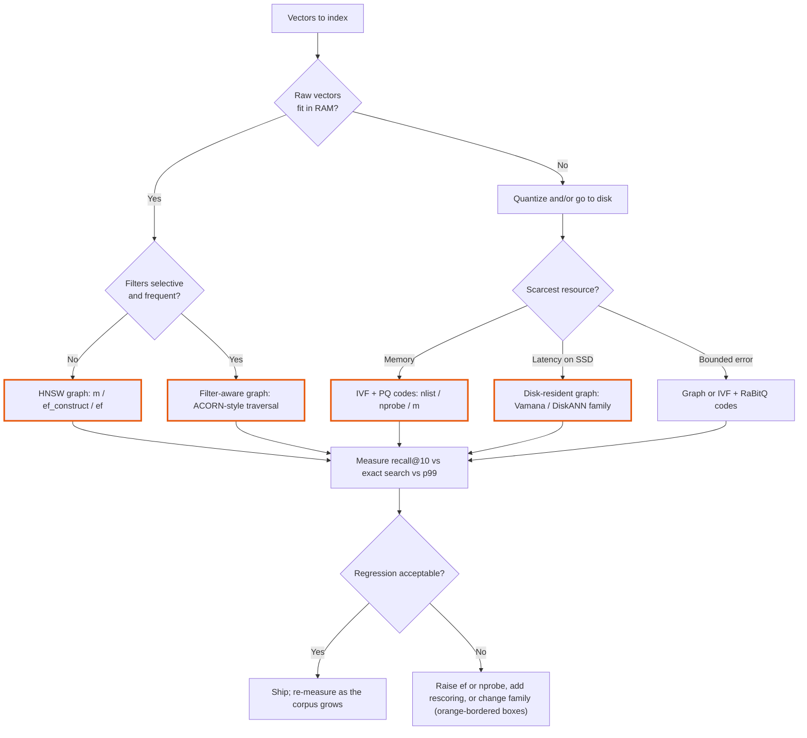
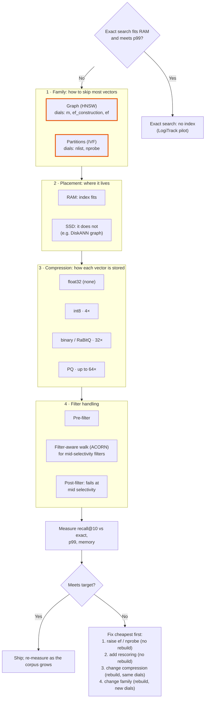

# Index decision diagram — options to compare

Draft for choosing what goes in M5's recap section, "Putting it together: choosing an index". Not linked from the README.

## Option A — current (decision tree)

One path per question; family, placement, compression and filtering are mixed at the same level.

## Option B — four independent choices (layers)

An index is one pick from each layer. Only layer 1 is the family.

## How they differ

| | Option A | Option B |
|---|---|---|
| What it teaches | Which path to take, question by question | That an index is four independent picks |
| "Family" | Mixed with placement and compression | Only layer 1, orange-bordered |
| Decision criteria | Explicit (fits RAM? filters selective?) | Short hints inside each option |
| Remediation | One box, no order | Cheapest-first ladder, marked rebuild or not |
| LogiTrack's pilot | Not shown | "Exact search: no index" exit at the top |
