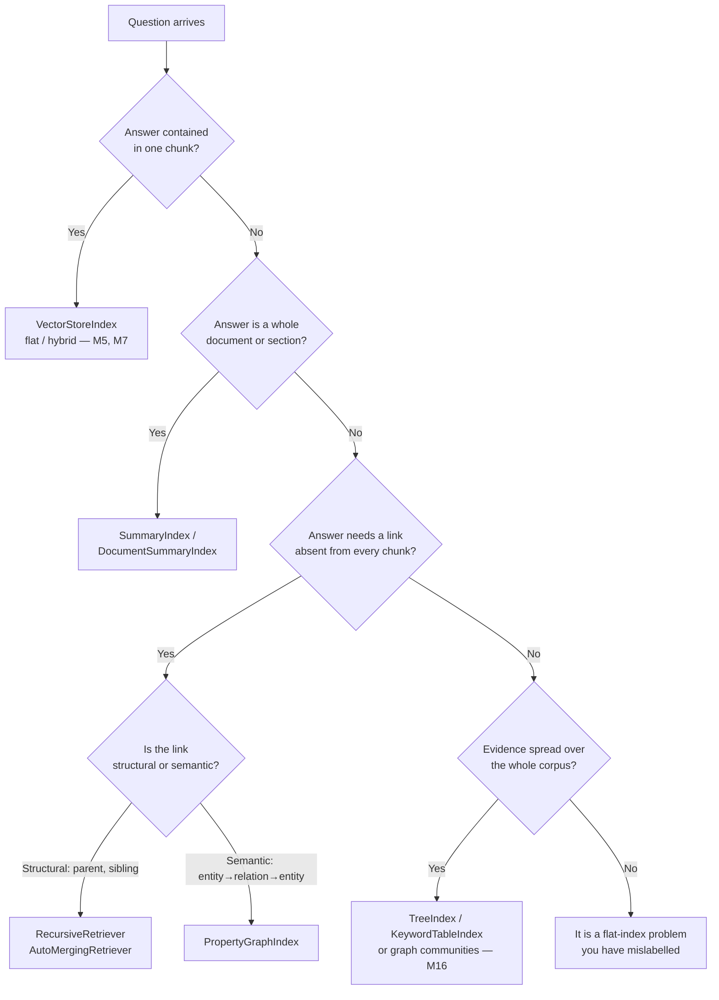

# M8 · Index Structures Beyond Flat Vectors

> **Module question:** Which non-vector index earns its complexity for which question shape?
> **Cross-cutting threads:** Failure modes · Tradeoff ledger · LlamaIndex at a glance
> **Domain spine:** LogiTrack — the DG rules' cross-references ("see §4.1 of the applicable carrier service agreement") and the multi-hop questions no flat index answers
> **Prerequisites:** [M7 — Sparse, Dense, and Hybrid Retrieval](../07-sparse-dense-hybrid/README.md) · [M3 — Corpus Acquisition, Parsing, and the Chunking Decision](../03-parsing-and-chunking/README.md)

---

## Opening scene — the answer that lived in two documents

LogiTrack's retrieval is, by M7's end, genuinely good. Hybrid search on the DG corpus clears 0.86
recall@10 on the known-item subset. The team stops asking whether retrieval works.

Then a customs broker asks the question the DG corpus exists to answer: *"What inner packaging
must be used for UN3480 lithium-ion batteries shipped on the Rotterdam–Singapore lane?"*

The top-5 is, in a narrow sense, perfect. Every chunk is about UN3480. The top chunk is the
correct entry, and it says:

> **UN3480 — LITHIUM ION BATTERIES.** Packing instruction 965. Inner packaging requirements as
> specified in the applicable carrier service agreement for the lane in question. See §4.1.

The retriever did its job. The chunk is right, the embedding matched, the lexical overlap on
`UN3480` is exact. And the answer is not there.

The answer is in a different document — the Maersk carrier service agreement, clause 4.1. To
retrieve it, something must notice that the DG chunk **points** at another document, go fetch
*that* document's clause 4.1, and combine two retrieved units into one piece of evidence. Top-k
search over a flat index has no mechanism for any of the three steps. It retrieves the k nearest
chunks to the query, and clause 4.1 shares no vocabulary with either the query or the DG entry,
so it is not a neighbour of anything the system has.

Everything downstream then behaves correctly. The generator faithfully reports that the
requirement is *elsewhere*. The system is not hallucinating. It is answering a two-document
question with a one-document retrieval, and telling the truth about the half it has.

> **Failure mode (the module in one line):** assuming that **one index structure, applied to every
> question, is the same thing as one retrieval strategy** — so a question whose evidence is
> *relational*, *aggregate*, or *distributed across documents* is answered with the nearest
> chunks, because the nearest chunks are all a flat index can produce.

---

## The index-selection decision

There is no best index — only a best index *for a question shape*, and the shapes are observable
in your query log before you build anything. The decision is a traversal of four questions:

The last branch is the honest one. Most "we need a knowledge graph" requests are a flat-index
problem wearing a costume — usually a chunking or query-reformulation problem (→ M3, M10) — and
the graph will not fix it.

| Question shape | LogiTrack example | Why flat top-k fails | Index that can answer it |
|---|---|---|---|
| **Known-item lookup** | "The demurrage window in our Maersk agreement?" | Does not fail — the flat index's home shape | `VectorStoreIndex`, hybrid (M7) |
| **Whole-document / section** | "Summarize our exposure under CARRIER-2211." | A summary is not a chunk; nothing is nearest to "summarize" | `SummaryIndex`, `DocumentSummaryIndex` |
| **Structural continuation** | "…and what does the clause *after* that one say?" | Sibling clauses are not semantic neighbours of the query | `RecursiveRetriever`, `AutoMergingRetriever` |
| **Cross-document referential** | The opening scene: DG rule → carrier §4.1 | The referent shares no vocabulary with the query | `PropertyGraphIndex`, reference-chasing retrieval |
| **Aggregate / corpus-level** | "Which of our 12 carriers has the worst EU DG exposure?" (→ M16) | No single nearest chunk *is* the answer; the answer is a statistic | Graph communities (M16), `TreeIndex` traversal |
| **Relational / structured** | "List all lanes where the DG surcharge exceeds 3%." | Numbers and rows are not prose (→ M3's table discussion) | Text-to-SQL / `TextToCypherRetriever` |

This table is the module. Everything below is the *why* and the *what it costs*.

> **Multimodal inputs** ($\color{red}\text{to be discussed}$) — mixed-content pages decide whether a row is even reachable.
> - **Relational row:** text-to-SQL needs real rows. A rate table inside a PDF or scan must be extracted to cells at ingest (→ [M3](../03-parsing-and-chunking/README.md)).
> - **Figures and charts:** every index here reaches them only as text (caption + vision-model description, → M3).
> - **"What does this label/page look like?"** fits no row. Image indexes exist — deferred by [syllabus §1](../../syllabus.md#1-scope-knobs-frozen):
>   - LlamaIndex [`MultiModalVectorStoreIndex`](https://developers.llamaindex.ai/python/framework/module_guides/models/multi_modal/) keeps separate image and text vector stores.
>   - [ColPali](https://arxiv.org/abs/2407.01449) embeds page images directly, skipping text extraction.

---

## What a flat index actually is

An `Index` is "a data structure that allows us to quickly retrieve relevant context for a user
query", built from `Documents`, storing data in `Node` objects, and exposing a `Retriever`
interface [[LI-IDX]](#src-li-idx). The framework is explicit that "the most common index by far is the
`VectorStoreIndex`" [[LI-IDX]](#src-li-idx) — and the reason is uniformity: embed every node, embed the query,
return the top-k by similarity.

That uniformity is the strength and the ceiling. A `VectorStoreIndex` answers exactly one
question: *which stored units are most similar to this query?* It has no notion of
**containment** ("which document is this chunk in, and what is the rest of it?"), **precedence**
("which of these supersedes the other?" → M6, M14), **reference** ("this chunk points at a clause
elsewhere"), or **aggregation** ("what is true of *all* matching chunks?" — a top-k of 10 is a
sample, and sampling is not counting).

The aggregation failure deserves arithmetic. If a question needs evidence from $m$ documents and
the retriever returns $k$ nodes, the chance all $m$ are present is a joint event; if each had
independent probability $p$, it would be $p^m$. At $p = 0.9$: $m=3 \Rightarrow 0.729$,
$m=5 \Rightarrow 0.590$. Real retrieval violates independence, but the shape of the curve is why
multi-hop degrades far faster than single-hop — and why M10's decomposition exists. The
alternative repair, taken by Xiong et al., is to make retrieval *itself* iterative rather than to
change the index: their multi-hop dense retriever "does not require access to any corpus-specific
information, such as inter-document hyperlinks or human-annotated entity markers, and can be
applied to any unstructured text corpus" [[MHDR20]](#src-mhdr20). That is the crucial fork in this module — a
graph is one answer to multi-hop, and *not* the only one.

Before the catalogue, the distinction that organizes it: there are exactly two ways to make
retrieval respect something other than cosine similarity. **Metadata filtering** puts the
constraint on the node, in the vector store — cheap, but the filter's expressiveness is the store's
problem (→ M6). **Metadata replacement** puts it in a *second* index structure — expensive at index
time, and it changes what "a retrieved unit" means. The reference stack makes the split visible in
one primitive: `MetadataReplacementPostProcessor` "replace[s] the node content with a field from
the node metadata", documented as "most useful when used in combination with the
`SentenceWindowNodeParser`" [[LI-NPP]](#src-li-npp). A *derived* representation is matched; the *source*
representation is returned. `DocumentSummaryIndex` and `PropertyGraphIndex` are that same move at
document and entity granularity.

> **LlamaIndex at a glance:** `VectorStoreIndex` stores each `Node` and its embedding in a vector
> store and, at query time, "involves fetching the top-k most similar Nodes, and passing those
> into our Response Synthesis module" [[LI-IG]](#src-li-ig). One mechanism, one question shape — and upstream of
> M11, that mechanism is the entire retrieval story for every query the system receives.

> **Tradeoff (the ledger entry M8-1).** *Decision:* reach for a second index structure rather
> than a richer filter, when the retrieval constraint is not expressible as a field predicate.
> *Costs:* a second thing to build, persist, keep fresh, and evaluate; every new index is a new
> staleness surface (→ M14) and a new failure mode the taxonomy did not have. *Accepted because:*
> filters can only exclude — they cannot *create* a retrieval signal absent from the node's own
> text and vector. A clause relevant because it is *referenced* is unreachable by any predicate
> over its own content. *Reverses if:* the constraint turns out to be a metadata constraint after
> all, and you built two indexes where one filter would have done (→ M6).

---

## Summary, Tree, and Keyword Table: three old ideas that still earn their place

These predate the vector era, are documented side by side in the framework's index guide
[[LI-IG]](#src-li-ig), and survive because each addresses a shape embeddings are structurally bad at.

| Index | Mechanism and query-time behaviour | Wins when |
|---|---|---|
| **`SummaryIndex`** (formerly List Index) | "simply stores Nodes as a sequential chain" [[LI-IG]](#src-li-ig). With no other parameters, "LlamaIndex simply loads **all** Nodes in the list into our Response Synthesis module" [[LI-IG]](#src-li-ig). Embedding-based top-k or a keyword filter are the documented alternatives [[LI-IG]](#src-li-ig) | The question is corpus-level and you intend to read everything |
| **`TreeIndex`** | "builds a hierarchical tree from a set of Nodes (which become leaf nodes)" [[LI-IG]](#src-li-ig); querying "involves traversing from root nodes down to leaf nodes". Default `child_branch_factor=1` — "a query chooses one child node given a parent node"; at `2`, "a query chooses two child nodes per level" [[LI-IG]](#src-li-ig) | The corpus has a genuine taxonomy and the query is "where does X live in it?" |
| **`KeywordTableIndex`** | "extracts keywords from each Node and builds a mapping from each keyword to the corresponding Nodes" [[LI-IG]](#src-li-ig); at query time it extracts query keywords and matches them against the pre-extracted set [[LI-IG]](#src-li-ig) | Vocabulary is stable and controlled — part numbers, UN codes, clause identifiers |

Two properties matter precisely. **`SummaryIndex` is the only index whose top-k does not exist** —
its default mode sends *every* node to synthesis. That is a feature for the aggregate question and a
budget catastrophe for everything else, because cost scales with corpus size rather than question
difficulty; the framework notes the index "does offer numerous ways of querying", including
embedding top-k or a keyword filter [[LI-IG]](#src-li-ig), and you should read that as the escape hatch rather
than an equal alternative. **`KeywordTableIndex` does not rank; it looks up** — `BM25Retriever`
(→ M7) scores every term against every document, whereas a keyword table goes straight from term to
node set, trading expressiveness for cost. The framework exposes three extractors for it: the
default `KeywordTableGPTRetriever`, plus `KeywordTableSimpleRetriever` and
`KeywordTableRAKERetriever` [[LI-RMODE]](#src-li-rmode). A GPT-backed *default* is a strong hint that query keyword
extraction is not a solved deterministic problem — M10's business, not M8's.

The `retriever_mode` mapping is the most useful page in this part of the docs, because it tells
you which class each index hands you without reading source: Summary takes
`default`/`embedding`/`llm`; Tree takes `select_leaf`/`select_leaf_embedding`/`all_leaf`/`root`;
Document Summary takes `llm`/`embedding`; Knowledge Graph takes `keyword`/`embedding`/`hybrid`,
all three mapping to `KGTableRetriever` [[LI-RMODE]](#src-li-rmode). Note the Vector row: `retriever_mode` there
"has no effect (silently ignored)" [[LI-RMODE]](#src-li-rmode). A configuration mistake that changes nothing is
worse than one that raises, because it survives code review.

> **LlamaIndex at a glance:** `summary_index.as_retriever(retriever_mode="llm")` selects the
> LLM-driven summary retriever in one line, and the same kwarg selects index-appropriate
> retrievers across five index families [[LI-RET](#src-li-ret), [LI-RMODE](#src-li-rmode)]. The low-level equivalent is
> `SummaryIndexLLMRetriever(index=summary_index, choice_batch_size=5)`, which the framework
> presents as equivalent to the high-level form [[LI-RET]](#src-li-ret).

> **Tradeoff (the ledger entry M8-2).** *Decision:* ship a `SummaryIndex` or `TreeIndex` before
> shipping a graph, when the question shape is aggregate or taxonomically scoped. *Costs:* a
> second index over the same nodes, plus — for `SummaryIndex`'s default mode — a synthesis cost
> proportional to corpus size. *Accepted because:* both are mechanical and deterministic with zero
> LLM calls at index time, so they are testable hypotheses rather than projects. *Reverses if:*
> the aggregate question turns out to be answerable by better top-k plus a smarter synthesis mode
> (→ M11) — M16's territory to adjudicate.

---

## Document summaries as retrieval units

`DocumentSummaryIndex` is the first index here that costs LLM calls to build, and the cleanest
illustration of metadata replacement. The framework's demo states it in one sentence: "The
document summary index will extract a summary from each document and store that summary, as well
as all nodes corresponding to the document. Retrieval can be performed through the LLM or
embeddings … We first select the relevant documents to the query based on their summaries. **All
retrieved nodes corresponding to the selected documents are retrieved.**" [[LI-DSI]](#src-li-dsi)

That last sentence is the decision, stated plainly: document-summary retrieval is a two-stage
**granularity amplifier** — match at document granularity, return at node granularity, all of it.
Construction needs both an LLM and an embedding model, visible in the framework's own migration
example ("a document summary index needs both an llm and embed model for the constructor"
[[LI-SET]](#src-li-set)). The demo builds it with `transformations=[splitter]` and a
`get_response_synthesizer(response_mode="tree_summarize", use_async=True)` [[LI-DSI]](#src-li-dsi) — note that
the summary is produced by a *response synthesizer*, i.e. M11's machinery, in M11's summarization
mode.

The demo's own numbers show the amplifier firing. Querying `DocumentSummaryIndexLLMRetriever` for
*"What are the sports teams in Toronto?"* over five city articles returns **20 nodes** —
`len(retrieved_nodes)` prints `20` [[LI-DSI]](#src-li-dsi). Four cities' worth of nodes for a question whose
answer is in one. The answer synthesized from them was correct [[LI-DSI]](#src-li-dsi). So the pipeline *worked*,
by spending context budget it did not need to spend. Across five Wikipedia articles that is
invisible; across [3,000 documents](../../syllabus.md#corpus-scale) with a 4,000-token answer budget it is the entire budget.

> **LlamaIndex at a glance:** `DocumentSummaryIndex.from_documents(city_docs, llm=chatgpt,
> transformations=[splitter], response_synthesizer=response_synthesizer)` builds it;
> `doc_summary_index.get_document_summary("Boston")` returns the generated summary for
> inspection; `as_query_engine(response_mode="tree_summarize", use_async=True)` queries it, and
> the demo notes the high-level query path "uses the default, embedding-based form of retrieval"
> while the LLM path is reached explicitly via `DocumentSummaryIndexLLMRetriever` [[LI-DSI]](#src-li-dsi).
> Inspecting the summaries before shipping is not optional — they are the retrieval key, and a
> bad summary is a permanently unreachable document.

> **Multimodal inputs** ($\color{red}\text{to be discussed}$) — the summary is only as complete as the parsed text.
> - Tables or figures lost at parsing never reach the summary, so the document is matched on its prose alone.
> - Rate tables extracted as markdown inflate each summary call's input (→ [M18](../18-cost-and-latency/README.md)).
> - Spot-check summaries of table-heavy and scanned documents first.

> **Tradeoff (the ledger entry M8-3).** *Decision:* retrieve at document granularity via generated
> summaries, and accept node floods, when the question is whole-document or document-scoped.
> *Costs:* one response-synthesis call per document at ingest (a full-corpus rebuild is a real LLM
> bill → M14), plus a query-time context cost of *every* node in every selected document.
> *Accepted because:* for "summarize our exposure under CARRIER-2211" the flood *is* the evidence
> — the answer genuinely requires the whole document, and no chunk-level ranking produces it.
> *Reverses if:* the document-summary share of your query mix is small, so you are paying an
> ingest bill for a path that rarely fires — or if capping the flood with a reranker (→ M9) costs
> you nothing measurable.

---

## Structure at index time: recursive retrieval and auto-merging

The two previous sections derive *new units*. This one uses the relationships between units you
already have. The hypothesis under test is a documented one: Liu et al. argue that "current dense
retrievers require splitting documents into short passages that usually contain local, partial,
and sometimes biased context, and highly depend on the splitting process", and repair it with a
"document-level retriever [that] first identifies relevant documents, among which relevant
passages are then retrieved by a passage-level retriever" [[DHR21]](#src-dhr21). Everything below is a
mechanism for doing that repair without training a new model.

**Node references retrieve a pointer instead of a passage.** "When you first perform retrieval,
you may want to retrieve the reference as opposed to the raw text. You can have multiple
references point to the same node." [[LI-RR]](#src-li-rr) Two uses are documented, and they map onto M3's two
problems: **chunk references** index small child chunks (128/256/512 tokens), each an `IndexNode`
pointing at a 1024-token parent, so a precise small match returns the large parent (F3 ·
chunk-boundary loss); **metadata references** index `SummaryExtractor` and
`QuestionsAnsweredExtractor` outputs, each pointing at its source node, so a summary or a
generated question is what gets matched and the source text is what gets returned (F4 ·
representation mismatch) [[LI-RR]](#src-li-rr). The traversal is
`RecursiveRetriever("vector", retriever_dict={...}, node_dict=..., verbose=True)`, and what comes
back is the referent, not the reference [[LI-RR]](#src-li-rr) — a pointer chase: match a cheap small unit,
return an expensive large one.

The framework's own evaluation is the strongest available number for the pattern, and also where
to start being suspicious:

| Retriever | hit_rate | MRR |
|---|---|---|
| Base Retriever | 0.7784 | 0.5631 |
| Retriever (Chunk References) | 0.8969 | 0.6911 |
| Retriever (Metadata References) | 0.8918 | 0.7184 |

Source: the node-reference guide's `RetrieverEvaluator` run at `top_k = 10` [[LI-RR]](#src-li-rr). Read the
caveat before the gain: the eval dataset was "generate[d] … from the set of text chunks" by an LLM,
over `base_nodes` [[LI-RR]](#src-li-rr) — precisely the generate-queries-from-the-chunks-you-will-retrieve trap
that **M13** owns. The direction is informative; the magnitude is not transferable.

**Auto-merging makes the hierarchy pay off at query time.** `AutoMergingRetriever` "looks at a set
of leaf nodes and recursively 'merges' subsets of leaf nodes that reference a parent node beyond a
given threshold" [[LI-AMR]](#src-li-amr). The hierarchy comes from `HierarchicalNodeParser`, documented with a
three-level default of chunk sizes **2048 / 512 / 128**; only leaf nodes are embedded and
retrieved, while parents live in the docstore [[LI-AMR]](#src-li-amr). In the framework's run over the Llama-2
paper: 1,029 nodes, **795 leaves**; the base retriever at `similarity_top_k=6` returned 6 nodes,
and `AutoMergingRetriever` — after logging "Merging 4 nodes into parent node" — returned **3**
[[LI-AMR]](#src-li-amr).

<strong><code>AutoMergingRetriever</code> — what the code actually does</strong> (read from source and checked on llama-index-core 0.14.25)

- **The loop, per query:**
  - Retrieve the top-k **leaves** from the vector index.
  - **Fill-in pass:** two leaves adjacent in the ranked list, with one leaf missing between them in
    the document → fetch the missing one.
  - **Merge pass:** group hits by parent; ratio = retrieved children ÷ total children.
  - Merge if ratio **> 0.5** — strictly greater (`simple_ratio_thresh = 0.5`).
  - Repeat both passes until nothing changes, so merges cascade 128 → 512 → 2048.
  - Sort by score and return.
- **What the threshold means in practice:**
  - A 512-token parent has **5 leaves** (measured), so a merge needs **3 of 5**.
  - With 4 children, 2 is not enough: 2/4 = 0.5 is not *greater* than 0.5.
- **Merged score = average of the children's scores.**
  - A strong hit diluted by weaker siblings can rank *lower* after merging.
- **The fill-in pass never fires on default hierarchical nodes.**
  - Fill-in requires a `NEXT` relationship on each leaf.
  - `HierarchicalNodeParser` leaves carry `PARENT` + `PREVIOUS` + `SOURCE` — **no `NEXT`** (the
    same dropped-pointer behaviour M3 records for chained parsers).
  - Net: only the ratio vote runs.
- **Fill-in also checks neighbours in score order, not document order.**
  - Two leaves must sit next to each other *in the ranking* for the gap between them to be noticed.
- **What this means for M3's opening scene:**
  - The clause splits across 2 leaves; only the "Demurrage liability…" leaf ranks well → 1 of 5, no
    merge.
  - Even with both halves retrieved, 2 of 5 is no merge.
  - Auto-merge rescues **large answers** that light up most of a parent — not **small answers that
    straddle a boundary**.

And then the evaluation that matters:

| Retriever | correctness | relevancy | faithfulness | semantic_similarity |
|---|---|---|---|---|
| Auto Merging Retriever | 4.2667 | 0.9167 | 0.95 | 0.962196 |
| Base Retriever | 4.2083 | 0.9167 | 0.95 | 0.960602 |

The notebook's own analysis, verbatim: **"The results are roughly the same."** It then runs a
pairwise comparison reporting a preference score of **0.525**, with the analysis "Here we see that
it's roughly even." [[LI-AMR]](#src-li-amr)

This is a negative result published by the framework that ships the feature, and it is the most
useful artifact in this module. It does not mean auto-merging is useless. It means hierarchical
retrieval's benefit is invisible in the setting measured — whole-document QA over one long PDF. It
reappears where the failure is real: a question whose answer straddles a chunk boundary in a
document the retriever *did* find. If you cannot name that query class in your own log, the ~4.6×
vector count (187,043 leaves vs 40,703 for M3's `SentenceSplitter(512, 50)`)
is pure cost.

> $\color{red}\text{to be discussed more}$ — which layer to embed, which to rely on, and when to stop climbing. Four designs: **A** leaves only + auto-merge (this section); **B** embed children, always return the parent — chunk references above, and the dominant production pattern (LangChain's `ParentDocumentRetriever`); **C** every level in one index, so similarity picks the granularity per query ([RAPTOR](https://arxiv.org/abs/2401.18059)'s collapsed tree beat tree traversal, though its upper levels are summaries); **D** a router picks the granularity per query ([Mix-of-Granularity](https://arxiv.org/abs/2406.00456)). LogiTrack chose A — should it be B?

> **LlamaIndex at a glance:** `HierarchicalNodeParser.from_defaults()` produces the 2048/512/128
> hierarchy, `get_leaf_nodes(nodes)` isolates the embedded set, *all* nodes go into a
> `SimpleDocumentStore`, the leaf nodes alone into a `VectorStoreIndex`, and
> `AutoMergingRetriever(base_retriever, storage_context)` merges at query time [[LI-AMR]](#src-li-amr). The
> docstore is not optional — it is where the parents live, and without it the retriever has
> nothing to merge *into*.

> **Tradeoff (the ledger entry M8-4).** *Decision:* index a hierarchy and merge at query time
> rather than indexing larger chunks directly. *Costs:* ~6× the node count, a docstore on the
> query path, and a merge step whose benefit the framework's own evaluation could not distinguish
> from noise on its test corpus [[LI-AMR]](#src-li-amr). *Accepted because:* larger chunks degrade embedding
> quality for *every* query (M3's compression argument), whereas the hierarchy costs only storage
> and preserves precision for queries that do not need merging. *Reverses if:* you measure the
> gain on your own boundary-spanning subset and it lands inside the confidence interval — then
> delete the hierarchy and keep the storage.

---

## Knowledge graphs and property graphs

This is where the complexity budget is finally spent, so it is where the module must be most
careful: "add a knowledge graph" is the most frequently prescribed and least frequently justified
architectural change in RAG.

**What the framework provides.** `PropertyGraphIndex` works "by first building a knowledge graph
containing labelled nodes and relations. The construction of this graph is extremely customizable,
ranging from letting the LLM extract whatever it wants, to extracting using a strict schema, to
even implementing your own extraction modules. Optionally, nodes can also be embedded for
retrieval later." Retrieval is "highly flexible … works by using several sub-retrievers and
combining results. By default, keyword + synonym expansion is used, as well as vector retrieval
(if your graph was embedded), to retrieve relevant triples." [[LI-IG]](#src-li-ig)

The property-graph guide supplies the mechanics the decision depends on [[LI-PG]](#src-li-pg):

- **Extraction** applies "a series of `kg_extractors` on each chunk, and attach[es] entities and
  relations as metadata to each llama-index node". Defaults: `SimpleLLMPathExtractor` (LLM
  extraction of single-hop `entity1, relation, entity2` paths, `max_paths_per_chunk=10`,
  `num_workers=4`) plus `ImplicitPathExtractor`, which reads `node.relationships` and "does not
  need an LLM or embedding model to run".
- **Typed extraction** comes in two documented strengths: `DynamicLLMPathExtractor`, where allowed
  entity/relation types "help guide the LLM, but will not enforce exactly those types", and
  `SchemaLLMPathExtractor`, where a pydantic `kg_validation_schema` with `strict=True` refuses
  off-schema triples.
- **Retrieval** offers five sub-retrievers; defaults are `LLMSynonymRetriever` (`max_keywords=10`,
  `path_depth=1`) and `VectorContextRetriever` (`similarity_top_k=2`, `path_depth=1`), both of
  which expand connected paths after the node match. `TextToCypherRetriever` and
  `CypherTemplateRetriever` push querying into Cypher; `CustomPGRetriever` covers the rest.
- **Storage** is the in-memory, disk-persistable `SimplePropertyGraphStore` or a server-backed
  store (the guide lists Neo4j, Nebula, TiDB, FalkorDB; two support native embeddings).
  `SimplePropertyGraphStore` "is not actually a graph database, [so] it does not support cypher
  queries" — the Cypher path implies a server commitment (→ M5's operational axes).

Two further warnings belong in a senior engineer's notes. First, on `TextToCypherRetriever`:
"Executing arbitrary cypher has its risks. Ensure you take the needed measures (read-only roles,
sandboxed env, etc.) to ensure safe usage in a production environment." [[LI-PG]](#src-li-pg) A generated Cypher
statement is an LLM-authored query against your database — a security surface **M21** owns.
Second, source-text inclusion: retrieved triples can carry their source chunks when
`include_text=True`, but this is "unavailable for graphs created outside of LlamaIndex" [[LI-IG]](#src-li-ig).
That limitation decides *where you build the graph*, not merely where you query it — a graph
imported from an external pipeline gives you triples with no citable text (→ M12).

**The extraction bill is one LLM call per chunk, minimum.** With `SimpleLLMPathExtractor` at
`max_paths_per_chunk=10` [[LI-PG]](#src-li-pg), every chunk receives a prompt asking for up to ten triples. For
LogiTrack at M3's `SentenceSplitter(512, 50)` — 40,703 chunks — that is 40,703 extraction calls on
a full build, before retries and before `DynamicLLMPathExtractor`'s
`max_triplets_per_chunk=20` default roughly doubles the output-token bill. At `num_workers=4` wall
clock is not the problem; the token bill is, and it recurs on every full re-index (→ M14, M18).
There is a second bill: extraction output is nondeterministic, so changing the schema or the
prompt does not *recompute* the same graph with a different representation — it can produce a
different graph. The graph is the least cacheable artifact in the pipeline.

> **Multimodal inputs** ($\color{red}\text{to be discussed}$) — extraction sees only the text the parser produced.
> - A "see §4.1" inside a scanned stamp, a table cell, or a dropped footnote yields **no triple**: the edge is missing, the hop fails silently.
> - Wrong reading order on multi-column DG pages can attach a reference to the wrong entity.
> - Figure descriptions stored as text are extra chunks, so extra extraction calls (one per chunk).
> - Fix the parse before building the graph: an OCR or layout fix later means a full re-extraction (→ [M3](../03-parsing-and-chunking/README.md), [M14](../14-ingestion-at-scale/README.md)).

> **LlamaIndex at a glance:** `PropertyGraphIndex.from_documents(documents, kg_extractors=[...])`
> builds, `index.as_retriever(include_text=True, similarity_top_k=2)` queries, and
> `index.storage_context.persist(persist_dir="./storage")` or
> `PropertyGraphIndex.from_existing(property_graph_store=graph_store, vector_store=vector_store,
> embed_kg_nodes=True)` reattaches to an existing Neo4j and/or vector store [[LI-PG]](#src-li-pg). The
> `include_text=True` setting is what lets retrieved triples bring citable source along; without
> it you have triples and no evidence (→ M12).

> **Tradeoff (the ledger entry M8-5).** *Decision:* build a property graph when the query mix
> holds a material share of cross-document referential questions nothing else answers. *Costs:* an
> LLM call per chunk at ingest (40,703 for LogiTrack at M3's chunking), a fifth storage system, a
> second retrieval path to evaluate, index-time nondeterminism, and rebuild-everything coupling
> whenever the schema changes. *Accepted because:* the alternative is failing the opening scene's
> question class permanently, and no amount of chunking, hybrid search, or reranking creates a
> link between two documents that share no vocabulary. *Reverses if:* the measured gain is
> confined to a question class you could instead serve by query decomposition (→ M10) at a
> fraction of the ingest cost — exactly the trade the literature disagrees about, below.

---

## The storage split, and the migration options it decides

The framework separates five storage components: **document stores** (the ingested `Node`
objects), **index stores** ("lightweight index metadata" [[LI-IS]](#src-li-is)), **vector stores** (embedding
vectors), **property graph stores**, and **chat stores** [[LI-STORE]](#src-li-store). Their rebuild costs differ by
orders of magnitude: docstore and index store are free to change (source and metadata), the vector
store costs a full re-embed (→ M14), and the graph store costs a full re-extraction in LLM calls
that may not reproduce the same graph. That asymmetry — not the API — is what should govern how
much of your architecture you put in a graph.

Two operational facts follow, both easy to get wrong. **First:** "Many vector stores (except FAISS)
will store both the data as well as the index (embeddings). This means that you will not need to use
a separate document store or index store." [[LI-STORE]](#src-li-store) Presented as convenience, it is also a
commitment — if your vector store owns the nodes, your vector store *is* your document store, and
every structure that looks a node up by id (auto-merging, reference chasing, document summaries) is
coupled to that vendor's query capabilities. `StorageContext.from_defaults(docstore=...,
vector_store=..., index_store=...)` [[LI-STORE]](#src-li-store) exists so you can keep them separate; choose
deliberately. **Second:** the `IndexStore` is what lets `load_index_from_storage` reconstruct
*which* index structure a persisted context contains, which is why M8's five indexes can share one
storage context rather than being mutually exclusive choices; its default is a `SimpleIndexStore`
backed by an in-memory key-value store, persistable to and loadable from disk [[LI-IS]](#src-li-is).

---

## Worked example: LogiTrack's multi-hop and aggregate subsets, measured

LogiTrack's 180-query evaluation set (M1's 60 labelled queries, grown), stratified by shape
*before* any index is built:

| Subset | Count | Definition of success |
|---|---|---|
| Known-item | 124 | Span-level recall@10 on the annotated answer span |
| Multi-hop (≥2 documents) | 34 | All required documents in the top-5, and the answer correct |
| Aggregate / whole-document | 22 | Answer correct *and* no required document omitted |

The multi-hop subset is annotated the way the 2WikiMultiHopQA authors insist multi-hop must be
annotated — with an explicit evidence path, because "previous studies revealed that many examples
in existing multi-hop datasets do not require multi-hop reasoning to answer a question"
[[MULTIHOP20]](#src-multihop20). A multi-hop subset without evidence paths measures whether the answer string
matched, not whether the hop happened; the same trap M13 owns for generated queries.

Five configurations, same corpus (3,000 documents, M3's chunking for the flat configurations),
same synthesis settings:

| Configuration | Known-item R@10 | Multi-hop R@5 | Aggregate success | Ingest LLM calls | Index units | P95 retrieval |
|---|---|---|---|---|---|---|
| `VectorStoreIndex` (M7 hybrid baseline) | **0.87** | 0.21 | 0.14 | 0 | 40,703 | 0.11 s |
| `SummaryIndex` (default mode) | 0.31 | 0.26 | **0.71** | 0 | 40,703 | 4.9 s † |
| `DocumentSummaryIndex` (`llm`) | 0.79 | 0.44 | 0.68 | 3,000 | 3,000 summaries + 40,703 | 0.62 s |
| `HierarchicalNodeParser([2048,512,128])` + `AutoMergingRetriever` | 0.85 | **0.58** | 0.22 | 0 | 187,043 leaves (243,340 nodes) | 0.31 s |
| `PropertyGraphIndex` (default extractors) | 0.83 | **0.83** | 0.61 | 40,703 | ≤ 407,000 triples (10 per chunk) | 0.88 s |

† `SummaryIndex` in default mode sends every node to synthesis, so its measured time is dominated
by *assembling the prompt*, not by ranking. The real cost lands in M11's synthesis budget and
M18's token bill. This is the trap the column is designed to expose: a 4.9 s stage is not a
retrieval problem, it is an architecture problem.

Read the four findings that decide LogiTrack's architecture:

1. **No configuration wins more than two columns**, and the flat hybrid baseline still wins
   known-item outright — as it should, because that is the shape flat indexes were built for.
   Every non-flat index here *pays* known-item recall to buy a different shape.
2. **The graph is the only configuration that moves multi-hop from failure to success** — 0.21 →
   0.83, against 0.58 for hierarchical+auto-merge. If LogiTrack's business case is the opening
   scene's question class, that gap *is* the case.
3. **The graph's cost is concentrated entirely at ingest and is enormous.** 40,703 LLM calls is a
   full-corpus LLM workload — about five days of query volume at 8,500/day. It is one-time only if
   the extractor schema and prompt never change, a strong assumption across 40 jurisdictions.
4. **`DocumentSummaryIndex` is the cheapest index-time structure that buys a question shape.** 3,000
   calls (one per document) moves aggregate success 0.14 → 0.68. Per unit of ingest spend it is
   roughly 12× more efficient than the graph at moving *its* target column (+0.54 per 3,000 calls,
   against +0.62 per 40,703).

**LogiTrack's decision after M8:** ship three indexes, not one — M7's hybrid `VectorStoreIndex` as
the default path (≈69% of queries by the strata above), a `DocumentSummaryIndex` for the
whole-document and aggregate classes, and a `PropertyGraphIndex` restricted to the
carrier agreements and DG rules (1,184 documents, 29,481 chunks, 29,481 extraction calls
rather than 40,703 for the whole corpus) as
the cross-document path. `SummaryIndex` in default mode is rejected: it wins nothing
`DocumentSummaryIndex` does not, at a cost that scales with the corpus. The routing decision that
selects among the three is **M10's**; M8's job was to establish that three structures exist and
that each one is priced.

---

## Design exercise

> *Paper-based. Think, then write.*

**Task.** Write the index-selection ADR for a corpus you actually own — or use LogiTrack's DG rules
and carrier agreements if you have none. Deliver a decision with a budget attached, not a survey.

1. **Stratify your query log before you choose anything.** Label 100 real queries as known-item,
   whole-document, structural-continuation, cross-document, or aggregate. Report the shares. If you
   cannot, you cannot make this decision, and any index you pick is a guess — this stratification
   is the ADR's first page, not an appendix.
2. **Name which shapes the flat index fails, and prove it.** For one query per failing class, run
   your current path and record the top-5 node ids and scores. Show the required evidence is
   *absent* (F1) rather than ranked low (F2). A low-ranked correct chunk is an M9 problem; an absent
   one is this module's.
3. **Price each candidate in ingest LLM calls, not adjectives.** Compute the call count: zero for
   `SummaryIndex`/`TreeIndex`, one per document for `DocumentSummaryIndex`, one per chunk for
   `PropertyGraphIndex` at `max_paths_per_chunk=10` [[LI-PG]](#src-li-pg). Multiply by your token rate and corpus
   size; write dollars next to each option.
4. **Decide the index mix and the routing rule, and define the acceptance test.** State which
   indexes ship, which queries each serves, what happens to a query matching none, and the metric,
   subset, and threshold at which you delete an index. If you ship more than one index, write the
   router's fallback: a misroute is silent, degrading into a wrong answer rather than an error. For
   a graph specifically, state the extraction schema, the store, and what a rebuild costs — because
   it may produce a *different* artifact rather than a recomputed one.

**Why this exercise matters.** M3's decision is the one senior engineers inherit rather than make.
This is its opposite: the one they are asked to *add* mid-project, usually after a stakeholder has
read that knowledge graphs improve RAG. The engineer who can produce this ADR has done three things
the request cannot do for itself — measured which query shapes actually fail, priced the graph's
extraction bill in dollars, and scoped it to a document subset. Note what the worked-example table
refuses to tell you: whether the graph is worth it. It cannot, because that answer is a function of
your multi-hop share, and that number lives in your query log, not in a benchmark. The published
evidence, as the next section shows, is more ambiguous than vendor enthusiasm suggests.

---

## Where the literature disagrees

- **"Knowledge graphs beat flat RAG."** This module presents `PropertyGraphIndex` as the only
  structure that answers the opening scene's question class, and the framework documents its
  multi-sub-retriever retrieval as a first-class mechanism [[LI-IG](#src-li-ig), [LI-PG](#src-li-pg)]. Xiang, Wu, Zhang, Chen,
  Hong, Huang & Su built GraphRAG-Bench explicitly to test that claim, and open with the
  counter-observation: *"Despite its conceptual promise, recent studies report that GraphRAG
  frequently underperforms vanilla RAG on many real-world tasks. This raises a critical question:
  Is GraphRAG really effective, and in which scenarios do graph structures provide measurable
  benefits for RAG systems?"* Their benchmark "systematically investigate[s] the conditions when
  GraphRAG surpasses traditional RAG" across fact retrieval, complex reasoning, contextual
  summarization, and creative generation [[KGVSRAG25]](#src-kgvsrag25). **What to change:** treat "does a graph help
  here?" as an empirical question whose answer is task-type-dependent, not a function of corpus
  size or graph elegance. Note that this module's worked example answers it for multi-hop only —
  precisely the setting the benchmark literature says is favourable. Do not extrapolate the
  0.21 → 0.83 multi-hop win to the aggregate column, where the graph scored 0.61 against a 0.68
  from a structure costing roughly 1/20th as much to build.
- **"Recursive and hierarchical retrieval improves retrieval quality."** The two framework
  notebooks in this module disagree with each other, and neither is a controlled comparison. The
  node-reference guide reports hit_rate 0.7784 → 0.8969 and MRR 0.5631 → 0.6911 from node
  references [[LI-RR]](#src-li-rr). The auto-merging guide reports correctness 4.2083 → 4.2667, *identical*
  relevancy (0.9167) and faithfulness (0.95), and a pairwise preference of 0.525, concluding *"The
  results are roughly the same"* [[LI-AMR]](#src-li-amr). Different retrievers (`RecursiveRetriever` vs
  `AutoMergingRetriever`), different metrics (IR metrics vs LLM-judge scores), and — decisively —
  the [[LI-RR]](#src-li-rr) evaluation set was generated by an LLM from the very nodes being retrieved [[LI-RR]](#src-li-rr).
  **What to change:** treat neither number as transferable. The [[LI-AMR]](#src-li-amr) result is the more
  trustworthy of the two *because it is negative*: it is a framework reporting that its own feature
  did not move the metrics, which is the finding least likely to have been selected for.
- **"Retrieve at document granularity and let synthesis sort it out."** `DocumentSummaryIndex`'s
  documented behaviour — "All retrieved nodes corresponding to the selected documents are
  retrieved" [[LI-DSI]](#src-li-dsi) — is presented as the design, and the demo's 20-node return for a
  single-document question [[LI-DSI]](#src-li-dsi) is presented without comment. The framework offers no guidance
  on capping that fan-out, and no source in this module establishes a document-count-to-quality
  curve. This is an honest gap, which is why entry M8-3's revert condition is written as a
  measurement ("cap the flood with a reranker and lose nothing"), not a number.
- **Ownership note.** GraphRAG's community summarization for genuinely *global* aggregate queries is
  **M16's** claim; this module cites the question shape and stops. Treat M16 as the authority on
  whether graph communities beat summary indexes for the aggregate column — the LogiTrack table in
  this module is fiction and settles nothing.

---

## Sources

- [Indexing](https://developers.llamaindex.ai/python/framework/module_guides/indexing/) — `[LI-IDX]` · owns the `Index` concept, the `Document`→`Node`→`Retriever` structure, and the statement that `VectorStoreIndex` is the most common index.
- [How Each Index Works](https://developers.llamaindex.ai/python/framework/module_guides/indexing/index_guide/) — `[LI-IG]` · owns per-index mechanism and query behaviour for Summary, Vector Store, Tree, Keyword Table, and Property Graph indexes, including `SummaryIndex`'s load-all default, `TreeIndex`'s `child_branch_factor`, and the property-graph retrieval defaults.
- [Using a Property Graph Index](https://developers.llamaindex.ai/python/framework/module_guides/indexing/lpg_index_guide/) — `[LI-PG]` · owns `kg_extractors` and their defaults, the five sub-retrievers and their defaults, graph stores, and the arbitrary-Cypher security warning.
- [Document Summary Index](https://developers.llamaindex.ai/python/examples/index_structs/doc_summary/docsummary/) — `[LI-DSI]` · owns per-document summary construction, the LLM and embedding retrievers, and the all-nodes-of-selected-documents return behaviour.
- [Retriever Modes](https://developers.llamaindex.ai/python/framework/module_guides/querying/retriever/retriever_modes/) — `[LI-RMODE]` · owns the `retriever_mode` → retriever-class mapping for every index, including the silently-ignored Vector case.
- [Retriever](https://developers.llamaindex.ai/python/framework/module_guides/querying/retriever/) — `[LI-RET]` · owns `index.as_retriever()`, the high-level `retriever_mode` API, and the equivalence of the low-level composition API.
- [Auto Merging Retriever](https://developers.llamaindex.ai/python/examples/retrievers/auto_merging_retriever/) — `[LI-AMR]` · owns `AutoMergingRetriever` semantics, the 2048/512/128 hierarchy default, the merge logs, and the "roughly the same" evaluation.
- [Recursive Retriever + Node References](https://developers.llamaindex.ai/python/examples/retrievers/recursive_retriever_nodes/) — `[LI-RR]` · owns `IndexNode` references, chunk vs metadata references, `RecursiveRetriever` traversal, and the hit_rate/MRR table.
- [Node Postprocessor Modules](https://developers.llamaindex.ai/python/framework/module_guides/querying/node_postprocessors/node_postprocessors/) — `[LI-NPP]` · owns `MetadataReplacementPostProcessor` and its sentence-window coupling; the rerankers it also documents are M9's.
- [Storing](https://developers.llamaindex.ai/python/framework/module_guides/storing/) — `[LI-STORE]` · owns the five storage components, `StorageContext` defaults, and the "vector stores store data and index" note.
- [Index Stores](https://developers.llamaindex.ai/python/framework/module_guides/storing/index_stores/) — `[LI-IS]` · owns the index-store definition and the `SimpleIndexStore` default.
- [Configuring Settings](https://developers.llamaindex.ai/python/framework/module_guides/supporting_modules/settings/) — `[LI-SET]` · owns which resources each index constructor requires.
- *Dense Hierarchical Retrieval for Open-Domain Question Answering* — Ye Liu, Kazuma Hashimoto, Yingbo Zhou, Semih Yavuz, Caiming Xiong, Philip S. Yu · arXiv:2110.15439 (EMNLP 2021 Findings) · [arxiv.org/abs/2110.15439](https://arxiv.org/abs/2110.15439) — `[DHR21]` · owns the document-level-then-passage-level dense retrieval result and the argument that short-passage splitting yields "local, partial, and sometimes biased context".
- *When to use Graphs in RAG: A Comprehensive Analysis for Graph Retrieval-Augmented Generation* — Zhishang Xiang, Chuanjie Wu, Qinggang Zhang, Shengyuan Chen, Zijin Hong, Xiao Huang, Jinsong Su · arXiv:2506.05690 (2025) · [arxiv.org/abs/2506.05690](https://arxiv.org/abs/2506.05690) — `[KGVSRAG25]` · owns GraphRAG-Bench and the finding that GraphRAG frequently underperforms vanilla RAG, plus the task conditions under which it does not.
- *Constructing A Multi-hop QA Dataset for Comprehensive Evaluation of Reasoning Steps* — Xanh Ho, Anh-Khoa Duong Nguyen, Saku Sugawara, Akiko Aizawa · arXiv:2011.01060 (COLING 2020) · [arxiv.org/abs/2011.01060](https://arxiv.org/abs/2011.01060) — `[MULTIHOP20]` · owns 2WikiMultiHopQA and the explicit evidence-path annotation that makes multi-hop evaluation possible. **Key-assignment caveat:** the course blueprint labelled this key "multi-hop decomposition query engines"; the ID resolves to this dataset paper, not to a query-engine paper. The dataset is what this module uses it for.
- *Answering Complex Open-Domain Questions with Multi-Hop Dense Retrieval* — Wenhan Xiong, Xiang Lorraine Li, Srini Iyer, Jingfei Du, Patrick Lewis, William Yang Wang, Yashar Mehdad, Wen-tau Yih, Sebastian Riedel, Douwe Kiela, Barlas Oğuz · arXiv:2009.12756 (2020) · [arxiv.org/abs/2009.12756](https://arxiv.org/abs/2009.12756) — `[MHDR20]` · owns multi-hop dense retrieval *without* corpus-specific hyperlinks or entity markers — the iterated-retrieval alternative to a graph index.

**Unsupported (synthetic or derived in-file, no located source):** the LogiTrack corpus, its
3,000-document figure, the 180-query evaluation set and its stratification, every number in the
worked-example table, and all tradeoff-ledger entries. These are constructed for teaching and are
not empirical findings. The multi-hop attrition arithmetic ($p^m$) is derived in-file from its own
independence assumption, which real retrieval violates. The figure of 40,703 extraction calls is
LogiTrack arithmetic over M3's chunk count and the documented `max_paths_per_chunk=10` default
[[LI-PG]](#src-li-pg), not a measurement. The claim that a graph rebuild can produce a *different* graph is
argued from the documented use of LLM extraction and is not measured anywhere in this module.
`KnowledgeGraphIndex` appears in the course syllabus and in the framework's index module list only
as a link to an example notebook
([Knowledge Graph Index](https://developers.llamaindex.ai/python/examples/index_structs/knowledge_graph/knowledgegraphdemo/)),
not to a module guide; its relationship to the deprecated surface and to `PropertyGraphIndex` is
**thinly documented**, so this module grounds all graph claims on `PropertyGraphIndex` pages rather
than inferring `KnowledgeGraphIndex` behaviour.

**Verification note:** 🟡 *pending* — Step 7 (memory-less logic review) and Step 8 (literature
survey) not yet run on this module.

**Next module:** [M9 — Ranking, Fusion, and Reranking](../09-ranking-fusion-reranking/README.md)
— what to do when the right chunk *was* retrieved and ranked 9th, which is the failure mode M8's
opening scene deliberately ruled out.
