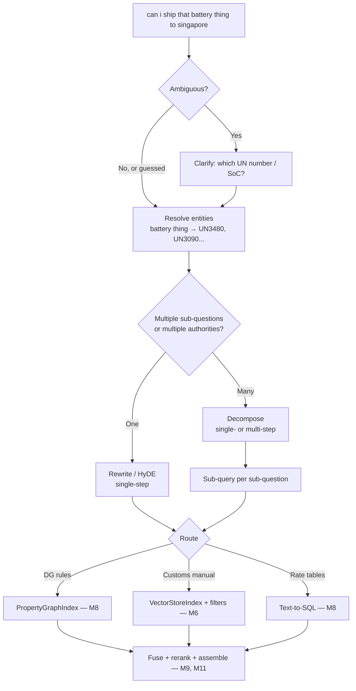

# M10 · Query Understanding and Query Transformation

> **Module question:** How do you fix retrieval when the user's words are not the corpus's words?
> **Cross-cutting threads:** Failure modes · Tradeoff ledger · LlamaIndex at a glance
> **Domain spine:** LogiTrack — "can I ship that battery thing to Singapore?", which is vague, colloquial, and needs decomposition *and* jurisdiction resolution
> **Prerequisites:** [M9 — Ranking, Fusion, and Reranking](../09-ranking-fusion-reranking/README.md) · [M7 — Sparse, Dense, and Hybrid Retrieval](../07-sparse-dense-hybrid/README.md)

---

## Opening scene — the query that was never a retrieval problem

LogiTrack's search box has a real user on the other end of it: a warehouse supervisor, typing on a
phone, in a hurry. He types:

> **can i ship that battery thing to singapore**

Retrieval returns nothing useful. Not badly ranked results — *nothing useful*, at any k. The top
chunks are a shipping-lane rate table for Singapore, a service bulletin about port congestion, and
a support ticket containing the word "thing". Every one of them is about Singapore. None of them is
about shipping batteries.

The team's first instinct is that retrieval needs work. It does not. Consider what the query
actually *is*:

- **"battery thing"** is not the corpus's vocabulary. The corpus says `UN3480`, `UN3090`, `lithium
  ion`, `lithium metal`, `PI 965`, `PI 968`. The user's words and the corpus's words never meet.
- **"Singapore"** is not one jurisdiction in this corpus. There is a customs procedure manual
  (`SG`), a carrier lane restriction, and a DG rule set keyed on the destination country — three
  documents with different authority over the same question.
- **"can i ship"** is *two* questions fused into one: is the shipment **permitted** (DG rules,
  carrier restrictions), and what **documentation and packaging** does it require (customs manual,
  packing instruction)?
- **And it is ambiguous.** "Battery thing" could be UN3480 (lithium-ion, standalone), UN3090
  (lithium-metal), UN3481 (contained in equipment), or UN3480 shipped under a state-of-charge
  restriction. These have different answers. The system does not know which one the user means, and
  neither, probably, does the user.

No reranker recovers this. M9's instrument reorders a candidate set that already contains the
answer; here the candidate set is wrong because the *query string* was wrong. Every node the
retriever could reasonably return for those seven words is a node about Singapore — and the
retriever is not being stupid, it is being faithful.

> **Failure mode (the module in one line):** treating the user's raw string as the query, when the
> user's string is a **lossy, colloquial, ambiguous compression of an information need** — so the
> retrieval stage is asked to bridge a vocabulary gap and a decomposition gap that belong *before*
> it, and it fails at a job it was never given the inputs to do.

---

## Query transformation as a pipeline stage

The framework treats this as a first-class stage with a precise definition: "Query transformations
are modules that will convert a query into another query. They can be **single-step**, as in the
transformation is run once before the query is executed against an index. They can also be
**multi-step**, as in: (1) The query is transformed, executed against an index, (2) The response is
retrieved, (3) Subsequent queries are transformed/executed in a sequential fashion." [[LI-QT]](#src-li-qt)

The documented use cases map one-to-one onto the opening scene's four problems [[LI-QT]](#src-li-qt):

| Use case (documented) | Opening-scene problem it addresses | Technique |
|---|---|---|
| "Transforming an initial query into a form that can be more easily embedded" | vocabulary gap ("battery thing" → `UN3480`) | HyDE, rewriting |
| "Transforming an initial query into a subquestion that can be more easily answered from the data" | fused questions (permitted *and* documented) | single-step decomposition |
| "Breaking an initial query into multiple subquestions that can be more easily answered on their own" | multi-part information need | multi-step decomposition |
| *(not listed — this module adds it)* jurisdiction/source resolution | "Singapore" → which of three documents has authority | routing and filter inference |



Three structural facts about this diagram decide the module.

**1. Every box before `Route` is an LLM call that happens *before* retrieval.** A query
transformation is not free preprocessing; it is generation, on the critical path, with the user
waiting. That is the entire cost story of M10 and it is why the module ends in a budget exercise
rather than a technique catalogue.

**2. The pipeline is a tree, and trees multiply.** One clarification + one rewrite + three
sub-questions + five sub-query retrievals + five sub-query syntheses + one final synthesis is not
"a query with a rewrite step". It is nine LLM calls where the baseline had one, and the latency is
the sum along the critical path, not the max.

**3. Routing is where M10 meets M8.** M8 established that LogiTrack ships three index structures.
Somebody has to choose among them per query, and that somebody is this stage. A router is not an
optimization; it is the requester for the indexes M8 built.

> **LlamaIndex at a glance:** `TransformQueryEngine(query_engine, query_transform=hyde)` wraps any
> query engine so that the transform runs before retrieval, and `HyDEQueryTransform(include_original=True)`
> is the documented transform [[LI-QT]](#src-li-qt). `include_original` is the parameter that decides whether the
> transformed query *replaces* the user's or is *added to it* — and that is a real decision, because
> HyDE's generated document is a guess that can be confidently wrong.

> **Tradeoff (the ledger entry M10-1).** *Decision:* insert one or more LLM-driven query
> transformations before retrieval rather than retrieving on the raw user string. *Costs:* every
> transformation is a generation call on the critical path, and multi-step transformations multiply
> into N retrieval *and* N synthesis calls; each added stage is also a new failure point whose
> failure mode is a *silently different* query, not an error. *Accepted because:* the raw string is
> an input the retriever cannot act on, and a wrong query produces a wrong candidate set that no
> downstream stage can repair — M9's instrument reorders, it does not discover. *Reverses if:* the
> transformation's measured retrieval delta does not exceed the noise band of your query set, in
> which case you have added latency and a failure surface for nothing.

---

## Clarity first: the clarify-or-guess decision

The technique catalogue is seductive, and the first decision is not on it. Before rewriting,
decomposing, or expanding anything, you decide whether the query is **answerable at all**.

Kuhn, Gal & Farquhar state the problem and the baseline failure: "Users often ask dialogue systems
ambiguous questions that require clarification. We show that current language models rarely ask
users to clarify ambiguous questions and instead provide incorrect answers." Their framework, CLAM,
is "a framework for getting language models to selectively ask for clarification about ambiguous
user questions", doing three things in sequence: "detect whether a given question is ambiguous,
generate an appropriate clarifying question to ask the user, and give a final answer after
receiving clarification." They also solve the evaluation problem the same way M13 will: "we can
simulate users by providing language models with privileged information. This lets us
automatically evaluate multi-turn clarification dialogues." [[CLAM22]](#src-clam22)

Two properties of that finding should shape the decision, and neither is about accuracy.

**The relevant behaviour is *selective* clarification.** Asking for clarification on every ambiguous
query converts a one-shot system into an interrogation, and users of a warehouse-floor search box
will not tolerate it. The design question is not "detect ambiguity?" but "at what confidence floor
do we spend the user's patience?" — a threshold, in other words, which is exactly the kind of
decision this course asks you to sign off on.

**Clarification is the only technique in M10 whose cost is paid by the user, not the system.** Every
other in this module spends tokens and milliseconds. Clarification spends a *turn*, and a turn is
the most expensive resource in the pipeline because it can end the interaction. That asymmetry is
why CLAM frames it as "selective" [[CLAM22]](#src-clam22) and why the alternative — guess, but state the guess —
deserves equal standing in your ADR.

For LogiTrack, the guessed version of the opening scene writes something like: *"Assuming UN3480
(lithium-ion, standalone, ≤30% state of charge): Singapore requires X. If you meant UN3090
(lithium-metal), the requirement is different — say which and I'll re-run."* That is a defensible
*two-in-one* answer: it answers, it exposes the assumption, and it does not spend a turn. It is also
strictly more work to build, because it needs the ambiguity detection CLAM describes [[CLAM22]](#src-clam22) plus a
branch structure in the generation prompt — which makes it an M11 problem as much as an M10 one.

> **Tradeoff (the ledger entry M10-2).** *Decision:* guess the disambiguation and state the guess
> inline, rather than blocking on a clarifying question. *Costs:* an explicit assumption to render,
> an ambiguity detector to threshold, and a wrong-answer path the user must notice and correct.
> *Accepted because:* clarification spends a conversational turn, and for high-volume, low-stakes,
> self-service queries an answered-with-caveat response has strictly better expected value than an
> interaction that ends in a question. *Reverses if:* the domain is compliance-critical — a customs
> ruling where the wrong UN number is a regulatory incident (→ M12, M17) — in which case the turn is
> cheaper than the incident and clarification becomes mandatory rather than optional.

---

## Rewriting and expansion: making the query look like the corpus

### HyDE: retrieve with a hallucinated answer

Hypothetical Document Embeddings is the counter-intuitive technique that works by generating the
*answer* and retrieving with it instead of the question. Gao, Ma, Lin & Callan describe the
motivation exactly as the opening scene frames it — "it remains difficult to create effective fully
zero-shot dense retrieval systems when no relevance label is available. In this paper, we recognize
the difficulty of zero-shot learning and encoding relevance." Their pivot: "Given a query, HyDE
first zero-shot instructs an instruction-following language model (e.g. InstructGPT) to generate a
hypothetical document. The document captures relevance patterns but is unreal and may contain false
details. Then, an unsupervised contrastively learned encoder (e.g. Contriever) encodes the document
into an embedding vector." [[HYDE22]](#src-hyde22)

The two-step structure is the whole idea, and the second step is the one that makes it safe: "This
second step ground the generated document to the actual corpus, with the encoder's dense bottleneck
filtering out the incorrect details." [[HYDE22]](#src-hyde22) A hallucinated *pas sage* is full of wrong specifics;
but the *embedding* of a passage that talks about lithium battery packaging instructions, in the
corpus's register, with the corpus's vocabulary, lands much nearer the corpus's real DG chunks than
an embedded seven-word text message does. The wrong details are exactly the kind of information a
fixed-size vector discards (→ M4's compression argument).

The reported result: HyDE "significantly outperforms the state-of-the-art unsupervised dense
retriever Contriever and shows strong performance comparable to fine-tuned retrievers, across
various tasks (e.g. web search, QA, fact verification) and languages" [[HYDE22]](#src-hyde22). Read the scope
carefully: the comparison is against an **unsupervised** dense retriever — a low bar — and the
achievement is *parity* with fine-tuned retrievers, not superiority over them. M15 owns the
fine-tuning alternative; HyDE is the zero-labels path to the same place, and it is cheaper *if* your
query volume is low and your corpus vocabulary is learnable from a prompt.

The framework's version is `HyDEQueryTransform(include_original=True)` wrapped by
`TransformQueryEngine` [[LI-QT]](#src-li-qt). `include_original=True` retains the user's own query alongside the
hypothetical document, which is the right default here for the same reason M9's diversity argument
is right: you do not know which of the two representations is better for a given query, so retrieve
on both rather than betting on one.

> **Multimodal inputs** ($\color{red}\text{to be discussed}$) — the "corpus register" a rewrite or HyDE passage imitates is whatever text ingestion produced.
> - Rate tables land as table text (→ [M3](../03-parsing-and-chunking/README.md)); a prose HyDE passage can sit far from a table chunk.
> - Figures and stamps exist only as captions or vision-model descriptions; rewrites should aim at that wording.
> - OCR slips (e.g. `UN348O` for `UN3480`) break exact-code rewrites; keep a dense or fuzzy path alongside.
> - Report rewrite/HyDE gains per content type, not only per defect stratum (→ [M13](../13-evaluation/README.md)).

### Multi-query expansion and RAG-Fusion

The other expansion route is to generate *several* query variants and fuse their results — the
mechanism M7 owns as reciprocal rank fusion across retrievers, applied here within a single
retriever's result list. Rackauckas evaluated it on a real industrial corpus: "Infineon has
identified a need for engineers, account managers, and customers to rapidly obtain product
information … I evaluated the use of the newly popularized RAG-Fusion method. RAG-Fusion combines
RAG and reciprocal rank fusion (RRF) by generating multiple queries, reranking them with reciprocal
scores and fusing the documents and scores." [[RAGFUS23]](#src-ragfus23)

The finding is a genuinely honest one, and it names both the benefit and the failure: "I found that
RAG-Fusion was able to provide accurate and comprehensive answers due to the generated queries
contextualizing the original query from various perspectives. **However, some answers strayed off
topic when the generated queries' relevance to the original query is insufficient.**" [[RAGFUS23]](#src-ragfus23)

That "however" is the safety property of every expansion technique in this module. Expansion adds
candidate-signal and adds drift in the same operation, and the drift is undetectable downstream
because a drifted query produces a *confident, well-cited* answer to a question nobody asked. It is
F2 · retrieval noise, arriving before retrieval.

**Ownership note.** The framework primitive that generates query variants — `QueryFusionRetriever`,
with its `num_queries` parameter — is **M7's**, and this module does not re-survey it. M10's
contribution is the *query side* of that retriever: what the generated variants should be, and what
it costs to generate them.

---

## Decomposition: splitting one query into answerable pieces

Decomposition is the technique the opening scene needs most, because "can I ship" is two questions.

### The primitive and its true cost

The framework's multi-document engine is documented as follows: "Given a query, this query engine
will generate a 'query plan' containing sub-queries against sub-documents before synthesizing the
final answer", constructed as `SubQuestionQueryEngine.from_defaults(query_engine_tools=[...])` [[LI-QA]](#src-li-qa).
The example notebook adds the mechanism: "It first breaks down the complex query into sub questions
for each relevant data source, then gather all the intermediate reponses and synthesizes a final
response." [[LI-SQ]](#src-li-sq)

The example's own trace is the most useful artifact in this module, because it puts a real number on
the multiplication. The query *"How was Paul Grahams life different before, during, and after YC?"*
over a single-document index produces:

```
Generated 3 sub questions.
[pg_essay] Q: What did Paul Graham work on before YC?
[pg_essay] Q: What did Paul Graham work on during YC?
[pg_essay] Q: What did Paul Graham work on after YC?
```

and its debug trace, verbatim [[LI-SQ]](#src-li-sq):

| Event | Time |
|---|---|
| `QUERY` (total) | **66.492657 s** |
| ↳ `LLM` (sub-question generation) | 2.226621 s |
| ↳ `SUB_QUESTION` #1 | 62.387177 s |
| ↳ `SUB_QUESTION` #2 | 2.421552 s |
| ↳ `SUB_QUESTION` #3 | 1.530997 s |
| ↳ `SYNTHESIZE` (final) | 1.877223 s |

Read the shape of this table rather than its absolute numbers (they are a 2024-era notebook against
a remote API, and the 62 s sub-question is an outlier, not a typical cost). What it shows is the
**structural** consequence: one user query becomes
$1 + N + 1$ LLM calls, where $N$ is the number of sub-questions, and each of the $N$ is itself a
full retrieve-and-synthesize pipeline with its own retrieval, its own context assembly, and its own
failure modes. Latency is the **sum** over sub-questions (they run concurrently only if you enable
`use_async`), so the P95 of a decomposed query is roughly $N \times$ the P95 of a simple one, plus
the final synthesis.

Against M1's 2.5 s P95 end-to-end ceiling: with a 2.2 s question-generation call plus three
sub-answers, a *three-way decomposed* LogiTrack query does not fit, and no amount of prompt tuning
makes an $N$-way decomposition fit a budget sized for one query. Decomposition is an architecture
that must be **scoped**, not a flag.

### Sequential decomposition, and why it exists

`MultiStepQueryEngine` is the other form, and the docs are explicit about the distinction: "Multi-step
query transformations are a generalization on top of existing single-step query transformation
approaches. Given an initial, complex query, the query is transformed and executed against an index.
The response is retrieved from the query. Given the response (along with prior responses) and the
query, follow-up questions may be asked against the index as well. This technique allows a query to
be run against a single knowledge source until that query has satisfied all questions." [[LI-QT]](#src-li-qt)

The construction is `MultiStepQueryEngine(query_engine, query_transform=StepDecomposeQueryTransform(llm,
verbose=True))` [LI-QT]. The distinction from `SubQuestionQueryEngine` is a **data dependency**, and
it matters:

| Engine | Sub-questions | Depends on | Use when |
|---|---|---|---|
| `SubQuestionQueryEngine` | generated **in parallel** from the original query, one per data source [[LI-QA](#src-li-qa), [LI-SQ](#src-li-sq)] | nothing | the parts are independent ("before / during / after") |
| `MultiStepQueryEngine` | generated **sequentially**, each conditioned on prior answers [[LI-QT]](#src-li-qt) | previous answers | the next question depends on what the last one found ("which carrier? … and what does *that* carrier's clause say?") |

The opening scene needs the second. "Is UN3480 permitted to Singapore?" is answerable in parallel
with "what documentation does Singapore require?" — but M8's opening scene, "…see §4.1 of the
applicable carrier service agreement", is *not*: the identity of the applicable carrier is the
output of the first hop and the input of the second. **Decomposition and multi-hop retrieval are the
same mechanism pointed at different dependency structures**, and choosing the wrong one produces
either wasted parallelism or a chain that cannot close.

For the multi-hop case, the paper that owns the evidence-path formulation matters for evaluation:
Ho, Nguyen, Sugawara & Aizawa built 2WikiMultiHopQA because "previous studies revealed that many
examples in existing multi-hop datasets do not require multi-hop reasoning to answer a question",
and their dataset "introduce[s] the evidence information containing a reasoning path for multi-hop
questions" [[MULTIHOP20]](#src-multihop20). If your decomposition evaluation has no evidence paths, you are measuring
whether the answer string matched, not whether the decomposition worked.

### The prompting side: three decomposition strategies and their differences

The framework gives you the *engine*; it does not give you the *prompt strategy*. Three documented
strategies exist in the literature, and they are not interchangeable.

**Self-ask** (Press, Zhang, Min, Schmidt, Smith & Lewis) is built on a finding that should temper
everyone's expectations of scale: "In the GPT-3 family of models, as model size increases we show
that the single-hop question answering performance improves faster than the multi-hop performance
does, therefore the compositionality gap does not decrease. This surprising result suggests that
while more powerful models memorize and recall more factual knowledge, they show no corresponding
improvement in their ability to perform this kind of compositional reasoning." Their method: "the
model explicitly asks itself (and answers) follow-up questions before answering the initial
question", and crucially, "self-ask's structured prompting lets us easily plug in a search engine to
answer the follow-up questions" [[SELFASK22]](#src-selfask22). That last property is why self-ask is the natural
prompt shape for a decomposition *engine*: its output is a sequence of sub-questions with answer
slots, which is exactly what a retrieval loop needs.

**Decomposed prompting** (Khot et al.) generalizes the same idea into a modular library: "we propose
Decomposed Prompting, a new approach to solve complex tasks by decomposing them (via prompting) into
simpler sub-tasks that can be delegated to a library of prompting-based LLMs dedicated to these
sub-tasks. This modular structure allows each prompt to be optimized for its specific sub-task,
further decomposed if necessary, and even easily replaced with more effective prompts, trained
models, or symbolic functions if desired." Critically for this course, "on open-domain multi-hop QA,
we can incorporate a symbolic information retrieval within our decomposition framework" [[DECOMP22]](#src-decomp22).
That is the division of labour M10 should adopt: **the LLM decomposes, the retriever retrieves, and
the LLM never fabricates a fact the retriever could have supplied.** A decomposition prompt that
answers its own sub-questions is not retrieval-augmented; it is chain-of-thought with extra steps.

**Step-back prompting** (Zheng et al.) decomposes along a different axis — abstraction rather than
decomposition: "a simple prompting technique that enables LLMs to do abstractions to derive
high-level concepts and first principles from instances containing specific details. Using the
concepts and principles to guide reasoning, LLMs significantly improve their abilities in following
a correct reasoning path towards the solution." Reported gains include MMLU Physics +7% and
Chemistry +11%, TimeQA +27%, and MuSiQue +7% [[STEPBACK23]](#src-stepback23).

Step-back is the most useful of the three for LogiTrack-and is also the one with **no documented
framework primitive**. `StepDecomposeQueryTransform` exists for decomposition [[LI-QT]](#src-li-qt), and
`HyDEQueryTransform` exists for expansion [[LI-QT]](#src-li-qt), but a search of the framework documentation for a
step-back transform returns nothing. **This is a thin-documentation finding, stated plainly:** step-back
is implementable as a custom query transform or as a prompt-prefix instruction, and the framework's
`TransformComponent`-style abstraction accommodates it, but the module cannot point at a verified
class name and will not invent one.

---

## Routing: sending the query to the right structure

M8 established that LogiTrack ships three index structures. Routing is the stage that picks one.

"A `RouterRetriever` is composed on top of other retrievers as tools", and a `RouterQueryEngine` "is
composed on top of other query engines as tools". The selector is the decision-making component, and
the framework offers four documented forms with a sharp implementation distinction: "LLM selectors
put the choices as a text dump into a prompt and use LLM text completion endpoint to make decisions",
while "Pydantic selectors pass choices as Pydantic schemas into a function calling endpoint, and
return Pydantic objects." Single vs multi variants exist for both — `LLMSingleSelector` /
`LLMMultiSelector` and `PydanticSingleSelector` / `PydanticMultiSelector`. A selector can also be
used standalone, against "a list of `ToolMetadata` or as a list of strings" [[LI-ROUTER]](#src-li-router).

The single-vs-multi choice is the one that matters architecturally:

| Selector | Returns | Consequence |
|---|---|---|
| `PydanticSingleSelector` / `LLMSingleSelector` | exactly one choice | Cheap, and *mutually exclusive by construction* — a wrong choice is unrecoverable, because the other indexes are never consulted |
| `PydanticMultiSelector` / `LLMMultiSelector` | one or more choices | Recovers from misclassification when the answer spans structures, at the cost of running several retrievers and fusing (M7) their output |

For LogiTrack's opening scene — a question that is simultaneously a DG-permission question and a
customs-documentation question — a *multi* selector is the honest choice, and the reason has nothing
to do with model quality: the question genuinely spans two authorities, so a single-selector router
has no correct answer to give.

Two further documented details are worth knowing before you build one. There is
`ToolRetrieverRouterQueryEngine` for "retrieval-augmented routing – this is the case where the set
of choices themselves may be very big and may need to be indexed", flagged in the docs as "a beta
feature" [[LI-ROUTER]](#src-li-router) — which is the design you need if routing is over 40 jurisdictions × 12 clients
rather than over 3 index structures. And the choices are described by *text descriptions* the LLM
reads, so **the router's accuracy is a function of how well you wrote the tool descriptions**, not of
the retrieval underneath. Treat a router's descriptions as production prompt text with an owner and
a test, not as a docstring.

> **Multimodal inputs** ($\color{red}\text{to be discussed}$) — the router must know what form each index holds.
> - Name the content type in each tool description: "rate tables as SQL rows", "DG rules as text with cross-refs".
> - Rate questions belong on Text-to-SQL, not on a vector index of flattened table text (→ [M8](../08-index-structures-beyond-flat/README.md)).
> - A photo of a package label as the query: turn it into text (the UN number) first, then rewrite and route.
> - Retrieving with the image itself (image embeddings, page-image retrieval) is deferred (→ [syllabus §1](../../syllabus.md#1-scope-knobs-frozen)).

The alternative to LLM routing is a **classifier**. Jeong, Baek, Cho, Hwang & Park show the shape:
"we propose a novel adaptive QA framework, that can dynamically select the most suitable strategy for
(retrieval-augmented) LLMs from the simplest to the most sophisticated ones based on the query
complexity. Also, this selection process is operationalized with a classifier, which is a smaller LM
trained to predict the complexity level of incoming queries with automatically collected labels" —
adapting among "iterative and single-step retrieval-augmented LLMs, as well as the no-retrieval
methods" [[ADAPTIVE24]](#src-adaptive24). **M16 surveys the broader adaptive/self-correcting family**; M10's claim is
narrower and cheaper: a small trained classifier that picks a *path* is a legitimate alternative to
an LLM that picks a path in a prompt, and it moves the routing decision off the critical path's
generation budget entirely.

> **LlamaIndex at a glance:** `RouterQueryEngine(selector=PydanticSingleSelector.from_defaults(),
> query_engine_tools=[list_tool, vector_tool])` — a router over query engines, with each tool carrying
> the description the selector reads [[LI-ROUTER]](#src-li-router). `RouterQueryEngine.from_defaults(query_engine_tools=[...])`
> with no explicit selector "uses a `LLMSingleSelector` as the router, which uses the LLM to choose
> the best sub-index to router the query to, given the descriptions" [[LI-QA]](#src-li-qa). Note the default: an
> unconfigured router is single-select, so the multi-authority question in the opening scene gets one
> authority's answer by construction unless you change it.

> **Tradeoff (the ledger entry M10-3).** *Decision:* route with an LLM selector over described
> choices rather than heuristically inferring the target from the query string. *Costs:* one
> generation call before retrieval, and — for a single selector — a hard, unrecoverable commitment to
> one index structure per query. *Accepted because:* the choice among M8's structures is a semantic
> judgement ("is this a whole-document question or a cross-document one?") that keyword matching on
> the query cannot express, and the failure it prevents is silent: a cross-document question sent to
> the flat index returns a confident, well-cited, wrong answer. *Reverses if:* the choice set grows
> large or the choice is separable by cheap features — either way a trained classifier or a metadata
> filter beats a prompt (→ M6, M16).

---

## Worked example: four techniques, fifty queries, one budget

Fifty real LogiTrack queries drawn from the ops queue, hand-classified by the *defect* they exhibit:
colloquial vocabulary (24), multi-part information need (13), multi-hop dependency (8), genuinely
ambiguous UN number or jurisdiction (5). Retrieval delta is measured against span-level recall@10;
"added cost" is measured as added P95 latency on top of the M7 hybrid baseline.

| Technique | Colloquial (24) | Multi-part (13) | Multi-hop (8) | Ambiguous (5) | Added P95 latency | Added tokens/query |
|---|---|---|---|---|---|---|
| **Baseline** (raw query, M7 hybrid) | 0.31 | 0.42 | 0.19 | 0.40 | — | — |
| **LLM rewrite** (single-step, one call) | **0.68** | 0.49 | 0.27 | 0.44 | 210 ms | ~180 |
| **HyDE** (`include_original=True`) | 0.64 | 0.51 | 0.34 | 0.46 | 690 ms | ~450 |
| **RAG-Fusion** (4 variants + RRF) | 0.59 | 0.55 | 0.38 | 0.48 | 840 ms | ~700 |
| **`SubQuestionQueryEngine`** (N=3) | 0.36 | **0.81** | 0.46 | 0.42 | 2,100 ms | ~1,900 |
| **`MultiStepQueryEngine`** (N=2, sequential) | 0.34 | 0.58 | **0.71** | 0.44 | 2,600 ms | ~2,300 |
| **Clarify-on-ambiguity** (CLAM-style) | 0.33 | 0.44 | 0.21 | **0.86** † | 260 ms + 1 turn | ~140 |

† Ambiguous-set accuracy is measured *after* clarification, i.e. on the second turn. It is not
comparable to the other rows' single-turn numbers, and presenting it in the same column is itself a
decision the ADR must state explicitly.

Read the five findings that decide LogiTrack's architecture:

1. **Each technique moves exactly one column.** Rewrite fixes colloquial vocabulary (0.31 → 0.68) and
   nothing else. Sub-question decomposition fixes multi-part (0.42 → 0.81) and barely touches
   colloquial. Sequential multi-step fixes multi-hop (0.19 → 0.71). The techniques are **not
   substitutes** — they are per-defect instruments, and the only thing that makes the set coherent is
   that the classifier deciding among them must first classify the *defect*.
2. **The two cheap techniques carry most of the traffic.** Rewrite + HyDE cost 210 ms and 690 ms and
   cover the two largest strata (~74% of queries). The two expensive engines cost 2.1–2.6 s and cover
   the two smallest (16%). This is the shape to expect: cost and frequency are inversely correlated,
   which is precisely the argument for a router rather than a single configured path.
3. **The expensive techniques cannot be the default path.** 2,100 ms and 2,600 ms *added* latency
   against a 2.5 s end-to-end P95 ceiling means neither can run on more than a minority of traffic
   (→ M18's cascade routing). They fit because they are scoped; they would not fit as defaults.
4. **Clarification wins its column outright and pays in the only currency the table cannot show.**
   0.40 → 0.86 on the ambiguous stratum, at 260 ms — the best quality-per-millisecond in the table.
   The cost column is blank in latency terms because it is not a latency cost; it is a conversational
   turn, and it is invisible to a per-query latency budget. A budget that cannot see a turn will
   always choose clarification, which is exactly how you ship an interrogation.
5. **Multi-hop and multi-part are different problems with different engines.** 0.71 vs 0.46 on the
   multi-hop stratum for `MultiStepQueryEngine` over `SubQuestionQueryEngine`, while the ordering
   reverses on multi-part (0.81 vs 0.58). If you build one, you have built the wrong one for half of
   that 16%.

**LogiTrack's decision after M10:** ship a **defect classifier** (→ M16 owns the adaptive family; a
small trained classifier per `ADAPTIVE24` is the target shape), then per-defect paths — LLM rewrite
for colloquial queries, HyDE with `include_original=True` for short keyword-ish queries, 
`SubQuestionQueryEngine` for the multi-part stratum, `MultiStepQueryEngine` for the multi-hop
stratum, and a `PydanticMultiSelector` `RouterQueryEngine` across M8's three indexes inside each
path. Clarification is **mandatory** for the ambiguous stratum only when the query touches a
regulated output (→ M12, M17); elsewhere the guessed-answer-with-stated-assumption pattern ships
instead. Nothing runs on the default path: the baseline path is M7 hybrid with one rewrite, and every
expensive engine is behind the classifier.

---

## Design exercise

> *Paper-based. Think, then write.*

**Task.** Write the query-understanding ADR for a retrieval system you own — or use LogiTrack's
defect strata if you have none. Deliver a priced decision, not a technique comparison.

1. **Classify your queries by *defect*, not by topic.** Take 100 real queries and label each
   colloquial / multi-part / multi-hop / ambiguous / none. Report the shares. The classifier that
   routes them is the deliverable, and building it requires this matrix — not the other way round.
2. **Set the clarification floor and the clarification policy separately.** State the confidence
   threshold below which you ask, and name the strata where clarification is *mandatory* rather than
   optional. Justify the threshold by expected value, not by accuracy: a wrong answer costs the user
   trust, a turn costs the user patience, and only you know which is scarcer in your product.
3. **Price each transformation in tokens and milliseconds, against the SLO.** For every technique you
   propose, write the added LLM calls, the added tokens, and the added P95 latency. Confirm the sum
   for your *default* path fits the budget — remembering that a decomposed query's latency is a sum
   over sub-questions, not a max. State explicitly which techniques are excluded from the default
   path and are reachable only via the router.
4. **Choose the expansion count and the drift guard.** If you expand (multi-query, RAG-Fusion), state
   how many variants, and how you detect that a generated variant has drifted off the original
   question — because Rackauckas' own finding is that "some answers strayed off topic when the
   generated queries' relevance to the original query is insufficient" [[RAGFUS23]](#src-ragfus23). A guard is a
   gate, and a gate is a threshold.
5. **Choose the selector type and write the descriptions.** Single or multi selector, LLM or trained
   classifier, and the tool descriptions the selector reads. Then state what happens when the router
   picks nothing — a router with no fallback converts a classification failure into an error page.
6. **Define the acceptance test and the revert condition.** Specify the metric (recall@10 on each
   defect stratum), the subset, and the threshold that deletes a transformation. A transformation
   that does not beat the raw query on its own stratum is pure latency, and the revert condition is
   how you find out without a debate.

**Why this exercise matters.** Query transformation is the highest-variance decision in the pipeline:
it is where a small prompt change can move recall by 30 points or can add two seconds of latency and
a hallucination path, with no code review able to tell the difference. The engineer who can produce
this ADR has done three things the technique list cannot do — stratified the queries by the defect
that *needs* the technique, priced each one against the SLO and explicitly excluded the expensive
ones from the default path, and stated the guard that stops an expanded query from answering a
question nobody asked. Note what the worked-example table refuses to tell you: how many
transformations to ship. It cannot, because that is a function of your defect *distribution*, and
LogiTrack's 24/13/8/5 split is fiction — yours will be different and you have to measure it before
you can choose.

---

## Where the literature disagrees

- **"Decomposition is the answer to hard retrieval."** This module presents one-shot and multi-step
  decomposition as the primary repair for multi-part and multi-hop queries, on the strength of
  `SubQuestionQueryEngine`'s parallel-query-plan design [[LI-QA](#src-li-qa), [LI-SQ](#src-li-sq)] and self-ask's finding that
  "the model explicitly asks itself (and answers) follow-up questions before answering the initial
  question" and that "self-ask's structured prompting lets us easily plug in a search engine to
  answer the follow-up questions, which additionally improves accuracy" [[SELFASK22]](#src-selfask22). Press et al. also
  supply the result that should temper the claim: "as model size increases we show that the single-hop
  question answering performance improves faster than the multi-hop performance does, therefore the
  compositionality gap does not decrease. This surprising result suggests that while more powerful
  models memorize and recall more factual knowledge, they show no corresponding improvement in their
  ability to perform this kind of compositional reasoning." [[SELFASK22]](#src-selfask22) **What to change:** a bigger
  generator does not shrink your decomposition problem — the gap is structural, which is why the
  repair must be an *engine* (a query plan, a retrieval loop) and not a better prompt to a better
  model. But note the corollary the same paper implies: if compositional reasoning does not improve
  with scale, the *sub-questions are still being answered one hop at a time by a model that is
  demonstrably weak at composing*, so decomposition relocates the compositionality gap into your
  synthesis stage (→ M11) rather than closing it.
- **"Expansion improves retrieval."** Rackauckas reports that RAG-Fusion "was able to provide accurate
  and comprehensive answers due to the generated queries contextualizing the original query from
  various perspectives" [[RAGFUS23]](#src-ragfus23), which is the claim every expansion technique makes. The same
  paper supplies its own refutation in the next clause: "some answers strayed off topic when the
  generated queries' relevance to the original query is insufficient" [[RAGFUS23]](#src-ragfus23). HyDE has the same
  structure from the other side — its own authors describe the hypothetical document as one that
  "captures relevance patterns but is unreal and may contain false details" [[HYDE22]](#src-hyde22), and the
  corrective mechanism they rely on ("the encoder's dense bottleneck filtering out the incorrect
  details" [[HYDE22]](#src-hyde22)) is a *hoped-for* property of a fixed-size vector, not a measured guarantee.
  **What to change:** report expansion results as a distribution over query strata, never as a mean.
  The mean of "helped several queries, hurt several others" is a number that describes no query you
  will ever serve.
- **"Ambiguity should be detected and clarified."** CLAM shows the failure and the fix: "current
  language models rarely ask users to clarify ambiguous questions and instead provide incorrect
  answers", and their prompting framework "significantly improves language models' accuracy on mixed
  ambiguous and unambiguous questions relative to SotA" [[CLAM22]](#src-clam22). The disagreement is not with the
  finding but with its generality as *product* advice. CLAM's framing is explicitly **selective**
  clarification, and the paper does not measure the cost it imposes on the unambiguous majority. A
  system that asks on every flagged query optimizes the metric CLAM measures (accuracy on mixed sets)
  while degrading the metric it does not (turns-to-answer on unambiguous queries). **What to change:**
  treat the clarification threshold as a product decision with a cost the paper does not model, and
  measure both directions. This module's worked example shows the asymmetry concretely: clarification
  wins its stratum (0.40 → 0.86) at the best quality-per-millisecond in the table, and its true cost
  is invisible in every column — which is why a system optimized only on this table always chooses
  it.
- **Thin documentation, stated plainly.** There is no documented step-back query-transform class in
  the framework: `StepDecomposeQueryTransform` and `HyDEQueryTransform` exist and are documented
  [[LI-QT]](#src-li-qt), and a documentation search for a step-back transform returns nothing. Step-back prompting
  is therefore presented here from its paper [[STEPBACK23]](#src-stepback23) with **no verified framework primitive**,
  and any implementation is custom. This module does not invent a class name for it.
- **Ownership note.** HyDE and query rewriting/decomposition are **M10's** claims course-wide; M16
  cites them by key and does not re-survey them. Reciprocal rank fusion and `QueryFusionRetriever` are
  **M7's**. The adaptive/self-correcting retrieval family, GraphRAG, and agentic retrieval loops are
  **M16's**; this module cites `Adaptive-RAG`'s classifier shape [[ADAPTIVE24]](#src-adaptive24) and stops at the routing
  decision.

---

## Sources

- <a id="src-li-qt"></a>[Query Transformations](https://developers.llamaindex.ai/python/framework/optimizing/advanced_retrieval/query_transformations/) — `[LI-QT]` · owns the single-step/multi-step distinction, the three documented use cases, `HyDEQueryTransform`, `TransformQueryEngine`, `StepDecomposeQueryTransform`, and `MultiStepQueryEngine`.
- <a id="src-li-router"></a>[Routers](https://developers.llamaindex.ai/python/framework/module_guides/querying/router/) — `[LI-ROUTER]` · owns `RouterQueryEngine`, `RouterRetriever`, the LLM-vs-Pydantic selector distinction, single vs multi selectors, standalone selector use, and the beta `ToolRetrieverRouterQueryEngine`.
- <a id="src-li-qa"></a>[Q&A patterns](https://developers.llamaindex.ai/python/framework/understanding/putting_it_all_together/q_and_a/) — `[LI-QA]` · owns the `SubQuestionQueryEngine` query-plan description, the multi-step query framing, `DecomposeQueryTransform`, and the fact that `RouterQueryEngine.from_defaults` defaults to `LLMSingleSelector`.
- <a id="src-li-sq"></a>[Sub Question Query Engine](https://developers.llamaindex.ai/python/examples/query_engine/sub_question_query_engine/) — `[LI-SQ]` · owns the break-down-then-synthesize mechanism, the "Generated 3 sub questions" behaviour, the `CBEventType.SUB_QUESTION` trace structure, and the 66.49 s timing breakdown.
- <a id="src-hyde22"></a>*Precise Zero-Shot Dense Retrieval without Relevance Labels* — Luyu Gao, Xueguang Ma, Jimmy Lin, Jamie Callan · arXiv:2212.10496 (2022) · [arxiv.org/abs/2212.10496](https://arxiv.org/abs/2212.10496) — `[HYDE22]` · owns HyDE, the hypothetical-document mechanism, the dense-bottleneck grounding argument, and the comparison against unsupervised dense retrieval.
- <a id="src-ragfus23"></a>*RAG-Fusion: a New Take on Retrieval-Augmented Generation* — Zackary Rackauckas · arXiv:2402.03367 (IJNLC v13 n1, 2024) · [arxiv.org/abs/2402.03367](https://arxiv.org/abs/2402.03367) — `[RAGFUS23]` · owns multi-query generation fused by RRF and the off-topic-drift failure when generated queries lose relevance to the original.
- <a id="src-selfask22"></a>*Measuring and Narrowing the Compositionality Gap in Language Models* — Ofir Press, Muru Zhang, Sewon Min, Ludwig Schmidt, Noah A. Smith, Mike Lewis · arXiv:2210.03350 (EMNLP 2023 Findings) · [arxiv.org/abs/2210.03350](https://arxiv.org/abs/2210.03350) — `[SELFASK22]` · owns self-ask, the compositionality-gap measurement, and the finding that the gap does not shrink with model scale.
- <a id="src-stepback23"></a>*Take a Step Back: Evoking Reasoning via Abstraction in Large Language Models* — Huaixiu Steven Zheng, Swaroop Mishra, Xinyun Chen, Heng-Tze Cheng, Ed H. Chi, Quoc V Le, Denny Zhou · arXiv:2310.06117 (ICLR 2024) · [arxiv.org/abs/2310.06117](https://arxiv.org/abs/2310.06117) — `[STEPBACK23]` · owns step-back prompting (abstraction rather than decomposition) and its reported task gains. **No framework primitive:** documented as a technique only; see the thin-documentation note above.
- <a id="src-decomp22"></a>*Decomposed Prompting: A Modular Approach for Solving Complex Tasks* — Tushar Khot, Harsh Trivedi, Matthew Finlayson, Yao Fu, Kyle Richardson, Peter Clark, Ashish Sabharwal · arXiv:2210.02406 (ICLR 2023) · [arxiv.org/abs/2210.02406](https://arxiv.org/abs/2210.02406) — `[DECOMP22]` · owns modular sub-task delegation and the explicit incorporation of symbolic retrieval inside a decomposition framework.
- <a id="src-clam22"></a>*CLAM: Selective Clarification for Ambiguous Questions with Generative Language Models* — Lorenz Kuhn, Yarin Gal, Sebastian Farquhar · arXiv:2212.07769 (2022) · [arxiv.org/abs/2212.07769](https://arxiv.org/abs/2212.07769) — `[CLAM22]` · owns the ambiguity-detection failure of current LMs, selective clarification, and simulated-user evaluation of multi-turn clarification.
- <a id="src-adaptive24"></a>*Adaptive-RAG: Learning to Adapt Retrieval-Augmented Large Language Models through Question Complexity* — Soyeong Jeong, Jinheon Baek, Sukmin Cho, Sung Ju Hwang, Jong C. Park · arXiv:2403.14403 (NAACL 2024) · [arxiv.org/abs/2403.14403](https://arxiv.org/abs/2403.14403) — `[ADAPTIVE24]` · owns the trained-classifier route-selection shape and the three-way choice among no-retrieval, single-step, and iterative retrieval. **M16 owns the broader adaptive/self-correcting family**; M10 cites only the routing-classifier mechanism.
- <a id="src-multihop20"></a>*Constructing A Multi-hop QA Dataset for Comprehensive Evaluation of Reasoning Steps* — Xanh Ho, Anh-Khoa Duong Nguyen, Saku Sugawara, Akiko Aizawa · arXiv:2011.01060 (COLING 2020) · [arxiv.org/abs/2011.01060](https://arxiv.org/abs/2011.01060) — `[MULTIHOP20]` · owns 2WikiMultiHopQA and the evidence-path annotation without which multi-hop evaluation measures answer-string matching rather than decomposition. **Key-assignment caveat:** the course blueprint labelled this key "multi-hop decomposition query engines", but the ID resolves to this dataset paper, not to a query-engine paper; the dataset's evidence-path contribution is what this module uses.

**Unsupported (synthetic or derived in-file, no located source):** the LogiTrack corpus, the
180-query evaluation set, the 50-query ops sample and its defect strata, every number in the
worked-example table, and all tradeoff-ledger entries. These are constructed for teaching and are not
empirical findings. The $1 + N + 1$ LLM-call count and the "latency is a sum, not a max" claim are
derived in-file from the `SubQuestionQueryEngine` trace structure [[LI-SQ]](#src-li-sq), not measured. The
assertion that there is no documented step-back transform is based on a full-text documentation
search returning no such class plus its absence from the query-transformations page [[LI-QT]](#src-li-qt); it is a
statement about the **documented** surface, not about the source tree. The opening scene's query,
its four defect labels, and the "assuming UN3480 … if you meant UN3090" response pattern are LogiTrack
fiction. The claim that router accuracy depends on tool-description quality is argued from the
documented mechanism (descriptions are what the LLM selector reads [[LI-ROUTER]](#src-li-router)) and is not measured
anywhere in this module.

**Verification note:** 🟡 *pending* — Step 7 (memory-less logic review) and Step 8 (literature
survey) not yet run on this module.

**Next module:** [M11 — Context Assembly, Prompting, and the Temperature Dial](../11-context-assembly-temperature/README.md)
— what to do with the candidate set M9 ranked and M10 correctly queried for, and what temperature
actually changes about the answer.
