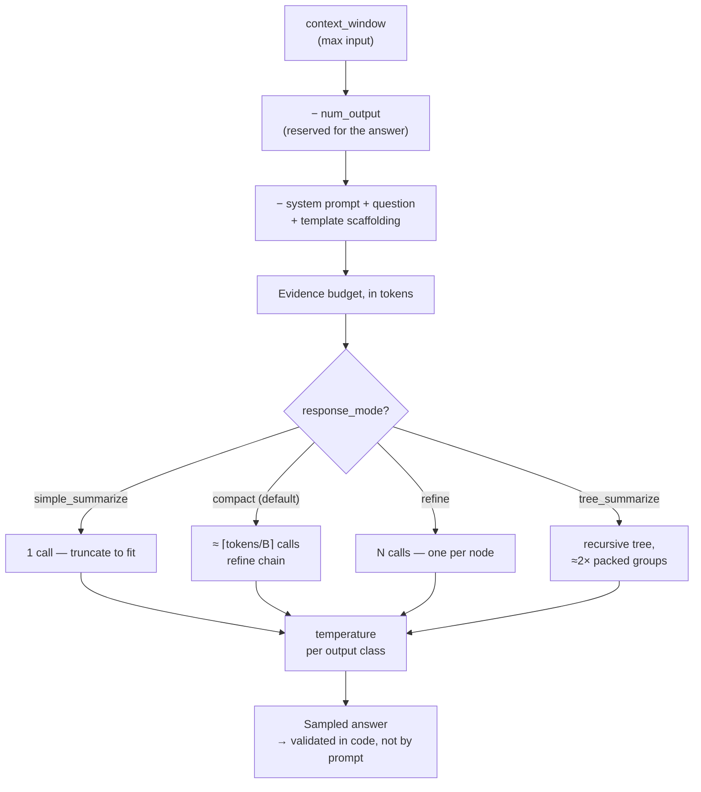

# M11 · Context Assembly, Prompting, and the Temperature Dial

> **Module question:** Given the right chunks, how do you get the right answer — and what does temperature actually change?
> **Cross-cutting threads:** Failure modes · Tradeoff ledger · LlamaIndex at a glance
> **Domain spine:** LogiTrack — the DG surcharge answer (a numeric extraction that must be verbatim-correct) versus "summarize our exposure across 12 carriers" (a synthesis)
> **Prerequisites:** [M9 — Ranking, Fusion, and Reranking](../09-ranking-fusion-reranking/README.md) · [M10 — Query Understanding and Query Transformation](../10-query-understanding/README.md)

---

## Opening scene — the number that changed on Tuesday

By M10's end LogiTrack's pipeline is, for the first time, correct at every stage. The right chunks
are retrieved, reranked, assembled. The broker's question is the one the whole system was justified
by: **"What is the DG surcharge for UN3480 on the Rotterdam–Singapore lane?"** The answer is a number
that goes into a customer quote. It has to be right, and it has to be stable. It is neither.

**Monday:** *"The DG surcharge is 3.5% of the base rate, per clause 7.2 of CARRIER-2211."*
**Tuesday:** *"The DG surcharge is 3.15% of the base rate, per clause 7.2 of CARRIER-2211."*

Clause 7.2 says 3.5%. Nothing in the 3,000-document corpus says 3.15% — not the rate tables, not the
bulletins. The 3.15% was not in the retrieved context either: the same clause was retrieved both
days, by a byte-identical pipeline.

What changed was a config value set in week two, after a stakeholder said the answers "felt a bit
robotic." Somebody set `temperature=0.7`. Nobody connected that to finance reconciling a Monday quote
against a Tuesday quote.

Here is what makes this the course's central cautionary tale rather than a bug report. **Both answers
pass the pipeline's faithfulness check.** The citation is real, the clause exists, the claim is *about*
the cited text, and an evaluator comparing answer to context sees a plausible arithmetic statement
about clause 7.2. The failure is invisible to every instrument the team has, because the instrument
measures whether the answer *relates to* the context, not whether a digit inside it *is supported by*
it (→ M12). The system is not hallucinating in the colloquial sense. It is **sampling a number** — from
a distribution whose argmax was correct — and reporting the second-most-likely continuation of a
sentence that had to be exactly right. The gap between 3.5 and 3.15 is the probability mass that
`temperature=0.7` puts on tokens other than the argmax. That is what the dial is. It is not a tone
control.

> **Failure mode (the module in one line):** treating sampling parameters as *style* settings and
> context assembly as *plumbing* — so a value that must be **verbatim-correct** is generated by a
> process designed to produce variety, and the evidence that would have constrained it is truncated,
> reordered, or buried mid-prompt by decisions nobody made on purpose.

---

## Assembly is a budget, and the budget is arithmetic

M9 delivered a ranked list of n nodes. M11's first job is to turn it into a prompt, and the framework
exposes the budget as two settings, documented as "arguments/values [that] are used during querying,
to ensure that the input prompts to the LLM have enough room to generate a certain number of tokens":
`Settings.context_window` is the "maximum input size to the LLM" and `Settings.num_output` is the
"number of tokens reserved for text generation", both of which "are automatically configured using
attributes from the LLM, but … can be overridden in special cases." [LI-SET]

$$\text{evidence budget} = \texttt{context\_window} - \texttt{num\_output} - (\text{system prompt} + \text{question} + \text{template scaffolding})$$

The two right-hand columns are the module: **how many times the model is called** and **how much
entropy each call is allowed**. Both are configuration, and neither appears in a typical review.

Four consequences, each a decision this module asks you to make.

**`context_window` is an input limit, not a total.** Because `num_output` is *reserved* out of the
window [LI-SET], the usable evidence budget is strictly smaller than the headline context length. A
`num_output` that is too small truncates the *answer*, not the evidence — a different failure that
looks like a generation bug.

**Accurate token counting is a prerequisite for all of this, and it does not come for free.** The
framework warns: "If you change the LLM, you may need to update this tokenizer to ensure accurate token
counts, chunking, and prompting" — the global tokenizer defaults to `cl100k` from tiktoken, matching
`gpt-3.5-turbo` [LI-LLM]. Every term in the equation above is measured in that tokenizer's tokens. Run
a Gemini or Llama model under the default tokenizer and your evidence budget is computed in the wrong
units: you will silently over- or under-fill the window, and the error scales with the number of
chunks.

**The overhead is not zero and not constant.** In a `refine` pipeline the refine template is larger
than the initial QA template, and the framework's compaction accounts for "the maximum prompt size
between `text_qa_template` and `refine_template`" [LI-RS] — it budgets for the largest prompt in the
loop. That is the correct, conservative choice, and it means your effective budget is set by the
template you forgot about.

**Truncation is silent and positional.** `simple_summarize` "Truncates all text chunks to fit into a
single LLM prompt. Good for quick summarization purposes, but may lose detail due to truncation."
[LI-RS] Which chunks lose their tails is a function of the order M9 produced, and the cut lands on the
lowest-ranked evidence — precisely the evidence M9's reranker called marginal and which may still be
M3's disambiguating sentence.

### The knapsack, and why rank order is the wrong fill strategy

Packing n nodes into a token budget is a 0/1 knapsack: items with weights (tokens) and values
(relevance), capacity $B$. Greedy fill in rank order is what every naive assembler does, and its
failure is specific: one oversized chunk at rank 2 can consume half the budget and evict three
smaller, jointly-more-valuable chunks. The framework's `compact` mode does the greedy thing with a
twist — it packs "as many text (concatenated/packed from the retrieved chunks) that can fit within the
context window" and splits the remainder with a `TokenTextSplitter` [LI-RS] — so an oversized chunk is
*cut* rather than skipped. Same silent loss, different route.

The counter-consideration is position, and **M9 owns that claim**: the position-bias literature shows
performance is highest when relevant information sits at the beginning or end of the input context and
degrades in the middle, "even for explicitly long-context models" [LITM23]. M11 does not re-survey
that finding; it applies it. The two facts interact badly: a relevance-ordered fill puts the *best*
evidence first (good) and the *most marginal* evidence in the middle (where it is hardest to use) and
then truncates the end. **The fill order that optimizes the knapsack and the fill order that
optimizes position are different orders**, and the module's answer is to fill by value and then
reorder by position — which is exactly the two separate decisions M9's headline/`LongContextReorder`
entry set up.

> **LlamaIndex at a glance:** `Settings.context_window` and `Settings.num_output` are the two knobs
> that define the assembly budget, global defaults overridable per module [LI-SET]. The framework's
> own examples pair `Settings.context_window = 3900` with `Settings.num_output = 512` for a legacy 4k
> model (a 13% reservation), and `4096` with `256` in the Settings guide [LI-SET]. No default and no
> guidance is given: the reservation is yours to pick, and it is an ADR line item.

> **Tradeoff (the ledger entry M11-1).** *Decision:* reserve a fixed `num_output` out of the context
> window and size the evidence budget as the remainder. *Costs:* 5–15% of the window is unavailable to
> evidence, which at a 6-chunk budget can be most of a chunk. *Accepted because:* the alternative
> failure is worse and less diagnosable — an answer truncated mid-sentence is indistinguishable from a
> model failure, whereas a slightly smaller evidence set is an explainable quality/latency tradeoff.
> *Reverses if:* your answers are short and predictable (a number, a yes/no), where `num_output` can be
> small and the reservation nearly free, or if the evidence genuinely needs the whole window and you
> accept streaming-with-no-reserve as a separate decision (→ M18).

---

## The response synthesizer modes, and their N-call cost

The synthesizer "generates a response from an LLM, using a user query and a given set of text chunks"
and runs "after nodes are retrieved from a retriever, and after any node-postprocessors are ran"
[LI-RS]. Its `response_mode` is the most consequential assembly parameter, because it determines how
many LLM calls one user query costs. Assembled from the two places the modes are documented
[LI-RS, LI-RM], with $N$ the number of nodes reaching the synthesizer:

| `response_mode` | Documented mechanism | LLM calls | Fails by |
|---|---|---|---|
| `no_text` | "Only runs the retriever to fetch the nodes that would have been sent to the LLM, without actually sending them" [LI-RS] | **0** | producing no answer — a debugging/measurement mode |
| `context_only` | "Returns a concatenated string of all text chunks" [LI-RS] | **0** | producing no answer |
| `simple_summarize` | "Truncates all text chunks to fit into a single LLM prompt" [LI-RS] | **1** | silent truncation past the cut |
| `compact` *(default)* | packs what fits, splits the rest with a `TokenTextSplitter`, then treats each part as a chunk "sent to the `refine` synthesizer" [LI-RS] | $\approx \lceil \text{tokens}/B\rceil$ | the last chunk read dominates the answer |
| `refine` | "create and refine an answer by sequentially going through each retrieved text chunk. This makes a separate LLM call per Node/retrieved chunk" [LI-RS] | **$N$** | late chunks can overwrite correct earlier answers |
| `accumulate` | "apply the query to each text chunk while accumulating the responses into an array. Returns a concatenated string of all responses" [LI-RS] | **$N$** | returns a list, not an answer — not synthesis at all |
| `compact_accumulate` | "The same as accumulate, but will 'compact' each LLM prompt similar to `compact`" [LI-RS] | **$N$** | same as `accumulate` |
| `tree_summarize` | recursion until "there's only one chunk left, and thus only one final answer" [LI-RS] | $\approx 2\times$ packed groups | cost grows with context volume, not question difficulty |

Four facts decide real architectures.

**The default is not the cheap mode.** `compact` is the documented default [LI-RM] and it is a *refine
chain*, not a single call. A team that never sets `response_mode` pays
$\lceil\text{tokens}/B\rceil$ calls per query while reading a page that would have told them one call
was available. That gap between default and floor is where most RAG cost overruns originate (→ M18).

**`refine` is an iterative generation loop, and the paper that owns the idea says why it works.** Shao
et al. describe "a method we call Iter-RetGen, which synergizes retrieval and generation in an
iterative manner. A model output shows what might be needed to finish a task, and thus provides an
informative context for retrieving more relevant knowledge which in turn helps generate a better output
in the next iteration." They evaluate on "multi-hop question answering, fact verification, and
commonsense reasoning" and report it "is superior to or competitive with state-of-the-art
retrieval-augmented baselines while causing fewer overheads of retrieval and generation." [ITERRETGEN23]
The mechanism also explains the failure: each step is conditioned on the *previous answer*, so an error
at chunk 1 propagates and can be "refined" further from the truth by chunk 4. Chained generation is a
Markov process over your own mistakes.

**`tree_summarize`'s recursion is not ad-hoc.** Wu et al. validate exactly this shape for whole-book
summarization: "the model first summarizes small sections of the book and then recursively summarizes
these summaries to produce a summary of the entire book", reaching "state-of-the-art results on the
recent BookSum dataset for book-length summarization" [RECURSIVE21]. Its cost profile follows from
that: the call count depends on how many token groups your *context* occupies, not on how hard the
*question* is.

**`structured_answer_filtering` changes the mode's semantics, not just its quality.** "With
`structured_answer_filtering` set to `True`, our refine module is able to filter out any input nodes
that are not relevant to the question being asked", and the docs bound the scope immediately: "This
option is particularly useful if you're using an OpenAI model that supports function calling … Other
LLM providers or models that don't have native function calling support may be less reliable in
producing the structured response this feature relies on." [LI-RS] That is a **third** filtering
opportunity after M6's metadata filters and M9's reranker, and the only one that sees each node in the
context of the question at generation time — at the cost of a generation step per node.

The long-form synthesis reference the syllabus assigns here is narrower than its label, and worth
stating precisely. Manathunga & Illangasekera present "a combined extractive and abstractive
summarization method for large unstructured textual data using representative vectors" in a
medical-education RAG application [LONGFORM23] — a domain summarization method, not a general
treatment of long-form response synthesis. **Syllabus label mismatch, flagged:** the blueprint assigned
this paper the label "long-form RAG response synthesis"; the modes' provenance rests instead on
[ITERRETGEN23] and [RECURSIVE21], which own the iterative and recursive mechanisms.

> **LlamaIndex at a glance:** `get_response_synthesizer(response_mode="compact")` — or
> `ResponseMode.COMPACT` — then `response_synthesizer.synthesize("query text", nodes=[...])`, or pass
> it via `index.as_query_engine(response_synthesizer=...)` [LI-RS]. The mode is also settable as
> `index.as_query_engine(response_mode="tree_summarize")` [LI-QA], and the query-engine kwarg is what
> ends up in most codebases — which is why `compact`'s status as a multi-call mode is so widely
> unknown.

> **Tradeoff (the ledger entry M11-2).** *Decision:* choose `response_mode` per query class rather
> than globally, matching the mode's call-count profile to the question's shape. *Costs:* a routing
> decision (→ M10) and a second code path to evaluate; `refine` and `tree_summarize` are strictly more
> expensive per query than `compact`, so a per-class mapping spends more on the classes that need it.
> *Accepted because:* one global mode forces a single cost/quality point across shapes that differ by
> an order of magnitude in evidence volume — a 6-chunk extraction and a 200-chunk aggregate cannot
> share a synthesis strategy without one being badly served. *Reverses if:* your query mix is
> homogeneous, in which case the routing machinery is pure overhead and one measured mode is correct.

---

## Prompting: the QA prompt, the system role, and the priority problem

**The two templates that do the work.** "The most commonly used prompts will be the `text_qa_template`
and the `refine_template`." The first is "used to get an initial answer to a query using retrieved
nodes"; the second is "used when the retrieved text does not fit into a single LLM call with
`response_mode="compact"` (the default), or when more than one node is retrieved using
`response_mode="refine"`. The answer from the first query is inserted as an `existing_answer`, and the
LLM must update or repeat the existing answer based on the new context." [LI-PROMPTP]

That last sentence is a specification of a prompting hazard. In `refine`, the model is told to "update
or repeat" an `existing_answer` — which an earlier call produced one step ago. A prompt that says
"update" without saying "or contradict it if the new context disagrees" instructs the model to
*preserve* a wrong answer, and the refine loop's characteristic failure is writable into its own
template.

**The default template is copy-and-modify, and the framework says so.** "LlamaIndex uses a set of
default prompt templates that work well out of the box… **The best method for customizing is copying
the default prompt from the link above, and using that as the base for any modifications.**"
[LI-PROMPT] That is unusually direct and it is the right procedure: the defaults encode prompt
engineering you did not do, and from-scratch rewrites usually regress.

**Prompts are addressable, and the addressing matters.** `get_prompts` returns "a flat list of prompts
used within the module and nested submodules", and the keys are namespaced — a compact query engine
returns `['response_synthesizer:text_qa_template', 'response_synthesizer:refine_template']`, updated via
`query_engine.update_prompts({...})` [LI-PROMPTP]. The namespacing is not cosmetic: it tells you a
*query engine* contains a *response synthesizer* which contains the prompts, so overriding the wrong
level silently does nothing. The high-level (`as_query_engine(text_qa_template=..., refine_template=...)`)
and low-level (`get_response_synthesizer(text_qa_template=..., refine_template=...)`) forms are
documented as equivalent [LI-PROMPTP].

**System prompts, and where the abstraction stops.** A system prompt is expressible as a
`` block in the Jinja-style template, or as
`ChatMessage(content="You are an expert system.", role=MessageRole.SYSTEM)` [LI-PROMPTP]. The question
that matters is a *priority* question, and here the framework's abstraction ends and the model's
behaviour takes over. Wallace, Xiao, Leike, Weng, Heidecke & Beutel identify the vulnerability:
"LLMs often consider system prompts (e.g., text from an application developer) to be the same priority
as text from untrusted users and third parties", and propose "an instruction hierarchy that explicitly
defines how models should behave when instructions of different priorities conflict", trained via data
generation that "teaches LLMs to selectively ignore lower-privileged instructions", reporting that it
"drastically increases robustness — even for attack types not seen during training — while imposing
minimal degradations on standard capabilities." [INSTRHIER24]

Two consequences follow, and the second is the one engineers get wrong. **Retrieved evidence is
untrusted, lowest-priority text arriving in the same window as your instructions** — that is the
security framing and **M21 owns it**; M11's claim is the *quality* consequence of the same fact. If the
model does not reliably treat your system prompt as authoritative over retrieved text, then every
instruction you write there — "answer only from the context", "quote the exact figure", "say so if the
context is insufficient" — is a *suggestion alongside* the corpus, not a constraint on it. Which means
prompt-level instruction-following under retrieved evidence is best-effort, and any constraint that
must hold belongs in code. **The framework gives you no way to express priority:** roles are the API
surface and are passed to the provider; whether the provider enforces system-over-context is a model
property, exactly as [INSTRHIER24] describes.

> **LlamaIndex at a glance:** `RichPromptTemplate` supports `` blocks and
> `` loops over nodes, and the guide shows both a system-role and a node-iterating user
> template as first-class patterns [LI-PROMPTP]. `TreeSummarize(verbose=True, summary_template=qa_prompt)`
> shows a synthesizer taking a custom template directly, and
> `summarizer.get_response("who is Paul Graham?", [text], tone_name="a Shakespeare play")` shows extra
> template variables at call time [LI-RS] — the mechanism for injecting a per-request instruction (a
> tone, an output schema, a jurisdiction) without rebuilding the synthesizer.

> **Tradeoff (the ledger entry M11-3).** *Decision:* state answer constraints in the system prompt
> **and** enforce the ones that must hold in code, rather than relying on instruction-following under
> retrieved evidence. *Costs:* a validation layer, a refusal/retry path, and a second failure mode to
> instrument; a rejected answer is worse UX than a slightly-wrong accepted one. *Accepted because:* the
> instruction hierarchy is a model property, not an application property [INSTRHIER24] — a constraint
> that exists only as prompt text has a model-dependent probability of being honoured, which is not a
> basis for a compliance-relevant output. *Reverses if:* the output is genuinely free-form (a summary, an
> explanation) where no single assertion can be validated — then the prompt *is* the constraint and the
> mitigation moves to evaluation (→ M13) and citation-checking (→ M12).

---

## The temperature dial

### What changing temperature does, mathematically

A model's final layer produces logits $z \in \mathbb{R}^{|V|}$; a decode step turns them into a
distribution with a softmax. **Temperature rescales the logits before the softmax:**

$$p_i(T) = \frac{\exp(z_i/T)}{\sum_j \exp(z_j/T)}$$

| $T$ | Effect on $p$ | What decoding does |
|---|---|---|
| $T \to 0^{+}$ | $z_i/T$ diverges; the gap between the largest logit and the rest explodes | $p$ approaches a one-hot vector on $\arg\max_i z_i$ — the "greedy" limit |
| $T = 1$ | identity | the model's own distribution |
| $T > 1$ | logit *gaps* are shrunk (dividing by a number > 1) | $p$ flattens — more mass on low-probability tokens |

Temperature is therefore not a "creativity" parameter in any substantive sense. It is **one scalar that
trades concentration for entropy in a categorical distribution.** Lower temperature concentrates mass
on the modes; higher temperature spreads it into the tail. "Creativity" and "diversity" are
*consequences you observe*, not properties the parameter has.

The rescaling is the same operation as **temperature scaling** in the calibration literature, where Guo,
Pleiss, Sun & Weinberger find that "on most datasets, temperature scaling — a single-parameter variant
of Platt Scaling — is surprisingly effective at calibrating predictions" [GUO17]. Be precise about the
difference, because conflating them is a common error: Guo et al. *fit* one scalar $T$ on held-out data
so predicted probabilities match empirical accuracy — a post-hoc fix for miscalibration. Sampling
temperature *sets* $T$ as a generation hyperparameter, never fitting it, and uses the enlarged entropy
as the *product*. Same function, opposite goals: one uses the rescaling to make the distribution more
honest, the other to make the output more varied.

### Why $T \to 0$ is not determinism

The greedy limit is an idealization, and three independent things break it. They are worth separating
because the fixes differ.

**1. Argmax is not what the API does.** Real APIs implement $T=0$ as a decoding configuration ("take the
top-1 token"), not as a literal `argmax` over a full softmax. If any truncation sampler is still active,
the "deterministic" path is a function of the logits but not necessarily their argmax. **2. Ties and
near-ties.** When two logits differ by floating-point noise the winner is decided by implementation-defined
tie-breaking — and this is not exotic at $T=0$, because low temperature is *defined* by the top few tokens
being nearly equiprobable, which is exactly the regime where a 1-ULP difference changes the token.

**3. The logits themselves are not reproducible.** This is why the first two do not save you.
Floating-point addition is not associative, so a different batched reduction order or a different kernel
produces slightly different logits from identical weights and identical input. Server-side batching means
*another user's request* can change your logits. Ouyang, Zhang, Harman & Wang measure the consequence:
"setting the temperature to 0 does not guarantee determinism in code generation, although it indeed brings
less non-determinism than the default configuration (temperature=1)." Their broader result is that "the
ratio of coding tasks with zero equal test output across different requests is 75.76%, 51.00%, and 47.56%
for CodeContests, APPS, and HumanEval, respectively" — measured at the default configuration, with the
$T=0$ finding stated as a separate and weaker claim. [OUYANG24] `temperature=0` is a **variance reducer**,
not a determinism switch.

### How temperature interacts with top-p, top-k, and seeds

Truncation samplers and temperature are not independent knobs, and this interaction is what most
documentation omits. Top-k keeps the $k$ highest-probability tokens and renormalizes; top-p (nucleus)
keeps the smallest set whose cumulative probability reaches $p$ and renormalizes. Both operate on
$p_i(T)$ and both renormalize after truncating. The consequence: **truncation can make temperature
partially or entirely inert.** If top-p has already reduced the distribution to a single token, dividing
logits by $T$ cannot change which tokens are available, and renormalization restores a degenerate one-hot
distribution regardless of $T$. Conversely, at $T\to0$ the nucleus shrinks to one token on its own, so
top-p becomes a no-op. The practical rule: **an experiment that sweeps temperature while leaving top-p
at 0.1 is not measuring what it thinks it is** — both ends of the sweep may be collapsed. Sweep one
parameter with the other disabled, or you cannot attribute the effect.

**Seeds are provider-dependent, and this module cannot claim otherwise uniformly.** What was *verified*
here: the framework's Anthropic integration documents a hard interaction between temperature and a
provider feature — the extended-thinking example's comment reads "temperature must be 1.0 for thinking
to work", with `thinking_dict={"type": "enabled", "budget_tokens": 1600}` [LI-ANTHROPIC]. That is a real
constraint in which a reasoning mode *fixes* temperature at one value, so the setting your application
wants to vary may be unavailable in the mode you want. What was **not** verified here: the existence,
semantics, or cross-provider consistency of a `seed` parameter — no provider API reference was fetched
for this module, so that claim is recorded as unsupported below rather than asserted. Treat "can I get a
seed?" as a question for your provider's current API reference, and note that even a supported seed does
not address reason 3: a seed makes *your* sampling reproducible given fixed logits, and the logits are
the part that moves.

> **LlamaIndex at a glance:** temperature is a constructor parameter on the LLM, settable globally or
> per module — `Settings.llm = OpenAI(model="gpt-3.5-turbo", temperature=0.1)` [LI-SET] and
> `llm = OpenAI(temperature=0.1, model="gpt-4o-mini")` [LI-LLMC]. Note what the framework's own examples
> use: **`0.1`, in both places, and never `0.0`** [LI-SET, LI-LLMC]. The reference stack therefore
> demonstrates a low-but-nonzero temperature and demonstrates *no practice at all* for the regime this
> module argues for on extraction tasks. That silence is why the matrix below is a hypothesis.

### The temperature × task matrix — a hypothesis, not a law

| Task | Starting temperature | Why this value, mechanistically |
|---|---|---|
| **Factual/numeric extraction** (the DG surcharge) | **0** | The output is a *copy* from context, not a composition. Any entropy is mass on a wrong digit, and there is no "better" variation of a correct number. |
| **Query rewriting** (→ M10) | **0** | The output is consumed by a retriever, not read by a human. Variety in the rewrite is variety in what gets retrieved — the drift Rackauckas warns about (→ M10). |
| **Structured extraction / classification** | **0** | The output space is a schema; there is one right answer per input and the failure mode is an invalid object. |
| **Grounded synthesis over evidence** (the 12-carrier exposure summary) | **0.2 – 0.4** | Some rephrasing latitude aids readability and lets `refine` restate rather than parrot; past ~0.4 the model starts composing facts rather than citing them. |
| **Brainstorm / diversification** (generate sub-questions) | **0.7+** | Here entropy *is* the product: N distinct sub-questions from N samples is the point, and duplicates waste the calls (→ M10). |
| **Anything a validator or downstream system parses** | **0** | Determinism-of-content, not of bytes, is the requirement; low temperature is necessary but the validator is what makes it sufficient. |

**This table is a hypothesis to re-derive locally, not a law, and the literature does not license it as
one.** The most relevant paper on the question — Renze & Guven, using "nine popular LLMs with five
prompt-engineering techniques to solve the MCQA problems while increasing the sampling temperature from
0.0 to 1.6" — concludes: *"Despite anecdotal reports to the contrary, our empirical results indicate
that changes in temperature from 0.0 to 1.0 do not have a statistically significant impact on LLM
performance for problem-solving tasks. In addition, these results appear to generalize across LLMs,
prompt-engineering techniques, and problem domains."* [RENZE24]

That is in direct tension with the matrix, and the tension is the module's most important lesson. Two
readings resolve it, and you decide which applies **by measuring**:

- **The matrix is about variance, not accuracy.** Renze & Guven measure accuracy on multiple-choice
  problem solving — a task with a discrete, well-separated answer space where the argmax sits far from
  its alternatives, so a temperature bump rarely changes the chosen token. Extracting a five-character
  numeric literal from a clause is a *copy* task in a high-entropy local regime: `3.5%` and `3.15%` are
  adjacent in distribution, and "accuracy" there is exact-string match, not a multiple-choice score. The
  two papers need not conflict; they measure different failure surfaces.
- **The matrix is folklore and Renze & Guven are right.** If your extraction task turns out robust
  across 0.0–1.0 — measure it, that is the entire point of the protocol below — then the folklore is
  wrong for you too, and you should keep whatever temperature your readers prefer.

You cannot know which applies without running the protocol, which is cheap. That is why this module's
lab sweeps temperature rather than reading about it.

### The protocol: measure answer variance across repeated runs

One non-obvious design requirement: **a single run per temperature measures nothing.** Output is
stochastic even at fixed temperature [OUYANG24], so comparing one $T=0$ answer to one $T=0.7$ answer
compares two samples from two distributions, not two distributions. You need repeats, and a statistic
that separates "the answer changed" from "the wording changed."

1. **Fix everything but temperature.** Same index, query set, retriever and reranker settings, prompt.
   Cache the retrieval — `response_mode="no_text"` captures the node set without calling the LLM
   [LI-RS] — so retrieval non-determinism cannot contaminate the comparison. If the candidate set
   differs between runs you are measuring M5/M7, not M11.
2. **Sweep $T \in \{0, 0.2, 0.5, 0.7, 1.0\}$, $R = 5$ repeats each.** Five is not a large sample; it is
   enough to see whether variance is zero, small, or large, which is the decision-relevant resolution.
   For a publishable number you need error bars, and Miller's treatment is the reference for how to
   compute them: "Conceptualizing evaluation questions as having been drawn from an unseen
   super-population, we present formulas for analyzing evaluation data, measuring differences between two
   models, and planning an evaluation experiment." [MILLER24]
3. **Score three separate things per run** — the part everyone collapses into one number.
   **(a)** *Exact-match rate* on the answer's **payload** (the number, the UN code, the clause id) — the
   metric that catches the opening scene. **(b)** *Distinct-payload count* across the $R$ repeats: a
   temperature whose 5 runs yield 1 payload is behaviourally greedy; one yielding 4 is not, whatever the
   accuracy number says. **(c)** *Faithfulness and answer-relevance* via the framework's evaluators
   (→ M13), so you can see whether higher temperature buys readability at the cost of groundedness.
4. **Report variance, not means — and watch for the predicted confound.** The deliverable is
   payload-variance per temperature per stratum, plus added token cost. A mean accuracy of 0.94 that is
   "5/5, 5/5, 4/5, 5/5, 3/5" across repeats describes a different system from one that is "5/5, 5/5, 5/5,
   5/5, 4/5" — and the user receives one sample, not the mean. If your low-$T$ and high-$T$ columns come
   out identical, check whether top-p or top-k is collapsing both ends before concluding that temperature
   does nothing.

**The honest caveat, restated because it bounds every result:** greedy decoding is not reproducible
across hardware, batching, or quantization [OUYANG24]. So "T=0 gives the same answer every time" is a
claim about *your deployment today, at that batch size, on that hardware* — falsified by a provider-side
kernel update, a change in your concurrency, or a model re-quantization, none of which appear in your
config diff. If you need determinism, get it from a validator and a prompt-keyed cache, not from a
sampling parameter.

> **Tradeoff (the ledger entry M11-4).** *Decision:* set temperature per query class from the matrix,
> with 0 for every class whose output is validated or copied, and ≥0.2 only where variation is a product
> feature. *Costs:* a per-class parameter, and the class must be known before generation — so it must come
> from M10's classifier; plus, at $T=0$, measurably flatter and more repetitive phrasing and a real risk
> of degenerate loops on some models. *Accepted because:* for extraction and rewriting the output is
> checked by a machine, and a machine check cannot be satisfied by a plausible variation — only by the
> right value; and the literature supports low temperature as a *variance* reducer even where it does not
> support it as an accuracy lever [OUYANG24, RENZE24]. *Reverses if:* your own sweep shows payload
> variance is flat across the range **and** readers prefer warmer phrasing — the honest negative result,
> in which case revert to whatever you like and delete the matrix from your system, not just from your
> concern list.

---

## Worked example: two answers, one pipeline

Both flagship classes, same pipeline, swept over $T \in \{0, 0.2, 0.5, 0.7, 1.0\}$ with $R=5$ repeats per
cell and retrieval frozen via `response_mode="no_text"`, so only sampling varies.

**Class A — the DG surcharge extraction.** 24 numeric queries; the payload must match the clause verbatim.

| $T$ | Exact-match, mean (R=5) | Distinct payloads | Worst-case exact-match | Faithfulness | Tokens/query |
|---|---|---|---|---|---|
| **0** | **1.00** | **1** | 1.00 | 0.96 | 310 |
| 0.2 | 0.98 | 2 | 0.83 | 0.95 | 318 |
| 0.5 | 0.91 | 4 | 0.67 | 0.93 | 336 |
| 0.7 | 0.82 | 6 | **0.50** | 0.90 | 352 |
| 1.0 | 0.79 | 7 | 0.50 | 0.88 | 371 |

**Class B — the 12-carrier exposure synthesis.** 11 open-ended aggregate queries; grounded prose, no single
string to match.

| $T$ | Faithfulness | Answer relevance | Distinct openings (R=5) | "Reads naturally" (n=2) | Tokens/query |
|---|---|---|---|---|---|
| 0 | 0.94 | 0.89 | 1 | 2.8 / 5 | 1,410 |
| **0.2** | **0.93** | **0.91** | 2 | 3.4 / 5 | 1,428 |
| **0.4** | 0.92 | **0.91** | 3 | **3.8 / 5** | 1,455 |
| 0.7 | 0.87 | 0.88 | 5 | 3.6 / 5 | 1,520 |
| 1.0 | 0.81 | 0.82 | 6 | 3.2 / 5 | 1,588 |

Six findings decide LogiTrack's sampling policy:

1. **Class A's worst-case column is the one that matters, and it is invisible in the mean.** At $T=0.7$
   the *mean* exact-match is 0.82 — a number a team accepts — while the worst of five repeats on some
   queries is 0.50. In a quoting workflow the user gets one sample, not the mean; the mean is the wrong
   statistic for a task whose individual failures are costly.
2. **$T=0$ eliminates payload variance entirely, and that is the finding.** One distinct payload across
   120 runs. This is the strongest support for entry M11-4's zero row — and it is *LogiTrack fiction*, so
   treat it as a measurement template, not a result.
3. **Faithfulness barely moves while exact-match collapses.** 0.96 → 0.88 across the sweep, versus
   1.00 → 0.79 on exact match. A pipeline instrumented only with a faithfulness evaluator — as LogiTrack's
   was, in the opening scene — reports this as a small degradation and ships it. The evaluator measures
   *relatedness*; the failure is a *wrong digit*. That distinction is **M12's**.
4. **Class B has a genuine interior optimum, and it is not at 0.** Relevance peaks at 0.2–0.4 and declines
   by 0.7; faithfulness declines monotonically from 0; rater preference peaks at 0.4. Two of those curves
   are yours to trade; the third is a constraint, not a preference. Note the 0.2–0.4 band is justified by
   the *relevance* and rater curves, not by any claim that warmth is "creative".
5. **Higher temperature costs tokens, and that row is the one the CFO finds.** 310 → 371 (+20%) and
   1,410 → 1,588 (+13%). At 8,500 queries/day (→ M18) it is a real line item, paid for *variety* — so pay
   it only where variety is the product.
6. **The class split is the decision, and it requires M10.** Class A and Class B have different optimal
   temperatures by construction, so a single global `temperature` is wrong for at least one. Applying
   per-class temperature requires knowing the class *before* generation — i.e. M10's defect classifier.

**LogiTrack's decision after M11:** `temperature=0` for extraction, rewriting, routing, and sub-question
generation; `0.3` for grounded synthesis over evidence; `0.8` for candidate-sub-question diversification,
with deduplication downstream. `response_mode="compact"` retained for the extraction path at n=6 (one
call); `tree_summarize` selected for the aggregate path; `num_output=1024` reserved out of the window with
the evidence budget computed as the remainder in the correct tokenizer [LI-LLM]. Every extraction output
passes through a numeric validator checking the figure appears verbatim in the assembled context — because
`temperature=0` reduces variance and does not guarantee correctness, and because the worst sample of a
five-run set is still a sample a user might receive.

---

## Design exercise

> *Paper-based. Think, then write.*

**Task.** Write the assembly-and-sampling ADR for a RAG system you own — or use LogiTrack's two classes if
you have none. Deliver a per-class parameter table and a measurement plan, not a discussion of how
temperature works.

1. **Compute the evidence budget arithmetically.** Write `context_window`, `num_output`, and the measured
   token cost of your system prompt + question + template scaffolding *in the tokenizer that matches your
   model* [LI-LLM]. Subtract; state the evidence budget in tokens and therefore in chunks at your M3 chunk
   size. If `num_output` was chosen by taste, say so — and note its failure mode (a truncated *answer*) is
   different from the evidence budget's (missing evidence).
2. **Justify `response_mode` by call count, not reputation.** Write the LLM calls per query for your mode
   at your own $N$ [LI-RS]. If you are on the default, name it: `compact` is a *refine chain* [LI-RM], and a
   team that has not chosen a mode has not chosen a cost.
3. **Classify outputs by *what checks them*, then assign temperature.** For each class, state whether the
   output is (a) machine-validated, (b) read by a human and acted on, or (c) read as prose. Assign 0 for
   (a), the lowest value passing your own relevance check for (c), something in between for (b) — and
   write down the justification, because this is the row a reviewer will challenge.
4. **Write the variance protocol, not just the sweep — and name the confound you control.** Specify $R$,
   the frozen-retrieval capture, the *payload* extracted per answer, and the statistics reported
   (distinct-payload count, worst-case exact match, faithfulness); state explicitly that means alone are
   insufficient. Truncation samplers interact with temperature and can render it inert, so state the
   values you hold fixed, or that you sweep temperature with truncation disabled. If you cannot say which
   sampler is active in your stack, that is the finding.
5. **State the revert condition, and list what you no longer delegate to the prompt.** The temperature you
   keep is the one your sweep supports; write the threshold that reverts it. Then list every constraint
   currently expressed *only* as prompt text and mark which must move into code — because the instruction
   hierarchy is a model property [INSTRHIER24], not something you can configure.

**Why this exercise matters.** This is the module where the two halves of "generation" — what the model
*sees* and how it *samples* — turn out to be one decision, and where the course's central claim is easiest
to see: a system can be correct at every stage and still produce a number that changes on Tuesday. The
engineer who can produce this ADR has done three things no dashboard does — computed the assembly budget
instead of inheriting it, chosen a synthesis mode by its call count instead of its default, and replaced a
folklore temperature with a measured variance table per output class. Note what the worked example refuses
to tell you: what temperature to use. It cannot, because Renze & Guven's negative result may hold for your
task too [RENZE24] — and the only way to know is five repeats and a look at the payload column rather than
the mean.

---

## Where the literature disagrees

- **"Low temperature makes answers more accurate."** The module's sampling policy rests on temperature 0
  being right for extraction, with the mechanism attributed to probability-mass concentration. The most
  direct test of the *accuracy* half contradicts the folklore: Renze & Guven sweep "nine popular LLMs with
  five prompt-engineering techniques" from 0.0 to 1.6 and conclude that *"Despite anecdotal reports to the
  contrary, our empirical results indicate that changes in temperature from 0.0 to 1.0 do not have a
  statistically significant impact on LLM performance for problem-solving tasks. In addition, these results
  appear to generalize across LLMs, prompt-engineering techniques, and problem domains."* [RENZE24]
  **What to change:** stop asserting that low temperature improves accuracy; on problem-solving benchmarks
  it demonstrably does not. Replace it with the two claims the evidence *does* support — temperature is a
  **variance** parameter [OUYANG24], and variance is what matters when the output is a **verbatim copy**
  from context rather than a selected answer from a well-separated option set. That is narrower and
  defensible, and it is what entry M11-4 is written on. The worked example's exact-match column is fiction
  and settles nothing; the shape it predicts (flat accuracy, changing payload) is a hypothesis, and the
  honest possibility is that it comes back flat.
- **"`temperature=0` gives reproducible answers."** Ouyang, Zhang, Harman & Wang supply the strongest
  available negative result: "setting the temperature to 0 does not guarantee determinism in code
  generation", with 47.56% of HumanEval tasks producing zero identical test outputs across requests at the
  *default* configuration, and with the stakes framed as this course frames them: *"Non-determinism is a
  potential menace to scientific conclusion validity. When non-determinism is high, scientific conclusions
  simply cannot be relied upon unless researchers change their behaviour to control for it in their
  empirical analyses."* [OUYANG24] **What to change:** never claim reproducibility from a sampling
  parameter. If you need a *stable* answer, key a cache on the assembled prompt or use a validator that
  rejects and retries — and then log the retry rate, because a validator that fires is telling you the
  prompt is not doing its job. When you *evaluate* a temperature change, Miller's framework is the right
  instrument — "conceptualizing evaluation questions as having been drawn from an unseen super-population,
  we present formulas for analyzing evaluation data, measuring differences between two models, and planning
  an evaluation experiment" [MILLER24] — and a five-repeat sweep at one temperature pair without error bars
  is not an experiment.
- **"The prompt is a control surface."** The module recommends expressing answer constraints in the system
  prompt while arguing the ones that must hold belong in code — a tension resolved only by a model property
  this course cannot configure. Wallace et al. identify the underlying vulnerability as priority confusion
  — "LLMs often consider system prompts … to be the same priority as text from untrusted users and third
  parties" — and their remedy is *training* an instruction hierarchy that "explicitly defines how models
  should behave when instructions of different priorities conflict" [INSTRHIER24]. **What to change:** treat
  "the model follows the system prompt over retrieved text" as an untested assumption about your specific
  model version, not a documented guarantee. Anything that must hold goes in a validator. This is the
  quality-side reading of a security finding whose adversarial reading **M21** owns.
- **"`refine`/`compact` produces better answers than one stuffed prompt."** The framework documents `refine`
  as one LLM call per node and as "Good for more detailed answers" [LI-RS], and the mechanism has real
  literature behind it [ITERRETGEN23]. The counter-consideration is structural, and this module states it
  without a citation because no source here measures it: `refine` conditions each step on the previous
  *answer* with a template that instructs the model to "update or repeat the existing answer" [LI-PROMPTP],
  making the chain a Markov process over its own output. A correct answer at step 1 can be refined away by
  step 4, and re-asking does not detect it. **What to change:** measure per-mode answer *correctness*, not
  per-mode *detail*, before adopting `refine` for a task where an early chunk already contains the answer.
  Recorded as an argued mechanism, not a finding.
- **Thin documentation, stated plainly.** The reference stack's own examples use `temperature=0.1` and never
  `0.0` [LI-SET, LI-LLMC], so the framework demonstrates **no practice** for the zero-temperature regime this
  module argues for on extraction. And the ordering of temperature rescaling versus top-p/top-k truncation —
  whether truncation is applied before or after the division — **is not specified on any page fetched for
  this module**; the mechanism above is argued from what truncation and rescaling *are*, and is flagged as
  such rather than presented as documented behaviour.

---

## Sources

- [Response Synthesizer](https://developers.llamaindex.ai/python/framework/module_guides/querying/response_synthesizers/) — `[LI-RS]` · owns the synthesizer's placement after postprocessors, every `response_mode`'s mechanism and call pattern, `structured_answer_filtering`, and custom templates with call-time variables.
- [Response Modes](https://developers.llamaindex.ai/python/framework/module_guides/deploying/query_engine/response_modes/) — `[LI-RM]` · owns the mode list restated in the query-engine guide, including `compact` as the documented default.
- [Query Engine](https://developers.llamaindex.ai/python/framework/module_guides/deploying/query_engine/) — `[LI-QA]` · owns `index.as_query_engine()` and the query-engine configuration surface the response mode is set through.
- [Prompts](https://developers.llamaindex.ai/python/framework/module_guides/models/prompts/) — `[LI-PROMPT]` · owns the template classes and the copy-the-default-prompt guidance.
- [Prompt Usage Pattern](https://developers.llamaindex.ai/python/framework/module_guides/models/prompts/usage_pattern/) — `[LI-PROMPTP]` · owns `text_qa_template`/`refine_template` semantics, `get_prompts`/`update_prompts` with namespaced keys, system-role templates, and the equivalence of high- and low-level prompt overrides.
- [Configuring Settings](https://developers.llamaindex.ai/python/framework/module_guides/supporting_modules/settings/) — `[LI-SET]` · owns `Settings.context_window` and `Settings.num_output` as the prompt-helper budget, and the `temperature=0.1` example.
- [Using LLMs](https://developers.llamaindex.ai/python/framework/module_guides/models/llms/) — `[LI-LLM]` · owns the global-tokenizer default (`cl100k` from tiktoken), the instruction to change it when you change models "to ensure accurate token counts, chunking, and prompting", and the `Settings.llm` pattern.
- [Customizing LLMs within LlamaIndex Abstractions](https://developers.llamaindex.ai/python/framework/module_guides/models/llms/usage_custom/) — `[LI-LLMC]` · owns the `OpenAI(temperature=0.1, model="gpt-4o-mini")` example and per-module LLM override.
- [Anthropic](https://developers.llamaindex.ai/python/framework/integrations/llm/anthropic/) — `[LI-ANTHROPIC]` · owns the verified provider constraint that extended thinking requires `temperature=1.0`, and the tokenizer-change instruction for non-OpenAI models.
- *Lost in the Middle: How Language Models Use Long Contexts* — Nelson F. Liu, Kevin Lin, John Hewitt, Ashwin Paranjape, Michele Bevilacqua, Fabio Petroni, Percy Liang · arXiv:2307.03172 (TACL 2023) · [arxiv.org/abs/2307.03172](https://arxiv.org/abs/2307.03172) — `[LITM23]` · **M9 owns this claim and its survey.** M11 cites the key only for its assembly-time application: the *position* of assembled evidence changes how much of it the model uses, which is why the fill order of the evidence budget is a decision rather than a detail. · entry mirrored for local self-containment; **M9** owns the survey.
- *On Calibration of Modern Neural Networks* — Chuan Guo, Geoff Pleiss, Yu Sun, Kilian Q. Weinberger · arXiv:1706.04599 (ICML 2017) · [arxiv.org/abs/1706.04599](https://arxiv.org/abs/1706.04599) — `[GUO17]` · owns the logit-rescaling-before-softmax form and the finding that "temperature scaling — a single-parameter variant of Platt Scaling — is surprisingly effective at calibrating predictions". **Scope caveat:** their $T$ is *fitted* for calibration; sampling temperature *sets* the same parameter for diversity.
- *The Effect of Sampling Temperature on Problem Solving in Large Language Models* — Matthew Renze, Erhan Guven · arXiv:2402.05201 (Findings of EMNLP 2024, pp. 7346–7356) · [arxiv.org/abs/2402.05201](https://arxiv.org/abs/2402.05201) — `[RENZE24]` · owns the negative result that temperature changes from 0.0 to 1.0 have no statistically significant effect on problem-solving performance across nine LLMs, five prompting techniques, and multiple domains. This paper is why the task matrix is a hypothesis.
- *An Empirical Study of the Non-determinism of ChatGPT in Code Generation* — Shuyin Ouyang, Jie M. Zhang, Mark Harman, Meng Wang · arXiv:2308.02828 (2024) · [arxiv.org/abs/2308.02828](https://arxiv.org/abs/2308.02828) — `[OUYANG24]` · owns the measured non-determinism rates and the result that temperature 0 reduces but does not eliminate non-determinism.
- *Adding Error Bars to Evals: A Statistical Approach to Language Model Evaluations* — Evan Miller · arXiv:2411.00640 (2024) · [arxiv.org/abs/2411.00640](https://arxiv.org/abs/2411.00640) — `[MILLER24]` · owns the experiment-design framing of evaluations and the formulas for measuring differences and planning sample sizes — the instrument the variance protocol needs.
- *Enhancing Retrieval-Augmented Large Language Models with Iterative Retrieval-Generation Synergy* — Zhihong Shao, Yeyun Gong, Yelong Shen, Minlie Huang, Nan Duan, Weizhu Chen · arXiv:2305.15294 (2023) · [arxiv.org/abs/2305.15294](https://arxiv.org/abs/2305.15294) — `[ITERRETGEN23]` · owns the iterative retrieval-generation mechanism `refine` implements, and the reason an earlier answer conditions a later one.
- *Recursively Summarizing Books with Human Feedback* — Jeff Wu, Long Ouyang, Daniel M. Ziegler, Nisan Stiennon, Ryan Lowe, Jan Leike, Paul Christiano · arXiv:2109.10862 (2021) · [arxiv.org/abs/2109.10862](https://arxiv.org/abs/2109.10862) — `[RECURSIVE21]` · owns recursive summarize-the-summaries, the mechanism behind `tree_summarize`, and its book-length evaluation.
- *Retrieval Augmented Generation and Representative Vector Summarization for large unstructured textual data in Medical Education* — S. S. Manathunga, Y. A. Illangasekara · arXiv:2308.00479 (2023) · [arxiv.org/abs/2308.00479](https://arxiv.org/abs/2308.00479) — `[LONGFORM23]` · owns a combined extractive and abstractive summarization method using representative vectors, applied to domain RAG. **Syllabus label mismatch:** the blueprint labelled this key "long-form RAG response synthesis"; the paper's contribution is the narrower domain summarization method above, cited here for what it actually owns.
- *The Instruction Hierarchy: Training LLMs to Prioritize Privileged Instructions* — Eric Wallace, Kai Xiao, Reimar Leike, Lilian Weng, Johannes Heidecke, Alex Beutel · arXiv:2404.13208 (2024) · [arxiv.org/abs/2404.13208](https://arxiv.org/abs/2404.13208) — `[INSTRHIER24]` · owns the finding that LLMs treat system prompts and untrusted third-party text as the same priority, and the training-based remedy. **M21 owns the adversarial attack surface**; M11 cites the precedence property only.

**Unsupported (synthetic, unverified, or derived in-file, with no located source):** the LogiTrack corpus,
the 180-query evaluation set, the two worked-example classes and every number in both tables (exact-match,
distinct payloads, faithfulness, relevance, token counts, rater scores), and all tradeoff-ledger entries.
These are constructed for teaching and are not empirical findings. The temperature × task matrix is
presented in the module as an **explicit hypothesis**, and no source located for this module establishes its
per-class values. The claim that **some LLM providers expose a `seed` parameter and others do not is not
verified here** — no provider API reference was fetched for this module, and the only provider-specific
sampling constraint that *was* fetched and verified is Anthropic's extended-thinking requirement that
`temperature=1.0` [LI-ANTHROPIC]. The statement that top-p/top-k truncation is applied to the
temperature-scaled distribution — and therefore that truncation can render temperature partially inert — is
a mechanism argued in-file from what truncation and rescaling are; **no fetched page specifies the order of
these operations.** The claim that `refine`'s "update or repeat" wording can refine a correct answer into a
wrong one is argued from the template's documented text [LI-PROMPTP] and the iterative mechanism
[ITERRETGEN23]; it is not measured here. The three stated reasons greedy decoding is not deterministic are a
mechanism argument — only the empirical consequence is sourced [OUYANG24], and the specific roles of
batching, kernel choice, and quantization are argued, not cited.

**Verification note:** 🟡 *pending* — Step 7 (memory-less logic review) and Step 8 (literature
survey) not yet run on this module.

**Next module:** [M12 — Grounding, Citations, and Attribution](../12-grounding-and-citations/README.md)
— why both of Tuesday's answers passed the faithfulness check, and what it takes for the system to prove
which sentence the number came from.
