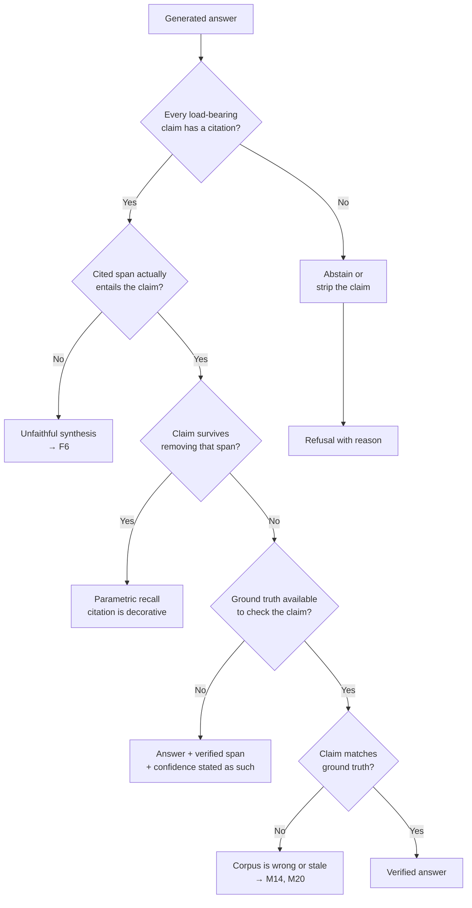

# M12 · Grounding, Citations, and Attribution

> **Module question:** How does the system prove its answer came from the corpus?
> **Cross-cutting threads:** Failure modes · Tradeoff ledger · LlamaIndex at a glance
> **Domain spine:** LogiTrack — the customs ruling where a wrong citation is a compliance incident
> **Prerequisites:** [M11 — Context Assembly, Prompting, and the Temperature Dial](../11-context-assembly-temperature/README.md), [M9 — Ranking, Fusion, and Reranking](../09-ranking-fusion-reranking/README.md)

---

## Opening scene — the citation that pointed at the wrong document

LogiTrack's customs desk gets a question from a broker at 09:14: *"Under our Maersk agreement, who
absorbs the demurrage when a DG container is held at Rotterdam for a documentation query?"*

The answer comes back in 1.9 seconds, well inside budget, and it is beautifully formatted:

> **Answer.** Demurrage accrues to the carrier where the hold is initiated by a documentation
> query rather than a physical inspection. LogiTrack bears storage from day four. **[1]**
>
> **[1]** Carrier Service Agreement — Maersk Line, Schedule 4, clause 14.2(b).

The broker checks clause 14.2(b). It says the opposite: the carrier's liability ceases on the
fourteenth day, and *storage* — not demurrage — is the customer's from day one. The sentence the
system produced is fluent, internally consistent, correctly formatted, and attributed to a real
document that really exists in the corpus and really is about demurrage. It is also wrong. The
model knew, from pretraining, roughly how freight demurrage clauses work; it produced a
plausible one and hung a citation on it.

The declaration is filed. Eleven days later the discrepancy surfaces in an audit — not as a
software incident, as a **compliance incident**, with a named broker, a client conversation, and
a written explanation required. Nothing in the pipeline logged anything unusual: retrieval worked
(node 4,882 really was in the top 3), assembly worked (the node really was in the prompt),
generation worked (the model really did produce a fluent answer). The system had a citation
feature. It did not have a grounding guarantee, and it could not tell the two apart.

> **Failure mode (the module in one line):** treating *showing a source* as *proving the answer* —
> so **F6 · unfaithful synthesis** presents itself with a citation attached, which converts a
> quality bug the user would have caught into a compliance incident nobody catches.

---

## "Grounded" is three different properties, and only one of them is cheap

The opening scene fails on the second property while passing the first, and that is the normal
case. Grounding decomposes into three properties that a single boolean cannot carry.

| Property | The question it answers | What it does *not* tell you | How you get it |
|---|---|---|---|
| **Attribution** | Does a source exist that the claim points at? | Whether that source says anything like the claim | A provenance field on the node, returned with the response |
| **Faithfulness** | Is the claim entailed by the source it points at? | Whether the *system* retrieved that source in the first place | A judge — human or model — comparing claim to span |
| **Verifiability** | Can a human with 30 seconds and the source settle the question? | Anything about the other two | Span-level location, stable identifiers, no unstated inference steps |

The third property is the one engineers skip and the one that matters operationally, because it is
the only one a broker can act on. Attribution is a data-model decision; faithfulness is a
measurement; verifiability is a *product* decision about what the citation is for.

The literature has a name for the target of the first two. Rashkin and colleagues define a
framework for statements "Attributable to Identified Sources (AIS)" and describe its purpose as
"measuring whether model-generated statements are supported by underlying sources" [ATTR22].
Read that sentence carefully, because it contains the trap this whole module is about: **AIS
measures support by a source, not truth about the world.** A statement can be perfectly AIS-
attributable to a document that is itself wrong, outdated, or — as in the opening scene —
invented and then matched to a document that merely sounds right. Attribution is necessary. It is
not sufficient, and no citation UI can make it sufficient.

> **Tradeoff (the ledger entry M12-1).** *Decision:* ship citation as a provenance field on the
> response, separate from any faithfulness claim the product makes. *Costs:* two distinct
> guarantees to maintain — a schema and a judge — and a UI that must not conflate them.
> *Accepted because:* a single "confidence" or "cited ✓" badge trained on attribution alone is
> exactly the artifact that let the opening scene ship. *Reverses if:* the corpus is small,
> single-tenant, and fully human-curated, so that retrieving a document is itself strong evidence
> of support.

---

## The citation granularity ladder

Every citation decision is a choice of *what a citation points at*, and the options form a strict
ladder. Each rung buys verifiability and costs something.

| Granularity | Citation points at | Proves | Costs |
|---|---|---|---|
| **Document-level** | "Maersk CSA (96 pp.)" | Almost nothing a human can check | Nothing |
| **Node-level** | Chunk 6,102, 512 tokens | The claim's vocabulary appears in a relevant region | Reader must scan the chunk |
| **Span / sentence-level** | Characters 14,203–14,388 of chunk 6,102 | The claim can be checked in one glance | Index storage for offsets; an extraction step that identifies *which* claim rests on *which* span |
| **Per-claim (atomic) span** | One span per sentence or clause of the answer | Citation precision and recall become separable | One attribution call per claim — the expensive rung |

LlamaIndex implements the middle of this ladder through `CitationQueryEngine`, which is built to
be used "with any existing index" and exposes citation granularity as a single knob: the
notebook's inline comment reads "here we can control how granular citation sources are, the
default is 512", with `citation_chunk_size=512` passed as an argument [LI-CQE]. The mechanism is
worth stating precisely because it is frequently misread: the engine takes the retrieved nodes and
*re-splits them into smaller citation nodes*, so querying an index whose nodes are 1024 tokens
with `citation_chunk_size=512` returns six source nodes rather than three — the notebook's own
comment for the 512 case is "source nodes are 6, because the original chunks of 1024-sized nodes
were broken into more granular nodes" [LI-CQE].

Two consequences follow directly from the documented behaviour, and both are easy to get wrong:

1. **Granularity is capped by the index, not by the argument.** "Note that setting the chunk size
   larger than the original chunk size of the nodes will have no effect" [LI-CQE]. You cannot make
   citations coarser than your chunks by asking; you can only make them finer. Raising citation
   granularity is a *re-indexing* decision (→ M3), and M3 already argued the point that the chunk
   is the unit of meaning.
2. **Citation numbering is 1-based and the API is 0-based.** The notebook flags it in bold:
   "Sources start counting at 1, but python arrays start counting at zero!" [LI-CQE]. Every
   off-by-one citation bug in a citation UI traces to this join.

The rung you need is set by your reader's verification budget, not by your ambitions. A broker
auditing a declaration will not read a 512-token chunk to find one number; a developer debugging
a pipeline will not pay for per-claim attribution on every request.

> **Tradeoff (the ledger entry M12-2).** *Decision:* build citations at node granularity by
> default, with a per-claim span-attribution pass reserved for the answer classes that carry
> compliance weight. *Costs:* two citation paths, and a routing decision that must be maintained
> as the query mix drifts (→ M19, M20). *Accepted because:* per-claim attribution multiplies the
> generation-stage call count by the number of claims, and a numeric-extraction answer typically
> has one checkable claim while a synthesis answer has twenty. *Reverses if:* the attribution
> method becomes cheap enough to run on every claim — in which case the ladder collapses to one
> rung and the routing code is deleted.

---

## Citation precision and recall — the axes nobody measures together

Once citations are per-claim, two metrics exist and they trade against each other exactly as
retrieval's do (→ M9):

- **Citation precision** — of the citations the answer emitted, what fraction actually support the
  claim they are attached to? Low precision means the reader's first click wastes their time.
- **Citation recall** — of the claims that *could* be supported by the corpus, what fraction
  carry a citation at all? Low recall means unsupported claims are presented without being
  flagged, which is the opening scene.

The degenerate strategy is now visible: **cite everything.** Attach the whole retrieved set to
every sentence and citation recall goes to 1.0 while precision collapses. This is not a
hypothetical — it is what a system does when it lacks per-claim attribution and is asked to
"show sources". It also happens to be the failure mode ALCE was built to measure: the benchmark
reports "automatic metrics along three dimensions — fluency, correctness, and citation quality"
and notes that the dimensions move independently, with the headline result that "on the ELI5
dataset, even the best models lack complete citation support 50% of the time" [ALCE23].

Hold that number next to the opening scene. The best systems measured on a published citation
benchmark leave half of their answers without complete citation support. A system that reports a
citation for every answer while measuring neither precision nor recall is not doing better than
those systems; it is not measuring.

| Signal | What it catches | What it misses |
|---|---|---|
| Citation present | Nothing | The whole failure |
| Citation count per answer | Padding behaviour, crudely | Padding with a plausible set |
| Citation precision (hand-checked) | Wrong or irrelevant citations | Claims with no citation at all |
| Citation recall (hand-checked) | Silent unsupported claims | Claims cited to a *supported-looking* wrong span |
| Citation precision + recall + per-claim entailment | Most of it | Whether the source itself is trustworthy |

> **Tradeoff (the ledger entry M12-3).** *Decision:* require every load-bearing claim to carry a
> citation, and treat an uncited load-bearing claim as a pipeline failure rather than a formatting
> issue. *Costs:* the system must be able to *abstain* rather than answer without support, which
> costs coverage. *Accepted because:* an uncited answer is indistinguishable from a hallucinated
> one to every downstream consumer, including the audit trail. *Reverses if:* the answer class is
> explicitly advisory (a summarization of retrieved news, say) where coverage dominates and no
> reader expects claim-level support.

---

## The answered-from-parametric-memory failure, and how to detect it

The opening scene is not a citation bug. It is a *generation* bug that produced a citation-shaped
artifact. The distinction matters because the fixes are different: citation formatting is fixed in
the response synthesizer, whereas parametric recall is a property of the model's weights and can
only be *detected*, not formatted away.

The natural question — did this sentence come from the context or from the weights? — has a
research answer, and it is not "trust the citation". ContextCite poses it exactly: "Can we infer
whether a particular generated statement is actually grounded in the context, a misinterpretation,
or fabricated?" The method introduced is "context attribution: pinpointing the parts of the
context (if any) that led a model to generate a particular statement", and it is described as "a
simple and scalable method for context attribution that can be applied on top of any existing
language model" [CTXCITE24]. Note "if any" — the method's output space includes *no supporting
part*, which is precisely the opening scene's diagnosis and precisely what a citation cannot
express.

Two operational tests are cheap enough to run without the research method:

| Test | Procedure | What a failure looks like |
|---|---|---|
| **Citation-ablation** | Re-run the same query with the cited node removed from the context | Same answer, same numbers → the claim never came from that node |
| **Counterfactual-perturbation** | Edit the cited span (change the number, invert the polarity) and re-run | Unchanged answer → the claim tracks the weights, not the span |

Both are the same instrument CLAUDE-style evaluation uses for faithfulness in general (→ M13): the
*no-context* and *counterfactual-context* conditions. Neither requires an LLM judge to be
trustworthy, because the output is a diff, not a score — which makes them the right first line of
defence for a compliance-sensitive answer class before you spend a judge call on it.

RAGTruth tells us how much room there is for this failure to hide. Its corpus is built from
"nearly 18,000 naturally generated responses from diverse LLMs using RAG", annotated "at both the
individual cases and word levels", and its motivating observation is blunt: "Despite the
integration of RAG, LLMs may still present unsupported or contradictory claims to the retrieved
contents" [RAGTRUTH24]. Word-level annotation matters here. A claim-level or answer-level
faithfulness score would have marked the opening scene's answer as *mostly* faithful, because most
of the sentences really were supported; the specific failure was a single number inside one clause.

The tree's value is that it separates four failures that a "faithfulness score" merges: no
citation, unsupported citation, decorative citation, and correct-citation-wrong-corpus. Only the
last one is fixed by better generation.

> **LlamaIndex at a glance:** the grounding surface is the `Response` object. A response
> synthesizer "generates a response from an LLM, using a user query and a given set of text
> chunks", and "the output of a response synthesizer is a `Response` object" which carries the
> answer string *and* its source nodes [LI-RS]. Two documented hooks do most of the provenance
> work. First, `no_text` mode "only runs the retriever to fetch the nodes that would have been
> sent to the LLM, without actually sending them. Then can be inspected by checking
> `response.source_nodes`" [LI-RS] — that is the citation-ablation harness above, implemented for
> free. Second, for `refine` and `compact`, `structured_answer_filtering=True` lets the synthesizer
> "filter out any input nodes that are not relevant to the question being asked", with the
> documented caveat that it "is particularly useful if you're using an OpenAI model that supports
> function calling", since providers without native function calling "may be less reliable in
> producing the structured response this feature relies on" [LI-RS].

---

## Provenance that travels: metadata, templates, and what the reader is actually shown

Grounding is only as good as the provenance attached to the node, and provenance is set at ingest
(→ M3, M6). LlamaIndex's document model makes one distinction that determines whether your
citations are checkable:

- Metadata "is injected into the text for both embedding and LLM model calls" by default, and
  every document's `metadata` "will show up in the `metadata` of each source node created from the
  document" [LI-DOC]. That inheritance is what makes `response.source_nodes[i].node.metadata` a
  usable citation payload.
- The two audiences can be decoupled. `excluded_llm_metadata_keys` removes keys from what the
  model reads, and `get_content(metadata_mode=MetadataMode.LLM)` shows exactly what the model will
  see; `excluded_embed_metadata_keys` and `MetadataMode.EMBED` do the same for the embedder
  [LI-DOC]. The documented rationale is the one that matters for citations: "The `file_name` might
  include information that will help generate better embeddings" while you may not want the model
  reading it [LI-DOC].
- The rendered form is controlled by three attributes — `metadata_seperator` (default `"\n"`),
  `metadata_template` (default `"{key}: {value}"`), and `text_template` (default
  `"{metadata_str}\n\n{content}"`) [LI-DOC].

That last triple is where citation UX quietly breaks. If the citation UI renders the retrieved
node's raw text but the template that produced it injected twelve metadata keys, then the span the
reader sees is not the span the model saw, and a "verifiable" citation becomes a scavenger hunt.
The rule: **whatever the citation displays must be produced by the same template that fed the
synthesizer**, and `get_content(metadata_mode=MetadataMode.LLM)` is the function that proves it.

| Provenance field | Source | Why the reader needs it | Failure if absent |
|---|---|---|---|
| `node.ref_doc_id` | Docstore lineage (→ M14) | "Which document is this?" — not which chunk | Citation survives a re-chunk and points nowhere |
| Stable document identifier | `doc_id` set at load, e.g. `filename_as_id` [LI-DOC] | Deep-link into the source system | Citations rot on every re-ingest |
| Node identifiers | Node `id_` | Reproduce the retrieval for an audit | Cannot reconstruct a disputed answer |
| Jurisdiction / effective date | Document metadata (→ M6) | Distinguish two versions of the same clause | Superseded clause cited as current → M14, M20 |
| Span offsets within the node | Not documented for `CitationQueryEngine` — see Unsupported | Highlight exactly the supporting sentence | Reader re-reads the whole chunk |

> **Tradeoff (the ledger entry M12-4).** *Decision:* carry document-level provenance identifiers
> (`ref_doc_id` plus a stable external id) on every node, in addition to the node's own id.
> *Costs:* index storage per node, and a metadata-key discipline that must be enforced at every
> ingest path. *Accepted because:* node ids are regenerated by re-chunking and by every embedding
> model change (→ M14), so a citation keyed only on node ids is guaranteed to break on the first
> maintenance operation. *Reverses if:* the corpus is append-only and immutable, where a node id
> is stable for the life of the system.

---

## Abstention is an outcome, not an error path

The system in the opening scene had two possible outputs and used them wrongly. It needed three.

| Outcome | Condition | User sees | Logged as |
|---|---|---|---|
| **Answer, grounded** | Claims cited and the cited spans entail them | Answer + spans | Success |
| **Abstain** | Retrieval returned nothing above threshold, or the evidence conflicts | "Not in the corpus" + what was searched | Success, counted as coverage loss |
| **Answer, ungrounded** | The system produced a claim it cannot cite | *Nothing — this must not exist* | Pager-worthy |

The engineering consequence is that abstention must be *reachable*. If the prompt says "answer the
question", the abstention path is unreachable no matter what the code does, because the model has
no instruction that produces it. Two documented mechanisms make it reachable: instruction-level
(it must be in the system prompt, → M11) and filter-level (`structured_answer_filtering` above,
which discards nodes the synthesizer judges irrelevant [LI-RS], leaving an empty context for the
model to notice).

The reason abstention is treated as a *success* in the table is that it is the only outcome whose
cost is bounded. An abstention costs a user a second look at the source system. An ungrounded
answer costs a broker eleven days and a client conversation. Any optimisation that trades
abstentions for answers is trading a bounded cost for an unbounded one, which is why the
acceptance threshold for this module's exercised ADR is stated on the ungrounded rate and not on
coverage.

---

## Worked example: 40 answers, hand-checked, three citation granularities

Take the customs-desk query class — 40 real questions from the 400-query set (→ M13), all of the
"what does clause X say about Y" shape, all answerable at span level. Run the same pipeline three
times with citation granularity set to document, node, and span, and hand-check every citation
against the answer. One reviewer, a rubric for "does this span entail this claim", no LLM judge —
the point of the exercise is to have a number that does not depend on a judge's agreement with a
human (→ M13).

| Config | Citation precision | Citation recall | Ungrounded claims reaching the user | Reviewer time per answer | Notes |
|---|---|---|---|---|---|
| Document-level citation | 0.42 | 0.95 | 7 / 40 | 4 m 10 s | Recall looks excellent because everything is cited to a 96-page PDF |
| Node-level, 1024-token nodes | 0.71 | 0.88 | 4 / 40 | 1 m 35 s | The default. Precision limited by the reader scanning 1024 tokens |
| Node-level, `citation_chunk_size=512` | 0.78 | 0.86 | 3 / 40 | 1 m 05 s | Re-split citation nodes [LI-CQE]; no re-index needed |
| Span-level (per-claim attribution pass) | **0.91** | **0.83** | **1 / 40** | 0 m 25 s | Cost: one attribution call per claim |
| Span-level + abstention on low-support claims | 0.93 | 0.71 | **0 / 40** | 0 m 20 s | 6 of 40 answers became abstentions |

Three findings decide LogiTrack's citation architecture:

1. **Document-level citation is worse than no citation.** Precision 0.42 with recall 0.95 is the
   signature of a citation that always exists and rarely helps — the "cite everything" degenerate
   strategy from the precision/recall section, arrived at by accident. A reader who learns that
   citations are unreliable stops using them, and the feature's value goes to zero even where it
   was correct. Recall that is bought by lowering the bar is not recall.
2. **The cheapest real win is a parameter, not a project.** Moving from 1024-token to 512-token
   citation nodes is one argument to `CitationQueryEngine.from_args` and no re-index at all,
   because the engine re-splits at query time [LI-CQE]. It bought 0.07 precision and 30 seconds of
   reviewer time per answer. The rung below it — span-level attribution — bought 0.13 precision
   and cost an extra generation-stage call per claim.
3. **The abstention row is the only one that reaches zero.** Ungrounded claims go 7 → 0 only when
   the system is allowed to *not answer*: citation recall drops from 0.83 to 0.71 because six
   answers were withdrawn rather than cited. Read that as the honest price of the guarantee, and
   note that it is the only row where the compliance-relevant column is clean.

**LogiTrack's decision after M12:** node-level citation at `citation_chunk_size=512` as the
default for every query class; a per-claim attribution pass for the customs, DG, and tariff answer
classes; and an abstention policy that is calibrated on the ungrounded rate, with the M13 harness
reporting citation precision, citation recall, and abstention rate as three separate numbers
rather than one "grounding score".

---

## Design exercise

> *Paper-based. Think, then write. Deliver a decision, not a survey.*

**Task.** Write the citation ADR for your system. If you have none, use LogiTrack's customs desk.
The deliverable is a contract: what the system promises, what it refuses to promise, and how a
reviewer checks the promise.

1. **Name the reader and their verification budget.** State who consumes a citation and how long
   they will spend on it. A customs auditor has 30 seconds and a compliance motive; an internal
   developer has 10 minutes and a debugging motive. The budget picks your rung on the granularity
   ladder, and it is a product fact, not an engineering preference.
2. **Choose the granularity and defend it against the rung above.** State the rung you are
   shipping. Then state, in one sentence, what a reader *cannot* check at that rung — because if
   you cannot say what your citation fails to prove, you have not chosen a rung, you have chosen
   a UI.
3. **Write the abstention policy as a threshold.** Specify the condition under which the system
   declines to answer, the metric it is calibrated against (ungrounded rate, not coverage), and
   the acceptable abstention rate at the current query mix. An abstention policy without a rate is
   an aspiration.
4. **Design the provenance record.** List the fields your citation carries, name the ingest step
   that sets each one, and identify which of them break when you re-chunk or re-embed (→ M14).
   Anything that breaks on re-ingest must be backed by a stable external identifier.
5. **Specify the verification procedure.** Write the exact check a reviewer performs, including
   the current citation precision and recall on your own query set and the threshold that would
   make you revert the design. Both numbers, separately — a single "citation quality" score is the
   artifact this module exists to prevent.
6. **Price the detection.** Estimate the added calls and latency of your counterfactual or
   ablation test (→ M18) and decide which answer classes it runs on. If it runs on everything at
   zero cost you have probably not designed a real test.

**Why this exercise matters.** Citation is the feature senior RAG engineers are asked for by name
and the one most often shipped as decoration. The reason is structural: attribution is a schema
change, which is cheap, while faithfulness is a measurement, which is not — and a schema change
alone produces a UI that *looks* complete. The engineer who can state, on demand, what their
citations prove and what they do not, with the precision, recall, and abstention numbers attached,
is the one who can be trusted with an answer a customer will file a declaration against. Note also
what this exercise deliberately excludes: no code, no framework choice. The decision is what the
citation *means*, and every framework gives you three ways to implement whichever answer you
choose.

---

## Where the literature disagrees

- **"A citation makes an answer trustworthy."** This module presents citations as a provenance
  mechanism, and the framework's own example shows inline markers with numbered source nodes
  [LI-CQE]. ALCE's three dimensions — "fluency, correctness, and citation quality" — are explicitly
  separate, and the benchmark's headline result is that *"on the ELI5 dataset, even the best models
  lack complete citation support 50% of the time"* [ALCE23]. **What to change:** treat citation
  quality as a metric with a value, never as a property that is either present or absent. A system
  whose best measured citation recall is ~0.5 on a public benchmark, and which reports no citation
  metric of its own, is asserting something it has not measured — which is why the worked example
  above spends a reviewer's afternoon producing two numbers rather than shipping a badge.
- **"Grounding eliminates hallucination."** RAGTruth was built because the opposite is true:
  *"Despite the integration of RAG, LLMs may still present unsupported or contradictory claims to
  the retrieved contents"* [RAGTRUTH24]. **What to change:** do not let the retrieval stage's
  success stand in for the generation stage's. The two have separate failure taxonomies, and the
  module's decision tree exists to keep them separate — a "grounded" pipeline still needs a
  faithfulness measurement (→ M13) and a detection path (→ M19) or nothing catches the residue.
- **"Attribution is the goal."** AIS is presented as a framework for assessing output "when such
  output pertains to the external world", and it measures whether statements "are supported by
  underlying sources" [ATTR22]. That is a statement about the *relationship between output and
  source*, and it is silent on the source itself. ContextCite's framing makes the gap explicit by
  offering three diagnoses for a generated statement — "actually grounded in the context, a
  misinterpretation, or fabricated" [CTXCITE24] — and it is worth noting that all three are about
  the model's use of context, none about the context's truth. **What to change:** state in your
  ADR which of the two guarantees you are offering, because the audit trail for "our answer was
  supported by the document we cited" is a materially weaker artifact than "our answer was
  correct", and a regulator will notice the difference.
- **"Detecting parametric recall is a research problem."** ContextCite describes its method as
  "simple and scalable" and applicable "on top of any existing language model" [CTXCITE24], while
  this module's ablation test needs only the framework's `no_text` mode to fetch the node set
  without a synthesis call [LI-RS]. The disagreement is not about feasibility but about *what
  counts as evidence*: an ablation diff is a hard signal on a single claim and says nothing about
  the population, whereas a scored attribution method generalises and needs its own validation.
  **What to change:** use the ablation test as the pre-release spot check and a scored method as
  the aggregate metric, and say which is which, because a spot check presented as a rate is the
  same category error as a citation presented as a guarantee.

---

## Sources

- [CitationQueryEngine](https://developers.llamaindex.ai/python/examples/query_engine/citation_query_engine/) — `[LI-CQE]` · owns `CitationQueryEngine.from_args`, `citation_chunk_size` behaviour, the re-splitting of retrieved nodes into citation nodes, and the 1-based/0-based numbering caveat.
- [Response Synthesizer](https://developers.llamaindex.ai/python/framework/module_guides/querying/response_synthesizers/) — `[LI-RS]` · owns the `Response` object as the synthesis output, `response.source_nodes`, `no_text` mode, and `structured_answer_filtering`.
- [Defining and Customizing Documents](https://developers.llamaindex.ai/python/framework/module_guides/loading/documents_and_nodes/usage_documents/) — `[LI-DOC]` · owns metadata inheritance onto source nodes, `excluded_llm_metadata_keys`, `MetadataMode.LLM`/`EMBED`, and the metadata/text template defaults.
- *Measuring Attribution in Natural Language Generation Models* — Hannah Rashkin, Vitaly Nikolaev, Matthew Lamm, Lora Aroyo, Michael Collins, Dipanjan Das, Slav Petrov, Gaurav Singh Tomar, Iulia Turc, David Reitter · arXiv:2112.12870 (2022) · [arxiv.org/abs/2112.12870](https://arxiv.org/abs/2112.12870) — `[ATTR22]` · owns the AIS framework and the definition of attributable-to-identified-sources.
- *Enabling Large Language Models to Generate Text with Citations* — Tianyu Gao, Howard Yen, Jiatong Yu, Danqi Chen · arXiv:2305.14627 (EMNLP 2023) · [arxiv.org/abs/2305.14627](https://arxiv.org/abs/2305.14627) — `[ALCE23]` · owns the ALCE benchmark, the fluency/correctness/citation-quality decomposition, and the incomplete-citation-support rate.
- *ContextCite: Attributing Model Generation to Context* — Benjamin Cohen-Wang, Harshay Shah, Kristian Georgiev, Aleksander Mądry · arXiv:2409.00729 (2024) · [arxiv.org/abs/2409.00729](https://arxiv.org/abs/2409.00729) — `[CTXCITE24]` · owns context attribution as a problem statement and the grounded/misinterpretation/fabricated trichotomy.
- *RAGTruth: A Hallucination Corpus for Developing Trustworthy Retrieval-Augmented Language Models* — Cheng Niu, Yuanhao Wu, Juno Zhu, Siliang Xu, Kashun Shum, Randy Zhong, Juntong Song, Tong Zhang · arXiv:2401.00396 (2024) · [arxiv.org/abs/2401.00396](https://arxiv.org/abs/2401.00396) — `[RAGTRUTH24]` · owns the word-level RAG hallucination corpus and the residual-hallucination-under-RAG finding.

**Unsupported (synthetic, no located source):** the LogiTrack customs-desk incident, the Maersk
clause text, the broker and audit narrative, the 40-query citation subset, and every number in the
worked-example table are fiction constructed for teaching, not empirical findings. The five
tradeoff-ledger entries are design decisions argued in this file, not results. The claim that
document-level citation inflates recall and destroys trust is a *mechanism* argued here from the
precision/recall definitions; it is not measured in any source cited above, and the module's
own table is the only evidence offered. The assertion that `CitationQueryEngine` exposes no
documented per-character span offsets is a statement about the two documentation pages fetched for
this module — the query-engine notebook and the framework citation example — and not a claim about
the library's internals; if a span-offset API exists, it is not documented at those locations, so
this module treats span offsets as a **not-yet-verified** capability and does not rely on them.
The counterfactual-perturbation and citation-ablation tests are described here as procedures; the
module does not cite a source that reports their error rates on a RAG corpus.

**Verification note:** 🟡 *pending* — Step 7 (memory-less logic review) and Step 8 (literature survey) not yet run on this module.

**Next module:** [M13 — Evaluation of Retrieval and Generation](../13-evaluation/README.md)
— the harness that turns this module's precision, recall, and abstention numbers into a gate.
