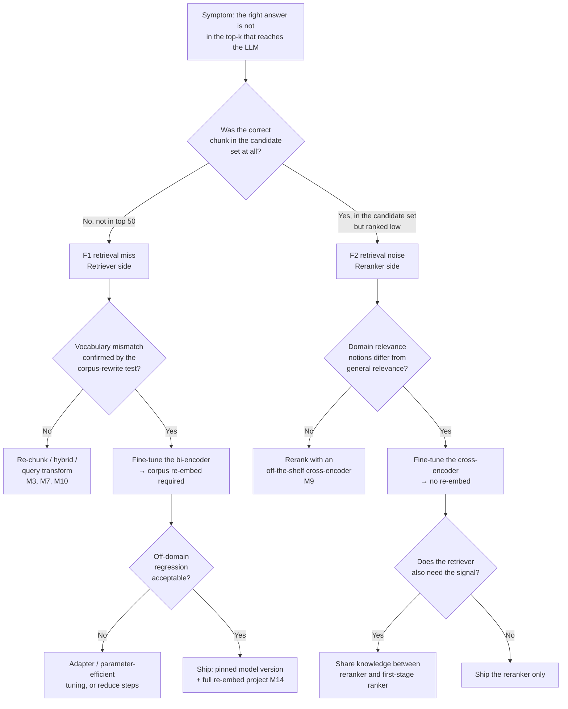

# M15 · Fine-Tuning Embeddings and Rerankers for a Domain

> **Module question:** When is fine-tuning the retrieval model cheaper than better prompting or a better index?
> **Cross-cutting threads:** Failure modes · Tradeoff ledger · LlamaIndex at a glance
> **Domain spine:** LogiTrack — a DG vocabulary of UN numbers, IMCO classes and tariff codes against a general-purpose embedding model
> **Prerequisites:** [M14 — Ingestion at Scale, Incremental Sync, and Deletion](../14-ingestion-at-scale/README.md), [M4 — Embeddings and Vector Space](../04-embeddings-and-vector-space/README.md), [M9 — Ranking, Fusion, and Reranking](../09-ranking-fusion-reranking/README.md)

---

## Opening scene — the model does not know this word

LogiTrack's DG desk runs 40 query classes, and one fails in a way no amount of reranking
fixes. A broker types: *"UN3480 consignment, 30% SoC, what's the acceptance rule for
air?"* The clause exists, is chunked correctly, and is indexed — retrieval never returns it.

The reason is vocabulary, not ranking. The clause says "lithium ion batteries ... state of charge
not exceeding thirty percent ... offered for transport by air"; the query says "UN3480 consignment,
30% SoC, air". The model has seen millions of sentences about batteries and almost none about the
UN-number/state-of-charge relationship, so it maps both to vectors that are *near* each other but
not nearer than the two hundred similar clauses that share the topic without the rule. This is
**F4 · representation mismatch** in its purest form.

The team's instinct is right, their sequence wrong: they fine-tune a bi-encoder before re-chunking
the DG rules, before hybrid retrieval for the exact-token queries, before testing a reranker. Eight
weeks later the model is better on the DG stratum (+0.07 recall@10) and worse on three others, the
held-out BEIR check was never run, and deployment required a full [480k-document](../../syllabus.md#corpus-scale) re-embed (→ M14)
plus four figures a month for a pinned artifact nobody remembers how to retrain (→ M20). A third of
their recall gap came from the fine-tune, two thirds from the re-chunk — misattributed to the model.

> **Failure mode (the module in one line):** fine-tuning the retrieval model as the *first*
> response to a domain gap — because the gap is more often a chunking, hybridisation, or ranking
> problem wearing an embedding-model costume, and a fine-tune is the only intervention in the
> ladder that permanently mutates an artifact, invalidates every vector in the corpus, and cannot
> be rolled back by a config change.

---

## Is it actually the embedding model? A diagnosis before a decision

The domain gap is real. FinMTEB asks the question directly: "Is the development of
domain-specific embedding models necessary when general-purpose models are trained on vast corpora
that already include specialized domain texts?", answering by evaluating "the performance of
seven state-of-the-art embedding models on FinMTEB" against MTEB and finding "a significant
performance drop compared to their performance on MTEB", and the sharper result that "the
performance of general-purpose embedding models on MTEB is not correlated with their performance
on FinMTEB, indicating the need for domain-specific embedding benchmarks" [[FMTEB24]](#src-fmteb24).

Note what that establishes and what it does not: **a leaderboard score does not predict your
performance** — you cannot select your way out of measuring. It does *not* establish that fine-tuning
is the fix: a model can underperform for four reasons, one of which fine-tuning addresses.

| Diagnostic | What you observe | Most likely cause | The intervention, in cost order |
|---|---|---|---|
| The right chunk is not in the index at all | Inspect the node set for a known-good answer span | Chunking destroyed it (F3) | Re-chunk → M3 |
| The answer spans two chunks, each retrieved sometimes | Both halves appear in the top 20, never together in the top 6 | Chunk-boundary loss (F3) | Hierarchical / auto-merge retrieval → M3, M8 |
| Exact identifiers are missed — "UN3480", "clause 14.2(b)", a tariff code | Dense retrieval fails, BM25 finds it immediately | Lexical signal absent from the embedding (F1) | Hybrid retrieval → M7 |
| The right chunk is retrieved at rank 20, not rank 3 | Recall@50 is fine, recall@6 is not | Ranking, not representation (F2) | Rerank → M9 |
| The query and the corpus use unrelated words for the same thing | Dense and lexical both fail; the answer is present and the vocabulary is disjoint | Query-side gap (F4) | Query rewriting / expansion → M10 |
| Domain vocabulary that *should* be semantically adjacent is not — "SoC" and "state of charge", "IMCO class" and "hazard class" | Dense fails, lexical fails, rewriting fails, and it fails *consistently across paraphrases* | Representation mismatch (F4), genuinely in the weights | **Fine-tune → this module** |

The test that separates the last row from the others is cheap: **take the failing queries and rewrite
each one using the corpus's own words, verbatim from the clause that should have been retrieved.**
If the rewritten query retrieves the clause, the gap is on the query side and M10 owns it; if it still
does not, the gap is in the representation and this module owns it. Run that test before spending
anything — it costs an afternoon and is the difference between the opening scene's outcome and a
two-thirds-cheaper fix.

> **Multimodal inputs** ($\color{red}\text{to be discussed}$) — on scanned or table-heavy pages, a "representation gap" is often a parse miss.
> - Run the rewrite test on the indexed node text, not the PDF: if OCR mangled "UN3480", the test fails for the wrong reason.
> - A DG limit inside a table or a stamped scan that flattened badly is row 1 (re-parse), not the last row (fine-tune).
> - Fix it with layout-aware parsing, OCR and table extraction first (→ [M3](../03-parsing-and-chunking/README.md), [M14](../14-ingestion-at-scale/README.md)).

> **Tradeoff (the ledger entry M15-1).** *Decision:* require a documented diagnosis — the
> corpus-vocabulary rewrite test plus a per-stratum recall breakdown — before any fine-tuning
> project is approved. *Costs:* roughly a week of delay on a genuine representation problem, and a
> diagnosis artifact that must be maintained. *Accepted because:* the four cheaper interventions
> are all reversible by configuration, and a fine-tune is not — it invalidates every vector in the
> corpus (→ M14), pins a model artifact, and makes every subsequent evaluation baseline need
> re-basing (→ M13). *Reverses if:* the diagnosis is already unambiguous and pre-existing — for
> example a new language or a specialised sub-corpus where the corpus-vocabulary rewrite test
> itself fails, as it did in the opening scene.

---

## The ladder: four interventions, and the order is the decision

The framework's production guidance states the ordering in its own structure, arguing that
"Pre-trained models may not capture the salient properties of the data relevant to your use case",
that reranking addresses the case where "the retrieval looks right, but the model is still
answering the wrong question" by running "a stronger, slower model over the top-`k` candidates",
and finally that "beyond some of the techniques listed above, we can also try finetuning the
embedding model" — offered as the last item on the list, and as a path available "over an
unstructured text corpus, in a label-free way" [[LI-PR]](#src-li-pr). The retrieval-model fine-tuning guide
places the same lever in the same position, describing the toolkit's core as "in-context learning /
retrieval augmentation, which involves using the models in inference mode and not training the
models themselves", with embedding fine-tuning as a complement to that [[LI-FT]](#src-li-ft).

| Step | Intervention | What it buys | Reversible by config? | Corpus-wide cost |
|---|---|---|---|---|
| **1** | Re-chunk / re-parse, structure-aware (M3) | Fixes F3 and the whole class of "the answer was split" failures; often the largest single gain | ✅ Yes — re-ingest, no artifact changes | One re-embed |
| **2** | Hybrid retrieval, BM25 + dense (M7) | Fixes the exact-token class entirely; the highest ratio of recall gained to engineering risk | ✅ Yes — a retriever change | None |
| **3** | Rerank a wider candidate set (M9) | Fixes F2; converts recall into precision; framework-default local cross-encoder is "the recommended default" because it needs "no API key, runs on the same infra as your embeddings" [[LI-PR]](#src-li-pr) | ✅ Yes — a postprocessor | None |
| **4** | Fine-tune the bi-encoder (this module) | Fixes *only* the representation mismatch that survives 1–3 | ❌ No — a pinned artifact | One re-embed **per model version** |
| **4b** | Fine-tune the cross-encoder reranker (this module) | Fixes ranking on domain-specific notions of relevance | ⚠️ Partly — a model swap, no re-embed | None (the reranker sees candidate text at query time) |

---

## Triples: what the training signal actually is

Bi-encoder training — the architecture itself and its contrastive objective — is M4's claim
[[DPR20]](#src-dpr20) and is not re-surveyed here; what matters for this module is where the three elements of a
training triple come from, because the data pipeline *is* the project. The siamese/triplet training
structure that the modern sentence-embedding training loop inherits is Sentence-BERT's contribution
[[SENTBERT19]](#src-sentbert19), used here as the substrate that a domain fine-tune re-trains. The framework guide lays
out the three-step shape: "Generating a synthetic question/answer dataset using LlamaIndex over any
unstructured context", then "Finetuning the model", then "Evaluating the model" [[LI-FT]](#src-li-ft).

| Element | Where it comes from | What it teaches | Failure if the source is wrong |
|---|---|---|---|
| **Query** $q$ | Synthetic generation from a chunk; or real logged queries (→ M19) | The query-side vocabulary, which is the half of the gap you are actually trying to close | Synthetic-only training teaches the model to match *LLM phrasing*, not broker phrasing |
| **Positive** $p^+$ | The chunk the query was generated from; or a click/human judgement | The association $q \leftrightarrow p$ | The synthetic positive is a leak by construction (see below) — useful for training, fatal for evaluation |
| **Hard negative** $p^-$ | Top-ranked non-relevant chunks from the current retriever | The *boundary* — what makes this clause different from two hundred similar clauses | Mined negatives are closer to the query and therefore more likely to be mislabelled (see below) |

> **Multimodal inputs** ($\color{red}\text{to be discussed}$) — training pairs inherit whatever text the parser made of tables, scans and figures.
> - Synthetic queries over a flattened rate table learn the parser's cell layout, not broker phrasing.
> - Rate-table rows often differ only by a number; that boundary is usually better served by hybrid and filters (→ [M7](../07-sparse-dense-hybrid/README.md), [M6](../06-metadata-filters-multitenancy/README.md)) than by contrastive training.
> - Tag each pair with its source type (prose, table, OCR page, figure caption) and break recall out per type.
> - A later parser or table-format change shifts the text the model was trained on: re-run the held-out gates below.
> - Fine-tuning page-image embedders (e.g. [ColPali](https://arxiv.org/abs/2407.01449)) is deferred ([syllabus §1](../../syllabus.md#1-scope-knobs-frozen)).

Both are worth knowing by structure: RocketQA contributes "three major technical contributions ...,
namely cross-batch negatives, denoised hard negatives and data augmentation" [[HARDNEG20]](#src-hardneg20) — the
middle one exists because mined negatives are unreliable, the third because labelled data is scarce.
GPL's unsupervised domain adaptation "combines a query generator with pseudo
labeling from a cross-encoder", requiring no labelled target-domain data and reporting "up to
9.3 points nDCG@10" across "six representative domain-specialized datasets" [[GIANT21]](#src-giant21).

> **LlamaIndex at a glance:** the framework's synthetic-pair primitive is the same object M13
> declared unfit for evaluation. `generate_question_context_pairs(nodes, llm=llm,
> num_questions_per_chunk=2)` "uses the LLM to auto-generate questions from each context chunk" and
> returns an `EmbeddingQAFinetuneDataset` "containing `queries`, `relevant_docs`, and `corpus`"
> [[LI-EVR]](#src-li-evr). Read the return type's name: it is a *fine-tuning* dataset — the framework built it for
> this module, and M13's retrieval-evaluation guide repurposes it for measurement. That single
> object is where this module's core tension lives, and it resolves cleanly once stated:
> **a query conditioned on a chunk is excellent supervision and worthless ground truth.** Use it to
> train; never use it to score.

The workflow's third step is not optional: the guide ends in "Evaluating the model" [[LI-FT]](#src-li-ft), and it
anchors evaluation of a fine-tuned model in the text-scoring and retrieval suite the corpus already
has. A model not measured against the gate (→ M13) has not been evaluated.

> **Tradeoff (the ledger entry M15-2).** *Decision:* build the training set from a mixture —
> synthetic generated pairs for coverage, real logged queries with human-verified positives for
> vocabulary fidelity, and mined hard negatives — with a hard separation between the pairs used for
> training and the queries used for evaluation. *Costs:* a labelling pass on real queries, and a
> split that must be enforced in code rather than by convention. *Accepted because:* synthetic-only
> training optimises the model for LLM phrasing, which is exactly the phrasing your users do not
> use, while real-query training has the vocabulary you need but too little volume on its own.
> *Reverses if:* the domain has an abundance of logged queries with reliable implicit labels
> (→ M19's click and citation signals), at which point synthetic generation becomes a rare
> augmentation rather than a pillar.

---

## Hard negatives, and the failure mode that punishes the obvious move

Hard negatives are the highest-leverage and most dangerous part of the pipeline, for structural
reasons. The false-negative paper states it as sharply as it can be stated:

> "Hard negative sampling, which is commonly used to improve contrastive learning, can introduce
> more noise in training. This is because hard negatives are those closer to a given query, and thus
> more likely to be false negatives." [[FN24]](#src-fn24)

Read that twice, because it inverts the naive intuition. "Harder" negatives are not merely harder to
learn from — **the harder a negative is, the more likely it is to be a positive your annotation
missed.** Mining preferentially selects the passages whose labels you cannot trust, so raising
hardness can *degrade* a model while every in-loop diagnostic (training loss, in-domain accuracy on
the mined set) improves — the mechanism behind the opening scene's regressions on three other strata,
where a negative mined from a neighbouring clause is a positive for the paraphrase queries.

| Mitigation | Mechanism | Source | Residual risk |
|---|---|---|---|
| **Denoise the negatives** | Filter mined negatives through a stronger model before training on them | RocketQA's "denoised hard negatives" [[HARDNEG20]](#src-hardneg20) | The filter inherits the stronger model's domain blindness |
| **Pseudo-label with a cross-encoder** | A cross-encoder scores (query, candidate) pairs and supplies soft labels instead of hard positive/negative | GPL: "combines a query generator with pseudo labeling from a cross-encoder" [[GIANT21]](#src-giant21) | The cross-encoder's own relevance notion is now the ceiling |
| **Regularise the loss** | Add a contrastive confidence regulariser for the NCE loss so the objective is robust to mislabelled negatives | "a novel contrastive confidence regularizer for Noise Contrastive Estimation (NCE) loss ... the regularizer helps dense retrieval models be more robust against false negatives with a theoretical guarantee" [[FN24]](#src-fn24) | A guarantee against label noise is not a guarantee against a systematically biased negative distribution |
| **Mine with dimensionality reduction over diverse encoders** | Select negatives that are semantically challenging but contextually irrelevant, using several embedding models rather than one | "Our method integrates diverse embedding models, performs dimensionality reduction, and uniquely selects hard negatives" [[HNM25]](#src-hnm25) | Enterprise-specific; the published result is on a proprietary corpus with public validation on FiQA, Climate Fever and TechQA [[HNM25]](#src-hnm25) |
| **Audit by hand** | Sample the 100 hardest negatives and read them against the query | This module | The only method that catches a *systematic* labelling bias rather than an average noise level; costs an afternoon |

The audit is not a throwaway: a false-negative rate of 3% concentrated in the hardest 10% of negatives
is invisible in every aggregate metric and is exactly the distribution the miner selects for. Its
output is a manifest rate — "of the
100 hardest negatives, 7 were in fact relevant" — so the next reader knows the boundary was corrupt.

> **Tradeoff (the ledger entry M15-3).** *Decision:* mine hard negatives, denoise them through a
> cross-encoder, regularise the loss, and cap mining hardness at a threshold validated by a
> 100-sample hand audit rather than pushing to the hardest available pairs. *Costs:* an extra
> cross-encoder pass over every candidate at data-construction time, plus a recurring audit, and a
> ceiling on how much boundary sharpening you get. *Accepted because:* past some hardness the
> marginal pair is more likely to be a mislabelled positive than a useful negative [[FN24]](#src-fn24), so the
> gradient it contributes points in the wrong direction and no in-loop metric can detect it.
> *Reverses if:* the corpus has a dense, verified relevance-annotation layer — a hand-judged
> negative set — where mined hardness carries less label risk and the cap can be raised.

---

## Synthetic queries revisited: same mechanism, opposite verdict

M13 rejected `generate_question_context_pairs`-style synthetic queries as an *evaluation* set: the
query is conditioned on the chunk, the chunk is written in as ground truth, and the task degenerates
into near-duplicate detection. This module uses the identical mechanism as *supervision*, where
derivation from the target is not a leak but the entire point.

| Property of the generated pair | As evaluation (M13) | As training data (M15) |
|---|---|---|
| Query derived from the target chunk | Fatal — ground truth is an input to generation | Correct — this is the association to learn |
| Source chunk retrievable by near-duplicate matching | Inflates the score and saturates the metric | Unproblematic — the model still has to represent both sides |
| Query phrasing is the *generator's* phrasing | Irrelevant — you are measuring retrieval | **Load-bearing risk** — you train the model to match LLM phrasing, not broker phrasing |
| Volume | Unlimited | Unlimited |

That last row is where synthetic-only training goes wrong: a synthetic query set is internally
consistent, high-volume, and *unrepresentative of the vocabulary gap you set out to close*. An LLM
generating a question from LogiTrack's DG clause writes
"lithium ion batteries with a state of charge of thirty percent" because that is what the clause
says. The broker writes "UN3480, 30% SoC". Training only on the generator's phrasing teaches transfer
between two *general-vocabulary* paraphrases — the axis the base model was already best at — and
leaves the jargon axis untouched; that is why the fine-tune closed only a third of the gap.

The fix is a mixture, and the mixture is a decision with a number attached:

$$n_{\text{synth}} : n_{\text{real}} \quad\text{chosen so that the real-query pairs span every stratum}$$

If your query log gives 8,500 queries a day (→ M19), the real half is not a data problem but a
*labelling* one, and the labelling budget sets the ratio. Report the ratio in the training manifest
alongside the mined-negative audit rate; together they describe the boundary the model learned.

The other discipline inherited from M13 is the split. The same generator produces both halves, so it
is possible to train and evaluate on the same chunks without noticing; the rule is a *document-level*
holdout, not a *pair-level* one, because chunks of a document share almost all their text (→ M3).

---

## Fine-tune the retriever, the reranker, or both?

This is the decision the module exists to force, and it has a clean answer once the failure mode is
named.

| | Fine-tune the bi-encoder | Fine-tune the cross-encoder (reranker) |
|---|---|---|
| **Failure mode addressed** | F1 · retrieval miss — the chunk never reaches the candidate set | F2 · retrieval noise — the chunk is in the candidate set and ranked low |
| **Can it fix a retrieval miss?** | Yes, if the miss is representational | **No.** Reranking cannot promote a chunk that was never retrieved — a reranker's entire input is the retriever's candidate set [[LI-PR]](#src-li-pr) |
| **Corpus-wide cost** | Full re-embed, every model version (→ M14) | None — the model is applied at query time |
| **Latency cost** | None (same encoder architecture, same dimension) | Added per-query inference over the candidate set; measured in M9's lab |
| **Rollback** | Requires another full re-embed | Swap the model back |
| **Rollout risk** | Highest in the course: a bad model version is a bad index, and recovering needs a backfill | Low: candidate set unchanged, so a bad reranker produces a worse *ordering*, not a worse *corpus* |
| **Documented framework path** | Embedding fine-tuning guides, plus the adapter option over "any black-box embedding" [[LI-FT]](#src-li-ft) | Cross-encoder fine-tuning with `sentence-transformers`, plus a hosted custom-reranker path [[LI-FT]](#src-li-ft) |

**The reranker is the better first fine-tune, for cost reasons that have nothing to do with quality.**
It addresses the failure mode the retriever's candidate set is designed to tolerate (a wide
`similarity_top_k` of 10–20 reranked down to a `top_n` of 3–5 [[LI-PR]](#src-li-pr)), requires no re-embed, and is
reversible — the cheapest place to learn domain adaptation before committing to an artifact.

**Training the reranker can improve the retriever.** The adapters study considers "knowledge sharing
between rerankers and first stage rankers" explicitly [[ADAPTER23]](#src-adapter23), and cross-encoder judgements
are precisely the pseudo-labels GPL uses to adapt a bi-encoder [[GIANT21]](#src-giant21).

> **Tradeoff (the ledger entry M15-4).** *Decision:* when the diagnosis points at both axes, ship
> the fine-tuned reranker first and use its judgements as the pseudo-labels for a subsequent
> bi-encoder fine-tune, rather than running both as one project. *Costs:* two release cycles
> instead of one, and an intermediate state where the system's quality depends on a reranker over a
> still-domain-blind retriever. *Accepted because:* the reranker's rollout risk is a reordering
> rather than a re-embedding, so it is the cheapest possible place to discover that your
> training-data construction is wrong — and discovering that after a 480k-document backfill is the
> expensive version of the same lesson. *Reverses if:* the diagnosis is unambiguously a retrieval
> miss and hybrid retrieval plus query transformation have already failed the corpus-rewrite test,
> in which case the reranker fixes nothing and the bi-encoder is the only lever left.

---

## Catastrophic forgetting and the held-out check

Fine-tuning on-domain is a distribution shift applied to your own model, and the failure is
forgetting: in-domain scores rise while everything else falls. The domain-adaptation literature
reports one sobering version of this. After proposing GPL, the same paper investigates
"the role of six recent pre-training methods in the scenario of domain adaptation for retrieval
tasks, where only three could yield improved results" [[GIANT21]](#src-giant21) — half the methods studied did not
help. That negative result comes from the paper that also reports the positive one, and it is the
right prior: a substantial fraction of adaptation attempts on your domain will not improve retrieval.

The framework guide prescribes the instrument, and is explicit about the out-of-domain check:
"after fine-tuning an embedding model on your
dataset, it may be helpful to view whether and by how much its performance degrades on a diverse
set of domains. This can be an indication of how much data drift may affect your retrieval
accuracy, such as if you add documents to your RAG system outside of your fine-tuning training
distribution" [[LI-CWE]](#src-li-cwe). BEIR — surveyed in **M4**, cited here only as that instrument — is the named
benchmark for this check.

The held-out protocol therefore has **three** sets, and shipping with two is the common mistake:

| Set | Composition | What it detects | Gate |
|---|---|---|---|
| **In-domain test** | Held-out *documents* (not held-out pairs) from the target corpus, stratified as in M13 | Did the fine-tune work at all | recall@10 must improve by more than M13's ~4-point noise floor |
| **Out-of-domain** | A general retrieval benchmark, or a slice of a second corpus | Catastrophic forgetting | No more than a stated tolerance of degradation, e.g. ≤2 points nDCG@10 |
| **Same-corpus regression** | General-vocabulary queries against the *same* corpus — the non-jargon strata from M13 | Over-specialisation: the model got better at jargon and worse at ordinary questions | No regression, because these are the majority of traffic |
| **Held-out split discipline** | Document-level, enforced in code | Train/test leakage through shared chunk text (→ M3) | Zero overlapping documents between train and eval |

The third set is the one teams skip, because it seems redundant: the model is now *the* encoder for
every query, and a contrastive fine-tune that sharpens the domain boundary reshapes the whole space,
including the regions ordinary queries live in. A 2,000-pair fine-tune can move general-vocabulary
recall by several points either way, and for LogiTrack that number decides whether the model ships.

Shipping a fine-tuned model also makes it a **pinned artifact with a version** whose loss degrades
silently when the vendor deprecates the base checkpoint (→ M20), and a **budget item**: every later
re-chunk or parser improvement needs another corpus re-embed against *this* model (→ M14, M18).

> **Tradeoff (the ledger entry M15-5).** *Decision:* ship a fine-tuned model only if it clears all
> three held-out sets, with the out-of-domain tolerance stated as a number in the ADR before the
> experiment runs. *Costs:* three evaluation runs per candidate, plus a stated tolerance that will
> sometimes fail a model with a genuine in-domain gain. *Accepted because:* an out-of-domain
> tolerance chosen after seeing the results is not a gate, it is a rationalisation — and the
> degradation it would have caught is a slow, cross-cutting recall loss that the in-domain metric
> cannot see. *Reverses if:* the corpus is closed and never grows — a fixed, isolated document set
> where out-of-domain inputs cannot arrive, which removes the forgetting risk from the operating
> envelope.

---

## Worked example: 2,000 pairs, one held-out set, five configurations

The lab: fine-tune a small bi-encoder on ~2,000 mined pairs and measure the recall@10 delta on a
held-out set, with the DG stratum broken out and a general-vocabulary regression set as a third column.

| Configuration | DG-stratum recall@10 | General-stratum recall@10 | Out-of-domain nDCG@10 (Δ vs base) | Pairs needed | Query-time cost | Re-embed |
|---|---|---|---|---|---|---|
| Base general-purpose bi-encoder | 0.62 | 0.87 | — (reference) | 0 | baseline | — |
| + structure-aware DG re-chunk (M3) | 0.71 | 0.88 | 0.00 | 0 | none | once |
| + hybrid BM25/dense (M7) | **0.79** | 0.89 | 0.00 | 0 | none | none |
| + off-the-shelf cross-encoder rerank (M9) | 0.79 | 0.89 | 0.00 | 0 | +0.3 s p95 | none |
| + fine-tuned bi-encoder, 2,000 synthetic pairs | 0.81 | 0.86 | **−0.03** | 2,000 | none | 480k docs |
| + fine-tuned bi-encoder, 2,000 **mixed** pairs (40% real queries) | **0.86** | 0.87 | −0.02 | 2,000 | none | 480k docs |
| + fine-tuned cross-encoder reranker only | 0.85 | 0.89 | −0.01 | 3,000 | +0.4 s p95 | none |

Five findings, in the order they should change a decision:

1. **Steps 1–3 close 17 of the 24 points before any fine-tuning.** Re-chunking plus hybrid retrieval
   takes DG recall from 0.62 to 0.79, and the hybrid step alone is a configuration change.
2. **Synthetic-only training moves DG recall by 0.02 and *costs* the general stratum 0.01 and the
   out-of-domain set 0.03** — the generator's phrasing teaches paraphrase transfer, not jargon [[GIANT21]](#src-giant21).
3. **The mixed set is worth more than any hyperparameter.** 40% real logged queries moves DG recall
   from 0.81 to 0.86 for the same 2,000 pairs; labelled real queries are the scarce resource.
4. **The reranker fine-tune reaches 0.85 with no re-embed and no out-of-domain cost worth reporting**
   — matching the mixed bi-encoder within the harness's 4-point resolution (→ M13), at +0.4 s p95.
5. **Both fine-tunes show a small out-of-domain degradation, and the tolerance decides the release.**
   −0.03 nDCG@10 did not breach LogiTrack's ≤2-point tolerance, but it is the column to watch (→ M20).

**LogiTrack's decision after M15:** ship steps 1–3 (re-chunk, hybrid, rerank) as the baseline;
fine-tune the cross-encoder reranker on 3,000 domain pairs as the first model change, requiring no
re-embed; run the bi-encoder fine-tune as a scheduled project only after the reranker has been live
for a quarter and its latency is priced against the 2.5 s budget (→ M18); train only on mixed pairs
with a document-level holdout; and require all three held-out sets to clear before pinning a version.

---

## Design exercise

> *Paper-based. Think, then write. Deliver a decision, not a survey.*

**Task.** Write the ADR that decides *whether* to fine-tune a retrieval model for your domain — and
if the answer is yes, which one. The deliverable is a decision with a diagnosis and a rollback path.

1. **Run the diagnosis and record it.** Complete the intervention-ladder table for your corpus — for
   each of re-chunk, hybrid, rerank, and fine-tune, what you measured, what it moved, what remains —
   then run the corpus-vocabulary rewrite test. If the rewritten query retrieves the answer, stop.
2. **Name the failure mode and therefore the model.** State whether your residual problem is F1 (the
   chunk is not in the candidate set) or F2 (in the candidate set, ranked low). A reranker cannot fix
   a miss, however well it is trained.
3. **Specify the training data construction, including the negative audit.** State the source and count
   of queries, positives, and hard negatives; the mining hardness cap and why; the denoising step; a
   100-sample audit of your hardest negatives; and the synthetic-to-real ratio.
4. **State the holdout at document level and prove the separation.** Specify how documents are
   partitioned and the mechanism that enforces it, then state how many the two sets share — zero.
5. **Write the three gates with numbers, before running the experiment.** In-domain improvement above
   the harness noise floor; an out-of-domain tolerance as an explicit number; and a same-corpus
   general-vocabulary regression bound. Pre-committing the tolerance is what makes it a gate.
6. **Price the whole thing, including the parts that are not the training run.** Compute pair
   construction tokens, training compute, the full corpus re-embed if the bi-encoder changes (→ M14),
   query-time inference, and the pinned model's upkeep (→ M20) — then compare against steps 2 and 3.
7. **Name the rollback.** For whichever model you would ship, state the reverse operation and its cost.
   If the answer is "re-embed 480k documents", state how long that takes and what serves traffic in the
   meantime — a rollback path that takes nine hours is not a rollback path.

**Why this exercise matters.** Fine-tuning is the intervention with the best story and the worst cost
profile: it alone permanently mutates a versioned artifact, invalidates every vector in the corpus,
invalidates the evaluation set's node-id ground truth, and cannot be undone by a setting — which is
why it is reached for first, when a measured column would have said steps 1–3 already closed two
thirds of the gap, or that the corpus-rewrite test failed and no configuration can fix it.

---

## Where the literature disagrees

- **"Fine-tuning the retriever reliably beats hybrid search plus reranking for the same spend."**
  The honest finding is that **no source located for this module performs that comparison**. The
  framework's guide states a magnitude without a baseline —
  "Finetuning gives you a 5-10% increase in retrieval evaluation metrics" [[LI-FT]](#src-li-ft) — while GPL reports
  its domain-adaptation gains as "up to 9.3 points nDCG@10" on "six representative
  domain-specialized datasets" [[GIANT21]](#src-giant21). Those two are in different units, against different
  baselines, and neither is measured against a hybrid-plus-reranker control. The closest thing to a
  spend-controlled result points the *other* way: adapters on SPLADE, a **sparse** retriever,
  "not only optimizes just 2% of training parameters, but outperforms fully fine-tuned counterpart
  and existing parameter-efficient dense IR models on IR benchmark datasets", and it addresses
  "domain adaptation of neural retrieval thanks to adapters on cross-domain BEIR datasets and
  TripClick" [[ADAPTER23]](#src-adapter23). The cheap adaptation of the *lexical* half of a hybrid system outperformed
  the expensive adaptation of the dense half. **What to change:** answer the spend comparison locally,
  on the M13 harness, with a hybrid-plus-reranker control in the same table.
- **"Harder negatives are better negatives."** This is the field's most repeated piece of training
  folklore, and the false-negative paper states the opposite mechanism directly: hard negatives
  "are those closer to a given query, and thus more likely to be false negatives" [[FN24]](#src-fn24). RocketQA's
  response was not to mine harder but to *denoise* — "denoised hard negatives" is one of its three
  named contributions [[HARDNEG20]](#src-hardneg20) — and GPL replaced hard binary labels with cross-encoder
  pseudo-labels [[GIANT21]](#src-giant21). The enterprise mining work takes the middle position, selecting for
  "semantically challenging but contextually
  irrelevant documents" using multiple embedding models and dimensionality reduction [[HNM25]](#src-hnm25).
  **What to change:** state a hardness cap, add a denoising stage, and audit the hardest sample by
  hand — the failure is a *systematic* bias concentrated in exactly the pairs your miner prefers.
- **"You need a domain-specific embedding model."** FinMTEB sets up the question as "Is the
  development of domain-specific embedding models necessary when general-purpose models are trained
  on vast corpora that already include specialized domain texts?" and answers it with evidence that
  general models "struggle to capture domain-specific linguistic and semantic patterns", plus the
  finding that MTEB performance "is not correlated with their performance on FinMTEB" [[FMTEB24]](#src-fmteb24).
  This module accepts the first half — a domain gap exists and is measurable — and disputes the
  prescription. The *architecture* of the fix is not settled: adapting an existing retriever
  parameter-efficiently can beat a full fine-tune [[ADAPTER23]](#src-adapter23), and the framework documents an adapter
  path "over any black-box embedding" as an alternative to training the model itself [[LI-FT]](#src-li-ft). And
  "domain-specific model" and "domain-adapted model" are different objects with different costs, only
  the second reachable by a team with 2,000 pairs and one GPU. **What to change:** separate the
  diagnosis from the prescription, and report *which* kind of adaptation you chose.
- **"Synthetic data is the way to get domain training data."** GPL's central claim is that
  unsupervised domain adaptation is possible by combining "a query generator with pseudo labeling
  from a cross-encoder", requiring no target-domain labels, with results across six datasets
  [[GIANT21]](#src-giant21); the framework's guide makes the same move, generating a synthetic question/answer
  dataset as step one of its three-step workflow [[LI-FT]](#src-li-ft). M13 argued the opposite for *evaluation* —
  a query conditioned on its own target chunk cannot serve as ground truth. The positions are
  reconcilable, but at a cost neither source states: if training and evaluation queries come from the
  same generator family, you measure the generator's phrasing distribution, not your users'. GPL's own
  generation is at least *retrieval-trained* — a docTTTTTquery-style sequence-to-sequence generator,
  not a chat model prompted for questions. **What to change:** state which generator produced your
  pairs, and measure at least one gate on *real* user queries (→ M13, M19), because a synthetic-only
  pipeline can report a large in-domain gain no broker ever experiences.

---

## Sources

- [Fine-tuning](https://developers.llamaindex.ai/python/framework/optimizing/fine-tuning/fine-tuning/) — `[LI-FT]` · owns the embedding-fine-tuning benefit statement, the "5-10% increase" magnitude, the three-step generate/fine-tune/evaluate workflow, the adapter-over-a-black-box-embedding option, cross-encoder fine-tuning with `sentence-transformers`, and the hosted custom-reranker path.
- [Building Performant RAG Applications for Production](https://developers.llamaindex.ai/python/framework/optimizing/production_rag/) — `[LI-PR]` · owns the intervention ordering, the reranker's role against recall-tuned retrievers, the retrieve-wide-then-rerank-narrow pattern with `top_n` 3–5, `SentenceTransformerRerank` as the recommended local default, and "Optimize Context Embeddings" as the last item on the list.
- [Usage Pattern (Retrieval)](https://developers.llamaindex.ai/python/framework/module_guides/evaluating/usage_pattern_retrieval/) — `[LI-EVR]` · owns `generate_question_context_pairs`, its per-chunk query generation, and the `EmbeddingQAFinetuneDataset` return type with `queries`, `relevant_docs`, and `corpus`.
- [Component Wise Evaluation](https://developers.llamaindex.ai/python/framework/optimizing/evaluation/component_wise_evaluation/) — `[LI-CWE]` · owns the post-fine-tuning out-of-domain degradation check, the data-drift framing of that check, and BEIR as the instrument for it.
- *Sentence-BERT: Sentence Embeddings using Siamese BERT-Networks* — Nils Reimers, Iryna Gurevych · arXiv:1908.10084 (EMNLP 2019) · [arxiv.org/abs/1908.10084](https://arxiv.org/abs/1908.10084) — `[SENTBERT19]` · owns the siamese/triplet training structure and cosine-comparable sentence embeddings; cited here only as the training substrate a domain fine-tune re-trains · mirrored for local self-containment; **M4** owns the survey of the embedding-model architecture.
- *Dense Passage Retrieval for Open-Domain Question Answering* — owned by **M4**, surveyed there; cited here only by key as the owner of the bi-encoder architecture and its contrastive objective, which this module trains rather than re-derives — `[DPR20]`.
- *RocketQA: An Optimized Training Approach to Dense Passage Retrieval for Open-Domain Question Answering* — Yingqi Qu, Yuchen Ding, Jing Liu, Kai Liu, Ruiyang Ren, Wayne Xin Zhao, Daxiang Dong, Hua Wu, Haifeng Wang · arXiv:2010.08191 (NAACL 2021) · [arxiv.org/abs/2010.08191](https://arxiv.org/abs/2010.08191) — `[HARDNEG20]` · owns cross-batch negatives, denoised hard negatives, and data augmentation as the three training contributions.
- *GPL: Generative Pseudo Labeling for Unsupervised Domain Adaptation of Dense Retrieval* — Kexin Wang, Nandan Thakur, Nils Reimers, Iryna Gurevych · arXiv:2112.07577 (NAACL 2022) · [arxiv.org/abs/2112.07577](https://arxiv.org/abs/2112.07577) — `[GIANT21]` · owns generative pseudo-labelling, the query-generator plus cross-encoder construction, the up-to-9.3-nDCG@10 domain-adaptation result, and the negative result that only three of six pre-training methods improved retrieval.
- *Mitigating the Impact of False Negatives in Dense Retrieval with Contrastive Confidence Regularization* — Shiqi Wang, Yeqin Zhang, Cam-Tu Nguyen · arXiv:2401.00165 (AAAI 2024) · [arxiv.org/abs/2401.00165](https://arxiv.org/abs/2401.00165) — `[FN24]` · owns the false-negative problem statement for hard-negative sampling and the contrastive confidence regulariser for the NCE loss.
- *Hard Negative Mining for Domain-Specific Retrieval in Enterprise Systems* — Hansa Meghwani, Amit Agarwal, Priyaranjan Pattnayak, Hitesh Laxmichand Patel, Srikant Panda · arXiv:2505.18366 (ACL 2025) · [arxiv.org/abs/2505.18366](https://arxiv.org/abs/2505.18366) — `[HNM25]` · owns the enterprise hard-negative-mining framework with multi-embedding dimensionality reduction and its MRR improvements.
- *Do We Need Domain-Specific Embedding Models? An Empirical Investigation* — Yixuan Tang, Yi Yang · arXiv:2409.18511 (2024) · [arxiv.org/abs/2409.18511](https://arxiv.org/abs/2409.18511) — `[FMTEB24]` · owns FinMTEB, the measured general-model performance drop on a domain benchmark, and the non-correlation between MTEB and domain-benchmark performance.
- *Parameter-Efficient Sparse Retrievers and Rerankers using Adapters* — Vaishali Pal, Carlos Lassance, Hervé Déjean, Stéphane Clinchant · arXiv:2303.13220 (ECIR 2023) · [arxiv.org/abs/2303.13220](https://arxiv.org/abs/2303.13220) — `[ADAPTER23]` · owns adapter-based domain adaptation for sparse retrievers and rerankers, the outperform-fully-fine-tuned-dense result, and knowledge sharing between rerankers and first-stage rankers.

**Unsupported (synthetic, no located source):** the LogiTrack DG-stratum run, the UN3480/SoC query
narrative, the eight-week fine-tuning aftermath, the 2,000- and 3,000-pair lab sizes, and every
number in the worked-example table are fiction or constructed illustration, not empirical findings.
The five tradeoff-ledger entries are design decisions argued in this file. Three claims are
mechanisms argued here rather than findings: (a) that synthetic-only training teaches general-purpose
paraphrase transfer rather than domain-jargon transfer, which follows from the construction of the
pairs but is not measured in any source cited — the sources report *that* synthetic-pair
domain adaptation works [[GIANT21]](#src-giant21) without decomposing its effect by query vocabulary; (b) that a
document-level holdout is required because chunks of the same document share nearly all their text,
argued from M3's chunking behaviour and not stated in a source; (c) that the mixed synthetic/real
ratio is the constraint that matters, argued from the real-query labelling budget rather than an
experiment. The diagnosis table and the corpus-vocabulary rewrite test are procedures proposed here
with no located source reporting their error rates, and the per-configuration columns and dollar costs
in the worked example are constructed illustration. Finally, the statement that **no located source
compares fine-tuning against hybrid-plus-reranking at equal spend** is a claim about the literature
searched for this module — the guidance page, GPL, RocketQA, adapters, false-negative,
enterprise-mining, and FinMTEB papers — not a claim that no such study exists; a reader who knows of
one should treat it as the missing control this module asks for.

**Verification note:** 🟡 *pending* — Step 7 (memory-less logic review) and Step 8 (literature survey) not yet run on this module.

**Next module:** [M16 — Advanced Architectures: GraphRAG, Self-RAG, Agentic Retrieval](../16-advanced-architectures/README.md)
— the architectures that cost N× tokens, priced against the harness M13 built and the corpus M14 keeps fresh.
