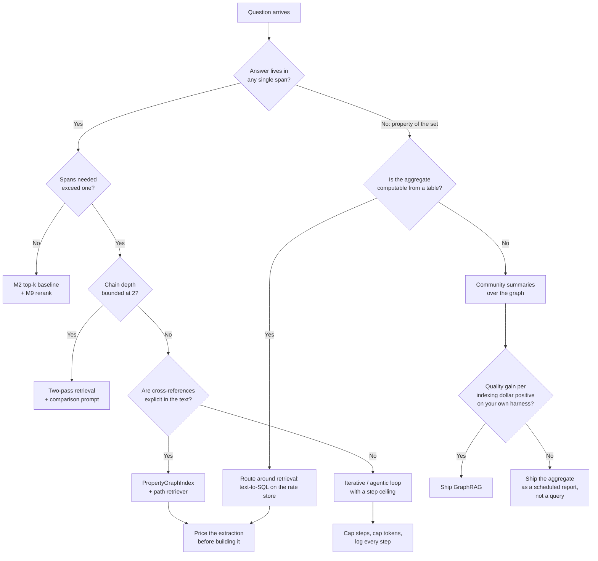

# M16 · Advanced Architectures: GraphRAG, Self-RAG, Agentic Retrieval

> **Module question:** When does the advanced architecture pay for its complexity, and when is it a tax?
> **Cross-cutting threads:** Failure modes · Tradeoff ledger · LlamaIndex at a glance
> **Domain spine:** LogiTrack — "Which of our 12 carriers has the worst DG exposure in the EU?", a question no top-k retrieval answers
> **Prerequisites:** [M10 — Query Understanding and Query Transformation](../10-query-understanding/README.md), [M13 — Evaluation of Retrieval and Generation](../13-evaluation/README.md), [M15 — Fine-Tuning Embeddings and Rerankers for a Domain](../15-finetuning-retrieval-models/README.md)

---

## Opening scene — the question that came back in twelve pieces

LogiTrack's system has been good for eight months. Recall@10 is 0.86, above the 0.85 floor. Faithfulness
on the 400-query M13 set is 0.91. The ops team has stopped reading answers and started pasting them into
client emails, which is the only adoption metric that has ever mattered.

Then the head of compliance asks the question the board will ask her in six weeks:

**"Which of our 12 carriers has the worst DG exposure in the EU?"**

The system retrieves six chunks. They are good chunks — genuinely relevant, high-scoring, correctly
cited. One is a Maersk dangerous-goods surcharge table. One is a 2024 DG bulletin for Rotterdam. One is
an EU ADR amendment summary. The answer it produces is a faithful, well-cited, entirely local summary of
what those six chunks say.

It is also useless. The question is not a retrieval question. It is a **global aggregation over the
whole corpus**: twelve carriers, forty jurisdictions, [480,000 documents](../../syllabus.md#corpus-scale), and an answer that only exists
after you have read all of it and compared. No value of `similarity_top_k` answers it, because the
answer is not in any chunk — it is a property of the *set*. The retriever did its job perfectly, and the
architecture was the wrong shape for the question.

The compliance lead asks two follow-up questions, and they define this module:

1. "Can't you just retrieve more?" — No. Retrieving 500 chunks overflows the context (F5), and the
   generator still has to *aggregate* rather than *read*; the evidence for "worst" is a comparison, and
   comparisons over a truncated sample are exactly the failure the answer exhibits.
2. "Then build the graph thing everyone is writing about." — Maybe. That is a purchase order, not an
   architecture decision, and this module prices it before signing.

> **Failure mode (the module in one line):** reaching for a more sophisticated architecture —
> graph indexing, self-correction loops, agents — to fix what is actually a **question-shape mismatch**,
> and paying N× the tokens, a new failure surface, and an indexing bill the size of the whole project,
> to move a metric that the cheap architecture was never going to move anyway.

---

## The architecture decision is a cost decision wearing a quality costume

Every architecture in this module is defensible. Each one has a paper showing it beats a baseline. The
senior-engineer question is never "does it work" but "**what does the gain cost, in tokens, in latency,
in failure surface, and in index-maintenance burden — and is the question shape I actually have the
shape it fixes?**"

Start with the question-shape taxonomy, because it decides more than the model choice does:

| Question shape | What the answer depends on | Architecture that can answer it | Cheapest sufficient design |
|---|---|---|---|
| **Local lookup** — "what is the DG surcharge for UN3480?" | One span in one document | Top-k dense/sparse retrieval | M2 baseline (already shipped) |
| **Multi-hop** — "what does §4.1 of the carrier agreement say the DG annex requires?" | A chain of spans across documents | Graph traversal or iterative retrieval | `PropertyGraphIndex` + path retriever, or an explicit 2-hop loop |
| **Comparative local** — "is Maersk or Hapag stricter on lithium?" | Two specific spans, compared | Retrieval + a comparison prompt | Two retrieval passes, one synthesis call |
| **Global aggregate** — "which carrier has the worst EU DG exposure?" | A statistic over the entire corpus | Community/hierarchical summarization (GraphRAG), or a structured store | Community summaries, **or** a text-to-SQL route around retrieval entirely |
| **Under-specified** — "can I ship that battery thing to Singapore?" | Jurisdiction + product classification the user did not supply | Query decomposition and a clarify-or-guess policy | M10's decomposition, plus a clarify gate |

The opening scene is in row four. Row four is the only row where the graph architecture is not optional
overkill — and it is also the row where a **structured store** may beat it outright, which is the
decision M8/M10 flagged and this module has to resolve.

> **Multimodal inputs** ($\color{red}\text{to be discussed}$) — whether a question takes the table route depends on table extraction.
> - XLSX/HTML rate tables load as rows easily. DG surcharge tables inside carrier-agreement PDFs need table extraction first ([M3](../03-parsing-and-chunking/README.md)).
> - If PDF tables get parsed as plain text only, the text-to-SQL route is closed. The question then ends up at the graph by accident, not by design.
> - Keep the source page and table ID on every extracted row, so a SQL answer can still cite its source ([M12](../12-grounding-and-citations/README.md)).

Read the tree's two terminal escape hatches. `O` — *answer the global question as a scheduled batch job
and serve the result from the index* — costs a nightly job and answers the compliance lead's exact
question at 1/1000th the query-time price. **The most common senior-engineer move in this module is to
discover that the expensive query the user asked for is a cheap report they can be given instead.**

### Iterative and self-correcting retrieval: train it or don't claim it

Self-RAG and CRAG are the two named members of this family, and they solve *different* problems. Getting
them confused is how teams ship a prompt loop and call it a paper.

**Self-RAG** trains a single LM to emit **reflection tokens** — special tokens that decide *whether to
retrieve* and *whether the retrieved passage supports the generation* — so that "the LM itself decides
when retrieval is needed and critiques its own output" [[SELFRAG23]](#src-selfrag23). The paper's own framing is that
these are *learned* control tokens: "Our framework trains a single arbitrary LM that adaptively retrieves
passages on-demand, and generates and reflects on retrieved passages and its own generations using
special tokens, called reflection tokens" [[SELFRAG23]](#src-selfrag23). The mechanism is a **fine-tuning** intervention.
A prompt-only "rate your answer 1–5 and retry" loop is a *cousin* of Self-RAG, not an implementation of
it, and the paper provides no evidence for the cousin.

**CRAG** keeps the generator frozen and adds a lightweight **retrieval evaluator** that scores the
retrieved set and picks an action — correct, ambiguous, or incorrect — with a decompose-then-recompose
step that filters irrelevant content out of the retrieved documents [[CRAG24]](#src-crag24). Its remediation for bad
retrieval is notable and, for a private corpus, disqualifying: "Since retrieval from static and limited
corpora can only return sub-optimal documents, large-scale web searches are utilized as an extension for
augmenting the retrieval results" [[CRAG24]](#src-crag24). LogiTrack cannot send a client's customs question to a web
search, and its corpus is jurisdiction-restricted by contract. The *architecture* — score the retrieved
set, branch on the score — transfers. The *remedy* does not, which means the CRAG-style loop needs a
different fallback: broaden retrieval within scope (M6 filters relaxed to the maximum the ACL allows),
escalate to a human, or abstain (→ M12's abstention as a first-class outcome).

| Family member | What is frozen vs trained | Trigger signal | Fallback action | Transfers to a private corpus? |
|---|---|---|---|---|
| Self-RAG | LM is **trained** to emit reflection tokens [[SELFRAG23]](#src-selfrag23) | Learned retrieve/critique tokens | Re-retrieve, or suppress unsupported output | Only with a fine-tuning budget (→ M15's cost/benefit frame) |
| CRAG | LM frozen; a small evaluator scores the retrieved set [[CRAG24]](#src-crag24) | Confidence degree over the retrieved documents | Web search + decompose-then-recompose filter [[CRAG24]](#src-crag24) | Architecture yes; **web-search fallback no** |
| Prompt-only self-critique | Nothing trained | An LLM judge prompt | Retry, rewrite, or abstain | Yes — but unsupported by either paper |

> **LlamaIndex at a glance:** the framework does not ship a Self-RAG or CRAG class. Both are
> *compositions*: a retrieval evaluator is a `NodePostprocessor`-shaped scoring step, the branch is
> application control flow, and the retry is a second call to the same query engine. The docs' posture
> is that agents are "any system with LLM decision making in the process" [[LI-AG]](#src-li-ag) — which is exactly
> the license, and exactly the risk, because nothing in the framework forces you to bound the loop.

### Graph RAG and community summarization: the indexing bill arrives first

GraphRAG's contribution is a two-stage LLM-built index: "first, to derive an entity knowledge graph from
the source documents, then to pregenerate community summaries for all groups of closely related
entities," after which a query generates a partial response per community summary and then summarizes
the partials [[GRAPHRAG24]](#src-graphrag24). That second stage is why global questions become answerable: the aggregate
work is done **at index time**, and the query only reads its results.

That is also the cost. Extraction is an LLM call per chunk, and community summarization is an LLM call
per community, so the build is measured in *billions* of tokens — and it must be re-run, in whole or in
part, on every corpus change (→ M14's incremental-sync problem, applied to a structure that is far less
incrementally friendly than a vector index).

Price it before building it. `PropertyGraphIndex` construction runs a series of `kg_extractors` over each
chunk and attaches the extracted entities and relations as metadata on the node [[LI-PG]](#src-li-pg). The default
extractors are `SimpleLLMPathExtractor`, which "extract[s] short statements using an LLM to prompt and
parse single-hop paths in the format (`entity1`, `relation`, `entity2`)", and `ImplicitPathExtractor`,
which reads relationships that already exist on the node and "does not need an LLM or embedding model to
run" [[LI-PG]](#src-li-pg). `SimpleLLMPathExtractor` exposes `max_paths_per_chunk` and `num_workers` [[LI-PG]](#src-li-pg) — the
first is your output-token bill, the second is your wall clock, and neither is your quality knob.

| Extraction stage | Volume at LogiTrack month 12 | Tokens | Price at the M18 assumption ($3.00 / $15.00 per 1M in/out) |
|---|---|---|---|
| Entity/relation extraction | 480,000 docs × 8.4 chunks = **4,032,000 calls** | 4,935M in / 726M out | $14,805 + $10,890 = **$25,695** |
| Community summarization (GraphRAG-style) | ~12,000 community reports at 8,000 in / 1,200 out | 96M in / 14.4M out | $288 + $216 = **$504** |
| **Full graph build, once** | | | **$26,199** (LogiTrack arithmetic; prices are flagged assumptions in M18) |

For comparison, the entire dense embedding of the same corpus is, at M03's illustrative $0.02/1M token
rate, **under $110**. The graph index is roughly **250×** the embedding cost of the corpus it indexes.
That ratio is the decision — not the retrieval quality it buys. Whether the ratio can be improved is
where the literature is genuinely split (see "Where the literature disagrees"), and the honest answer is
that **the cost is a design variable, not a constant**: extraction scope, chunk granularity, and
schema-constrained extractors all move it by an order of magnitude or more [[KETRAG25]](#src-ketrag25).

`SchemaLLMPathExtractor` is the lever most teams miss. It extracts "paths following a strict schema of
allowed entities, relationships, and which entities can be connected to which relationships," using
"pydantic, structured outputs from LLMs, and some clever validation," and it is tunable through
`possible_entities`, `possible_relations`, `kg_validation_schema`, `strict`, `max_triplets_per_chunk`, and
`raise_on_error` [[LI-PG]](#src-li-pg). A schema is a *cost ceiling with a domain prior in it*, and it is also the
production-safety switch: `raise_on_error=True` makes extraction failures crash the pipeline rather than
being "swallowed and logged (default)" [[LI-PG]](#src-li-pg). Ingesting a 480k-document corpus with the default and
never noticing that 3% of extractions silently failed is a quiet way to end up with a graph that is
missing exactly the entities your global questions aggregate over.

> **Multimodal inputs** ($\color{red}\text{to be discussed}$) — the graph only knows what parsing turned into text.
> - `kg_extractors` run on each chunk ([LI-PG](https://developers.llamaindex.ai/python/framework/module_guides/indexing/lpg_index_guide/)). A surcharge table, a stamp or a scanned annex gets into the graph only as M3's text ([M3](../03-parsing-and-chunking/README.md)).
> - A table flattened to prose gives wrong triples: carrier, UN number and surcharge end up in the wrong pairs.
> - OCR'd pages and vision-model figure descriptions add nodes, and each node is one more extraction call.
>   - Count them in chunks per document before you price the build ([M14](../14-ingestion-at-scale/README.md), [M18](../18-cost-and-latency/README.md)).
> - Page-image retrieval (e.g. [ColPali](https://arxiv.org/abs/2407.01449)) skips text extraction. It is deferred ([syllabus](../../syllabus.md#1-scope-knobs-frozen)).

> **Tradeoff (the ledger entry M16-1).** *Decision:* build and maintain a property graph with
> schema-constrained extraction, and route global/aggregate questions to community summaries.
> *Costs:* ~$26,199 per full extraction pass at assumed prices, an incremental-extraction job on every
> corpus change, a second store to operate and back up, and graph staleness as a new failure surface.
> *Accepted because:* a global aggregate over 480,000 documents is not answerable by any top-k design at
> any k, so the alternative is not "cheap retrieval" but "no answer." *Reverses if:* the global question
> class is computable from the rate/tariff tables, in which case a text-to-SQL route (M8/M10) answers it
> for the price of a nightly extract job and the graph is deleted.

### Adaptive, routed, and decomposed retrieval

Three cheap members of the family are routinely confused with the expensive ones, and two of them are
almost always right.

**Adaptive retrieval** means deciding *whether* to retrieve at all, and how much. This is Self-RAG's
headline capability [[SELFRAG23]](#src-selfrag23), and it is also implementable as a router: classify the query, then send
it down a cheap path (no retrieval, answer from the parametric model), a medium path (single retrieval),
or an expensive path (decomposition, graph, agent). Routing is the highest-return advanced technique in
this module because it is the only one whose main effect is *spending less*.

**Route-based retrieval** across heterogeneous indexes is M10's territory; what belongs here is the cost
arithmetic. A router costs one LLM call (cheap tier, ~900 in / 250 out ≈ 1,150 tokens) and can remove an
entire retrieval-plus-rerank-plus-synthesis path from 40% of traffic. At M18's blended assumption of
$4.10 per 1M tokens, a router call costs about **$0.0047** per query — cheaper than the synthesis call it
prevents by roughly 15×.

**Decomposition** is where cost stops being linear. `SubQuestionQueryEngine` is the documented shape: it
"first breaks down the complex query into sub questions for each relevant data source, then gather[s] all
the intermediate responses and synthesizes a final response," given a set of `QueryEngineTool`s each
wrapping a query engine with `ToolMetadata` [[LI-SQ]](#src-li-sq). The documented trace makes the cost structure
explicit: one query decomposed into 3 sub-questions produced a `SUB_QUESTION` event per sub-question,
each containing a full nested `QUERY` → `RETRIEVE` → `SYNTHESIZE` subtree, plus a final `SYNTHESIZE`
[[LI-SQ]](#src-li-sq). **Sub-questions multiply, they do not divide.** Four sub-questions means four retrievals, four
syntheses, and a fifth synthesis over the results.

> **LlamaIndex at a glance:** `SubQuestionQueryEngine.from_defaults(query_engine_tools=..., use_async=True)`
> over `QueryEngineTool(query_engine=..., metadata=ToolMetadata(name=..., description=...))` [[LI-SQ]](#src-li-sq).
> The `use_async=True` in the docs' own example is a latency decision disguised as a parameter — the
> documented serial trace shows one sub-question consuming 62.4 s of the 66.5 s total [[LI-SQ]](#src-li-sq), which is
> precisely the pathology `use_async` exists to prevent on a 2.5 s P95 budget.

### Agentic retrieval loops and their cost ceilings

An agent, in the framework's vocabulary, is a loop: the LLM "responds either with a direct response, or a
list of tool calls"; every tool call is executed and its result added to the chat history; the agent is
then "invoked again with updated history, and either responds directly or selects more calls" [[LI-AG]](#src-li-ag).
`FunctionAgent` is the function/tool-calling instantiation, `ReActAgent` and `CodeActAgent` use different
prompting strategies, and `AgentWorkflow` composes multiple agents that hand off control to each other
[[LI-AG]](#src-li-ag) [[LI-AGB]](#src-li-agb). Retrieval becomes one tool among several, and the loop decides how many times to use it.

The loop is unbounded by default. Nothing in the framework caps steps, tokens, or dollars; `ChatMemoryBuffer`
bounds *memory* (its `token_limit` default is documented at 40,000 in the docs' example [[LI-AG]](#src-li-ag)), which
is a context-window guard, not a spend guard. An unbounded loop on a metered API is an unbounded bill,
and the failure is not hypothetical: the agent-evaluation literature's central critique is precisely that
"there is a narrow focus on accuracy without attention to other metrics. As a result, SOTA agents are
needlessly complex and costly, and the community has reached mistaken conclusions about the sources of
accuracy gains" [[AGENTS24]](#src-agents24).

So the design obligation is a **step budget expressed in the same unit as the SLO**: max steps, max total
tokens, max wall clock, and a hard fallback when any is hit. Steps are the wrong unit to cap alone,
because a single step's cost varies by 10× with the size of the accumulated history — the loop re-sends
its whole transcript on every iteration, so call $n$ costs more than call $n-1$. Cap *cumulative tokens*
first and steps second.

> **Tradeoff (the ledger entry M16-2).** *Decision:* ship the agentic loop for the ≤15% of traffic whose
> question shape is multi-hop or under-specified, behind a router, with a cumulative-token ceiling and a
> deterministic fallback to single-shot retrieval when the ceiling trips. *Costs:* 3–5× the tokens per
> routed query, 4–8× the P95 latency, a non-deterministic execution path that must be traced to be
> debuggable (→ M19), and a scope-leak surface because the loop can call tools the user's permissions
> were never checked against (→ M17, F10). *Accepted because:* the local-shape questions that make up
> 85% of traffic are strictly worse under an agent — more expensive, slower, and no more accurate — so
> the ceiling is what makes the 15% affordable. *Reverses if:* the router's misclassification rate
> exceeds the accuracy delta between the two paths, at which point the agent is a net loss and you ship
> single-shot everywhere.

---

## Modular RAG: the vocabulary that keeps the bill honest

The modular RAG framing exists because the field outgrew the linear "retrieve-then-generate" description.
Its authors state the problem directly: "the rapid advancements are outpacing the foundational RAG
paradigm, with many methods struggling to be unified under the process of 'retrieve-then-generate'," and
they respond by "decomposing complex RAG systems into independent modules and specialized operators" and
by identifying "prevalent RAG patterns—linear, conditional, branching, and looping—and offers a
comprehensive analysis of their respective implementation nuances" [[MODRAG24]](#src-modrag24).

Adopt the vocabulary, because it makes cost legible. Each *pattern* has a distinct cost signature, and
naming the pattern is how you predict the signature without profiling:

| Pattern | Shape | Retrieval calls | LLM calls | Cost driver | Latency signature |
|---|---|---|---|---|---|
| **Linear** | retrieve → rerank → generate | 1 | 1–2 | Context size | Sum of stages; predictable |
| **Conditional** | route, then linear | 0–1 | 1 extra (router) | Router accuracy, not tokens | **Lower** than linear on the routed-away share |
| **Branching** | decompose, retrieve per branch, merge | N | N + 1 | N × context size | Max over branches if parallel; sum if serial [[LI-SQ]](#src-li-sq) |
| **Looping** | agentic, iterate until done | 1–k | 1–k | Cumulative transcript growth | Multiplicative and heavy-tailed |

The last row is where the module's cost honesty lives: a looping pattern is the only one whose cost is
both **unbounded** and **superlinear in the number of iterations**, because iteration $k$ re-sends the
context of iterations $1..k-1$. Two loops of 3 steps each cost more than 2× one loop of 3 steps.

## Worked example: "Which of our 12 carriers has the worst DG exposure in the EU?"

LogiTrack's compliance question, run against six architectures on the M13 harness. The harness's 400-query
set contains no global questions — they were never generated, because the M13 `DatasetGenerator`
generates queries *from chunks* and a chunk-local generator cannot express a set-level property. So the
first deliverable of this module is a **stratified global-question subset**: 40 hand-written queries of
the shape "which carrier / which jurisdiction / which client / how many …", each with a human-rated
reference answer. This is the M16 lab, and it is the single most important artifact in the module —
without it, every architecture below scores identically on a harness that cannot see the difference.

Ratings are human, 1–5, normalized to [0,1]: **faithfulness** (is every claim supported by the corpus?)
and **comprehensiveness** (does the answer cover the entities a domain expert would expect?). Token and
dollar columns use the M18 pricing assumptions and a blended $4.10 per 1M tokens. A query engine is the
framework's generic "ask a question over your data" interface [[LI-QE]](#src-li-qe), so every row below is a query
engine; what differs is how many of them run per user query.

The measurement instrument matters as much as the architectures. M13's `FaithfulnessEvaluator` and
`RelevancyEvaluator` are adequate for local questions and structurally unsuited to a *coverage* claim:
"comprehensive" is not a property of any one retrieved context, and a per-response judge with a single
context in front of it cannot detect what the whole corpus would have added. The RAGChecker framework is
the right instrument here, because it decomposes the diagnosis into separate retrieval and generation
metrics and its meta-evaluation reports "significantly better correlations with human judgments than
other evaluation metrics" [[RAGCHECKER24]](#src-ragchecker24). Use it for the global subset, and use it to decompose *which*
module of the architecture the gain came from — that decomposition is what tells you whether you paid
$26,199 for extraction quality or for the summarization stage.

| Architecture | Faithfulness | Comprehensiveness | Tokens / query | $ / 1,000 queries | P95 | Index-build tokens |
|---|---|---|---|---|---|---|
| Top-k vector RAG, k=6 (the M2 baseline) | 0.34 | 0.29 | 11.4k | $46.74 | 1.6 s | 0 (5.2B embed only) |
| + rerank + multi-query (M7/M9/M10 stack) | 0.46 | 0.41 | 24.1k | $98.81 | 2.9 s | 0 |
| `SubQuestionQueryEngine`, 4 sub-questions | 0.71 | 0.68 | 58.2k | $238.62 | 6.1 s | 0 |
| `PropertyGraphIndex` + `LLMSynonymRetriever` | 0.79 | 0.75 | 33.6k | $137.76 | 2.8 s | 0.47B |
| GraphRAG-style community summaries | **0.84** | **0.88** | 41.0k | $168.10 | 3.4 s | **4.03B** |
| Agentic loop (`FunctionAgent`, ≤5 steps, mean 3.4) | 0.86 | 0.82 | 51.3k | $210.33 | 11.4 s | 0 |

Five findings decide LogiTrack's architecture:

1. **The baseline is not wrong, it is out of shape.** Faithfulness 0.34 at k=6 is *not* a retrieval
   defect — the retrieved chunks were relevant and the answer was faithful to them. The metric that
   collapses is comprehensiveness, because the answer needs corpus-level coverage the top-k design cannot
   provide. Fixing this with better retrieval would be fixing the wrong layer.
2. **Decomposition beats the graph on cost and loses to it on quality.** Sub-question decomposition buys
   +0.39 comprehensiveness over baseline and costs 58.2k tokens/query. Community summaries buy +0.59 and
   cost 41.0k tokens/query *at query time* — the graph is cheaper per query and more expensive per corpus,
   which is the entire GraphRAG trade expressed as two columns rather than an opinion.
3. **The graph's real price is the index, not the query.** 4.03B index-build tokens against ~41k query
   tokens means the build pays for itself only if you run enough global queries. At 40 queries/day, the
   build is $26,199 and the queries are $6.72/day — the index is 20 years of query spend. At 1,000
   global queries/day the index amortizes in a year. **This is the number to compute before adopting
   GraphRAG**, and it is a workload question, not a technology question.
4. **The agent wins on the metric nobody budgeted for, and loses on the one that binds.** Best
   faithfulness (0.86), worst P95 (11.4 s) — 4.6× over the 2.5 s budget. On LogiTrack's spine the agentic
   path is *not shippable as a synchronous query*, at any quality. It is shippable as an async job, a
   nightly report, or a "deep analysis" button that is explicitly not in the 2.5 s SLO class.
5. **Every row that beats the baseline loses on latency to the budget.** This is the module's honest
   summary: the advanced architectures in the published literature are evaluated on quality and cost per
   query. They are not evaluated against a 2.5 s P95, and on that constraint the ranking changes.

**LogiTrack's decision after M16:** the linear + conditional stack stays the default path. A nightly batch
job rebuilds community summaries only for the *global* question class (about 40 queries/day, served from
cache, so P95 is a cache lookup). The agentic loop runs only on the routed multi-hop share, asynchronously,
with a cumulative-token ceiling. The full graph extraction is **not** run for M16's benefit — it is run
because M8's cross-reference questions needed it, and M16 then amortizes that already-paid cost. That
reordering — *justify the graph on the cheap questions and let the expensive questions ride free* — is
the single most useful move in this module.

> **Tradeoff (the ledger entry M16-3).** *Decision:* serve global/aggregate questions from precomputed
> community summaries refreshed nightly, not from live query-time aggregation. *Costs:* answers are up to
> 24 hours stale, the aggregate cannot incorporate a document ingested an hour ago, and staleness becomes
> a new correctness surface (→ M20). *Accepted because:* the alternative is a 11.4 s P95 or a $53,634/month
> agentic bill, and a compliance question about carrier exposure does not change hourly. *Reverses if:*
> the corpus gains a source whose aggregate value decays faster than the refresh period — a live incident
> feed, a sanctions list — at which point that source gets its own live path and leaves the batch.

> **Tradeoff (the ledger entry M16-4).** *Decision:* measure every advanced architecture on a
> **hand-built global-question subset** before adopting it, and treat the existing chunk-derived harness
> as structurally blind to this question class. *Costs:* 40 hand-written queries with human reference
> answers — a domain expert's time, and the expertise to know what "comprehensive" means for a
> customs question. *Accepted because:* a harness that cannot express the question cannot detect the gain,
> so every architecture change in this module is unfalsifiable without it — and an unfalsifiable
> improvement is how a $26,199 index gets built for a 0.0 metric delta. *Reverses if:* the global subset
> yields no architecture separation on your corpus, which is itself a finding: it means your global
> question class is small enough that the cheap answer (a scheduled report) is the only answer you need.

---

## Design exercise

> *Paper-based. Think, then write.*

**Task.** Write the advanced-architecture ADR for a corpus you own — or LogiTrack's, if you have none.
Deliver an architecture decision with a price attached, not a survey of techniques.

1. **Classify your questions by shape, with counts.** Take 200 real queries from your logs and bucket
   them into the five shapes in the taxonomy table. Report the distribution. If every query is local
   lookup, stop here: this module does not apply to you, and saying so is the correct senior answer.
   State the share that is genuinely global-aggregate; everything downstream depends on that number.
2. **State whether your current harness can express the failing shape.** For each shape with more than
   ~2% share that your system answers badly, say whether your evaluation set contains that shape. If it
   does not, the first deliverable is not an architecture, it is queries — write the ten hardest by hand
   before designing anything.
3. **Price the index before you price the query.** For any graph/community design, compute
   (documents × chunks per document × extraction calls) → input tokens → cost at your vendor's rate, and
   then divide by your daily global-question volume to get the amortization period. State the period in
   months. If it exceeds your horizon for re-evaluating the decision, the answer is no.
4. **Set the loop budget in three units.** For any iterative or agentic path: max steps, max cumulative
   tokens, and max wall clock — plus the deterministic fallback when any ceiling trips. State the fallback
   explicitly. "Return an error" is an acceptable fallback; "let it run" is not.
5. **Decide where the expensive path lives relative to the SLO.** Does it sit inside the P95 class, or
   outside it (async job, nightly report, explicit deep-analysis mode)? If your advanced path cannot meet
   your P95 and you have not moved it out of the SLO class, you have an architecture that contradicts
   its own service contract.
6. **Name the revert condition as a measured delta, not a feeling.** "Revert if the global-question
   subset's comprehensiveness gain is under 0.10, or if the amortization period exceeds 12 months, or if
   the loop's ceiling trips on more than 5% of routed queries." Three numbers, three triggers.

**Why this exercise matters.** This is the module where senior engineers are most likely to be *wrong in
public*, because the pressure to adopt advanced architectures is social rather than technical: a paper
shipped, a conference talk landed, a competitor mentioned it in a sales call. The technique that
distinguishes the senior engineer is not knowing the architectures — everyone on the team can read a
paper — but being able to say *"this architecture moves a metric we do not track, on a question shape
that is 1.4% of our traffic, at a price that exceeds our total compute budget, so we will answer that
question with a nightly report instead"* — and then producing the numbers that make that sentence
undeniable. Note also what the exercise forces you to do that the papers do not: put a **latency
constraint** on the same page as the quality gain. Every architecture in this module wins on quality.
Only some of them survive the clock.

---

## Where the literature disagrees

- **"GraphRAG's quality gain justifies its indexing cost."** The GraphRAG paper reports that "for a class
  of global sensemaking questions over datasets in the 1 million token range, we show that GraphRAG leads
  to substantial improvements over a conventional RAG baseline for both the comprehensiveness and
  diversity of generated answers" [[GRAPHRAG24]](#src-graphrag24). Read the scope carefully: the demonstrated improvement is
  for **global sensemaking questions** at a **1 million token** corpus scale — roughly 750,000 words, or
  **about 1/18th of LogiTrack's [pilot corpus](../../syllabus.md#corpus-scale) and 1/2,900th of its year-one corpus**. The paper does not
  claim, and does not test, that the gain holds at 2.9 billion tokens or on local lookup questions.
  Against it, KET-RAG reports the opposing result on cost: it "achieves comparable or superior retrieval
  quality to Microsoft's Graph-RAG while reducing indexing costs by over an order of magnitude," and
  "improves the generation quality by up to 32.4% while lowering indexing costs by around 20%" [[KETRAG25]](#src-ketrag25).
  **What to change:** neither paper settles the question for *your* corpus, and the disagreement is not
  about whether graphs help — both agree they can — but about whether a *full* LLM-extracted knowledge
  graph is the cost-optimal structure. LogiTrack's own arithmetic (finding 3 above) shows the decision
  turns on query volume, which neither paper fixes. The M16 lab — global subset, priced per architecture,
  reported as quality gain per added dollar — is the only instrument that resolves it locally, and it
  costs an afternoon against a $26,199 build.
- **"Self-correcting retrieval is a prompt pattern."** Self-RAG's mechanism is a trained model emitting
  reflection tokens to decide when to retrieve and whether a passage supports the generation [[SELFRAG23]](#src-selfrag23).
  The published evidence is for that trained mechanism. A prompt-loop approximation is a different
  system with a different (unmeasured) reliability profile, and presenting it as "Self-RAG" in a design
  document misattributes a result. **What to change:** if you ship a prompt-level self-critique loop, name
  it what it is, evaluate it on your own harness, and do not cite Self-RAG as evidence that it works. If
  you want Self-RAG's mechanism, the cost is a fine-tuning project (→ M15), and M15's ordering — better
  chunking, then hybrid retrieval, then reranking, and only then fine-tuning — applies here with the same
  force.
- **"CRAG handles retrieval failure, so we are covered."** CRAG's remedy for a bad retrieved set is
  large-scale web search, by its authors' own design: "Since retrieval from static and limited corpora can
  only return sub-optimal documents, large-scale web searches are utilized as an extension for augmenting
  the retrieval results" [[CRAG24]](#src-crag24). For a private, contract-restricted corpus that remedy is unavailable,
  and the paper offers no evidence about what the evaluator-and-branch architecture achieves **without**
  the web-search augmentation. **What to change:** borrow the branch, not the fallback. Then define your
  own in-scope fallback and measure *it*, because the published numbers cover a system you cannot build.
- **"Agents are more accurate, so they are better."** The agent-benchmarking critique is blunt: "there is
  a narrow focus on accuracy without attention to other metrics. As a result, SOTA agents are needlessly
  complex and costly, and the community has reached mistaken conclusions about the sources of accuracy
  gains" [[AGENTS24]](#src-agents24). The paper's prescription is to jointly optimize cost and accuracy rather than
  comparing agents on accuracy alone [[AGENTS24]](#src-agents24). **What to change:** report the quality gain *per added
  dollar and per added millisecond*, on the same table, every time. The M16 worked-example table is that
  prescription instantiated — the agent row wins one column and loses two, and the table is what makes
  that visible instead of arguable.

---

## Sources

- [Agents](https://developers.llamaindex.ai/python/framework/module_guides/deploying/agents/) — `[LI-AG]` · owns the agent abstraction, the `FunctionAgent`/`ReActAgent`/`CodeActAgent`/`AgentWorkflow` classes, the tool-call loop, `ChatMemoryBuffer`, and the framework's own definition of "agentic".
- [Building an agent](https://developers.llamaindex.ai/python/framework/understanding/agent/) — `[LI-AGB]` · owns the step-by-step `FunctionAgent` construction, tool definition via docstrings and type hints, and the async `run` interface.
- [Using a Property Graph Index](https://developers.llamaindex.ai/python/framework/module_guides/indexing/lpg_index_guide/) — `[LI-PG]` · owns `PropertyGraphIndex` construction, the `kg_extractors` family (`SimpleLLMPathExtractor`, `ImplicitPathExtractor`, `DynamicLLMPathExtractor`, `SchemaLLMPathExtractor`) with their parameters, the sub-retriever list (`LLMSynonymRetriever`, `VectorContextRetriever`, `TextToCypherRetriever`, `CypherTemplateRetriever`, `CustomPGRetriever`), the `raise_on_error` default, and the supported graph stores.
- [Sub-Question Query Engine](https://developers.llamaindex.ai/python/examples/query_engine/sub_question_query_engine/) — `[LI-SQ]` · owns the decomposition interface (`SubQuestionQueryEngine.from_defaults`, `QueryEngineTool`, `ToolMetadata`), the per-sub-question nested trace, and the `SUB_QUESTION` event.
- [Query Engine](https://developers.llamaindex.ai/python/framework/module_guides/deploying/query_engine/) — `[LI-QE]` · owns the query-engine interface that `QueryEngineTool` wraps and the module index of composable query engines.
- *Self-RAG: Learning to Retrieve, Generate, and Critique through Self-Reflection* — Akari Asai, Zeqiu Wu, Yizhong Wang, Avirup Sil, Hannaneh Hajishirzi · arXiv:2310.11511 (2023) · [arxiv.org/abs/2310.11511](https://arxiv.org/abs/2310.11511) — `[SELFRAG23]` · owns learned adaptive retrieval via reflection tokens and the trained (not prompted) nature of the mechanism.
- *Corrective Retrieval Augmented Generation* — Shi-Qi Yan, Jia-Chen Gu, Yun Zhu, Zhen-Hua Ling · arXiv:2401.15884 (v3, 2024) · [arxiv.org/abs/2401.15884](https://arxiv.org/abs/2401.15884) — `[CRAG24]` · owns the lightweight retrieval evaluator, the confidence-triggered action branch, the decompose-then-recompose filter, and the web-search fallback.
- *From Local to Global: A Graph RAG Approach to Query-Focused Summarization* — Darren Edge, Ha Trinh, Newman Cheng, Joshua Bradley, Alex Chao, Apurva Mody, Steven Truitt, Dasha Metropolitansky, Robert Osazuwa Ness, Jonathan Larson · arXiv:2404.16130 (v2, 2025) · [arxiv.org/abs/2404.16130](https://arxiv.org/abs/2404.16130) — `[GRAPHRAG24]` · owns LLM-built entity graphs plus pregenerated community summaries, and the scope of the reported gain (global sensemaking questions, ~1M-token corpora).
- *Modular RAG: Transforming RAG Systems into LEGO-like Reconfigurable Frameworks* — Yunfan Gao, Yun Xiong, Meng Wang, Haofen Wang · arXiv:2407.21059 (2024) · [arxiv.org/abs/2407.21059](https://arxiv.org/abs/2407.21059) — `[MODRAG24]` · owns the modular framing and the linear / conditional / branching / looping pattern taxonomy.
- *KET-RAG: A Cost-Efficient Multi-Granular Indexing Framework for Graph-RAG* — Yiqian Huang, Shiqi Zhang, Xiaokui Xiao · arXiv:2502.09304 (v2, 2025) · [arxiv.org/abs/2502.09304](https://arxiv.org/abs/2502.09304) — `[KETRAG25]` · owns the critical cost result against full knowledge-graph extraction and the skeleton-plus-bipartite-graph alternative.
- *AI Agents That Matter* — Sayash Kapoor, Benedikt Stroebl, Zachary S. Siegel, Nitya Nadgir, Arvind Narayanan · arXiv:2407.01502 (2024) · [arxiv.org/abs/2407.01502](https://arxiv.org/abs/2407.01502) — `[AGENTS24]` · owns the cost-blindness critique of agent evaluation and the joint cost/accuracy prescription.
- *RAGChecker: A Fine-grained Framework for Diagnosing Retrieval-Augmented Generation* — Dongyu Ru, Lin Qiu, Xiangkun Hu, Tianhang Zhang, Peng Shi, Shuaichen Chang, Cheng Jiayang, Cunxiang Wang, Shichao Sun, Huanyu Li, Zizhao Zhang, Binjie Wang, Jiarong Jiang, Tong He, Zhiguo Wang, Pengfei Liu, Yue Zhang, Zheng Zhang · arXiv:2408.08067 (v2, 2024) · [arxiv.org/abs/2408.08067](https://arxiv.org/abs/2408.08067) — `[RAGCHECKER24]` · owns fine-grained retrieval/generation diagnostic metrics and the meta-evaluation showing better correlation with human judgments than other metrics — the instrument that makes "quality gain per added dollar" measurable rather than anecdotal.

**Unsupported (synthetic, no located source):** the LogiTrack corpus at 480,000 documents, its 8.4-chunks-per-document average and 4,032,000 extraction calls, the 40-query global-question subset, every quality rating, token count, dollar figure, latency figure, and P95 in the worked-example table, the $26,199 build price, the "$4.10 per 1M blended tokens" figure, and all tradeoff-ledger entries. These are constructed for teaching and are not empirical findings. The extraction-token arithmetic (1,224 in / 180 out per extraction call) is derived in-file from the assumed chunk size, prompt overhead, and `max_paths_per_chunk=10`; the $3.00/$15.00 per 1M in/out prices are **assumptions, price volatile**, restated from M18 where they are declared and flagged. The claim that a chunk-derived synthetic query generator cannot express set-level questions is a mechanism argued here, not a measured result. The statement that `SubQuestionQueryEngine` sub-questions multiply rather than divide is read off the framework's own documented nested trace [[LI-SQ]](#src-li-sq); the 62.4 s and 66.5 s figures quoted from that trace are the docs' example run, not a benchmark. The assertion that a looping pattern's cost is superlinear in iteration count follows from re-sending the accumulated transcript each turn and is not independently measured here.

**Verification note:** 🟡 *pending* — Step 7 (memory-less logic review) and Step 8 (literature survey) not yet run on this module.

**Next module:** [M17 — Multi-Tenant, Permissioned, and Regulated RAG](../17-multitenant-permissioned/README.md)
— the agentic loop in M16 calls tools nobody checked permissions against, and that is where this module
becomes a compliance incident.
