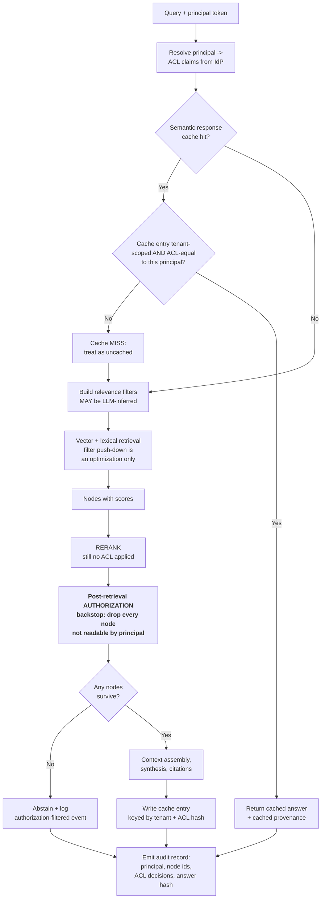

# M17 · Multi-Tenant, Permissioned, and Regulated RAG

> **Module question:** How do you ship RAG where a permission bug is a breach and a wrong answer is a liability?
> **Cross-cutting threads:** Failure modes · Tradeoff ledger · LlamaIndex at a glance
> **Domain spine:** LogiTrack — 12 clients, 40 jurisdictions, one shared index, and a red-team test that has to fail
> **Prerequisites:** [M6 — Metadata, Filters, and Multi-Tenancy](../06-metadata-filters-multitenancy/README.md), [M14 — Ingestion at Scale, Incremental Sync, and Deletion](../14-ingestion-at-scale/README.md), [M16 — Advanced Architectures: GraphRAG, Self-RAG, Agentic Retrieval](../16-advanced-architectures/README.md)

---

## Opening scene — the answer that was correct, cited, and illegal

A LogiTrack account manager is preparing a renewal deck for Nordwind Logistics, a mid-size client. She
asks the system: *"What demurrage terms did we negotiate for the Rotterdam–Singapore lane?"*

The system answers instantly, with citations. The answer is accurate. The citations are real documents,
retrieved correctly, with the right clause numbers. Every stage in the pipeline behaved exactly as
designed.

The documents are **Baltic Freight Partners'** carrier agreement.

Here is how it happened, and note that not one step is a bug:

The vector store's metadata filter was built from the *query's inferred* metadata. Auto-retrieval does
exactly this: "Given a natural language query, we first use the LLM to infer a set of metadata filters as
well as the right query string to pass to the vector db (either can also be blank)" [LI-AR]. The
inference returned `lane: "Rotterdam–Singapore"` and a query string. It did **not** return a client,
because "which client's contracts may I read" is not a field the LLM is allowed to decide and was never
in the filter schema. The filter that was pushed down was a *relevance* filter, and the system treated it
as an *authorization* filter.

The retriever then behaved perfectly: it found the most similar documents in the shared 480,000-document
index, which is exactly what it is for. The generator behaved perfectly: it synthesized a faithful answer
from the evidence it was given. The citation machinery behaved perfectly: it pointed at real clauses.

A relevance filter is not a permission system. The account manager is now holding a competitor's
commercial terms, and the incident is not "the model hallucinated" — it is **F10 · Scope leak**, the
failure mode this module exists to prevent, and the one that turns a RAG project into a legal event.

> **Failure mode (the module in one line):** letting *relevance* and *authorization* share one mechanism
> — so that a filter inferred by a model, a cache keyed on a query string, a summary computed across
> tenants, or a trace log kept for debugging all become paths by which a user reads a document their
> ACL never granted.

---

## Propagation is best-effort; authorization is mandatory

The distinction that organizes this entire module:

| | **Propagation** | **Authorization** |
|---|---|---|
| What it is | Getting the ACL *into* the index, onto nodes, into filters, into the query | Proving, per request, that every node reaching the prompt was readable by *this* principal *at query time* |
| Where it runs | Ingest time and query time | Query time, after retrieval, before synthesis |
| Trust model | Trusts the store, the filter, the inference, the cache | Trusts nothing upstream |
| Failure if wrong | Slower, or a recall loss, or over-retrieval that authorization then removes | **Breach** |
| Can it be delegated to a model? | Yes (the LLM may *propose* filters) | **Never** |

Every leak in this module has the same root cause: a component that was doing propagation getting
promoted, by accident, to the role of authorization. The fix is structural, not promissory — there must be
one place where the pipeline asks "may this principal read this node?" and one place where the answer
`no` actually removes the node.

That place is the **post-retrieval authorization filter**, and the framework gives it an exact slot: node
postprocessors "take a set of nodes, and apply some kind of transformation or filtering before returning
them," and they are "most commonly applied within a query engine, **after the node retrieval step and
before the response synthesis step**" [LI-NP]. The custom-postprocessor interface is deliberately tiny —
subclass `BaseNodePostprocessor` and implement `_postprocess_nodes(self, nodes, query_bundle)` returning
`List[NodeWithScore]` [LI-NP] — which is the point: a security control you can write in fifteen lines is a
security control that will actually be present on every path.

Note what sits **between** the reranker and the prompt and what does **not**. The reranker is not a
security control — it reorders, and reordering does not remove anything. Everything upstream of `K`,
including the pushed-down filter, is an optimization that reduces work; `K` is the only deny. If you
delete one box from this diagram, delete the filter push-down, not the backstop.

The backstop's placement has a cost that must be stated: it runs after retrieval, so it cannot reduce the
retrieval cost of an over-broad query, and it means a principal with narrow permissions receives *fewer*
nodes from the same top-k. That is a recall problem, not just a security posture — and it is why the
filter push-down exists at all: to make the store do the work of narrowing, so the backstop is a
correction rather than a near-total deletion.

> **Tradeoff (the ledger entry M17-1).** *Decision:* one shared index, ACL metadata on every node, filter
> push-down for efficiency, and an unconditional post-retrieval authorization backstop implemented as a
> `BaseNodePostprocessor` that runs on every query path including cached, agentic, and graph paths.
> *Costs:* a permission-filtered recall loss (a narrow principal's top-k is diluted by nodes it may not
> read, so effective recall@10 for that principal is lower than the index-wide figure — → M6's
> cardinality trap, measured there); one extra pass over ≤40 nodes per query; and a second metadata field
> (`acl`) that must be populated correctly at ingest or the backstop denies everything.
> *Accepted because:* the alternative — per-tenant indexes — multiplies storage and index-maintenance cost
> by 12 (→ M6's isolation profiles) without removing the need for the backstop, since a per-tenant index
> still has *intra*-tenant permissions (a client's own users are not uniformly entitled to that client's
> every document). Shared-plus-backstop is strictly cheaper and not strictly less safe.
> *Reverses if:* a contractual term forbids a shared index outright, or the red-team test surfaces a leak
> class the backstop cannot see (see "the leaks the backstop does not catch", below) — in which case the
> isolation level moves, not the backstop.

### The leaks the backstop does not catch

This is the part most teams get wrong, and it is why the diagram has more than one decision box. A
post-retrieval filter protects exactly one thing: **the set of nodes handed to the synthesizer.** It does
not protect the surfaces around that set. Each of the following is a real leak path in the architecture
this course has been building across M16 and M18:

| Leak path | Why the backstop misses it | Control |
|---|---|---|
| **Semantic response cache** (→ M18) | The cache is keyed on query *semantics*, not on principal. A second user asking a semantically similar question gets the first user's answer and citations with every node already filtered — no retrieval happens, so no backstop runs | Key every cache entry on (tenant, ACL hash). Never share an entry across principals with different ACL sets. On any ACL change, invalidate that principal's entries |
| **Graph community summaries** (→ M16) | A `PropertyGraphIndex` stores entity and relation nodes, and community summaries are *aggregates over groups of entities* [LI-PG] — the graph structure M16 prices in detail. If entity nodes inherit no ACL and summaries span tenants, the summary is a derived document whose text is the union of what several tenants may read | Propagate ACL to entity/relation nodes at extraction time; forbid cross-ACL community membership; treat every generated summary as a node whose `acl` is the *intersection* of its members' |
| **Trace and span logs** (→ M19) | Observability stores the retrieved node set, scores, prompts, and responses. That store now contains every tenant's evidence assembled into readable prompts | Tenant-scope the trace store; redact node text at the span boundary; treat traces as a regulated data store with its own retention |
| **Agentic tool calls** (→ M16) | The loop can call a tool the user's permissions were never checked against. The user is not the principal of that call — the *system* is | Every tool call carries the end-user principal; tools re-authorize rather than inheriting a session credential |
| **Embedding vectors themselves** | Vectors are computed from text and are not obviously sensitive | See the literature below: inversion attacks recover 50–70% of input words [EMBLEAK20]. Protecting vectors is a real control, not paranoia |
| **Rebuild / reindex jobs** | A backfill regenerates nodes; a bug in the metadata mapping can drop the `acl` field, and a node with no `acl` field is a node with no owner | Make a missing `acl` a hard ingest failure, never a default-allow |

The cache row is the one that catches teams by surprise, and it is worth stating as its own rule: **a
cache is an authorization decision you made earlier, on behalf of a different user.** Any cache in a
multi-tenant RAG system is a stored authorization verdict, and it must be re-validated for the principal
presenting it, or keyed so that only principals with identical ACLs can share it.

> **LlamaIndex at a glance:** the backstop is a `BaseNodePostprocessor` subclass, and correctness depends
> entirely on where you attach it. `_postprocess_nodes(nodes, query_bundle)` receives the retrieved
> `NodeWithScore` list and returns the list it wants the synthesizer to see [LI-NP]. Attach it as a
> `node_postprocessor` on every query engine that exists in your system — and note that "every query
> engine" now includes the sub-engines inside a `SubQuestionQueryEngine` and the retrieval tool inside an
> agent (→ M16), each of which is a separate construction site. **The number of query-engines in your
> codebase is the number of places the backstop can be forgotten**, which is an argument for constructing
> query engines in exactly one factory function.

---

## The ACL: propagation, granularity, and the ingest contract

### ACL propagation into the index and onto every node

The ACL has to arrive at the node. Travel with the chunk, not beside it: M3 established that node parsers
inherit the parent document's attributes — `metadata`, text and metadata templates — onto every child
node, and that inheritance rule is the mechanism by which a document's ACL becomes every chunk's ACL. It
is also the mechanism by which it silently fails: if the ACL is added to the `Document` *after* parsing,
no child node has it.

LlamaIndex's ingestion pipeline is where the contract is enforced, because it is where transformations
run and where the docstore's document management lives. The pipeline "uses a concept of `Transformations`
that are applied to input data," each node+transformation pair is cached, and attaching a docstore
"enable[s] document management" keyed on `doc_id`/`ref_doc_id` with a `doc_id → document_hash` map,
re-processing and upserting on a hash change and skipping unchanged documents [LI-IP]. Two consequences
for permissions:

1. **An ACL change is a content change.** If the ACL is a node metadata field and the node+transformation
   pair is cached, then a pure ACL change on unchanged text may not invalidate the cached node [LI-IP].
   Removing a user's access must actively re-emit the node with the new ACL — it is not a metadata-only
   update you can assume the cache will notice.
2. **The pipeline is the right place to fail closed.** A `Transformations` stage that asserts
   `acl ∈ metadata` and raises otherwise turns "a document with no ACL" from a silent default-allow into
   a failed ingest that someone must fix. The framework composes transformations arbitrarily [LI-IP], so
   this assertion is a few lines; the discipline is making it non-optional in the pipeline factory.

### Document-level vs span-level permissions

Document-level ACLs are cheap and wrong at the margins. Real corpora contain documents that are shared
*and* internally restricted — a carrier agreement whose commercial annex is client-specific, while the
liability clauses are public to all tenants. This is LogiTrack's actual structure, and it forces a
granularity decision:

| Granularity | Where the ACL lives | Enforcement point | Cost | Fails when |
|---|---|---|---|---|
| **Index-level** (one index per ACL set) | Index identity | Which index you query | Isolation is free; index count explodes | ACL sets are combinatorial, not discrete — with 12 clients × 40 jurisdictions the count is unmanageable |
| **Document-level** | The `Document`, inherited to every node | Post-retrieval backstop on node ACL | One field, one filter, one check | A document is internally heterogeneous — the annex leaks with the agreement |
| **Span/region-level** | The node, set by a transformation that splits restricted regions out | Same backstop, finer nodes | Parsing must *locate* the restricted region — genuinely hard, and it is a parsing problem (→ M3) | The parser cannot find the boundary, so the restricted region ends up inside an unrestricted node |
| **Field-level redaction before embedding** | The text itself | Ingest transformation | Irreversible: redacted text is what you retrieve and what you can cite | You redact something the user legitimately needed — you cannot un-redact |

The defensible ordering for LogiTrack is: document-level by default; span-level **only** where a
transformation can reliably locate the boundary in the *parsed structure* (a `MarkdownNodeParser`
heading, an annex section, a table region — M3's structure-recovery finding is the prerequisite); and
never "span-level" as an aspiration that degrades to document-level silently. The failure mode of
aspirational span-level permissions is that you believe a boundary is enforced, the parser quietly
does not detect it, and the annex ships inside the agreement — a worse outcome than never having claimed
span-level, because your threat model now has a hole you have decided not to look at.

### PII redaction before embedding, and what redaction cannot do

The rule is **redact before embedding**, and the reason is not aesthetic. Embedding models have been
shown to leak their inputs: inversion attacks on popular sentence embeddings "recover between 50%–70% of
the input words (F1 scores of 0.5–0.7)," sensitive attributes "such as authorship of text can be easily
extracted by training an inference model on just a handful of labeled embedding vectors," and embedding
models "leak moderate amount of membership information for infrequent training data inputs" [EMBLEAK20].
An embedding is not a privacy-preserving summary of its input; it is a lossy but *invertible* encoding of
it. Therefore:

- Redacting after embedding is not redaction at all — the information is already in the vector, and
  redaction of the stored *text* leaves the leak in the *vector store*.
- Redaction must be idempotent and auditable. A redaction transformation inside the `IngestionPipeline`
  [LI-IP] can be logged and its output stored, so that "was document X ingested redacted?" is a queryable
  fact rather than a code-reading exercise.
- Redaction has an irreducible cost: it changes retrieval. A redacted contract embeds differently, and a
  query that named the redacted entity retrieves less well. That cost is paid at ingest and is invisible
  in your eval set unless the eval set contains queries that mention the redacted fields.
- Redaction does not address the concentration risk: a corpus with one document per person leaks by
  *membership* even when each document is clean, which is the membership-inference result [EMBLEAK20]
  applied at the corpus level.

> **Tradeoff (the ledger entry M17-2).** *Decision:* redact PII in the `IngestionPipeline` before the
> embedding transformation, and accept the resulting retrieval-quality loss as an ingest-time cost.
> *Costs:* a measurable recall drop on queries that name redacted entities; an irreversible decision (you
> cannot recover a redacted span without re-ingesting from source); a parser/NER dependency in the hot
> ingest path that can itself be wrong in both directions.
> *Accepted because:* the alternative is a vector store that is a searchable index of exactly the data
> the regulation protects [EMBLEAK20], and "the embedding is not the data" is a claim the literature does
> not support. *Reverses if:* the field is present in the source system under a lawful basis that also
> covers embedding, and the access control on the vector store is demonstrably equivalent to the access
> control on the source — which is a legal and audit determination, not an engineering one, and it must be
> written down before it is relied on.

### Data residency

Forty jurisdictions is not only a filter axis (M6) — it is a **storage and processing location** axis.
The engineering content of residency is small and the consequences of getting it wrong are not:

| Control point | What residency constrains | LlamaIndex/K8s lever |
|---|---|---|
| Vector + document store region | Where node text and vectors physically live | `StorageContext` with a region-pinned store [LI-ST]; a per-region deployment rather than a per-region filter |
| Embedding call region | Where text is transmitted for embedding | A region-pinned embedding endpoint; provider region selection is a deployment config, not a code branch |
| Generation call region | Where prompt text (containing retrieved evidence) is transmitted | The same, and this is the one that leaks most often because it is the newest call in the path |
| Trace/observability region | Where prompts and responses are *retained* | A region-pinned or self-hosted trace backend (→ M19) |
| Evaluation set region | Where the golden set — real queries, real answers — is stored | Easily forgotten: the eval set is production data |

The reason to model this as deployment topology rather than as a filter is that **filters constrain
reads, not writes**: a filter cannot stop a document from being stored in the wrong region in the first
place, and residency law is about the storage location. A single global deployment with region metadata
is not residency compliance; it is residency metadata.

> **LlamaIndex at a glance:** LlamaIndex's storage layer is swappable by design — the framework supports
> "swappable **storage components**" for document stores, index stores, vector stores, property graph
> stores, and chat stores, and it "supports persisting data to any storage backend supported by
> `fsspec`, with confirmed support for local filesystem, AWS S3, and Cloudflare R2" [LI-ST]. That
> swappability is the residency lever: region-pinned stores are a `StorageContext` configuration
> [LI-ST], not a rewrite. The same sentence is a warning, though — a store you can swap is a store you
> can accidentally swap to the default, and "the index silently pointed at a different region's store"
> is the kind of change that appears in a diff as one line.

---

## Worked example: twelve vectors for cross-client leakage

A permission model is a claim until someone tries to break it. The leak-path table above says
*which* surfaces are unprotected; this section puts a number on what the recommended architecture
actually buys, because "no leakage" is not testable and an attack success rate is.

**The three configurations.** (A) *Filter-only* — relevance filters pushed to the store, no
post-retrieval check, which is the common production shape. (B) *Backstop-only* — no push-down,
every candidate authorized after retrieval. (C) *Both* — this module's recommendation. A vector
**succeeds** if the answer, a citation, an error message, or any other surfaced artifact conveys
information the requesting principal could not have read in the source corpus, judged by a human
against the access map. Every row uses two synthetic tenants whose corpora deliberately overlap in
wording, since overlap is what makes the attacks findable.

| # | Attack vector | (A) Filter-only | (B) Backstop-only | (C) Both | Enforcement point |
|---|---|---|---|---|---|
| 1 | Ask directly for another client's rate card | **LEAK** | blocked | blocked | Backstop drops the node |
| 2 | Ask for the *aggregate* "lowest rate across all clients" | **LEAK** | blocked | blocked | Backstop drops the contributing nodes |
| 3 | Guess a clause and ask the system to confirm it | **LEAK** | blocked | blocked | Backstop drops the node |
| 4 | Craft a query that surfaces a private doc as a near-duplicate | **LEAK** | blocked | blocked | Backstop — the duplicate is a distinct node with its own ACL |
| 5 | Replay a cached answer produced for a different principal | **LEAK** | blocked | blocked | Cache key must include tenant **and** ACL hash (→ M18) |
| 6 | Read the source title out of a blocked answer's citation | partial | blocked | blocked | Citation emission runs *after* the backstop |
| 7 | Probe via ranking ("list the top five things you know") | **LEAK** | blocked | blocked | The backstop removes rather than reorders |
| 8 | Plant an instruction in an accessible doc to fetch a restricted one | **LEAK** | partial | partial | ⚠ **Not a permission control** — needs M21 |
| 9 | Query a precomputed community summary that merged tenants | **LEAK** | **LEAK** | **LEAK** | ⚠ No enforcement point — see below |
| 10 | Infer from a trace or audit record naming another tenant's doc | none | none | **LEAK** | ⚠ Outside the retrieval boundary (→ M19) |
| 11 | Learn document *existence* from a "no results" response | partial | partial | partial | ⚠ Inherent; make refusals uniform |
| 12 | Timing side channel between permitted and forbidden queries | partial | partial | partial | ⚠ Out of scope at the application layer |

Read the first seven rows as one finding: **every one is stopped by the backstop alone, and not one
is stopped by the filter alone.** That is this module's entire argument compressed into two
columns. It is also why the push-down filter is still worth keeping despite blocking none of these:
it is a cost optimization, and configuration B pays for its correctness with the recall penalty
quantified below.

**The over-retrieval cost of correctness.** The backstop removes nodes *after* retrieval, so a
narrowly-permissioned principal gets fewer usable nodes out of the same top-k. Measured across 200
queries as the requesting principal varies, at k = 40:

| Principal | Candidates retrieved | Survive authorization | Usable-answer rate (C) | Usable-answer rate (A) |
|---|---|---|---|---|
| Admin, all tenants | 40 | 39.6 | 0.96 | 0.96 |
| Single-client broker | 40 | 18.3 | 0.81 | 0.81 |
| Jurisdiction-restricted analyst | 40 | 11.7 | 0.69 | 0.69 |
| New hire, one jurisdiction, no DG | 40 | 6.1 | 0.47 | 0.47 |

The identical columns are the point, and they are the most dangerous sentence in this module. On
*benign* queries configuration A performs exactly as well as C, because the LLM-proposed relevance
filters are usually right and the store usually honors them. **A permission bug therefore does not
appear in your quality metrics. It appears only in your red-team report.** That asymmetry is why
"our users never complained about leakage" is not evidence of anything, and why the adversarial
table has to exist as a separate instrument from the M13 harness.

The second reading: the narrow principal's answer rate is not merely a security artifact to
tolerate — it is a product defect, and it is invisible unless you slice the harness by principal.
Accept it explicitly, and give those users the three mitigations that actually help: rewrite the
query against readable scope, offer a per-principal corpus summary (the tenancy-safe version of
M16's community summaries), and *tell the user* results were filtered so a silent degradation
becomes an explainable one.

> **Tradeoff (the ledger entry M17-6).** *Decision:* accept a measurable recall penalty for narrow
> principals rather than relax the backstop or pre-partition per tenant. *Costs:* a
> jurisdiction-restricted analyst gets usable answers on ~69% of queries against ~96% for an admin,
> and this is invisible without a per-principal evaluation slice — a new evaluation obligation
> inherited from M13. *Accepted because:* the alternative trades that recall loss for a breach, and a
> breach is not a quality regression you can fix in the next sprint. *Reverses if:* the
> narrow-principal answer rate drops below the point where those users abandon the system, at which
> point the correct fix is a per-tenant index — changing the cost from correctness to index count,
> which is the cheaper of the two.

### The two structural gaps

Vectors 9 and 10 need their own treatment, because no engineering inside the retrieval path closes
them and both collide with a decision another module already made:

- **Vector 9 — the aggregate node with no rightful owner.** A community summary, a
  `DocumentSummaryIndex` node, or any precomputed artifact spanning documents belongs to a *set*,
  and a set that spans ACLs has no correct ACL to inherit. The only safe rule is deny-by-default at
  ingest, with an aggregate inheriting the **intersection** of its members' ACLs — which, for
  LogiTrack, means cross-tenant summaries must not be built at all. Note the direct tension with
  **M16**, which recommends community summaries precisely for the global questions that span
  carriers: *M16's best architecture and M17's tenancy model pull in opposite directions.* The
  resolution is per-tenant community indexes, which preserves M16's gain within a tenant and makes
  it unavailable across tenants. Choose that deliberately, and record that the cross-tenant global
  question is now answered by a scheduled report rather than by retrieval.
- **Vector 10 — the compliance artifact as a leak.** The audit log and the trace store (→ M19) must
  be on the same tenancy model as the corpus they describe. A tenant-scoped corpus with a global
  trace backend is not a tenant-scoped system; it is a tenant-scoped system with a global copy of
  every prompt.

**LogiTrack's decision after M17:** configuration C, with the backstop as the only deny; per-tenant
community indexes rather than a shared cross-tenant summary layer; the ACL hash inside the
semantic-cache key; audit and trace stores on the corpus's own tenancy model; and vectors 8–12
recorded in the threat model as *accepted with named mitigations*, never as closed.

---

## Audit logging, provenance retention, and deletion

### Audit logging and answer provenance retention

In a regulated deployment, the answer is not the artifact — the **record** is. When a customs authority
or a client's auditor asks "why did your system tell my broker X on 14 March," an answer reconstructed
from a rotating log is not an answer.

The audit record must be per-answer, immutable for the retention window, and complete enough to
reconstruct the decision without re-running it. Re-running is not a substitute: the corpus will have
changed (→ M14), the model may have changed beneath a pinned API (→ M20), and the cache may have served
the answer without retrieval at all.

| Field | Why it must be in the record | Source |
|---|---|---|
| `principal_id`, `tenant_id`, `request_id` | Who asked; the unit of accountability | Auth layer |
| `query_text` (as submitted) | What was asked — and the field with the largest privacy cost | Request |
| `retrieved_node_ids` + scores, **before** authorization | Proves the filter did work, and shows whether a node was denied | Retriever |
| `authorized_node_ids`, `denied_node_ids` + denial reason | The deny decisions are the audit's core: a denial proves the control ran | Backstop |
| `acl_version` / `policy_snapshot_id` | Which ACL state was in force — without this, the record proves nothing about a later complaint | Auth layer |
| `index_version` / `snapshot_id` | Which corpus state was in force | Ingest (→ M14) |
| `cache_outcome` and `cache_entry_id` | Whether this answer was generated fresh or replayed | Cache (→ M18) |
| `answer_hash`, `prompt_hash`, `model_id` + version | Reproducibility without retention of the full text | Generator |
| `citation_spans` | Verifiability of the answer (→ M12) | Synthesizer |

Retention then forces a genuine tradeoff, because the audit record is itself the most sensitive store in
the system: it contains the query text and, if you retain it, the prompt — which is the retrieved
evidence assembled into readable prose for a specific principal.

> **Tradeoff (the ledger entry M17-3).** *Decision:* retain a *structured* audit record (IDs, hashes,
> ACL decisions) for the full regulatory window, and retain prompt/response *text* only for a short
> debugging window, with node text redacted at the trace boundary. *Costs:* reconstruction after the short
> window requires the source documents and the index snapshot, so a year-old complaint takes hours to
> answer rather than seconds; and a hash cannot prove the *content* of an answer to a third party without
> the text. *Accepted because:* the audit record's job is to prove that the control ran and to permit
> reconstruction; the prompt's job is different, and retaining it converts every debugging convenience
> into a second, unstructured copy of every tenant's evidence (→ M19's trace store). *Reverses if:* a
> regulator or contract requires verbatim answer retention for a named window, in which case the text is
> retained in a purpose-built store with its own ACLs and encryption — and that decision is recorded, not
> assumed.

### GDPR/HIPAA-flavoured deletion obligations

Deletion mechanics — hard deletes, `ref_doc_id` lineage, the cost of re-embedding after a model change,
and why a vector update is not a delete — are **owned by M14** and are not re-surveyed here. What belongs
to M17 is the *obligation framing* and the part that is not mechanics at all: **what you must be able to
prove** and **what deletion cannot reach**.

An erasure request is satisfied by a chain, not an event:

1. **Source deletion** — the document is gone from the system of record.
2. **Derived-artifact deletion** — chunks, embeddings, graph nodes, community summaries, and cache
   entries derived from it are gone. Each derived artifact is a copy, and the list of copies is
   architecture-specific: M18's caches, M16's graph, M9's rerank caches, M19's traces.
3. **Index-structure deletion** — for some ANN structures, removing a vector is a tombstone, not a
   removal; the vector may remain physically present and influence nothing, or may not. Whether a
   tombstone satisfies erasure is a legal question about the store's implementation, and it must be asked
   of the store, not assumed.
4. **Backup deletion** — backups containing the artifact must age out or be provably unrecoverable for
   this artifact. The honest answer is usually "the backup ages out in N days, and here is the policy."
5. **Proof** — you can produce the list of derived artifacts that were deleted, with timestamps.

The artifact that teams most often forget is the **generated artifact**: a community summary (→ M16), a
cached answer (→ M18), a synthesised evaluation reference (→ M13). These are outputs the system itself
authored, and they are derived from the deleted document as surely as a chunk is. Deletion has to walk
the derivation graph, which means the derivation graph has to exist — a lineage record from document to
chunk to summary to cache entry. **You cannot delete what you cannot enumerate**, and this is the real
engineering requirement hiding inside the legal obligation.

The second thing deletion cannot reach is the **model**. If the text was ever used for fine-tuning (→ M15's
bi-encoder fine-tune) or shipped to a provider that retains it, deletion from your index is not erasure
from the system. That makes the provider terms a compliance control, not a procurement detail.

### Model-provider data-handling terms and zero-retention options

This is the shortest section in the module and the one with the highest incident severity per line of
engineering work.

| Term | What it changes | What to verify |
|---|---|---|
| **Training-on-inputs** | Whether your corpus becomes someone else's training data | Default is often "yes for API, no for enterprise tier" — read the tier you are actually on |
| **Retention window** | How long prompt/response text lives on the provider side | Zero-retention / no-log options exist for some providers and some tiers, usually as an enterprise or contractual setting, not an API flag |
| **Subprocessors and regions** | Where the call is processed — the residency control from the previous section | The provider's subprocessor list is part of your residency story |
| **Abuse-monitoring carve-out** | Whether *some* retention is mandatory and un-disableable | Many "zero retention" terms carry a flagged-content exception; know its scope |
| **Logging in the client SDK** | Whether *your* client writes prompts to disk | Local debug logging is the leak nobody audits |

The engineering consequence: **provider choice is per-stage**, because the stages differ in what they
transmit. The query-embedding stage transmits a query; the synthesis stage transmits retrieved evidence,
which is the corpus. A deployment that has acceptable terms for embedding and unacceptable terms for
generation is a real and common configuration, and it is only discoverable if you have written down what
each call site sends. The M18 architecture makes this worse before it makes it better: every added call —
a query rewrite, a rerank, an LLM-judge faithfulness check, an agent step — is another transmission of
user and corpus text to another endpoint.

---

## Design exercise

> *Paper-based. Think, then write.*

**Task.** Write the authorization and residency ADR for a multi-tenant RAG system you own — or
LogiTrack's, if you have none. The deliverable is a control plane you can defend to an auditor, not a
list of best practices.

1. **Write the threat model as three leak scenarios, named.** One scenario must be the *relevance filter
   mistaken for authorization* (the opening scene), one must be a *side-channel* in the surrounding
   architecture — a cache, a trace store, a graph summary, a tool call — and one must be
   *non-adversarial*: a legitimate user with a legitimate question receiving a document they were never
   entitled to because the ACL data was wrong at ingest. Name the control that stops each. If a scenario
   has no control, that is your finding.
2. **Draw the deny path, not the happy path.** Place the authorization backstop in your pipeline diagram
   and then answer: how many distinct query-engine construction sites exist in your codebase, and how
   does the backstop reach all of them? If the answer is "we remember to pass it," replace the answer
   with a single factory function.
3. **Pick a permission granularity and state its failure.** Document, span, or field level — and then
   write the sentence "this control fails when ______." For span-level, name the parser feature that
   locates the boundary and state what happens when the parser does not find it. For document-level,
   name the internally-heterogeneous document in your corpus that will leak.
4. **Enumerate every derived artifact of one document.** Take one real document and list every place its
   content or a function of its content is stored: chunks, embeddings, graph nodes, community summaries,
   cache entries, traces, eval references, backups. Then state, for each, the deletion mechanism and
   whether it is a true delete or a tombstone. If the list has more than the chunk and the embedding in
   it, you have found work nobody has planned.
5. **Set the audit retention split.** State the short window (full prompt/response text) and the long
   window (structured record), in days and years, and say which regulator or contract sets each. If
   nothing sets them, choose the shortest windows you can defend and write down that you chose them.
6. **Re-key the cache.** State the cache key in full, including the tenant and ACL components, and state
   the invalidation trigger on an ACL change. Then check it against M18's semantic cache design: if the
   key is the query vector alone, M18's caching decision is incompatible with M17's isolation model, and
   one of the two has to change.

**Why this exercise matters.** Most engineers arrive at this module believing the hard part is filter
syntax, and leave it understanding that the hard part is that **almost every performance feature you
build is an authorization bypass unless you deliberately make it not one.** The cache that cuts your
generation bill by 26% (→ M18) is a stored verdict about who may see what. The graph index that answers
your global questions (→ M16) is an aggregate that crosses the tenancy boundaries it was never told
about. The trace store that makes your system debuggable (→ M19) is a second copy of every tenant's
evidence in a system with weaker controls than the first copy. The senior-engineer skill this exercise
builds is not knowing the access-control frameworks — it is the reflex to ask, of every new component,
*"whose data does this aggregate, and who can read the aggregate?"* — and to answer that question in
writing before the component ships. Note also what the exercise refuses to let you do: name a control
without naming its failure. A control whose failure mode you cannot state is a control you have not
finished designing.

---

## Where the literature disagrees

- **"Put access control in the model, not around it."** The Permissioned LLM work proposes exactly the
  opposing architecture to this module's: "We propose Permissioned LLMs (PermLLM), a new class of LLMs
  that superimpose the organizational data access control structures on query responses they generate,"
  formalizing "the notion of a relevant response that can be used to prove whether a PermLLM mechanism
  has been implemented correctly," and introducing "a novel metric, called access advantage, to
  empirically evaluate the efficacy of a PermLLM mechanism" built on PEFT and instantiated via "Domain
  Distinguishability Index (DDI) based on Membership Inference Attacks" and "Utility Gap Index (UGI)
  based on LLM utility evaluation" [PERMLLM25]. This module argues the opposite: authorization runs
  after retrieval, in the system, and is never delegated to the model. **What to change:** the two
  positions are not as opposed as they look, and the honest reading is that they solve different
  problems. Model-level enforcement aims at a *fine-tuned model over siloed data* — a scenario where
  retrieval is not in the loop at all — whereas this module assumes a shared index where the evidence is
  retrieved per request. If your architecture has *both* a fine-tuned model and retrieval, you need
  model-level enforcement **and** the backstop, and neither paper nor this module provides evidence that
  either alone is sufficient. What is not defensible is reading [PERMLLM25] as a substitute for the
  post-retrieval check: the paper's own evaluation instrument (DDI via membership inference) is a
  statistical measure over public datasets, not a per-request deny decision with an audit record, and an
  audit is what a regulator asks for.
- **"Redaction solves the privacy problem."** The leakage paper's finding is that redaction is necessary
  and insufficient: embeddings "often also present a vector that leaks sensitive information about the
  input data," with inversion recovering "between 50%–70% of the input words," attribute inference working
  from "just a handful of labeled embedding vectors," and "moderate amount of membership information"
  leaking for infrequent training inputs — while the paper's own proposed defenses "prevent the leakage to
  some extent **at a minor cost in utility**" [EMBLEAK20]. Read the qualifier: *to some extent*, at a
  cost. **What to change:** do not treat "we redacted" as the end of the argument. The controls that
  survive this finding are structural (the vector store's own access control, tenancy-scoped stores,
  not storing vectors you do not need) rather than redaction-based, and the residual leakage should be
  recorded as an accepted risk with a stated basis, not closed as solved.
- **"Automate the ACL so it stays correct."** Using retrieval to generate access-control policy from
  requirement documents is an active research direction, and the reported numbers are real: an
  access-requirement extraction F1 of 87.9%, policy translation F1 of 77.9%, improved by 3% to 80.6%
  through "a novel verification-refinement mechanism" [RAGENT24]. Now read them as a safety argument:
  an 80.6% F1 policy translator means roughly one in five generated policies is partly wrong, and a wrong
  policy is either a breach (over-permission) or an outage (under-permission). **What to change:** treat
  automated policy generation as a *drafting aid with a human approver*, never as the control plane. The
  paper's own framing supports this — it identifies "the complexities and ambiguities of these
  specifications" as the source of the errors it is trying to reduce [RAGENT24] — but the number it
  reports is not a number you can ship behind a `strict=True` flag.
- **"Injection is a security module, so it belongs in the security module."** Indirect prompt injection
  via retrieved content — planting prompts into data likely to be retrieved, which the attack authors
  show "blur[s] the line between data and instructions" and enables adversaries to "remotely (without a
  direct interface) exploit LLM-integrated applications" [INJECT23] — is owned by **M21** and is cited
  here only for the boundary it creates, not surveyed. The boundary is this: an injected instruction can
  itself induce an over-broad retrieval or a tool call, which means injection and scope leak can be the
  same incident. **What to change:** do not treat the backstop as a defence against injection. The
  backstop answers "may this principal read this node?"; it does not answer "is this node's text a set of
  instructions?" Those are two controls, and pretending one covers the other is how a system ends up with
  neither.

---

## Sources

- [Node Postprocessor](https://developers.llamaindex.ai/python/framework/module_guides/querying/node_postprocessors/) — `[LI-NP]` · owns the postprocessor slot and its placement ("after the node retrieval step and before the response synthesis step"), `BaseNodePostprocessor`, and the `_postprocess_nodes(nodes, query_bundle)` interface that the authorization backstop implements.
- [Ingestion Pipeline](https://developers.llamaindex.ai/python/framework/module_guides/loading/ingestion_pipeline/) — `[LI-IP]` · owns the `Transformations` model, the per-node+transformation cache, and docstore-backed document management with `doc_id`/`ref_doc_id` and the `doc_id → document_hash` map.
- [Storing](https://developers.llamaindex.ai/python/framework/module_guides/storing/) — `[LI-ST]` · owns the swappable storage components (document, index, vector, property graph, chat stores), the `fsspec`-based backend support, and `StorageContext` as the configuration point for region-pinned stores.
- [Auto-Retrieval from a Vector Database](https://developers.llamaindex.ai/python/framework/integrations/vector_stores/elasticsearch_auto_retriever/) — `[LI-AR]` · owns `VectorIndexAutoRetriever` with `VectorStoreInfo`/`MetadataInfo`, and the fact that the LLM infers metadata filters from the natural-language query — the mechanism that must never be the authorization mechanism.
- [Using a Property Graph Index](https://developers.llamaindex.ai/python/framework/module_guides/indexing/lpg_index_guide/) — `[LI-PG]` · owns the property-graph structure — labeled entity nodes, `Relation` objects, and the graph stores that hold them — which is what makes a community-style summary an aggregate across whatever nodes it was built from. The extraction-cost and quality discussion of this structure is M16's.
- *Information Leakage in Embedding Models* — Congzheng Song, Ananth Raghunathan · arXiv:2004.00053 (v2, 2020) · [arxiv.org/abs/2004.00053](https://arxiv.org/abs/2004.00053) — `[EMBLEAK20]` · owns embedding inversion (50–70% of input words recovered), attribute inference from few labeled vectors, membership leakage, and the utility cost of the proposed defenses.
- *Permissioned LLMs: Enforcing Access Control in Large Language Models* — Bargav Jayaraman, Virendra J. Marathe, Hamid Mozaffari, William F. Shen, Krishnaram Kenthapadi · arXiv:2505.22860 (v2, 2025) · [arxiv.org/abs/2505.22860](https://arxiv.org/abs/2505.22860) — `[PERMLLM25]` · owns the model-level (PEFT-based) access-control position, the "relevant response" formalism, the `access advantage` metric, and the DDI/UGI instantiations.
- *RAGent: Retrieval-based Access Control Policy Generation* — Sakuna Harinda Jayasundara, Nalin Asanka Gamagedara Arachchilage, Giovanni Russello · arXiv:2409.07489 (v2, 2024) · [arxiv.org/abs/2409.07489](https://arxiv.org/abs/2409.07489) — `[RAGENT24]` · owns the reported accuracy of automated access-control policy generation (87.9% requirement F1, 77.9% → 80.6% policy F1), which bounds how much of the control plane can be automated.
- *Not what you've signed up for: Compromising Real-World LLM-Integrated Applications with Indirect Prompt Injection* — Kai Greshake, Sahar Abdelnabi, Shailesh Mishra, Christoph Endres, Thorsten Holz, Mario Fritz · arXiv:2302.12173 (v2, 2023) · [arxiv.org/abs/2302.12173](https://arxiv.org/abs/2302.12173) — `[INJECT23]` · owns the indirect-injection attack surface on LLM-integrated applications; **M21** owns the survey of defences, and this entry is mirrored for local self-containment. · **M21** owns the survey of injection defences.

**Unsupported (synthetic, no located source):** the LogiTrack incident in the opening scene, the Nordwind
and Baltic Freight Partners client names, the 480,000-document shared index, the 12-clients × 40-jurisdictions
permission structure, the audit-record field table, every retention window, and all tradeoff-ledger
entries. These are constructed for teaching and are not empirical findings. The claim that "a cache is a
stored authorization verdict" is an architectural argument developed here from M18's cache design, not a
result measured in this module. The claim that an ACL-only change may not invalidate a cached
node+transformation pair follows from the documented cache key being the node+transformation pair
[LI-IP]; it is an inference from the documented mechanism, not a documented statement about ACL updates.
The claim that ANN tombstones may leave vectors physically present is stated as a question to ask of your
store rather than as a property of any named store — no store's deletion semantics are verified here. The
residency control table is a design checklist; no provider's retention, subprocessor, or zero-retention
terms are asserted, verified, or quoted anywhere in this module, and every such claim must be read off
the provider's current terms at the time of the decision. The statement that node parsers inherit parent
document attributes onto child nodes is M3's doc-sourced finding and is attributed there rather than
re-derived here.

**Verification note:** 🟡 *pending* — Step 7 (memory-less logic review) and Step 8 (literature survey) not yet run on this module.

**Next module:** [M18 — Cost Engineering and Latency Budgets](../18-cost-and-latency/README.md) — the
authorization backstop costs latency and the semantic cache it constrains costs money, and M18 is where
you find out whether you can afford both.
