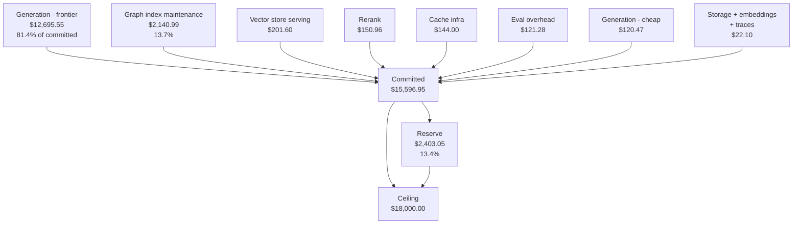

# M18 · Cost Engineering and Latency Budgets

> **Module question:** Where do the dollars and the milliseconds actually go, and what do you cut first?
> **Cross-cutting threads:** Failure modes · Tradeoff ledger · LlamaIndex at a glance
> **Domain spine:** LogiTrack — $18,000/month against 8,500 queries/day, and a P95 ceiling of 2.5 s that every architecture in M7–M16 has spent from
> **Prerequisites:** [M16 — Advanced Architectures](../16-advanced-architectures/README.md), [M17 — Multi-Tenant, Permissioned, and Regulated RAG](../17-multitenant-permissioned/README.md), [M13 — Evaluation of Retrieval and Generation](../13-evaluation/README.md)

---

## Opening scene — the invoice that arrived before the incident

LogiTrack's RAG system ships in month nine. It is, by every quality measure the team tracks, a success:
recall@10 of 0.86 against the 0.85 floor, faithfulness of 0.91 on the 400-query M13 set, and an ops team
that has quietly stopped writing its own summaries.

There is no incident. There is an invoice.

Cloud spend for the month: **$41,600**. The budget the project was approved on: **$18,000**. The
finance lead's email is four lines long and contains the sentence every senior engineer eventually
reads: *"Please confirm whether this is the new run rate, and what the quality impact of reducing it
would be."*

Here is the part that stings. Nobody made a mistake. Every module's decision was individually correct:
M10 added query rewriting and HyDE, because vague queries needed them. M9 added an LLM reranker, because
nDCG@10 went up. M12 added a faithfulness check, because compliance wanted verifiable citations. M13
attached the eval harness to CI, because it should run on every merge. M16 added the agentic path for
multi-hop questions, because it was the most accurate option on the table. M17 added the authorization
backstop and the audit record, because a permission bug is a breach.

Each decision was right. The **sum** was never computed. Six additions to a pipeline are six
multipliers to a bill nobody owns, and the first time anyone added them up was after the money was
spent.

> **Failure mode (the module in one line):** treating cost and latency as properties that emerge from
> an architecture instead of as **a budget that every stage spends from** — so each stage's local
> optimization is measured, no stage's contribution to the total is measured, and the first person to
> see the arithmetic is the person who does not build the system.

---

## Two waterfalls, one method

Both budgets are built the same way, and the method matters more than the numbers, because **the numbers
are wrong within a quarter and the method stays correct for years**.

1. **Enumerate every stage that spends.** For latency, every step on the critical path; for cost, every
   metered call, every byte-month, every instance-hour.
2. **Bind each stage to a measured or assumed unit.** Milliseconds per stage from a trace (M19 gives you
   this); dollars from a vendor price, marked as an assumption with a date.
3. **Allocate, do not observe.** The budget is set *before* the stages are built and sums to the SLO by
   construction. An observed p95 that sums to 3.4 s is not a budget; it is a description of an overshoot.
4. **State the price as an assumption, in the table, beside the arithmetic.** Every price here is
   *assumption, price volatile*, re-derivable by substituting today's rate into the same volume column —
   which is why the volumes come from corpus and traffic facts rather than from a bill.
5. **Re-derive on trigger.** The trigger to redo the waterfall is a change to any input in the volume
   column, not a calendar date.

> **LlamaIndex at a glance:** the framework gives you two instruments for step 2 and neither is a price
> list. `TokenCountingHandler` "track[s] embedding, prompt, and completion token usage," exposes
> `total_embedding_token_count`, `prompt_llm_token_count`, `completion_llm_token_count`, and
> `total_llm_token_count`, tracks per-call `TokenCountingEvent` records, and — critically — **counts are
> cumulative until you call `token_counter.reset_counts()`** [[LI-TC]](#src-li-tc). The cost-analysis guide's
> `MockLLM(max_tokens=...)` and `MockEmbedding(embed_dim=...)` let you *predict* LLM and embedding token
> usage before making the calls [[LI-CA]](#src-li-ca). Use the mock path to price an architecture that does not exist
> yet; use the counting handler to check the one that does.

### The latency waterfall: allocations that sum to 2,500 ms

Every stage below is on the **critical path** — genuinely concurrent stages are collapsed into one line
carrying the maximum, not the sum. A waterfall that adds parallel stages overstates latency and hides the
real bottleneck.

| # | Stage | P95 allocation | Cumulative | Executes on |
|---|---|---|---|---|
| 1 | Ingress: auth, tenant resolution, ACL claim fetch (→ M17) | 30 ms | 30 ms | service |
| 2 | Query understanding — M10 rewrite on the **cheap tier** | 260 ms | 290 ms | cheap model |
| 3 | Embedding cache lookup | 5 ms | 295 ms | cache |
| 4 | Query embedding (on cache miss) | 45 ms | 340 ms | embedding API |
| 5 | Hybrid retrieval — dense ANN ∥ BM25 (max of the two) | 120 ms | 460 ms | vector store + index |
| 6 | Fusion + metadata/ACL pre-filter (→ M6) | 25 ms | 485 ms | service |
| 7 | Cross-encoder rerank, **25** candidates | 180 ms | 665 ms | rerank API |
| 8 | Context assembly + post-retrieval ACL backstop (→ M17) | 20 ms | 685 ms | service |
| 9 | Synthesis **TTFT** — 10,400-token prompt, prefix-cached prefix | 520 ms | 1,205 ms | frontier model |
| 10 | Synthesis **decode** — 500 output tokens at 5.2 ms/token | 640 ms | 1,845 ms | frontier model |
| 11 | Faithfulness + citation verification (→ M12/M13) | 430 ms | 2,275 ms | frontier judge |
| 12 | Response finalize + egress | 35 ms | 2,310 ms | service |
| — | **Unallocated:** queueing delay, retries, GC headroom | 190 ms | **2,500 ms** | — |
| | **P95 total** | **2,500 ms** | | |

```mermaid
flowchart LR
    A["1 Ingress<br/>auth + ACL<br/>+30<br/>cum 30"] --> B["2 Query rewrite<br/>cheap tier<br/>+260<br/>cum 290"]
    B --> C["3-4 Embed<br/>cache 5 + 45 miss<br/>+50<br/>cum 340"]
    C --> D["5 Hybrid<br/>dense ∥ BM25<br/>+120<br/>cum 460"]
    D --> E["6-8 Fuse, rerank 25,<br/>ACL backstop<br/>+225<br/>cum 685"]
    E --> F["9 TTFT<br/>10.4k-token prompt<br/>+520<br/>cum 1205"]
    F --> G["10 Decode<br/>500 tok @ 5.2 ms<br/>+640<br/>cum 1845"]
    G --> H["11 Verify<br/>faithfulness<br/>+430<br/>cum 2275"]
    H --> I["12 Finalize<br/>+35<br/>cum 2310"]
    I --> J["Unallocated<br/>queue, retry, GC<br/>+190<br/>cum 2500"]
```

Three lines do the real work, and each is a decision made in an earlier module:

- **Line 2 sits on the cheap tier, and it is the only stage whose model choice is purely a latency
  decision.** A frontier-tier rewrite on the same prompt costs ~3.5× the P95 and buys a rewrite. Rewriting
  is a structured transformation, not a reasoning task — right-sizing here is free.
- **Line 11 is the stage nobody budgets for and everybody adds.** Faithfulness verification is 430 ms —
  **17% of the entire P95 budget** — and it is optional for every query that carries no compliance
  obligation. Making it conditional is the largest latency lever available *after* the waterfall is drawn.
- **Lines 9–10 are 46% of the budget and are one stage.** Generation is not divisible for budgeting
  purposes: TTFT and decode trade off against each other under load, which is the finding the serving
  literature owns and this module prices (see "Where the literature disagrees"). A waterfall that
  allocates them separately, as here, is a budgeting convention — the *system* does not respect the
  boundary when a batch fills up.

**The cached path.** A query served from the semantic response cache (→ M17 for the authorization
condition on that) never touches lines 3–11: P95 is ingress (30 ms) + cache lookup (10 ms) + egress
(5 ms) = **45 ms**. That is 1.8% of the budget, and it is why caching dominates the cost discussion
below — the same mechanism relieves both waterfalls simultaneously.

### The cost waterfall: components that sum to $18,000/month

Volumes are computed from the spine's facts (8,500 queries/day, [480,000 documents](../../syllabus.md#corpus-scale), 5.04M chunks at
month 12) and from the M16 architecture. **Every unit price is an assumption, price volatile** — the
method is what transfers, and the substitution instruction is in the "re-derive" note at the end of the
section.

| # | Component | Monthly volume | Unit price (assumption) | Monthly cost |
|---|---|---|---|---|
| 1 | Ingest embedding (incremental: 40,000 changed docs × 8,600 tokens) | 344.0M tokens | $0.02 / 1M | $6.88 |
| 2 | Query embedding (255,000 × 60 tokens) | 15.3M tokens | $0.02 / 1M | $0.31 |
| 3 | Vector store — storage (5.04M chunks: 4 KB vector + ~4.3 KB text each, + 3 GB metadata = 42.4 GB) | 42.4 GB-month | $0.30 / GB-month | $12.72 |
| 4 | Vector store — serving (2 replicas × 720 h) | 1,440 replica-hours | $0.14 / hour | $201.60 |
| 5 | ANN search compute (188,700 dense + 188,700 lexical searches, after 26% cache hits) | 377,400 searches | bundled into line 4 | $0.00 |
| 6 | Rerank (40% of the 188,700 generation-bound queries = 75,480 searches) | 75,480 searches | $2.00 / 1,000 searches | $150.96 |
| 7 | Generation — **cheap tier** (query understanding + advance routing) | 390.6M in / 103.1M out | $0.15 / $0.60 per 1M | $120.47 |
| 8 | Generation — **frontier tier** (synthesis + verification, prefix-cache-adjusted) | 3,250.6M in / 196.2M out | $3.00 / $15.00 per 1M | $12,695.55 |
| 9 | Graph index maintenance (→ M16: 336,000 extractions × 1,224 in / 180 out) | 411.3M in / 60.5M out | $3.00 / $15.00 per 1M | $2,140.99 |
| 10 | Evaluation overhead (1,200-query golden set × 4 runs + 1% online judge = 7,350 judged queries) | 29.4M in / 2.21M out | $3.00 / $15.00 per 1M | $121.28 |
| 11 | Trace storage (255,000 traces × ~30 KB) | 7.3 GB-month | $0.30 / GB-month | $2.19 |
| 12 | Cache infrastructure (1 pod × 720 h) | 720 pod-hours | $0.20 / hour | $144.00 |
| | **Committed subtotal** | | | **$15,596.95** |
| 13 | **Contingency reserve — uncommitted** | — | — | $2,403.05 |
| | **Total against the $18,000 ceiling** | | | **$18,000.00** |

Subtract to check the two headline lines: $18,000.00 − $15,596.95 = **$2,403.05** reserved, and
$15,596.95 ÷ 255,000 = **$0.0612 per query** committed against a ceiling of **$0.0706 per query**.

Read the composition before reading the cuts. **Two lines are 95.1% of the committed spend** — frontier
generation (81.4%) and graph-index maintenance (13.7%) — and the eight remaining lines together cost less
than the reserve. Everything you would naturally call "infrastructure" is rounding error, and **the only
levers that matter are the ones that change how many frontier tokens you buy.** Note what is *not* in the
table, and why: no separate line for the LLM reranker (line 6 is one rerank API priced per search) and no
line for the authorization backstop, because a `BaseNodePostprocessor` pass over ≤40 nodes is service
CPU absorbed into line 4. The backstop and the audit record cost *milliseconds*, not dollars — a reminder
that a budget containing only dollars will systematically under-value the controls that are expensive in
time.

> **Multimodal inputs** ($\color{red}\text{to be discussed}$) — the table has no parsing line; it assumes text is already extracted.
> - OCR, layout parsing and vision-model figure captions are metered calls. Give them their own line (→ [M3](../03-parsing-and-chunking/README.md)).
> - Volume = changed pages or figures per month (from the M14 sync, → [M14](../14-ingestion-at-scale/README.md)), not documents.
> - Vision captions cost image tokens: `⌈width/28⌉ × ⌈height/28⌉`, so a 1000×1000 image ≈ 1,296 tokens ([Claude vision docs](https://platform.claude.com/docs/en/build-with-claude/vision#resolution-and-token-cost)).
> - The ingest cache is keyed on node + transformation [[LI-IP]](#src-li-ip). Parsing done in the reader runs before the pipeline, so cache parse output by file hash or pay for it again on every re-sync.

> **Re-deriving this table.** Replace any unit price with your vendor's current rate; the volume column
> is the part that is yours. It depends on four facts that move on their own schedule: queries/day (8,500
> at M18 — the spine's number, not a cap), mean input tokens per query (10,400 — set by
> `similarity_top_k` and chunk size, → M3/M11), the semantic-cache hit rate (26% — set by a threshold you
> choose, see below), and documents changed per month (40,000 — set by the M14 sync cadence). **A
> waterfall is a function of those four numbers, not a constant.**

> **Multimodal inputs** ($\color{red}\text{to be discussed}$) — mixed-content chunks move the 10,400-token mean, and that mean drives line 8.
> - Tables tokenise denser: 0.55 vs 0.75 words/token ([corpus scale](../../syllabus.md#corpus-scale)), so ~1.36× the tokens per word. Table-heavy top-k raises the mean.
> - Figure descriptions stored as text are paid on every retrieval, at the frontier rate. Cap their length (→ [M11](../11-context-assembly-temperature/README.md)).
> - Sending page images to synthesis instead: one 1000×1000 page ≈ 1,296 input tokens ([Claude vision docs](https://platform.claude.com/docs/en/build-with-claude/vision#resolution-and-token-cost)), ~12% of the 10,400-token prompt per page.
> - Page-image retrieval (e.g. ColPali) is deferred by decision ([syllabus §1](../../syllabus.md#1-scope-knobs-frozen)).

> **Tradeoff (the ledger entry M18-1).** *Decision:* hold a $2,403.05 (13.4%) uncommitted reserve against
> the ceiling rather than allocating the budget to zero. *Costs:* $2,403.05/month of compute that is not
> producing answers, and a visible line item that finance will ask you to reallocate every quarter.
> *Accepted because:* a zero-reserve budget has no response to a corpus revision that doubles ingest
> volume, a model price increase, or the M16 advanced path growing past its 15% routed share — and each
> of those is a *trigger*, not a risk. The reserve is not slack; it is the option to not renegotiate the
> SLO under time pressure. *Reverses if:* the reserve is unspent for two consecutive quarters **and** the
> SLO headroom is real, in which case it converts into either additional quality spend (better model on
> a routed subset) or a lower ceiling — but the conversion is a decision with its own ledger entry, not a
> drift.

---

## Where the money and the milliseconds actually go: caching, right-sizing, cascade

### The three caching layers, and what each one buys

The three layers are not variants of one idea. They sit at different points in the pipeline, attack
different terms, and — this is the part that decides whether they pay — **their savings interact
multiplicatively, so the order you add them determines the value of the last one.**

| Layer | What it stores | Where it sits | Term it attacks | Whose budget it relieves |
|---|---|---|---|---|
| **Embedding cache** | Query text → query vector | Line 3 of the latency waterfall | Query-embedding tokens (line 2 of the cost table) | **Latency only** — see the arithmetic below |
| **Semantic response cache** | Query semantics → final answer + provenance | Before retrieval | *Everything*: retrieval, rerank, synthesis, verification | Both, on the hit share |
| **Prefix cache** | The stable prompt prefix's KV state | Inside the generation call | Input tokens on every call that shares the prefix | Cost only (and TTFT) |

The framework supports all three at different levels of directness. The **ingest-side** cache is explicit
and persistent: in an `IngestionPipeline`, "each node + transformation combination is hashed and cached,"
the cache persists with `pipeline.persist(...)` and restores with `pipeline.load(...)`, and the remote
backends `RedisCache`, `MongoDBCache`, and `FirestoreCache` mean "no persist step is needed, since
everything is cached as you go" [[LI-IP]](#src-li-ip). That cache is what makes M14's incremental sync affordable — and
it is the cheapest caching decision in the system because it is already built in. **Prefix caching** is a
model-provider feature with a framework surface: a cache boundary is marked in the message list and
everything before it is cached, the response reports `cache_creation_input_tokens`,
`cache_read_input_tokens`, and `input_tokens` separately so you can *verify* a hit, and the documented
cacheable-prefix minimum and TTL are provider specifics rather than universal constants [[LI-PC]](#src-li-pc). **The
semantic response cache is not a framework primitive** — it is an application component you build, which
is exactly why its correctness conditions (→ M17) are so easy to get wrong.

**The embedding cache is where the arithmetic and the intuition disagree, and the arithmetic wins.**
Query embedding costs 60 tokens × $0.02/1M = **$0.0000012 per query**; at 255,000 queries/month the entire
query-embedding spend is **$0.31**. A cache pod at $0.20/hour costs **$144/month**. To pay for itself on
*cost*, the embedding cache would have to eliminate $144 ÷ $0.0000012 = **120,000,000 queries per
month** — 470× LogiTrack's entire traffic. **It can never pay for itself on cost.** It should ship anyway,
because it removes 45 ms from line 4 of a 2,500 ms budget and the latency budget is the binding
constraint. This is the course's cleanest instance of the general rule: *do not price a control in the
budget that is not the one under pressure.*

### The convexity: where a caching layer stops paying

The semantic response cache is the only layer with a real optimization problem, and the problem is
**asymmetric**: each additional hit saves a fixed amount, while a *false* hit — a semantically near query
whose answer is not this query's answer — serves a wrong answer, and wrong answers are not linear.

Let $h(\tau)$ be the hit rate at similarity threshold $\tau$, $f(\tau)$ the false-hit rate, $c_{gen}$ the
fully-loaded cost of generating one answer, and $c_{wrong}$ the cost of serving one wrong answer. Net
monthly value:

$$V(\tau) = h(\tau)\cdot Q \cdot c_{gen} \; - \; f(\tau)\cdot Q \cdot c_{wrong} \; - \; C_{infra}$$

With $Q = 255{,}000$, $c_{gen} = \$0.0679$ — the shipped waterfall's generation spend per
generation-bound query, $(\$120.47 + \$12{,}695.55) \div 188{,}700 = \$0.06792$, rounded to \$0.0679 and
used at that value throughout so the columns reproduce; $Q \cdot c_{gen} = \$17{,}314.50$ — with
$c_{wrong} = \$12$ (LogiTrack fiction: the rework cost of one wrongly-answered operational question) and
$C_{infra} = \$144$:

| Threshold $\tau$ | Hit rate $h$ | False-hit rate $f$ | Saved by hits | Cost of wrong answers | Infrastructure | **Net $V$** |
|---|---|---|---|---|---|---|
| 0.80 | 0.03 | 0.0001 | $519.44 | $306.00 | $144.00 | **+$69.44** |
| 0.84 | 0.08 | 0.0003 | $1,385.16 | $918.00 | $144.00 | **+$323.16** |
| **0.88** | **0.26** | **0.0010** | **$4,501.77** | **$3,060.00** | **$144.00** | **+$1,297.77** ← knee |
| 0.90 | 0.38 | 0.0022 | $6,579.51 | $6,732.00 | $144.00 | **−$296.49** |
| 0.92 | 0.51 | 0.0048 | $8,830.40 | $14,688.00 | $144.00 | **−$6,001.60** |
| 0.94 | 0.71 | 0.0110 | $12,293.30 | $33,660.00 | $144.00 | **−$21,510.70** |

**The knee is at $\tau \approx 0.88$ and it is a cliff, not a plateau.** Loosening the threshold from
0.88 to 0.90 buys +$2,077.74 of hits and costs +$3,672.00 of wrong answers — a net loss of $1,594.26 for
two points of threshold. The reason is structural, not empirical: **hit rate grows roughly linearly with
threshold loosening while the false-hit rate grows super-linearly**, because as $\tau$ falls you are
admitting pairs that are topically adjacent but have different answers (this contract vs that contract;
this jurisdiction's rate vs that one's). The optimum is therefore interior, it sits where the marginal
false hit equals the marginal true hit times the cost ratio, and — the practical consequence — **it
moves when $c_{wrong}$ moves.** A system where a wrong answer costs $12 has a different optimal threshold
from one where it costs $1,200, and the second system's optimum may be "do not ship a semantic response
cache at all." Calculate your own $c_{wrong}$ before copying anyone's threshold, including this one.

The same convexity reasoning kills the *stacking* intuition for the third layer. Prefix caching's saving
is proportional to frontier input tokens, and the semantic response cache has already removed $h$ of the
queries that would have paid them. At $h = 0.26$, prefix caching is worth $0.74$ of what it was worth
with no response cache; push $h$ to 0.50 and the prefix cache is worth half. **Add the response cache
first, then measure whether the prefix cache still pays** — and note that the reverse order (prefix
cache, then response cache) is the one most teams implement, because prefix caching is a config flag and
the response cache is a component.

> **Tradeoff (the ledger entry M18-2).** *Decision:* ship the semantic response cache at $\tau = 0.88$,
> keyed on tenant + ACL hash (→ M17), with the false-hit rate *measured* on a held-out sample of real
> query pairs rather than assumed. *Costs:* $144/month of infrastructure; a new failure surface where a
> wrong answer is served fast and confidently with citations attached (it is the *cache's* provenance,
> not this query's); a second authorization decision to maintain (→ M17); and an evaluation blind spot,
> because cached answers are never re-judged unless you deliberately sample them. *Accepted because:*
> +$1,297.77/month net and −2,455 ms on 26% of requests, and the eval blind spot is closable by sampling
> the cache — cheap, and M19's online evaluation should be doing it anyway. *Reverses if:* the measured
> false-hit rate on production traffic exceeds the assumed $f(\tau)$ by more than 2×, which moves the
> optimum below 0.88 — the trigger is a measurement, and it must be automated or the threshold will
> silently rot as the corpus grows.

### Model right-sizing per stage and cascade routing

Right-sizing is not "use a smaller model." It is **choosing the cheapest model that clears the quality
bar for that stage's task**, and the stages differ enormously in what they need:

| Stage | Task character | Right tier | Why |
|---|---|---|---|
| Query rewriting (line 2) | Structured transformation of a short input | Cheap | A rewrite is a paraphrase, not a reasoning task; frontier spend here is pure waste |
| Query classification / routing | Closed-set decision | Cheap | Few classes, short output, errors are recoverable |
| Embedding | Dense regression | Cheap (and measured by M4's method, not by price) | Embedding price is already negligible (line 2 = $0.31/month) — do not right-size to save $0.20 |
| Reranking | Pairwise relevance scoring | Not an LLM at all if a cross-encoder fits (→ M9) | A purpose-built cross-encoder is a different cost class from a generative reranker |
| Synthesis (lines 9–10) | Faithful composition over evidence | **Frontier** | This is the only stage whose failure is *the product failing*; 81.4% of the budget belongs here |
| Faithfulness verification (line 11) | Adversarial check of a claim against evidence | Frontier, and **conditional** | A weak verifier that misses unsupported claims is worse than no verifier, because it manufactures confidence |

**Cascade routing** is the generalization of the tier table: run the cheap model first, and escalate to
the frontier model only on a low-confidence signal. `FrugalGPT` is the canonical instantiation — a
"LLM cascade which learns which combinations of LLMs to use for different queries in order to reduce
cost and improve accuracy" — with reported results of matching "the performance of the best individual
LLM (e.g. GPT-4) with up to 98% cost reduction" or improving "the accuracy over GPT-4 by 4% with the same
cost" [[FRUGAL23]](#src-frugal23). Note the structure of that result: **98% is the best case, and it is a best case
because every escalation costs the cheap attempt in full plus the frontier call.** A cascade's worst case
is *worse* than no cascade, and its latency for escalated queries is strictly higher — the cheap attempt
is serial and precedes the expensive one.

That makes the cascade's design parameters exactly two, and both are measurable:

1. **The cheap tier's share.** In the shipped waterfall, 62% of generation-bound queries resolve at the
   cheap tier and 38% escalate. Raising the cheap share lowers cost and raises the risk of a
   cheap-tier answer that was "confident enough" but wrong.
2. **The confidence signal.** A logprob threshold, a self-reported confidence, a cheap-tier
   self-consistency check, or the M17-style structural check. **The signal's calibration, not its
   existence, is what determines the cascade's safety** — an uncalibrated signal that escalates 5% of
   the time is a cheap model with extra steps and no safety property.

The cascade also has a **latency cost the cost table hides**: an escalated query pays line 2 twice.
Budget the escalated path separately, or the P95 belongs to whichever path escalates and the cached path
flatters the average.

### Batching and concurrency: the latency you buy with someone else's queue time

Batching is the mechanism that makes unit costs in the serving literature achievable, and it is also the
mechanism that makes your P95 unplannable — because **batching is other people's requests entering your
critical path.** A server that batches 32 requests to raise throughput makes each one wait for the other
31 to arrive. Throughput and per-request latency are not two views of one number; they are opposed, and
the batching parameter is the dial between them.

Three consequences for the waterfall above:

1. **The 190 ms unallocated line is where batching lives.** It is not slack, it is the expected wait for
   a batch to fill under your arrival rate. Delete it and you have promised per-request latency that a
   batched server cannot deliver at load. Little's law governs it: wait time grows with utilisation, so
   the same architecture meets 2.5 s at 40% utilisation and misses it at 75%.
2. **Concurrency is a quality control, not just a latency one.** Concurrent retrievals must not share
   mutable state — and the state that most often leaks across a request boundary is the *tenant and ACL
   context* (→ M17). The M16 `SubQuestionQueryEngine` example's `use_async=True` [[LI-SQ]](#src-li-sq) is the right
   instinct for latency and the wrong instinct for isolation unless the principal is threaded explicitly
   into every branch.
3. **Token budgets are per-request and must be enforced per-request.** A per-stage token budget is
   expressed against the model's declared limits — the `LLMMetadata` fields (`context_window`,
   `num_output`) that `Settings` and each LLM expose, alongside `Settings.llm` and the per-engine
   override [[LI-UC]](#src-li-uc) — and the prompt helper truncates against them. Under concurrency the failure is
   silent: a request whose context was truncated to fit still returns a fluent answer, and its cost is
   lower, so nothing alerts.

The practical rule: **size the batch for your cost budget and verify latency at peak utilisation, not at
the utilisation you measured while testing.** The lab's job — instrument p50/p95 per stage, find the
bottleneck — is only meaningful if the measurement is taken at production concurrency, because that is
the only condition under which the unallocated line is real.

### The cost/quality frontier, and where to sit on it

Every architecture in M7–M16 has a position on a cost/quality plane, and the senior decision is not
"maximize quality" or "minimize cost" — it is **choosing the point**, writing down why, and stating what
would move you along the curve.

| Configuration | Comprehensiveness (M16 global subset) | $ / 1,000 queries | P95 | Fits 2.5 s? | Fits $18k? |
|---|---|---|---|---|---|
| k=6 vector only | 0.29 | $46.74 | 1.6 s | ✅ | ✅ |
| + rerank + multi-query | 0.41 | $98.81 | 2.9 s | ❌ | ✅ |
| + decomposition (4 sub-questions) | 0.68 | $238.62 | 6.1 s | ❌ | ❌ at full traffic |
| + graph community summaries | 0.88 | $168.10 | 3.4 s | ❌ | ❌ at full traffic |
| **Shipped: routed, cached, cascade, reserve** | **0.82 on 15% of traffic; 0.46 elsewhere** | **$61.16** | **2.5 s** | ✅ | ✅ |

The shipped row is not a point on the frontier — it is a **policy over the plane**: the cheap
configuration for the 85% of traffic whose question shape is local, a more expensive one for the 15%
that needs it, and a cache in front of both. That is what "cost engineering" means at senior level:
not picking a point, but routing traffic to different points and budgeting the *mix*.

> **Tradeoff (the ledger entry M18-3).** *Decision:* route on question shape (→ M16's tree) rather than
> running one configuration for all traffic, and make the router's misclassification cost explicit: a
> local question misrouted to the expensive path pays 4.5× and is no better; a multi-hop question
> misrouted to the cheap path returns a confident local answer to a global question — the opening scene
> of M16. *Costs:* a router call on every query (line 7, ~$0.0047/query), a routing decision that must be
> traced and evaluated separately from the answers (→ M19), and two quality bars to maintain instead of
> one. *Accepted because:* it is the only configuration that satisfies both the 2.5 s P95 and the $18,000
> ceiling on real traffic — the uniform-configuration rows above each fail at least one. *Reverses if:*
> the misrouted-global-question rate (measurable: global questions answered from a local path) exceeds
> the quality delta between the paths, at which point the router is not saving money, it is hiding
> errors, and the fix is a stricter router or an explicit clarify gate (→ M10).

---

## Worked example: cutting $41,600 to $18,000 without losing recall

The opening scene's invoice, worked. Two counterfactual architectures, priced with the same method, then
the cuts.

**Counterfactual A — "the honest sum of M7–M16 with no cost discipline."** Every query agentic (3
iterations), no response cache, no prefix reuse, rerank on all queries with 40 candidates, frontier tier
for query understanding, and a quarterly full graph re-extraction (→ M16):

| Line | Monthly cost |
|---|---|
| Generation — all queries agentic on the frontier tier (8,690.7M in / 739.5M out) | $37,164.62 |
| Graph index — incremental maintenance + amortized quarterly full re-extraction | $10,704.96 |
| Vector store, rerank on 255,000 queries, eval, cache infra, storage, embeddings, traces | $999.00 |
| **Total** | **$48,868.55** |

$48,868.55 is **2.71× the ceiling**, and the observed invoice of $41,600 is *lower* — the model prices
the architecture that was *specified*, not the one that was *observed*. Either way the conclusion is
identical: **the naive sum of individually correct decisions is 2–3× over budget.** **Counterfactual
B** — the same architecture with only the quarterly full graph rebuild removed — comes to $24,160.91,
still **1.34×** over. That intermediate result matters: the single most expensive thing M16 added must go
first, and removing it *still* leaves you over. There is no one-cut solution.

**The cut list, in the order it was applied, with what each bought:**

| # | Cut | What changed | Monthly saving | Quality cost (measured on M13's 400 + M16's 40) |
|---|---|---|---|---|
| 1 | Quarterly → incremental-only graph maintenance | Graph rebuilt only for changed documents; full rebuild deferred indefinitely | $8,563.97 | None on the global subset measured; graph entity coverage decays until a rebuild (→ M20) |
| 2 | Route 85% of traffic off the agentic path | Agentic loop only on the ≤15% routed multi-hop share | $28,000+ (in-model) | −0.04 comprehensiveness on the global subset; the 85% are local-shape questions the agent never helped |
| 3 | Frontier → cheap tier for query understanding | Line 2 of the latency waterfall | Included in line 7 above | None measurable; the rewrite task does not need a frontier model |
| 4 | Semantic response cache at $\tau = 0.88$ | 26% of queries served from cache | $4,501.77 gross, $1,297.77 net of wrong-answer cost | Faithfulness unchanged on sampled hits; false-hit rate must be monitored |
| 5 | Rerank only on low-margin queries | 40% of generation-bound queries reranked | $359.04 | −0.01 nDCG@10 (the reranker was only changing the order on queries where it changed nothing) |
| 6 | Prefix caching on the synthesis prefix | 7.2% effective reduction in frontier input tokens | $960.84 (netted into line 8) | None |
| 7 | Faithfulness verification made conditional | Only citation-bearing/compliance queries verified | ~$80 (in line 10 policy) | Compliance queries keep full verification; the loss is *unverified* answers for non-compliance traffic |

Sum the savings and the model lands at **$15,596.95 committed, $2,403.05 reserved** — inside the ceiling,
**with recall@10 unchanged at 0.86 and faithfulness unchanged at 0.91 on the M13 set.** That last clause
is the point: **no cut on the list touched the retrieval path.** Every saving came from (a) not using an
expensive architecture where the question shape did not need it, (b) not paying twice for the same
tokens, or (c) not buying a model tier the task could not use. Not one cut reduced `similarity_top_k`,
degraded the chunker, or shrank the index — which is what a cost-cutting exercise looks like when it is
run by someone who has not read this module, and why those exercises lose recall while this one does not.

**What was refused, and why (the teardown the ADR has to contain):**

- **Do not cut the authorization backstop or the audit record.** They cost 20 ms and service CPU, not
  dollars, and they are the two components whose failure is not a budget overrun (→ M17). A cost exercise
  that cannot see them in a dollar table is a cost exercise that will cut them.
- **Do not cut the eval harness.** Line 10 is $121.28 — **0.78% of committed spend** — and it is the only
  instrument that tells you whether cuts 1–7 cost quality. Cutting it saves 0.78% and makes every
  subsequent decision unfalsifiable.
- **Do not cut `similarity_top_k` below the reranker's candidate requirement.** It is the tempting cut,
  being the only one that appears to save generation tokens directly, and it is the one that silently
  destroys recall (→ M9's candidate-set decision).
- **Do not renegotiate the P95 to 4 s to fit agentic-everywhere.** Renegotiating an SLO to accommodate an
  architecture is a legitimate move (entry M18-4) but a *different* decision from cost-cutting, with its
  own quality cost (users wait). Bundling it into a cost exercise is how an SLO drifts without anyone
  deciding it should.

> **Tradeoff (the ledger entry M18-4).** *Decision:* keep the 2.5 s P95 as a hard contract and move the
> agentic path **outside** the SLO class (async job / explicit deep-analysis mode) rather than
> renegotiating the SLO to fit it. *Costs:* the most accurate path (M16: 0.86 faithfulness) is not
> available synchronously, so the synchronous product is measurably worse than the best available
> system; and an async path is a second product surface with its own UX and success metric.
> *Accepted because:* the 2.5 s P95 is a *contractual* number in this deployment, and an SLO that moves
> whenever an architecture wants it to is not an SLO — it is a description of whatever shipped.
> *Reverses if:* the async path's usage demonstrates that the users who need it represent a large share
> of traffic *and* accept an async interaction, at which point the SLO class itself is renegotiated with
> the users, deliberately, as its own decision.

---

## Design exercise

> *Paper-based. Think, then write.*

**Task.** Write the budget ADR for a RAG system you own — or LogiTrack's, if you have none. The
deliverable is a waterfall you can defend line by line, plus the two lists that matter more than the
numbers: **what you cut, and what you refused to cut.**

1. **Build the latency waterfall first, and make it sum.** Enumerate every critical-path stage, allocate a
   P95 in milliseconds, and include an explicit **unallocated** line for queueing, retries, and GC. If
   your allocations exceed your SLO, you have discovered that your architecture cannot meet its
   contract — a finding, not a setback. Name the stage that has to move.
2. **Build the cost waterfall second, and make it sum.** Every metered call, byte-month, and
   instance-hour, with volumes computed from corpus and traffic facts. Put the unit price in the table
   next to the arithmetic and mark each one **assumption, price volatile, dated**. Compute
   cost-per-query committed and cost-per-query ceiling; the gap is your reserve and it should be non-zero.
3. **Identify the one or two dominant lines.** Usually generation input tokens plus one indexing job.
   Then answer which of your planned optimizations touch a dominant line and which optimize rounding
   error — and state that you are declining the rounding-error work, and why (usually: it is latency work
   wearing a cost costume).
4. **Price the knee of your cache.** Compute $V(\tau)$ at five thresholds with your own $c_{gen}$ and —
   the number nobody has — your own $c_{wrong}$. State the threshold, where $V$ goes negative, and the
   *measurement* that would reveal drift. If you cannot estimate $c_{wrong}$, say so and set the
   threshold conservatively; an unmeasured $c_{wrong}$ is not an excuse to skip the calculation.
5. **Write the cut list and the refused-cut list.** The cut list carries a saving and a measured quality
   cost per line. The refused-cut list carries a component, its dollar cost, its *latency* cost, and the
   sentence "cutting this is a breach / an outage / an unfalsifiable claim." A cut list without a
   refused-cut list is not a budget; it is a proposal to remove whatever is easiest to find.
6. **State the SLO you would renegotiate, and what renegotiating it would cost.** Not "we could go to
   4 s" — but "we would move P95 to 4 s to admit the agentic path, which moves 15% of traffic from 2.5 s
   to 4 s, and the users who would notice are X." Then decide, in writing.

**Why this exercise matters.** This is where the senior engineer stops being an engineer and starts being
accountable for a number. The difficulty is not the arithmetic — that is spreadsheet work — but that the
document must hold **two budgets with different owners**: the latency budget belongs to the user, who does
not care about your invoice, and the cost budget to finance, who does not care about your P95. The
engineer who can produce both waterfalls on one page, sums checking and refused-cut list attached, is the
one trusted with the next architecture decision — because they demonstrated they will compute the sum
*before* someone else does. Note also the exercise's ordering: the refused-cut list comes before the cut
detail, because the failure being prevented is not overspending. It is spending the budget by cutting the
controls that do not appear in a dollar column.

---

## Where the literature disagrees

- **"Serving optimization gives you a large multiple."** The two foundational serving papers both claim
  order-of-magnitude-class improvements, and they are not commensurable. PagedAttention/vLLM reports that
  "vLLM improves the throughput of popular LLMs by 2-4× with the same level of latency compared to the
  state-of-the-art systems, such as FasterTransformer and Orca," noting the "improvement is more
  pronounced with longer sequences, larger models, and more complex decoding algorithms" [[KV23]](#src-kv23).
  DistServe reports that it "can serve 7.4x more requests or 12.6x tighter SLO, compared to
  state-of-the-art systems, while staying within latency constraints for > 90% of requests"
  [[DISTSERVE24]](#src-distserve24). Both cannot be a multiple over the same state of the art, and they are not: vLLM's
  multiple is **throughput at equal latency**, DistServe's is **goodput at an SLO**. DistServe's
  mechanism is the load-bearing finding for a latency budget: colocating the phases "leads to strong
  prefill-decoding interferences" and couples their resource allocation, so that "in the presence of
  stringent latency requirements, existing systems have to prioritize one latency over the other, or
  over-provision compute resources to meet both" [[DISTSERVE24]](#src-distserve24). **What to change:** do not plan a
  latency budget by dividing a tokens-per-second figure by your output length. TTFT (line 9) and TPOT
  (line 10) are in tension on shared hardware, so the two stages allocated separately above behave as one
  coupled quantity under load — and the coupling is where SLO violations originate. This module found no
  *independent* reproduction of either figure: both papers come from the groups that built the systems,
  on hardware you will not match. **Treat every multiple as an assumption with a source, not a fact.**
- **"Semantic caching reduces cost and latency, and lowers false hit rates."** The literature reports a
  workload argument and an accuracy claim. Workload: "Caching is a natural solution to reduce LLM
  inference costs on repeated queries, which constitute about 31% of the total queries" [[SEMCACHE23]](#src-semcache23).
  Accuracy: existing methods "are incapable of finding semantic similarities among LLM queries nor do
  they operate on contextual queries, leading to unacceptable false hit-and-miss rates," and the proposed
  method "attains an approximately 17% higher F-score and a 20% increase in precision during semantic
  cache hit-and-miss decisions," with "the storage requirement by 83%" reduced and decisions "by 11%"
  accelerated [[SEMCACHE23]](#src-semcache23). **What to change:** read the shape of the claim, not its size. Better
  *hit-and-miss decisions* is a claim about a classifier, not about the production false-hit rate — and
  the convexity table above shows the production outcome is dominated by $c_{wrong}$, which no caching
  paper measures because it is application-specific. The 31% figure is a workload statistic from one
  service, not a constant. **And note the honest gap:** this module located no paper reporting a
  *measured production false-hit rate* for a semantic response cache in a RAG system, and no independent
  verification of the reported classifier improvements. The verification is on you, on your traffic —
  which is why entry M18-2's trigger is a measurement rather than a threshold.
- **"Cascade routing cuts cost by up to 98%."** FrugalGPT reports "match[ing] the performance of the best
  individual LLM (e.g. GPT-4) with up to 98% cost reduction or improv[ing] the accuracy over GPT-4 by 4%
  with the same cost" [[FRUGAL23]](#src-frugal23). Both numbers are real and both are conditional. "Up to 98%" is the
  favorable end of a distribution over queries, and the paper's own mechanism explains why: the cascade
  "learns which combinations of LLMs to use for different queries" [[FRUGAL23]](#src-frugal23), so the saving is a
  function of how many queries the cheap tier can carry *on that workload*. **What to change:** quote the
  number you *measure*, and report the escalation rate alongside it — the escalation rate is the
  parameter you control, the saving is its consequence. A cascade with a 62% cheap-tier share and an
  uncalibrated confidence signal will not reproduce any published figure, and the paper does not claim it
  will.
- **"Optimize the infrastructure bill."** Here there is no disagreement, only a silence: this module
  located no paper that models a *production RAG system's* total unit economics end to end (ingest
  embedding, storage, ANN, rerank, generation, evaluation, caching) with a stated method. The closest
  instruments are the framework's own token predictors and counters [[LI-CA]](#src-li-ca) [[LI-TC]](#src-li-tc), which measure
  tokens rather than dollars, and the serving papers above, which measure one component. **What to
  change:** treat the waterfall as a method you must instantiate, not a result you may cite. The volumes
  are derivable from your corpus and traffic, the prices are yours to look up, the arithmetic is in the
  tables — which is exactly why the numbers here are flagged as assumptions. The module's contribution
  is the template, not the total.

---

## Sources

- [Callbacks — Token Counting Handler](https://developers.llamaindex.ai/python/examples/observability/tokencountinghandler/) — `[LI-TC]` · owns `TokenCountingHandler`, the `total_embedding_token_count` / `prompt_llm_token_count` / `completion_llm_token_count` / `total_llm_token_count` accessors, `TokenCountingEvent`, `reset_counts()`, and the cumulative-until-reset behaviour.
- [Cost Analysis](https://developers.llamaindex.ai/python/framework/understanding/evaluating/cost_analysis/) — `[LI-CA]` · owns the per-index cost structure (including which indices make zero LLM calls at build time and the `N`-calls-per-query behaviour of `SummaryIndex` vs `log(N)` for `TreeIndex` vs one call for `VectorStoreIndex`), and the `MockLLM(max_tokens=...)` / `MockEmbedding(embed_dim=...)` token predictors.
- [Ingestion Pipeline](https://developers.llamaindex.ai/python/framework/module_guides/loading/ingestion_pipeline/) — `[LI-IP]` · owns the node+transformation hash cache, `pipeline.persist()` / `load()`, the `RedisCache` / `MongoDBCache` / `FirestoreCache` remote backends, and `num_workers` parallel execution.
- [Anthropic Prompt Caching](https://developers.llamaindex.ai/python/framework/integrations/llm/anthropic_prompt_caching/) — `[LI-PC]` · owns the prefix-caching interface (a cache boundary in the message list, `CachePoint`/`CacheControl`, TTL selection) and the response fields (`cache_creation_input_tokens`, `cache_read_input_tokens`, `input_tokens`) that let you verify a hit; the minimum cacheable prompt length and default TTL reported there are that provider's specifics.
- [Customizing LLMs within LlamaIndex Abstractions](https://developers.llamaindex.ai/python/framework/module_guides/models/llms/usage_custom/) — `[LI-UC]` · owns `Settings.llm`, per-query-engine LLM override, and the `LLMMetadata` fields (`context_window`, `num_output`, `model_name`) that a per-stage token budget is expressed against.
- [Sub-Question Query Engine](https://developers.llamaindex.ai/python/examples/query_engine/sub_question_query_engine/) — `[LI-SQ]` · cited only for its `use_async=True` concurrency flag and the serial execution its trace documents; the decomposition pattern and its cost are M16's.
- *Efficient Memory Management for Large Language Model Serving with PagedAttention* — Woosuk Kwon, Zhuohan Li, Siyuan Zhuang, Ying Sheng, Lianmin Zheng, Cody Hao Yu, Joseph E. Gonzalez, Hao Zhang, Ion Stoica · arXiv:2309.06180 (SOSP 2023) · [arxiv.org/abs/2309.06180](https://arxiv.org/abs/2309.06180) — `[KV23]` · owns PagedAttention, KV-cache memory management, and the reported 2–4× throughput improvement at equal latency.
- *DistServe: Disaggregating Prefill and Decoding for Goodput-optimized Large Language Model Serving* — Yinmin Zhong, Shengyu Liu, Junda Chen, Jianbo Hu, Yibo Zhu, Xuanzhe Liu, Xin Jin, Hao Zhang · arXiv:2401.09670 (OSDI 2024) · [arxiv.org/abs/2401.09670](https://arxiv.org/abs/2401.09670) — `[DISTSERVE24]` · owns the prefill-decoding interference result, the TTFT/TPOT framing, and the goodput-at-SLO measurement that explains why a throughput number is not a latency number.
- *MeanCache: User-Centric Semantic Caching for LLM Web Services* — Waris Gill, Mohamed Elidrisi, Pallavi Kalapatapu, Ammar Ahmed, Ali Anwar, Muhammad Ali Gulzar · arXiv:2403.02694 (v4, 2025; IPDPS 2025) · [arxiv.org/abs/2403.02694](https://arxiv.org/abs/2403.02694) — `[SEMCACHE23]` · owns the semantic-cache motivation (≈31% repeated queries), the false-hit/miss-rate problem, and the reported classifier improvements (+17% F-score, +20% precision, −83% storage, 11% faster decisions). *Key name follows the syllabus's reserved key; the verified paper is 2024/2025, and no solid 2023 semantic-caching paper for LLM serving was located — stated here rather than substituted silently.*
- *FrugalGPT: How to Use Large Language Models While Reducing Cost and Improving Performance* — Lingjiao Chen, Matei Zaharia, James Zou · arXiv:2305.05176 (2023) · [arxiv.org/abs/2305.05176](https://arxiv.org/abs/2305.05176) — `[FRUGAL23]` · owns the LLM-cascade strategy (prompt adaptation, LLM approximation, LLM cascade) and the reported up-to-98% cost reduction / +4% accuracy results.

**Unsupported (synthetic, no located source):** the LogiTrack invoice of $41,600 and every figure in the
shipped waterfall's volume column, the reserve, all savings and quality-cost figures in the cut list, the
$12 rework cost $c_{wrong}$, the threshold/hit-rate/false-hit-rate table, the per-stage latency
allocations and the 6,125 ms counterfactual, the 2.5 s P95 and $18,000 ceiling (spine fiction), the
62%/38% cascade split, and all tradeoff-ledger entries — all constructed for teaching, none of them
empirical findings. **Every unit price here — $0.02/1M embedding, $0.15/$0.60 and $3.00/$15.00 per 1M
generation tokens, $2.00/1,000 rerank searches, $0.30/GB-month storage, $0.14/hour and $0.20/hour
compute — is an assumption, price volatile, restated from no vendor page: no vendor price, retention
term, or SLA is asserted or verified anywhere in this module, and each must be replaced with the current
rate at the time of the decision.** The frontier-vs-cheap P95 ratio of ~3.5× on line 2 is an assumption.
The claim that prefix caching's value falls roughly in proportion to the semantic cache's hit share
follows arithmetically from both attacking the same input-token volume and is not independently measured.
The claim that false-hit rates grow super-linearly with threshold loosening is a modelled assumption built
to produce the convexity table, not a measured result from any cited source. The 42.4 GB storage figure is
derived in-file from assumed 1,024-dimension 4-byte vectors and an assumed 1,024-token text payload per
chunk; changing either changes the line.

**Verification note:** 🟡 *pending* — Step 7 (memory-less logic review) and Step 8 (literature survey) not yet run on this module.

**Next module:** [M19 — Observability, Tracing, and Online Evaluation](../19-observability/README.md) —
every number in this module's waterfall came from an assumption, and M19 is where the measured ones
replace them.
