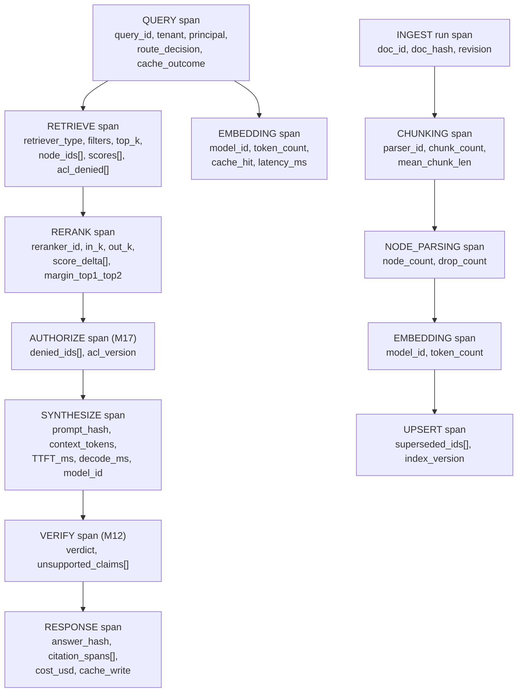

# M19 · Observability, Tracing, and Online Evaluation

> **Module question:** What do you instrument so that a quality drop is diagnosable before a user reports it?
> **Cross-cutting threads:** Failure modes · Tradeoff ledger · LlamaIndex at a glance
> **Domain spine:** LogiTrack — a Tuesday-afternoon quality drop traced to a carrier-agreement revision ingested with a broken parser
> **Prerequisites:** [M13 — Evaluation of Retrieval and Generation](../13-evaluation/README.md), [M17 — Multi-Tenant, Permissioned, and Regulated RAG](../17-multitenant-permissioned/README.md), [M18 — Cost Engineering and Latency Budgets](../18-cost-and-latency/README.md)

---

## Opening scene — the incident with no error in it

**Tuesday, 14:07.** LogiTrack's ingestion sync picks up a carrier-agreement revision: Hapag-Lloyd's
service agreement, revision 2026-03, a 210-page PDF with a new embedded font subset. The sync job
succeeds. Exit code 0. Duration 41 seconds. Nothing in the log is a warning.

The PDF's text layer for pages 44–63 — the dangerous-goods annex — does not extract. The embedded subset
maps most glyphs to the wrong codepoints, so the parser produces 20 pages of plausible-looking Latin
garbage. Not empty, not an exception: **text**. 1,180 chunks are re-embedded from garbage and upserted,
superseding the annex's previous revision.

**Tuesday, 14:07 to Thursday, 09:20.** For two days, every DG question behaves like this:

| Observable | Value before | Value after | Alerts? |
|---|---|---|---|
| Error rate | 0.02% | 0.02% | No |
| P95 latency | 2.48 s | **2.31 s** | No — it improved |
| Monthly cost run rate | $18,000 | **$17,460** | No — it dropped |
| Faithfulness (sampled) | 0.91 | **0.93** | No — it improved |
| Recall@10, DG stratum | 0.88 | **0.41** | **Not measured** |
| Golden-set recall overall | 0.86 | 0.83 | Not measured continuously |

Every metric on the dashboard that exists is either flat or **better**. Latency improved because garbage
chunks are shorter, so prompts are smaller. Cost dropped for the same reason. Faithfulness improved
because an answer drawn from a shorter, less relevant context is easier to be faithful to — the model
says less, and less is easier to support. (This is F6 turning into F1: the system became more faithful
by retrieving worse.)

The first human signal is Thursday morning, when a customs broker notices that the DG surcharge the system
quoted is last quarter's number. Time to detect, from a human: **45 hours**. And the human detected it by
*knowing the answer*, which is not a control — it is luck with domain expertise attached.

> **Failure mode (the module in one line):** instrumenting the system's **health** (uptime, errors,
> latency, cost) instead of its **quality**, so a change that makes every health metric flat-or-better
> while destroying retrieval is invisible — and the first detector of a recall collapse is a customer.

---

## What a trace has to contain for a drop to be diagnosable

Attributability is the requirement, and it is stricter than "we have traces." A trace is diagnostic when
**every stage that can be the cause emits a span whose attributes can distinguish that cause from every
other cause.** The framework gives the mechanism two generational surfaces, and you have to know which one
you are on: observability "is now being handled via the `instrumentation` module (available in
v0.10.20 and later)," while "a lot of the tooling and integrations mentioned in this page use our legacy
`CallbackManager` or don't use `set_global_handler`" [LI-OB]. The instrumentation module's vocabulary is
exactly the right one for this problem — an `Event` is "a single moment in time that a certain occurrence
took place," a `Span` "represents the execution flow of a particular part in the application's code and
thus contains `Event`s," `SpanHandler` is "responsible for the entering, exiting, and dropping (i.e.,
early exiting due to error) of `Span`s," and a `Dispatcher` "emits `Event`s as well as signals to
enter/exit/drop a `Span`" [LI-IN]. Handlers attach to a dispatcher, and dispatchers are **hierarchical**:
"all `dispatcher`s except for the root `dispatcher` [have] a parent, and when handling events or span's
can propagate them to its parent as well (this is the default behaviour)" [LI-IN] — so a root-level handler
sees everything and a module-level handler sees one module, which is how you get per-stage attribution
without a global god-object.

The legacy surface is still the one most codebases actually use, and its event types map one-to-one onto
the stages you must attribute: `CHUNKING`, `NODE_PARSING`, `EMBEDDING`, `LLM`, `QUERY`, `RETRIEVE`,
`SYNTHESIZE`, `TREE`, `SUB_QUESTION` [LI-CB]. That list is effectively the minimum span set — and note
that it is **ingest-side as well as query-side**: `CHUNKING`, `NODE_PARSING`, and `EMBEDDING` fire during
indexing [LI-CB], which is what makes the opening scene's failure attributable at all. An observability
stack scoped to query time cannot see the incident, because the incident happened at 14:07 in an
ingestion job that exited zero.

Two attributes on that diagram are the ones teams omit and then cannot diagnose without:

- **`index_version` / `snapshot_id` on every retrieve span, mirrored from the ingest span.** Without it, a
  Friday trace and a Tuesday trace are not comparable, and "did the corpus change under this query?" — the
  opening scene's exact question — is unanswerable from the telemetry. This is the same identifier M14
  needs for deletion lineage and M17 needs for audit reconstruction; it is one field with three consumers.
- **`cache_outcome` on the query span (→ M18).** A cached answer never ran retrieval, so its retrieve span
  is absent and its latency and cost are near zero. A dashboard that does not segment by cache outcome
  will read a cache hit rate change as a performance improvement.

### Logging the retrieved node set with scores and lineage

The retrieved node set is the single most valuable artifact in the trace and the single most dangerous one
to retain, and both facts are permanent. It is valuable because retrieval is the stage that fails most
often (F1, F2, F4 are all retrieval-side) and because *which* nodes were retrieved — not just how many —
is what distinguishes "the right chunk was there and ranked 9th" from "the right chunk was never
retrieved." Those two failures have different fixes and identical summary statistics.

Log per query, at minimum:

| Field | Diagnostic value | Retention note |
|---|---|---|
| `node_ids[]` in rank order | Reproduces the ranking exactly; joins to the docstore for lineage | IDs only — cheap, and not sensitive on their own |
| `scores[]` alongside `node_ids[]` | Distinguishes a retrieval miss (low scores everywhere) from a ranking failure (right node, low rank) | Cheap |
| `margin_top1_top2` | A collapsed margin is the earliest detectable signal that a query is no longer well-served | Cheap, and the highest-value single derived field |
| `doc_ids[]` and `ref_doc_id` lineage | Maps a bad node back to the document that produced it, which is how an *ingest* bug is found from a *query* symptom | Joins to the docstore; no duplication needed |
| `node_text` (or a hash of it) | Lets a reviewer read the evidence without a second query | **The sensitive field.** Retain the hash long; retain the text under the short window and under M17's isolation rules |
| `acl_denied_ids[]` | Distinguishes "not retrieved" from "retrieved and denied" — a distinction with completely different owners (M6 vs M17) | IDs only |
| Token counts per call (`prompt`, `completion`, `embedding`) | Binds the trace to M18's cost waterfall, so a cost anomaly is attributable to a span rather than to the invoice | Cheap; the framework's `TokenCountingHandler` exposes exactly these per-call via `TokenCountingEvent` and in total, cumulative until `reset_counts()` [LI-TC] |

Note the last row. Without it, a permission filter narrowing results and a retriever failing to find
results look identical in every aggregate metric, and the two have opposite fixes.

> **Tradeoff (the ledger entry M19-1).** *Decision:* retain full node-level trace detail (IDs, scores,
> ranks, margins, ACL decisions) for the long window, and node **text** only for a short window, with the
> text redacted at the span boundary per M17's retention split. *Costs:* reconstructing a month-old
> incident without text requires re-reading source documents and re-running retrieval against the archived
> `index_version`; two retention classes to operate; and a redaction step in the hot trace path that can
> itself fail. *Accepted because:* IDs and scores answer the diagnostic questions (miss vs misrank vs
> denial vs staleness) and are not sensitive, while text answers only "what did the model read" — a
> question that matters for two weeks and is a liability for two years (→ M17). *Reverses if:* a
> regulatory obligation or an incident class requires verbatim prompt retention, in which case the text
> moves to a purpose-built store with its own ACLs rather than being kept in the trace backend.

### Online signals as proxy labels

Offline evaluation (M13) answers "did this change help on the set we have." Online signals answer "is the
system working right now on traffic we do not have labels for." They are the only continuous feedback in
the system, and they are **proxies** — every one of them is confounded, in a way that is specific to the
signal and knowable in advance:

| Signal | What it plausibly proxies | Its bias | What it structurally cannot see |
|---|---|---|---|
| **Thumbs up/down** | User-perceived satisfaction on that answer | Self-selection: only a small, non-random fraction rate anything, and raters skew to the extremes | Any answer the user did not react to — including the confident wrong answer that was pasted into a client email |
| **Regeneration / re-ask rate** | Whether the first answer was usable | Confounded with user patience and with the interface: a re-ask may be a refinement, not a complaint | Failures where the user does not know the answer is wrong |
| **Citation-click rate** | Whether the user is verifying | Rises with *suspicion* as well as with diligence; falls when users stop checking | Nothing directly — it is a behaviour, not a judgment |
| **Abandonment (session ends after answer)** | Frustration *or* success | Ambiguous by construction: satisfied users also leave | Both directions |
| **Escalation to human / support ticket** | A failure the user could attribute | Requires the user to know a human path exists, and to have the time | Silent failures (the opening scene's broker never escalated — she just knew the number) |
| **Copy/paste or export of the answer** | Perceived usability | Proxy for *use*, not for *correctness*; the opening scene's wrong answer was copied | Correctness entirely |

Two design consequences follow, and both are engineering requirements rather than analytics preferences:

1. **Never let a proxy be the only quality signal.** The signals above are all downstream of the user
   *noticing*, and every expensive failure in this course is one the user does not notice until later.
   Proxies are a monitoring layer over an offline gate (M13), never a replacement for it.
2. **Log the proxy as an event with the trace id, not as a separate analytics stream.** The signal's value
   is entirely in joining it back to *which nodes were retrieved* — a thumbs-down with no trace id tells
   you something is wrong and nothing about what. The join key is the `query_id` on the query span, which
   is the reason to emit it in the response payload.

The literature's own finding here is a limitation, not a validation, and it is worth internalising before
designing a dashboard around proxies: harvesting implicit feedback from interaction logs is studied
because "asking for direct user feedback can be disruptive," and the results are "mixed... this helps in
short human-designed questions (MTBench) but not on longer and more complex questions (WildBench)," the
paper's own summary being "an in-depth study of implicit user feedback, showing its potential and
limitations" [UFF25]. **The signals are a lens on users, not a measurement of quality** — the paper's title
says so, and the mixed result is the finding.

> **LlamaIndex at a glance:** the framework ships the *plumbing* for online signals but not the signals.
> `set_global_handler("<handler_name>", **kwargs)` wires an integration in one line, with `kwargs` passed
> through to the underlying handler [LI-OB], and the integrations span hosted and self-hosted backends:
> OpenTelemetry (exportable to Jaeger, Zipkin, or Prometheus), LlamaTrace/Arize Phoenix, SigNoz, W&B Weave,
> MLflow, OpenLLMetry, Langfuse, Literal AI, Opik, Argilla, Agenta, Confident AI, and Maxim [LI-OB].
> Several of the newer ones route through `instrumentation` rather than callbacks, and one doc note is
> worth copying into your own design: embedding calls are not traced by every integration [LI-OB] — which
> means the stage that failed in the opening scene is not necessarily visible in the default trace you
> get from your vendor. **Audit which spans your integration actually emits before trusting it as the
> diagnostic surface.**

---

## Drift detection, alert design, and the loop back into the golden set

### Detecting drift on query and embedding distributions

Concept drift is "unforeseeable changes in the underlying distribution of streaming data over time," and
the field's established framework has three components — "concept drift detection, concept drift
understanding, and concept drift adaptation" [DRIFT]. Two of those three transfer to RAG with a twist,
and one does not transfer at all:

| Drift kind | What drifts | Detectable from | Transfers cleanly? |
|---|---|---|---|
| **Query drift** | The distribution of incoming questions | Query embedding distribution; query length; intent-class mix; entity-type mix | Yes — this is the classic unsupervised drift-detection setting, and it needs no labels |
| **Corpus drift** | The documents and the index | Ingest volume and change rate; per-parser extraction statistics; index-version diffs; golden-set recall per stratum | Partly — detection yes, but the *cause* requires ingest-side telemetry, which is why ingest spans exist |
| **Model drift** | The behaviour of a pinned API beneath you | Golden-set re-runs; output-distribution shift at fixed input | Yes, as a *measurement* — but see M20, which owns the pinned-API problem |
| **Concept drift proper** | The relationship between evidence and correct answer | Human labels on fresh traffic | **No** — this is the one the drift literature is actually about, and RAG has no labels for live traffic |

The last row is the honest limit and the reason this section is short. A drift *detector* is a statistical
test on a stream; in the classic setting the stream carries labels and the test watches the error rate.
In production RAG, the live stream carries no labels, so what you can actually monitor is (a) **input
drift** — the query and embedding distributions, which are unsupervised and cheap — and (b) **proxy
drift** — the online signals above, which are confounded. Everything more rigorous requires sampling
traffic and paying for labels.

If you cite detectors for input drift, cite them for what they are. Note also that established drift work
carries an important warning by omission: "data analysis has revealed that machine learning in a concept
drift environment will result in poor learning results if the drift is not addressed" [DRIFT] — adaptation
in that literature means *retraining the model*. For RAG, adaptation means re-chunking, re-embedding,
re-tuning filters, or changing the corpus (→ M14, → M20). The taxonomy transfers; the remedy does not.

| Detector on your telemetry | Statistic | Catches | Typical lag |
|---|---|---|---|
| Query-embedding centroid shift | Distance between rolling and reference centroid, per tenant | New topic classes, new jurisdiction mix | Hours–days |
| Query-length / token distribution | PSI or KS on the distribution | Terse-vs-verbose shift; a new client with different phrasing | Hours |
| Per-stratum golden-set recall | Re-run the M13 set, stratified | **The opening scene** — a stratum-specific collapse | One eval cycle (a night) |
| Mean `margin_top1_top2` | Rolling mean of the retrieval margin | Retrieval quietly getting less decisive, before recall moves | Hours |
| Ingest extraction statistics | Mean chunk length, characters per page, drop counts per parser | **The opening scene**, in minutes | Minutes |
| Cost per query at flat traffic | Rolling cost / query | A silent change in prompt size, cache outcome, or route mix | Hours |

The `margin_top1_top2` row is the one teams discover late and then never remove, because it moves *before*
recall does: as the corpus drifts away from a query class, the top-1 stops being clearly best long before
the correct document stops being retrieved at all.

### Alert design on quality metrics rather than uptime

An alert is a promise that someone will act, and the failure mode of observability work is alert fatigue —
so the design rule is that **every quality alert has an owner, an action, and a threshold justified by a
decision, not a number chosen to stop the noise.**

| Alert | Metric | Window | Why this threshold | Action |
|---|---|---|---|---|
| **Stratum recall floor breach** | Golden-set recall@10 per stratum, nightly | 1 night | Threshold is M13's 0.85 floor, applied *per stratum* rather than in aggregate | Page the retrieval owner; freeze deploys; the aggregate number hides the stratum (the opening scene) |
| **Extraction quality regression** | Characters per page, and mean chunk length, per parser per ingest run | Per run | Threshold is a control-chart bound on the last 30 runs, because "normal" is parser-specific | Block the corpus update from serving; re-ingest after parser fix |
| **Retrieval margin collapse** | Mean `margin_top1_top2`, rolling | 6 h | Alert at 2σ below the 30-day baseline for that stratum | Investigate before users report; no page |
| **Ingest assertions** | Text-length-per-page, glyph coverage, language-detection confidence | Per document | Any document failing the assertion | **Fail the ingest.** This is a correctness control, not an alert |
| **Cache-hit-rate collapse** | Cache outcome mix (→ M18) | 15 min | A sudden drop means keys changed, ACL hashes changed, or the cache broke; cost and latency both move | Investigate; the cost alert will fire first |
| **Faithfulness sampled score** | M13's evaluator on a 1% sample | Daily | Alert on a *drop* below the trailing band | Investigate; note this alert did **not** fire in the opening scene, because faithfulness went *up* |
| **Cost against the M18 waterfall** | Actual vs the committed line, per component | Daily | Alert on any component exceeding its waterfall allocation by 20% | Re-derive the waterfall (→ M18) |

Two of these are worth generalizing, because they are the ones that catch the class of failure this
module exists for: **an ingest-time assertion is worth more than any post-hoc alert**, because it converts
a two-day incident into a failed job; and **the alert must be on the metric whose value *should* hold, in
units you do not have to interpret.** A "cost dropped 3%" alert looks absurd until you articulate the
invariant it encodes: *cost per query at flat traffic should not change by more than the noise band,
because any large move is a change in what is being retrieved.* The opening scene's incident is visible in
exactly that alert, on the same day, which is the point.

> **Tradeoff (the ledger entry M19-2).** *Decision:* alert (page a human) only on stratum-level recall
> and extraction assertions; route everything else to a daily digest with an owner. *Costs:* slow-moving
> degradations — margin collapse, cost creep, cache misbehaviour — are found in the digest rather than in
> minutes, so some incidents are caught a day late. *Accepted because:* a paging alert that fires
> weekly and is dismissed is worse than no alert, since it trains the on-call engineer to ignore the
> channel that carries the recall breach. The two paging alerts are the two whose failure is a
> *correctness* failure with no user-visible signal; the digest alerts are the ones a human will notice.
> *Reverses if:* a digest alert fires twice in a week, which is evidence its process is wrong (usually
> because a genuinely paging invariant was misclassified) — promote it and fix the process.

### A/B and interleaving for retrieval changes

Offline evaluation decides whether a change *can* ship; online evaluation decides whether it *did*. The
distinction matters most for retrieval, where the offline set is finite and the online traffic is not, and
where the effect you care about (does the user get a better answer) is measured through a proxy.

| Method | Unit of comparison | Strength | Cost | Use when |
|---|---|---|---|---|
| **A/B over sessions** | Independent user/session cohorts | Unbiased for any metric you can log; the standard for a full-pipeline change | Needs traffic volume; needs metric stability; two systems to operate for the duration | A new reranker, a new chunk size, a new model — anything changeable per request |
| **Interleaving** | One merged list, per query | Far more sensitive per unit of traffic — it detects ranking differences with a fraction of the sample, and it compares *rankings* rather than systems | Only valid for ranking changes; requires the same result set from both arms and a click/credit model | Comparing two rankers or two fusion weights with limited traffic |
| **Shadow / replay** | Logged queries against a new arm | No user exposure at all; safe for risky changes | No online signal either — you get offline metrics on real queries | Risky retrieval changes; validating an index rebuild (→ M14) |
| **Canary by tenant** | One tenant's traffic | Blast-radius control; the natural unit when tenants are the isolation boundary (→ M17) | Slow to reach significance; a tenant-specific effect contaminates the comparison | Any change with a compliance or contract dimension |

Two practical constraints that decide between them. **A/B spends traffic, and LogiTrack's DG stratum is a
small fraction of 8,500 queries/day** — a stratum-level A/B on a 4% stratum with a modest effect size may
need weeks, which is why the opening scene took two days to be noticed by a human and would have taken
far longer to be caught by an underpowered experiment. **And a proxy metric must be chosen before the
experiment runs**, because a metric selected after seeing the results is not a measurement. Decide the
metric, the stratum, the minimum detectable effect, and the stopping rule *in the experiment design*, and
make the design a reviewable artifact — the M13 harness is the offline half of the same artifact.

> **Tradeoff (the ledger entry M19-3).** *Decision:* default to shadow/replay for retrieval changes and
> reserve live A/B for changes that cannot be judged offline, accepting slower shipping. *Costs:* changes
> reach users later; shadow runs double the retrieval cost for the duration (→ M18); and shadow results
> are offline proxies, so a change that only helps through a user-behaviour channel will be missed.
> *Accepted because:* retrieval changes are the ones whose failures are invisible in health metrics (the
> opening scene) and whose blast radius is the whole corpus, so the asymmetry favours a method with no
> user exposure. *Reverses if:* the change class is ranking-only and traffic is sufficient — interleaving
> is then strictly more efficient than either, and the lab's harness should support it.

### The feedback loop back into the golden set

The golden set is a *product*, and its maintenance is the mechanism by which the system improves. M13 owns
its construction, stratification, and growth; M19 owns the **online-to-offline pipeline** that keeps it
current, because the pipeline is a piece of infrastructure that runs on telemetry:

| Online evidence | Hypothesis it generates | Golden-set action |
|---|---|---|
| A stratum whose recall dropped (alert) | The corpus or the query mix changed under that stratum | Add that stratum's failing queries; investigate the corpus change (the opening scene) |
| Thumbs-down clusters with a shared `doc_id` | One document is bad — wrong revision, bad parse, mis-scoped permission | Test the document directly; add a query whose answer is in it |
| Queries with a collapsed `margin_top1_top2` | A query class is no longer well-served by the index as built | These are the *hardest* queries you have and the best candidates for the set |
| Cache false hits (→ M18) detected by sampling | The response-cache threshold is too loose | Add the false-hit pair to the set as a *negative* example — the answer must differ |
| Escalations and regenerations with trace ids | A question shape the router misclassified (→ M16) | Add to the router's evaluation set, not the retrieval set |
| New client, new jurisdiction, new document type | A stratum that did not exist | **Create the stratum.** This is the loop's most important job |

The pipeline has one non-negotiable property: **the golden set must not be grown from the system's own
outputs without human adjudication.** M13 owns the trap in synthetic generation; the online version of the
same trap is subtler and worse — adding a query *because the system got it wrong* is legitimate, but
adding the system's *answer* as the reference is how an evaluation set learns the system's errors and
certifies them. Every entry that enters the set from online evidence enters with a human-written
reference answer or it does not enter.

> **Tradeoff (the ledger entry M19-4).** *Decision:* run a weekly, human-adjudicated loop from online
> evidence into the golden set, capped at a small number of additions per week. *Costs:* a recurring
> domain-expert hour every week, forever — the only line item in this module that is a *person's time*;
> a set that grows without bound unless retired (M13's maintenance problem); and a set whose growth is
> biased toward failure modes the current system exhibits. *Accepted because:* the alternative is a
> frozen set that measures the system you had, and the M18 waterfall is attached to a recall floor that
> must remain meaningful as the corpus quadruples. *Reverses if:* additions stop changing the aggregate
> score, which is evidence the set has saturated relative to the current system — at which point the
> stratification needs revisiting rather than more queries (→ M13).

---

## Worked example: the Tuesday-afternoon drop, and what would have caught it

The opening scene, analysed as an instrumented incident. The question is not "what went wrong" — a
parser failed on a font subset — but **"what control, at what detection latency, at what build cost,
would have caught it before a broker did."** Each control below is priced in the same units the incident
cost: detection latency and engineering time.

| Control | Detection latency | What it costs to build | Would it have caught it? |
|---|---|---|---|
| Uptime / error-rate alerting | Never | Already built | **No** — exit code 0, no errors |
| Latency alerting | Never | Already built | **No** — P95 *improved* 2.48 s → 2.31 s |
| Cost alerting | Never | Already built | **No** — cost *dropped* 3% |
| **Ingest assertion: characters-per-page and glyph-coverage bounds per parser** | **< 15 min** (same sync run) | ~1 day, plus a baseline from 30 runs | **Yes** — 20 pages of garbage trip any length or coverage bound |
| **Nightly per-stratum golden-set recall** | **~12 h** (the 02:00 run) | ~2 days on top of M13's harness — mostly the stratification | **Yes** — the DG stratum falls 0.88 → 0.41, far past the 0.85 floor |
| Retrieval margin alert (`margin_top1_top2`, 6 h window) | ~6 h | ~1 day | **Yes, as a leading indicator** — DG queries' top-1 becomes indistinct within the first hour |
| Query-embedding distribution drift | ~hours | ~3 days (reference distribution, per-tenant baselines, threshold calibration) | **Partly** — the *queries* did not change; only the corpus did. Query drift detects this only via a drop in top-1 similarity |
| Faithfulness sampling | Never | Already built | **No — it improved.** The system got more faithful by retrieving worse, which is why faithfulness alone is not a quality gate |
| Online signals (regeneration, thumbs, citation clicks) | Hours-to-days, and only for users who noticed | ~1 week (event plumbing, trace-id join, dashboard) | **Maybe** — the first broker noticed at 45 h; the signals would have shown a regeneration uptick if those users had asked |
| Human domain expertise | **45 h**, and by luck | Unbounded | It "worked," and it is not a control |

Read the table's shape. **The two controls that would have caught it cost about three engineering-days
between them, and both are on the ingest and offline-eval sides — not the query side.** That is the
module's central finding in one comparison: the observability investment that pays is the one that
watches *what enters the index* and *what the index can still answer*, not the one that watches *how the
service is running*. Every existing dashboard in the opening scene watched the service, and every existing
dashboard reported that the service was fine.

**The dashboard the incident implies.** Ranked by value per engineering day, not by completeness:

1. **Ingest health, per parser, per run**: characters per page, mean chunk length, drop counts, glyph
   coverage — with 30-run control bounds and a *blocking* assertion. One day of work; catches the entire
   class of "the parser silently produced garbage."
2. **Per-stratum recall, nightly**: the M13 set, sliced by the strata that matter (jurisdiction, question
   shape, freshness), each with its own floor. The aggregate number hid this incident; the stratum found it.
3. **Retrieval margin distribution, per stratum, rolling 6 h**: the leading indicator, and the cheapest
   single derived field in the trace.
4. **Index version and ingest provenance on every query trace**: the field that makes "did the corpus
   change under this query" answerable at all, and the join that turns a query symptom into an ingest bug.
5. **Cost-per-query and cache-outcome mix, daily, against the M18 waterfall**: the mundane alert that
   would have fired on the *improvement*.

Note what is not on the list. No new vendor, no LLM-judge running on 100% of traffic, no real-time
anomaly detection. **The controls that matter here are assertions and stratified aggregates over data you
already have** — the trace attributes from the first section of this module, sliced the way the incident
cuts. That is the honest shape of most observability wins: not a better tool, but a better choice of
what to compute from the spans already being emitted.

**The lab.** Instrument the pipeline end to end and build the dashboard above: every stage emitting a
span with the attributes named in the trace diagram, the retrieved node set logged with scores and
lineage, the ingest assertions wired to block, and the per-stratum recall job attached to the M13 harness.
Then re-run the incident — replace a document with a deliberately corrupted parse — and measure your
**detection latency** for each control. That measurement, not the dashboard's existence, is the
deliverable: the number you are trying to move from 45 hours to minutes.

---

## Design exercise

> *Paper-based. Think, then write.*

**Task.** Write the observability and online-evaluation plan for a RAG system you own — or LogiTrack's, if
you have none. The deliverable is a set of alerts with owners and a feedback loop, not a tooling choice.

1. **Write the invisible incident first.** Describe a change that would make every metric you currently
   monitor flat-or-better while degrading answer quality. If you cannot describe one, you have not
   looked; the opening scene's mechanism (shorter, less-relevant context → lower cost, lower latency,
   *higher* faithfulness) generalizes to any degradation that shrinks what the model reads.
2. **Name the invariant that would have caught it.** For your incident, state the metric, the unit, and
   the direction you expect it to be *stable* in — then write the alert. "Cost per query should not move
   by more than the noise band at flat traffic" is an invariant; "monitor cost" is not.
3. **Audit your spans for attributability.** For each stage that can be the cause of a quality drop,
   state the span attribute that distinguishes that cause from the others. Two are mandatory and usually
   missing: **`index_version`** on every retrieval span and **ACL-denial counts** on the authorization
   span (→ M17). If you are on the legacy callback surface, note the event types it gives you
   (`CHUNKING`, `NODE_PARSING`, `EMBEDDING`, `LLM`, `QUERY`, `RETRIEVE`, `SYNTHESIZE`, `TREE`,
   `SUB_QUESTION` [LI-CB]) and which stages they leave dark.
4. **Classify every online signal you collect as a proxy and name its bias.** For each of thumbs,
   regeneration, citation-click, abandonment, and escalation: what it plausibly proxies, the specific bias,
   and what it structurally cannot see. Then state which *one* of them you would use as a secondary
   guardrail and which you would refuse to alert on at all.
5. **Design the alert table with owners and actions.** Every alert gets a metric, a window, a threshold
   *justified by a decision* (not by noise suppression), an owner, and an action. Mark exactly two as
   paging. If you have more than three paging quality alerts, state which invariant each encodes and
   delete the ones whose invariant you cannot state.
6. **Design one experiment for a retrieval change, before running it.** State the unit of randomization,
   the method (A/B / interleaving / shadow / canary), the stratum, the metric, the minimum detectable
   effect, and the stopping rule. Then state the traffic volume it needs and whether you have it — if
   your stratum is too small for the effect size, say so and choose shadow instead.
7. **Close the loop with a weekly quota.** State who adjudicates, how many additions per week, which
   evidence sources feed the loop, and the rule that prevents the set from absorbing the system's own
   answers. Then state the retirement rule for entries that no longer discriminate.

**Why this exercise matters.** Observability is the discipline where the gap between "we have a dashboard"
and "we can diagnose a drop" is largest, and where the difference is almost never the tool. It is the
choice of what to compute, and specifically the willingness to compute **quality** rather than health —
which is harder, because quality metrics are noisier, slower, more expensive, and produce alerts that
fire when nothing is obviously broken. The senior-engineer skill is being the person who insists on them
anyway, on the grounds that a system whose quality can collapse silently is not a system anyone can
operate, no matter how green its dashboard is. Note also what the exercise refuses to accept as an answer:
a proxy signal as a primary quality gate. Every proxy in this module is downstream of the user *noticing*,
and the failures that cost the most are the ones nobody notices until it is too late to be cheap — which
is why the offline stratum floor, not the thumbs-down rate, is the alert that pages someone.

---

## Where the literature disagrees

- **"Online proxy signals tell you whether quality is dropping."** The implicit-feedback study is explicit
  that they are a lens, not a measurement. Its motivation is pragmatic — "asking for direct user feedback
  can be disruptive; thus, we study harvesting implicit user feedback from user-LM interaction logs" — and
  its results are "mixed... this helps in short human-designed questions (MTBench) but not on longer and
  more complex questions (WildBench)," concluding with "an in-depth study of implicit user feedback,
  showing its potential and limitations" [UFF25]. Read the direction of the negative result: the signals
  were **less** useful precisely on the longer, more complex questions — which is the class LogiTrack's
  global and multi-hop questions belong to (→ M16), and the class where a wrong answer is most expensive.
  **What to change:** use proxies as a monitoring layer and a source of hypotheses, never as the primary
  quality gate, and expect them to be weakest on your hardest questions. The alert that pages someone
  should be an offline stratified metric (M13's harness), and the proxies should feed the golden set
  (§"the feedback loop") rather than the pager.
- **"Drift detection is a solved problem you can adopt."** The drift literature's framework — detection,
  understanding, adaptation — is well established [DRIFT], and the warning it carries is real: "data
  analysis has revealed that machine learning in a concept drift environment will result in poor learning
  results if the drift is not addressed" [DRIFT]. But the framework assumes a stream with a measurable
  *error rate* and an adaptation path that is *retraining*. RAG has neither: live traffic carries no
  labels, and you cannot retrain a pinned vendor's generator. **What to change:** adopt the detection
  component and adapt the rest. What you can honestly monitor online is **input drift** (query and
  embedding distributions, unsupervised and cheap) and **proxy drift** (confounded, per the bullet above).
  True concept drift — a change in the evidence-to-answer relationship — is detectable only through
  labelled samples of fresh traffic, which means the golden-set loop is not a nice-to-have but the only
  instrument that can see it. And note the vocabulary trap: the drift literature's "concept" is a labelled
  target variable; a shift in your *terminology* or your *jurisdiction mix* is not drift in that sense,
  it is a distribution shift in the inputs, and conflating the two leads to monitoring the wrong thing.
- **"Fine-grained evaluation metrics correlate better with humans, so use them online."** RAGChecker's
  meta-evaluation reports that it "has significantly better correlations with human judgments than other
  evaluation metrics," and demonstrates the framework by evaluating "8 RAG systems" and revealing "insightful
  patterns and trade-offs in the design choices of RAG architectures" [RAGCHECKER24]. The claim is
  well-supported and the framework is the right instrument for the offline gate. **What to change:** read
  the cost. Claim-level diagnostic metrics require a judge call per claim, and running them on 100% of
  8,500 daily queries is a new line in M18's waterfall — the evaluation component M18 prices at
  sub-1%-of-spend covers the *golden set*, not production traffic. Use the fine-grained instrument where
  it is definitive (the offline gate and incident forensics on a sample) and a cheap sampled proxy online.
  Also treat "significantly better correlation" as the claim it is: a correlation with human judgments on
  a meta-evaluation set, not a guarantee that the metric is calibrated on your domain.
- **"More tracing is strictly better."** No paper disagrees with this, because no paper is about it —
  and that is the point. The retention of retrieved node text, prompts, and responses in a trace backend
  is a **data-store decision with an authorization dimension** (→ M17), and the observability literature
  is written from the assumption that more detail is more diagnostic. This module located no study that
  treats trace-retention as a privacy or multi-tenancy problem, which means there is no literature to lean
  on: the decision is yours, it is a ledger entry (M19-1), and the honest statement is that the field has
  not yet treated traces as a regulated store. **What to change:** make the retention split a deliberate
  decision with a stated basis rather than the default of whatever the vendor retains.

---

## Sources

- [Observability](https://developers.llamaindex.ai/python/framework/module_guides/observability/) — `[LI-OB]` · owns `set_global_handler`, the integration catalogue (OpenTelemetry, LlamaTrace/Arize Phoenix, SigNoz, W&B Weave, MLflow, OpenLLMetry, Langfuse, Literal AI, Opik, Argilla, Agenta, Confident AI, Maxim), the note that observability moved to the `instrumentation` module in v0.10.20 while legacy `CallbackManager` integrations remain, and the per-integration gaps (e.g. embedding calls not traced).
- [Instrumentation](https://developers.llamaindex.ai/python/framework/module_guides/observability/instrumentation/) — `[LI-IN]` · owns `Event`, `EventHandler`, `Span`, `SpanHandler`, `Dispatcher`, the `span_enter` / `span_exit` / `span_drop` signals and `@dispatcher.span` decorator, and the parent-propagating dispatcher hierarchy.
- [Callbacks](https://developers.llamaindex.ai/python/framework/module_guides/observability/callbacks/) — `[LI-CB]` · owns the legacy `CallbackManager` surface, the `CBEventType` list (`CHUNKING`, `NODE_PARSING`, `EMBEDDING`, `LLM`, `QUERY`, `RETRIEVE`, `SYNTHESIZE`, `TREE`, `SUB_QUESTION`), `LlamaDebugHandler`, and the token-counting handler.
- [Callbacks — Token Counting Handler](https://developers.llamaindex.ai/python/examples/observability/tokencountinghandler/) — `[LI-TC]` · owns the token telemetry that binds the query span to M18's cost waterfall (`total_embedding_token_count`, `prompt_llm_token_count`, `completion_llm_token_count`, per-call `TokenCountingEvent`, cumulative-until-reset).
- *User Feedback in Human-LLM Dialogues: A Lens to Understand Users But Noisy as a Learning Signal* — Yuhan Liu, Michael J.Q. Zhang, Eunsol Choi · arXiv:2507.23158 (v2, 2025; EMNLP) · [arxiv.org/abs/2507.23158](https://arxiv.org/abs/2507.23158) — `[UFF25]` · owns the study of implicit user feedback from interaction logs and its mixed/negative result on long, complex questions.
- *Learning under Concept Drift: A Review* — Jie Lu, Anjin Liu, Fan Dong, Feng Gu, Joao Gama, Guangquan Zhang · arXiv:2004.05785 (2020; journal reference IEEE TKDE 31(12):2346–2363) · [arxiv.org/abs/2004.05785](https://arxiv.org/abs/2004.05785) — `[DRIFT]` · owns the concept-drift framework (detection, understanding, adaptation), the taxonomy, and the benchmark/synthetic dataset inventory. *(The canonical *A survey on concept drift adaptation* by Gama, Žliobaitė, Bifet, Pechenizkiy & Bouchachia is ACM Computing Surveys, DOI 10.1145/2523813; this review was cited instead because it is the version whose full author list and record could be fetched and verified directly.)*
- *RAGChecker: A Fine-grained Framework for Diagnosing Retrieval-Augmented Generation* — Dongyu Ru, Lin Qiu, Xiangkun Hu, Tianhang Zhang, Peng Shi, Shuaichen Chang, Cheng Jiayang, Cunxiang Wang, Shichao Sun, Huanyu Li, Zizhao Zhang, Binjie Wang, Jiarong Jiang, Tong He, Zhiguo Wang, Pengfei Liu, Yue Zhang, Zheng Zhang · arXiv:2408.08067 (v2, 2024) · [arxiv.org/abs/2408.08067](https://arxiv.org/abs/2408.08067) — `[RAGCHECKER24]` · owns the fine-grained retrieval/generation diagnostic metrics and the meta-evaluation reporting significantly better correlation with human judgments than other metrics.

**Unsupported (synthetic, no located source):** the Hapag-Lloyd revision, the 210-page PDF, the
pages 44–63 font-subset failure, the 1,180 garbage chunks, every figure in the before/after table
(2.48 s → 2.31 s, $18,000 → $17,460, 0.91 → 0.93 faithfulness, 0.88 → 0.41 stratum recall, the 45-hour
detection latency, the $\tau$ and stratum numbers), the detection-latency and build-cost estimates in the
worked-example table, the alert table's thresholds and windows, the per-stratum detector lag estimates,
and all tradeoff-ledger entries. These are constructed for teaching and are not empirical findings. The
mechanism claimed in the opening scene — that an answer drawn from a shorter, less relevant context can
score *higher* on a faithfulness evaluator because it says less while being supported by what it read — is
argued here as a consequence of how faithfulness is defined against a given context, and is not a measured
result in this module; the same caveat applies to the claim that it generalizes. The claim that a
retrieval margin collapses before recall does is a monitoring heuristic argued here, not measured. No
observability vendor's retention defaults, span coverage, or pricing are asserted or verified; the
per-integration gap about embedding calls is read off the framework's own note [LI-OB] and must be
re-checked against the integration you deploy, since integrations change.

**Verification note:** 🟡 *pending* — Step 7 (memory-less logic review) and Step 8 (literature survey) not yet run on this module.

**Next module:** [M20 — Failure Modes, Drift, and Continuous Improvement](../20-failure-modes-and-drift/README.md)
— M19 gives you the trace that localizes the drop; M20 turns the localized drop into a triage decision, a
failure budget, and the improvement loop that closes it.
