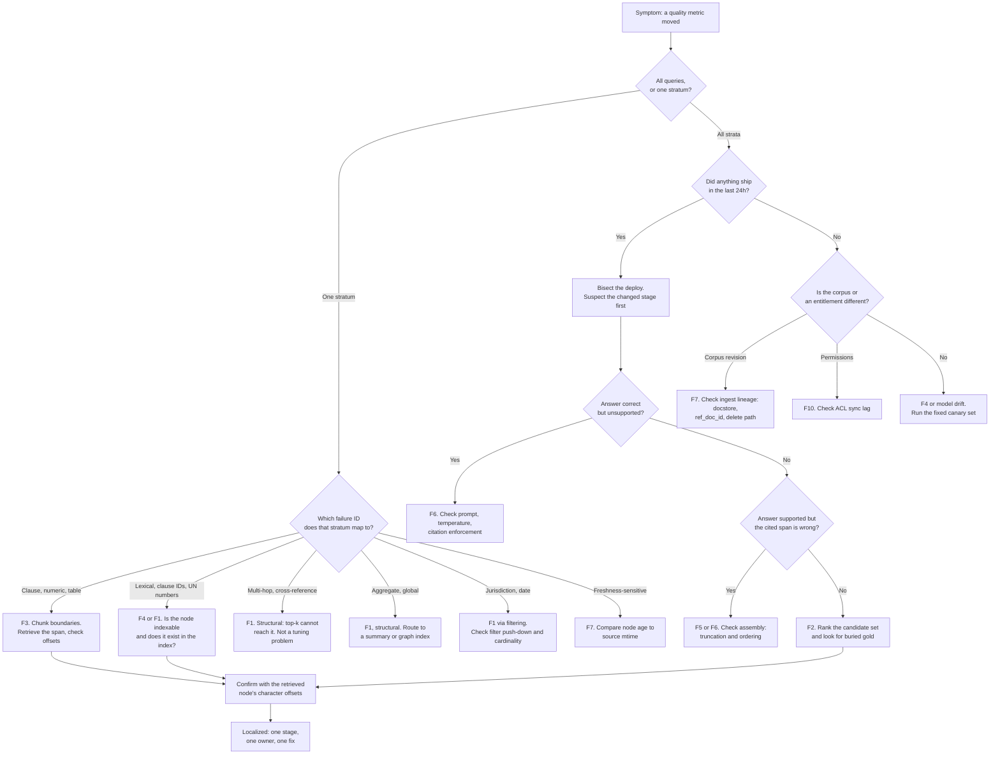

# M20 · Failure Modes, Drift, and Continuous Improvement

> **Module question:** How do you run a RAG system as a system with a known failure budget?
> **Cross-cutting threads:** Failure modes · Tradeoff ledger · LlamaIndex at a glance
> **Domain spine:** LogiTrack — the full incident post-mortem of the Tuesday-afternoon quality drop, root-caused to parse → chunk → stale nodes
> **Prerequisites:** [M2 — The RAG Pipeline End to End](../02-rag-pipeline-end-to-end/README.md) · [M14 — Ingestion at Scale, Incremental Sync, and Deletion](../14-ingestion-at-scale/README.md) · [M19 — Observability, Tracing, and Online Evaluation](../19-observability/README.md)

---

## Opening scene — the Tuesday afternoon slide

**14:08.** The quality dashboard M19 built flips a tile from green to amber. Not an alert — a
trend: faithfulness on the sampled production set has moved from 0.94 to 0.81 over ninety minutes.
P95 latency is unchanged. Error rate is unchanged. Cost per query is unchanged. Every uptime signal
in the building is green.

**14:11.** A support ticket arrives from a customs broker: *"your tool says the demurrage window is
14 days, our contract says 21."*

**14:20.** The on-call engineer runs the standard drill. The relevant carrier agreement was revised
yesterday — a routine revision, one clause amended, ingest completed on schedule at 09:41 and
logged as successful. Retrieval for that question returns a node from the agreement. Generation is
faithful to the node: the node says fourteen days. Citation resolves. Every component is behaving
as designed.

**16:40.** The actual root cause, after three hours of work that should have taken twenty minutes:
the revised agreement was ingested by a **newer parser version** that had been shipped with the
service-bulletin pipeline two weeks earlier. The parser handles the agreement's clause tables
differently from its predecessor. The result is not an error — it is a *successful* ingest of
slightly different chunks. The clause that was amended now straddles two nodes, and the first node
carries the pre-amendment text, which is still present because the amendment is in the second node.
Both nodes are current. Both have correct `ref_doc_id`s. The index is, by every definition the
pipeline checks, fresh.

**17:15.** The second discovery, which is the one that changes the runbook. The old chunks were
never removed. The document-management path the team used (`index.insert` per document, no
docstore attached) treated the revision as a new document rather than a superseding one, so the
2024 revision and the 2025 revision are both in the index, both fresh-looking, both retrievable,
and separated in score by 0.004. Which one wins is a coin flip that decided this query and will
decide the next one differently.

So the incident has three causes, in pipeline order: a **parse** change (M3's territory), a
**chunk-boundary** effect on the amended clause (F3), and a **stale node** that survived because
deletion was never wired up (F7). It took three hours to find because the system had no way to
express "was this answer supported by the *current* revision of the document it cites?" — and no
budget that said how much degradation was allowed before anyone should stop shipping features.

> **Failure mode (the module in one line):** operating a RAG system with no failure budget and no
> triage path — so every quality drop is investigated from scratch, the first plausible cause wins,
> and the fixes that ship are the ones that were easiest to think of rather than the ones the
> evidence named.

---

## The failure budget

Infrastructure teams have had a name for "how much failure is acceptable" for two decades, and the
name transfers: an **error budget**, defined in the standard treatment as "a rate at which the SLOs
can be missed", tracked daily or weekly, with the gap against the SLO "used as an input to the
process that decides when to roll out new releases" [[SRE-SLO]](#src-sre-slo).

The transfer to RAG is not free — the numerator of a quality SLO is measured on a sample, judged by
a model, and therefore carries the judge's error (→ M13) — but the *shape* transfers intact, and
without it there is no way to answer "should we ship this change?". The budget has to exist before
the change arrives, because the only moment at which a quality budget can be negotiated is when
nobody is losing one.

LogiTrack's incident classes, with budgets attached:

| Class | Definition | Budget | Response | Who decides |
|---|---|---|---|---|
| **C1 — Compliance** | A wrong answer with legal or customs consequence, or any cross-client data exposure (→ M17, F10) | **0 per quarter** | Stop the line. Roll back to the last known-good index state. Same-day written post-mortem | Compliance owner, not engineering alone |
| **C2 — Stratum regression** | Any stratum's accuracy drops > 5 pp against the frozen baseline, or P95 > 2.5 s for more than 30 minutes | **1 per quarter** | Triage within 24 h; post-mortem within 5 working days; golden-set additions mandatory | On-call + retrieval owner |
| **C3 — Degradation** | Single-stratum recall down 2–5 pp; freshness SLO breached once; cost per query up > 20% | **4 per quarter** | Fix inside the normal release train; record in the drift log | Retrieval owner |
| **C4 — Individual answers** | Bad answers with no systematic cause; user-reported errors | unbounded, but **tracked** | Triage as a batch weekly; each unresolved case becomes a golden-set candidate | Support + eval owner |

Three design properties of this table matter more than the numbers.

**The budget is per class, not global.** A single "we allow 2% bad answers" line would let four
stratum regressions consume the budget that C1 requires to stay at zero. Classes exist so that
different failures can be traded against each other explicitly rather than accidentally.

**C4 is where the golden set comes from.** The only sustainable source of new evaluation queries is
production failures. A C4 case that is not added to the set is a failure the system is guaranteed to
repeat, because nothing in the evaluation pipeline will ever notice it again. This is the feedback
edge in M19's diagram, and it is the single highest-leverage process in this module.

**C1's budget of zero is a policy, not a measurement.** No sampling regime can certify a rate of
zero. What the zero means is that a compliance-affecting failure is not traded against velocity:
when one happens, the release train stops until the class of failure is structurally excluded, not
until the specific instance is patched.

> **Tradeoff (the ledger entry M20-1).** *Decision:* hold compliance-affecting failures at a zero
> budget and let every other class absorb the variance. *Costs:* velocity. A stop-the-line response
> costs days of engineering time per event, and the fix is usually structural (a stronger backstop,
> a wider eval stratum) rather than local. *Accepted because:* the cost of one wrong customs ruling
> is not on the same scale as the cost of a delayed release, and a budget that allows *some* wrong
> rulings is a budget that has to be argued to a regulator. *Reverses if:* the system's answers stop
> being acted on directly (drafting assistance, search ranking) and become advisory, at which point
> a graded budget is the correct model.

---

## F1–F10 revisited, with the mitigations mapped

Sixteen modules have now shipped mitigations. This table is the audit: what each mitigation
actually buys, what it costs, and what it still does not catch. It is the input to M22's reference
architecture and the reason M22 can read the ledger back as a design.

| ID | Failure | Mitigation shipped in | Production detector | Residual risk after mitigation | Cost of the mitigation |
|---|---|---|---|---|---|
| **F1** | Retrieval miss | Structure-aware chunking (M3); hybrid sparse+dense (M7); summary/graph indexes for multi-hop (M8); query rewriting, decomposition and routing (M10) | recall@k per stratum on the golden set; zero-result rate; abstention rate | Rare identifiers and long-tail clause IDs; queries whose answer needs a document that was never ingested | Extra index (sparse + dense), extra nodes for multi-granularity, plus a query-understanding call |
| **F2** | Retrieval noise | Cross-encoder reranking (M9); fusion of lexical and semantic rankings (M7); MMR for diversity (M9) | nDCG@k; rank of first relevant node; near-duplicate share of top-k | Reranker's own blind spots, and near-duplicate chunks created by overlap competing for slots | A cross-encoder pass per query — the largest single non-generation latency line item |
| **F3** | Chunk-boundary loss | Sentence-window and hierarchical parsing (M3); auto-merging and recursive retrieval (M8) | Answer-completeness on span-level ground truth; fraction of answers whose support crosses a node boundary | Tables and clause hierarchies whose structure the parser still flattens | 2–6× node count; expansion metadata; an extra retrieval hop |
| **F4** | Representation mismatch | Embedding-model selection (M4); lexical retrieval for exact tokens (M7); domain fine-tuning (M15) | Recall split by stratum — lexical, semantic, jargon-heavy — rather than aggregate | Domain vocabulary that post-dates the fine-tune; multilingual lanes | Embedding spend; re-embed cost on every model change |
| **F5** | Context overflow | Assembly ordering and packing (M11); budget-aware candidate-set sizing (M18) | Distribution of assembled-context tokens; faithfulness as a function of context length and answer position | A hard window that the assembler cannot see, because the tokenizer it counts with is not the tokenizer the provider uses | Nothing in latency; a permanent argument about whose token count is authoritative |
| **F6** | Unfaithful synthesis | Prompting and temperature control (M11); citation enforcement and abstention (M12); self-reflection and corrective retrieval (M16, `[SELFRAG23]` and `[CRAG24]`, surveyed there) | Faithfulness and citation precision on a sampled production set — scored with a reference-free evaluator where no ground truth exists [[RAGAS23]](#src-ragas23) — plus the abstention rate | Fluent answers that are faithful to a *misleading* span — the M2 worked example's exact shape | A second model call per sampled query, or per query if online |
| **F7** | Staleness | Incremental ingest with docstore lineage (M14); `ref_doc_id`-based supersession (M14); this module's freshness audit | Age distribution of retrieved nodes versus source modification times; ingest success rate; orphan-node count | Revisions that arrive outside the watched sources; parser-version changes that silently alter chunking (this module's opening scene) | Ingest orchestration; a docstore; delete-path testing |
| **F8** | Budget blowout | Unit economics and the latency waterfall (M18); per-stage tracing [[LI-OBS]](#src-li-obs) (surveyed in M19) | Per-stage p95 latency and per-stage token spend, alerting on the composite | Any new mitigation added without re-pricing the pipeline | Monitoring that must be maintained as stages change |
| **F9** | Poisoned context | Ingest sanitization, provenance constraints, isolation, output filtering (M21) | Injection canary documents in the ingest path; egress monitoring on URLs emitted in answers | Novel injections; the defences' own false-negative rate | A sanitization stage; approval friction; possible recall loss when legitimate documents are flagged |
| **F10** | Scope leak | ACL propagation onto nodes; the post-retrieval authorization filter as backstop (M17) | Red-team leakage test in CI; post-filter audit log of dropped nodes | A permission change in the source system that has not propagated to the index | Metadata on every node; a filter evaluation per query; a permission-sync job |

Two observations from the table are worth stating as findings about the system as a whole.

**Every mitigation bought a failure mode a smaller version of itself.** Wider candidate sets (F1)
worsened ranking (F2). Overlap and multi-granularity (F3) created near-duplicates (F2). A reranker
(F2) added latency (F8). Sanitization (F9) can drop legitimate documents (F1). The mitigations are
not additive; they are a system in tension with itself, which is why the budget in the previous
section has to be refit whenever a mitigation ships.

**The residual-risk column is where incidents come from.** Nothing in the table is fully mitigated.
Every real incident in this module's worked example walks straight through the residual-risk column
of two rows — F3's "clause hierarchies whose structure the parser still flattens" and F7's
"parser-version changes that silently alter chunking" — and the value of writing the column down is
that it tells the post-mortem where to look before the trace does.

> **Multimodal inputs** ($\color{red}\text{to be discussed}$) — much of the residual-risk column comes from mixed-content pages.
> - F3: clause tables, rate tables (XLSX/HTML) and DG cross-reference tables lose their structure when flattened to text.
> - F1: a scanned page with no text layer and no OCR yields no node, which looks like a retrieval miss.
> - Triage: slice recall by extraction path (text layer, OCR, table extractor, figure caption) before blaming the retriever → [M3](../03-parsing-and-chunking/README.md).
> - Feed C4 table-only and scan-only failures into the golden set as their own stratum → [M13](../13-evaluation/README.md).

---

## The drift taxonomy

Failure modes describe a pipeline that is wrong now. Drift describes a pipeline that was right and
is becoming wrong. The concept-drift literature is mature and explicit about the shape of the
problem: "Concept drift describes unforeseeable changes in the underlying distribution of streaming
data over time. Concept drift research involves the development of methodologies and techniques for
drift detection, understanding and adaptation" [[DRIFT]](#src-drift).

That framework's enabling assumption is that labels keep arriving — a supervised stream, where the
ground truth of yesterday's prediction is observable today. **A RAG system violates that
assumption.** Nobody tells you whether yesterday's answers were correct. What you get instead is a
set of cheap *proxy* signals (→ M19 owns their collection): thumbs, regeneration rate, citation
clicks, abandonment, escalation-to-human. The drift taxonomy below is therefore an adaptation of an
established framework to a setting where its central input is missing — a transfer that has to be
justified rather than assumed, and one this module flags as contested in the disagreements section.

| Drift type | What changes | Observable signal | Detection | Response |
|---|---|---|---|---|
| **Corpus drift** | Documents added, revised, superseded, deleted | Node count; revision rate; the age distribution of retrieved nodes | Freshness audit; diff of the re-embedded corpus against the previous embed | Incremental ingest with supersession (→ M14) |
| **Query drift** | The questions users ask change — new lanes, new jurisdictions, new clients, new vocabulary | Shift in the query-embedding distribution; new-token rate; change in stratum mix | Distribution test on query embeddings and on query length; new-vocabulary sampling | Re-stratify the golden set (→ M13); re-open F1 and F4 for the new stratum |
| **Model drift beneath a pinned API** | The provider changes the weights behind a stable model identifier | Answer-length distribution; refusal rate; format-compliance rate; sampled faithfulness | Nightly shadow evaluation of a fixed canary query set against stored outputs | Pin versions where offered; re-baseline and re-record; treat as a C2 event |
| **Embedding / index drift** | The retriever's neighbour graph changes without the corpus changing | Recall@k on the golden set; the set of returned node IDs for a fixed query | Golden-set canary run on every deploy and nightly | Freeze index parameters; version the embedding model on every node |
| **Permission drift** | Entitlements change in the source system but not in the index | The distribution of filtered-out nodes per user; permission-sync lag | Permission-sync audit; the F10 red-team test | ACL propagation with a sync SLO and a post-retrieval filter (→ M17) |

The fifth row is the one that is easy to omit because it does not look like quality drift. It is
drift in the *retrieval result set for a fixed user*, caused by a system nobody in the RAG team
owns. A user who changed teams on Monday should see a different answer on Tuesday, and if the index
does not know, the answers are stale in a way the freshness audit cannot see — because the
documents are current. They are just no longer permitted.

> **Multimodal inputs** ($\color{red}\text{to be discussed}$) — the extraction step is a drift source with no row of its own.
> - Upgrading the OCR engine, layout model or table extractor changes node text while the corpus stays the same.
>   - Same shape as the opening scene's parser change.
> - Vision-model figure descriptions stored as text can differ on a forced re-parse unless the model and prompt are pinned.
> - Detection: stamp the extractor name and version on every node; diff node text per `ref_doc_id` after any extractor change → [M14](../14-ingestion-at-scale/README.md).
> - Page-image embeddings (e.g. [ColPali](https://arxiv.org/abs/2407.01449)) would add their own embedding-drift lane; deferred, see [syllabus §1](../../syllabus.md#1-scope-knobs-frozen).

> **Tradeoff (the ledger entry M20-2).** *Decision:* run a nightly shadow evaluation of a fixed
> canary query set against stored previous outputs, and alert on output divergence even when no
> quality metric has moved. *Costs:* a fixed token spend every night that produces no user-facing
> value on the nights when nothing changed, plus alert fatigue if the divergence threshold is set
> by taste. *Accepted because:* model drift beneath a pinned identifier is silent by construction —
> no version string changes, no deploy happens, no dashboard moves — and output divergence on a
> fixed input set is the only signal that appears before a user notices. *Reverses if:* the provider
> offers immutable versioned model identifiers, at which point an identifier change is the signal
> and the nightly job becomes redundant.

---

## Triage: from symptom to stage

The triage tree is the operational form of M2's taxonomy. Its single design rule: **every branch must
partition the space, and every leaf must name one stage.** A triage procedure that ends at "the
model" or "retrieval" has not localized anything.

Three properties of the tree are deliberate.

**It starts with stratification, not with the pipeline.** "All strata" and "one stratum" have
entirely different causes, and the distinction is available for free if your golden set is
stratified (→ M1, M13). This is the dividend from M1's stratification decision, collected here.

**It reaches "structural" before it reaches "tuning".** The multi-hop and aggregate branches end at
"not a tuning problem" because no `top_k` value makes a flat index answer a global question. The
most expensive engineering mistake in this area is tuning parameters to fix a structural failure;
the tree refuses that branch.

**It ends in a confirmation step, not a hypothesis.** Each leaf's last action is to look at the
artefact — the node's character offsets, the candidate-set ranking, the assembled context — and
confirm. A triage that ends at a suspicion produces a fix that is untested against the actual
failure, which is how the same incident happens twice.

---

## The improvement loop

The change process is a loop with four gates, and its most common failure is skipping gate 2.

| Step | What happens | Gate criterion | If it fails |
|---|---|---|---|
| **1. Hypothesis** | A named failure ID, a stratum, and a proposed change with a predicted direction of movement | The hypothesis names an ID and a stratum, and predicts which metric moves and by roughly how much | Send it back; "improve retrieval" is not a hypothesis |
| **2. Offline eval gate** | The frozen golden set, re-run against both the current and candidate pipeline | No stratum regresses beyond its class-C3 tolerance; the target metric improves by more than the noise band; p95 latency and cost per query stay inside F8 | Reject, or re-scope the change |
| **3. Canary** | A partial, time-limited deployment: "canarying is a partial and time-limited deployment of a change in a service and its evaluation" [[SRE-CANARY]](#src-sre-canary) | Online proxy metrics (→ M19) do not degrade over the canary window; no C1 or C2 event | Roll back; the offline gate was wrong or the proxy metrics are insensitive |
| **4. Monitor** | The change becomes the new baseline; its detector from the F1–F10 table is armed | The detector fires on real drift within one review cycle, or the change was unobservable and needs instrumenting | The change shipped blind; add the detector before the next change |

Gate 2 is skipped most often because it is the slowest, and it is the one that catches the largest
class of errors: **changes that improve the metric you were looking at and break the stratum you
were not.** A wider candidate set raises aggregate recall and lowers numeric-extraction accuracy,
because more table fragments crowd the context. Without a stratified gate, that ships, and the
regression appears as a C2 event six weeks later with no causal link to the change that caused it.

Gate 3 exists because the offline set is finite and stationary. A golden set is a snapshot of the
query distribution at the time it was written; the production distribution keeps moving (query
drift), so the offline gate is systematically more optimistic than reality precisely where drift is
fastest.

> **Tradeoff (the ledger entry M20-3).** *Decision:* require both an offline stratified gate and an
> online canary for every retrieval-affecting change, with no path that bypasses either. *Costs:*
> roughly a day of calendar time per change, and a release process that cannot absorb a
> same-afternoon fix to a C1 incident. *Accepted because:* a retrieval change is a change to every
> answer the system will ever give, and its failure mode is silent — a slightly worse ranking looks
> exactly like a slightly different ranking. *Reverses if:* the change is provably confined to one
> stratum, and that stratum's golden subset is large enough to be gated offline on its own — in
> which case the canary can be scoped to the traffic that hits it.

---

## When the vendor deprecates the model under you

The generation model is the only component of the pipeline that someone else can change without
telling your deploy system. There are three distinct events, and they need three different
responses.

| Event | What you observe | Response |
|---|---|---|
| **Announced deprecation** — a dated retirement for a versioned model ID | A date and a migration target in the provider's documentation | Treat as a project, not a config change: re-run the full golden set against the replacement, re-baseline the noise band, re-tune temperature if the provider's meaning of temperature differs, and re-measure latency and cost. Budget it before the deadline |
| **Alias update** — a floating identifier now resolves to a different version | Output divergences on the fixed canary set, with no deploy on your side | Pin the version explicitly, or accept the update as a re-baseline. Never accept it *silently* — record the change and re-run the gate |
| **Capability change in place** — the same identifier behaves differently | The nightly shadow evaluation's divergence alert | Re-baseline, then re-check the F6 detectors: a model that has become more or less willing to answer from parametric memory changes your faithfulness and abstention rates without a code change |

The discipline that makes all three survivable is unglamorous and belongs to M2's instrumentation
decision: **record the model identifier, the temperature, the token counts and the prompt template
version on every trace.** Without that, a re-baseline cannot be attributed, and the incident
post-mortem's first question — "what changed?" — has no answer for the one component you do not
control.

There is also a retrieval-side version of the same problem, and it is worse, because it is your
fault: **changing your own embedding model is a full-corpus re-embed with a re-baselining
requirement.** M14 owns the mechanics and the budget; M20's contribution is the rule that a model
change is never a hot-swap, because the new model's neighbour graph is a different graph and every
threshold calibrated against the old one is now uncalibrated.

---

## Worked example: the post-mortem, written properly

The incident from the opening scene, in the form a post-mortem has to take: timeline, causal chain
with stage attribution, what the instrumentation caught, what it missed, and actions with owners.

**Timeline.**

| Time | Event | Stage |
|---|---|---|
| Mon 09:41 | Carrier agreement revision ingested; ingest logged successful | 1–5 |
| Mon 09:41 | Parser version `parse-1.7.0` (shipped for bulletins 2 weeks earlier) handles the amended clause table | 2 |
| Mon 09:41 | Chunks produced; the amended clause straddles two nodes | 2–3 |
| Mon 09:41 | New revision inserted as a **new document**; the 2024 revision is not deleted (no docstore attached) | 5 |
| Mon–Tue | Quality proxy metrics drift downward; below alert threshold | — |
| Tue 14:08 | Faithfulness tile turns amber | — |
| Tue 14:11 | User report: demurrage window wrong | — |
| Tue 17:15 | Root cause confirmed: parse change + boundary straddle + stale node | 2, 3, 5 |
| Tue 18:30 | Old revision deleted; index re-ingested with the corrected parser config | — |
| Wed 11:00 | Golden set extended with 3 demurrage queries; freshness audit scheduled | — |

**Causal chain, attributed.** Three failures, in ascending ID order, each necessary:

1. **F3 — chunk-boundary loss (stage 3).** The parser-version change altered where the clause table
   was split, so the amended text landed in a different node from the clause it amends. Detection
   came from the answer completeness metric, which was not being tracked per-source.
2. **F7 — staleness (stages 1–5).** The supersession path was never wired: `index.insert` without a
   docstore. The docs are explicit that document management depends on attaching a docstore, keyed
   on `document.doc_id` or `node.ref_doc_id`, so that a re-processed document is upserted rather
   than duplicated [[LI-IP]](#src-li-ip). Both revisions were therefore current, and their scores differed by
   0.004.
3. **F2 — retrieval noise (stage 7).** With two near-identical nodes in the index and no reranker
   configured to prefer the newer revision, the winner was decided by a score difference inside the
   noise band. This one is a *consequence*, not a cause — which is why the fix is not a reranker.

**What the instrumentation caught.** The faithfulness trend, because M19's sampling was running
continuously with stored artefacts. That is what turned a user complaint into a measured
degradation.

**What it missed, and the fix.** Three gaps, each matched to an artefact that already existed and
was not being read:

| Gap | The artefact that existed | The check that was added |
|---|---|---|
| No detector for duplicated documents | The docstore's `doc_id` → hash map [[LI-IP]](#src-li-ip) | A nightly audit: nodes per `ref_doc_id`. Anything above the expected node count is a supersession failure |
| No parser-version attribution | The node's metadata carried no parser version | Record the transformation and parser version on every node; alert when a parser version changes under an unchanged corpus |
| No per-source completeness metric | Span-level ground truth existed for M3's evaluation | Answer completeness sliced by source type, so a carrier-agreement regression cannot hide inside a corpus-wide average |

**The three structural actions.** (1) Attach a docstore to the ingest pipeline and make
supersession a tested path, not an assumption — with a delete test in CI, because F7's most common
form is a delete that silently did nothing. (2) Version every transformation and record it on every
node, so that "the parser changed" is a queryable fact rather than an archaeology project. (3) Add
`TimeWeightedPostprocessor` as a tie-breaker where recency is semantically meaningful, since the
framework's recency weighting exists precisely for the case where two nodes are equally relevant
and one is newer [[LI-NPP]](#src-li-npp) — used deliberately and never as a substitute for deleting the stale node.
The audit in the first action is built from two things the framework already tracks: each node's
`ref_doc_id`, and the document-to-nodes map exposed as `ref_doc_info` [[LI-DOCMGMT]](#src-li-docmgmt).

**The number that matters after the post-mortem is not the three-hour detection time; it is the
twenty-nine hours between the ingest and the first signal.** Every hour of that window is a window
in which the system confidently served a superseded clause. Reducing it is what the nightly
docstore audit and the node-level parser-version metadata are for, and neither is a quality
improvement — both are detection improvements, which is the correct target when the failure class is
already known.

> **LlamaIndex at a glance:** localizing a failure to a stage depends on lineage that the framework
> already stores. The `IngestionPipeline`'s docstore "enable[s] document management" keyed on
> `doc_id`/`ref_doc_id` with a `doc_id → document_hash` map, re-processing on a hash change and
> skipping unchanged documents [[LI-IP]](#src-li-ip) — which is what turns F7 (staleness) from a guess into a query:
> compare each node's `ref_doc_id` hash against source. Node–document relationships and
> `RefDocInfo` give the reverse walk, answer → node id → source document → revision, and the
> callback/observability layer supplies the per-stage spans that make F5 (context overflow) and F6
> (unfaithful synthesis) distinguishable in a trace rather than in an argument [[LI-OBS]](#src-li-obs).

---

## Design exercise

> *Paper-based. Produce a failure budget, a runbook, and one incident review.*

**Task.** Given a RAG system you own (or LogiTrack), write the operational document set that turns
the F1–F10 taxonomy into a process.

1. **Write the failure budget as a table with four classes, and give each class a budget number.**
   Follow the C1–C4 shape but derive the numbers from your own risk posture rather than copying
   LogiTrack's. State which class is at zero and defend the zero: a zero budget is a policy that
   costs velocity, and a reviewer will ask what it bought.
2. **For each of F1–F10, name the detector you will actually run, its cadence, and its artefact
   dependency.** "Recall@k per stratum, nightly, requires the golden set plus a retained candidate
   set" is a detector. "Monitor quality" is not. If a detector needs an artefact you do not retain,
   that is a finding about your instrumentation, and it belongs in the document.
3. **Reduce the triage tree to the six branches you will actually use, and justify the deletions.**
   A ten-branch runbook at 03:00 is a five-branch runbook plus a coin flip. Say which failures you
   are willing to triage the slow way (by reading traces) and why they are rare enough to afford it.
4. **Take one real or invented incident and write the review in the worked example's shape:**
   timeline with stage attribution, causal chain in ascending failure-ID order, what the
   instrumentation caught, what it missed, and three structural actions with owners. The
   discrimination test: your causal chain must have at least one *consequence* that is not a cause,
   because a chain in which every failure is independently sufficient is not a chain.
5. **State the one thing that would make you give up on the failure budget.** If a compliance
   failure (C1) or a scope leak (F10) happens twice in a quarter, or if a class-C2 budget is
   consumed three quarters running, the budget is not describing your system. Say in advance what
   you would replace it with.

**Why this exercise matters.** This is the artefact that separates an engineer who can build a RAG
system from one who can be handed one at 03:00. Everything specific to RAG is in items 2 and 4: the
detector table forces you to discover which artefacts you are not retaining, and the incident review
forces the discipline of ordering failures by stage rather than by how interesting they were. Note
what item 5 asks for and why it is a senior artefact rather than a junior one — proposing the
abandonment condition of your own process in advance is the same move as M1's ADR reversal
condition, applied to operations rather than architecture.

---

## Where the literature disagrees

- **Do RAG systems actually drift, measurably?** This module presents a five-row drift taxonomy and
  a nightly shadow evaluation, and the honest state of the evidence is that **the longitudinal
  measurement does not exist in the literature this course could locate**. The concept-drift
  framework is mature and precise about its setting — "Concept drift describes unforeseeable changes
  in the underlying distribution of *streaming data* over time", with detection, understanding and
  adaptation as the three components [[DRIFT]](#src-drift) — and that setting is a supervised stream where labels
  arrive after the prediction. A RAG system has no labels: nobody records whether yesterday's
  demurrage answer was right. The best available RAG evaluation work is explicitly a *diagnostic*
  framework rather than a longitudinal one: RAGChecker's authors "propose a fine-grained evaluation
  framework, RAGChecker, that incorporates a suite of diagnostic metrics for both the retrieval and
  generation modules" and then "evaluate 8 RAG systems and conduct an in-depth analysis of their
  performance" [[RAGCHECKER24]](#src-ragchecker24) — a static comparison of systems, not a time series of one system.
  **What to change:** treat every row of the drift taxonomy as a *hypothesis about your corpus* that
  your own instrumentation has to confirm, and accept that this module's strongest claims are
  engineering arguments. If your nightly canary run shows no divergence over two quarters, that is
  evidence the taxonomy is over-fitted to a failure you do not have, and the correct response is to
  delete rows rather than to keep paying for the job.
- **Should the offline evaluation gate or the online canary be the primary safety net?** The
  offline gate is fast, cheap, reproducible and blind to everything outside the golden set; the
  canary is representative and slow, and its proxy metrics are noisy. The SRE treatment lands
  squarely on the online side, defining canarying as "a partial and time-limited deployment of a
  change in a service and its evaluation" and framing it as the mechanism that uses the error-budget
  gap as input to release decisions [[SRE-CANARY]](#src-sre-canary) [[SRE-SLO]](#src-sre-slo). The RAG-specific counter-argument is
  that online quality signals are proxies — regeneration rate and citation clicks measure
  *dissatisfaction*, not correctness — so a canary cannot certify a quality improvement, only the
  absence of a visible regression. **What to change:** do not choose. The gate catches what the
  canary is too noisy to see; the canary catches what the gate's finite, stationary query set
  cannot represent. The disagreement is real, and it resolves in favour of running both — which is
  more process than either source recommends alone.
- **Does the error-budget model transfer to a quality SLO at all?** The SRE formulation is
  deliberately about rates that can be measured directly: an error budget is "a rate at which the
  SLOs can be missed", tracked daily or weekly and compared against the SLO violation rate
  [[SRE-SLO]](#src-sre-slo). A RAG quality SLO has no such rate: its numerator comes from a sample judged by a
  model, so the budget inherits the judge's biases (position, verbosity, self-preference — surveyed
  in **M13**, which owns that claim) and its measurement cost. **What to change:** treat the quality
  budget as a *management instrument* rather than a measurement — it coordinates decisions about
  what to ship — and keep at least one directly-measurable SLO alongside it (freshness lag, p95
  latency, cost per query) so that the budget is not the only thing standing between you and an
  unobservable system.

---

## Sources

- [Ingestion Pipeline](https://developers.llamaindex.ai/python/framework/module_guides/loading/ingestion_pipeline/) — `[LI-IP]` · owns the cache keyed on each node + transformation pair, and the document-management path in which attaching a docstore enables duplicate detection keyed on `document.doc_id` or `node.ref_doc_id` so that a changed document is re-processed and upserted rather than duplicated.
- [Document Management](https://developers.llamaindex.ai/python/framework/module_guides/indexing/document_management/) — `[LI-DOCMGMT]` · owns `index.insert`, `delete_ref_doc`, `update_ref_doc`, `refresh_ref_docs`, `ref_doc_info` and the `RefDocInfo` structure mapping a document ID to its node IDs and metadata, plus the `filename_as_id` flag.
- [Node Postprocessor](https://developers.llamaindex.ai/python/framework/module_guides/querying/node_postprocessors/) — `[LI-NPP]` · owns `TimeWeightedPostprocessor` and the postprocessor interface used here for recency tie-breaking.
- [Observability](https://developers.llamaindex.ai/python/framework/module_guides/observability/) — `[LI-OBS]` · owns the tracing surface (`set_global_handler`, the `instrumentation` module) that the shadow evaluation and per-stage detectors depend on; **M19** owns its survey.
- [Service Level Objectives](https://sre.google/sre-book/service-level-objectives/) — `[SRE-SLO]` · Site Reliability Engineering (O'Reilly), Chapter 4 · owns the error-budget definition and its use as input to release decisions.
- [Canarying Releases](https://sre.google/workbook/canarying-releases/) — `[SRE-CANARY]` · The Site Reliability Workbook, Chapter 16 · owns the definition of canarying as a partial and time-limited deployment with evaluation.
- *Learning under Concept Drift: A Review* — Jie Lu, Anjin Liu, Fan Dong, Feng Gu, Joao Gama, Guangquan Zhang · arXiv:2004.05785 (IEEE TKDE 31(12), 2018) · [arxiv.org/abs/2004.05785](https://arxiv.org/abs/2004.05785) — `[DRIFT]` · owns the concept-drift detection / understanding / adaptation framework and the streaming-distribution definition used here. Note: the platform team's canonical earlier survey (Gama, Žliobaitė, Bifet, Pechenizkiy & Bouchachia, *A survey on concept drift adaptation*, ACM Computing Surveys, 2014) has no open arXiv record; this review, which Gama co-authors, is cited instead so that the entry is verifiable.
- *RAGChecker: A Fine-grained Framework for Diagnosing Retrieval-Augmented Generation* — Dongyu Ru, Lin Qiu, Xiangkun Hu, Tianhang Zhang, Peng Shi, Shuaichen Chang, Cheng Jiayang, Cunxiang Wang, Shichao Sun, Huanyu Li, Zizhao Zhang, Binjie Wang, Jiarong Jiang, Tong He, Zhiguo Wang, Pengfei Liu, Yue Zhang, Zheng Zhang · arXiv:2408.08067 (2024) · [arxiv.org/abs/2408.08067](https://arxiv.org/abs/2408.08067) — `[RAGCHECKER24]` · owns fine-grained diagnostic metrics for retrieval and generation, and the static multi-system comparison that this module contrasts with longitudinal measurement.
- *Self-RAG: Learning to Retrieve, Generate, and Critique through Self-Reflection* — Akari Asai, Zeqiu Wu, Yizhong Wang, Avirup Sil, Hannaneh Hajishirzi · arXiv:2310.11511 (2023) · [arxiv.org/abs/2310.11511](https://arxiv.org/abs/2310.11511) — `[SELFRAG23]` · owns self-reflective retrieval and critique as an F6 mitigation. Cited here by key only; **M16** owns the survey. · entry mirrored for local self-containment; **M16** owns the survey.
- *Corrective Retrieval Augmented Generation* — Shi-Qi Yan, Jia-Chen Gu, Yun Zhu, Zhen-Hua Ling · arXiv:2401.15884 (2024) · [arxiv.org/abs/2401.15884](https://arxiv.org/abs/2401.15884) — `[CRAG24]` · owns corrective retrieval as an F1/F6 mitigation. Cited here by key only; **M16** owns the survey. · entry mirrored for local self-containment; **M16** owns the survey.
- *Ragas: Automated Evaluation of Retrieval Augmented Generation* — Shahul Es, Jithin James, Luis Espinosa-Anke, Steven Schockaert · arXiv:2309.15217 (2023) · [arxiv.org/abs/2309.15217](https://arxiv.org/abs/2309.15217) — `[RAGAS23]` · owns a reference-free RAG evaluation framework, i.e. one that does not require ground truth to score a run. Cited here by key only; **M13** owns the survey. · entry mirrored for local self-containment; **M13** owns the survey.

**Unsupported (synthetic, no located source):** LogiTrack, its incident, the timeline and times in
the post-mortem, the parser version identifiers, the docstore node counts, the faithfulness trend
values (0.94 → 0.81), the 0.004 score gap, the incident-class budgets (C1–C4), the release-gate
day-cost estimate, and every tradeoff-ledger entry. The five-row drift taxonomy, the six-branch
triage reduction, and the claim that **every mitigation buys a smaller version of another failure
mode** are arguments constructed in this file, not findings. Two specific gaps are recorded rather
than papered over: (1) **no source was located, within this course's freeze, that measures quality
drift longitudinally in a production RAG system** — the drift claims in this module are transfers
from supervised concept-drift work, and the module says so; (2) **no vendor-neutral source was
located for the practice of model-deprecation planning** described in "When the vendor deprecates
the model under you" — the three-event taxonomy there is engineering judgement, and the specific
remedies are conditioned on providers offering versioned or pinned model identifiers, which this
module does not assert for any particular provider.

**Verification note:** 🟡 *pending* — Step 7 (memory-less logic review) and Step 8 (literature survey) not yet run on this module.

**Next module:** [M21 — Security, Prompt Injection, and Adversarial Retrieval](../21-security-prompt-injection/README.md) — the failure class that no amount of retrieval-quality work mitigates: F9, where the corpus itself is the attacker.
