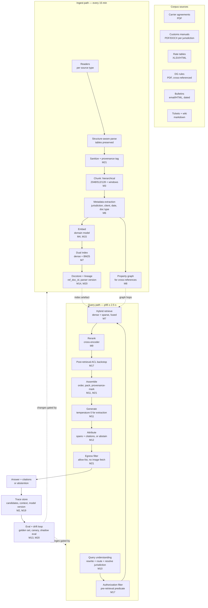

# M22 · Architecture Review and the Senior Engineer's Playbook

> **Module question:** What does a senior RAG engineer actually decide, and how do they defend it?
> **Cross-cutting threads:** Failure modes · Tradeoff ledger · LlamaIndex at a glance
> **Domain spine:** LogiTrack — the production-readiness review: the capstone oral, with three adversarial challenges
> **Prerequisites:** the whole course. Nothing in M1–M21 is optional here; this module reads them back as one decision record.

---

## Opening scene — the review nobody passes on the first try

The LogiTrack pilot has been in production for eleven months. The corpus is at 214,000 documents and
climbing toward the 480,000 projection. P95 is 2.1 s, monthly spend is $5,800, the golden set has
grown from 60 queries to 1,200, and the last C1 incident was seven months ago. By every measure the
reviewer's slide template has a row for, the system is ready for the wider rollout.

The review takes ninety minutes, and the first eighty are uneventful — until the reviewer stops
walking the scorecard and asks three questions in a row.

> *"Your chunking decision was made in week one with `chunk_size=1024`. Why is it 1024?"*

The engineering lead answers honestly: it was copied from a documentation example and never
revisited. That is a correct answer to the question that was asked. It is not an answer to the
question that was being asked, which is: *do you know what your system's decisions are, and which of
them are load-bearing?*

> *"Your recall is 0.91. Which stratum is 0.63, and what is it costing you?"*

There is a stratum at 0.63 — numeric extraction from tariff tables. The team knows it exists. Nobody
has priced it, so nobody can say whether the compliance exposure it represents is larger than the
cost of fixing it. The scorecard's aggregate number was doing the work that a per-stratum number
should have been doing.

> *"An attacker plants a document in your corpus tomorrow. What happens, and how would you know?"*

This one gets a five-minute answer that is mostly a list of defences, and the reviewer lets it run
before asking the follow-up that ends the meeting early: *"and what is your current attack success
rate for cross-tenant disclosure, measured, with the number?"* The number does not exist. Neither
does the red-team suite that would produce it.

None of these answers indicates an incompetent team. All three indicate the same structural gap, and
it is the gap this module closes: **the decisions were made, but they were not recorded as decisions,
so they cannot be examined, priced, or reversed.** A system built from unrecorded choices is a system
whose behaviour is defensible only by the person who built it, which is the definition of a system
nobody can inherit.

> **Failure mode (the module in one line):** arriving at production readiness with a working system
> and no decision record — so the review can score the system's *outputs* but cannot examine its
> *choices*, every challenge is answered with a number instead of a rationale, and the architecture
> belongs to one engineer rather than to the organisation.

---

## The ledger, read back

The tradeoff ledger has been accumulating since M1. Every entry has the same shape —
*Decision. Costs X. Accepted because Y. Reverses if Z.* — and the reversal condition is what makes
the collection a design record rather than a set of preferences. Read back by layer, the entries are
the architecture.

| Layer | Decision | Entry | Cost accepted | Reverses if |
|---|---|---|---|---|
| **Evaluation** | Freeze a stratified 60-query set with labelled answer spans before building | M1-1 | Two engineer-days of domain-expert time; a set that will need revision | The query distribution turns out to be dominated by one stratum |
| **Attribution** | Treat citation and abstention as first-class outputs | M1-2 | Extra tokens, provenance on every node, a visible refusal rate | Queries turn out to be casual and low-stakes |
| **Operating envelope** | Pin cost and latency as SLOs from day one; quality absorbs variance | M1-3 | Some architectures excluded on paper; per-stage token accounting from the first version | A query class appears whose value per query is an order of magnitude above average |
| **Pipeline shape** | Pin stage boundaries to the framework's abstraction boundaries | M2-1 | Framework seams constrain where a stage can be replaced | A stage genuinely does not fit any seam |
| **Observability** | Retain the full per-query trace: candidate set, order, context, prompt, model version, tokens | M2-2 | Storage, a privacy surface, and a retention policy | Residency or retention rules forbid storing context |
| **Retrieval unit** | Optimize chunk size for retrieval precision; recover completeness downstream | M3-1 | An expansion stage, in latency or index memory | The dominant query class is whole-document summarization |
| **Overlap** | `chunk_overlap` at 10–20% of chunk size | M3-2 | 11–25% more embedded tokens; near-duplicates competing for top-k | Dedup is in place and measured to recover the slots |
| **Unit decoupling** | Separate the embedding unit, the retrieval unit, and the generation unit | M3-3 | A long-context encoder at ingest, or per-node expansion metadata | Queries are already document-scoped |
| **Failure budget** | Zero budget for compliance-affecting failures; every other class absorbs variance | M20-1 | Velocity; a stop-the-line response per event | Answers stop being acted on directly and become advisory |
| **Model drift** | Nightly shadow evaluation of a fixed canary set, alerting on divergence | M20-2 | A fixed nightly token spend; alert-fatigue risk | The provider offers immutable versioned identifiers |
| **Release process** | Both an offline stratified gate and an online canary, with no bypass | M20-3 | ~A day per change; no same-afternoon fix for a C1 incident | A change is provably confined to one stratum with a large enough golden subset |
| **Ingest security** | Sanitize and provenance-tag at ingest; treat instruction-like content as an anomaly | M21-1 | A per-document stage, a false-positive rate, a detector to maintain | The corpus can be restricted to authenticated, human-reviewed sources |
| **Output security** | No network reach from rendered output; images proxied, links click-gated | M21-2 | Real usability loss on legitimate rich answers | The answer surface is not a renderer at all |

Two properties of this table are the point of the module.

**Every row has a reversal condition, and the reversal conditions are mostly measurements.** "The
dominant query class is X", "dedup is measured to recover the slots", "recall on the stratum is
below Y". A ledger whose entries reverse on *opinion* is a ledger of preferences. The discipline of
writing the reversal condition at decision time is what allows the review's first challenge — *why is
it 1024?* — to have an answer that is not a confession: either the number is in the ledger with its
reason, or the number is not a decision and should be replaced by one.

**The layers are ordered by cost of reversal, and that ordering is the architecture's true shape.**
Retrieval-unit and representation decisions (M3–M4) invalidate every embedding and every cached node;
they are the most expensive to change. Ranking, assembly and generation decisions (M9–M12) are
configuration. Ingest and tenancy decisions (M14, M17) are expensive in a different currency —
operational risk. An architecture review should therefore spend its first hour on the top of that
list, which is the opposite of how design reviews usually run: they spend their time on the parts
that are cheap to change because those are the parts that are interesting to argue about.

> **Tradeoff (the ledger entry M22-1).** *Decision:* maintain the ledger as a living artefact, with
> every architecture-affecting change appending or amending an entry rather than being described in a
> pull request. *Costs:* a documentation obligation on every change, and a record that makes
> reversals explicit and therefore arguable. *Accepted because:* the alternative is an architecture
> whose rationale lives in one engineer's memory, which is unreviewable, un-inheritable, and
> unmaintainable the moment that engineer changes teams. *Reverses if:* the system is genuinely
> throwaway — a two-week evaluation prototype with no production intent — in which case the ledger is
> overhead and the M1 evaluation set is all that should survive.

---

## The reference architecture

Assembled from the course's decisions, LogiTrack's production system looks like this. Every box is a
decision, and every decision has an entry or a module that owns it.

| Layer | LogiTrack's choice | Owned by | What it costs | What breaks without it |
|---|---|---|---|---|
| Retrieval unit | Hierarchical 2048/512/128 with sentence windows for clause-precision strata | M3 | ~6× node count; expansion metadata | F3 on every clause question; the M3 opening scene |
| Representation | A domain-adapted embedding model, with BM25 retained for identifiers | M4, M7, M15 | Re-embed cost on change; a second index | F4 on UN numbers, clause IDs, part numbers |
| Index structures | Flat vector + sparse + a property graph for cross-document DG references | M7, M8 | Three stores to operate; graph extraction cost at ingest | The multi-hop stratum, which scores zero on a flat index |
| Ranking | Cross-encoder rerank, 40 candidates → 6 | M9 | The largest non-generation latency line | F2 on near-duplicates; F5 at assembly |
| Query understanding | Rewrite + route; text-to-SQL path for numeric table questions | M10, M3 | One extra model call; a second query path | The numeric stratum, which is a parsing/routing problem masquerading as retrieval |
| Assembly | Ordered, packed, provenance-marked, under a token budget | M11, M21 | A token-count argument with the provider's tokenizer | F5; and F9, since assembly is a security boundary |
| Generation | A mid-tier model, temperature 0 for extraction, ~0.3 for synthesis | M11 | Re-tuning per model migration | F6 variance; unreproducible extraction |
| Attribution | Span-level citations; abstention as a valid outcome | M12 | Extra tokens; a refusal rate stakeholders read as failure | F6 goes undetected; the M2 "verifiable and wrong" outcome |
| Tenancy | Shared index with ACLs on every node, pre-filter plus a post-retrieval backstop | M17 | Metadata on every node; per-query filter evaluation | F10 — a breach, not a bad answer |
| Ingest | Incremental with docstore supersession, parser versioning, and a delete test in CI | M14, M20 | Ingest orchestration; delete-path testing | F7, silently, for as long as nobody asks the affected question |
| Cost and latency | Per-stage budget summing to 7.06¢ and 2.5 s, instrumented per stage | M18 | Continuous attention as stages change | F8, which is a tax on every other mitigation |
| Operations | Four incident classes, a triage tree, and a four-gate improvement loop | M20 | Process that must be maintained | Every quality drop becomes a three-hour archaeology project |
| Security | Sanitization, provenance marking, capability isolation, egress control, a measured ASR suite | M21 | Ingest compute, usability, and a suite to keep current | F9 — and an attacker who writes your answers |

---

## Build versus buy

Every box in the diagram is a build-or-buy decision, and the criteria that actually decide it are
narrower than they look. The one that matters most in RAG is not price or features: it is **whether
the thing you are buying is on your critical path for quality attribution.** A component you cannot
observe and re-rank cannot be debugged, and the M2 ledger entry on traces is what makes that concrete.

| Component | Choice | The criterion that decided it | What changes the answer |
|---|---|---|---|
| Parse structure from PDFs | **Buy** (a commercial parser) or build on an open pipeline | Table and clause structure fidelity is the single largest input to F3 | A source format change, or a parser whose failure mode you cannot inspect |
| Chunk, embed, index, retrieve | **Build** on the framework | Stage boundaries must be observable and swappable (M2-1, M2-2) | Nothing; this is the critical path |
| Embedding model | **Buy**, with the option to fine-tune (M15) | Model quality is not a differentiator; the domain gap is | A measured recall gap on a stratum that fine-tuning closes cheaper than re-chunking |
| Vector store / ANN engine | **Buy** (managed) or self-host | Operational cost, filter expressiveness, tenant isolation — not benchmark QPS | A licensing change, a residency requirement, or a filter that cannot be pushed down |
| Reranker | **Buy** or serve a cross-encoder yourself | Latency per query against the F8 budget | A cheap enough in-house cross-encoder, or a reranking tier inside the store |
| Query understanding | **Build** (prompted) | It is the seam between the corpus's vocabulary and the user's; it needs your domain | A plateau on F1/F4 after rewriting, routing, hybrid and rerank are all measured |
| Graph extraction | **Build** on the framework, or buy | Ingest cost versus the multi-hop stratum's share of query volume | The multi-hop share turning out to be negligible |
| Sanitization / injection detection | **Build** | No framework component exists for it (M21), and it must be tuned to your corpus | Nothing; a vendor cannot know your corpus's legitimate instruction-like text |
| Egress control | **Build** (application layer) | It lives where output is rendered, not in the retrieval stack (M21) | The output surface changing to a trusted consumer with no renderer |
| Observability | **Buy**, with a self-hosted escape hatch | Trace fidelity per stage is a hard requirement (M2-2); vendor lock-in is a risk | Retention or residency rules (M17) |
| Golden set and eval harness | **Build**, always | It is the instrument every other decision is measured with (M1-1) | Nothing. Outsourcing the instrument outsources the ability to disagree with a vendor |
| Model providers | **Buy**, routed through a proxy | Model swap must be a config change, never a code change | A model becoming load-bearing for a quality claim that a competitor cannot reproduce |

Two boundaries deserve their own line because teams get them wrong in the same direction.

**The evaluation instrument is never bought.** A vendor's eval suite measures the vendor's product
against the vendor's rubric. It cannot tell you that your numeric stratum is at 0.63, because it does
not know that stratum exists. Buying an eval platform is fine; buying your *golden set* — the thing
that defines correctness for your domain — is not.

**Sanitization and egress control are never bought as components, because they are policy.** A
sanitizer is a transformation whose false-positive rate must be calibrated against your corpus's
legitimate text (M21's worked example drops rate-table rows containing the phrase "ignore previous
rate"). A vendor's classifier is a starting point for a detector, not a substitute for the
calibration.

Protocol boundaries complicate the picture in a useful way: where a capability is consumed as a tool
or a resource over MCP, the framework can serve or consume it [LI-MCP], which means the *integration*
is cheap and the *capability review* becomes the work. The confused-deputy class of failure lives
exactly there, and the specification's own answer is prescriptive at the `MUST` level: an MCP server
"**MUST NOT** accept any tokens that were not explicitly issued for the MCP server" and servers that
implement authorization "**MUST NOT** use sessions for authentication" [MCP-SEC]. Buying the
integration does not buy the authorization model; that remains a decision you make and record.

---

## The capacity and cost model

The readiness review's arithmetic, in the form a plan has to take: from pilot to the 12-month
target, with headroom stated rather than assumed.

| Dimension | Pilot (60 queries, 3k docs) | Production (1,200 queries, 214k docs) | 12-month target (480k docs) | Constraint | Headroom |
|---|---|---|---|---|---|
| Corpus words | 13.5M | ~1.0B | ~2.2B | — | — |
| Nodes in the dense index | 41k | 2.9M | 6.6M | Index memory | 160× over the pilot; the memory tier changes somewhere around 2M nodes |
| Ingest volume/month | 3k docs | 12k docs | 22k docs | ≤ 15-min freshness | Sustained ingest must exceed the peak arrival rate by 2× |
| Full re-embed on a model change | 23.4M tokens | 1.7B tokens | 3.7B tokens | One-off project budget | A two-order-of-magnitude step; needs financing or a rolling migration (→ M14) |
| Queries/day | 40 | 6,200 | 8,500 | P95 ≤ 2.5 s | p95 at 2.1 s → ~0.4 s of headroom |
| Cost/query | 1.4¢ | 2.3¢ | 2.9¢ (projected) | ≤ 7.06¢, the ceiling *at target volume* | 2.4× at target volume, against a projection that assumes the M18 work lands |
| Monthly spend | ~$1.5k (one-off ingest) | ~$5.8k | ~$8.4k (projected) | $18k ceiling | Comfortable both ways; ingest dominates at pilot, query traffic dominates by production |
| Known-item recall@10 | 0.41 | 0.91 | — | ≥ 0.85 | Met in aggregate; **0.63 on the numeric stratum** |
| Freshness lag | 24 h | 11 min | — | ≤ 15 min | Met, with 4 minutes of slack |
| Red-team ASR (measured) | — | not measured | — | Must be measured | **Absent.** The review's blocker |

Three findings from this table are the kind a readiness review exists to surface, and all three are
invisible in a headline scorecard.

1. **Cost is not the binding constraint. Latency is — and the review template treats them as equals.**
   At 2.9¢/query projected against a 7.06¢ line, the system has 2.4× cost headroom; against a 2.5 s
   P95 it has 0.4 s, which is less than the reranker it already runs. M1-3 pinned both SLOs together
   and the instinct since has been to defend them symmetrically, but every capability the roadmap
   wants to add — a second retrieval hop, a query-rewrite call, a graph traversal, a self-check on
   faithfulness — is a latency decision first and a cost decision second. **The readiness review
   should present a latency headroom model rather than a cost one**, because the latency model is
   what determines what can still be added. → M18.
2. **The aggregate recall number is doing unearned work.** 0.91 against a 0.85 target passes. The
   per-stratum number — 0.63 on numeric extraction — is a compliance exposure, since numeric
   extraction from tariff tables is exactly where a wrong answer becomes a wrong customs ruling. An
   aggregate SLO with a per-stratum failure underneath it is the M1 lesson repeating at scale.
3. **A model migration at target scale is a project, not a config change.** The billed re-embed
   volume moves from tens of millions of tokens at pilot to billions at target — a step of two orders
   of magnitude — and the dollar figure is set by whatever rate you have negotiated, which is why
   this row is expressed in tokens rather than in currency. This is why M14's rolling-migration design
   is an early decision rather than a scaling contingency: at 480k documents, "we'll just re-embed"
   is not available.

> **Tradeoff (the ledger entry M22-2).** *Decision:* set the readiness gate on per-stratum recall and
> measured attack success rate rather than on aggregate recall. *Costs:* a gate that fails more often
> than the aggregate one, and a rollout that can be blocked by a stratum representing 3% of query
> volume. *Accepted because:* the strata that fail are not randomly distributed — they are
> systematically the compliance-critical ones, and an aggregate gate is structurally blind to exactly
> the failures that cost the most. *Reverses if:* a stratum's failures are demonstrably recoverable
> downstream (a human review step that catches all of them), in which case its recall target can be
> relaxed in exchange for the review step's cost.

---

## The team and capability model

RAG systems are built by teams, and the capability map is part of the architecture review because
each missing capability corresponds to a class of failure that nothing else catches.

| Capability | Who owns it | What breaks without it | Where it is built |
|---|---|---|---|
| Retrieval and IR engineering | Retrieval engineer | F1, F2, F3, F4 treated as prompt problems | M3–M10 |
| Evaluation design | Eval owner (often shared) | Every decision becomes an opinion; no reversal condition can be evaluated | M13 |
| Data engineering and ingest | Platform/data engineer | F7 silently; stale and duplicated documents in the index | M14 |
| Operations and on-call | SRE-minded engineer | Quality drops are discovered by users, not dashboards | M19, M20 |
| Security review | Security engineer | F9 and F10: no threat model, no measured ASR, no capability inventory | M21 |
| Domain expertise | Broker, customs specialist | The golden set encodes the wrong answers; strata are mis-specified; the "correct" answer is plausible and wrong | M1, M13 |
| Product and stakeholder management | Product owner | Cost and latency SLOs are renegotiated after they are breached rather than before | M18, M20 |

The two rows that are most often missing, and are the hardest to replace later, are **domain
expertise in the evaluation loop** and **security review with a capability inventory**. A team
without the first will build an evaluation set that agrees with the system; a team without the second
will discover its F9 exposure from someone outside the company. Neither can be back-filled by hiring
a specialist at the end, because both change decisions that were made in the first month — the same
month in which M1's stratification and M2's instrumentation decisions were made.

---

## The senior RAG engineer's artefact set

The interview-shaped artefacts this course has been producing all along, and the question each one
exists to answer under challenge:

| Artefact | Question it answers | Module | The challenge it must survive |
|---|---|---|---|
| **Architecture decision records** | What did we decide, what did it cost, and what would reverse it? | M1, M3, M5, M6, M18, M21 | *"Why this number?"* — answerable only if the number is in the ledger |
| **Pipeline schema with failure annotations** | Which stage injects which failure, and who owns it? | M2 | *"Retrieval quality dropped — where do you look first?"* |
| **Evaluation plan** | What does "correct" mean, on which strata, measured how? | M13 | *"Show me the stratum your aggregate number is hiding"* |
| **Capacity model** | Does it work at 10× with the same architecture? | M18, M22 | *"What breaks first, and what does fixing it cost?"* |
| **Cost model** | What does a query cost, per stage, and what is the ceiling? | M18 | *"Halve the budget. What do you cut?"* |
| **Incident review** | What failed, in which stage, and what structural change prevents the class? | M20 | *"Which of your three causes was a consequence rather than a cause?"* |
| **Threat model + measured ASR** | Who can write to the corpus, what can an injection reach, and how do you know? | M21 | *"Give me the number, and the suite that produced it"* |
| **Reference architecture + ledger read-back** | What is the whole system, and which decisions compose it? | M22 | *"Two of your decisions contradict each other. Which one is wrong?"* |

### How to argue them under challenge

Three challenges recur in every review of this kind, and each has an answer shape. Memorising the
shapes is less useful than noticing what they have in common: **every strong answer names a
measurement, a cost, and a reversal condition, and every weak answer names a benefit.**

| Challenge | Weak answer | Strong answer shape |
|---|---|---|
| *"Why not just use a bigger model / a longer context?"* | "Bigger models are expensive" | Name the constraint (7.06¢/query, 2.5 s P95), the measured evidence ([LONGCONTEXT23] on cost, [INPUTLEN24] on degradation), and the condition under which you would switch — a document-scoped query class that fits the window at your cost ceiling |
| *"Your recall is 91%. Why is anything failing?"* | "No system is perfect" | Disaggregate: name the stratum, its rate, its share of volume, and its business cost. Then state either the remediation's cost or the accepted risk with a compensating control |
| *"What happens if an attacker writes to your corpus?"* | A list of defences | Give the measured per-outcome attack success rate, the capability inventory an injection can reach, the residual risk class, and what would notice a successful attack. If the number does not exist, say so and name the suite that will produce it |
| *"This works at 3,000 documents. Does it work at 480,000?"* | "We'll scale it" | Point at the capacity table: which dimension breaks first, at what value, and what the fix costs. Name the one dimension whose fix is a project rather than a configuration change |
| *"What would you do differently?"* | "Nothing, it went well" | A specific list with the decision IDs. An engineer who cannot name three decisions they would reverse has not been paying attention to their own ledger |

---

## What I would do differently

An honest retrospective is an expected artefact, not a confession, and it is only useful if it names
decisions rather than regrets.

1. **Write the failure taxonomy (M2) in week one, not month three.** It cost nothing to write and
   would have prevented roughly six weeks of unattributable debugging in the first quarter, because
   it makes "retrieval is bad" an illegal sentence.
2. **Instrument for per-stage scoring before optimizing anything.** M2-2 (retain the full trace) was
   adopted late, and the consequence is that the first four months of the system's history cannot be
   re-scored. Metrics computed against artefacts you did not retain are gone.
3. **Set the chunking decision as a decision.** M3's entry exists, but it was written *after* the
   config was copied from a documentation example. The failure was not the number; it was that the
   number was never a decision, and therefore never had a reversal condition.
4. **Build the red-team suite at the same time as the ingest pipeline.** The suite is cheap, its
   findings are structural, and building it after the tool set has grown means discovering the
   capability surface (M21) at the worst possible moment — while it is already in production.
5. **Price the ingest path before the query path.** The M3 overlap arithmetic and M14's re-embed
   budget were computed as projects, retrospectively. They are ingest-path decisions with
   query-path consequences, and at 480k documents a model migration is a seven-figure event that
   should have been visible from the first month.

Note what all five have in common: none is a modelling error and none is a technology choice. Every
one is a decision made without its reversal condition, which is the failure mode this module's
opening scene depicts. **The technology in this course was rarely the hard part.**

---

## Deliberately out of scope

Extension points, named so that they are absent by decision rather than by omission. Each carries the
condition that would bring it in.

| Extension | Why it is out | The condition that brings it in |
|---|---|---|
| **Multi-modal retrieval** (image, audio, video embeddings) | Not needed for a text corpus; the framework's multi-modal support is documented as beta for images in documents [LI-RAG] | A source whose meaning is not in its text — scanned rate tables that resist OCR, inspection photos, recorded broker calls |
| **Fine-tuned generators** | The cost/quality frontier is reached more cheaply by retrieval, ranking and assembly changes; M15 covers the *retriever* fine-tune, which is the retrieval lever | A measured, reproducible quality gap that survives better retrieval, better ranking and a better prompt, and that a generator fine-tune closes |
| **Online learning / continuous adaptation** | Requires a labelled feedback stream the system does not have; the drift taxonomy's proxies (M19, M20) are dissatisfaction signals, not labels | A reliable ground-truth feedback channel — a human review queue that is actually worked, producing labels at a rate that supports adaptation |
| **Agentic orchestration beyond retrieval** (multi-agent, long-horizon planning) | Every agent capability is a capability an injection can reach (M21), and the cost ceiling (F8) does not admit unbounded loops | A query class that provably cannot be served by a bounded pipeline, with the capability-surface review completed first |
| **Building a vector database engine** | The algorithms are analysed in M5; implementing one is a different specialism and is not on the critical path | An ANN requirement no existing engine satisfies — in practice, a filter-expressiveness or quantization constraint, not raw QPS |
| **Model training from scratch** | Out of scope for a retrieval course by definition | Never, within the boundaries of this course |

---

## Worked example: the production-readiness scorecard

The review's final artefact, in the form the capstone oral is scored against. Every row names an
evidence artefact, not a claim.

| Dimension | Gate | Evidence | Status | Residual risk |
|---|---|---|---|---|
| Retrieval quality | recall@10 ≥ 0.85 aggregate, ≥ 0.80 per stratum | 1,200-query golden set, per stratum | **Conditional** — aggregate 0.91; numeric stratum 0.63 | Compliance exposure on numeric extraction; remediation scheduled (text-to-SQL route, M10) |
| Answer quality | Faithfulness ≥ 0.95 sampled; citation precision ≥ 0.90 | Sampled production scoring with a reference-free evaluator [RAGAS23] plus 40 hand-checked answers per month | Pass | Judge bias (→ M13); mitigated by the hand-checked sample |
| Latency | P95 ≤ 2.5 s end to end | Per-stage waterfall [LI-RAG] instrumentation | Pass — 2.1 s | 0.4 s headroom; the reranker consumes 0.6 s and is the first cut under pressure |
| Cost | ≤ $18k/month at 8,500 queries/day | Per-stage unit economics | **Pass** — ~$5.8k/month at 6,200 queries/day, with the 2.9¢/query projection at target volume sitting 2.4× inside the 7.06¢ line | The projection assumes the M18 caching, batching and right-sizing work lands. Cost is not what limits the roadmap; latency is |
| Freshness | ≤ 15 min lag, p99 | Ingest logs; age distribution of retrieved nodes | Pass — 11 min p50, 14 min p99 | A source outside the watch list would not appear in this metric; the node-age audit is the compensating control |
| Diagnosability | Every stage traced with retained artefacts | Trace store; the four planned-failure injection test | Pass | Retention cost grows linearly with volume |
| Failure budget | C1 = 0; C2 ≤ 1/quarter | Incident log | Pass — one C1 in eleven months, root-caused and structurally fixed | — |
| Drift detection | Canary set run nightly; alert on divergence | Shadow-eval history | Pass | Alert threshold set by taste, not derivation; flagged as a known weakness |
| Security | Measured per-outcome ASR; zero for cross-tenant disclosure | Red-team suite in CI | **Fail** — no suite, no measurement | **The review's blocker.** F9 and F10 are unmeasured, and an unmeasured control is not a control |
| Tenancy | Red-team leakage test green in CI | CI report; post-filter audit log | Pass | Privilege drift (M20) is monitored but the sync SLO is informal |
| Operability | Triage tree usable at 03:00 by an engineer who did not build the system | A drill with a rotated on-call engineer | Pass after one remediation | The drill found two branches that required the original author |
| Decision record | Every load-bearing decision has an entry with a reversal condition | The ledger | **Conditional** — 13 entries; the ingestion and tenancy layers have decisions that were never written down | The M22-1 obligation is adopted from this review forward, not retroactively |

The scorecard's four conditional or failing rows are the point of the exercise, and their distribution
is instructive: **none of the failures is a quality failure.** Retrieval, faithfulness, latency,
freshness and incident discipline all pass. What fails is the ability to *state* things — a stratum
that was never priced, a security posture that was never measured, a set of decisions that was never
recorded. A readiness review's failures are almost always of this kind, which is why the artefacts in
the previous section matter more than any single metric: they are what converts a working system into
a defensible one.

> **LlamaIndex at a glance:** the reference architecture is assembled from primitives already named
> across the course, and this module's contribution is the *assembly*, not a new component: an
> `IngestionPipeline` with an ACL-asserting transformation (→ M14, M17); one or more `Index` objects
> with `VectorStoreIndex` as the dense default and `PropertyGraphIndex` reserved for the cross-reference
> question class (→ M8); `Retriever` + `BaseNodePostprocessor` as the two places retrieval is shaped
> (→ M9, M10); the authorization backstop as a non-optional postprocessor in a single query-engine
> factory (→ M17); and a `ResponseSynthesizer` whose mode is chosen per question class rather than
> globally (→ M11). The framework's "swappable storage components" [LI-RAG] are what make the
> build-vs-buy boundary in this module a `StorageContext` decision instead of a rewrite.

---

## Design exercise

> *Paper-based, then verbal. The capstone oral, rehearsed in writing.*

**Task.** Defend LogiTrack's capstone architecture against the instructor's three-challenge bank.
Write the answers before you say them, because the written answer is where a missing measurement
becomes visible.

1. **Challenge A — economics.** *"Your architecture is defensible at $18k/month. The CFO halves it
   to $9k with the same latency SLO and the same recall target. What do you cut, in order, and what
   do you refuse to cut?"* Your answer must be a priced sequence, not a list: name each cut, the
   dollars and milliseconds it recovers, and the quality class it degrades (by failure ID). Then name
   the one thing you refuse to cut and the SLO you would renegotiate rather than degrade it —
   candidate-set width, reranking, and citation enforcement are the three arguments to have ready.
2. **Challenge B — a failure under load.** *"At 4× query volume, p99 latency goes to 6 seconds and
   the error rate rises. Walk me through your first thirty minutes."* Your answer must be a triage
   walk, not a list of mitigations: which dashboard, which stratum or traffic slice, which of the
   four gates rolled something back, and which failure ID you would bet on before seeing the traces —
   and what evidence would change that bet. If your answer contains "I'd restart the service", the
   answer is wrong and you should say why.
3. **Challenge C — the threat model.** *"An attacker's goal is a specific wrong answer to a
   compliance question, and they have a valid partner email account. What stops them, what does not,
   and how would you know it happened?"* Your answer must include the write path they would use, the
   capability the injection would reach, the defence that holds *without the model's cooperation*,
   the residual risk class, and the detection that would fire. If your current ASR for that outcome
   is unmeasured, say so, name the suite that will measure it, and state the date.
4. **Then write the reversal log for the whole capstone.** One page: every decision you would reverse
   if you started today, with the entry ID and the specific evidence that changed your mind. This is
   the "what I would do differently" artefact from the previous section, applied to your own system,
   and it is the fastest way to find the decisions you made without noticing.

**Why this exercise matters.** The capstone oral is the artefact a senior engineer is actually hired
on, and it tests something the other twenty-one modules cannot test on their own: whether the
decisions have become *yours*. A candidate who can describe a RAG pipeline is common. A candidate who
can be handed a halved budget, a latency regression and a threat model in the same hour, and answer
each with a priced sequence, a triage path and a measured number, is the one who gets the
architecture review in the first place. Note that item 4 is the same move this module's opening scene
punished: a reviewer asking *why 1024?* is asking for the reversal log. Write it before someone else
does.

---

## Where the literature disagrees

- **Is there a settled reference architecture at all?** This module presents one, and the literature
  does not converge on it. The modular-RAG taxonomy proposes composing RAG systems from reconfigurable
  modules, cited here by key as `[MODRAG24]` and surveyed in **M16**; graph-based approaches propose
  a structurally different pipeline built around community summarization for query-focused
  summarization, cited by key as `[GRAPHRAG24]`, also surveyed in **M16**. Both are genuinely
  different architectures, not variations of one, and neither is superseded. The comparison paper's
  own framing underscores how unsettled the *retrieval-versus-context* axis still is: "Results reveal
  that when resourced sufficiently, LC consistently outperforms RAG in terms of average performance.
  However, RAG's significantly lower cost remains a distinct advantage" [LONGCONTEXT23]. The
  diagnostic-evaluation literature is equally non-prescriptive about architecture, presenting metrics
  and "an in-depth analysis of their performance, revealing insightful patterns and trade-offs in the
  design choices of RAG architectures" [RAGCHECKER24] — patterns, not a prescription. **What to
  change:** present your reference architecture as *the record of your decisions under your
  constraints*, never as best practice. The defensible claim is "this is what we chose, here is what
  it costs, here is what would reverse it". The indefensible claim — and the one review panels
  punish — is "this is the standard architecture".
- **Does a bigger context window eventually dissolve the pipeline?** Still contested at the point
  M22 is written, and this course's position (retrieval is a decision, not a default) is a position
  rather than a finding. The pro-long-context evidence is quoted above from `[LONGCONTEXT23]`; the
  counterweight is that effective capacity is not technical capacity — "Our findings show a notable
  degradation in LLMs' reasoning performance at much shorter input lengths than their technical
  maximum" [INPUTLEN24]. **What to change:** keep the reversal condition explicit in the ledger.
  If a document-scoped query class emerges that fits the window at the cost ceiling, the honest
  architecture routes that class to long-context, exactly as `[LONGCONTEXT23]`'s Self-Route proposes
  — and the architecture review should describe the pipeline as what happens to the queries that do
  *not* fit.
- **Is the error-budget framing appropriate for a quality SLO?** The infrastructure formulation is
  a rate that can be measured directly — an error budget is "a rate at which the SLOs can be missed",
  tracked daily or weekly and compared against the SLO violation rate [SRE-SLO]. The scorecard above
  uses it for retrieval quality, faithfulness and security, where no such direct rate exists: the
  numerator comes from sampling, and for the security row it comes from a red-team suite whose
  coverage is unknown. **What to change:** present the budget as a decision-making instrument and
  keep at least one directly-measurable gate — freshness lag, p95 latency, cost per query — in every
  review, so that the readiness conversation cannot become entirely a conversation about sampled
  numbers.

---

## Sources

- [Introduction to RAG](https://developers.llamaindex.ai/python/framework/understanding/rag/) — `[LI-RAG]` · owns the five-stage vocabulary used in the readiness scorecard, and the note that the framework's multi-modal support for images in documents is beta, which is the boundary this module's out-of-scope table rests on.
- [Model Context Protocol (MCP)](https://developers.llamaindex.ai/python/framework/module_guides/mcp/) — `[LI-MCP]` · owns the framework's MCP client and server surface, i.e. the cheap-integration side of the build-versus-buy boundary.
- [Security Best Practices](https://modelcontextprotocol.io/docs/2025-11-25/tutorials/security/security_best_practices) — `[MCP-SEC]` · Model Context Protocol specification · owns the token-passthrough prohibition and the session-authentication rule quoted here as the reason a bought integration does not buy an authorization model.
- [Service Level Objectives](https://sre.google/sre-book/service-level-objectives/) — `[SRE-SLO]` · Site Reliability Engineering (O'Reilly), Chapter 4 · owns the error-budget definition that the failure budget and the readiness scorecard adapt.
- *Retrieval Augmented Generation or Long-Context LLMs? A Comprehensive Study and Hybrid Approach* — Zhuowan Li, Cheng Li, Mingyang Zhang, Qiaozhu Mei, Michael Bendersky · arXiv:2407.16833 (EMNLP 2024, industry track) · [arxiv.org/abs/2407.16833](https://arxiv.org/abs/2407.16833) — `[LONGCONTEXT23]` · owns the RAG-versus-long-context comparison, the cost concession, and the Self-Route routing method. Owned and surveyed in **M1**; cited here for the architecture disagreement. · entry mirrored for local self-containment; **M1** owns the survey.
- *Same Task, More Tokens: the Impact of Input Length on the Reasoning Performance of Large Language Models* — Mosh Levy, Alon Jacoby, Yoav Goldberg · arXiv:2402.14848 (ACL 2024) · [arxiv.org/abs/2402.14848](https://arxiv.org/abs/2402.14848) — `[INPUTLEN24]` · owns the input-length degradation result. Owned and surveyed in **M1**; cited here for the architecture disagreement. · entry mirrored for local self-containment; **M1** owns the survey.
- *RAGChecker: A Fine-grained Framework for Diagnosing Retrieval-Augmented Generation* — Dongyu Ru, Lin Qiu, Xiangkun Hu, Tianhang Zhang, Peng Shi, Shuaichen Chang, Cheng Jiayang, Cunxiang Wang, Shichao Sun, Huanyu Li, Zizhao Zhang, Binjie Wang, Jiarong Jiang, Tong He, Zhiguo Wang, Pengfei Liu, Yue Zhang, Zheng Zhang · arXiv:2408.08067 (2024) · [arxiv.org/abs/2408.08067](https://arxiv.org/abs/2408.08067) — `[RAGCHECKER24]` · owns fine-grained diagnostic metrics and the multi-system comparison quoted here as evidence that the literature reports trade-offs rather than prescribing an architecture.
- *Modular RAG: Transforming RAG Systems into LEGO-like Reconfigurable Frameworks* — Yunfan Gao, Yun Xiong, Meng Wang, Haofen Wang · arXiv:2407.21059 (2024) · [arxiv.org/abs/2407.21059](https://arxiv.org/abs/2407.21059) — `[MODRAG24]` · owns the modular RAG decomposition. Cited here by key at title level only; **M16** owns the survey. · entry mirrored for local self-containment; **M16** owns the survey.
- *From Local to Global: A Graph RAG Approach to Query-Focused Summarization* — Darren Edge, Ha Trinh, Newman Cheng, Joshua Bradley, Alex Chao, Apurva Mody, Steven Truitt, Dasha Metropolitansky, Robert Osazuwa Ness, Jonathan Larson · arXiv:2404.16130 (2024) · [arxiv.org/abs/2404.16130](https://arxiv.org/abs/2404.16130) — `[GRAPHRAG24]` · owns the graph-based architecture for query-focused summarization over a corpus. Cited here by key at title level only; **M16** owns the survey. · entry mirrored for local self-containment; **M16** owns the survey.
- *Ragas: Automated Evaluation of Retrieval Augmented Generation* — Shahul Es, Jithin James, Luis Espinosa-Anke, Steven Schockaert · arXiv:2309.15217 (2023) · [arxiv.org/abs/2309.15217](https://arxiv.org/abs/2309.15217) — `[RAGAS23]` · owns the reference-free evaluation family referenced in the scorecard's faithfulness row. Cited here by key only; **M13** owns the survey. · entry mirrored for local self-containment; **M13** owns the survey.

**Unsupported (synthetic, no located source):** LogiTrack, the readiness review and its three
challenges, the eleven-month production history, every number in the capacity model and the readiness
scorecard (214,000 documents, 0.63 stratum recall, 2.1 s p95, ~$5.8k/month, 11-minute freshness lag,
the 2.9¢/query projection), the thirteen entry IDs read back in the ledger table (M1-1 through M21-2),
the build-versus-buy dispositions, the team and capability map, and both new tradeoff-ledger entries. The claim that **a readiness review's failures are structural rather
than quality-related**, the ordering of the ledger layers by cost of reversal, and the five-item
"what I would do differently" list are arguments made in this module, not findings. The read-back
table cites only entries whose IDs are fixed by modules already written (M1, M2, M3, M20, M21); the
M4–M19 layers own their own entry IDs and are referenced by module rather than by a guessed
identifier. `[MODRAG24]` and `[GRAPHRAG24]` are verified against arXiv for title, full author list
and identifier, but their abstracts were not fetched for this module, so they are cited at title
level and no quotation from either appears in this file.

**Verification note:** 🟡 *pending* — Step 7 (memory-less logic review) and Step 8 (literature survey) not yet run on this module.

**Next module:** the course ends here, and the capstone begins — [the capstone brief](../../capstone/README.md)
carries the LogiTrack system from M1's original brief through to this module's production-readiness
review, and [the final assessment](../../assessments/final.md) covers M1–M22.
